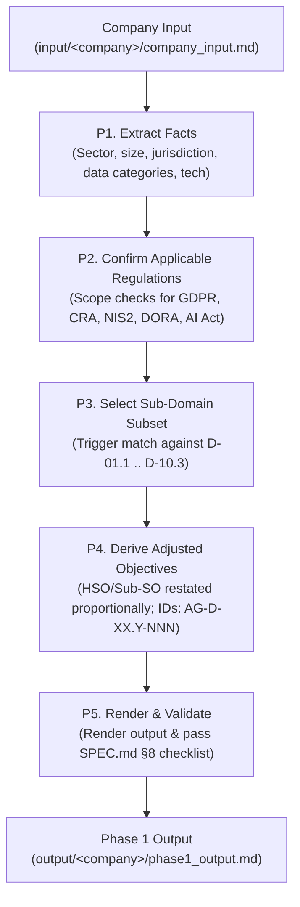

# AGENTS.md — AEGIS MVP Operational Guidelines for Agents

> **Scope:** Guidelines for AI agents (and human operators) executing tasks within the `aegis-mvp` repository.
> **Current Version:** 0.1.0 (Increment 0 — Minimum Phase 1 Pipeline)

---

## 1. Mission & Purpose

`aegis-mvp` is the minimal, self-contained implementation of **AEGIS Phase 1 — Contextual Definition**.
Its primary mission is to bootstrap a **new** company/project with the absolute minimum information possible, producing:
1. An assessment of **applicable regulations** (binary predicates).
2. A selection of the **applicable sub-domain subset** (from the 38 canonical sub-domains `D-01.1` to `D-10.3`).
3. **Adjusted Objectives** (`AG-D-XX.Y-NNN`) tailored proportionally to the company's profile, **without technology or vendor lock-in**.

All deep regulatory knowledge, article texts, and baseline control taxonomies are **inherited by reference** from the frozen AEGIS methodology baseline (`Methodology_compact`).

---

## 2. Directory Layout & Roles

```text
aegis-mvp/
├── AGENTS.md               # (This file) Operational contract and rules for agents
├── SPEC.md                 # Full pipeline specification, derivation rules (R1-R8), and checklist
├── README.md               # Quick-start documentation
├── config.yaml             # Corpus paths (by reference, read-only)
├── baseline/               # Phase 0 Baseline (frozen taxonomy, ambiguity registry, generic objectives)
│   ├── 00_Taxonomy_Reference.md
│   ├── 01_Ambiguity_Registry.md
│   └── 02_Regulatory_Mapping_and_Generic_Objectives.md
├── templates/              # Blank templates for execution
│   ├── company_input.md    # 5-section plain prose input template
│   └── phase1_output.md    # 6-section output template
├── input/                  # Target company inputs: input/<company>/company_input.md
├── output/                 # Target company outputs: output/<company>/phase1_output.md
├── cases/                  # Reference benchmark cases from the full methodology
│   └── Case_01_TinyTask_SaaS/
│       ├── 01_PHASE1_CONTEXT/  # Case deliverables (Doc01 to Doc06)
│       └── filtered_corpus/    # Case-specific deterministic corpus slice (NO summaries, verbatim in-scope only)
│           └── index.md        # Slice index of in-scope sub-domains and articles
├── scripts/
│   └── generate_case_corpus_slice.py # Deterministic filter utility (removes out-of-scope regs/articles)
└── example/                # Golden reference run (VetCare Connect, GDPR-only)
```

---

## 3. The 3 Natures of Information in Phase 1

| Nature | Content | Agent Obligation |
|---|---|---|
| **Inherited (Free)** | 38 Sub-domains `D-XX.Y`, verbatim articles (`articles/`), control referentials (`CONTROLS/`), ambiguity baseline (`AMBIGUITY_REGISTRY/`). | **Read-only by reference** via `config.yaml`. Never modify, copy, or re-derive interpretations already established. |
| **Company Input** | Profile, products/services, data handled, infrastructure, assumed regulations. | **Provided once** in `input/<company>/company_input.md` (5 sections, plain prose). Never fabricate facts (Rule R6). |
| **Generated Output** | Applicability rationale, sub-domain triggers, company-adjusted objectives (`AG-D-XX.Y-NNN`). | **Produced by the agent** into `output/<company>/phase1_output.md` following `SPEC.md`. |

---

## 4. Phase 1 Core Workflow (P1 to P5)

When instructed to evaluate or generate Phase 1 for a company, follow this sequential procedure:



### Detailed Steps:
1. **P1 — Extract Facts:** Read `company_input.md` (§1–§4). Build the fact sheet without making unstated inferences.
2. **P2 — Confirm Regulations:** Evaluate the 5 candidate regulations (`GDPR`, `CRA`, `NIS2`, `DORA`, `AI_Act`). State whether each applies or does not apply with a 1-line rationale.
3. **P3 — Select Sub-domain Subset:** Determine which of the 38 sub-domains are triggered by the applicable regulations and the company's operational profile (typical small company: 4–10 sub-domains).
4. **P4 — Derive Adjusted Objectives:**
   - For each active sub-domain, read the corpus High-level Security Objective (HSO) and applicable Sub-SOs.
   - Restate the objective to fit the company's scale and operational reality (**proportionality**).
   - Assign canonical IDs (`AG-D-XX.Y-NNN`).
   - Cite regulatory articles and control anchors (NIST CSF / OWASP) strictly from the baseline corpus.
   - Respect ambiguity cards from `AMBIGUITY_REGISTRY/` if applicable.
5. **P5 — Render and Validate:** Output into `output/<company>/phase1_output.md` and verify against the checklist in `SPEC.md` §8.

---

## 5. Non-Negotiable Agent Rules (from SPEC.md §7)

- **R1 — Canonical Sub-domain Axis:** Always use canonical IDs `D-XX.Y` (`D-01.1` to `D-10.3`). Never merge or invent sub-domains.
- **R2 — Anchor Integrity:**
  - Every regulatory citation must exist in the sub-domain's `articles/` directory or in its merged corpus file.
  - Every control anchor must exist in the `CONTROLS/` referential (e.g. NIST CSF 2.0).
  - **No invented anchors.** If an anchor cannot be verified, omit or re-derive the objective.
- **R3 — Proportionality:** Adjust wording to company size/maturity (e.g., an 8-person company gets managed-cloud encryption, not a dedicated PKI governance board).
- **R4 — Standardized IDs:** Always use `AG-D-XX.Y-NNN` (e.g., `AG-D-01.1-001`).
- **R5 — Strict Technology Neutrality in Phase 0 & Phase 1:** 
  - **Phase 0:** Has zero company context, zero tools, zero infrastructure. It contains only legal text, ambiguity analysis, canonical taxonomy, and generic regulatory objectives (HSO/Sub-SOs).
  - **Phase 1:** Specifies *what* must be achieved proportionately by the company without prescribing tools, software libraries, cloud vendors, or technical control implementations. Control implementation and vendor choices belong strictly to Phase 2.
- **R6 — No Fact Invention:** Every statement about the company must trace back to `company_input.md`. Any unavoidable assumption must be prefixed with `> ASSUMPTION:`.
- **R7 — Ambiguity Deference:** If an obligation references an ambiguity card in the registry, link to the card rather than inventing a novel legal interpretation.
- **R8 — Regulatory Scope Discipline:** Only derive obligations from regulations confirmed as *applies* in P2.
- **R9 — Case-Level Filtered Slice (Zero Summaries):**
  - When exploring sub-domains and baseline requirements for a case, agents should reference the case's `filtered_corpus/` (generated via [`scripts/generate_case_corpus_slice.py`](file:///c:/Users/paulo.ribeiro/OneDrive%20-%20Instituto%20CCG%20ZGDV/Ambiente%20de%20Trabalho/Projetos_PhD/aegis-mvp/scripts/generate_case_corpus_slice.py)) rather than the monolithic multi-regulation baseline.
  - The slice retains **only** in-scope regulation pairs, active Sub-SOs, and verbatim applicable article copies, eliminating out-of-scope noise completely with zero text summaries.
  - Baseline domain documents in `baseline/domains/` are standardized with universal semantic boundary tags (`<!-- aegis:pair:REG1,REG2 -->`, `<!-- aegis:subso:REG -->`, `<!-- aegis:req:REG... -->`, `<!-- aegis:ambiguity:REG -->`), guaranteeing deterministic, surgical parsing by any automated script.
- **R10 — Physical Inspection & Anti-Circular Testing:**
  - Automated tests and scratch scripts are necessary but **never sufficient on their own**. Agents must avoid circular validation traps (i.e. writing a test that merely confirms the assumptions of the code just written).
  - Whenever generating, filtering, or modifying documentation and baseline corpora, agents **must perform direct physical inspections** of the generated Markdown files (reading actual line ranges, verifying table columns/rows, validating section boundaries, checking markdown syntax rendering).
  - No task or implementation can be declared complete without physical evidence from the target files confirming that the output is visually and structurally sound.

---

## 6. Phase Boundary: Phase 1 vs Phase 2

| Feature | Phase 1 (This MVP) | Phase 2 (Downstream) |
|---|---|---|
| **Primary Goal** | Context, Regulatory Scope, Adjusted Objectives | Concrete Rules, Controls, Mitigations |
| **Output Unit** | `AG-D-XX.Y-NNN` (Adjusted Objective) | `R-D-XX.Y-NNN` (Rules Catalog), Controls mapping |
| **Level of Abstraction** | Technology-neutral (what requirements bind us) | Architecture & implementation specific (how we comply) |
| **Verification** | Regulatory and baseline control anchors | Verification tests, audit evidence, metrics |
