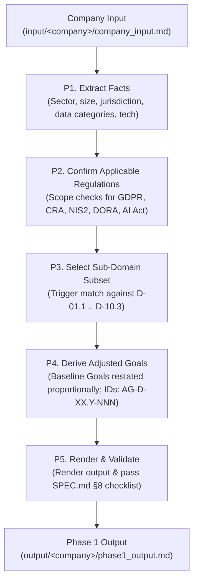

# AGENTS.md — AEGIS MVP Operational Guidelines for Agents

> **Scope:** Guidelines for AI agents (and human operators) executing tasks within the `aegis-mvp` repository.
> **Current Version:** 0.1.0 (Increment 0 — Minimum Phase 1 Pipeline)

---

## 1. Mission & Purpose

`aegis-mvp` is the minimal, self-contained implementation of **AEGIS Phase 1 — Contextual Definition**.
Its primary mission is to bootstrap a **new** company/project with the absolute minimum information possible, producing:
1. An assessment of **applicable regulations** (binary predicates).
2. A selection of the **applicable sub-domain subset** (from the 38 canonical sub-domains `D-01.1` to `D-10.3`).
3. **Adjusted Goals** (`AG-D-XX.Y-NNN`) tailored proportionally to the company's profile, **without technology or vendor lock-in**.

All deep regulatory knowledge, article texts, and baseline control taxonomies are **inherited by reference** from the frozen AEGIS methodology baseline (`Methodology_compact`).

---

## 2. Directory Layout & Roles

```text
aegis-mvp/
├── AGENTS.md               # (This file) Operational contract and rules for agents
├── SPEC.md                 # Full pipeline specification, derivation rules (R1-R8), and checklist
├── README.md               # Quick-start documentation
├── config.yaml             # Corpus paths (by reference, read-only)
├── baseline/               # Phase 0 Baseline (frozen taxonomy, ambiguity registry, generic objectives)
│   ├── 00_Taxonomy_Reference.md
│   ├── 01_Ambiguity_Registry.md
│   └── 02_Regulatory_Mapping_and_Generic_Objectives.md
├── baseline/               # Phase 0 Baseline (frozen taxonomy, ambiguity registry, generic objectives)
│   ├── 00_Taxonomy_Reference.md
│   ├── 01_Ambiguity_Registry.md
│   ├── 02_Regulatory_Mapping_and_Generic_Objectives.md
│   ├── CONTROLS/           # Control referentials
│   │                       #   Enforced: NIST_CSF_2.0/, NIST_PF/, NIST_AI_RMF/
│   │                       #   Advisory (not enforced by scripts/verify_no_loss.py):
│   │                       #     NIST_SP_800_53R5/, NIST_SSDF/, NIST_AI_SSDF/,
│   │                       #     OWASP_ASVS/, OWASP_SAMM/, ISO_27001_2022/,
│   │                       #     ISO_27701_2019/, ISO_42001_2023/, CIS_CONTROLS_V8/,
│   │                       #     BSI_GRUNDSCHUTZ/, ENISA/
│   ├── MAPPINGS/           # OVERLAYS + sr_control_mappings/<REG>.json (complete SR↔CSF/PF/AI-RMF
│   │                       #   store extracted from the frozen dashboards; traceability/ chain
│   │                       #   reg -> article -> objective -> requirement -> control; ledgers)
│   └── domains/            # MODULAR per-regulation corpus (38 sub-domains)
│       ├── index.md        # Corpus index (modular layout)
│       ├── _migration_report.md  # Modularization audit trail (line accounting)
│       └── D-XX_Name/      # Per domain:
│           ├── D-XX.manifest.json  # Per-regulation inverted index + modular_layout
│           ├── _index.md
│           └── D-XX.Y/     # Per sub-domain — fully modular:
│               ├── _index.md                # identity card + module map
│               ├── objective.md             # SO-D-XX.Y.HL (regulation-neutral common objective)
│               ├── regs/<REG>.md            # INDEPENDENT per-regulation module:
│               │                            #   participant row + Sub-SO + requirements
│               │                            #   + verbatim regulatory basis + demoted
│               │                            #   'Cross-references (informational)' section
│               ├── regs/<REG>.ambiguity.md  # Part 4 ambiguity analysis, per regulation
│               ├── cross/<R1>-<R2>.md       # canonical pair analysis (consult if BOTH regs apply)
│               ├── cross/_interactions.md   # matrices, tensions, aggregation logic
│               └── articles/                # verbatim article copies (per regulation)
├── templates/              # Blank templates for execution
│   ├── company_input.md    # 5-section plain prose input template
│   └── phase1_output.md    # 6-section output template
├── input/                  # Target company inputs: input/<company>/company_input.md
├── output/                 # Target company outputs: output/<company>/phase1_output.md
├── cases/                  # Reference benchmark cases from the full methodology
│   ├── Case_01_TinyTask_SaaS/
│   │   ├── 01_PHASE1_CONTEXT/  # Case deliverables (Doc01 intake + Doc02 adjusted goals)
│   │   └── filtered_corpus/    # Case-specific deterministic corpus slice (NO summaries, verbatim in-scope only)
│   │       └── index.md        # Slice index of in-scope sub-domains and articles
│   └── Case_02_SecureBorder_Solutions/
│       ├── 01_PHASE1_CONTEXT/  # Doc01 intake + Doc02 adjusted goals (GDPR+CRA+NIS2+AI_Act, 35 active)
│       ├── 02_PHASE2_RULES/    # Doc01 operational objectives + Doc02 secure design principles
│       ├── 03_PHASE3_SPEC/     # Doc01 requirements elicitation & PUC (E1.1) + Doc02 system use cases (E1.2)
│       └── filtered_corpus/    # Deterministic corpus slice (GDPR CRA NIS2 AI_Act) + index.md
├── scripts/
│   ├── modularize_domains.py          # Deterministic splitter: merged Parts 1-4 → modular per-regulation layout
│   └── generate_case_corpus_slice.py  # Deterministic composer: case slice from modular modules (no deletion filtering)
└── example/                # Golden reference run (VetCare Connect, GDPR-only)
```

---

## 3. The 3 Natures of Information in Phase 1

| Nature | Content | Agent Obligation |
|---|---|---|
| **Inherited (Free)** | 38 Sub-domains `D-XX.Y`, verbatim articles (`articles/`), control referentials under `CONTROLS/` — enforced by `scripts/verify_no_loss.py` are NIST CSF 2.0, NIST PF 1.1, NIST AI RMF; **advisory** (per-control JSONs available for citation, **not** enforced by `verify_no_loss.py`) are NIST SP 800-53 Rev 5, NIST SSDF (SP 800-218), NIST AI SSDF (SP 800-218A), OWASP ASVS, OWASP SAMM, ISO/IEC 27001:2022, ISO/IEC 27701:2019, ISO/IEC 42001:2023, CIS Critical Security Controls v8, BSI IT-Grundschutz, and ENISA — ambiguity baseline (`AMBIGUITY_REGISTRY/`), SR↔control mapping store (`MAPPINGS/sr_control_mappings/`) and full traceability chain (`MAPPINGS/traceability/`: regulation → article → clause → Baseline Goals (HSO/SO-REG/Sub-SO legacy) → requirement → controls), both dashboard-extracted and uniformized with the modules. | **Read-only by reference** via `config.yaml`. Never modify, copy, or re-derive interpretations already established. |
| **Company Input** | Profile, products/services, data handled, infrastructure, assumed regulations. | **Provided once** in `input/<company>/company_input.md` (5 sections, plain prose). Never fabricate facts (Rule R6). |
| **Generated Output** | Applicability rationale, sub-domain triggers, company-adjusted goals (`AG-D-XX.Y-NNN`). | **Produced by the agent** into `output/<company>/phase1_output.md` following `SPEC.md`. |

---

## 4. Phase 1 Core Workflow (P1 to P5)

When instructed to evaluate or generate Phase 1 for a company, follow this sequential procedure:



### Detailed Steps:
1. **P1 — Extract Facts:** Read `company_input.md` (§1–§4). Build the fact sheet without making unstated inferences.
2. **P2 — Confirm Regulations:** Evaluate the 5 candidate regulations (`GDPR`, `CRA`, `NIS2`, `DORA`, `AI_Act`). State whether each applies or does not apply with a 1-line rationale.
3. **P3 — Select Sub-domain Subset:** Determine which of the 38 sub-domains are triggered by the applicable regulations and the company's operational profile (typical small company: 4–10 sub-domains).
4. **P4 — Derive Adjusted Goals:**
   - For each active sub-domain, read `objective.md` (the regulation-neutral **Baseline Goal**; legacy "HSO" — ADR-004) and, **for each regulation confirmed in P2**, the independent module `regs/<REG>.md` (Sub-SO card + security requirements + verbatim regulatory basis). When ≥2 confirmed regulations apply, consult `cross/<R1>-<R2>.md` and `cross/_interactions.md` for aggregation.
   - Restate the objective as a company-proportional **goal** to fit the company's scale and operational reality (**proportionality**).
   - Assign canonical IDs (`AG-D-XX.Y-NNN`).
   - Cite regulatory articles and control anchors strictly from the baseline corpus: the module anchor surfaces (`regs/<REG>.md` Sub-SO anchor blocks + requirement YAML `nist_csf`/`nist_pf`/`nist_airmf`, the `**Control anchors:**` lines on the ambiguity cards) and the mapping store (`MAPPINGS/sr_control_mappings/<REG>.json`) are pre-verified — copy from them, never re-derive.
   - Respect ambiguity cards from `AMBIGUITY_REGISTRY/` if applicable.
5. **P5 — Render and Validate:** Output into `output/<company>/phase1_output.md` and verify against the checklist in `SPEC.md` §8.

---

## 5. Non-Negotiable Agent Rules (from SPEC.md §7)

- **R1 — Canonical Sub-domain Axis:** Always use canonical IDs `D-XX.Y` (`D-01.1` to `D-10.3`). Never merge or invent sub-domains.
- **R2 — Anchor Integrity:**
  - Every regulatory citation must exist in the sub-domain's `articles/` directory or be quotable verbatim from `regs/<REG>.md` ("Verbatim regulatory basis" section).
  - Every control anchor must exist in the `CONTROLS/` referential (NIST CSF 2.0, NIST PF 1.1 in `NIST_PF/`, NIST AI RMF in `NIST_AI_RMF/`). PF 1.1 anchors only accompany GDPR-derived obligations and AI RMF anchors only AI_Act-derived obligations (dashboard-published axes; rule R8).
  - **No invented anchors.** If an anchor cannot be verified, omit or re-derive the goal.
- **R2b (advisory referentials).** Additional control referentials are available under `CONTROLS/` for citation at the agent's discretion:
  NIST SP 800-53 Rev 5 (`NIST_SP_800_53R5/`), NIST SSDF v1.1 (`NIST_SSDF/`), NIST AI SSDF Profile (`NIST_AI_SSDF/`), OWASP ASVS (`OWASP_ASVS/`), OWASP SAMM (`OWASP_SAMM/`), ISO/IEC 27001:2022 Annex A (`ISO_27001_2022/`), ISO/IEC 27701:2019 Annex A (`ISO_27701_2019/`), ISO/IEC 42001:2023 Annex A (`ISO_42001_2023/`), CIS Critical Security Controls v8 (`CIS_CONTROLS_V8/`), BSI IT-Grundschutz (`BSI_GRUNDSCHUTZ/`), and ENISA advisory guidance (`ENISA/`). These referentials are **not enforced** by `scripts/verify_no_loss.py` and do not appear in `MAPPINGS/sr_control_mappings/<REG>.json`. When cited, the cited ID must exist as a JSON file in the corresponding `CONTROLS/<FW>/` subtree; agent discretion applies.
- **R3 — Proportionality:** Adjust wording to company size/maturity (e.g., an 8-person company gets managed-cloud encryption, not a dedicated PKI governance board).
- **R4 — Standardized IDs:** Always use `AG-D-XX.Y-NNN` (e.g., `AG-D-01.1-001`).
- **R5 — Strict Technology Neutrality in Phase 0 & Phase 1:** 
  - **Phase 0:** Has zero company context, zero tools, zero infrastructure. It contains only legal text, ambiguity analysis, canonical taxonomy, and generic regulatory **goals** (legacy names: HSO/Sub-SOs — ADR-004).
  - **Phase 1:** Specifies *what* must be achieved proportionately by the company without prescribing tools, software libraries, cloud vendors, or technical control implementations. Control implementation and vendor choices belong strictly to Phase 2.
- **R6 — No Fact Invention:** Every statement about the company must trace back to `company_input.md`. Any unavoidable assumption must be prefixed with `> ASSUMPTION:`.
- **R7 — Ambiguity Deference:** If an obligation references an ambiguity card in the registry, link to the card rather than inventing a novel legal interpretation.
- **R8 — Regulatory Scope Discipline:** Only derive obligations from regulations confirmed as *applies* in P2.
- **R9 — Case-Level Composed Slice (Zero Summaries):**
  - When exploring sub-domains and baseline requirements for a case, agents should reference the case's `filtered_corpus/` (generated via [`scripts/generate_case_corpus_slice.py`](file:///c:/Users/paulo.ribeiro/OneDrive%20-%20Instituto%20CCG%20ZGDV/Ambiente%20de%20Trabalho/Projetos_PhD/aegis-mvp/scripts/generate_case_corpus_slice.py)) rather than the full baseline.
  - The slice is **composed, not filtered**: for the active regulations it copies the already-independent per-regulation modules verbatim (`objective.md`, `regs/<REG>.md` + `regs/<REG>.ambiguity.md`, `cross/` pairs where BOTH regulations are active, in-scope `articles/`). Regulation purity holds by construction — zero text summaries, zero deletion filtering of mixed prose.
  - The baseline itself is modular: `baseline/domains/D-XX.Y/` separates the regulation-neutral objective, the independent `regs/<REG>.md` modules (with cross-regulation notes demarcated in trailing `Cross-references (informational)` sections), and the cross-regulation layer (`cross/`). The layout was produced deterministically by `scripts/modularize_domains.py`; audit trail in `baseline/domains/_migration_report.md`.
- **R10 — Physical Inspection & Anti-Circular Testing:**
  - Automated tests and scratch scripts are necessary but **never sufficient on their own**. Agents must avoid circular validation traps (i.e. writing a test that merely confirms the assumptions of the code just written).
  - Whenever generating, filtering, or modifying documentation and baseline corpora, agents **must perform direct physical inspections** of the generated Markdown files (reading actual line ranges, verifying table columns/rows, validating section boundaries, checking markdown syntax rendering).
  - No task or implementation can be declared complete without physical evidence from the target files confirming that the output is visually and structurally sound.
  - For documents, physical inspection includes running `python scripts/doc_lint.py` over the touched scope (R11/R12 integrity) — reading ranges alone is not sufficient.
- **R11 — No Editorial Meta-Commentary in Documents:** Case, example and output documents carry **content and functional cross-references only**.
  - Correction, migration, supersession and designation history — e.g. `corr-NNN` references, `formerly_known_as` notes, "deprecated"/"retired" remarks, migration or reconciliation notes — **never appears in document bodies, headings, blockquotes or frontmatter**. It belongs in the document's Version History / CHANGELOG section, in git history, or in agent memory.
  - Alias/mapping tables that resolve legacy IDs to current IDs are functional data and stay; the narrative around them does not.
  - When a cleanup removes such a note, record the fact once in the document's own changelog (or the commit message), never inline in the body.
  - Pointers to corpus or governance material are **bare functional references** (IDs + paths only): explanatory glosses, legacy-name expansions, floor/justification paragraphs and "full chain" narratives live in governance documents (AGENTS/SPEC/ADRs) or the document's own changelog — never in case/example/output bodies.
- **R12 — Placeholder & Anchor Integrity in Documents:** No document under `cases/`, `templates/`, `example/`, `output/` may contain unresolved placeholders — `?` table cells, `?` segments inside paths (e.g. `NIST_CSF/?/X.json`), `TODO`/`FIXME` markers, or unfilled `<>` slots outside `templates/`. Every cited control-referential path must resolve under `baseline/CONTROLS/` (e.g. `NIST_CSF/<FUNCTION>/<ID>.json`); a row whose anchor cannot be resolved is **dropped** (or its cell filled with `—`), never marked with `?`. Verified mechanically: `python scripts/doc_lint.py --strict` (SPEC §8).
- **R13 — Phase 3 Functional Specification Standard, Strict Technology Neutrality & Phrasing Rules:**
  - **Structure & Reference Standard:** Phase 3 functional deliverables (`Doc01` and `Doc02`) must strictly mirror the structural layout, section headings, and table schemas of the GPTools reference deliverables (`E1.1 — Modelo AS-IS / TO-BE & Levantamento de Requisitos` and `E1.2 — Análise de Requisitos & Casos de Uso`). Never invent new table columns, wrapper properties, or layout conventions.
  - **Strict Technology Neutrality (ABSOLUTE BAN on specific technologies):**
    - Under NO circumstances may any requirement, card, or description mention specific database engines, software frameworks, libraries, cloud providers, or technical protocols (e.g., **NEVER** write "PostgreSQL", "MySQL", "MongoDB", "Dotnet", "Angular", "React", "Stripe", "AWS S3", "WebSockets", "SAML", etc.).
    - Use pure functional terms: "Internal Application Database", "File Storage Service", "External Payment Gateway", "Transactional Email Service", "Real-time communication channel".
    - `Information Systems / Databases:` in dependency cards must be generic ("Internal Application Database") or left empty.
  - **Action Verb Conjugation (No Nominalizations):**
    - All requirement titles, sub-requirement names, and use case names MUST use active verbs in the infinitive/imperative (e.g., "Manage User Accounts", NOT "User Account Management"; "Manage Projects", NOT "Project Lifecycle"; "Gerir Tarefas", NOT "Gestão de Tarefas"). Conjugation must always be an active verb in English as in Portuguese.
  - **Exact Requirement Card Anatomy (E1.1 Table 22 Standard):** Individual functional requirements must use the exact 7-row single-column card format:
    1. `ID: R... Name: <Active Verb Phrase>`
    2. `Description: ...`
    3. `Requirement Origin: ...`
    4. `Interfaces: ...`
    5. `Dependencies:` (Stakeholders, Data Sources, Extraction Periodicity, Information Systems / Databases [technology-neutral or empty], Preceding Requirements [**empty by default**])
    6. `Identified Problems: ...` (empty by default)
    7. `Priority: Must / Should / Could / Won't`
  - **Preceding Requirements Discipline:** Do NOT artificially chain requirements (e.g., do not put `R1.1` as preceding for every requirement). Leave `Preceding Requirements` **empty** by default, only populating it when a genuine, strict prerequisite dependency exists between requirements (matching GPTools E1.1 where >90% are blank).
  - **Restrictions Column Discipline (Summary Table):** In the MoSCoW summary table, the `Restrictions` column must be **empty by default** for most requirements (matching GPTools Table 20). Only record genuine business constraints; never force synthetic text into every cell.
  - **Company Scale Discipline (No Enterprise Scope Inflation):** Repertoire of requirements must strictly fit the company's real context from the Intake Form (e.g., an 8-person micro-SaaS must NOT include enterprise SSO federation, complex permission matrices, or oversized features).
  - **Use Case Granularity & Literature Best Practices (Cockburn Sea-Level Standard):** Refinement stops strictly at **Level 1** (`{U.C.n.m}`). **Zero leaf nodes** (`{U.C.n.m.k}`) and **zero micro-UI procedural scripts** (clicking buttons, typing in fields). In accordance with Alistair Cockburn's *Writing Effective Use Cases* and Craig Larman, each Level-1 use case is specified using the literature-grounded fully dressed format: Primary & Supporting Actors, Preconditions, Trigger, Main Success Scenario (black-box actor-system behavioral exchange), Extensions (Alternative/Exception Flows), and Postconditions (Success & Minimal Guarantees), directly traced to `Doc01` requirements and PUCs.
  - **Requirement Origin Discipline:** Cite real operational, business event, or stakeholder origins (e.g., "Founders Business Case & User Onboarding Workflow", "Team Lead Operational Intake"). NEVER use self-referential internal module strings (e.g., do NOT write "TinyTask SaaS / Identity Management").
  - **Anti-Patterns / How NOT to Write Requirements (Lessons Learned):** Strict adherence to avoiding the 11 canonical requirements engineering anti-patterns documented in [`templates/phase3_functional_spec_guidelines.md`](file:///c:/Users/paulo.ribeiro/OneDrive%20-%20Instituto%20CCG%20ZGDV/Ambiente%20de%20Trabalho/Projetos_PhD/aegis-mvp/templates/phase3_functional_spec_guidelines.md) §7:
    1. *The Pre-Baked Security/Privacy Trap:* Injecting 2FA, session termination, password hashing, or GDPR anonymization into functional specs.
    2. *The Technology Leakage Trap:* Mentioning specific databases (PostgreSQL), vendors (Stripe, AWS S3), frameworks, or protocols.
    3. *The Clam-Level Decomposition Trap:* Fragmenting user goals into micro-UI cards (drag-and-drop, individual file formats, thumbnails).
    4. *The Artificial Chaining Trap:* Sequentially populating `Preceding Requirements` with previous card IDs (>90% must be blank).
    5. *The Phantom Restriction Trap:* Forcing arbitrary narrative fluff into every cell of the summary table's `Restrictions` column.
    6. *The Pseudo-Origin Trap:* Using internal system categories as the requirement origin instead of stakeholder/business events.
    7. *The Passive Nominalization Trap:* Using noun phrases ("User Account Management") instead of active verbs ("Manage User Accounts").
    8. *The Vague Adjective Trap:* Using subjective terms ("fast", "intuitive", "common formats") without verifiable fit criteria.
    9. *The Actor-Dump Interfaces Trap:* Filling the card's `Interfaces:` row with actor names instead of the concrete interaction surfaces (screens, forms, flows, external system interfaces).
    10. *The Copy-Paste Databases Trap:* Pasting the same generic `Information Systems / Databases:` value into every card instead of the functionally specific repository role each requirement touches.
    11. *The Premature Solution Design & Over-Specific Parameter Trap:* Prescribing arbitrary low-level operational numbers ("30-minute idle timeout", "100 req/min rate limit", "128-bit entropy", "salt >= 16 bytes", "export within 24 hours") in non-functional requirements.
  - **High-Level Control Abstraction Mandate for Non-Functional Requirements:** Security and privacy constraints (`RN`s / `REQ-D-XX.Y-NNN`) must strictly follow the derivation chain `Regulation → Article / Clause → Control Framework (NIST CSF 2.0 / NIST PF 1.1 / ISO) → High-Level Control Objective`. They must define the protective boundary and control objective at a high level without conditioning or pre-determining detailed implementation parameters ("sem conhecimento de causa"). Concrete operational tuning belongs strictly to Phase 4 (Architecture & Implementation) or subsequent detailed design passes.
  - **Card Field-Filling Standard:** Every card field (Description, Origin, Security & Privacy Constraints, Interfaces, Dependencies sub-fields, Priority) has a codified filling rule with a ✅ correct example and a ❌ anti-pattern in [`templates/phase3_functional_spec_guidelines.md`](file:///c:/Users/paulo.ribeiro/OneDrive%20-%20Instituto%20CCG%20ZGDV/Ambiente%20de%20Trabalho/Projetos_PhD/aegis-mvp/templates/phase3_functional_spec_guidelines.md) §3.3. Any correction to a filling style is codified there in the same session.
  - **V1 Functional Evolution (Refinement Pass):** V0 is locked against pre-baked security, not frozen functionally. In the V1 synthesis the functional set may evolve only through the exhaustive taxonomy **D1** derived requirement / **D2** description refinement / **D3** regulatory priority re-evaluation / **D4** card split, with every change (including `evaluated, no change`) recorded in a Functional Change Register carrying its `RN`/`PO-`/`SO-`/article driver, and `v0_functional_baseline/` untouched. Codified in [`templates/phase3_functional_spec_guidelines.md`](file:///c:/Users/paulo.ribeiro/OneDrive%20-%20Instituto%20CCG%20ZGDV/Ambiente%20de%20Trabalho/Projetos_PhD/aegis-mvp/templates/phase3_functional_spec_guidelines.md) §3.4.
  - **Specificity Matching (Altitude Control):** A downstream statement's specificity may not exceed its source's plus documented descents: every level drop on the **L0 property → L1 goal → L2 verifiable constraint → L3 mechanism category → L4 technology** scale requires a cited warrant (**W1** source statement, **W2** regulation verbatim, **W3** anchored Phase 2 objective/corpus module, **W4** admitted good practice per ADR-001, **W5** company statement); no warrant → stay at the source's level. Quantitative fit criteria are orthogonal (never count as a descent); L4 vocabulary is banned in Phases 0–3 (R5/R13 §2.1). Codified in [`templates/phase3_functional_spec_guidelines.md`](file:///c:/Users/paulo.ribeiro/OneDrive%20-%20Instituto%20CCG%20ZGDV/Ambiente%20de%20Trabalho/Projetos_PhD/aegis-mvp/templates/phase3_functional_spec_guidelines.md) §2.5.
  - **Iterative Risk-Acceptance Rounds (ADR-005):** Phase 3 synthesis runs in rounds — each proposal carries the EARS constraint, the risk it addresses, its altitude level, and its regulatory chain, and the client answers **per item**: Accept / Reject (= explicit risk acceptance, recorded, never silent) / Adjust. Rounds iterate to convergence; only then do `Doc01`/`Doc02` versions evolve, followed by explicit **control selection** (Step 4). Formal threat modeling is **out of Phase 3** — it is Fase 4 (ADR-005). Register: `synthesis_rounds/` per case (template [`templates/phase3_risk_acceptance_register.md`](file:///c:/Users/paulo.ribeiro/OneDrive%20-%20Instituto%20CCG%20ZGDV/Ambiente%20de%20Trabalho/Projetos_PhD/aegis-mvp/templates/phase3_risk_acceptance_register.md)).
  - **Foundational Literature & Detailed Manual:** Full elicitation methodology, Volere Snow Card derivation, Cockburn goal levels, and downstream AEGIS security synthesis mapping are codified in [`templates/phase3_functional_spec_guidelines.md`](file:///c:/Users/paulo.ribeiro/OneDrive%20-%20Instituto%20CCG%20ZGDV/Ambiente%20de%20Trabalho/Projetos_PhD/aegis-mvp/templates/phase3_functional_spec_guidelines.md). All Phase 3 functional authoring must adhere to this guide.

---

## 6. Phase Boundary: Phase 1 vs Phase 2

### 6.0 Pipeline I/O contract (ADR-004 — normative)

Each phase's output is the **only** unit of work the next phase consumes;
company context enters once (Fase 1); regulations and control anchors ride the
chain as citations, never as work units.

| Phase | Input | Output (unit of exchange) | IDs |
|---|---|---|---|
| **Fase 0 — Baseline** (frozen) | Regulation corpus (verbatim articles + ambiguity analysis) | **Baseline Goals** (high-level + per-regulation) | `SO-D-XX.Y.HL`, `SO-D-XX.Y.<REG>` |
| **Fase 1 — Contextual Definition** | Baseline Goals + company context | **Adjusted Goals** | `AG-D-XX.Y-NNN` |
| **Fase 2 — Operationalization** | Adjusted Goals (+ obligations, tensions) | **Security & Privacy Operational Objectives** (tail: testable `RULE-*`) | `PO-/SO-D-XX.Y-NNN` |
| **Fase 3 — Specification** | Objectives (+ Rules) | **Security & Privacy Requirements** (risk-accepted via iterative rounds; control-anchored) | `REQ-D-XX.Y-NNN` (practice: `R<n>`/`RN<n>`) |
| **Fase 4 — Threat Analysis** (new, deferred — ADR-005) | Accepted F3 baseline + selected controls | **Threat Model** (formal modeling over the accepted baseline) | naming fixed at phase design (proposed `TM-D-XX.Y-NNN`) |

Concept/alias note: the frozen artifacts keep their names and IDs (`objective.md`,
`SO-D-XX.Y.*`, legacy "HSO"/"Sub-SO" expansions) — conceptually they are
**Baseline Goals** (ADR-004 D2 alias table). Prose says *goal* for the Fase 0
layer; "objective" starts at Fase 2. Phase 3 now runs as an **iterative
risk-acceptance cycle** (rounds of propose → client Accept/Reject/Adjust per
item → converge) followed by explicit control selection; formal threat
modeling is **Fase 4** (ADR-005), and verification/implementation is
referenced as **Fase 5**.

| Feature | Phase 1 (This MVP) | Phase 2 (Downstream) |
|---|---|---|
| **Primary Goal** | Context, Regulatory Scope, Adjusted Goals | Concrete Rules, Controls, Mitigations |
| **Output Unit** | `AG-D-XX.Y-NNN` (Adjusted Goal) | `R-D-XX.Y-NNN` (Rules Catalog), Controls mapping |
| **Level of Abstraction** | Technology-neutral (what requirements bind us) | Architecture & implementation specific (how we comply) |
| **Verification** | Regulatory and baseline control anchors | Verification tests, audit evidence, metrics |

Designation convention (methodology-wide): **Fase 0 = Baseline Goals**
(`SO-D-XX.Y.*`, frozen), **Fase 1 = Goals** (`AG-D-XX.Y-NNN`, Adjusted Goals),
**Fase 2 = Objectives** (`PO-/SO-D-XX.Y-NNN`), **Fase 3 = Requirements**
(`REQ-D-XX.Y-NNN`), **Fase 4 = Threat Model** (ADR-005, deferred);
verification/implementation = **Fase 5**.
