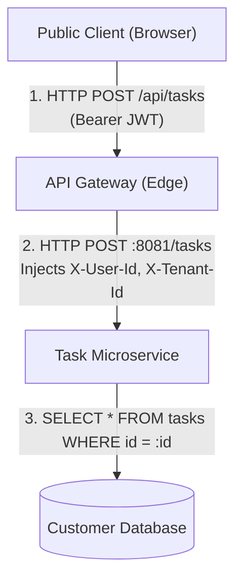
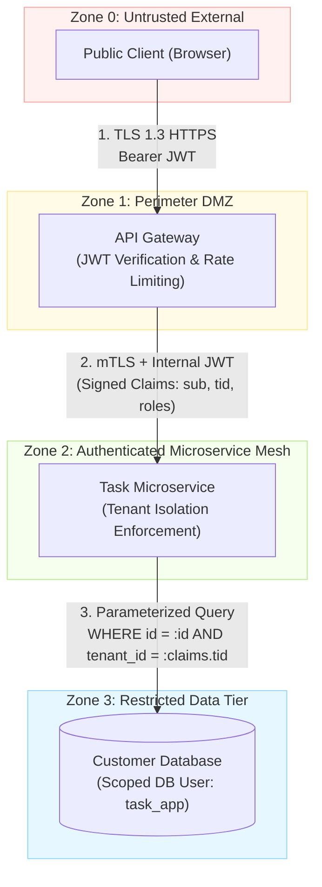

# Trust Boundary & Complete Mediation Analysis

Analyzes architectural diagrams, data flow representations (DFDs), and inter-service communication topologies to verify that trust boundaries are explicitly demarcated and that all boundary crossings enforce complete mediation.

> **Target Principle:**  
> - `PRIN-ENG-01` (Explicit Trust Boundaries & Complete Mediation — Shostack / Saltzer & Schroeder)

---

## 1. Operational Mandate & Scope

The agent acts as a Principal Security Architect reviewing architectural and data flow specifications:
- **Architectural Diagrams:** Mermaid DFDs, C4 Model diagrams (Container/Component), sequence diagrams.
- **Service Mesh & Network Maps:** Ingress routes, internal RPC/REST boundaries, asynchronous worker queues.
- **Authorization & Context Propagation:** Token validation logic, gateway header forwarding, multi-tenant isolation barriers.

The goal is to ensure that no process blindly trusts incoming data or requests across a boundary, that all access is fully mediated on every operation, and that privilege separation prevents single-point compromise.

---

## 2. Evaluation Procedure

1. **Zone Identification:** Classify components into distinct trust zones:
   - **Zone 0 (Untrusted):** Public browsers, mobile apps, third-party webhooks, external integrations.
   - **Zone 1 (DMZ / Edge):** Reverse proxies, TLS terminators, API Gateways.
   - **Zone 2 (Internal Compute):** Core application microservices, asynchronous workers.
   - **Zone 3 (Restricted Data):** Relational databases, key-value caches, cryptographic key stores.
2. **Boundary Crossing Trace:** For every data flow crossing between zones, determine:
   - Does the receiver authenticate the sender?
   - Does the receiver validate and sanitize the payload schema before execution?
   - Does the flow rely on implicit trust (e.g. trusting an unvalidated HTTP header)?
3. **Mediation Verification (`PRIN-SEC-02`):** Confirm that downstream services perform localized authorization checks on the target resource (e.g., verifying tenant isolation) rather than relying on perimeter-only checks.
4. **Separation of Privilege Verification (`PRIN-SEC-04`):** Confirm that distinct operational roles (e.g., read vs write, user vs administrative execution) require separate credentials or scoped assertions.
5. **Ledger Output:** Produce a Trust Boundary Audit Ledger detailing findings and remediations.

---

## 3. Concrete Walkthrough Example

### 3.1 Input Artifact: Vulnerable Multi-Tier Architecture

### 3.2 Analytical Evaluation

1. **Violation of `PRIN-MOD-01` (Explicit Trust Boundaries):**
   - The boundary between `Gateway` (Zone 1) and `Task Microservice` (Zone 2) relies on unauthenticated, unsigned HTTP headers (`X-User-Id`, `X-Tenant-Id`). If an attacker or a compromised service in Zone 2 injects these headers, the task service treats them as authoritative identity.
2. **Violation of `PRIN-SEC-02` (Complete Mediation):**
   - Step 3 performs a database query filtering only by `id` (`SELECT * FROM tasks WHERE id = :id`), relying on the edge gateway to have performed all tenant ownership checks. If the query parameter is manipulated, an authenticated user can read another tenant's tasks (IDOR vulnerability).
3. **Violation of `PRIN-SEC-04` (Separation of Privilege):**
   - The `Task Microservice` connects to `Customer Database` using a single shared database credential that has full read/write/schema-alter privileges across all tables.

### 3.3 Remediated Architecture

### 3.4 Trust Boundary Audit Ledger

| Crossing Point | Ingress Zone $\rightarrow$ Target Zone | Vulnerability / Hazard | Remediated Control | Principle |
|---|---|---|---|---|
| Edge to Core Service | Zone 1 $\rightarrow$ Zone 2 | Header spoofing / Confused deputy | Enforce **mTLS** and cryptographically **signed internal tokens** | `PRIN-MOD-01` |
| Core Service to Data Tier | Zone 2 $\rightarrow$ Zone 3 | IDOR / Cross-tenant data leakage | Enforce **complete mediation**: queries must bind `tenant_id` from token claims | `PRIN-SEC-02` |
| Core Service DB Connection | Zone 2 $\rightarrow$ Zone 3 | Excessive database privileges | Split into dedicated, least-privilege DB role (`task_app`) restricted to app tables | `PRIN-SEC-04` |

---

## 4. Reference Catalogs

- **Detailed Heuristics:** Consult [`references/heuristics.md`](references/heuristics.md) for boundary discovery rules and token propagation standards.
- **Concrete Anti-Patterns:** Consult [`references/antipatterns.md`](references/antipatterns.md) for real-world trust boundary bypasses and confused deputy scenarios.
- **End-to-End Case Studies:** Consult [`references/examples.md`](references/examples.md) for complex asynchronous worker and microservice DFD remediations.
- **Audit Checklist:** Consult [`references/checklist.md`](references/checklist.md) for the structured boundary verification checklist.
