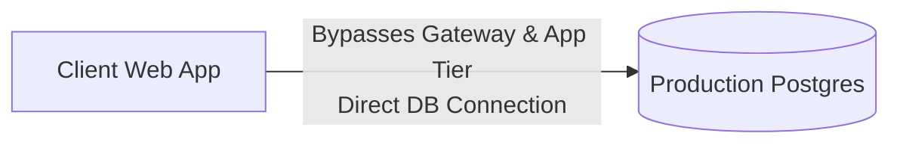
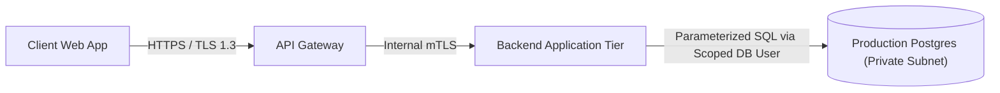

# Anti-Patterns & Smells — Trust Boundary & Complete Mediation

Concrete architectural smells and anti-patterns violating trust boundaries, complete mediation, and privilege separation.

---

## 1. Ambient Authority via Unsigned Headers

### Bad Pattern: Trusting Edge-Injected Headers Internally

```python
# Internal User Service endpoint (Zone 2)
@app.route('/internal/v1/users/<user_id>', methods=['GET'])
def get_user_profile(user_id):
    # SMELL: Trusting unauthenticated header passed from reverse proxy
    caller_role = request.headers.get('X-User-Role')
    
    if caller_role == 'admin':
        return db.get_user_with_sensitive_fields(user_id)
    return db.get_user_public(user_id)
```

**Consequence:** Any developer, compromised container, or internal attacker who can reach the internal port can forge `X-User-Role: admin` and extract sensitive data without credentials (Confused Deputy).

**Hardened Pattern:**

```python
# Internal User Service endpoint (Zone 2)
@app.route('/internal/v1/users/<user_id>', methods=['GET'])
def get_user_profile(user_id):
    token = request.headers.get('Authorization', '').replace('Bearer ', '')
    try:
        # Cryptographically verify internal JWT signed with Gateway Private Key
        claims = jwt.decode(token, GATEWAY_PUBLIC_KEY, algorithms=['RS256'], audience='internal-user-service')
    except jwt.InvalidTokenError:
        abort(401, "Invalid internal caller identity token")
        
    caller_role = claims.get('role')
    if caller_role == 'admin':
        return db.get_user_with_sensitive_fields(user_id)
    return db.get_user_public(user_id)
```

---

## 2. Ingress Bypass & Direct Database Connectivity

### Bad Pattern: Frontend or Lambda Connecting Directly to Database



**Consequence:** Inability to enforce uniform auditing, rate limiting, or tenant isolation logic. Direct exposure of relational database ports to external networks.

**Hardened Pattern:**



---

## 3. Perimeter-Only Authorization (Missing Complete Mediation)

### Bad Pattern: Relying Solely on URL-Level Gateway Checks

```python
# API Gateway Route Filter
if request.path.startswith("/api/v1/projects") and is_authenticated(user):
    forward_to_upstream(request)

# Backend Microservice Handler
@app.route('/api/v1/projects/<project_id>', methods=['GET'])
def get_project(project_id):
    # SMELL: Queries project solely by project_id without verifying user owns this project
    project = db.query("SELECT * FROM projects WHERE id = %s", [project_id])
    return jsonify(project)
```

**Consequence:** Insecure Direct Object Reference (IDOR). Any authenticated user can access any other tenant's projects simply by guessing or iterating `project_id`.

**Hardened Pattern:**

```python
# Backend Microservice Handler (Complete Mediation)
@app.route('/api/v1/projects/<project_id>', methods=['GET'])
def get_project(project_id):
    tenant_id = g.current_user.tenant_id
    # Enforces tenant boundary on every query
    project = db.query(
        "SELECT * FROM projects WHERE id = %s AND tenant_id = %s",
        [project_id, tenant_id]
    )
    if not project:
        abort(404, "Project not found or access denied")
    return jsonify(project)
```
