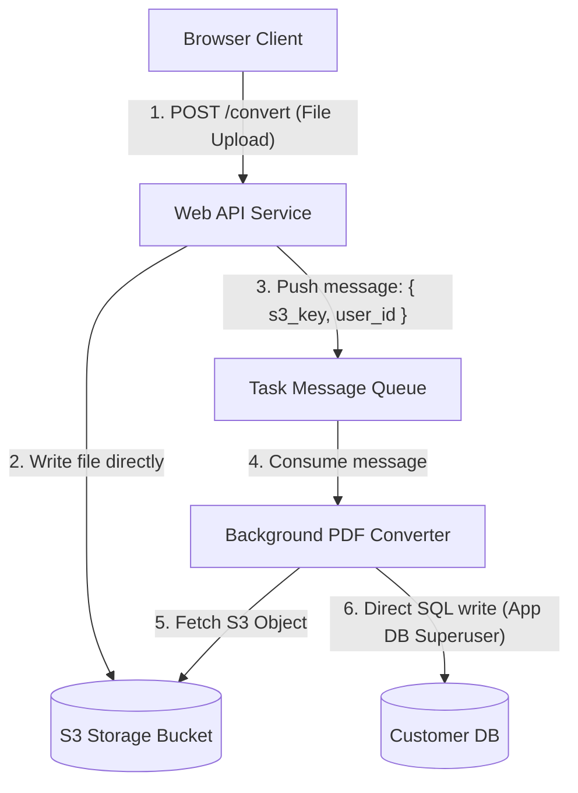
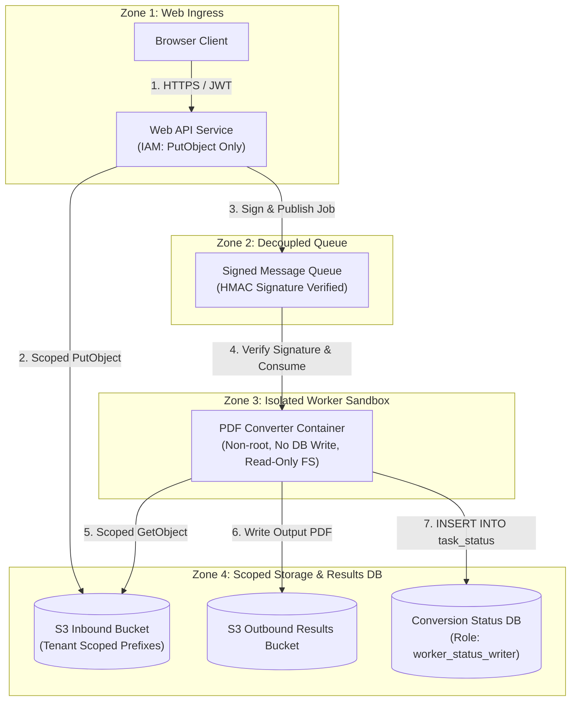

# End-to-End Case Studies — Trust Boundary & Complete Mediation

Realistic before-and-after architecture scenarios demonstrating trust boundary demarcation and complete mediation.

---

## Case Study 1: Asynchronous Worker & Queue Boundary Remediation

### Context
A document conversion platform processes user uploaded files asynchronously via a background task queue (RabbitMQ / SQS).

### Initial (Flawed) Architecture

### Analysis & Vulnerability Findings

1. **Missing Boundary Isolation on Storage (`PRIN-MOD-01`):**  
   Both `Web` and `Worker` use shared AWS IAM credentials with full read/write access to the entire `S3` bucket. If the worker's PDF parser is compromised (e.g. via an ImageMagick or Ghostscript vulnerability), the attacker has full read/write access to all tenants' uploaded files.
2. **Missing Complete Mediation on Asynchronous Jobs (`PRIN-SEC-02`):**  
   The message queue payload contains unverified `s3_key` and `user_id`. An attacker able to publish to the queue can direct the worker to process arbitrary files or overwrite arbitrary records.
3. **Privilege Over-Assignment on Data Store (`PRIN-SEC-04`):**  
   The worker uses the database superuser connection, allowing it to modify user account tables, billing data, or schemas, none of which are required for document conversion.

---

### Remediated Architecture

### Remediation Ledger

| Component / Boundary | Initial State | Finding | Remediated State | Principle |
|---|---|---|---|---|
| Ingress $\rightarrow$ S3 | Global bucket write | Excessive blast radius | Scoped IAM role: `PutObject` strictly to `inbound/${tenant_id}/*` | `PRIN-SEC-01` |
| Queue Message | Unsigned JSON | Spoofed queue jobs | Message payload cryptographically signed with HMAC secret | `PRIN-MOD-01` |
| Worker Container | Root user, shared DB admin | Sandbox escape risk | Isolated container with read-only rootfs; scoped DB user `worker_status_writer` | `PRIN-SEC-04` |
| Worker $\rightarrow$ DB | Full read/write | Unauthorized data access | Restricted DB role: `INSERT, UPDATE (status)` on `task_status` table only | `PRIN-SEC-02` |
