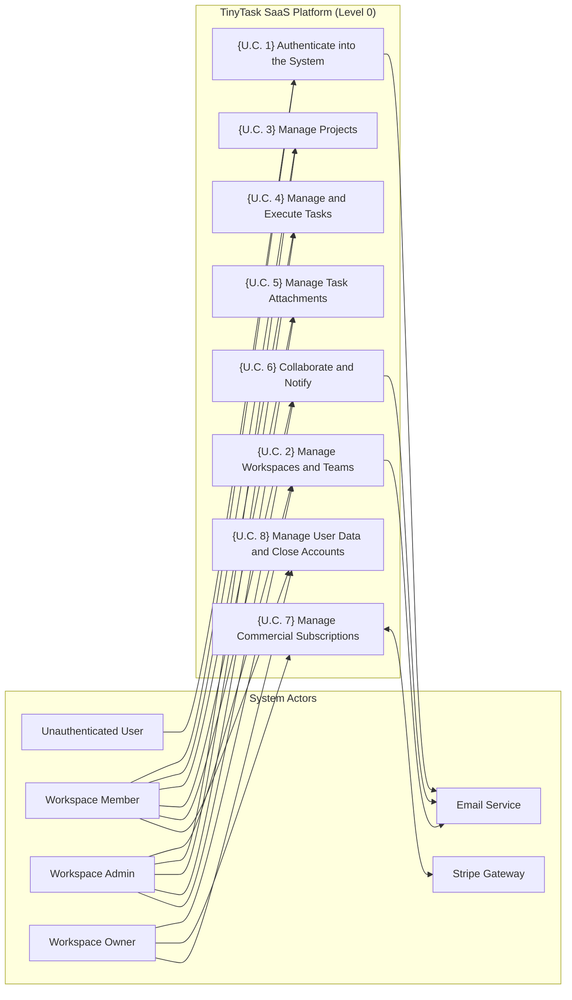

# E1.1 – TinyTask SaaS: AS-IS and TO-BE Model (Requirements Elicitation & PUC)

## Executive Summary

This report establishes the baseline requirements elicitation and analysis for the **TinyTask SaaS** platform, detailing the existing operational model (*As-Is*) and the target model (*To-Be*). The primary objective is to define exhaustively the product's functional scope, identifying actors, operational workflows, functional requirements prioritized using the MoSCoW methodology, and the formal Product Use Cases (*PUC*) catalog.

This document focuses strictly on user operational and business needs, maintaining a pure functional approach. Security, privacy, and regulatory compliance overlays derived from the AEGIS methodology will be systematically integrated and mapped in downstream Phase 3 engineering steps.

---

## Table of Contents

- [Part I – Scope](#part-i--scope)
  - [1. Objective](#1-objective)
  - [2. Problem Description](#2-problem-description)
  - [3. Product Position Statement](#3-product-position-statement)
  - [4. Expected Impact](#4-expected-impact)
  - [5. Key Features](#5-key-features)
  - [6. Stakeholders](#6-stakeholders)
  - [7. System Users](#7-system-users)
  - [8. Constraints](#8-constraints)
- [Part II – As-Is](#part-ii--as-is)
  - [1. Business Roles in Context](#1-business-roles-in-context)
  - [2. Workflow Processes for Work Management](#2-workflow-processes-for-work-management)
  - [3. IT Support](#3-it-support)
- [Part III – To-Be](#part-iii--to-be)
  - [1. Initial Customer Expectations](#1-initial-customer-expectations)
  - [2. Functional and Non-Functional Requirements](#2-functional-and-non-functional-requirements)
    - [2.1 Actors](#21-actors)
    - [2.2 Functional Requirements](#22-functional-requirements)
    - [2.3 Non-Functional Requirements](#23-non-functional-requirements)
  - [3. Business Product Use Cases (PUC) Definition](#3-business-product-use-cases-puc-definition)
  - [4. System Use Case Model](#4-system-use-case-model)
- [Bibliography](#bibliography)
- [Version History](#version-history)

---

## Part I – Scope

### 1. Objective

The primary objective of this project is to specify and engineer the **TinyTask SaaS** platform, a cloud-native multi-tenant solution designed for small-to-medium teams that need to coordinate projects, assign tasks, track deadlines, and centralize support documentation without the cumbersome complexity or administrative friction of traditional enterprise management software.

The platform establishes a single source of operational truth, delivering an intuitive and fluid collaborative experience that eliminates communication overhead across team leads, technical staff, and external clients.

### 2. Problem Description

Small organizations and agile teams currently suffer from severe operational fragmentation:

- **Decentralization and Data Silos:** Critical information regarding task statuses, deadlines, and responsibilities is scattered across uncoordinated spreadsheets, instant messaging threads, and disparate email chains.
- **Coordination Overhead:** Team leads spend hours every week manually chasing status updates and compiling ad-hoc reports across separate channels.
- **Lack of Operational Visibility:** Individual team members lack clear visibility into immediate priorities, dependencies, and blocked deliverables, leading to duplicate efforts and missed deadlines.
- **Document Management Friction:** Deliverable attachments are exchanged via email attachments or unmanaged folder links, resulting in lost version history and broken auditability.

### 3. Product Position Statement

TinyTask is positioned as an agile, lean, and collaborative SaaS productivity platform optimized for intuitive usability, rapid onboarding, and autonomous team execution:

- **For:** Small teams, startups, digital agencies, and independent consultancies;
- **Who:** Require a centralized and visual way to organize tasks, manage projects, and share deliverable documentation;
- **TinyTask is:** A collaborative SaaS platform built around interactive Kanban boards, dynamic task views, and contextual discussions;
- **That allows:** Real-time visibility into project execution, automated progress notifications, and self-service team subscription management;
- **Unlike:** Heavy, bloated enterprise project management tools that demand extensive configuration and steep learning curves;
- **Our product distinguishes itself by:** Offering a clean, friction-free, and delightful user experience focused strictly on high-impact coordination and execution.

### 4. Expected Impact

The deployment and adoption of TinyTask SaaS delivers the following organizational impacts:

1. **Reduce Coordination Overhead:** Estimated 60% reduction in time spent on manual status sync meetings and repetitive progress update inquiries.
2. **Centralize Operational Information:** 100% of projects, tasks, attachments, and discussions reside in a unified, searchable, and structured repository.
3. **Improve Delivery Predictability:** Increased on-time delivery rates through real-time bottleneck detection and automated deadline warning alerts.
4. **Accelerate User Onboarding:** Enable new team members and external guests to onboard and become productive in under five minutes through intuitive self-service workflows.

### 5. Key Features

The platform's functional baseline is structured into core operational capabilities:

- **Multi-Tenant Workspaces:** Complete logical isolation across organizations, supporting dedicated member rosters and role-based access control.
- **Visual Task Management:** Interactive Kanban boards (To-Do, In-Progress, Under-Review, Done) and tabular lists with multi-criteria dynamic filtering.
- **Contextual In-Task Collaboration:** Rich Markdown discussion threads directly embedded within task cards, supporting user mentions (@user) to trigger instant alerts.
- **Integrated Attachment Management:** Upload, preview, download, and delete deliverable files directly linked to task contexts.
- **Commercial Subscription Management:** Seamless self-service billing integration via external payment gateway to manage Free, Pro, and Enterprise plan tiers.
- **User Data Portability:** Self-service personal data export, workspace-level archive downloads, and autonomous account closure workflows.

### 6. Stakeholders

The following table details the key stakeholders invested in the TinyTask SaaS platform:

*Table 1. Stakeholders*

| Stakeholder | Representatives | Role and Interest in the System |
|---|---|---|
| **Executive Leadership & Founders** | TinyTask SaaS Founders | Business viability, user growth, paid tier conversion, and low customer churn. |
| **Team Leads & Project Managers** | Project Managers, Team Coordinators | Operational visibility into workloads, seamless task delegation, and deadline tracking. |
| **Individual Contributors & Specialists** | Software Engineers, Designers, Marketers | Daily task queue management, clear priorities, and distraction-free communication. |
| **External Clients & Observers** | Client Stakeholders, External Reviewers | Transparent read-only access to deliverable progress and project timelines. |

### 7. System Users

The application defines four distinct user roles:

*Table 2. System Users*

| System User | Description and Responsibilities |
|---|---|
| **Workspace Owner** | Ultimate commercial and administrative authority. Manages billing, subscriptions, seat quotas, organization export, and workspace deletion. |
| **Workspace Admin** | Operational team manager. Invites members, assigns roles, configures workspace settings, and creates new projects. |
| **Workspace Member** | Standard team contributor. Creates, edits, and transitions tasks; uploads attachments; posts comments; and manages personal profile settings. |
| **Workspace Viewer** | External guest or client granted read-only visibility into authorized projects, task boards, and discussion threads. |

### 8. Constraints

The baseline product design operates under the following business and operational constraints:

- **Development Team Capacity:** The technical organization consists of 8 persons, requiring architectural simplicity, high modularity, and rapid maintainability.
- **Payment Card Processing:** The application does not collect, process, or store raw credit card details, delegating payment processing and PCI compliance to Stripe.
- **Technology Neutrality:** This document defines pure functional capabilities from the user's perspective, without pre-baking technical security controls, which will be formally synthesized in subsequent AEGIS phases.

---

## Part II – As-Is

### 1. Business Roles in Context

In the baseline As-Is operational state—typical of small teams prior to adopting TinyTask—collaborators execute overlapping roles informally without standardized tooling:

- **Business Founder / Lead:** Manages commercial commitments, tracking client subscriptions and invoicing via local spreadsheets and direct email exchanges.
- **Project Lead:** Spends 2 to 3 hours daily consolidating manual status updates across chat messages and emails, manually updating a shared spreadsheet.
- **Team Contributor:** Tracks individual work in personal desktop note applications or paper notebooks, isolated from colleagues' real-time progress.
- **External Client:** Periodically requests status meetings or emails to check project health, receiving sporadic deliverable attachments.

### 2. Workflow Processes for Work Management

#### 2.1 Create and Initialize Projects

In the As-Is state, project initialization is recorded in an unstructured master spreadsheet on a shared drive:

*Table 3 - Data manually inserted to create a new project*

| Data Field | Data Type | Mandatory |
|---|---|---|
| Project Name | Text | Yes |
| Client / Organization Name | Text | Yes |
| Start Date | Date (`dd/mm/yyyy`) | Yes |
| Target End Date | Date (`dd/mm/yyyy`) | Yes |
| Project Lead | Text | Yes |
| Estimated Budget (€) | Decimal Number | No |
| General Scope Description | Text Block | No |

#### 2.2 Define and Schedule Tasks

Tasks are added as informal rows in separate tabs of the master spreadsheet:

*Table 4 - Data manually inserted to define and schedule tasks*

| Data Field | Data Type | Mandatory |
|---|---|---|
| Task Title | Text | Yes |
| Assignee Name | Text | No |
| Priority Level | Drop-down option (`High`, `Medium`, `Low`) | No |
| Target Deadline | Date (`dd/mm/yyyy`) | No |
| Estimated Effort (Hours) | Integer Number | No |
| Deliverable Notes | Text | No |

#### 2.3 Track Task Progress and Status

Progress updates rely on manual self-reporting during periodic team catch-up calls:

*Table 5 - Data manually inserted to track task progress*

| Data Field | Data Type | Mandatory |
|---|---|---|
| Current Status | Drop-down option (`To-Do`, `In-Progress`, `Done`) | Yes |
| Last Updated Date | Date (`dd/mm/yyyy`) | No |
| Updated By | Text | No |
| Actual Hours Spent | Decimal Number | No |
| Blockers / Impediments | Text | No |

#### 2.4 Share and Manage Document Attachments

Deliverable files and specifications are shared via email attachments and unmanaged shared drives:

*Table 6 - Data manually inserted to manage document attachments*

| Data Field | Data Type | Mandatory |
|---|---|---|
| File Name | Text | Yes |
| Shared Drive Path / URL | Text | Yes |
| Document Category | Drop-down option | No |
| Associated Task | Text | No |
| Upload Date | Date (`dd/mm/yyyy`) | Yes |

#### 2.5 Manage Commercial Subscriptions and Invoicing

Customer subscription plans and billing statuses are tracked manually in an accounting ledger:

*Table 7 - Data manually inserted to manage customer subscriptions*

| Data Field | Data Type | Mandatory |
|---|---|---|
| Client Organization Name | Text | Yes |
| Contracted Plan | Drop-down option (`Free`, `Pro`, `Enterprise`) | Yes |
| Billing Cycle | Drop-down option (`Monthly`, `Annual`) | Yes |
| Recurring Amount (€) | Decimal Number | Yes |
| Payment Status | Drop-down option (`Paid`, `Pending`, `Past-Due`) | Yes |
| Last Invoice Date | Date (`dd/mm/yyyy`) | Yes |

### 3. IT Support

In the As-Is baseline, operational tools are fragmented and unintegrated:
- **Shared Spreadsheets (Excel / Google Sheets):** Used for task lists and budgets, suffering from version conflicts, concurrent overwrite errors, and accidental formula corruption.
- **Instant Messaging (Slack / WhatsApp):** Used for day-to-day discussion, leading to critical decisions getting buried in unsearchable chat histories.
- **Decentralized Cloud Drives (Dropbox / Google Drive):** Used for file storage, lacking contextual links to specific task deliverables or approval histories.

---

## Part III – To-Be

### 1. Initial Customer Expectations

The target To-Be system formalizes stakeholder expectations into a centralized SaaS platform:

*Table 8. Description of customer initial expectations*

| Initial Expectations | Description |
|---|---|
| **1. Centralize Work Management in a Single Platform** | Consolidate workspaces, projects, task boards, comments, and deliverable documentation into a unified, secure web platform accessible anywhere. |
| **2. Deliver Visual and Agile Task Management** | Provide interactive Kanban boards and dynamic table views enabling intuitive drag-and-drop state transitions with immediate visual feedback. |
| **3. Contextualize Team Collaboration** | Support rich Markdown discussion threads directly embedded inside task cards, allowing user mentions to trigger instant alerts. |
| **4. Integrate Document Attachment Storage** | Enable seamless uploading, previewing, and downloading of deliverable files directly indexed to specific tasks. |
| **5. Automate Commercial Subscription Workflows** | Enable workspace owners to subscribe, upgrade, and manage plans and invoices through self-service payment gateway integration. |
| **6. Ensure User Data Portability and Closure Autonomy** | Provide self-service personal data export, workspace archive generation, and autonomous account closure workflows. |

### 2. Functional and Non-Functional Requirements

#### 2.1 Actors

The following table formally defines the actors interacting with the system in the To-Be model:

*Table 9. List of actors*

| Actor | Description |
|---|---|
| **Workspace Owner** | Ultimate commercial and administrative authority. Manages billing, subscriptions, seat quotas, organization export, and workspace deletion. |
| **Workspace Admin** | Operational workspace manager. Invites members, modifies roles, configures organization profile settings, and initializes new projects. |
| **Workspace Member** | Standard collaborative contributor. Creates, edits, and transitions tasks; uploads attachments; posts comments; and manages profile settings. |
| **Workspace Viewer** | External guest or client granted read-only visibility into authorized projects and task lists. |
| **Payment Gateway (Stripe)** | External payment processing engine responsible for handling card data, executing billing charges, and dispatching signed asynchronous webhooks. |
| **Notification / Email Service** | Internal subsystem responsible for dispatching verification emails, assignment notifications, and daily pending task digests. |

#### 2.2 Functional Requirements

##### 2.2.1 MoSCoW Prioritization Method
Functional requirements are prioritized using the MoSCoW methodology:
- **MUST:** Mandatory requirement that must be satisfied in the baseline release for the system to be viable.
- **SHOULD:** High-impact requirement that should be satisfied unless critical delivery constraints dictate deferral.
- **COULD:** Desirable capability or enhancement that can be included if schedule and resources permit.
- **WON'T:** Out-of-scope feature that will not be implemented in the initial baseline release, reserved for future iterations.

##### 2.2.2 Summary Table of Functional Requirements

*Table 10. List of functional requirements*

| ID | ID | Requirement | Priority | Restrictions |
|---|---|---|---|---|
| **R1** | | **Manage User Accounts and Identity** | **MUST** | Registration, login, password recovery, session review, and role enforcement. |
| | R1.1 | Register user account with email verification | MUST | Email address must be unique across the platform. |
| | R1.2 | Authenticate user credentials and issue active session | MUST | Returns authorized workspace list upon successful login. |
| | R1.3 | Recover user credentials via email reset link | MUST | Single-use token with time-bound expiration. |
| | R1.4 | Enforce role-based access control (RBAC) | MUST | Roles: Owner, Admin, Member, Viewer per workspace. |
| | R1.5 | Review and terminate active user sessions | SHOULD | View remote sessions with remote logout option. |
| | R1.6 | Support two-factor authentication (2FA / TOTP) | COULD | Optional six-digit authenticator code. |
| | R1.7 | Support enterprise single sign-on (SSO SAML / OIDC) | WON'T | Out of scope for micro-SaaS initial release. |
| **R2** | | **Manage Workspaces and Teams** | **MUST** | Workspace instantiation, member roster management, and organization settings. |
| | R2.1 | Create workspace and assign creator as Workspace Owner | MUST | Unique workspace name and url slug. |
| | R2.2 | Invite workspace members via email | MUST | Enforces member quota limits of active plan tier. |
| | R2.3 | Modify member roles and revoke workspace membership | MUST | Admins cannot demote or remove Workspace Owner. |
| | R2.4 | Configure workspace profile (name, logo) | SHOULD | Image upload capped at 2 MB. |
| | R2.5 | Monitor workspace activity and member metrics | COULD | Displays active collaborator counts for the month. |
| | R2.6 | Configure custom granular permission matrices | WON'T | Out of scope; restricted to 4 canonical roles. |
| **R3** | | **Manage Projects** | **MUST** | Project creation, configuration, and archiving within workspaces. |
| | R3.1 | Create project with title, description, and visibility | MUST | Project strictly belongs to a single workspace. |
| | R3.2 | Archive completed project to read-only state | SHOULD | Blocks new tasks and comments in archived projects. |
| **R4** | | **Create and Assign Tasks** | **MUST** | Task definition, due date scheduling, priority rating, and team attribution. |
| | R4.1 | Create task with title, description, priority, and due date | MUST | Title mandatory; default initial state is "To-Do". |
| | R4.2 | Assign task to active workspace members | MUST | Restricts assignment to members of the workspace. |
| | R4.3 | Display visual priority badges (Low, Medium, High, Urgent) | SHOULD | Default priority rating is "Medium". |
| **R5** | | **Manage Task States and Kanban Boards** | **MUST** | Visual status progression and interactive board manipulation. |
| | R5.1 | Transition task states across To-Do, In-Progress, Under-Review, Done | MUST | Logs state transition author and timestamp in task history. |
| | R5.2 | Update task state via interactive drag-and-drop Kanban board | MUST | Immediate visual column update upon card drag. |
| | R5.3 | Clone recurring tasks automatically upon completion | COULD | Supports weekly or monthly auto-cloning. |
| **R6** | | **Search and Filter Tasks** | **MUST** | Dynamic task retrieval across project boards. |
| | R6.1 | Filter tasks dynamically by status, assignee, priority, and date | MUST | Updates board and table views without full page reload. |
| | R6.2 | Visualize timeline dependencies via Gantt chart | WON'T | Out of scope for micro-SaaS initial release. |
| **R7** | | **Upload and Manage Task Attachments** | **MUST** | File attachment management for project deliverables. |
| | R7.1 | Upload deliverable file to task with 25 MB size cap | MUST | Maximum file size limit of 25 MB per attachment. |
| | R7.2 | Support common document and image file formats | MUST | Supported formats: PDF, DOCX, XLSX, PNG, JPG. |
| **R8** | | **Access and Delete Task Attachments** | **MUST** | Secure file retrieval and removal from task cards. |
| | R8.1 | Download task attachment by authorized workspace members | MUST | Access restricted to members with project view rights. |
| | R8.2 | Delete task attachment by uploader or administrator | MUST | Restricted to original uploader or Workspace Admin. |
| | R8.3 | Display inline image thumbnail previews on task cards | COULD | Compact thumbnail preview in task detail modal. |
| **R9** | | **Collaborate via In-Task Comments** | **MUST** | Contextual discussions, Markdown formatting, and user mentions. |
| | R9.1 | Post threaded Markdown comments on task cards | MUST | Blocks comment posting on archived projects. |
| | R9.2 | Mention collaborators (@user) to trigger notifications | MUST | Dispatches notification alerts to mentioned members. |
| | R9.3 | Stream comments in real-time via WebSockets | COULD | Displays new comments dynamically without page reload. |
| **R10** | | **Track Activity History and Alerts** | **MUST** | Audit history tracking and user notification management. |
| | R10.1 | Record chronological activity history on task cards | MUST | Logs author, timestamp, and field changes. |
| | R10.2 | Consult in-app notification center for assignments and mentions | MUST | Bell icon with unread badge counter in header. |
| | R10.3 | Dispatch daily pending task summary digest via email | SHOULD | Aggregated email sent daily at 08:00 to subscribers. |
| **R11** | | **Manage Commercial Subscriptions** | **MUST** | Plan tier management and automated quota updates via Stripe. |
| | R11.1 | Subscribe and upgrade plan tier via Stripe Checkout | MUST | Redirects to hosted Stripe Checkout payment session. |
| | R11.2 | Ingest and process billing webhooks to update plan status | MUST | Processes Stripe payment and cancellation webhooks. |
| | R11.3 | Reconcile workspace member seat quotas upon payment success | MUST | Updates workspace member limits immediately. |
| | R11.4 | Enforce 7-day grace period upon subscription payment failure | MUST | Maintains team access with warning banner during grace. |
| **R12** | | **Manage User Data and Close Accounts** | **MUST** | Self-service data export and account closure workflows. |
| | R12.1 | Export personal user profile and task data in JSON format | MUST | Downloadable structured JSON archive for the user. |
| | R12.2 | Export full workspace repository archive in ZIP format | MUST | Exclusive to Workspace Owner. |
| | R12.3 | Deactivate user account and anonymize display name | MUST | Replaces user name with "[Deleted User]" on tasks. |
| | R12.4 | Dispatch digital confirmation receipt upon account closure | SHOULD | Automated confirmation email with closure timestamp. |

---

##### 2.2.3 Detailed Specification Cards for Functional Requirements

The detailed functional requirement cards follow the exact 7-row single-column format established in the reference project standard:

#### R1 – Manage User Accounts and Identity

##### R1.1 – Register user account with email verification

| Requirement |
|---|
| **ID:** R1.1 **Name:** Register user account with email verification |
| **Description:** The system must allow new users to register an account by submitting their full name, email address, and password, automatically dispatching a confirmation email containing a verification link to activate the account. |
| **Requirement Origin:** TinyTask SaaS / Identity Management |
| **Interfaces:** Unauthenticated User and Email / Notification Service |
| **Dependencies:** • **Stakeholders:** Executive Leadership, Team Contributors • **Data Sources:** User Registration Form • **Extraction Periodicity:** On demand • **Information Systems / Databases:** PostgreSQL Database • **Preceding Requirements:** None |
| **Identified Problems:** |
| **Priority:** Must |

##### R1.2 – Authenticate user credentials and issue active session

| Requirement |
|---|
| **ID:** R1.2 **Name:** Authenticate user credentials and issue active session |
| **Description:** The system must validate the email address and password provided by the user, issuing an authenticated session and returning the list of workspaces authorized for that account. |
| **Requirement Origin:** TinyTask SaaS / Identity Management |
| **Interfaces:** Registered User |
| **Dependencies:** • **Stakeholders:** Team Contributors, Workspace Admins • **Data Sources:** Login Form • **Extraction Periodicity:** On demand • **Information Systems / Databases:** PostgreSQL Database • **Preceding Requirements:** R1.1 |
| **Identified Problems:** |
| **Priority:** Must |

##### R1.3 – Recover user credentials via email reset link

| Requirement |
|---|
| **ID:** R1.3 **Name:** Recover user credentials via email reset link |
| **Description:** The system must provide a self-service password recovery mechanism where users submit their registered email address to receive a secure, single-use, time-limited password reset link. |
| **Requirement Origin:** TinyTask SaaS / Identity Management |
| **Interfaces:** Registered User and Email / Notification Service |
| **Dependencies:** • **Stakeholders:** Team Contributors • **Data Sources:** Password Recovery Form • **Extraction Periodicity:** On demand • **Information Systems / Databases:** PostgreSQL Database • **Preceding Requirements:** R1.1 |
| **Identified Problems:** |
| **Priority:** Must |

##### R1.4 – Enforce role-based access control (RBAC)

| Requirement |
|---|
| **ID:** R1.4 **Name:** Enforce role-based access control (RBAC) |
| **Description:** The system must enforce authorization checks across four standard roles (Owner, Admin, Member, Viewer) scoped per workspace, ensuring that operations are executed only by users with appropriate role permissions. |
| **Requirement Origin:** TinyTask SaaS / Identity Management |
| **Interfaces:** All Platform Users |
| **Dependencies:** • **Stakeholders:** Workspace Admins, Executive Leadership • **Data Sources:** Workspace Membership Table • **Extraction Periodicity:** On demand • **Information Systems / Databases:** PostgreSQL Database • **Preceding Requirements:** R1.2 |
| **Identified Problems:** |
| **Priority:** Must |

##### R1.5 – Review and terminate active user sessions

| Requirement |
|---|
| **ID:** R1.5 **Name:** Review and terminate active user sessions |
| **Description:** The system must allow users to view their active sessions across different devices and browsers, providing the option to remotely terminate any specific session or all other sessions. |
| **Requirement Origin:** TinyTask SaaS / User Security and Usability |
| **Interfaces:** Registered User |
| **Dependencies:** • **Stakeholders:** Team Contributors • **Data Sources:** Active Sessions Table • **Extraction Periodicity:** On demand • **Information Systems / Databases:** PostgreSQL Database • **Preceding Requirements:** R1.2 |
| **Identified Problems:** |
| **Priority:** Should |

##### R1.6 – Support two-factor authentication (2FA / TOTP)

| Requirement |
|---|
| **ID:** R1.6 **Name:** Support two-factor authentication (2FA / TOTP) |
| **Description:** The system must optionally allow users to enable two-factor authentication, requiring a time-based one-time six-digit passcode generated by a mobile authenticator app during login. |
| **Requirement Origin:** TinyTask SaaS / Identity Management |
| **Interfaces:** Registered User |
| **Dependencies:** • **Stakeholders:** Workspace Admins, Team Contributors • **Data Sources:** Mobile Authenticator App • **Extraction Periodicity:** On demand • **Information Systems / Databases:** PostgreSQL Database • **Preceding Requirements:** R1.2 |
| **Identified Problems:** |
| **Priority:** Could |

#### R2 – Manage Workspaces and Teams

##### R2.1 – Create workspace and assign creator as Workspace Owner

| Requirement |
|---|
| **ID:** R2.1 **Name:** Create workspace and assign creator as Workspace Owner |
| **Description:** The system must allow any authenticated user to create a new workspace by providing a unique name and URL slug, automatically assigning the creator as the irrevocable Workspace Owner. |
| **Requirement Origin:** TinyTask SaaS / Administration |
| **Interfaces:** Workspace Owner |
| **Dependencies:** • **Stakeholders:** Platform Founders, Business Customers • **Data Sources:** Workspace Creation Form • **Extraction Periodicity:** On demand • **Information Systems / Databases:** PostgreSQL Database • **Preceding Requirements:** R1.2 |
| **Identified Problems:** |
| **Priority:** Must |

##### R2.2 – Invite workspace members via email

| Requirement |
|---|
| **ID:** R2.2 **Name:** Invite workspace members via email |
| **Description:** The system must allow Workspace Admins and Owners to invite new collaborators via email with a designated initial role, verifying that the workspace member seat quota is not exceeded. |
| **Requirement Origin:** TinyTask SaaS / Team Management |
| **Interfaces:** Workspace Admin, Workspace Owner, and Email Service |
| **Dependencies:** • **Stakeholders:** Team Leads, Project Managers • **Data Sources:** Member Invitation Form • **Extraction Periodicity:** On demand • **Information Systems / Databases:** PostgreSQL Database • **Preceding Requirements:** R2.1 |
| **Identified Problems:** |
| **Priority:** Must |

##### R2.3 – Modify member roles and revoke workspace membership

| Requirement |
|---|
| **ID:** R2.3 **Name:** Modify member roles and revoke workspace membership |
| **Description:** The system must allow administrators to update the role of an existing member (between Admin, Member, and Viewer) or remove the member from the workspace, strictly preventing other members from demoting or revoking the Workspace Owner. |
| **Requirement Origin:** TinyTask SaaS / Team Management |
| **Interfaces:** Workspace Admin and Workspace Owner |
| **Dependencies:** • **Stakeholders:** Workspace Admins • **Data Sources:** Workspace Member Roster • **Extraction Periodicity:** On demand • **Information Systems / Databases:** PostgreSQL Database • **Preceding Requirements:** R2.2 |
| **Identified Problems:** |
| **Priority:** Must |

##### R2.4 – Configure workspace profile (name, logo)

| Requirement |
|---|
| **ID:** R2.4 **Name:** Configure workspace profile (name, logo) |
| **Description:** The system must allow uploading a custom organization logo (image file up to 2 MB) and updating the workspace display name for visual alignment with organizational branding. |
| **Requirement Origin:** TinyTask SaaS / Branding |
| **Interfaces:** Workspace Admin and Workspace Owner |
| **Dependencies:** • **Stakeholders:** Business Customers • **Data Sources:** Workspace Settings Form • **Extraction Periodicity:** On demand • **Information Systems / Databases:** Object Storage / Database • **Preceding Requirements:** R2.1 |
| **Identified Problems:** |
| **Priority:** Should |

##### R2.5 – Monitor workspace activity and member metrics

| Requirement |
|---|
| **ID:** R2.5 **Name:** Monitor workspace activity and member metrics |
| **Description:** The system must provide an overview dashboard displaying aggregated workspace metrics, including total active members, tasks completed in the current month, and total file storage used. |
| **Requirement Origin:** TinyTask SaaS / Team Management |
| **Interfaces:** Workspace Admin and Workspace Owner |
| **Dependencies:** • **Stakeholders:** Team Leads, Executives • **Data Sources:** Workspace Activity Logs • **Extraction Periodicity:** On demand • **Information Systems / Databases:** PostgreSQL Database • **Preceding Requirements:** R2.1 |
| **Identified Problems:** |
| **Priority:** Could |

#### R3 – Manage Projects

##### R3.1 – Create project with title, description, and visibility

| Requirement |
|---|
| **ID:** R3.1 **Name:** Create project with title, description, and visibility |
| **Description:** The system must allow creating projects within a workspace, specifying title, scope description, and visibility level (public to all workspace members or restricted to selected contributors). |
| **Requirement Origin:** TinyTask SaaS / Project Management |
| **Interfaces:** Workspace Admin and Workspace Member |
| **Dependencies:** • **Stakeholders:** Project Managers, Team Contributors • **Data Sources:** Project Creation Form • **Extraction Periodicity:** On demand • **Information Systems / Databases:** PostgreSQL Database • **Preceding Requirements:** R2.1 |
| **Identified Problems:** |
| **Priority:** Must |

##### R3.2 – Archive completed project to read-only state

| Requirement |
|---|
| **ID:** R3.2 **Name:** Archive completed project to read-only state |
| **Description:** The system must allow archiving completed projects, rendering all contained tasks and comments read-only and hiding the project from daily operational project lists while preserving historical data. |
| **Requirement Origin:** TinyTask SaaS / Project Management |
| **Interfaces:** Workspace Admin and Workspace Owner |
| **Dependencies:** • **Stakeholders:** Project Managers • **Data Sources:** Project Settings Form • **Extraction Periodicity:** On demand • **Information Systems / Databases:** PostgreSQL Database • **Preceding Requirements:** R3.1 |
| **Identified Problems:** |
| **Priority:** Should |

#### R4 – Create and Assign Tasks

##### R4.1 – Create task with title, description, priority, and due date

| Requirement |
|---|
| **ID:** R4.1 **Name:** Create task with title, description, priority, and due date |
| **Description:** The system must enable rapid task creation within a project, requiring a mandatory title and allowing optional detailed description, target due date, and initial priority level. |
| **Requirement Origin:** TinyTask SaaS / Task Management |
| **Interfaces:** Workspace Member, Workspace Admin, and Workspace Owner |
| **Dependencies:** • **Stakeholders:** Team Contributors, Project Managers • **Data Sources:** Task Creation Form • **Extraction Periodicity:** On demand • **Information Systems / Databases:** PostgreSQL Database • **Preceding Requirements:** R3.1 |
| **Identified Problems:** |
| **Priority:** Must |

##### R4.2 – Assign task to active workspace members

| Requirement |
|---|
| **ID:** R4.2 **Name:** Assign task to active workspace members |
| **Description:** The system must allow assigning execution responsibility for a task to one or more active workspace members, instantly notifying the assigned contributors. |
| **Requirement Origin:** TinyTask SaaS / Task Management |
| **Interfaces:** Workspace Member, Workspace Admin |
| **Dependencies:** • **Stakeholders:** Team Contributors, Team Leads • **Data Sources:** Workspace Member Picker • **Extraction Periodicity:** On demand • **Information Systems / Databases:** PostgreSQL Database • **Preceding Requirements:** R4.1, R2.2 |
| **Identified Problems:** |
| **Priority:** Must |

##### R4.3 – Display visual priority badges (Low, Medium, High, Urgent)

| Requirement |
|---|
| **ID:** R4.3 **Name:** Display visual priority badges (Low, Medium, High, Urgent) |
| **Description:** The system must associate distinct colored badges and icons with each priority level (Low, Medium, High, Urgent) for rapid visual triage across board and table views. |
| **Requirement Origin:** TinyTask SaaS / Usability |
| **Interfaces:** All Users |
| **Dependencies:** • **Stakeholders:** Team Contributors • **Data Sources:** Task Priority Property • **Extraction Periodicity:** On demand • **Information Systems / Databases:** PostgreSQL Database • **Preceding Requirements:** R4.1 |
| **Identified Problems:** |
| **Priority:** Should |

#### R5 – Manage Task States and Kanban Boards

##### R5.1 – Transition task states across To-Do, In-Progress, Under-Review, Done

| Requirement |
|---|
| **ID:** R5.1 **Name:** Transition task states across To-Do, In-Progress, Under-Review, Done |
| **Description:** The system must support transitioning tasks through the canonical workflow stages (To-Do, In-Progress, Under-Review, Done), recording the transitioning user and exact timestamp in the task history. |
| **Requirement Origin:** TinyTask SaaS / Workflow Management |
| **Interfaces:** Workspace Member, Workspace Admin |
| **Dependencies:** • **Stakeholders:** Team Contributors, Project Leads • **Data Sources:** Task State Property • **Extraction Periodicity:** On demand • **Information Systems / Databases:** PostgreSQL Database • **Preceding Requirements:** R4.1 |
| **Identified Problems:** |
| **Priority:** Must |

##### R5.2 – Update task state via interactive drag-and-drop Kanban board

| Requirement |
|---|
| **ID:** R5.2 **Name:** Update task state via interactive drag-and-drop Kanban board |
| **Description:** The system must provide an interactive Kanban board interface where tasks are presented in vertical state columns, allowing users to drag and drop cards between columns to update their status. |
| **Requirement Origin:** TinyTask SaaS / User Interface & Usability |
| **Interfaces:** All Authorized Editors |
| **Dependencies:** • **Stakeholders:** Team Contributors, Project Leads • **Data Sources:** Task Model and Column States • **Extraction Periodicity:** On demand • **Information Systems / Databases:** PostgreSQL Database • **Preceding Requirements:** R5.1 |
| **Identified Problems:** |
| **Priority:** Must |

##### R5.3 – Clone recurring tasks automatically upon completion

| Requirement |
|---|
| **ID:** R5.3 **Name:** Clone recurring tasks automatically upon completion |
| **Description:** The system must allow configuring recurring task rules (weekly or monthly), automatically spawning a new task instance in the "To-Do" column once the previous instance is moved to "Done". |
| **Requirement Origin:** TinyTask SaaS / Productivity |
| **Interfaces:** Workspace Member, Workspace Admin |
| **Dependencies:** • **Stakeholders:** Team Contributors • **Data Sources:** Task Recurrence Configuration • **Extraction Periodicity:** On demand • **Information Systems / Databases:** PostgreSQL Database • **Preceding Requirements:** R5.1 |
| **Identified Problems:** |
| **Priority:** Could |

#### R6 – Search and Filter Tasks

##### R6.1 – Filter tasks dynamically by status, assignee, priority, and date

| Requirement |
|---|
| **ID:** R6.1 **Name:** Filter tasks dynamically by status, assignee, priority, and date |
| **Description:** The system must provide instant filter controls on project board views, allowing users to filter tasks by assignee, priority level, due date range, or overdue status without reloading the page. |
| **Requirement Origin:** TinyTask SaaS / Productivity |
| **Interfaces:** All Users |
| **Dependencies:** • **Stakeholders:** Team Contributors, Project Leads • **Data Sources:** Task Search Index • **Extraction Periodicity:** On demand • **Information Systems / Databases:** PostgreSQL Database • **Preceding Requirements:** R4.1 |
| **Identified Problems:** |
| **Priority:** Must |

#### R7 – Upload and Manage Task Attachments

##### R7.1 – Upload deliverable file to task with 25 MB size cap

| Requirement |
|---|
| **ID:** R7.1 **Name:** Upload deliverable file to task with 25 MB size cap |
| **Description:** The system must enable attaching deliverable files directly to a task card via file upload picker or drag-and-drop, enforcing a strict maximum size cap of 25 MB per attachment. |
| **Requirement Origin:** TinyTask SaaS / Document Management |
| **Interfaces:** Workspace Member, Workspace Admin |
| **Dependencies:** • **Stakeholders:** Team Contributors, Clients • **Data Sources:** Local Client File • **Extraction Periodicity:** On demand • **Information Systems / Databases:** Cloud Object Storage • **Preceding Requirements:** R4.1 |
| **Identified Problems:** |
| **Priority:** Must |

##### R7.2 – Support common document and image file formats

| Requirement |
|---|
| **ID:** R7.2 **Name:** Support common document and image file formats |
| **Description:** The system must support standard documentation and asset formats, including PDF, Microsoft Office documents (Word, Excel), presentations, and common image formats (PNG, JPEG). |
| **Requirement Origin:** TinyTask SaaS / Document Management |
| **Interfaces:** Workspace Member, Workspace Admin |
| **Dependencies:** • **Stakeholders:** Contributors, Project Leads • **Data Sources:** Uploaded Attachments • **Extraction Periodicity:** On demand • **Information Systems / Databases:** Object Storage • **Preceding Requirements:** R7.1 |
| **Identified Problems:** |
| **Priority:** Must |

#### R8 – Access and Delete Task Attachments

##### R8.1 – Download task attachment by authorized workspace members

| Requirement |
|---|
| **ID:** R8.1 **Name:** Download task attachment by authorized workspace members |
| **Description:** The system must provide a download link allowing any member with project view access to download the attached file to their local machine. |
| **Requirement Origin:** TinyTask SaaS / Document Management |
| **Interfaces:** All Users with project view access |
| **Dependencies:** • **Stakeholders:** Contributors, Clients • **Data Sources:** Stored Attachment • **Extraction Periodicity:** On demand • **Information Systems / Databases:** Object Storage • **Preceding Requirements:** R7.1 |
| **Identified Problems:** |
| **Priority:** Must |

##### R8.2 – Delete task attachment by uploader or administrator

| Requirement |
|---|
| **ID:** R8.2 **Name:** Delete task attachment by uploader or administrator |
| **Description:** The system must allow the original file uploader or a Workspace Admin to delete an attachment from a task card, updating the task history accordingly. |
| **Requirement Origin:** TinyTask SaaS / Document Management |
| **Interfaces:** Workspace Member (uploader) and Workspace Admin |
| **Dependencies:** • **Stakeholders:** Contributors, Admins • **Data Sources:** Attachment Record • **Extraction Periodicity:** On demand • **Information Systems / Databases:** Database / Object Storage • **Preceding Requirements:** R7.1 |
| **Identified Problems:** |
| **Priority:** Must |

##### R8.3 – Display inline image thumbnail previews on task cards

| Requirement |
|---|
| **ID:** R8.3 **Name:** Display inline image thumbnail previews on task cards |
| **Description:** The system must render compact image thumbnails for attached graphics within the task card view, enabling rapid visual inspection without downloading the original asset. |
| **Requirement Origin:** TinyTask SaaS / Usability |
| **Interfaces:** All Users |
| **Dependencies:** • **Stakeholders:** Designers, Contributors • **Data Sources:** Attached Images • **Extraction Periodicity:** On demand • **Information Systems / Databases:** Object Storage • **Preceding Requirements:** R7.2 |
| **Identified Problems:** |
| **Priority:** Could |

#### R9 – Collaborate via In-Task Comments

##### R9.1 – Post threaded Markdown comments on task cards

| Requirement |
|---|
| **ID:** R9.1 **Name:** Post threaded Markdown comments on task cards |
| **Description:** The system must provide a commenting thread inside each task card supporting rich text formatting via Markdown syntax (bold, italics, lists, and code blocks). |
| **Requirement Origin:** TinyTask SaaS / Team Collaboration |
| **Interfaces:** Workspace Member, Workspace Admin |
| **Dependencies:** • **Stakeholders:** Contributors, Clients • **Data Sources:** Task Comment Box • **Extraction Periodicity:** On demand • **Information Systems / Databases:** PostgreSQL Database • **Preceding Requirements:** R4.1 |
| **Identified Problems:** |
| **Priority:** Must |

##### R9.2 – Mention collaborators (@user) to trigger notifications

| Requirement |
|---|
| **ID:** R9.2 **Name:** Mention collaborators (@user) to trigger notifications |
| **Description:** The system must parse user mentions using the "@" symbol within comment text, automatically triggering in-app and email notifications to the tagged collaborators. |
| **Requirement Origin:** TinyTask SaaS / Team Collaboration |
| **Interfaces:** Workspace Member and Notification Service |
| **Dependencies:** • **Stakeholders:** Contributors • **Data Sources:** Comment Content • **Extraction Periodicity:** On demand • **Information Systems / Databases:** PostgreSQL Database • **Preceding Requirements:** R9.1 |
| **Identified Problems:** |
| **Priority:** Must |

##### R9.3 – Stream comments in real-time via WebSockets

| Requirement |
|---|
| **ID:** R9.3 **Name:** Stream comments in real-time via WebSockets |
| **Description:** The system must immediately push new comments to active users viewing the task card without requiring manual page reloads. |
| **Requirement Origin:** TinyTask SaaS / Collaboration |
| **Interfaces:** Active Online Users |
| **Dependencies:** • **Stakeholders:** Contributors • **Data Sources:** WebSocket Message Stream • **Extraction Periodicity:** On demand • **Information Systems / Databases:** WebSocket Gateway • **Preceding Requirements:** R9.1 |
| **Identified Problems:** |
| **Priority:** Could |

#### R10 – Track Activity History and Alerts

##### R10.1 – Record chronological activity history on task cards

| Requirement |
|---|
| **ID:** R10.1 **Name:** Record chronological activity history on task cards |
| **Description:** The system must log and display a chronological audit trail on each task card documenting state changes, assignee reallocations, due date adjustments, and attachment events. |
| **Requirement Origin:** TinyTask SaaS / Auditability |
| **Interfaces:** All Users |
| **Dependencies:** • **Stakeholders:** Project Managers, Contributors • **Data Sources:** Audit Log Table • **Extraction Periodicity:** On demand • **Information Systems / Databases:** PostgreSQL Database • **Preceding Requirements:** R4.1, R5.1 |
| **Identified Problems:** |
| **Priority:** Must |

##### R10.2 – Consult in-app notification center for assignments and mentions

| Requirement |
|---|
| **ID:** R10.2 **Name:** Consult in-app notification center for assignments and mentions |
| **Description:** The system must provide a bell icon with an unread badge counter in the navigation header, expanding into a notification drawer with direct links to referenced tasks. |
| **Requirement Origin:** TinyTask SaaS / Usability |
| **Interfaces:** Authenticated User |
| **Dependencies:** • **Stakeholders:** Contributors • **Data Sources:** User Notifications Table • **Extraction Periodicity:** On demand • **Information Systems / Databases:** PostgreSQL Database • **Preceding Requirements:** R4.2, R9.2 |
| **Identified Problems:** |
| **Priority:** Must |

##### R10.3 – Dispatch daily pending task summary digest via email

| Requirement |
|---|
| **ID:** R10.3 **Name:** Dispatch daily pending task summary digest via email |
| **Description:** The system must dispatch an aggregated email digest at 08:00 daily to subscribed users, summarizing their assigned tasks due on the current day or currently overdue. |
| **Requirement Origin:** TinyTask SaaS / Productivity |
| **Interfaces:** Registered User and Email Service |
| **Dependencies:** • **Stakeholders:** Project Managers, Contributors • **Data Sources:** Task Scheduler Daemon • **Extraction Periodicity:** Daily • **Information Systems / Databases:** PostgreSQL Database • **Preceding Requirements:** R4.1 |
| **Identified Problems:** |
| **Priority:** Should |

#### R11 – Manage Commercial Subscriptions

##### R11.1 – Subscribe and upgrade plan tier via Stripe Checkout

| Requirement |
|---|
| **ID:** R11.1 **Name:** Subscribe and upgrade plan tier via Stripe Checkout |
| **Description:** The system must allow the Workspace Owner to select a commercial plan (Pro or Enterprise) and initiate checkout, redirecting the browser to a secure Stripe Checkout payment session. |
| **Requirement Origin:** TinyTask SaaS / Billing |
| **Interfaces:** Workspace Owner and Payment Gateway (Stripe) |
| **Dependencies:** • **Stakeholders:** Executive Leadership, Business Customers • **Data Sources:** TinyTask Pricing Catalog • **Extraction Periodicity:** On demand • **Information Systems / Databases:** Stripe API / Database • **Preceding Requirements:** R2.1 |
| **Identified Problems:** |
| **Priority:** Must |

##### R11.2 – Ingest and process billing webhooks to update plan status

| Requirement |
|---|
| **ID:** R11.2 **Name:** Ingest and process billing webhooks to update plan status |
| **Description:** The system must ingest and validate signed asynchronous webhooks sent by Stripe upon completed payments, updating the workspace plan tier and renewal date immediately. |
| **Requirement Origin:** TinyTask SaaS / Billing |
| **Interfaces:** Payment Gateway (Stripe) and TinyTask Backend |
| **Dependencies:** • **Stakeholders:** Finance & IT Operations • **Data Sources:** Stripe Webhook Payloads • **Extraction Periodicity:** On demand • **Information Systems / Databases:** PostgreSQL Database • **Preceding Requirements:** R11.1 |
| **Identified Problems:** |
| **Priority:** Must |

##### R11.3 – Reconcile workspace member seat quotas upon payment success

| Requirement |
|---|
| **ID:** R11.3 **Name:** Reconcile workspace member seat quotas upon payment success |
| **Description:** The system must automatically adjust authorized workspace member quotas upon receiving payment confirmation, enabling the immediate invitation of additional team members. |
| **Requirement Origin:** TinyTask SaaS / Billing |
| **Interfaces:** Workspace Admin and Workspace Owner |
| **Dependencies:** • **Stakeholders:** Workspace Admins • **Data Sources:** Plan Tier Member Quota • **Extraction Periodicity:** On demand • **Information Systems / Databases:** PostgreSQL Database • **Preceding Requirements:** R11.2, R2.2 |
| **Identified Problems:** |
| **Priority:** Must |

##### R11.4 – Enforce 7-day grace period upon subscription payment failure

| Requirement |
|---|
| **ID:** R11.4 **Name:** Enforce 7-day grace period upon subscription payment failure |
| **Description:** The system must grant a 7-day grace period if an automated subscription renewal payment fails, maintaining normal operational access while notifying the Workspace Owner to update payment details. |
| **Requirement Origin:** TinyTask SaaS / Customer Retention & Billing |
| **Interfaces:** Workspace Owner and Payment Gateway |
| **Dependencies:** • **Stakeholders:** Customers, Finance • **Data Sources:** Stripe Payment Failure Event • **Extraction Periodicity:** On demand • **Information Systems / Databases:** PostgreSQL Database • **Preceding Requirements:** R11.2 |
| **Identified Problems:** |
| **Priority:** Must |

#### R12 – Manage User Data and Close Accounts

##### R12.1 – Export personal user profile and task data in JSON format

| Requirement |
|---|
| **ID:** R12.1 **Name:** Export personal user profile and task data in JSON format |
| **Description:** The system must allow any authenticated user to download a structured JSON archive containing their personal profile information, preferences, and tasks authored by their account. |
| **Requirement Origin:** TinyTask SaaS / Data Portability |
| **Interfaces:** Authenticated User |
| **Dependencies:** • **Stakeholders:** End Users • **Data Sources:** User Profile and Tasks Table • **Extraction Periodicity:** On demand • **Information Systems / Databases:** PostgreSQL Database • **Preceding Requirements:** R1.2 |
| **Identified Problems:** |
| **Priority:** Must |

##### R12.2 – Export full workspace repository archive in ZIP format

| Requirement |
|---|
| **ID:** R12.2 **Name:** Export full workspace repository archive in ZIP format |
| **Description:** The system must provide the Workspace Owner with a self-service workspace export option, generating a comprehensive ZIP archive containing projects, tasks, comments, and attachments. |
| **Requirement Origin:** TinyTask SaaS / Data Portability |
| **Interfaces:** Workspace Owner |
| **Dependencies:** • **Stakeholders:** Business Customers, Management • **Data Sources:** Workspace Data Tables and Files • **Extraction Periodicity:** On demand • **Information Systems / Databases:** Database and Object Storage • **Preceding Requirements:** R2.1 |
| **Identified Problems:** |
| **Priority:** Must |

##### R12.3 – Deactivate user account and anonymize display name

| Requirement |
|---|
| **ID:** R12.3 **Name:** Deactivate user account and anonymize display name |
| **Description:** The system must allow users to autonomously close their accounts, invalidating their credentials and replacing their public name with "[Deleted User]" to preserve historical task integrity. |
| **Requirement Origin:** TinyTask SaaS / Account Lifecycle |
| **Interfaces:** Authenticated User |
| **Dependencies:** • **Stakeholders:** End Users, Workspace Admins • **Data Sources:** User Profile Record • **Extraction Periodicity:** On demand • **Information Systems / Databases:** PostgreSQL Database • **Preceding Requirements:** R1.2 |
| **Identified Problems:** |
| **Priority:** Must |

##### R12.4 – Dispatch digital confirmation receipt upon account closure

| Requirement |
|---|
| **ID:** R12.4 **Name:** Dispatch digital confirmation receipt upon account closure |
| **Description:** The system must send a confirmation receipt via email immediately upon account deactivation, certifying the date and time when the account was permanently closed. |
| **Requirement Origin:** TinyTask SaaS / Communication |
| **Interfaces:** Closed User Account and Email Service |
| **Dependencies:** • **Stakeholders:** End Users • **Data Sources:** Deactivation Record • **Extraction Periodicity:** On demand • **Information Systems / Databases:** Database / Email Service • **Preceding Requirements:** R12.3 |
| **Identified Problems:** |
| **Priority:** Should |

---

#### 2.3 Non-Functional Requirements

The non-functional requirements define the platform's performance, availability, and usability targets:

*Table 11. List of non-functional requirements*

| ID | Requirement | Priority | Type |
|---|---|---|---|
| **RN1** | The platform must achieve a page load response time of under 500 ms for Kanban boards and task list views containing up to 200 items. | MUST | Performance & Efficiency |
| **RN2** | The system must maintain monthly service availability of at least 99.5%, excluding scheduled maintenance windows announced in advance. | MUST | Availability |
| **RN3** | The web application interface must be fully responsive, ensuring correct rendering on modern desktop and mobile viewports (minimum width of 375 px). | MUST | Usability |
| **RN4** | The storage architecture must support up to 50,000 active tasks per workspace without degradation in search, filter, or rendering speed. | SHOULD | Scalability |
| **RN5** | The system must execute automated daily database backups and maintain data recovery capabilities with an RPO under 24 hours. | MUST | Recoverability |
| **RN6** | The user interface must support internationalization (i18n), offering full system localization in English and Portuguese. | SHOULD | Internationalization |
| **RN7** | The Stripe integration must communicate exclusively over authenticated HTTPS channels and enforce cryptographic webhook signature verification. | MUST | Interoperability |
| **RN8** | The system architecture must enforce strict logical data segregation across workspaces (multi-tenancy), preventing cross-tenant access. | MUST | Architectural Integrity |

---

### 3. Business Product Use Cases (PUC) Definition

The Product Use Cases (*PUC*) delineate the functional boundary of TinyTask SaaS, mapping input payloads, processing boundaries, and output deliverables:

*Table 12. Summary table of Product Use Cases (PUC)*

| PUC | PUC Name | Actors / Users | Input and Output |
|---|---|---|---|
| **1.1** | Register and Activate User Account | Unauthenticated User, Email Service | **(in)** Full name, email, password **(out)** Verification email with activation link |
| **1.2** | Authenticate User and Issue Session | Registered User | **(in)** Email and password credentials **(out)** Active session and authorized workspace list |
| **1.3** | Recover User Password via Reset Link | Registered User, Email Service | **(in)** User registered email address **(out)** Password reset email with secure token |
| **2.1** | Create Organization Workspace | Workspace Owner | **(in)** Workspace name and URL slug **(out)** Instantiated workspace with creator as Owner |
| **2.2** | Invite and Manage Workspace Members | Workspace Admin, Workspace Owner, Email Service | **(in)** Invitee email and assigned role (Admin, Member, Viewer) **(out)** Invitation email and member added to roster |
| **2.3** | Configure Workspace Profile Settings | Workspace Admin, Workspace Owner | **(in)** Updated workspace name and logo image (up to 2 MB) **(out)** Updated workspace branding across client views |
| **3.1** | Create and Configure New Project | Workspace Admin, Workspace Member | **(in)** Project title, scope description, visibility setting **(out)** Initialized project accessible in navigation menu |
| **3.2** | Archive Completed Project | Workspace Admin, Workspace Owner | **(in)** Selection of target project to archive **(out)** Read-only project hidden from operational views |
| **4.1** | Create and Assign Project Task | Workspace Member, Workspace Admin | **(in)** Title, description, priority, due date, assignee **(out)** New task card in "To-Do" and assignee notification |
| **4.2** | Update Task State on Kanban Board | Workspace Member, Workspace Admin | **(in)** Drag card to target column (In-Progress, Under-Review, Done) **(out)** Updated task status and audit history event |
| **4.3** | Search and Filter Tasks | All Users | **(in)** Search terms and filter criteria (assignee, priority, status) **(out)** Filtered board and table views updated in real-time |
| **5.1** | Attach Deliverable File to Task Card | Workspace Member, Workspace Admin | **(in)** File selection (up to 25 MB size cap) **(out)** Uploaded file linked to task attachment gallery |
| **5.2** | Download and Delete Task Attachment | Workspace Member, Workspace Admin | **(in)** Download or delete command for specified file **(out)** File transferred to client or purged from attachment gallery |
| **6.1** | Post Comment and Mention Collaborator | Workspace Member, Workspace Admin | **(in)** Markdown comment text with user mentions (@user) **(out)** Comment posted and notifications delivered to tagged users |
| **6.2** | Consult In-App Notification Center | Authenticated User | **(in)** Access user notification drawer **(out)** Chronological list of unread mentions and task assignments |
| **7.1** | Subscribe and Upgrade Commercial Plan | Workspace Owner, Payment Gateway (Stripe) | **(in)** Selected plan tier (Pro/Enterprise) and billing info **(out)** Payment confirmation and updated workspace quotas |
| **7.2** | Process Billing Webhook and Reconcile Quotas | Payment Gateway (Stripe), TinyTask Backend | **(in)** Asynchronous webhook notification with payment event **(out)** Reconciled plan tier and member quotas in database |
| **8.1** | Export Personal and Workspace Data | Authenticated User, Workspace Owner | **(in)** Data export request (personal JSON or workspace ZIP) **(out)** Downloadable archive package generated for client |
| **8.2** | Deactivate and Close User Account | Authenticated User, Email Service | **(in)** Autonomous account deletion confirmation **(out)** Credentials purged, name anonymized, receipt dispatched |

---

### 4. System Use Case Model

The use case model formalizes interactions between system actors and the TinyTask platform. Refinement stops strictly at **Level 1**, omitting procedural execution steps and leaf nodes:

#### 4.1 Level-0 System Use Case Diagram

#### 4.2 Level-1 System Use Cases

##### {U.C. 1} Authenticate into the System
- **{U.C. 1.1} Register New Account:** Collects new user registration details and dispatches confirmation email with account activation link.
- **{U.C. 1.2} Authenticate User Credentials:** Validates login credentials, issues authenticated session, and loads authorized workspace list.
- **{U.C. 1.3} Recover Account Credentials:** Processes forgotten password requests by generating and emailing a secure, time-limited reset link.

##### {U.C. 2} Manage Workspaces and Teams
- **{U.C. 2.1} Create Workspace:** Instantiates a new multi-tenant organization environment and assigns the creator as Workspace Owner.
- **{U.C. 2.2} Invite and Manage Members:** Dispatches email invitations, modifies member role assignments, and revokes workspace access.
- **{U.C. 2.3} Configure Workspace Profile:** Updates organization display name, uploads custom logo graphic, and inspects plan tier quotas.

##### {U.C. 3} Manage Projects
- **{U.C. 3.1} Create and Configure Project:** Creates new project containers, specifying project name, scope description, and internal visibility.
- **{U.C. 3.2} Archive Project:** Moves completed projects to historical archive mode, locking tasks and comments into read-only state.

##### {U.C. 4} Manage and Execute Tasks
- **{U.C. 4.1} Create and Assign Task:** Records new task items, sets priority ratings, assigns team contributors, and specifies due dates.
- **{U.C. 4.2} Transition Task States on Kanban Board:** Enables interactive drag-and-drop movement of tasks across To-Do, In-Progress, Under-Review, and Done columns.
- **{U.C. 4.3} Search and Filter Tasks:** Applies real-time multi-criteria filtering across project boards and tabular task views.

##### {U.C. 5} Manage Task Attachments
- **{U.C. 5.1} Upload Task Attachment:** Allows uploading deliverable documents and graphics (up to 25 MB) directly to task cards.
- **{U.C. 5.2} Download and Remove Attachment:** Enables authorized users to download attached files and permits file deletion by uploaders or admins.

##### {U.C. 6} Collaborate and Notify
- **{U.C. 6.1} Post Comments and Mention Collaborators:** Supports threaded Markdown discussion inside task cards, triggering alerts via user mentions.
- **{U.C. 6.2} Consult Notification Center:** Displays in-app unread alerts and dispatches daily pending task digests via email.

##### {U.C. 7} Manage Commercial Subscriptions
- **{U.C. 7.1} Subscribe and Upgrade Plan:** Enables Workspace Owners to select commercial tiers and complete checkout via Stripe.
- **{U.C. 7.2} Process Billing Webhooks and Reconcile Quotas:** Ingests Stripe payment webhooks and updates workspace member seat quotas.

##### {U.C. 8} Manage User Data and Close Accounts
- **{U.C. 8.1} Export Personal and Workspace Data:** Generates downloadable JSON archives for user profiles and complete ZIP packages for workspaces.
- **{U.C. 8.2} Deactivate and Close Account:** Executes autonomous account closure, invalidating credentials, anonymizing names, and dispatching receipts.

---

## Bibliography

1. Robertson, S., & Robertson, J. (2012). *Mastering the Requirements Process: Getting Requirements Right* (3rd ed.). Addison-Wesley Professional.
2. Cockburn, A. (2000). *Writing Effective Use Cases*. Addison-Wesley Professional.
3. Leffingwell, D., & Widrig, D. (2003). *Managing Software Requirements: A Use Case Approach* (2nd ed.). Addison-Wesley Professional.
4. Project Management Institute. (2021). *A Guide to the Project Management Body of Knowledge (PMBOK Guide)* (7th ed.). Project Management Institute.

---

## Version History

| Version | Date | Author | Modification Notes |
|---|---|---|---|
| **1.0.0** | 2026-09-23 | AEGIS Technical Team | Initial baseline release of TinyTask SaaS AS-IS and TO-BE model matching GPTools E1.1 deliverable structure, table formats, and active action verb phrasing. |
