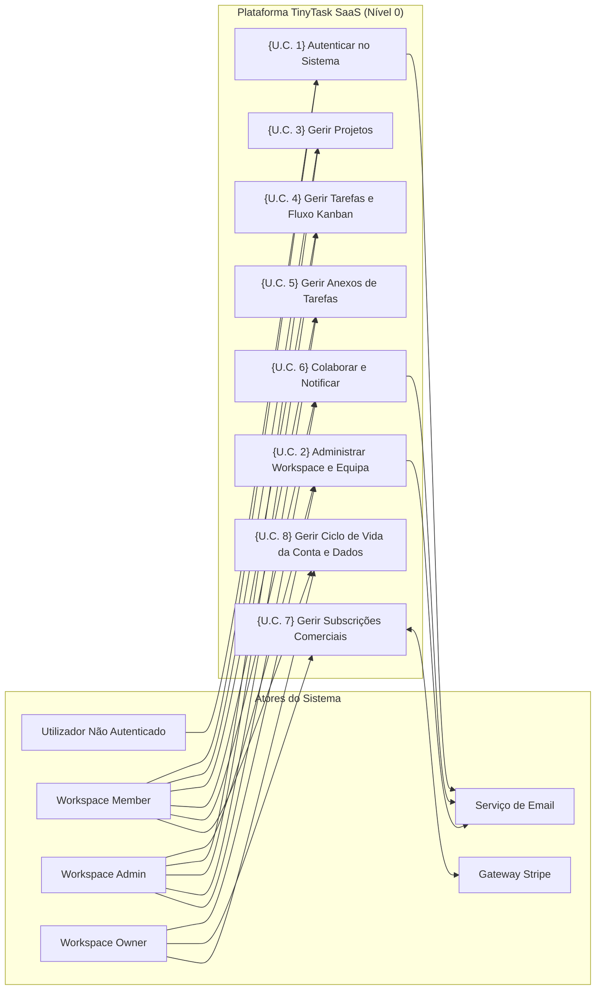

# E1.1 – TinyTask SaaS: Modelo AS-IS e TO-BE (Levantamento de Requisitos e PUC)

## Resumo

O presente documento constitui o relatório de levantamento e análise de requisitos para a plataforma **TinyTask SaaS**, detalhando o modelo operacional existente (*As-Is*) e o modelo alvo (*To-Be*). O objetivo primário deste documento é definir exaustivamente o âmbito funcional do produto, identificando os atores, os fluxos operacionais, os requisitos funcionais priorizados através da metodologia MoSCoW e o catálogo de Casos de Uso do Produto (*Product Use Cases* — PUC).

Este documento foca-se estritamente nas necessidades operacionais e de negócio dos utilizadores, mantendo uma abordagem puramente funcional. As sobreposições de segurança, privacidade e conformidade regulamentar decorrentes da metodologia AEGIS serão formalmente integradas e mapeadas nas etapas subsequentes.

---

## Índice

- [Parte I – Âmbito](#parte-i--âmbito)
  - [1. Objetivo](#1-objetivo)
  - [2. Descrição do Problema](#2-descrição-do-problema)
  - [3. Descrição da Posição do Produto](#3-descrição-da-posição-do-produto)
  - [4. Impacto Esperado](#4-impacto-esperado)
  - [5. Características Principais](#5-características-principais)
  - [6. Stakeholders](#6-stakeholders)
  - [7. Utilizadores do Sistema](#7-utilizadores-do-sistema)
  - [8. Restrições](#8-restrições)
- [Parte II – As-Is](#parte-ii--as-is)
  - [1. Papéis em Contexto Empresarial](#1-papéis-em-contexto-empresarial)
  - [2. Fluxo de Processos de Gestão de Trabalho](#2-fluxo-de-processos-de-gestão-de-trabalho)
  - [3. Suporte TI](#3-suporte-ti)
- [Parte III – To-Be](#parte-iii--to-be)
  - [1. Expectativas do Cliente para a Plataforma](#1-expectativas-do-cliente-para-a-plataforma)
  - [2. Requisitos Funcionais e Não Funcionais](#2-requisitos-funcionais-e-não-funcionais)
    - [2.1 Atores](#21-atores)
    - [2.2 Requisitos Funcionais](#22-requisitos-funcionais)
    - [2.3 Requisitos Não Funcionais](#23-requisitos-não-funcionais)
  - [3. Definição de Casos de Uso do Negócio](#3-definição-de-casos-de-uso-do-negócio)
  - [4. Modelo de Casos de Uso](#4-modelo-de-casos-de-uso)
- [Bibliografia](#bibliografia)
- [Histórico de Versões](#histórico-de-versões)

---

## Parte I – Âmbito

### 1. Objetivo

O objetivo principal deste projeto é conceber e especificar a plataforma **TinyTask SaaS**, uma solução multi-inquilino (*multi-tenant*) baseada na nuvem concebida para equipas pequenas e médias que necessitam de coordenar projetos, atribuir tarefas, acompanhar prazos e centralizar a documentação de suporte sem a complexidade excessiva nem a sobrecarga administrativa das ferramentas tradicionais de gestão empresarial.

A plataforma visa consolidar a informação operacional num ponto único de verdade, proporcionando uma experiência de colaboração intuitiva e fluida que minimize a fricção de comunicação entre líderes de equipa, técnicos e clientes externos.

### 2. Descrição do Problema

Atualmente, equipas em fase inicial ou de dimensão reduzida enfrentam uma grave dispersão de dados operacionais e de comunicação:

- **Descentralização e Fragmentação:** Informação crítica sobre o estado de tarefas, prazos e responsabilidades encontra-se distribuída por múltiplas folhas de cálculo partilhadas, canais informais de mensagens instantâneas e fios de correio eletrónico.
- **Sobrecarga de Coordenação:** Os gestores de equipa despendem horas semanais a compilar manualmente atualizações de estado e a solicitar pontos de situação a cada colaborador.
- **Falta de Visibilidade Operacional:** Os membros da equipa têm dificuldade em identificar prioridades imediatas e dependências de trabalho, resultando em duplicações de esforço e incumprimento de prazos acordados com clientes.
- **Fricção na Gestão Documental:** Os ficheiros anexos associados às entregas de projetos são transmitidos por correio eletrónico ou pastas de armazenamento partilhado não estruturadas, perdendo-se o histórico e o contexto de cada revisão.

### 3. Descrição da Posição do Produto

O TinyTask posiciona-se como uma plataforma SaaS de produtividade ágil e colaborativa, otimizada para simplicidade de utilização, rápida adoção e autonomia de equipa:

- **Para:** Equipas pequenas, startups, agências e consultoras independentes;
- **Que:** Necessitam de organizar tarefas, gerir projetos e partilhar documentação de forma visual e centralizada;
- **O TinyTask é:** Uma plataforma SaaS colaborativa baseada em quadros Kanban, listas de tarefas dinâmicas e discussões contextuais;
- **Que permite:** Acompanhar em tempo real a evolução dos trabalhos, automatizar notificações e gerir subscrições de equipa em regime de autosserviço;
- **Ao contrário de:** Ferramentas corporativas pesadas e complexas que exigem parametrizações morosas e formação extensiva;
- **O nosso produto distingue-se por:** Oferecer uma experiência de utilizador limpa, direta, sem atrito, focada exclusivamente nas tarefas essenciais de execução e coordenação.

### 4. Impacto Esperado

Com a implementação e adoção da plataforma TinyTask SaaS, espera-se alcançar os seguintes impactos organizacionais:

1. **Redução do Tempo de Coordenação:** Diminuição estimada em 60% do tempo despendido em reuniões de ponto de situação e pedidos manuais de atualização de tarefas.
2. **Centralização da Informação:** Adoção de um repositório centralizado onde 100% dos projetos, tarefas, ficheiros anexos e comentários residem num contexto partilhado e pesquisável.
3. **Melhoria do Cumprimento de Prazos:** Aumento da taxa de entregas pontuais através de visibilidade imediata de tarefas atrasadas e alertas automáticos de aproximação de prazos.
4. **Agilidade no Onboarding:** Capacidade de integrar novos colaboradores ou clientes convidados em menos de cinco minutos, graças a interfaces intuitivas e fluxos de convite simplificados.

### 5. Características Principais

As funcionalidades nucleares da plataforma estruturam-se nos seguintes pilares:

- **Espaços de Trabalho Multi-Inquilino (Workspaces):** Isolamento lógico de dados por organização ou departamento, permitindo a gestão autónoma de membros e permissões.
- **Gestão Visual de Tarefas:** Visualização em quadros Kanban (To-Do, In-Progress, Under-Review, Done) e visualização tabular com filtros multi-critério.
- **Colaboração em Contexto:** Caixa de comentários com suporte para Markdown e menções diretas de utilizadores (@utilizador) dentro de cada cartão de tarefa.
- **Repositório Integrado de Anexos:** Carregamento, pré-visualização e descarregamento de documentos diretamente indexados à tarefa correspondente.
- **Gestão de Subscrições Comerciais:** Integração com gateway de pagamentos para adesão em autosserviço aos planos Free, Pro e Enterprise.
- **Portabilidade e Gestão de Dados:** Exportação de dados do utilizador e da equipa e fluxos de encerramento de conta a pedido.

### 6. Stakeholders

A tabela seguinte detalha os principais intervenientes (*stakeholders*) com interesse estratégico e operacional no sucesso da plataforma:

*Tabela 1. Stakeholders*

| Stakeholder | Representantes | Papel e Interesses no Sistema |
|---|---|---|
| **Fundadores & Direção Executiva** | Founders da TinyTask SaaS | Sustentabilidade do negócio, adesão de utilizadores, conversão de planos pagos e retenção de clientes (*churn* reduzido). |
| **Líderes de Equipa & Gestores de Projeto** | Gestores de Projeto, Coordenadores | Visibilidade operacional sobre a carga de trabalho, delegação ágil e acompanhamento de prazos de entrega. |
| **Membros de Equipa Executante** | Engenheiros, Designers, Técnicos | Gestão diária da sua fila de tarefas, clareza de prioridades e comunicação contextualizada sem ruído. |
| **Clientes & Convidados Externos** | Clientes Finais, Auditores Externos | Acesso transparente ao estado de evolução dos seus projetos através de perfis de leitura (*Viewer*). |

### 7. Utilizadores do Sistema

Os utilizadores diretos do sistema agrupam-se nos seguintes perfis de acesso:

*Tabela 2. Utilizadores do Sistema*

| Utilizador do Sistema | Descrição e Responsabilidades |
|---|---|
| **Workspace Owner (Proprietário)** | Autoridade máxima do espaço de trabalho. Responsável pela subscrição comercial, faturação, quotas de membros, exportação global e encerramento do workspace. |
| **Workspace Admin (Administrador)** | Responsável pela gestão operacional da equipa. Convida novos membros, altera papéis de utilizador, cria novos projetos e configura parâmetros do workspace. |
| **Workspace Member (Membro)** | Utilizador operacional padrão. Cria e edita tarefas, move tarefas entre estados do Kanban, adiciona anexos, publica comentários e gere o seu perfil. |
| **Workspace Viewer (Visualizador)** | Utilizador com permissões estritas de leitura. Consulta quadros de tarefas, listagens e histórico de comentários, sem autorização para criar ou alterar dados. |

### 8. Restrições

O desenvolvimento da versão inicial do produto rege-se pelas seguintes restrições:

- **Dimensão da Equipa de Desenvolvimento:** A equipa técnica é constituída por 8 pessoas, exigindo foco estrito em componentes reutilizáveis e arquitetura simplificada.
- **Processamento de Pagamentos:** O sistema não recolhe nem armazena números de cartões de crédito, delegando o processamento comercial e a conformidade PCI ao fornecedor externo Stripe.
- **Neutralidade de Implementação:** O presente documento especifica os requisitos de negócio e funcionais do ponto de vista do utilizador, não impondo detalhes de implementação física de segurança, os quais serão sintetizados nas fases metodológicas adequadas.

---

## Parte II – As-Is

### 1. Papéis em Contexto Empresarial

No cenário operacional existente (*As-Is*) — comum a pequenas equipas antes da transição para uma plataforma dedicada —, as funções operacionais acumulam-se de forma informal:

- **Gestor / Fundador:** Trata das questões contratuais e de faturação através de trocas diretas de emails e notas bancárias, mantendo o controlo de custos numa folha de cálculo local.
- **Coordenador de Projeto:** Dedica entre 2 a 3 horas diárias a inquirir a equipa sobre o estado das entregas, atualizando manualmente um ficheiro partilhado na rede.
- **Colaborador Executante:** Organiza as suas tarefas em cadernos pessoais ou aplicações de notas individuais, sem sincronização com os restantes elementos da equipa.
- **Cliente:** Solicita frequentemente reuniões ou telefonemas para se inteirar do estado dos trabalhos, recebendo minutas esporádicas por correio eletrónico.

### 2. Fluxo de Processos de Gestão de Trabalho

#### 2.1 Registo e Criação de Novos Projetos

No modelo *As-Is*, quando um novo projeto ou cliente é iniciado, os dados gerais são registados numa folha de cálculo mestra partilhada:

*Tabela 3 - Dados inseridos manualmente para a criação de um novo projeto*

| Dados | Tipo de Dados | Obrigatoriedade |
|---|---|---|
| Nome do Projeto | Texto | Sim |
| Nome do Cliente / Entidade | Texto | Sim |
| Data de Início | Data (`dd/mm/aaaa`) | Sim |
| Data Prevista de Conclusão | Data (`dd/mm/aaaa`) | Sim |
| Responsável de Projeto | Texto | Sim |
| Orçamento Estimado (€) | Numérico Decimal | Não |
| Descrição Geral do Âmbito | Bloco de Texto | Não |

#### 2.2 Definição e Agendamento de Tarefas

A distribuição de tarefas do projeto é feita através de linhas adicionais nas folhas de cálculo:

*Tabela 4 - Dados inseridos manualmente para a definição e agendamento de tarefas*

| Dados | Tipo de Dados | Obrigatoriedade |
|---|---|---|
| Título da Tarefa | Texto | Sim |
| Responsável pela Execução | Texto | Não |
| Nível de Prioridade | Drop-down de opção (`Alta`, `Média`, `Baixa`) | Não |
| Data Limite de Execução | Data (`dd/mm/aaaa`) | Não |
| Estimativa de Esforço (Horas) | Numérico Inteiro | Não |
| Descrição dos Entregáveis | Texto | Não |

#### 2.3 Acompanhamento do Progresso de Tarefas

O controlo da execução depende de reuniões periódicas e auto-declaração dos membros:

*Tabela 5 - Dados inseridos manualmente para o acompanhamento do progresso*

| Dados | Tipo de Dados | Obrigatoriedade |
|---|---|---|
| Estado Atual | Drop-down de opção (`Por Fazer`, `Em Curso`, `Concluído`) | Sim |
| Data da Última Atualização | Data (`dd/mm/aaaa`) | Não |
| Registado por | Texto | Não |
| Horas Efetivamente Despendidas | Numérico Decimal | Não |
| Observações / Bloqueios | Texto | Não |

#### 2.4 Partilha e Gestão de Documentos Anexos

Os ficheiros e especificações associados às tarefas são trocados por email ou alojados em pastas locais:

*Tabela 6 - Dados inseridos manualmente para a gestão de documentos anexos*

| Dados | Tipo de Dados | Obrigatoriedade |
|---|---|---|
| Nome do Ficheiro | Texto | Sim |
| Localização / Caminho Partilhado | Texto (URL ou Caminho de Disco) | Sim |
| Categoria do Documento | Drop-down de opção | Não |
| Tarefa Associada | Texto | Não |
| Data de Carregamento | Data (`dd/mm/aaaa`) | Sim |

#### 2.5 Faturação e Gestão de Subscrições Comerciais

O acompanhamento dos planos e pagamentos no modelo atual é conduzido manualmente:

*Tabela 7 - Dados inseridos manualmente para a gestão de subscrições*

| Dados | Tipo de Dados | Obrigatoriedade |
|---|---|---|
| Nome da Organização Cliente | Texto | Sim |
| Plano Contratado | Drop-down de opção (`Free`, `Pro`, `Enterprise`) | Sim |
| Periodicidade de Cobrança | Drop-down de opção (`Mensal`, `Anual`) | Sim |
| Valor Recorrente (€) | Numérico Decimal | Sim |
| Estado do Pagamento | Drop-down de opção (`Regularizado`, `Pendente`, `Em Falta`) | Sim |
| Data da Última Fatura | Data (`dd/mm/aaaa`) | Sim |

### 3. Suporte TI

No modelo *As-Is*, o ecossistema tecnológico assenta em ferramentas genéricas e não integradas:
- **Folhas de Cálculo Partilhadas (Excel / Google Sheets):** Utilizadas para controlo de tarefas e orçamentos, sofrendo de problemas constantes de concorrência e corrupção de fórmulas.
- **Aplicações de Mensagens Instantâneas (Slack / WhatsApp):** Onde decorre a discussão operacional, resultando em decisões críticas perdidas nos históricos de conversação.
- **Serviços de Armazenamento na Nuvem Descentralizados (Dropbox / Google Drive):** Utilizados para armazenar ficheiros, sem associação estruturada às tarefas ou aos fluxos de aprovação.

---

## Parte III – To-Be

### 1. Expectativas do Cliente para a Plataforma

A transição para o modelo alvo (*To-Be*) procura concretizar as seguintes expectativas prioritárias:

*Tabela 8. Descrição das expectativas iniciais do cliente*

| Expectativas Iniciais | Descrição |
|---|---|
| **1. Centralizar a Gestão de Trabalho num Único Ponto** | Reunir espaços de trabalho, projetos, listas de tarefas, comentários e documentação de suporte num sistema centralizado e acessível pela Internet. |
| **2. Proporcionar Gestão Visual e Ágil de Tarefas** | Implementar quadros Kanban e vistas tabulares dinâmicas que permitam atualizar o estado das tarefas por arrastamento e com visualização imediata do progresso. |
| **3. Contextualizar a Colaboração da Equipa** | Permitir a inserção de comentários ricos em Markdown diretamente no cartão de cada tarefa, incluindo menções diretas de colaboradores para despoletar notificações. |
| **4. Integrar o Armazenamento de Anexos** | Permitir o carregamento, descarregamento e gestão de ficheiros anexos diretamente a partir da tarefa a que respeitam. |
| **5. Automatizar a Gestão de Subscrições Comerciais** | Oferecer aos clientes a capacidade de subscrever, atualizar e gerir os seus planos e faturas através de integração com plataforma de pagamentos especializada. |
| **6. Assegurar Autonomia na Gestão de Dados** | Permitir a exportação integral de dados e o encerramento de conta em regime de autosserviço pelo próprio utilizador. |

### 2. Requisitos Funcionais e Não Funcionais

#### 2.1 Atores

A tabela seguinte enumera os atores que interagem com o sistema no modelo *To-Be*:

*Tabela 9. Lista de atores*

| Ator | Descrição |
|---|---|
| **Workspace Owner (Proprietário)** | Autoridade comercial e administrativa de topo do espaço de trabalho. Responsável pela subscrição, faturação, quotas e encerramento do workspace. |
| **Workspace Admin (Administrador)** | Gestor operacional do workspace. Gere membros, atribui permissões, configura parâmetros da organização e cria novos projetos. |
| **Workspace Member (Membro)** | Utilizador operacional base. Cria, edita e transita tarefas, adiciona anexos, coloca comentários e gere o seu perfil pessoal. |
| **Workspace Viewer (Visualizador)** | Utilizador convidado ou cliente externo com acesso apenas de leitura a projetos e tarefas autorizadas. |
| **Gateway de Pagamento (Stripe)** | Sistema externo responsável pela recolha de dados de pagamento, processamento de cobranças e envio de webhooks com o estado das subscrições. |
| **Serviço de Notificações / Email** | Componente do sistema responsável pelo despacho de notificações transacionais, confirmações de registo e resumos diários de atividade. |

#### 2.2 Requisitos Funcionais

##### 2.2.1 Técnica de Priorização MoSCoW
Para cada requisito funcional é atribuída uma prioridade de acordo com a técnica MoSCoW:
- **MUST:** Requisito obrigatório que tem de estar incluído na versão base para que o sistema seja funcional.
- **SHOULD:** Requisito de elevado valor funcional que deve ser incluído caso não comprometa os prazos críticos.
- **COULD:** Requisito desejável ou melhoria de usabilidade que poderá ser incluído caso haja capacidade disponível.
- **WON'T:** Requisito que não será contemplado nesta fase do desenvolvimento, ficando reservado para versões futuras.

##### 2.2.2 Lista Sumária de Requisitos Funcionais

*Tabela 10. Lista de Requisitos funcionais*

| ID | ID | Requisito | Prioridade | Restrições |
|---|---|---|---|---|
| **R1** | | **Gestão de Contas de Utilizador e Identidade** | **MUST** | Registo, autenticação, recuperação de credenciais e controlo de acessos. |
| | R1.1 | Registo de utilizador com verificação de email | MUST | O email tem de ser único na plataforma. |
| | R1.2 | Autenticação com credenciais e início de sessão | MUST | Validação de credenciais e retorno dos workspaces do utilizador. |
| | R1.3 | Recuperação de credenciais via ligação por email | MUST | Envio de token de uso único com expiração temporal. |
| | R1.4 | Controlo de acesso baseado em papéis (RBAC) | MUST | Papéis: Owner, Admin, Member, Viewer. |
| | R1.5 | Consulta e encerramento de sessões ativas | SHOULD | Visualização de sessões remotas com opção de terminar sessão. |
| | R1.6 | Suporte a autenticação de dois fatores (2FA / TOTP) | COULD | Código temporário de seis dígitos. |
| | R1.7 | Federação de identidade empresarial (SSO SAML / OIDC) | WON'T | Fora do âmbito da versão inicial do produto. |
| **R2** | | **Administração de Workspaces e Equipas** | **MUST** | Criação de espaços de trabalho, gestão de membros e perfis organizacionais. |
| | R2.1 | Criação de espaço de trabalho atribuindo papel de Owner ao criador | MUST | Nome do workspace e slug identificador único. |
| | R2.2 | Convite de membros por endereço de email | MUST | Respeito pelos limites de membros definidos no plano ativo. |
| | R2.3 | Alteração de papéis e remoção de membros do workspace | MUST | O papel de Workspace Owner não pode ser revogado por terceiros. |
| | R2.4 | Personalização do perfil do workspace (nome, logótipo) | SHOULD | Ficheiro de imagem até 2 MB. |
| | R2.5 | Painel de monitorização de atividade e membros ativos | COULD | Contagem agregada de membros ativos no mês. |
| | R2.6 | Editor de matriz de permissões personalizada | WON'T | Fora do âmbito inicial; restrito aos 4 papéis canónicos. |
| **R3** | | **Gestão de Projetos** | **MUST** | Criação, parametrização e arquivo de projetos no workspace. |
| | R3.1 | Criação de projeto com título, descrição e visibilidade | MUST | O projeto fica estritamente associado a um único workspace. |
| | R3.2 | Arquivo de projetos concluídos para modo só de leitura | SHOULD | Bloqueio de novas tarefas e comentários nos projetos arquivados. |
| **R4** | | **Criação e Atribuição de Tarefas** | **MUST** | Definição de tarefas, prazos, prioridades e atribuição a responsáveis. |
| | R4.1 | Criação de tarefa com título, descrição, prioridade e prazo | MUST | Título obrigatório; estado inicial por defeito "To-Do". |
| | R4.2 | Atribuição de tarefas a membros ativos do workspace | MUST | Apenas utilizadores pertencentes ao workspace podem ser atribuídos. |
| | R4.3 | Indicadores visuais de prioridade (Baixa, Média, Alta, Urgente) | SHOULD | Prioridade por defeito definida como "Média". |
| **R5** | | **Gestão de Estados e Visualização Kanban** | **MUST** | Transição de tarefas e controlo visual do fluxo de trabalho. |
| | R5.1 | Transição de estados entre To-Do, In-Progress, Under-Review, Done | MUST | Registo do autor da transição e data/hora no histórico da tarefa. |
| | R5.2 | Quadro Kanban interativo com arrastamento de tarefas | MUST | Atualização visual imediata da coluna ao arrastar a tarefa. |
| | R5.3 | Clonagem automática de tarefas recorrentes na conclusão | COULD | Suporte a periodicidade semanal ou mensal. |
| **R6** | | **Pesquisa e Filtragem de Tarefas** | **MUST** | Localização rápida de tarefas através de múltiplos critérios combinados. |
| | R6.1 | Filtragem dinâmica por estado, responsável, prioridade e prazo | MUST | Atualização da vista sem necessidade de recarregar a página. |
| | R6.2 | Cronograma de dependências e gráfico de Gantt | WON'T | Fora do âmbito inicial do produto. |
| **R7** | | **Gestão e Carregamento de Anexos** | **MUST** | Associação de ficheiros de suporte às tarefas do projeto. |
| | R7.1 | Carregamento de ficheiros para a tarefa com limite de 25 MB | MUST | Limite máximo estrito de 25 MB por ficheiro. |
| | R7.2 | Suporte para formatos comuns de documentos e imagens | MUST | Formatos permitidos: PDF, DOCX, XLSX, PNG, JPG. |
| **R8** | | **Acesso e Eliminação de Anexos** | **MUST** | Consulta, descarregamento e remoção de ficheiros anexados. |
| | R8.1 | Descarregamento direto de anexos por membros autorizados | MUST | Acesso condicionado à pertença ao workspace do projeto. |
| | R8.2 | Remoção de anexos por autor ou administrador | MUST | Apenas o utilizador que enviou o ficheiro ou Admin pode eliminar. |
| | R8.3 | Miniatura de pré-visualização para imagens no cartão | COULD | Apresentação de miniatura compacta no detalhe da tarefa. |
| **R9** | | **Comentários e Discussões em Tarefas** | **MUST** | Comunicação colaborativa em fio de discussão dentro da tarefa. |
| | R9.1 | Fios de comentários em Markdown no cartão de tarefa | MUST | Bloqueio de inserção de novos comentários em projetos arquivados. |
| | R9.2 | Menções de utilizadores (@utilizador) gerando notificação | MUST | Despacho de notificação para os utilizadores mencionados. |
| | R9.3 | Atualização em tempo real de comentários via WebSockets | COULD | Inserção dinâmica do comentário na interface sem recarregar. |
| **R10** | | **Histórico de Atividade e Alertas** | **MUST** | Registo cronológico de ações e centro de alertas ao utilizador. |
| | R10.1 | Histórico cronológico de modificações no cartão da tarefa | MUST | Registo de quem alterou o estado, responsável ou campos da tarefa. |
| | R10.2 | Centro de notificações na aplicação para atribuições e menções | MUST | Indicador de número de notificações não lidas no menu superior. |
| | R10.3 | Resumo diário de pendências por correio eletrónico | SHOULD | Envio de email agregador às 08:00 com as tarefas do dia. |
| **R11** | | **Gestão de Subscrições Comerciais** | **MUST** | Contratação e gestão de planos através de gateway externa. |
| | R11.1 | Início de adesão/atualização de plano via Stripe Checkout | MUST | Redirecionamento para sessão de checkout hospedada no Stripe. |
| | R11.2 | Processamento de eventos de webhook para atualização de quotas | MUST | Ingestão e validação de webhooks de faturação da Stripe. |
| | R11.3 | Reconciliação automática de quotas de membros após pagamento | MUST | Atualização imediata do limite de utilizadores do workspace. |
| | R11.4 | Período de tolerância (7 dias) em caso de falha de cobrança | MUST | Manutenção de acesso com aviso de pagamento pendente durante 7 dias. |
| **R12** | | **Gestão de Dados e Encerramento de Conta** | **MUST** | Exportação de dados e encerramento de contas em autosserviço. |
| | R12.1 | Exportação de dados pessoais do utilizador em formato JSON | MUST | Disponibilização de ficheiro com perfil e tarefas criadas. |
| | R12.2 | Exportação integral do repositório do workspace em ZIP | MUST | Exclusivo para o Workspace Owner. |
| | R12.3 | Encerramento de conta de utilizador e anonimização de nome | MUST | O nome do utilizador passa a [Utilizador Desativado]. |
| | R12.4 | Comprovativo digital de encerramento de conta | SHOULD | Envio de email confirmativo com a data de desativação da conta. |

---

##### 2.2.3 Especificação Detalhada de Requisitos Funcionais

Abaixo encontram-se descritos em detalhe os requisitos funcionais da plataforma. Cada requisito apresenta a estrutura rigorosa em tabela conforme o padrão oficial do documento de referência:

#### R1 – Gestão de Contas de Utilizador e Identidade

##### R1.1 – Registo de utilizador com verificação de email

| Requisito |
|---|
| **ID:** R1.1 **Nome:** Registo de utilizador com verificação de email |
| **Descrição:** O sistema deve permitir o registo de uma nova conta de utilizador através da submissão de email, nome próprio e palavra-passe, despachando automaticamente uma mensagem de correio eletrónico com uma ligação de confirmação que ativa a conta. |
| **Origem do Requisito:** TinyTask SaaS / Gestão de Identidade |
| **Interfaces:** Utilizador Não Autenticado e Serviço de Notificações / Email |
| **Dependências:** • **Stakeholders:** Direção Executiva, Membros de Equipa • **Fontes de dados:** Formulário de Registo de Utilizador • **Periodicidade de Extração:** a pedido • **Aplicações Informáticas/ Bases de Dados:** Base de Dados PostgreSQL • **Requisitos Prévios:** Nenhum |
| **Problemas Identificados:** |
| **Prioridade:** Must |

##### R1.2 – Autenticação com credenciais e início de sessão

| Requisito |
|---|
| **ID:** R1.2 **Nome:** Autenticação com credenciais e início de sessão |
| **Descrição:** O sistema deve validar o endereço de email e a palavra-passe fornecidos pelo utilizador, emitindo uma sessão autenticada que autoriza o acesso aos workspaces a que o utilizador pertence. |
| **Origem do Requisito:** TinyTask SaaS / Gestão de Identidade |
| **Interfaces:** Utilizador Registado |
| **Dependências:** • **Stakeholders:** Membros de Equipa, Administradores • **Fontes de dados:** Formulário de Login • **Periodicidade de Extração:** a pedido • **Aplicações Informáticas/ Bases de Dados:** Base de Dados PostgreSQL • **Requisitos Prévios:** R1.1 |
| **Problemas Identificados:** |
| **Prioridade:** Must |

##### R1.3 – Recuperação de credenciais via ligação por email

| Requisito |
|---|
| **ID:** R1.3 **Nome:** Recuperação de credenciais via ligação por email |
| **Descrição:** O sistema deve disponibilizar uma opção para recuperação de credenciais onde o utilizador introduz o seu email e recebe uma hiperligação temporária para redefinição da palavra-passe. |
| **Origem do Requisito:** TinyTask SaaS / Gestão de Identidade |
| **Interfaces:** Utilizador Registado e Serviço de Notificações / Email |
| **Dependências:** • **Stakeholders:** Membros de Equipa • **Fontes de dados:** Formulário de Recuperação de Palavra-passe • **Periodicidade de Extração:** a pedido • **Aplicações Informáticas/ Bases de Dados:** Base de Dados PostgreSQL • **Requisitos Prévios:** R1.1 |
| **Problemas Identificados:** |
| **Prioridade:** Must |

##### R1.4 – Controlo de acesso baseado em papéis (RBAC)

| Requisito |
|---|
| **ID:** R1.4 **Nome:** Controlo de acesso baseado em papéis (RBAC) |
| **Descrição:** O sistema deve aplicar regras de autorização baseadas em quatro papéis bem definidos (Owner, Admin, Member, Viewer) no contexto de cada espaço de trabalho, garantindo que cada ação é executada apenas por utilizadores com privilégios adequados. |
| **Origem do Requisito:** TinyTask SaaS / Gestão de Identidade |
| **Interfaces:** Todos os Utilizadores da Plataforma |
| **Dependências:** • **Stakeholders:** Administradores, Direção Executiva • **Fontes de dados:** Tabela de Membros do Workspace • **Periodicidade de Extração:** a pedido • **Aplicações Informáticas/ Bases de Dados:** Base de Dados PostgreSQL • **Requisitos Prévios:** R1.2 |
| **Problemas Identificados:** |
| **Prioridade:** Must |

##### R1.5 – Consulta e encerramento de sessões ativas

| Requisito |
|---|
| **ID:** R1.5 **Nome:** Consulta e encerramento de sessões ativas |
| **Descrição:** O sistema deve permitir ao utilizador visualizar a lista das suas sessões ativas em diferentes dispositivos e navegadores, fornecendo a funcionalidade de encerrar remotamente qualquer sessão selecionada. |
| **Origem do Requisito:** TinyTask SaaS / Segurança e Usabilidade |
| **Interfaces:** Utilizador Registado |
| **Dependências:** • **Stakeholders:** Membros de Equipa • **Fontes de dados:** Tabela de Sessões Ativas • **Periodicidade de Extração:** a pedido • **Aplicações Informáticas/ Bases de Dados:** Base de Dados PostgreSQL • **Requisitos Prévios:** R1.2 |
| **Problemas Identificados:** |
| **Prioridade:** Should |

##### R1.6 – Suporte a autenticação de dois fatores (2FA / TOTP)

| Requisito |
|---|
| **ID:** R1.6 **Nome:** Suporte a autenticação de dois fatores (2FA / TOTP) |
| **Descrição:** O sistema deve disponibilizar opcionalmente a ativação de autenticação de dois fatores, exigindo um código de seis dígitos gerado por aplicação móvel compatível durante o login. |
| **Origem do Requisito:** TinyTask SaaS / Gestão de Identidade |
| **Interfaces:** Utilizador Registado |
| **Dependências:** • **Stakeholders:** Administradores, Membros de Equipa • **Fontes de dados:** Aplicação de Autenticação Móvel • **Periodicidade de Extração:** a pedido • **Aplicações Informáticas/ Bases de Dados:** Base de Dados PostgreSQL • **Requisitos Prévios:** R1.2 |
| **Problemas Identificados:** |
| **Prioridade:** Could |

#### R2 – Administração de Workspaces e Equipas

##### R2.1 – Criação de espaço de trabalho atribuindo papel de Owner ao criador

| Requisito |
|---|
| **ID:** R2.1 **Nome:** Criação de espaço de trabalho atribuindo papel de Owner ao criador |
| **Descrição:** O sistema deve permitir a qualquer utilizador autenticado criar um novo espaço de trabalho (workspace), atribuindo automaticamente ao criador o estatuto irrevogável de Workspace Owner. |
| **Origem do Requisito:** TinyTask SaaS / Administração |
| **Interfaces:** Workspace Owner |
| **Dependências:** • **Stakeholders:** Fundadores, Clientes Empresariais • **Fontes de dados:** Formulário de Criação de Workspace • **Periodicidade de Extração:** a pedido • **Aplicações Informáticas/ Bases de Dados:** Base de Dados PostgreSQL • **Requisitos Prévios:** R1.2 |
| **Problemas Identificados:** |
| **Prioridade:** Must |

##### R2.2 – Convite de membros por endereço de email

| Requisito |
|---|
| **ID:** R2.2 **Nome:** Convite de membros por endereço de email |
| **Descrição:** O sistema deve permitir que Administradores ou Owners enviem convites por email para que novos membros se juntem ao workspace com um papel inicial predeterminado, validando que o limite de membros do plano não é ultrapassado. |
| **Origem do Requisito:** TinyTask SaaS / Gestão de Equipas |
| **Interfaces:** Workspace Admin, Workspace Owner e Serviço de Notificações / Email |
| **Dependências:** • **Stakeholders:** Gestores de Projeto, Líderes de Equipa • **Fontes de dados:** Formulário de Convite de Membros • **Periodicidade de Extração:** a pedido • **Aplicações Informáticas/ Bases de Dados:** Base de Dados PostgreSQL • **Requisitos Prévios:** R2.1 |
| **Problemas Identificados:** |
| **Prioridade:** Must |

##### R2.3 – Alteração de papéis e remoção de membros do workspace

| Requisito |
|---|
| **ID:** R2.3 **Nome:** Alteração de papéis e remoção de membros do workspace |
| **Descrição:** O sistema deve permitir alterar o perfil de um membro existente (entre Admin, Member e Viewer) ou remover o membro do espaço de trabalho, impedindo expressamente a despromoção ou remoção do Workspace Owner por outros membros. |
| **Origem do Requisito:** TinyTask SaaS / Gestão de Equipas |
| **Interfaces:** Workspace Admin e Workspace Owner |
| **Dependências:** • **Stakeholders:** Administradores de Equipa • **Fontes de dados:** Lista de Membros do Workspace • **Periodicidade de Extração:** a pedido • **Aplicações Informáticas/ Bases de Dados:** Base de Dados PostgreSQL • **Requisitos Prévios:** R2.2 |
| **Problemas Identificados:** |
| **Prioridade:** Must |

##### R2.4 – Personalização do perfil do workspace (nome, logótipo)

| Requisito |
|---|
| **ID:** R2.4 **Nome:** Personalização do perfil do workspace (nome, logótipo) |
| **Descrição:** O sistema deve permitir carregar uma imagem de logótipo (até 2 MB) e atualizar o nome de exibição do espaço de trabalho para adequação à identidade visual da organização. |
| **Origem do Requisito:** TinyTask SaaS / Identidade Visual |
| **Interfaces:** Workspace Admin e Workspace Owner |
| **Dependências:** • **Stakeholders:** Clientes Empresariais • **Fontes de dados:** Definições do Workspace • **Periodicidade de Extração:** a pedido • **Aplicações Informáticas/ Bases de Dados:** Sistema de Ficheiros / Base de Dados • **Requisitos Prévios:** R2.1 |
| **Problemas Identificados:** |
| **Prioridade:** Should |

##### R2.5 – Painel de monitorização de atividade e membros ativos

| Requisito |
|---|
| **ID:** R2.5 **Nome:** Painel de monitorização de atividade e membros ativos |
| **Descrição:** O sistema deve fornecer um painel com métricas de utilização do espaço de trabalho, incluindo total de membros ativos, volume de tarefas concluídas no mês e espaço de armazenamento consumido. |
| **Origem do Requisito:** TinyTask SaaS / Gestão de Equipas |
| **Interfaces:** Workspace Admin e Workspace Owner |
| **Dependências:** • **Stakeholders:** Gestores e Direção • **Fontes de dados:** Registos de Atividade do Workspace • **Periodicidade de Extração:** a pedido • **Aplicações Informáticas/ Bases de Dados:** Base de Dados PostgreSQL • **Requisitos Prévios:** R2.1 |
| **Problemas Identificados:** |
| **Prioridade:** Could |

#### R3 – Gestão de Projetos

##### R3.1 – Criação de projeto com título, descrição e visibilidade

| Requisito |
|---|
| **ID:** R3.1 **Nome:** Criação de projeto com título, descrição e visibilidade |
| **Descrição:** O sistema deve permitir a criação de projetos dentro do espaço de trabalho, especificando título, descrição e nível de visibilidade (público para todos os membros do workspace ou restrito a membros selecionados). |
| **Origem do Requisito:** TinyTask SaaS / Gestão de Projetos |
| **Interfaces:** Workspace Admin e Workspace Member |
| **Dependências:** • **Stakeholders:** Gestores de Projeto, Membros de Equipa • **Fontes de dados:** Formulário de Criação de Projeto • **Periodicidade de Extração:** a pedido • **Aplicações Informáticas/ Bases de Dados:** Base de Dados PostgreSQL • **Requisitos Prévios:** R2.1 |
| **Problemas Identificados:** |
| **Prioridade:** Must |

##### R3.2 – Arquivo de projetos concluídos para modo só de leitura

| Requisito |
|---|
| **ID:** R3.2 **Nome:** Arquivo de projetos concluídos para modo só de leitura |
| **Descrição:** O sistema deve permitir arquivar projetos finalizados, tornando todas as tarefas e discussões associadas em modo de leitura estrita e ocultando o projeto da vista de trabalho principal. |
| **Origem do Requisito:** TinyTask SaaS / Gestão de Projetos |
| **Interfaces:** Workspace Admin e Workspace Owner |
| **Dependências:** • **Stakeholders:** Gestores de Projeto • **Fontes de dados:** Definições do Projeto • **Periodicidade de Extração:** a pedido • **Aplicações Informáticas/ Bases de Dados:** Base de Dados PostgreSQL • **Requisitos Prévios:** R3.1 |
| **Problemas Identificados:** |
| **Prioridade:** Should |

#### R4 – Criação e Atribuição de Tarefas

##### R4.1 – Criação de tarefa com título, descrição, prioridade e prazo

| Requisito |
|---|
| **ID:** R4.1 **Nome:** Criação de tarefa com título, descrição, prioridade e prazo |
| **Descrição:** O sistema deve permitir a criação rápida de tarefas num projeto, exigindo obrigatoriamente um título e permitindo opcionalmente especificar descrição detalhada, data limite de conclusão e prioridade inicial. |
| **Origem do Requisito:** TinyTask SaaS / Gestão de Tarefas |
| **Interfaces:** Workspace Member, Workspace Admin e Workspace Owner |
| **Dependências:** • **Stakeholders:** Membros de Equipa, Gestores • **Fontes de dados:** Formulário de Registo de Tarefa • **Periodicidade de Extração:** a pedido • **Aplicações Informáticas/ Bases de Dados:** Base de Dados PostgreSQL • **Requisitos Prévios:** R3.1 |
| **Problemas Identificados:** |
| **Prioridade:** Must |

##### R4.2 – Atribuição de tarefas a membros ativos do workspace

| Requisito |
|---|
| **ID:** R4.2 **Nome:** Atribuição de tarefas a membros ativos do workspace |
| **Descrição:** O sistema deve permitir atribuir a responsabilidade de execução de uma tarefa a um ou mais membros do espaço de trabalho, notificando imediatamente os membros selecionados. |
| **Origem do Requisito:** TinyTask SaaS / Gestão de Tarefas |
| **Interfaces:** Workspace Member, Workspace Admin |
| **Dependências:** • **Stakeholders:** Colaboradores, Líderes de Equipa • **Fontes de dados:** Seleção de Membros do Workspace • **Periodicidade de Extração:** a pedido • **Aplicações Informáticas/ Bases de Dados:** Base de Dados PostgreSQL • **Requisitos Prévios:** R4.1, R2.2 |
| **Problemas Identificados:** |
| **Prioridade:** Must |

##### R4.3 – Indicadores visuais de prioridade (Baixa, Média, Alta, Urgente)

| Requisito |
|---|
| **ID:** R4.3 **Nome:** Indicadores visuais de prioridade (Baixa, Média, Alta, Urgente) |
| **Descrição:** O sistema deve associar etiquetas coloridas e ícones diferenciados a cada nível de prioridade (Baixa, Média, Alta, Urgente) para rápida triagem visual nos quadros e tabelas de tarefas. |
| **Origem do Requisito:** TinyTask SaaS / Usabilidade |
| **Interfaces:** Todos os Utilizadores |
| **Dependências:** • **Stakeholders:** Membros de Equipa • **Fontes de dados:** Registo de Prioridade da Tarefa • **Periodicidade de Extração:** a pedido • **Aplicações Informáticas/ Bases de Dados:** Base de Dados PostgreSQL • **Requisitos Prévios:** R4.1 |
| **Problemas Identificados:** |
| **Prioridade:** Should |

#### R5 – Gestão de Estados e Visualização Kanban

##### R5.1 – Transição de estados entre To-Do, In-Progress, Under-Review, Done

| Requisito |
|---|
| **ID:** R5.1 **Nome:** Transição de estados entre To-Do, In-Progress, Under-Review, Done |
| **Descrição:** O sistema deve assegurar a passagem de tarefas através das fases canónicas do fluxo de trabalho (To-Do, In-Progress, Under-Review, Done), registando o autor da transição e a data/hora exata no histórico. |
| **Origem do Requisito:** TinyTask SaaS / Fluxo de Trabalho |
| **Interfaces:** Workspace Member, Workspace Admin |
| **Dependências:** • **Stakeholders:** Membros de Equipa, Gestores • **Fontes de dados:** Estado da Tarefa • **Periodicidade de Extração:** a pedido • **Aplicações Informáticas/ Bases de Dados:** Base de Dados PostgreSQL • **Requisitos Prévios:** R4.1 |
| **Problemas Identificados:** |
| **Prioridade:** Must |

##### R5.2 – Quadro Kanban interativo com arrastamento de tarefas

| Requisito |
|---|
| **ID:** R5.2 **Nome:** Quadro Kanban interativo com arrastamento de tarefas |
| **Descrição:** O sistema deve fornecer uma interface gráfica em quadro Kanban onde as tarefas são dispostas em colunas verticais correspondentes aos estados, permitindo mover os cartões de tarefas entre colunas por arrastamento (*drag-and-drop*). |
| **Origem do Requisito:** TinyTask SaaS / Interface e Usabilidade |
| **Interfaces:** Todos os Utilizadores com permissão de edição |
| **Dependências:** • **Stakeholders:** Membros de Equipa, Gestores • **Fontes de dados:** Modelo de Tarefas e Estados • **Periodicidade de Extração:** a pedido • **Aplicações Informáticas/ Bases de Dados:** Base de Dados PostgreSQL • **Requisitos Prévios:** R5.1 |
| **Problemas Identificados:** |
| **Prioridade:** Must |

##### R5.3 – Clonagem automática de tarefas recorrentes na conclusão

| Requisito |
|---|
| **ID:** R5.3 **Nome:** Clonagem automática de tarefas recorrentes na conclusão |
| **Descrição:** O sistema deve permitir configurar tarefas com repetição automática (semanal ou mensal), criando uma nova instância da tarefa no estado "To-Do" assim que a anterior for marcada como "Done". |
| **Origem do Requisito:** TinyTask SaaS / Produtividade |
| **Interfaces:** Workspace Member, Workspace Admin |
| **Dependências:** • **Stakeholders:** Membros de Equipa • **Fontes de dados:** Definições de Recorrência • **Periodicidade de Extração:** a pedido • **Aplicações Informáticas/ Bases de Dados:** Base de Dados PostgreSQL • **Requisitos Prévios:** R5.1 |
| **Problemas Identificados:** |
| **Prioridade:** Could |

#### R6 – Pesquisa e Filtragem de Tarefas

##### R6.1 – Filtragem dinâmica por estado, responsável, prioridade e prazo

| Requisito |
|---|
| **ID:** R6.1 **Nome:** Filtragem dinâmica por estado, responsável, prioridade e prazo |
| **Descrição:** O sistema deve disponibilizar controlos de filtragem rápida na barra superior das vistas de projeto, permitindo filtrar instantaneamente as tarefas apresentadas por responsável, nível de prioridade ou tarefas em atraso. |
| **Origem do Requisito:** TinyTask SaaS / Produtividade |
| **Interfaces:** Todos os Utilizadores |
| **Dependências:** • **Stakeholders:** Membros de Equipa, Gestores • **Fontes de dados:** Índices de Tarefas • **Periodicidade de Extração:** a pedido • **Aplicações Informáticas/ Bases de Dados:** Base de Dados PostgreSQL • **Requisitos Prévios:** R4.1 |
| **Problemas Identificados:** |
| **Prioridade:** Must |

#### R7 – Gestão e Carregamento de Anexos

##### R7.1 – Carregamento de ficheiros para a tarefa com limite de 25 MB

| Requisito |
|---|
| **ID:** R7.1 **Nome:** Carregamento de ficheiros para a tarefa com limite de 25 MB |
| **Descrição:** O sistema deve permitir anexar ficheiros diretamente a um cartão de tarefa através de formulário de envio ou arrastamento de ficheiros, impondo um limite máximo de tamanho de 25 MB por anexo. |
| **Origem do Requisito:** TinyTask SaaS / Gestão Documental |
| **Interfaces:** Workspace Member, Workspace Admin |
| **Dependências:** • **Stakeholders:** Membros de Equipa, Clientes • **Fontes de dados:** Ficheiro local do utilizador • **Periodicidade de Extração:** a pedido • **Aplicações Informáticas/ Bases de Dados:** Repositório de Ficheiros na Nuvem (Object Storage) • **Requisitos Prévios:** R4.1 |
| **Problemas Identificados:** |
| **Prioridade:** Must |

##### R7.2 – Suporte para formatos comuns de documentos e imagens

| Requisito |
|---|
| **ID:** R7.2 **Nome:** Suporte para formatos comuns de documentos e imagens |
| **Descrição:** O sistema deve suportar nativamente formatos correntes de documentação e imagem, incluindo ficheiros PDF, documentos do Microsoft Office (Word, Excel), apresentações e imagens nos formatos PNG e JPEG. |
| **Origem do Requisito:** TinyTask SaaS / Gestão Documental |
| **Interfaces:** Workspace Member, Workspace Admin |
| **Dependências:** • **Stakeholders:** Colaboradores, Gestores • **Fontes de dados:** Ficheiros carregados • **Periodicidade de Extração:** a pedido • **Aplicações Informáticas/ Bases de Dados:** Repositório de Ficheiros • **Requisitos Prévios:** R7.1 |
| **Problemas Identificados:** |
| **Prioridade:** Must |

#### R8 – Acesso e Eliminação de Anexos

##### R8.1 – Descarregamento direto de anexos por membros autorizados

| Requisito |
|---|
| **ID:** R8.1 **Nome:** Descarregamento direto de anexos por membros autorizados |
| **Descrição:** O sistema deve disponibilizar uma ligação de transferência para descarregamento do ficheiro anexo por qualquer membro com permissão de visualização do projeto correspondente. |
| **Origem do Requisito:** TinyTask SaaS / Gestão Documental |
| **Interfaces:** Todos os Utilizadores com acesso ao projeto |
| **Dependências:** • **Stakeholders:** Colaboradores, Clientes • **Fontes de dados:** Ficheiro em Armazenamento • **Periodicidade de Extração:** a pedido • **Aplicações Informáticas/ Bases de Dados:** Repositório de Ficheiros • **Requisitos Prévios:** R7.1 |
| **Problemas Identificados:** |
| **Prioridade:** Must |

##### R8.2 – Remoção de anexos por autor ou administrador

| Requisito |
|---|
| **ID:** R8.2 **Nome:** Remoção de anexos por autor ou administrador |
| **Descrição:** O sistema deve permitir a eliminação de um ficheiro anexo pelo membro que efetuou o seu carregamento ou por um Administrador do workspace, atualizando o histórico da tarefa. |
| **Origem do Requisito:** TinyTask SaaS / Gestão Documental |
| **Interfaces:** Workspace Member (autor) e Workspace Admin |
| **Dependências:** • **Stakeholders:** Membros de Equipa, Administradores • **Fontes de dados:** Registo de Anexos • **Periodicidade de Extração:** a pedido • **Aplicações Informáticas/ Bases de Dados:** Base de Dados / Repositório de Ficheiros • **Requisitos Prévios:** R7.1 |
| **Problemas Identificados:** |
| **Prioridade:** Must |

##### R8.3 – Miniatura de pré-visualização para imagens no cartão

| Requisito |
|---|
| **ID:** R8.3 **Nome:** Miniatura de pré-visualização para imagens no cartão |
| **Descrição:** O sistema deve gerar e exibir miniaturas visuais compactas para imagens anexadas a uma tarefa, permitindo a sua inspeção rápida sem necessidade de descarregamento prévio. |
| **Origem do Requisito:** TinyTask SaaS / Usabilidade |
| **Interfaces:** Todos os Utilizadores |
| **Dependências:** • **Stakeholders:** Designers, Membros de Equipa • **Fontes de dados:** Imagens anexadas • **Periodicidade de Extração:** a pedido • **Aplicações Informáticas/ Bases de Dados:** Repositório de Ficheiros • **Requisitos Prévios:** R7.2 |
| **Problemas Identificados:** |
| **Prioridade:** Could |

#### R9 – Comentários e Discussões em Tarefas

##### R9.1 – Fios de comentários em Markdown no cartão de tarefa

| Requisito |
|---|
| **ID:** R9.1 **Nome:** Fios de comentários em Markdown no cartão de tarefa |
| **Descrição:** O sistema deve disponibilizar um painel de comentários no cartão da tarefa suportando formatação em texto enriquecido através de sintaxe Markdown (negrito, itálico, listas e blocos de código). |
| **Origem do Requisito:** TinyTask SaaS / Comunicação |
| **Interfaces:** Workspace Member, Workspace Admin |
| **Dependências:** • **Stakeholders:** Membros de Equipa, Clientes • **Fontes de dados:** Caixa de Comentário da Tarefa • **Periodicidade de Extração:** a pedido • **Aplicações Informáticas/ Bases de Dados:** Base de Dados PostgreSQL • **Requisitos Prévios:** R4.1 |
| **Problemas Identificados:** |
| **Prioridade:** Must |

##### R9.2 – Menções de utilizadores (@utilizador) gerando notificação

| Requisito |
|---|
| **ID:** R9.2 **Nome:** Menções de utilizadores (@utilizador) gerando notificação |
| **Descrição:** O sistema deve detetar menções a outros utilizadores através do prefixo "@" no texto dos comentários, despoletando automaticamente notificações internas para os intervenientes identificados. |
| **Origem do Requisito:** TinyTask SaaS / Colaboração |
| **Interfaces:** Workspace Member e Serviço de Notificações |
| **Dependências:** • **Stakeholders:** Membros de Equipa • **Fontes de dados:** Texto do Comentário • **Periodicidade de Extração:** a pedido • **Aplicações Informáticas/ Bases de Dados:** Base de Dados PostgreSQL • **Requisitos Prévios:** R9.1 |
| **Problemas Identificados:** |
| **Prioridade:** Must |

##### R9.3 – Atualização em tempo real de comentários via WebSockets

| Requisito |
|---|
| **ID:** R9.3 **Nome:** Atualização em tempo real de comentários via WebSockets |
| **Descrição:** O sistema deve refletir imediatamente novos comentários nos ecrãs de outros membros que se encontrem com o cartão de tarefa aberto, sem exigir atualização manual da página. |
| **Origem do Requisito:** TinyTask SaaS / Colaboração |
| **Interfaces:** Utilizadores Online no Workspace |
| **Dependências:** • **Stakeholders:** Colaboradores • **Fontes de dados:** Canal de Mensagens WebSocket • **Periodicidade de Extração:** a pedido • **Aplicações Informáticas/ Bases de Dados:** Servidor de WebSockets • **Requisitos Prévios:** R9.1 |
| **Problemas Identificados:** |
| **Prioridade:** Could |

#### R10 – Histórico de Atividade e Alertas

##### R10.1 – Histórico cronológico de modificações no cartão da tarefa

| Requisito |
|---|
| **ID:** R10.1 **Nome:** Histórico cronológico de modificações no cartão da tarefa |
| **Descrição:** O sistema deve registar e apresentar cronologicamente todas as alterações efetuadas a uma tarefa (mudanças de estado, reatribuição de responsáveis, alterações de prazo e novos anexos), indicando o autor e a data/hora. |
| **Origem do Requisito:** TinyTask SaaS / Rastreabilidade |
| **Interfaces:** Todos os Utilizadores |
| **Dependências:** • **Stakeholders:** Gestores de Projeto, Membros de Equipa • **Fontes de dados:** Tabela de Auditoria de Ações • **Periodicidade de Extração:** a pedido • **Aplicações Informáticas/ Bases de Dados:** Base de Dados PostgreSQL • **Requisitos Prévios:** R4.1, R5.1 |
| **Problemas Identificados:** |
| **Prioridade:** Must |

##### R10.2 – Centro de notificações na aplicação para atribuições e menções

| Requisito |
|---|
| **ID:** R10.2 **Nome:** Centro de notificações na aplicação para atribuições e menções |
| **Descrição:** O sistema deve disponibilizar um ícone de sino com indicador de alertas não lidos no cabeçalho da aplicação, abrindo uma lista de notificações com ligação direta à tarefa visada. |
| **Origem do Requisito:** TinyTask SaaS / Comunicação |
| **Interfaces:** Utilizador Autenticado |
| **Dependências:** • **Stakeholders:** Membros de Equipa • **Fontes de dados:** Tabela de Notificações do Utilizador • **Periodicidade de Extração:** a pedido • **Aplicações Informáticas/ Bases de Dados:** Base de Dados PostgreSQL • **Requisitos Prévios:** R4.2, R9.2 |
| **Problemas Identificados:** |
| **Prioridade:** Must |

##### R10.3 – Resumo diário de pendências por correio eletrónico

| Requisito |
|---|
| **ID:** R10.3 **Nome:** Resumo diário de pendências por correio eletrónico |
| **Descrição:** O sistema deve enviar diariamente às 08:00 um email consolidado aos utilizadores que subscrevam resumos, listando as tarefas que lhes estão atribuídas e que atingem o prazo no próprio dia ou que se encontram em atraso. |
| **Origem do Requisito:** TinyTask SaaS / Produtividade |
| **Interfaces:** Utilizador Registado e Serviço de Notificações / Email |
| **Dependências:** • **Stakeholders:** Gestores e Membros de Equipa • **Fontes de dados:** Motor de Agendamento de Tarefas • **Periodicidade de Extração:** diária • **Aplicações Informáticas/ Bases de Dados:** Base de Dados PostgreSQL • **Requisitos Prévios:** R4.1 |
| **Problemas Identificados:** |
| **Prioridade:** Should |

#### R11 – Gestão de Subscrições Comerciais

##### R11.1 – Início de adesão/atualização de plano via Stripe Checkout

| Requisito |
|---|
| **ID:** R11.1 **Nome:** Início de adesão/atualização de plano via Stripe Checkout |
| **Descrição:** O sistema deve permitir ao Workspace Owner selecionar um plano comercial (Pro ou Enterprise) e iniciar o pagamento, sendo reencaminhado para uma sessão segura e personalizada de pagamento fornecida pelo Stripe. |
| **Origem do Requisito:** TinyTask SaaS / Faturação |
| **Interfaces:** Workspace Owner e Gateway de Pagamento (Stripe) |
| **Dependências:** • **Stakeholders:** Direção Executiva, Clientes Empresariais • **Fontes de dados:** Catálogo de Planos TinyTask • **Periodicidade de Extração:** a pedido • **Aplicações Informáticas/ Bases de Dados:** API Stripe / Base de Dados • **Requisitos Prévios:** R2.1 |
| **Problemas Identificados:** |
| **Prioridade:** Must |

##### R11.2 – Processamento de eventos de webhook para atualização de quotas

| Requisito |
|---|
| **ID:** R11.2 **Nome:** Processamento de eventos de webhook para atualização de quotas |
| **Descrição:** O sistema deve receber e processar as mensagens assíncronas (*webhooks*) transmitidas pela Stripe aquando da conclusão bem-sucedida de um pagamento, atualizando imediatamente o plano e a quota do workspace. |
| **Origem do Requisito:** TinyTask SaaS / Faturação |
| **Interfaces:** Gateway de Pagamento (Stripe) e Backend TinyTask |
| **Dependências:** • **Stakeholders:** Direção e Gestão de TI • **Fontes de dados:** Mensagens Webhook Stripe • **Periodicidade de Extração:** a pedido • **Aplicações Informáticas/ Bases de Dados:** Base de Dados PostgreSQL • **Requisitos Prévios:** R11.1 |
| **Problemas Identificados:** |
| **Prioridade:** Must |

##### R11.3 – Reconciliação automática de quotas de membros após pagamento

| Requisito |
|---|
| **ID:** R11.3 **Nome:** Reconciliação automática de quotas de membros após pagamento |
| **Descrição:** O sistema deve recalcular os limites autorizados de membros no espaço de trabalho imediatamente após a receção de confirmação de pagamento, desbloqueando a possibilidade de convidar novos elementos. |
| **Origem do Requisito:** TinyTask SaaS / Faturação |
| **Interfaces:** Workspace Admin e Workspace Owner |
| **Dependências:** • **Stakeholders:** Administradores de Equipa • **Fontes de dados:** Quota de Membros do Plano • **Periodicidade de Extração:** a pedido • **Aplicações Informáticas/ Bases de Dados:** Base de Dados PostgreSQL • **Requisitos Prévios:** R11.2, R2.2 |
| **Problemas Identificados:** |
| **Prioridade:** Must |

##### R11.4 – Período de tolerância (7 dias) em caso de falha de cobrança

| Requisito |
|---|
| **ID:** R11.4 **Nome:** Período de tolerância (7 dias) em caso de falha de cobrança |
| **Descrição:** O sistema deve conceder um período de tolerância de 7 dias na ocorrência de falha numa renovação de subscrição, mantendo o acesso operacional da equipa e notificando o Workspace Owner para atualização de dados de pagamento. |
| **Origem do Requisito:** TinyTask SaaS / Retenção e Faturação |
| **Interfaces:** Workspace Owner e Gateway de Pagamento |
| **Dependências:** • **Stakeholders:** Clientes, Direção Financeira • **Fontes de dados:** Evento de Falha de Pagamento Stripe • **Periodicidade de Extração:** a pedido • **Aplicações Informáticas/ Bases de Dados:** Base de Dados PostgreSQL • **Requisitos Prévios:** R11.2 |
| **Problemas Identificados:** |
| **Prioridade:** Must |

#### R12 – Gestão de Dados e Encerramento de Conta

##### R12.1 – Exportação de dados pessoais do utilizador em formato JSON

| Requisito |
|---|
| **ID:** R12.1 **Nome:** Exportação de dados pessoais do utilizador em formato JSON |
| **Descrição:** O sistema deve permitir a qualquer utilizador autenticado descarregar uma cópia estruturada em formato JSON contendo os seus dados de perfil, preferências e tarefas de que é autor. |
| **Origem do Requisito:** TinyTask SaaS / Gestão de Dados |
| **Interfaces:** Utilizador Autenticado |
| **Dependências:** • **Stakeholders:** Utilizadores Finais • **Fontes de dados:** Tabela de Utilizador e Tarefas • **Periodicidade de Extração:** a pedido • **Aplicações Informáticas/ Bases de Dados:** Base de Dados PostgreSQL • **Requisitos Prévios:** R1.2 |
| **Problemas Identificados:** |
| **Prioridade:** Must |

##### R12.2 – Exportação integral do repositório do workspace em ZIP

| Requisito |
|---|
| **ID:** R12.2 **Nome:** Exportação integral do repositório do workspace em ZIP |
| **Descrição:** O sistema deve disponibilizar ao Workspace Owner uma funcionalidade de exportação completa do espaço de trabalho, empacotando projetos, tarefas, comentários e ficheiros anexos num ficheiro ZIP descarregável. |
| **Origem do Requisito:** TinyTask SaaS / Gestão de Dados |
| **Interfaces:** Workspace Owner |
| **Dependências:** • **Stakeholders:** Clientes Empresariais, Direção • **Fontes de dados:** Dados e Ficheiros do Workspace • **Periodicidade de Extração:** a pedido • **Aplicações Informáticas/ Bases de Dados:** Base de Dados e Repositório de Ficheiros • **Requisitos Prévios:** R2.1 |
| **Problemas Identificados:** |
| **Prioridade:** Must |

##### R12.3 – Encerramento de conta de utilizador e anonimização de nome

| Requisito |
|---|
| **ID:** R12.3 **Nome:** Encerramento de conta de utilizador e anonimização de nome |
| **Descrição:** O sistema deve permitir ao utilizador solicitar o encerramento da sua conta pessoal, desativando as credenciais de acesso e substituindo o seu nome pelo identificador neutro "[Utilizador Desativado]" para preservar a coerência das tarefas partilhadas. |
| **Origem do Requisito:** TinyTask SaaS / Gestão de Dados |
| **Interfaces:** Utilizador Autenticado |
| **Dependências:** • **Stakeholders:** Utilizadores Finais, Administradores • **Fontes de dados:** Perfil de Utilizador • **Periodicidade de Extração:** a pedido • **Aplicações Informáticas/ Bases de Dados:** Base de Dados PostgreSQL • **Requisitos Prévios:** R1.2 |
| **Problemas Identificados:** |
| **Prioridade:** Must |

##### R12.4 – Comprovativo digital de encerramento de conta

| Requisito |
|---|
| **ID:** R12.4 **Nome:** Comprovativo digital de encerramento de conta |
| **Descrição:** O sistema deve expedir um comprovativo por correio eletrónico imediatamente após a conclusão do encerramento de conta, atestando a data e hora em que a conta foi efetivamente desativada. |
| **Origem do Requisito:** TinyTask SaaS / Comunicação |
| **Interfaces:** Utilizador que encerrou conta e Serviço de Notificações / Email |
| **Dependências:** • **Stakeholders:** Utilizadores Finais • **Fontes de dados:** Registo de Desativação • **Periodicidade de Extração:** a pedido • **Aplicações Informáticas/ Bases de Dados:** Base de Dados / Serviço de Email • **Requisitos Prévios:** R12.3 |
| **Problemas Identificados:** |
| **Prioridade:** Should |

---

#### 2.3 Requisitos Não Funcionais

A lista de requisitos não funcionais (*Non-Functional Requirements* — NFR) rege a qualidade, fiabilidade e comportamento da plataforma:

*Tabela 11. Lista de requisitos não funcionais*

| ID | Requisito | Prioridade | Tipo |
|---|---|---|---|
| **RN1** | A plataforma deve apresentar um tempo de resposta inferior a 500 ms no carregamento inicial de quadros Kanban e vistas de tarefas com até 200 itens. | MUST | Eficiência e Desempenho |
| **RN2** | O sistema deve assegurar uma disponibilidade mensal de serviço de pelo menos 99,5%, excluindo janelas de manutenção programada comunicadas com antecedência. | MUST | Disponibilidade |
| **RN3** | A interface da aplicação web deve ser concebida com desenho responsivo, assegurando operação correta em navegadores modernos desktop e dispositivos móveis (largura mínima de 375 px). | MUST | Usabilidade |
| **RN4** | O repositório de dados deve suportar crescimento até 50 000 tarefas ativas por espaço de trabalho sem degradação percetível de desempenho nas pesquisas e filtros. | SHOULD | Escalabilidade |
| **RN5** | O sistema deve realizar cópias de segurança diárias automatizadas da base de dados relacional e manter capacidade de restauro de dados com RPO inferior a 24 horas. | MUST | Recuperabilidade |
| **RN6** | A aplicação deve implementar internacionalização (i18n), disponibilizando a totalidade dos formulários e mensagens de sistema em Português e em Inglês. | SHOULD | Internacionalização |
| **RN7** | A integração com o gateway de pagamentos Stripe deve operar exclusivamente através de chamadas HTTPS autenticadas e validação criptográfica de assinaturas de webhook. | MUST | Interoperabilidade |
| **RN8** | A arquitetura do sistema deve isolar logicamente os dados de cada espaço de trabalho (multi-tenancy), impedindo o acesso transversal entre inquilinos distintos. | MUST | Integridade Arquitetural |

---

### 3. Definição de Casos de Uso do Negócio

A análise combinada das expectativas dos utilizadores e dos requisitos funcionais priorizados permitiu estabelecer a fronteira dos Casos de Uso do Produto (*Product Use Cases* — PUC), identificando os intervenientes e os respetivos fluxos de dados de entrada (*inputs*) e de saída (*outputs*):

*Tabela 12 - Tabela sumária de Casos de Uso do Produto (PUC)*

| PUC | Nome do PUC | Atores/Utilizadores | Input e Output |
|---|---|---|---|
| **1.1** | Registar e Ativar Conta de Utilizador | Utilizador Não Autenticado, Serviço de Email | **(in)** Nome, email e palavra-passe **(out)** Email com hiperligação de verificação de conta |
| **1.2** | Autenticar Utilizador e Gerir Sessão | Utilizador Registado | **(in)** Email e palavra-passe **(out)** Sessão autenticada e lista de workspaces autorizados |
| **1.3** | Recuperar Palavra-passe de Acesso | Utilizador Registado, Serviço de Email | **(in)** Endereço de email do utilizador **(out)** Hiperligação temporária para redefinição de credenciais |
| **2.1** | Criar Espaço de Trabalho (Workspace) | Workspace Owner | **(in)** Nome do workspace e slug de identificação **(out)** Workspace instanciado com o criador no papel de Owner |
| **2.2** | Convidar e Administrar Membros de Equipa | Workspace Admin, Workspace Owner, Serviço de Email | **(in)** Email do convidado e papel pretendido (Admin, Member, Viewer) **(out)** Notificação de convite e membro associado ao workspace |
| **2.3** | Personalizar Definições do Workspace | Workspace Admin, Workspace Owner | **(in)** Nome atualizado e ficheiro de logótipo (até 2 MB) **(out)** Perfil visual do workspace atualizado para a equipa |
| **3.1** | Criar e Parametrizar Novo Projeto | Workspace Admin, Workspace Member | **(in)** Título, descrição do âmbito e visibilidade do projeto **(out)** Projeto inicializado e acessível na barra de projetos |
| **3.2** | Arquivar Projeto Concluído | Workspace Admin, Workspace Owner | **(in)** Seleção do projeto a arquivar **(out)** Projeto em estado de só de leitura oculto da vista diária |
| **4.1** | Criar e Atribuir Nova Tarefa | Workspace Member, Workspace Admin | **(in)** Título, descrição, prioridade, membro responsável e prazo **(out)** Cartão de tarefa criado na coluna "To-Do" e notificação ao membro |
| **4.2** | Atualizar Estado da Tarefa no Kanban | Workspace Member, Workspace Admin | **(in)** Arrastamento do cartão de tarefa para nova coluna de estado **(out)** Estado da tarefa atualizado e evento registado no histórico |
| **4.3** | Pesquisar e Filtrar Tarefas | Todos os Utilizadores | **(in)** Critérios de pesquisa (responsável, estado, prioridade, texto livre) **(out)** Vista do quadro Kanban e listas filtradas em tempo real |
| **5.1** | Anexar Documento a Cartão de Tarefa | Workspace Member, Workspace Admin | **(in)** Seleção de ficheiro local (até 25 MB) **(out)** Ficheiro armazenado e associado à lista de anexos da tarefa |
| **5.2** | Descarregar e Eliminar Anexo | Workspace Member, Workspace Admin | **(in)** Ordem de descarregamento ou eliminação de anexo **(out)** Ficheiro transferido para o posto local ou removido do registo |
| **6.1** | Publicar Comentário e Mencionar Colaboradores | Workspace Member, Workspace Admin | **(in)** Texto formatado em Markdown com menções (@membro) **(out)** Comentário publicado e notificação emitida aos visados |
| **6.2** | Consultar Centro de Notificações | Utilizador Autenticado | **(in)** Acesso ao painel de alertas do utilizador **(out)** Lista de notificações de menções e atribuições não lidas |
| **7.1** | Subscrever e Atualizar Plano Comercial | Workspace Owner, Gateway de Pagamento (Stripe) | **(in)** Seleção de plano Pro/Enterprise e dados de faturação **(out)** Confirmação de subscrição e quota de membros atualizada |
| **7.2** | Processar Notificação de Cobrança | Gateway de Pagamento (Stripe), Backend TinyTask | **(in)** Mensagem assíncrona de webhook com estado do pagamento **(out)** Estado do plano reconciliado na base de dados do workspace |
| **8.1** | Exportar Dados Pessoais e do Workspace | Utilizador Autenticado, Workspace Owner | **(in)** Pedido de exportação (JSON pessoal ou ZIP de workspace) **(out)** Ficheiro compactado disponibilizado para descarregamento |
| **8.2** | Encerrar Conta de Utilizador | Utilizador Autenticado, Serviço de Email | **(in)** Confirmação de encerramento da conta de utilizador **(out)** Conta desativada, nome anonimizado e email de confirmação |

---

### 4. Modelo de Casos de Uso

O modelo de casos de uso formaliza a interação entre os atores e a plataforma. Em estrita conformidade com os princípios da engenharia de requisitos da metodologia de referência, o detalhe dos casos de uso restringe-se aos níveis macro e aos seus sub-casos de nível 1, sem descer a passos sequenciais de execução nem decomposição em nós folha (*leaf nodes*):

#### 4.1 Diagrama de Casos de Uso de Nível 0

#### 4.2 Casos de Uso de Nível 1

##### {U.C. 1} Autenticar no Sistema
- **{U.C. 1.1} Registar Nova Conta:** Recolhe os dados de identificação do utilizador e expede a mensagem de ativação com hiperligação de confirmação de endereço.
- **{U.C. 1.2} Autenticar Credenciais:** Valida as credenciais de login introduzidas, inicializa a sessão autenticada e apresenta o seletor de workspaces disponíveis.
- **{U.C. 1.3} Recuperar Credenciais:** Processa pedidos de esquecimento de palavra-passe, despachando um token temporário seguro para o email registado.

##### {U.C. 2} Administrar Workspace e Equipa
- **{U.C. 2.1} Criar Espaço de Trabalho:** Instancia um novo ambiente de inquilino para uma organização e associa o criador como Workspace Owner.
- **{U.C. 2.2} Convidar e Gerir Membros:** Permite o envio de convites de adesão por correio eletrónico, a alteração de papéis atribuídos e a remoção de membros.
- **{U.C. 2.3} Parametrizar Workspace:** Permite atualizar o logótipo visual, a designação oficial e consultar os limites de quota do plano ativo.

##### {U.C. 3} Gerir Projetos
- **{U.C. 3.1} Criar e Configurar Projeto:** Permite criar novas áreas de trabalho para clientes ou produtos, estabelecendo título, descrição e privacidade.
- **{U.C. 3.2} Arquivar Projeto:** Permite colocar um projeto concluído no arquivo histórico da organização em modo exclusivo de leitura.

##### {U.C. 4} Gerir Tarefas e Fluxo Kanban
- **{U.C. 4.1} Criar e Editar Tarefas:** Permite a introdução de novos itens de trabalho, atribuição a responsáveis, fixação de prioridades e datas de entrega.
- **{U.C. 4.2} Gerir Estados no Kanban:** Suporta a movimentação visual de tarefas entre as colunas "To-Do", "In-Progress", "Under-Review" e "Done".
- **{U.C. 4.3} Filtrar e Pesquisar Tarefas:** Permite a aplicação instantânea de filtros multicritério sobre as vistas de tarefas do projeto.

##### {U.C. 5} Gerir Anexos de Tarefas
- **{U.C. 5.1} Carregar Documentos de Suporte:** Permite anexar ficheiros até 25 MB a tarefas ativas do projeto.
- **{U.C. 5.2} Descarregar e Remover Anexos:** Permite a consulta e transferência de ficheiros pelos membros e a sua remoção por utilizadores autorizados.

##### {U.C. 6} Colaborar e Notificar
- **{U.C. 6.1} Publicar Comentários Contextuais:** Disponibiliza o registo de mensagens em fio de discussão dentro de cada cartão de tarefa em formato Markdown.
- **{U.C. 6.2} Notificar e Acompanhar Menções:** Emite avisos na aplicação e resumos diários por correio eletrónico com as pendências de cada colaborador.

##### {U.C. 7} Gerir Subscrições Comerciais
- **{U.C. 7.1} Subscrever e Alterar Plano:** Permite ao Workspace Owner contratar e atualizar planos comerciais via sessão segura da Stripe.
- **{U.C. 7.2} Processar Faturação Recorrente:** Efetua o tratamento automatizado de webhooks de cobrança e reconciliação de quotas de membros.

##### {U.C. 8} Gerir Ciclo de Vida da Conta e Dados
- **{U.C. 8.1} Exportar Dados do Utilizador e Workspace:** Gera ficheiros descarregáveis (JSON pessoal ou ZIP global) para salvaguarda de dados.
- **{U.C. 8.2} Desativar e Encerrar Conta:** Executa o fluxo de desativação voluntária de conta com anonimização de nome e emissão de recibo digital.

---

## Bibliografia

1. Robertson, S., & Robertson, J. (2012). *Mastering the Requirements Process: Getting Requirements Right* (3rd ed.). Addison-Wesley Professional.
2. Cockburn, A. (2000). *Writing Effective Use Cases*. Addison-Wesley Professional.
3. Leffingwell, D., & Widrig, D. (2003). *Managing Software Requirements: A Use Case Approach* (2nd ed.). Addison-Wesley Professional.
4. Project Management Institute. (2021). *A Guide to the Project Management Body of Knowledge (PMBOK Guide)* (7th ed.). Project Management Institute.

---

## Histórico de Versões

| Versão | Data | Autor | Notas de Modificação |
|---|---|---|---|
| **1.0.0** | 2026-09-23 | Equipa Técnica AEGIS | Criação inicial do modelo AS-IS e TO-BE em conformidade estrita com o padrão de entregáveis E1.1 do GPTools, integrando o levantamento funcional, priorização MoSCoW e tabela sumária de Casos de Uso do Produto (PUC). |
