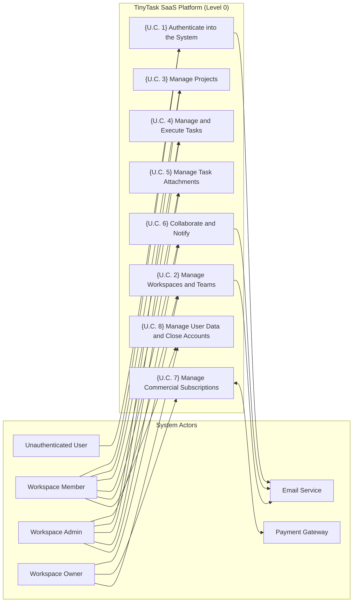

# E1.1 – TinyTask SaaS: AS-IS and TO-BE Model (Requirements Elicitation & PUC)

## Executive Summary

This report establishes the baseline requirements elicitation and analysis for the **TinyTask SaaS** platform, detailing the existing operational model (*As-Is*) and the target model (*To-Be*). The primary objective is to define exhaustively the product's functional scope, identifying actors, operational workflows, functional requirements prioritized using the MoSCoW methodology, and the formal Product Use Cases (*PUC*) catalog.

In accordance with software engineering literature (Robertson & Robertson, Cockburn, Wiegers & Beatty), this document focuses strictly on user operational and business needs, maintaining a pure functional approach. Security, privacy, and regulatory compliance overlays derived from the AEGIS methodology will be systematically integrated and mapped in downstream Phase 3 engineering steps.

---

## Table of Contents

- [Part I – Scope](#part-i--scope)
  - [1. Objective](#1-objective)
  - [2. Problem Description](#2-problem-description)
  - [3. Product Position Statement](#3-product-position-statement)
  - [4. Expected Impact](#4-expected-impact)
  - [5. Key Features](#5-key-features)
  - [6. Stakeholders](#6-stakeholders)
  - [7. System Users](#7-system-users)
  - [8. Constraints](#8-constraints)
- [Part II – As-Is](#part-ii--as-is)
  - [1. Business Roles in Context](#1-business-roles-in-context)
  - [2. Workflow Processes for Work Management](#2-workflow-processes-for-work-management)
  - [3. IT Support](#3-it-support)
- [Part III – To-Be](#part-iii--to-be)
  - [1. Initial Customer Expectations](#1-initial-customer-expectations)
  - [2. Functional and Non-Functional Requirements](#2-functional-and-non-functional-requirements)
    - [2.1 Actors](#21-actors)
    - [2.2 Functional Requirements](#22-functional-requirements)
    - [2.3 Non-Functional Requirements](#23-non-functional-requirements)
  - [3. Business Product Use Cases (PUC) Definition](#3-business-product-use-cases-puc-definition)
  - [4. System Use Case Model](#4-system-use-case-model)
- [Bibliography](#bibliography)
- [Version History](#version-history)

---

## Part I – Scope

### 1. Objective

The primary objective of this project is to specify and engineer the **TinyTask SaaS** platform, a cloud-native multi-tenant solution designed for small-to-medium teams that need to coordinate projects, assign tasks, track deadlines, and centralize support documentation without the cumbersome complexity or administrative friction of traditional enterprise management software.

The platform establishes a single source of operational truth, delivering an intuitive and fluid collaborative experience that eliminates communication overhead across team leads, technical staff, and external clients.

### 2. Problem Description

Small organizations and agile teams currently suffer from severe operational fragmentation:

- **Decentralization and Data Silos:** Critical information regarding task statuses, deadlines, and responsibilities is scattered across uncoordinated spreadsheets, instant messaging threads, and disparate email chains.
- **Coordination Overhead:** Team leads spend hours every week manually chasing status updates and compiling ad-hoc reports across separate channels.
- **Lack of Operational Visibility:** Individual team members lack clear visibility into immediate priorities, dependencies, and blocked deliverables, leading to duplicate efforts and missed deadlines.
- **Document Management Friction:** Deliverable attachments are exchanged via email attachments or unmanaged folder links, resulting in lost version history and broken auditability.

### 3. Product Position Statement

TinyTask is positioned as an agile, lean, and collaborative SaaS productivity platform optimized for intuitive usability, rapid onboarding, and autonomous team execution:

- **For:** Small teams, startups, digital agencies, and independent consultancies;
- **Who:** Require a centralized and visual way to organize tasks, manage projects, and share deliverable documentation;
- **TinyTask is:** A collaborative SaaS platform built around interactive Kanban boards, dynamic task views, and contextual discussions;
- **That allows:** Real-time visibility into project execution, automated progress notifications, and self-service team subscription management;
- **Unlike:** Heavy, bloated enterprise project management tools that demand extensive configuration and steep learning curves;
- **Our product distinguishes itself by:** Offering a clean, friction-free, and delightful user experience focused strictly on high-impact coordination and execution.

### 4. Expected Impact

The deployment and adoption of TinyTask SaaS delivers the following organizational impacts:

1. **Reduce Coordination Overhead:** Estimated 60% reduction in time spent on manual status sync meetings and repetitive progress update inquiries.
2. **Centralize Operational Information:** 100% of projects, tasks, attachments, and discussions reside in a unified, searchable, and structured repository.
3. **Improve Delivery Predictability:** Increased on-time delivery rates through real-time bottleneck detection and automated deadline warning alerts.
4. **Accelerate User Onboarding:** Enable new team members and external guests to onboard and become productive in under five minutes through intuitive self-service workflows.

### 5. Key Features

The platform's functional baseline is structured into core operational capabilities:

- **Multi-Tenant Workspaces:** Complete logical isolation across organizations, supporting dedicated member rosters and role-based access control.
- **Visual Task Management:** Interactive Kanban boards (To-Do, In-Progress, Under-Review, Done) and tabular lists with multi-criteria dynamic filtering.
- **Contextual In-Task Collaboration:** Rich Markdown discussion threads directly embedded within task cards, supporting user mentions to trigger instant alerts.
- **Integrated Attachment Management:** Upload, preview, download, and delete deliverable files directly linked to task contexts.
- **Commercial Subscription Management:** Seamless self-service billing integration via external payment gateway to manage Free, Pro, and Enterprise plan tiers.
- **User Data Portability:** Self-service personal data export, workspace-level archive downloads, and autonomous account closure workflows.

### 6. Stakeholders

The following table details the key stakeholders invested in the TinyTask SaaS platform:

*Table 1. Stakeholders*

| Stakeholder | Representatives | Role and Interest in the System |
|---|---|---|
| **Executive Leadership & Founders** | TinyTask SaaS Founders | Business viability, user growth, paid tier conversion, and low customer churn. |
| **Team Leads & Project Managers** | Project Managers, Team Coordinators | Operational visibility into workloads, seamless task delegation, and deadline tracking. |
| **Individual Contributors & Specialists** | Software Engineers, Designers, Marketers | Daily task queue management, clear priorities, and distraction-free communication. |
| **External Clients & Observers** | Client Stakeholders, External Reviewers | Transparent read-only access to deliverable progress and project timelines. |

### 7. System Users

The application defines four distinct user roles:

*Table 2. System Users*

| System User | Description and Responsibilities |
|---|---|
| **Workspace Owner** | Ultimate commercial and administrative authority. Manages billing, subscriptions, seat quotas, organization export, and workspace deletion. |
| **Workspace Admin** | Operational team manager. Invites members, assigns roles, configures workspace settings, and creates new projects. |
| **Workspace Member** | Standard team contributor. Creates, edits, and transitions tasks; uploads attachments; posts comments; and manages personal profile settings. |
| **Workspace Viewer** | External guest or client granted read-only visibility into authorized projects, task boards, and discussion threads. |

### 8. Constraints

The baseline product design operates under the following business and operational constraints:

- **Development Team Capacity:** The technical organization consists of 8 persons, requiring architectural simplicity, high modularity, and rapid maintainability.
- **Payment Processing:** The application delegates payment collection and billing transactions to an external payment gateway, avoiding local handling of credit card data.
- **Technology Neutrality:** This document defines pure functional capabilities from the user's perspective, without pre-baking technical security controls, which will be formally synthesized in subsequent AEGIS phases.

---

## Part II – As-Is

### 1. Business Roles in Context

In the baseline As-Is operational state—typical of small teams prior to adopting TinyTask—collaborators execute overlapping roles informally without standardized tooling:

- **Business Founder / Lead:** Manages commercial commitments, tracking client subscriptions and invoicing via local spreadsheets and direct email exchanges.
- **Project Lead:** Spends 2 to 3 hours daily consolidating manual status updates across chat messages and emails, manually updating a shared spreadsheet.
- **Team Contributor:** Tracks individual work in personal desktop note applications or paper notebooks, isolated from colleagues' real-time progress.
- **External Client:** Periodically requests status meetings or emails to check project health, receiving sporadic deliverable attachments.

### 2. Workflow Processes for Work Management

#### 2.1 Create and Initialize Projects

In the As-Is state, project initialization is recorded in an unstructured master spreadsheet on a shared drive:

*Table 3 - Data manually inserted to create a new project*

| Data Field | Data Type | Mandatory |
|---|---|---|
| Project Name | Text | Yes |
| Client / Organization Name | Text | Yes |
| Start Date | Date (`dd/mm/yyyy`) | Yes |
| Target End Date | Date (`dd/mm/yyyy`) | Yes |
| Project Lead | Text | Yes |
| Estimated Budget (€) | Decimal Number | No |
| General Scope Description | Text Block | No |

#### 2.2 Define and Schedule Tasks

Tasks are added as informal rows in separate tabs of the master spreadsheet:

*Table 4 - Data manually inserted to define and schedule tasks*

| Data Field | Data Type | Mandatory |
|---|---|---|
| Task Title | Text | Yes |
| Assignee Name | Text | No |
| Priority Level | Drop-down option (`High`, `Medium`, `Low`) | No |
| Target Deadline | Date (`dd/mm/yyyy`) | No |
| Estimated Effort (Hours) | Integer Number | No |
| Deliverable Notes | Text | No |

#### 2.3 Track Task Progress and Status

Progress updates rely on manual self-reporting during periodic team catch-up calls:

*Table 5 - Data manually inserted to track task progress*

| Data Field | Data Type | Mandatory |
|---|---|---|
| Current Status | Drop-down option (`To-Do`, `In-Progress`, `Done`) | Yes |
| Last Updated Date | Date (`dd/mm/yyyy`) | No |
| Updated By | Text | No |
| Actual Hours Spent | Decimal Number | No |
| Blockers / Impediments | Text | No |

#### 2.4 Share and Manage Document Attachments

Deliverable files and specifications are shared via email attachments and unmanaged shared drives:

*Table 6 - Data manually inserted to manage document attachments*

| Data Field | Data Type | Mandatory |
|---|---|---|
| File Name | Text | Yes |
| Shared Drive Path / URL | Text | Yes |
| Document Category | Drop-down option | No |
| Associated Task | Text | No |
| Upload Date | Date (`dd/mm/yyyy`) | Yes |

#### 2.5 Manage Commercial Subscriptions and Invoicing

Customer subscription plans and billing statuses are tracked manually in an accounting ledger:

*Table 7 - Data manually inserted to manage customer subscriptions*

| Data Field | Data Type | Mandatory |
|---|---|---|
| Client Organization Name | Text | Yes |
| Contracted Plan | Drop-down option (`Free`, `Pro`, `Enterprise`) | Yes |
| Billing Cycle | Drop-down option (`Monthly`, `Annual`) | Yes |
| Recurring Amount (€) | Decimal Number | Yes |
| Payment Status | Drop-down option (`Paid`, `Pending`, `Past-Due`) | Yes |
| Last Invoice Date | Date (`dd/mm/yyyy`) | Yes |

### 3. IT Support

In the As-Is baseline, operational tools are fragmented and unintegrated:
- **Shared Spreadsheets:** Used for task lists and budgets, suffering from version conflicts, concurrent overwrite errors, and accidental formula corruption.
- **Instant Messaging Applications:** Used for day-to-day discussion, leading to critical decisions getting buried in unsearchable chat histories.
- **Decentralized Cloud Drives:** Used for file storage, lacking contextual links to specific task deliverables or approval histories.

---

## Part III – To-Be

### 1. Initial Customer Expectations

The target To-Be system formalizes stakeholder expectations into a centralized SaaS platform:

*Table 8. Description of customer initial expectations*

| Initial Expectations | Description |
|---|---|
| **1. Centralize Work Management in a Single Platform** | Consolidate workspaces, projects, task boards, comments, and deliverable documentation into a unified, secure web platform accessible anywhere. |
| **2. Deliver Visual and Agile Task Management** | Provide interactive Kanban boards and dynamic table views enabling intuitive drag-and-drop state transitions with immediate visual feedback. |
| **3. Contextualize Team Collaboration** | Support rich Markdown discussion threads directly embedded inside task cards, allowing user mentions to trigger instant alerts. |
| **4. Integrate Document Attachment Storage** | Enable seamless uploading, previewing, and downloading of deliverable files directly indexed to specific tasks. |
| **5. Automate Commercial Subscription Workflows** | Enable workspace owners to subscribe, upgrade, and manage plans and invoices through self-service payment gateway integration. |
| **6. Ensure User Data Portability and Closure Autonomy** | Provide self-service personal data export, workspace archive generation, and autonomous account closure workflows. |

### 2. Functional and Non-Functional Requirements

#### 2.1 Actors

The following table formally defines the actors interacting with the system in the To-Be model:

*Table 9. List of actors*

| Actor | Description |
|---|---|
| **Workspace Owner** | Ultimate commercial and administrative authority. Manages billing, subscriptions, seat quotas, organization export, and workspace deletion. |
| **Workspace Admin** | Operational workspace manager. Invites members, modifies roles, configures organization profile settings, and initializes new projects. |
| **Workspace Member** | Standard collaborative contributor. Creates, edits, and transitions tasks; uploads attachments; posts comments; and manages profile settings. |
| **Workspace Viewer** | External guest or client granted read-only visibility into authorized projects and task lists. |
| **External Payment Gateway** | External payment processing engine responsible for handling payment sessions, executing billing charges, and dispatching signed asynchronous webhooks. |
| **Notification / Email Service** | Internal subsystem responsible for dispatching verification emails, assignment notifications, and daily pending task digests. |

#### 2.2 Functional Requirements

##### 2.2.1 MoSCoW Prioritization Method
Functional requirements are prioritized using the MoSCoW methodology:
- **MUST:** Mandatory requirement that must be satisfied in the baseline release for the system to be viable.
- **SHOULD:** High-impact requirement that should be satisfied unless critical delivery constraints dictate deferral.
- **COULD:** Desirable capability or enhancement that can be included if schedule and resources permit.
- **WON'T:** Out-of-scope feature that will not be implemented in the initial baseline release, reserved for future iterations.

##### 2.2.2 Summary Table of Functional Requirements

*Table 10. List of functional requirements*

| ID | ID | Requirement | Priority | Restrictions |
|---|---|---|---|---|
| **R1** | | **Manage User Accounts and Identity** | **MUST** | |
| | R1.1 | Register user account with email verification | MUST | Unique email |
| | R1.2 | Authenticate user credentials and issue active session | MUST | |
| | R1.3 | Recover user credentials via email reset link | MUST | |
| | R1.4 | Enforce role-based access control (RBAC) | MUST | |
| **R2** | | **Manage Workspaces and Teams** | **MUST** | |
| | R2.1 | Create workspace and assign creator as Workspace Owner | MUST | |
| | R2.2 | Invite workspace members via email | MUST | Seat quota |
| | R2.3 | Modify member roles and revoke workspace membership | MUST | |
| | R2.4 | Configure workspace profile (name, logo) | SHOULD | |
| | R2.5 | Monitor workspace activity and member metrics | COULD | |
| **R3** | | **Manage Projects** | **MUST** | |
| | R3.1 | Create project with title, description, and visibility | MUST | |
| | R3.2 | Archive completed project to read-only state | SHOULD | |
| **R4** | | **Create and Assign Tasks** | **MUST** | |
| | R4.1 | Create task with title, description, priority, and due date | MUST | |
| | R4.2 | Assign task to active workspace members | MUST | |
| | R4.3 | Display visual priority badges (Low, Medium, High, Urgent) | SHOULD | |
| **R5** | | **Manage Task States and Visual Board Views** | **MUST** | |
| | R5.1 | Track and transition task workflow states on visual board | MUST | |
| | R5.2 | Clone recurring tasks automatically upon completion | COULD | |
| **R6** | | **Search and Filter Tasks** | **MUST** | |
| | R6.1 | Filter tasks dynamically by status, assignee, priority, and date | MUST | |
| **R7** | | **Manage Task Deliverable Attachments** | **MUST** | |
| | R7.1 | Attach deliverable files to task card | MUST | 25 MB cap |
| | R7.2 | Download and remove task attachments | MUST | |
| **R8** | | **Collaborate via In-Task Comments** | **MUST** | |
| | R8.1 | Post threaded comments and mention collaborators | MUST | |
| | R8.2 | Stream comments in real-time | COULD | |
| **R9** | | **Track Activity History and Alerts** | **MUST** | |
| | R9.1 | Record chronological activity history on task cards | MUST | |
| | R9.2 | Consult in-app notification center for assignments and mentions | MUST | |
| | R9.3 | Dispatch daily pending task summary digest via email | SHOULD | |
| **R10** | | **Manage Commercial Subscriptions** | **MUST** | |
| | R10.1 | Subscribe and upgrade plan tier via payment gateway | MUST | |
| | R10.2 | Ingest and process billing webhooks to update plan status | MUST | |
| | R10.3 | Reconcile workspace member seat quotas upon payment success | MUST | |
| | R10.4 | Enforce grace period upon subscription payment failure | MUST | |
| **R11** | | **Manage User Data and Close Accounts** | **MUST** | |
| | R11.1 | Export personal user profile and task data in structured format | MUST | |
| | R11.2 | Export full workspace repository archive | MUST | |
| | R11.3 | Close user account | MUST | |
| | R11.4 | Dispatch digital confirmation receipt upon account closure | SHOULD | |

---

##### 2.2.3 Detailed Specification Cards for Functional Requirements

The detailed functional requirement cards follow the exact 7-row single-column format established in the reference project standard:

#### R1 – Manage User Accounts and Identity

##### R1.1 – Register user account with email verification

| Requirement |
|---|
| **ID:** R1.1 **Name:** Register user account with email verification |
| **Description:** The system must allow an unauthenticated visitor to register a user account by submitting full name, email address, and password, validating email uniqueness and automatically dispatching an activation email containing a time-limited confirmation link. |
| **Requirement Origin:** Client Onboarding Needs & Customer Expectation EXP-01 |
| **Interfaces:** Unauthenticated User and Notification / Email Service |
| **Dependencies:** • **Stakeholders:** Executive Leadership, Team Contributors • **Data Sources:** User Registration Form • **Extraction Periodicity:** on demand • **Information Systems / Databases:** Internal Application Database • **Preceding Requirements:** |
| **Identified Problems:** |
| **Priority:** Must |

##### R1.2 – Authenticate user credentials and issue active session

| Requirement |
|---|
| **ID:** R1.2 **Name:** Authenticate user credentials and issue active session |
| **Description:** The system must validate submitted email address and password credentials against registered active accounts, issuing an authenticated session and returning the list of authorized workspaces for that user. |
| **Requirement Origin:** Client Access Management Needs & Customer Expectation EXP-01 |
| **Interfaces:** Registered User |
| **Dependencies:** • **Stakeholders:** Team Contributors, Workspace Admins • **Data Sources:** Login Form • **Extraction Periodicity:** on demand • **Information Systems / Databases:** Internal Application Database • **Preceding Requirements:** |
| **Identified Problems:** |
| **Priority:** Must |

##### R1.3 – Recover user credentials via email reset link

| Requirement |
|---|
| **ID:** R1.3 **Name:** Recover user credentials via email reset link |
| **Description:** The system must allow a user to request account recovery by submitting their registered email address, generating a single-use, time-limited reset link delivered via email that enables password updating. |
| **Requirement Origin:** Self-Service User Account Operations |
| **Interfaces:** Registered User and Notification / Email Service |
| **Dependencies:** • **Stakeholders:** Team Contributors • **Data Sources:** Password Recovery Form • **Extraction Periodicity:** on demand • **Information Systems / Databases:** Internal Application Database • **Preceding Requirements:** |
| **Identified Problems:** |
| **Priority:** Must |

##### R1.4 – Enforce role-based access control (RBAC)

| Requirement |
|---|
| **ID:** R1.4 **Name:** Enforce role-based access control (RBAC) |
| **Description:** The system must evaluate user actions against four standard workspace roles (Owner, Admin, Member, Viewer), granting execution privileges strictly according to the role held by the authenticated user in that workspace. |
| **Requirement Origin:** Workspace Governance Needs & Customer Expectation EXP-01 |
| **Interfaces:** All Platform Users |
| **Dependencies:** • **Stakeholders:** Workspace Admins, Executive Leadership • **Data Sources:** Workspace Membership Table • **Extraction Periodicity:** on demand • **Information Systems / Databases:** Internal Application Database • **Preceding Requirements:** |
| **Identified Problems:** |
| **Priority:** Must |

#### R2 – Manage Workspaces and Teams

##### R2.1 – Create workspace and assign creator as Workspace Owner

| Requirement |
|---|
| **ID:** R2.1 **Name:** Create workspace and assign creator as Workspace Owner |
| **Description:** The system must allow an authenticated user to instantiate a new isolated workspace by submitting a unique name and URL slug, establishing the creator as the primary Workspace Owner with full administrative authority. |
| **Requirement Origin:** Multi-Tenant Organization Needs & Customer Expectation EXP-01 |
| **Interfaces:** Workspace Owner |
| **Dependencies:** • **Stakeholders:** Platform Founders, Business Customers • **Data Sources:** Workspace Creation Form • **Extraction Periodicity:** on demand • **Information Systems / Databases:** Internal Application Database • **Preceding Requirements:** |
| **Identified Problems:** |
| **Priority:** Must |

##### R2.2 – Invite workspace members via email

| Requirement |
|---|
| **ID:** R2.2 **Name:** Invite workspace members via email |
| **Description:** The system must allow Workspace Admins and Owners to invite prospective members by submitting email addresses and initial roles, verifying that active member quotas are not exceeded and dispatching invitation emails with onboarding links. |
| **Requirement Origin:** Team Collaboration Needs & As-Is Inefficiency 2.1 |
| **Interfaces:** Workspace Admin, Workspace Owner, and Notification / Email Service |
| **Dependencies:** • **Stakeholders:** Team Leads, Project Managers • **Data Sources:** Member Invitation Form • **Extraction Periodicity:** on demand • **Information Systems / Databases:** Internal Application Database • **Preceding Requirements:** |
| **Identified Problems:** |
| **Priority:** Must |

##### R2.3 – Modify member roles and revoke workspace membership

| Requirement |
|---|
| **ID:** R2.3 **Name:** Modify member roles and revoke workspace membership |
| **Description:** The system must allow Workspace Admins and Owners to update the role of existing members (between Admin, Member, and Viewer) or remove members from the workspace, preventing removal or demotion of the Workspace Owner. |
| **Requirement Origin:** Team Administration Needs & Governance |
| **Interfaces:** Workspace Admin and Workspace Owner |
| **Dependencies:** • **Stakeholders:** Workspace Admins • **Data Sources:** Workspace Member Roster • **Extraction Periodicity:** on demand • **Information Systems / Databases:** Internal Application Database • **Preceding Requirements:** |
| **Identified Problems:** |
| **Priority:** Must |

##### R2.4 – Configure workspace profile (name, logo)

| Requirement |
|---|
| **ID:** R2.4 **Name:** Configure workspace profile (name, logo) |
| **Description:** The system must allow Workspace Admins and Owners to update organization branding by editing the workspace name and uploading an organization logo graphic up to 2 MB in file size. |
| **Requirement Origin:** Customer Branding & Customization |
| **Interfaces:** Workspace Admin and Workspace Owner |
| **Dependencies:** • **Stakeholders:** Business Customers • **Data Sources:** Workspace Settings Form • **Extraction Periodicity:** on demand • **Information Systems / Databases:** File Storage Service • **Preceding Requirements:** |
| **Identified Problems:** |
| **Priority:** Should |

##### R2.5 – Monitor workspace activity and member metrics

| Requirement |
|---|
| **ID:** R2.5 **Name:** Monitor workspace activity and member metrics |
| **Description:** The system must compile and present aggregated operational metrics to workspace leadership, displaying active member counts, tasks completed during the billing cycle, and total deliverable file storage consumed. |
| **Requirement Origin:** Team Coordination Needs & Management Reporting |
| **Interfaces:** Workspace Admin and Workspace Owner |
| **Dependencies:** • **Stakeholders:** Team Leads, Executives • **Data Sources:** Workspace Activity Logs • **Extraction Periodicity:** on demand • **Information Systems / Databases:** Internal Application Database • **Preceding Requirements:** |
| **Identified Problems:** |
| **Priority:** Could |

#### R3 – Manage Projects

##### R3.1 – Create project with title, description, and visibility

| Requirement |
|---|
| **ID:** R3.1 **Name:** Create project with title, description, and visibility |
| **Description:** The system must allow Workspace Admins and Members to initialize distinct project containers within a workspace, specifying project name, description of deliverables, and visibility settings (workspace-wide or restricted). |
| **Requirement Origin:** Project Work Structuring Needs & As-Is Pain Point 2.1 |
| **Interfaces:** Workspace Admin and Workspace Member |
| **Dependencies:** • **Stakeholders:** Project Managers, Team Contributors • **Data Sources:** Project Creation Form • **Extraction Periodicity:** on demand • **Information Systems / Databases:** Internal Application Database • **Preceding Requirements:** |
| **Identified Problems:** |
| **Priority:** Must |

##### R3.2 – Archive completed project to read-only state

| Requirement |
|---|
| **ID:** R3.2 **Name:** Archive completed project to read-only state |
| **Description:** The system must allow Workspace Admins and Owners to transition completed projects into archived status, rendering all tasks and discussions read-only and hiding the project from daily operational views while preserving historical data. |
| **Requirement Origin:** Project Lifecycle Management Needs |
| **Interfaces:** Workspace Admin and Workspace Owner |
| **Dependencies:** • **Stakeholders:** Project Managers • **Data Sources:** Project Settings Form • **Extraction Periodicity:** on demand • **Information Systems / Databases:** Internal Application Database • **Preceding Requirements:** |
| **Identified Problems:** |
| **Priority:** Should |

#### R4 – Create and Assign Tasks

##### R4.1 – Create task with title, description, priority, and due date

| Requirement |
|---|
| **ID:** R4.1 **Name:** Create task with title, description, priority, and due date |
| **Description:** The system must enable rapid task authoring within a project, requiring a mandatory title and allowing optional detailed description, target due date, and initial priority level, placing the task in "To-Do" status. |
| **Requirement Origin:** Work Item Authoring Needs & As-Is Pain Point 2.2 |
| **Interfaces:** Workspace Member, Workspace Admin, and Workspace Owner |
| **Dependencies:** • **Stakeholders:** Team Contributors, Project Managers • **Data Sources:** Task Creation Form • **Extraction Periodicity:** on demand • **Information Systems / Databases:** Internal Application Database • **Preceding Requirements:** |
| **Identified Problems:** |
| **Priority:** Must |

##### R4.2 – Assign task to active workspace members

| Requirement |
|---|
| **ID:** R4.2 **Name:** Assign task to active workspace members |
| **Description:** The system must allow assigning execution responsibility for a task to one or more active members of the workspace, dispatching instant notifications to the assigned users. |
| **Requirement Origin:** Task Attribution Needs & As-Is Pain Point 2.2 |
| **Interfaces:** Workspace Member, Workspace Admin |
| **Dependencies:** • **Stakeholders:** Team Contributors, Team Leads • **Data Sources:** Workspace Member Picker • **Extraction Periodicity:** on demand • **Information Systems / Databases:** Internal Application Database • **Preceding Requirements:** |
| **Identified Problems:** |
| **Priority:** Must |

##### R4.3 – Display visual priority badges (Low, Medium, High, Urgent)

| Requirement |
|---|
| **ID:** R4.3 **Name:** Display visual priority badges (Low, Medium, High, Urgent) |
| **Description:** The system must render distinct visual badges for each priority level (Low, Medium, High, Urgent) across task cards and table views, enabling rapid visual triage of urgent deliverables. |
| **Requirement Origin:** Visual Triage Needs & Customer Expectation EXP-02 |
| **Interfaces:** All Users |
| **Dependencies:** • **Stakeholders:** Team Contributors • **Data Sources:** Task Priority Property • **Extraction Periodicity:** on demand • **Information Systems / Databases:** Internal Application Database • **Preceding Requirements:** |
| **Identified Problems:** |
| **Priority:** Should |

#### R5 – Manage Task States and Visual Board Views

##### R5.1 – Track and transition task workflow states on visual board

| Requirement |
|---|
| **ID:** R5.1 **Name:** Track and transition task workflow states on visual board |
| **Description:** The system must display tasks organized in sequential status columns (To-Do, In-Progress, Under-Review, Done) on an interactive visual board, allowing authorized users to transition cards between states and recording transition author and timestamp in task history. |
| **Requirement Origin:** Agile Workflow Tracking Needs & Customer Expectation EXP-02 |
| **Interfaces:** Workspace Member, Workspace Admin |
| **Dependencies:** • **Stakeholders:** Team Contributors, Project Leads • **Data Sources:** Task State Model • **Extraction Periodicity:** on demand • **Information Systems / Databases:** Internal Application Database • **Preceding Requirements:** |
| **Identified Problems:** |
| **Priority:** Must |

##### R5.2 – Clone recurring tasks automatically upon completion

| Requirement |
|---|
| **ID:** R5.2 **Name:** Clone recurring tasks automatically upon completion |
| **Description:** The system must allow users to configure recurrence schedules (weekly or monthly) on a task, automatically creating a duplicate task instance in the "To-Do" column once the current instance is marked "Done". |
| **Requirement Origin:** Repetitive Task Automation Needs |
| **Interfaces:** Workspace Member, Workspace Admin |
| **Dependencies:** • **Stakeholders:** Team Contributors • **Data Sources:** Task Recurrence Rule • **Extraction Periodicity:** on demand • **Information Systems / Databases:** Internal Application Database • **Preceding Requirements:** |
| **Identified Problems:** |
| **Priority:** Could |

#### R6 – Search and Filter Tasks

##### R6.1 – Filter tasks dynamically by status, assignee, priority, and date

| Requirement |
|---|
| **ID:** R6.1 **Name:** Filter tasks dynamically by status, assignee, priority, and date |
| **Description:** The system must provide multi-criteria filter controls on project board and list views, dynamically filtering displayed tasks by assignee, status, priority, or overdue status without requiring page reloads. |
| **Requirement Origin:** Task Retrieval Needs & Customer Expectation EXP-02 |
| **Interfaces:** All Users |
| **Dependencies:** • **Stakeholders:** Team Contributors, Project Leads • **Data Sources:** Task Search Index • **Extraction Periodicity:** on demand • **Information Systems / Databases:** Internal Application Database • **Preceding Requirements:** |
| **Identified Problems:** |
| **Priority:** Must |

#### R7 – Manage Task Deliverable Attachments

##### R7.1 – Attach deliverable files to task card

| Requirement |
|---|
| **ID:** R7.1 **Name:** Attach deliverable files to task card |
| **Description:** The system must allow authorized workspace members to upload deliverable files (supporting documents, spreadsheets, presentations, and images) up to 25 MB in size per file, indexing the attachment directly to the task card and updating task attachment counts. |
| **Requirement Origin:** Document Centralization Needs & Customer Expectation EXP-04 |
| **Interfaces:** Workspace Member, Workspace Admin |
| **Dependencies:** • **Stakeholders:** Team Contributors, Clients • **Data Sources:** Local Client File • **Extraction Periodicity:** on demand • **Information Systems / Databases:** File Storage Service • **Preceding Requirements:** |
| **Identified Problems:** |
| **Priority:** Must |

##### R7.2 – Download and remove task attachments

| Requirement |
|---|
| **ID:** R7.2 **Name:** Download and remove task attachments |
| **Description:** The system must provide secure download access for task attachments to users with project view rights, and allow the file uploader or Workspace Admin to permanently remove an attachment from the task card. |
| **Requirement Origin:** Document Lifecycle Needs & Customer Expectation EXP-04 |
| **Interfaces:** Workspace Member, Workspace Admin, Workspace Viewer |
| **Dependencies:** • **Stakeholders:** Contributors, Admins, Clients • **Data Sources:** Stored Attachment Record • **Extraction Periodicity:** on demand • **Information Systems / Databases:** File Storage Service • **Preceding Requirements:** |
| **Identified Problems:** |
| **Priority:** Must |

#### R8 – Collaborate via In-Task Comments

##### R8.1 – Post threaded comments and mention collaborators

| Requirement |
|---|
| **ID:** R8.1 **Name:** Post threaded comments and mention collaborators |
| **Description:** The system must provide a contextual comment thread inside each task card supporting rich text Markdown formatting and parsing collaborator mentions (@user) to automatically dispatch in-app notifications to tagged users. |
| **Requirement Origin:** In-Context Collaboration Needs & Customer Expectation EXP-03 |
| **Interfaces:** Workspace Member, Workspace Admin, and Notification / Email Service |
| **Dependencies:** • **Stakeholders:** Contributors, Clients • **Data Sources:** Task Comment Input • **Extraction Periodicity:** on demand • **Information Systems / Databases:** Internal Application Database • **Preceding Requirements:** |
| **Identified Problems:** |
| **Priority:** Must |

##### R8.2 – Stream comments in real-time

| Requirement |
|---|
| **ID:** R8.2 **Name:** Stream comments in real-time |
| **Description:** The system must push new comments instantly to active users currently viewing the task card without requiring manual interface refresh. |
| **Requirement Origin:** Real-Time Team Communication Needs |
| **Interfaces:** Active Online Users |
| **Dependencies:** • **Stakeholders:** Contributors • **Data Sources:** Real-Time Message Stream • **Extraction Periodicity:** on demand • **Information Systems / Databases:** Real-Time Push Channel • **Preceding Requirements:** |
| **Identified Problems:** |
| **Priority:** Could |

#### R9 – Track Activity History and Alerts

##### R9.1 – Record chronological activity history on task cards

| Requirement |
|---|
| **ID:** R9.1 **Name:** Record chronological activity history on task cards |
| **Description:** The system must record and display a chronological audit feed on each task card documenting state changes, assignee reallocations, due date adjustments, and attachment events, identifying author and timestamp. |
| **Requirement Origin:** Operational Transparency Needs & Team Accountability |
| **Interfaces:** All Users |
| **Dependencies:** • **Stakeholders:** Project Managers, Contributors • **Data Sources:** Audit Log Table • **Extraction Periodicity:** on demand • **Information Systems / Databases:** Internal Application Database • **Preceding Requirements:** |
| **Identified Problems:** |
| **Priority:** Must |

##### R9.2 – Consult in-app notification center for assignments and mentions

| Requirement |
|---|
| **ID:** R9.2 **Name:** Consult in-app notification center for assignments and mentions |
| **Description:** The system must provide a notification center accessible via header bell icon with unread badge counter, displaying an actionable list of direct task assignments and @mentions linking directly to target tasks. |
| **Requirement Origin:** User Attention Management & As-Is Pain Point 2.3 |
| **Interfaces:** Authenticated User |
| **Dependencies:** • **Stakeholders:** Contributors • **Data Sources:** User Notifications Table • **Extraction Periodicity:** on demand • **Information Systems / Databases:** Internal Application Database • **Preceding Requirements:** |
| **Identified Problems:** |
| **Priority:** Must |

##### R9.3 – Dispatch daily pending task summary digest via email

| Requirement |
|---|
| **ID:** R9.3 **Name:** Dispatch daily pending task summary digest via email |
| **Description:** The system must compile and dispatch an automated email digest at 08:00 daily to subscribed users, listing tasks assigned to them that are due on the current day or currently overdue. |
| **Requirement Origin:** Daily Work Prioritization Needs & Productivity |
| **Interfaces:** Registered User and Notification / Email Service |
| **Dependencies:** • **Stakeholders:** Project Managers, Contributors • **Data Sources:** Task Scheduler Daemon • **Extraction Periodicity:** daily • **Information Systems / Databases:** Internal Application Database • **Preceding Requirements:** |
| **Identified Problems:** |
| **Priority:** Should |

#### R10 – Manage Commercial Subscriptions

##### R10.1 – Subscribe and upgrade plan tier via payment gateway

| Requirement |
|---|
| **ID:** R10.1 **Name:** Subscribe and upgrade plan tier via payment gateway |
| **Description:** The system must allow the Workspace Owner to select a commercial plan tier (Pro or Enterprise) and initiate checkout, redirecting the browser to a secure hosted checkout session provided by the external payment gateway. |
| **Requirement Origin:** Customer Subscription Needs & Customer Expectation EXP-05 |
| **Interfaces:** Workspace Owner and External Payment Gateway |
| **Dependencies:** • **Stakeholders:** Executive Leadership, Business Customers • **Data Sources:** Pricing Catalog • **Extraction Periodicity:** on demand • **Information Systems / Databases:** External Payment Gateway • **Preceding Requirements:** |
| **Identified Problems:** |
| **Priority:** Must |

##### R10.2 – Ingest and process billing webhooks to update plan status

| Requirement |
|---|
| **ID:** R10.2 **Name:** Ingest and process billing webhooks to update plan status |
| **Description:** The system must ingest and validate signed asynchronous webhooks sent by the external payment gateway upon completed payments, updating workspace plan status, seat limits, and renewal dates immediately. |
| **Requirement Origin:** Commercial Automation Needs & Revenue Reconciliation |
| **Interfaces:** External Payment Gateway and Platform Core |
| **Dependencies:** • **Stakeholders:** Finance & IT Operations • **Data Sources:** Billing Webhook Payloads • **Extraction Periodicity:** on demand • **Information Systems / Databases:** Internal Application Database • **Preceding Requirements:** |
| **Identified Problems:** |
| **Priority:** Must |

##### R10.3 – Reconcile workspace member seat quotas upon payment success

| Requirement |
|---|
| **ID:** R10.3 **Name:** Reconcile workspace member seat quotas upon payment success |
| **Description:** The system must automatically adjust authorized workspace member quotas upon receiving payment confirmation, enabling the immediate invitation of additional team members up to the new tier limit. |
| **Requirement Origin:** Capacity Allocation Needs |
| **Interfaces:** Workspace Admin and Workspace Owner |
| **Dependencies:** • **Stakeholders:** Workspace Admins • **Data Sources:** Plan Tier Member Quota • **Extraction Periodicity:** on demand • **Information Systems / Databases:** Internal Application Database • **Preceding Requirements:** |
| **Identified Problems:** |
| **Priority:** Must |

##### R10.4 – Enforce grace period upon subscription payment failure

| Requirement |
|---|
| **ID:** R10.4 **Name:** Enforce grace period upon subscription payment failure |
| **Description:** The system must grant a 7-day operational grace period if an automated subscription renewal payment fails, maintaining normal workspace access while presenting payment update notices to the Workspace Owner. |
| **Requirement Origin:** Customer Retention & Business Continuity |
| **Interfaces:** Workspace Owner and External Payment Gateway |
| **Dependencies:** • **Stakeholders:** Customers, Finance • **Data Sources:** Payment Failure Notification • **Extraction Periodicity:** on demand • **Information Systems / Databases:** Internal Application Database • **Preceding Requirements:** |
| **Identified Problems:** |
| **Priority:** Must |

#### R11 – Manage User Data and Close Accounts

##### R11.1 – Export personal user profile and task data in structured format

| Requirement |
|---|
| **ID:** R11.1 **Name:** Export personal user profile and task data in structured format |
| **Description:** The system must allow an authenticated user to request and download a structured data package containing their personal profile information, preferences, and tasks authored by their account. |
| **Requirement Origin:** User Data Autonomy & Customer Expectation EXP-06 |
| **Interfaces:** Authenticated User |
| **Dependencies:** • **Stakeholders:** End Users • **Data Sources:** User Profile and Tasks Table • **Extraction Periodicity:** on demand • **Information Systems / Databases:** Internal Application Database • **Preceding Requirements:** |
| **Identified Problems:** |
| **Priority:** Must |

##### R11.2 – Export full workspace repository archive

| Requirement |
|---|
| **ID:** R11.2 **Name:** Export full workspace repository archive |
| **Description:** The system must provide the Workspace Owner with a self-service workspace export option, generating a comprehensive compressed archive containing projects, tasks, comments, and attachments. |
| **Requirement Origin:** Organization Data Portability & Customer Expectation EXP-06 |
| **Interfaces:** Workspace Owner |
| **Dependencies:** • **Stakeholders:** Business Customers, Management • **Data Sources:** Workspace Data Tables and Files • **Extraction Periodicity:** on demand • **Information Systems / Databases:** Internal Application Database • **Preceding Requirements:** |
| **Identified Problems:** |
| **Priority:** Must |

##### R11.3 – Close user account

| Requirement |
|---|
| **ID:** R11.3 **Name:** Close user account |
| **Description:** The system must allow users to autonomously terminate their accounts, invalidating active credentials and sessions, ending active workspace memberships, and recording account closure status. |
| **Requirement Origin:** Self-Service Account Termination & Customer Expectation EXP-06 |
| **Interfaces:** Authenticated User |
| **Dependencies:** • **Stakeholders:** End Users, Workspace Admins • **Data Sources:** User Profile Record • **Extraction Periodicity:** on demand • **Information Systems / Databases:** Internal Application Database • **Preceding Requirements:** |
| **Identified Problems:** |
| **Priority:** Must |

##### R11.4 – Dispatch digital confirmation receipt upon account closure

| Requirement |
|---|
| **ID:** R11.4 **Name:** Dispatch digital confirmation receipt upon account closure |
| **Description:** The system must send a confirmation receipt via email immediately upon account termination, certifying the date and time when the account was permanently closed. |
| **Requirement Origin:** User Verification & Customer Expectation EXP-06 |
| **Interfaces:** Closed User Account and Notification / Email Service |
| **Dependencies:** • **Stakeholders:** End Users • **Data Sources:** Deactivation Record • **Extraction Periodicity:** on demand • **Information Systems / Databases:** Notification / Email Service • **Preceding Requirements:** |
| **Identified Problems:** |
| **Priority:** Should |

---

#### 2.3 Non-Functional Requirements

The non-functional requirements define the platform's performance, availability, and usability targets:

*Table 11. List of non-functional requirements*

| ID | Requirement | Priority | Type |
|---|---|---|---|
| **RN1** | The platform must achieve a page load response time of under 500 ms for Kanban boards and task list views containing up to 200 items. | MUST | Performance & Efficiency |
| **RN2** | The system must maintain monthly service availability of at least 99.5%, excluding scheduled maintenance windows announced in advance. | MUST | Availability |
| **RN3** | The web application interface must be fully responsive, ensuring correct rendering on modern desktop and mobile viewports (minimum width of 375 px). | MUST | Usability |
| **RN4** | The storage architecture must support up to 50,000 active tasks per workspace without degradation in search, filter, or rendering speed. | SHOULD | Scalability |
| **RN5** | The system must execute automated daily database backups and maintain data recovery capabilities with an RPO under 24 hours. | MUST | Recoverability |
| **RN6** | The user interface must support internationalization (i18n), offering full system localization in English and Portuguese. | SHOULD | Internationalization |
| **RN7** | The payment gateway integration must communicate exclusively over authenticated secure channels and enforce cryptographic webhook signature verification. | MUST | Interoperability |
| **RN8** | The system architecture must enforce strict logical data segregation across workspaces (multi-tenancy), preventing cross-tenant access. | MUST | Architectural Integrity |

---

### 3. Business Product Use Cases (PUC) Definition

The Product Use Cases (*PUC*) delineate the functional boundary of TinyTask SaaS, mapping input payloads, processing boundaries, and output deliverables:

*Table 12. Summary table of Product Use Cases (PUC)*

| PUC | PUC Name | Actors / Users | Input and Output |
|---|---|---|---|
| **1.1** | Register and Activate User Account | Unauthenticated User, Notification / Email Service | **(in)** Full name, email, password **(out)** Verification email with activation link |
| **1.2** | Authenticate User and Issue Session | Registered User | **(in)** Email and password credentials **(out)** Active session and authorized workspace list |
| **1.3** | Recover User Password via Reset Link | Registered User, Notification / Email Service | **(in)** User registered email address **(out)** Password reset email with secure token |
| **2.1** | Create Organization Workspace | Workspace Owner | **(in)** Workspace name and URL slug **(out)** Instantiated workspace with creator as Owner |
| **2.2** | Invite and Manage Workspace Members | Workspace Admin, Workspace Owner, Notification / Email Service | **(in)** Invitee email and assigned role (Admin, Member, Viewer) **(out)** Invitation email and member added to roster |
| **2.3** | Configure Workspace Profile Settings | Workspace Admin, Workspace Owner | **(in)** Updated workspace name and logo image (up to 2 MB) **(out)** Updated workspace branding across client views |
| **3.1** | Create and Configure New Project | Workspace Admin, Workspace Member | **(in)** Project title, scope description, visibility setting **(out)** Initialized project accessible in navigation menu |
| **3.2** | Archive Completed Project | Workspace Admin, Workspace Owner | **(in)** Selection of target project to archive **(out)** Read-only project hidden from operational views |
| **4.1** | Create and Assign Project Task | Workspace Member, Workspace Admin | **(in)** Title, description, priority, due date, assignee **(out)** New task card in "To-Do" and assignee notification |
| **4.2** | Track and Transition Task Workflow States | Workspace Member, Workspace Admin | **(in)** Transition card to target status column **(out)** Updated task status and audit history event |
| **4.3** | Search and Filter Tasks | All Users | **(in)** Search terms and filter criteria (assignee, priority, status) **(out)** Filtered board and table views updated in real-time |
| **5.1** | Attach Deliverable Files to Task Card | Workspace Member, Workspace Admin | **(in)** File selection (up to 25 MB size cap) **(out)** Uploaded file linked to task attachment gallery |
| **5.2** | Download and Remove Task Attachments | Workspace Member, Workspace Admin, Workspace Viewer | **(in)** Download or delete command for specified file **(out)** File transferred to client or purged from attachment gallery |
| **6.1** | Post Threaded Comments and Mention Collaborators | Workspace Member, Workspace Admin | **(in)** Markdown comment text with user mentions (@user) **(out)** Comment posted and notifications delivered to tagged users |
| **6.2** | Consult In-App Notification Center | Authenticated User | **(in)** Access user notification drawer **(out)** Chronological list of unread mentions and task assignments |
| **7.1** | Subscribe and Upgrade Commercial Plan | Workspace Owner, External Payment Gateway | **(in)** Selected plan tier (Pro/Enterprise) and billing info **(out)** Payment confirmation and updated workspace quotas |
| **7.2** | Process Billing Webhooks and Reconcile Quotas | External Payment Gateway, Platform Core | **(in)** Asynchronous webhook notification with payment event **(out)** Reconciled plan tier and member quotas in database |
| **8.1** | Export Personal and Workspace Data | Authenticated User, Workspace Owner | **(in)** Data export request (personal format or workspace archive) **(out)** Downloadable archive package generated for client |
| **8.2** | Close User Account | Authenticated User, Notification / Email Service | **(in)** Autonomous account closure confirmation **(out)** Credentials invalidated, membership ended, receipt dispatched |

---

### 4. System Use Case Model

The use case model formalizes interactions between system actors and the TinyTask platform. Refinement stops strictly at **Level 1**, omitting procedural execution steps and leaf nodes:

#### 4.1 Level-0 System Use Case Diagram

#### 4.2 Level-1 System Use Cases

##### {U.C. 1} Authenticate into the System
- **{U.C. 1.1} Register New Account:** Collects new user registration details and dispatches confirmation email with account activation link.
- **{U.C. 1.2} Authenticate User Credentials:** Validates login credentials, issues authenticated session, and loads authorized workspace list.
- **{U.C. 1.3} Recover Account Credentials:** Processes forgotten password requests by generating and emailing a secure, time-limited reset link.

##### {U.C. 2} Manage Workspaces and Teams
- **{U.C. 2.1} Create Workspace:** Instantiates a new multi-tenant organization environment and assigns the creator as Workspace Owner.
- **{U.C. 2.2} Invite and Manage Members:** Dispatches email invitations, modifies member role assignments, and revokes workspace access.
- **{U.C. 2.3} Configure Workspace Profile:** Updates organization display name, uploads custom logo graphic, and inspects plan tier quotas.

##### {U.C. 3} Manage Projects
- **{U.C. 3.1} Create and Configure Project:** Creates new project containers, specifying project name, scope description, and internal visibility.
- **{U.C. 3.2} Archive Project:** Moves completed projects to historical archive mode, locking tasks and comments into read-only state.

##### {U.C. 4} Manage and Execute Tasks
- **{U.C. 4.1} Create and Assign Task:** Records new task items, sets priority ratings, assigns team contributors, and specifies due dates.
- **{U.C. 4.2} Track and Transition Task Workflow States:** Enables visual tracking and movement of tasks across To-Do, In-Progress, Under-Review, and Done columns.
- **{U.C. 4.3} Search and Filter Tasks:** Applies real-time multi-criteria filtering across project boards and tabular task views.

##### {U.C. 5} Manage Task Attachments
- **{U.C. 5.1} Attach Deliverable Files to Task Card:** Allows uploading deliverable documents and graphics (up to 25 MB) directly to task cards.
- **{U.C. 5.2} Download and Remove Task Attachments:** Enables authorized users to download attached files and permits file deletion by uploaders or admins.

##### {U.C. 6} Collaborate and Notify
- **{U.C. 6.1} Post Threaded Comments and Mention Collaborators:** Supports contextual Markdown discussion inside task cards, triggering alerts via user mentions.
- **{U.C. 6.2} Consult Notification Center:** Displays in-app unread alerts and dispatches daily pending task digests via email.

##### {U.C. 7} Manage Commercial Subscriptions
- **{U.C. 7.1} Subscribe and Upgrade Plan:** Enables Workspace Owners to select commercial tiers and complete checkout via external payment gateway.
- **{U.C. 7.2} Process Billing Webhooks and Reconcile Quotas:** Ingests payment gateway webhooks and updates workspace member seat quotas.

##### {U.C. 8} Manage User Data and Close Accounts
- **{U.C. 8.1} Export Personal and Workspace Data:** Generates downloadable archives for user profiles and complete packages for workspaces.
- **{U.C. 8.2} Close User Account:** Executes autonomous account closure, invalidating credentials, ending memberships, and dispatching receipts.

---

## Bibliography

1. Robertson, S., & Robertson, J. (2012). *Mastering the Requirements Process: Getting Requirements Right* (3rd ed.). Addison-Wesley Professional.
2. Cockburn, A. (2000). *Writing Effective Use Cases*. Addison-Wesley Professional.
3. Leffingwell, D., & Widrig, D. (2003). *Managing Software Requirements: A Use Case Approach* (2nd ed.). Addison-Wesley Professional.
4. Wiegers, K., & Beatty, J. (2013). *Software Requirements* (3rd ed.). Microsoft Press.
5. Project Management Institute. (2021). *A Guide to the Project Management Body of Knowledge (PMBOK Guide)* (7th ed.). Project Management Institute.

---

## Version History

| Version | Date | Author | Modification Notes |
|---|---|---|---|
| **1.0.0** | 2026-09-23 | AEGIS Technical Team | Initial baseline release of TinyTask SaaS AS-IS and TO-BE model matching GPTools E1.1 deliverable structure, table formats, and active action verb phrasing. |
