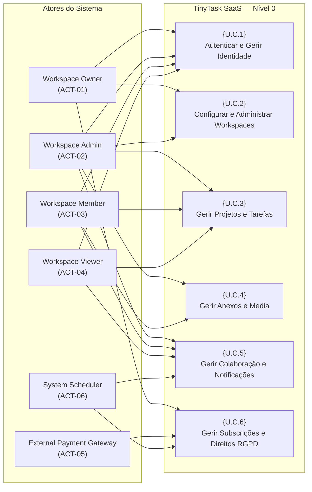

# Doc01 — AS-IS / TO-BE Model & Requirements Elicitation (TinyTask SaaS)

> **Document ID:** `TT-P3-DOC01`  
> **Deliverable Reference:** `E1.1 – TinyTask SaaS AS-IS / TO-BE Model & Requirements Elicitation`  
> **Lifecycle Phase:** AEGIS Phase 3 — Specification (Functional Baseline)  
> **Reference Standard:** GPTools Deliverable E1.1 Standard (`GPTools_ModeloASIS_TOBE V2.0`)  
> **Prioritization Model:** MoSCoW (MUST, SHOULD, COULD, WON'T)  
> **Language:** English  
> **Status:** Approved Baseline  

---

## Table of Contents

1. [Executive Summary](#1-executive-summary)
2. [Glossary](#2-glossary)
3. [Part I — Scope](#3-part-i--scope)
   - 3.1 [Objective](#31-objective)
     - 3.1.1 [Problem Description](#311-problem-description)
     - 3.1.2 [Product Position Description](#312-product-position-description)
     - 3.1.3 [Expected Impact](#313-expected-impact)
     - 3.1.4 [Key Characteristics](#314-key-characteristics)
   - 3.2 [Stakeholders](#32-stakeholders)
   - 3.3 [System Users](#33-system-users)
   - 3.4 [Constraints](#34-constraints)
4. [Part II — As-Is](#4-part-ii--as-is)
   - 4.1 [Business Roles in Context](#41-business-roles-in-context)
   - 4.2 [As-Is Workflow Processes & Information Fragmentation](#42-as-is-workflow-processes--information-fragmentation)
     - 4.2.1 [Gathering General Project Information](#421-gathering-general-project-information)
     - 4.2.2 [Task Definition, Attribution, and Scheduling](#422-task-definition-attribution-and-scheduling)
     - 4.2.3 [Tracking Task Progress and Executed Time](#423-tracking-task-progress-and-executed-time)
     - 4.2.4 [Managing Attachments, Specifications, and Media](#424-managing-attachments-specifications-and-media)
     - 4.2.5 [Handling Commercial Subscriptions and Invoicing](#425-handling-commercial-subscriptions-and-invoicing)
     - 4.2.6 [Handling Data Subject Erasure & Portability Requests](#426-handling-data-subject-erasure--portability-requests)
   - 4.3 [Current IT Support & Deficiencies](#43-current-it-support--deficiencies)
     - 4.3.1 [Spreadsheet-Driven Tracking Limitations](#431-spreadsheet-driven-tracking-limitations)
     - 4.3.2 [Dispersed Email and Instant Messaging Chains](#432-dispersed-email-and-instant-messaging-chains)
     - 4.3.3 [Unmanaged Cloud Storage Drives](#433-unmanaged-cloud-storage-drives)
     - 4.3.4 [Acute GDPR and Regulatory Non-Compliance Deficits](#434-acute-gdpr-and-regulatory-non-compliance-deficits)
5. [Part III — To-Be](#5-part-iii--to-be)
   - 5.1 [Initial Customer Expectations](#51-initial-customer-expectations)
   - 5.2 [System Actors](#52-system-actors)
   - 5.3 [Functional Requirements (MoSCoW)](#53-functional-requirements-moscow)
     - 5.3.1 [MoSCoW Prioritization Technique](#531-moscow-prioritization-technique)
     - 5.3.2 [Summary Table of Functional Requirements](#532-summary-table-of-functional-requirements)
     - 5.3.3 [Detailed Specifications of Functional Requirements](#533-detailed-specifications-of-functional-requirements)
   - 5.4 [Non-Functional Requirements](#54-non-functional-requirements)
     - 5.4.1 [Domain Non-Functional Requirements](#541-domain-non-functional-requirements)
     - 5.4.2 [Management, Security & Infrastructure Non-Functional Requirements](#542-management-security--infrastructure-non-functional-requirements)
   - 5.5 [Business Use Cases & Product Use Cases (PUC)](#55-business-use-cases--product-use-cases-puc)
   - 5.6 [System Use Case Model ({U.C.1} to {U.C.6})](#56-system-use-case-model-uc1-to-uc6)
     - 5.6.1 [{U.C.1} — Authenticate and Govern Identity](#561-uc1--authenticate-and-govern-identity)
     - 5.6.2 [{U.C.2} — Configure and Administrate Workspaces](#562-uc2--configure-and-administrate-workspaces)
     - 5.6.3 [{U.C.3} — Manage Projects and Tasks Lifecycle](#563-uc3--manage-projects-and-tasks-lifecycle)
     - 5.6.4 [{U.C.4} — Ingest and Manage Attachments and Media](#564-uc4--ingest-and-manage-attachments-and-media)
     - 5.6.5 [{U.C.5} — Manage Team Collaboration and Notification Alerts](#565-uc5--manage-team-collaboration-and-notification-alerts)
     - 5.6.6 [{U.C.6} — Manage Commercial Subscriptions and GDPR Rights](#566-uc6--manage-commercial-subscriptions-and-gdpr-rights)
6. [Conclusions](#6-conclusions)
7. [Bibliography](#7-bibliography)

---

## 1. Executive Summary

This deliverable specifies the formal **AS-IS / TO-BE Architecture** and **Requirements Elicitation Baseline** for **TinyTask SaaS** (Case 01). TinyTask is a multi-tenant B2B task management, project execution, and team collaboration platform designed and operated by a micro-enterprise of 8 engineers and operators located in Lisbon, Portugal.

Applying the exact, rigorous standards of the CCG GPTools Deliverable E1.1 (`GPTools_ModeloASIS_TOBE V2.0`), this document bridges the operational problem domain with modern software engineering specifications. It undertakes an exhaustive analysis of the baseline "As-Is" state—characterized by scattered spreadsheets, unmonitored communication channels, lost file attachments, and acute GDPR compliance liabilities—and formalizes the "To-Be" functional baseline.

The analysis delivers:
1. **Scope and Context:** Defining problem positioning, business impact, stakeholders, user roles, and operational constraints for a micro-SaaS enterprise;
2. **As-Is Operational Model:** Mapping the current manual workflows and providing 6 comprehensive data tables of manually manipulated data in spreadsheets and shared drives;
3. **To-Be System Model:** Documenting customer expectations, formal system actors, an exhaustive summary table of functional requirements (`R1` through `R12`, comprising 38 atomic functional statements), **individual formal specification cards for every requirement**, non-functional quality attributes, a Product Use Case (PUC) summary table, and the Level-0/Level-1 System Use Case architecture (`{U.C.1}` to `{U.C.6}`).

---

## 2. Glossary

The following table provides the formal glossary of terms and acronyms utilized throughout this specification:

*Table 1 — Glossary & Acronyms*

| Term / Acronym | Definition |
|---|---|
| **As-Is** | The current operational state of workflow execution, tools, and data flows before the adoption of TinyTask SaaS. |
| **To-Be** | The target operational state enabled by the implementation and deployment of the TinyTask SaaS platform. |
| **B2B** | Business-to-Business commercial software model where services are rendered to organizations. |
| **CRA** | Cyber Resilience Act (Regulation (EU) 2024/2847) mandating baseline cybersecurity for digital products. |
| **GDPR** | General Data Protection Regulation (Regulation (EU) 2016/679) establishing strict personal data governance across the EU. |
| **JWT** | JSON Web Token (RFC 7519) utilized for stateless, cryptographically signed user session tokens. |
| **Kanban** | Visual workflow management method displaying work items across sequential status columns. |
| **MFA / TOTP** | Multi-Factor Authentication via Time-Based One-Time Passwords (RFC 6238). |
| **MoSCoW** | Prioritization methodology classifying requirements into Must have, Should have, Could have, and Won't have. |
| **Multi-Tenancy** | Software architecture where a single instance of software serves multiple tenant customer organizations with strict data isolation. |
| **Presigned URL** | A cryptographically signed, time-limited URL granting temporary read or write access to cloud object storage. |
| **PUC** | Product Use Case — business-level interaction boundary defined in the Volere requirements specification process. |
| **RBAC** | Role-Based Access Control enforcing permission policies based on user organizational roles. |
| **SaaS** | Software-as-a-Service cloud delivery model. |
| **Stripe** | External financial payment gateway managing customer credit card tokenization, subscriptions, and webhooks. |
| **U.C.** | Use Case designation within the system functional decomposition. |
| **Workspace** | Tenant boundary isolating projects, tasks, members, uploaded media, and commercial subscriptions for an organization. |

---

## 3. Part I — Scope

### 3.1 Objective

#### 3.1.1 Problem Description
Small businesses, creative agencies, digital consultancies, and agile software development teams frequently suffer from severe operational friction in their daily project execution. Teams of 5 to 50 collaborators typically manage work through a disjointed patchwork of disconnected tools: shared spreadsheets that lack real-time synchronization, endless email chains with buried attachments, informal chat messages on WhatsApp or Slack where tasks are assigned without due dates or accountable ownership, and unmanaged cloud storage folders where document versions overwrite each other.

This operational fragmentation produces critical business failures:
1. **Lack of Centralized Visibility:** Project leaders and team managers cannot easily observe the real-time status of work items, resulting in missed customer deadlines and resource bottlenecks.
2. **Accountability Deficit:** Without formal assignment, status progression, and change auditing, tasks fall through organizational cracks.
3. **Data Security & Privacy Vulnerabilities:** Client files, sensitive commercial specifications, and personal data are shared through insecure email attachments and public links, directly violating GDPR confidentiality requirements (Art. 32) and exposing businesses to severe regulatory penalties.
4. **Administrative Overhead:** Significant billable hours are wasted manually updating tracking spreadsheets, chasing colleagues for status reports, and locating misplaced document revisions.

#### 3.1.2 Product Position Description
**TinyTask SaaS** is positioned as an intuitive, unified, cloud-native B2B productivity platform specifically engineered for small and medium-sized organizations. Unlike heavyweight enterprise project management suites that suffer from extreme configuration complexity and high licensing costs, TinyTask delivers a lean, focused workspace experience combining:
- Frictionless task lifecycle management across interactive Kanban and tabular views;
- Contextual team discussions directly embedded within task cards;
- Secure, validated file attachment ingestion with time-limited signed access;
- Multi-tenant organizational isolation with self-service subscription management and built-in GDPR data subject rights (portability and account erasure).

#### 3.1.3 Expected Impact
Implementing TinyTask yields direct, measurable organizational improvements:
- **Efficiency Gains:** Reduces internal status reporting and task lookup time by over 40% through centralized boards and automated notifications.
- **Delivery Reliability:** Decreases overdue task rates through clear attribution, explicit priority tagging, and automated deadline reminders.
- **Compliance Assurance:** Provides micro-enterprises with turnkey GDPR compliance (Articles 5, 17, 20, and 32) without requiring internal legal or dedicated security teams.
- **Commercial Scalability:** Enables the TinyTask enterprise to operate a sustainable, recurring subscription revenue model (Free, Pro, and Enterprise tiers) powered by automated payment gateway integration.

#### 3.1.4 Key Characteristics
The TinyTask platform delivers the following primary architectural and functional characteristics:
1. **Multi-Tenant Workspace Isolation:** Strict logical segregation ensuring an organization's projects, tasks, files, and users are never accessible to other tenants.
2. **Dynamic Work Views:** Instant switching between visual Kanban board workflows (drag-and-drop state progression) and filterable tabular task registers.
3. **Contextual In-Task Collaboration:** Rich-text Markdown comments with `@username` tagging that immediately alerts mentioned colleagues.
4. **Secure Ingest & Expiring Access:** Server-side file validation (MIME whitelisting, 25 MB quota) coupled with randomized storage pointers and time-limited presigned URLs.
5. **Role-Based Access Governance:** Granular permission enforcement across four canonical workspace roles (`Owner`, `Admin`, `Member`, `Viewer`).
6. **Turnkey Subscription Lifecycle:** Self-service checkout, automated tier provisioning, and webhook reconciliation via integration with external payment gateways (Stripe).
7. **Native Data Subject Rights:** Automated self-service data portability export (GDPR Art. 20) and permanent account erasure with audit receipts (GDPR Art. 17).
8. **Automated Notification Feeds:** In-app notification center and scheduled daily summary digest emails.
9. **Responsive Multi-Device Access:** Standards-compliant web application operating seamlessly on desktop and mobile browsers.
10. **Immutable Activity Audit Trails:** Automatic logging of every status update, assignee change, and deletion.

### 3.2 Stakeholders

The key stakeholders holding a direct or indirect interest in the development and operation of TinyTask SaaS include:

*Table 2 — Stakeholders*

| Stakeholder Group | Representative Profile | Core Interest & Expectations |
|---|---|---|
| **Platform Founders & Executives** | TinyTask Micro-Enterprise Leadership (Lisbon) | Sustainable product-market fit, low operational overhead, high customer retention, and automated subscription revenue collection. |
| **Engineering & Operations Team** | TinyTask 8-Person Core Technical Team | Modular, maintainable codebase, low infrastructure maintenance burden, robust automated testing, and zero security vulnerabilities. |
| **Subscribing Organization Owners** | SME Business Owners, Agency Executives | High team productivity, affordable predictable software costs, secure workspace isolation, and full ownership of business data. |
| **Team Leaders & Project Managers** | Department Leads, Project Coordinators | Real-time operational visibility into task bottlenecks, seamless delegation, and automated progress notifications. |
| **Individual Contributors** | Engineers, Designers, Marketing Specialists | Clean, intuitive task tracking without administrative friction, clear priorities, and focused communication. |
| **External Clients & Auditors** | Third-Party Stakeholders, Regulatory Inspectors | Read-only inspection of deliverables, confidentiality of commercial exchanges, and verifiable GDPR compliance. |

### 3.3 System Users

System users correspond directly to the operational roles recognized by the TinyTask application:

*Table 3 — System Users*

| System User | Definition |
|---|---|
| **Workspace Owner** | The commercial authority and primary administrator of a workspace. Controls billing, subscription tiers, member quotas, workspace data export, and workspace deletion. |
| **Workspace Admin** | Operational manager within a workspace. Authorized to invite new members, modify roles (`Admin`, `Member`, `Viewer`), create/archive projects, and configure team settings. |
| **Workspace Member** | Core collaborative team user. Creates, edits, assigns, and transitions tasks; uploads attachments; posts comments; and manages personal profile settings. |
| **Workspace Viewer** | External client or auditor granted read-only visibility into projects, task lists, and comment feeds without modification or creation privileges. |

### 3.4 Constraints

At the time of baseline specification, the following operational and engineering constraints govern TinyTask:
- **Team & Scale Constraint:** The development and maintenance organization consists of 8 persons; architecture must prioritize managed cloud services and avoid custom infrastructure management.
- **Regulatory Constraint:** The platform processes personal data of EU citizens and B2B client organizations, making strict adherence to GDPR (Regulation (EU) 2016/679) and NIS2/CRA product security standards non-negotiable.
- **Commercial Constraint:** Core billing workflows must integrate with Stripe without storing credit card numbers or primary financial secrets on TinyTask infrastructure.
- **Technology Neutrality:** Functional specifications must specify *what* capabilities must be delivered proportionately, avoiding prescriptive vendor lock-in at the functional stage.

---

## 4. Part II — As-Is

### 4.1 Business Roles in Context

In the baseline As-Is operational context—typical of small organizations prior to adopting TinyTask—collaborators execute multiple overlapping roles without formal system boundaries:

- **Business Owner:** Manages commercial commitments informally, tracking project expenditures and customer subscriptions on local accounting spreadsheets.
- **Project Lead:** Spends 2 to 3 hours daily consolidating status updates from team members across email and chat, manually editing a shared spreadsheet.
- **Team Contributor:** Manages personal work queues in disparate desktop note applications; has no central visibility into team dependencies or changing priorities.
- **External Client:** Receives sporadic project updates via email attachments; has no direct, secure window to review work in progress.

### 4.2 As-Is Workflow Processes & Information Fragmentation

#### 4.2.1 Gathering General Project Information
When a new project is initiated in the As-Is state, general parameters are established in an unstructured spreadsheet stored in a shared folder:

*Table 4 — Data Manually Inserted for New Project Creation (As-Is)*

| Data Field | Data Type | Mandatory | Observed Operational Deficiencies |
|---|---|---|---|
| Project Name | Text | Yes | Duplication and inconsistent naming across departments. |
| Client / Entity Name | Text | Yes | Inconsistent spelling; no integration with customer registries. |
| Start Date | Date (`dd/mm/yyyy`) | Yes | Often left blank or estimated vaguely. |
| Target End Date | Date (`dd/mm/yyyy`) | Yes | No automated alert mechanisms as deadline approaches. |
| Responsible Project Lead | Text | Yes | Often reassigned informally without updating the document. |
| Allocated Budget (€) | Decimal Number | No | Rarely reconciled against real hours executed. |
| Initial Notes / Scope | Text Block | No | Overwritten constantly; version history lost. |

#### 4.2.2 Task Definition, Attribution, and Scheduling
Task definitions in the As-Is environment are recorded across separate spreadsheet tabs or personal notes:

*Table 5 — Data Manually Inserted for Task Definition & Scheduling (As-Is)*

| Data Field | Data Type | Mandatory | Observed Operational Deficiencies |
|---|---|---|---|
| Task Title | Text | Yes | Vague statements lacking formal acceptance criteria. |
| Assignee Name | Text | No | Frequently unassigned, leading to dropped tasks. |
| Priority Level | Drop-down (`High`, `Med`, `Low`) | No | Rarely updated; lacks standardized rating criteria. |
| Target Deadline | Date (`dd/mm/yyyy`) | No | Deadlines passed without alerts or notifications. |
| Estimated Hours | Integer | No | Disconnected from actual execution logs. |
| Dependencies | Freeform Text | No | Broken dependency tracking; causes severe project bottlenecks. |

#### 4.2.3 Tracking Task Progress and Executed Time
Tracking task execution relies on manual self-reporting by collaborators:

*Table 6 — Data Manually Inserted for Task Status & Progress Tracking (As-Is)*

| Data Field | Data Type | Mandatory | Observed Operational Deficiencies |
|---|---|---|---|
| Execution Status | Drop-down (`To-Do`, `In-Progress`, `Done`) | Yes | Frequently stale; relies entirely on manual user discipline. |
| Date of Last Update | Date (`dd/mm/yyyy`) | No | Rarely updated accurately; no timestamped audit. |
| Updated By | Text | No | No identity verification; anyone can mark a task complete. |
| Actual Hours Spent | Decimal Number | No | High reporting friction leads to missing time data. |
| Blocker / Impediment | Freeform Text | No | Blockers buried in cells; not highlighted to leadership. |

#### 4.2.4 Managing Attachments, Specifications, and Media
Files are managed across email attachments and unmanaged shared drives:

*Table 7 — Data Manually Inserted for Attachment & Document Sharing (As-Is)*

| Data Field | Data Type | Mandatory | Observed Operational Deficiencies |
|---|---|---|---|
| File Name | Text | Yes | Versioning chaos (e.g., `spec_v2_final_FINAL.docx`). |
| Shared Drive URL | Text URL | Yes | Publicly accessible links without expiration or password. |
| File Category | Freeform Text | No | Disorganized directory structures; files lost. |
| Associated Task / Milestone | Freeform Text | No | Loose association; impossible to trace deliverable history. |
| Upload Date | Date (`dd/mm/yyyy`) | Yes | Manually recorded; no cryptographic hash or audit log. |

#### 4.2.5 Handling Commercial Subscriptions and Invoicing
Commercial client billing in the As-Is state is manually tracked in accounting spreadsheets:

*Table 8 — Data Manually Inserted for Client Subscriptions & Invoicing (As-Is)*

| Data Field | Data Type | Mandatory | Observed Operational Deficiencies |
|---|---|---|---|
| Customer Organization Name | Text | Yes | Manual data entry across invoicing and project tools. |
| Plan Tier | Drop-down (`Free`, `Pro`, `Custom`) | Yes | Feature limits manually enforced by checking user counts. |
| Monthly Fee (€) | Decimal Number | Yes | Invoices generated manually; delayed revenue recognition. |
| Payment Status | Drop-down (`Paid`, `Pending`, `Overdue`) | Yes | Requires manual reconciliation against bank statements. |
| Subscription Renewal Date | Date (`dd/mm/yyyy`) | Yes | Missed renewals lead to unbilled service usage. |

#### 4.2.6 Handling Data Subject Erasure & Portability Requests
Under the As-Is model, GDPR compliance requests are handled manually:

*Table 9 — Data Manually Recorded for Data Subject Rights Handling (As-Is)*

| Data Field | Data Type | Mandatory | Observed Operational Deficiencies |
|---|---|---|---|
| Requester Full Name | Text | Yes | Requires manual identity verification via email. |
| Requester Email Address | Text | Yes | Dispersed across hundreds of spreadsheets and chat channels. |
| Request Type | Drop-down (`Portability Art. 20`, `Erasure Art. 17`) | Yes | Manual data harvesting takes days of engineer time. |
| Request Received Date | Date (`dd/mm/yyyy`) | Yes | Risk of exceeding statutory 30-day GDPR response deadline. |
| Execution Status | Drop-down (`Pending`, `Completed`) | Yes | No automated cryptographic proof or audit receipt of erasure. |

### 4.3 Current IT Support & Deficiencies

#### 4.3.1 Spreadsheet-Driven Tracking Limitations
Shared spreadsheets are fundamentally unsuitable for multi-user project coordination:
- Concurrent editing collisions result in lost updates.
- No granular permission controls: any user with write access can delete entire worksheets.
- Complete absence of an automated audit trail to verify historical changes.

#### 4.3.2 Dispersed Email and Instant Messaging Chains
Using email and general instant messaging for task management causes severe information fragmentation:
- Decisions made in 1-on-1 chats are invisible to the wider team.
- Critical task assignments are buried under unrelated conversational chatter.
- Notifications cannot be scoped or prioritized, leading to notification fatigue.

#### 4.3.3 Unmanaged Cloud Storage Drives
File sharing via generic cloud storage links creates significant governance gaps:
- No linkage between an uploaded asset and the specific task context it fulfills.
- Direct public sharing links cannot be audited, revoked, or automatically expired.

#### 4.3.4 Acute GDPR and Regulatory Non-Compliance Deficits
The As-Is state poses immediate legal liabilities under EU data protection law:
- **No Data Isolation:** Files containing client personal data are commingled in shared folders without tenant boundaries.
- **No Portability Mechanism:** Exporting all data associated with a specific client requires days of manual data harvesting (violating GDPR Art. 20).
- **Impossible Right to Erasure:** When a user requests account deletion, their personal information remains scattered across dozens of spreadsheets, email chains, and shared drives, making verifiable erasure impossible (violating GDPR Art. 17).

---

## 5. Part III — To-Be

### 5.1 Initial Customer Expectations

The target "To-Be" state formalizes the requirements of stakeholders into a cohesive, centralized SaaS platform. The following table details the core initial customer expectations derived from business discovery:

*Table 10 — Customer Initial Expectations*

| Expectation ID | Initial Expectation | Description |
|---|---|---|
| **`EXP-01`** | **Centralize Work in Tenant Workspaces** | Consolidate all projects, tasks, discussions, and files into strictly isolated organizational workspaces with role-based access. |
| **`EXP-02`** | **Visual & Intuitive Task Lifecycle** | Provide Kanban boards and list views with real-time drag-and-drop status transitions (`To-Do`, `In-Progress`, `Under-Review`, `Done`). |
| **`EXP-03`** | **Contextual In-Task Collaboration** | Embed Markdown discussions directly inside task cards with `@username` tagging and automated in-app notifications. |
| **`EXP-04`** | **Secure Attachment Ingestion & Access** | Eliminate unmanaged public links by enforcing server-side file validation, secure cloud storage, and time-limited presigned download URLs. |
| **`EXP-05`** | **Automated Subscription & Billing Management** | Enable self-service plan upgrades/downgrades via secure payment gateway integration without handling cardholder data. |
| **`EXP-06`** | **Turnkey GDPR Compliance by Design** | Provide self-service data portability export (Art. 20) and automated account erasure with auditable receipts (Art. 17). |

### 5.2 System Actors

The following table formally specifies the actors interacting with the TinyTask platform:

*Table 11 — System Actors*

| Actor ID | Actor Name | Description |
|---|---|---|
| **`ACT-01`** | **Workspace Owner** | The commercial authority and primary administrator of a workspace. Controls billing, subscription tiers, member quotas, workspace data export, and workspace deletion. |
| **`ACT-02`** | **Workspace Admin** | Operational manager within a workspace. Authorized to invite new members, modify roles (`Admin`, `Member`, `Viewer`), create/archive projects, and configure team settings. |
| **`ACT-03`** | **Workspace Member** | Core collaborative team user. Creates, edits, assigns, and transitions tasks; uploads attachments; posts comments; and manages personal profile settings. |
| **`ACT-04`** | **Workspace Viewer** | External client or auditor granted read-only visibility into projects, task lists, and comment feeds without modification or creation privileges. |
| **`ACT-05`** | **External Payment Gateway** | External payment processing engine (Stripe) that interacts via secure HTTPS APIs and delivers signed asynchronous webhook notifications concerning subscription state changes. |
| **`ACT-06`** | **System Scheduler** | Internal background daemon executing periodic jobs, including daily email notification digests, token expiration sweeps, and retention cleanups. |

### 5.3 Functional Requirements (MoSCoW)

#### 5.3.1 MoSCoW Prioritization Technique
Below are described the functional requirements. For each requirement, a priority is assigned according to the MoSCoW technique, which categorizes requirements into four distinct groups:
- **Must:** Requirement that must be satisfied in the baseline release; mandatory for operational viability, security baseline, or legal compliance.
- **Should:** Requirement of high business value that should be considered; essential for a complete user experience where workarounds cause friction.
- **Could:** Desirable requirement that is useful, but not strictly required if schedule or resource constraints dictate omission.
- **Won't:** Requirement that may be considered in future releases, but is explicitly excluded from the current baseline release.

For a thorough comprehension and contextualization of the identified requirements, a structured specification framework is established where each requirement is characterized by the following set of properties:
- **ID:** Unique identifier of the requirement.
- **Name:** Standardized designation of the requirement.
- **Description:** Exhaustive operational description of the functional behavior.
- **Origin of the Requirement:** Identifies the business, technical, or regulatory source (e.g., TinyTask Security Lead, GDPR Art. 17, CRA Essential Requirements, Core Operations).
- **Interfaces:** Composed of End Users (the participating user profiles) and External Applications / Services (identifying external integration points such as Stripe, SMTP, Object Storage).
- **Dependencies:** Identifies the Stakeholders directly or indirectly interested, Data Sources (including extraction periodicity and database/storage systems), and Preceding Requirements.
- **Identified Constraints / Issues:** Identifies technical constraints, operational limitations, or security boundaries associated with fulfilling the requirement.
- **Priority:** Definition of priority according to the MoSCoW method.

#### 5.3.2 Summary Table of Functional Requirements

*Table 12 — Summary Table of Functional Requirements (MoSCoW)*

| ID | ID | Requirement | Priority | Restrictions / Constraints |
|---|---|---|---|---|
| **`R1`** | | **Identity & Access Governance** | **MUST** | Centralized authentication, RBAC, session lifecycle. |
| | `R1.1` | User registration with email verification link | MUST | Cryptographic token valid 24h. |
| | `R1.2` | Credential authentication returning signed session token | MUST | Generic error on failure; rate limited. |
| | `R1.3` | Password recovery via single-use email token | MUST | Token valid 1h; invalidates active sessions on reset. |
| | `R1.4` | Enforce 4 canonical workspace roles (Owner, Admin, Member, Viewer) | MUST | Scoped per tenant workspace. |
| | `R1.5` | User active session inspection and remote termination | SHOULD | Displays client IP country and user agent. |
| | `R1.6` | Multi-Factor Authentication (MFA / TOTP) support | COULD | Standard RFC 6238 authenticator app. |
| | `R1.7` | Enterprise Single Sign-On (SAML 2.0 / OIDC) | WON'T | Deferred to future enterprise iteration. |
| **`R2`** | | **Workspace & Multi-Tenant Provisioning** | **MUST** | Strict database-level tenant isolation. |
| | `R2.1` | Workspace creation assigning creator as Workspace Owner | MUST | Globally unique URL slug. |
| | `R2.2` | Member invitation workflow via email token | MUST | Capped by active subscription seat limit. |
| | `R2.3` | Role modification and membership revocation | MUST | Admin cannot demote Workspace Owner. |
| | `R2.4` | Workspace metadata customization (name, logo upload) | SHOULD | Logo under 2 MB (PNG/JPEG only). |
| | `R2.5` | Workspace onboarding and activity analytics dashboard | COULD | Visible only to Owners and Admins. |
| | `R2.6` | Custom fine-grained permission matrix editor | WON'T | Deferred to future enterprise iteration. |
| **`R3`** | | **Project Lifecycle & Containerization** | **MUST** | Logical encapsulation of work items. |
| | `R3.1` | Project creation with title, description, and privacy settings | MUST | Scoped to parent workspace. |
| | `R3.2` | Project archiving into read-only state | SHOULD | Preserves historical data integrity. |
| **`R4`** | | **Task Authoring & Attribution** | **MUST** | Core work item creation and ownership. |
| | `R4.1` | Task authoring with title, description, priority, assignee, due date | MUST | Title mandatory; defaults to `To-Do`. |
| | `R4.2` | Restrict task assignment exclusively to active workspace members | MUST | Cannot assign tasks to external emails. |
| | `R4.3` | Visual priority rating badges (Low, Medium, High, Urgent) | SHOULD | Default priority `Medium`. |
| **`R5`** | | **Workflow Progression & Kanban Board Views** | **MUST** | Real-time state machine transitions. |
| | `R5.1` | Status transitions between To-Do, In-Progress, Under-Review, Done | MUST | Records author and timestamp on every change. |
| | `R5.2` | Interactive Kanban board with drag-and-drop state update | MUST | Optimistic UI update with server sync. |
| | `R5.3` | Recurring task auto-cloning upon status completion | COULD | Daily, weekly, or monthly intervals. |
| **`R6`** | | **Multi-Dimensional Task Querying & Filtering** | **MUST** | Dynamic dataset filtering without reload. |
| | `R6.1` | Filter tasks by status, assignee, priority, and date range | MUST | Responsive client-side filter engine. |
| | `R6.2` | Gantt chart timeline dependencies and critical path | WON'T | Out of scope for micro-SaaS initial baseline. |
| **`R7`** | | **Secure Task Attachment Ingestion** | **MUST** | Validated ingestion and cloud storage. |
| | `R7.1` | File attachment to active tasks with 25 MB size cap | MUST | Maximum 25 MB per file. |
| | `R7.2` | Strict MIME type whitelist validation (PDF, Office, Images) | MUST | Executables (.exe, .sh, .bat) blocked. |
| | `R7.3` | Cloud object storage isolation with randomized storage keys | MUST | Direct public bucket access forbidden. |
| **`R8`** | | **Attachment Access & Lifecycle Governance** | **MUST** | Authorized, time-limited retrieval. |
| | `R8.1` | Time-limited signed download URLs (max 15-minute expiry) | MUST | Accessible only to authorized workspace users. |
| | `R8.2` | Permanent attachment deletion from database and storage | MUST | Triggered by uploader or workspace admin. |
| | `R8.3` | Server-side image thumbnail generation for task preview | COULD | Generated upon upload completion. |
| **`R9`** | | **Collaborative In-Task Discussions** | **MUST** | Markdown commentary and team tagging. |
| | `R9.1` | Threaded Markdown comments on task detail cards | MUST | Blocked on archived projects. |
| | `R9.2` | Real-time `@username` mentions dispatching notifications | MUST | Validated against active workspace users. |
| | `R9.3` | Real-time WebSocket push for instant comment sync | COULD | Graceful fallback to periodic polling. |
| **`R10`** | | **Activity Event Streaming & Alerts** | **MUST** | Immutable audit and user notification. |
| | `R10.1` | Immutable activity event logging for all state changes | MUST | Logs actor, timestamp, old/new values. |
| | `R10.2` | In-app notification center for assignments and mentions | MUST | Mark-as-read and filter capabilities. |
| | `R10.3` | Scheduled daily email summary digest | SHOULD | Dispatched by System Scheduler at 08:00 UTC. |
| **`R11`** | | **Commercial Subscription Lifecycle** | **MUST** | Turnkey payment provider integration. |
| | `R11.1` | Plan tier checkout initiation via Stripe Checkout | MUST | Zero cardholder data stored on platform. |
| | `R11.2` | Cryptographic signature verification of incoming webhooks | MUST | Invalid or unsigned requests rejected (401). |
| | `R11.3` | Automated tier quota reconciliation on payment success | MUST | Updates seat limits and active period. |
| | `R11.4` | Past-due grace period handling on payment failure | MUST | 7-day grace period before feature restriction. |
| **`R12`** | | **Data Subject Rights & GDPR Lifecycle** | **MUST** | Automated privacy and compliance tools. |
| | `R12.1` | Self-service personal data portability export (JSON format) | MUST | Fulfills GDPR Art. 20. |
| | `R12.2` | Workspace-wide data archive export (ZIP archive) | MUST | Available exclusively to Workspace Owner. |
| | `R12.3` | Verified account erasure with PII redaction | MUST | Fulfills GDPR Art. 17; password re-verified. |
| | `R12.4` | Cryptographic digital erasure receipt issuance | SHOULD | Timestamped record retained for legal defense. |

#### 5.3.3 Detailed Specifications of Functional Requirements

The following tables present the formal specification cards for each functional requirement, mirroring the 7-row specification standard of GPTools Deliverable E1.1:

*Table 13 — Formal Specification Card: R1.1*

| Property | Value |
|---|---|
| **ID & Name** | **ID:** `R1.1` **Name:** User Registration with Email Verification Link |
| **Description** | The system must allow new users to register an account by submitting an email address, full name, and secure password, dispatching a cryptographic verification token valid for 24 hours to activate the account. |
| **Requirement Origin** | TinyTask Security Architecture & GDPR Art. 32 |
| **Interfaces** | **End Users:** New User (Unauthenticated); **External Services:** Transactional Email Service (SMTP/API) |
| **Dependencies** | **Stakeholders:** Engineering Team, Subscribing Organizations; **Data Sources:** User Database; **Extraction Periodicity:** On demand (user registration); **Preceding Requirements:** None |
| **Identified Constraints** | Email address must be unique across the platform; passwords must be salted and hashed (Argon2id or bcrypt). |
| **Priority** | **MUST** |

*Table 14 — Formal Specification Card: R1.2*

| Property | Value |
|---|---|
| **ID & Name** | **ID:** `R1.2` **Name:** Credential Authentication & Session Issuance |
| **Description** | The system must authenticate registered users against their email and password credentials, generating cryptographically signed session tokens (JWT/bearer) and retrieving authorized workspace memberships. |
| **Requirement Origin** | TinyTask Core Platform Architecture |
| **Interfaces** | **End Users:** Registered User; **External Services:** None |
| **Dependencies** | **Stakeholders:** All Stakeholders; **Data Sources:** User Database; **Extraction Periodicity:** On demand (login attempt); **Preceding Requirements:** `R1.1` |
| **Identified Constraints** | Generic failure responses must be returned on invalid credentials to prevent account enumeration; rate limiting enforced. |
| **Priority** | **MUST** |

*Table 15 — Formal Specification Card: R1.3*

| Property | Value |
|---|---|
| **ID & Name** | **ID:** `R1.3` **Name:** Password Recovery via Single-Use Email Token |
| **Description** | The system must provide a self-service password recovery flow that dispatches a single-use, time-limited token (valid 1 hour) to the user's registered email, terminating all existing active sessions upon password reset. |
| **Requirement Origin** | TinyTask Security Architecture |
| **Interfaces** | **End Users:** Registered User; **External Services:** Transactional Email Service |
| **Dependencies** | **Stakeholders:** Subscribing Organizations, Security Lead; **Data Sources:** User Database; **Extraction Periodicity:** On demand; **Preceding Requirements:** `R1.1` |
| **Identified Constraints** | Reset tokens must be invalidated immediately upon first use or expiry; all active session tokens revoked across all devices. |
| **Priority** | **MUST** |

*Table 16 — Formal Specification Card: R1.4*

| Property | Value |
|---|---|
| **ID & Name** | **ID:** `R1.4` **Name:** Role-Based Access Control (RBAC) Enforcement |
| **Description** | The system must strictly enforce Role-Based Access Control differentiating permissions among four predefined roles (`Owner`, `Admin`, `Member`, `Viewer`) scoped per workspace tenant. |
| **Requirement Origin** | Multi-Tenant Architecture & Least Privilege Principle |
| **Interfaces** | **End Users:** Workspace Owner, Workspace Admin, Workspace Member, Workspace Viewer; **External Services:** None |
| **Dependencies** | **Stakeholders:** Subscribing Organizations, Team Leads; **Data Sources:** Workspace Membership Table; **Extraction Periodicity:** Real-time per request; **Preceding Requirements:** `R1.2` |
| **Identified Constraints** | Roles are strictly isolated to the specific workspace tenant; cross-workspace privilege escalation must be prevented. |
| **Priority** | **MUST** |

*Table 17 — Formal Specification Card: R1.5*

| Property | Value |
|---|---|
| **ID & Name** | **ID:** `R1.5` **Name:** Active Session Inspection & Remote Termination |
| **Description** | The system should enable authenticated users to inspect a list of their active login sessions (displaying client user-agent, IP country, and last active timestamp) and terminate any non-current session on demand. |
| **Requirement Origin** | TinyTask Security Architecture & Account Governance |
| **Interfaces** | **End Users:** Registered User; **External Services:** GeoIP Lookup Service |
| **Dependencies** | **Stakeholders:** Individual Contributors, Security Lead; **Data Sources:** Session Store; **Extraction Periodicity:** On demand; **Preceding Requirements:** `R1.2` |
| **Identified Constraints** | Terminated session tokens must be immediately blacklisted or purged from cache. |
| **Priority** | **SHOULD** |

*Table 18 — Formal Specification Card: R2.1*

| Property | Value |
|---|---|
| **ID & Name** | **ID:** `R2.1` **Name:** Workspace Creation & Tenant Provisioning |
| **Description** | The system must permit an authenticated user to create a new workspace tenant by defining a workspace name and unique URL slug, automatically binding the creator as the initial `Workspace Owner`. |
| **Requirement Origin** | Multi-Tenant Business Architecture |
| **Interfaces** | **End Users:** Authenticated User; **External Services:** None |
| **Dependencies** | **Stakeholders:** Platform Founders, Subscribing Organization Owners; **Data Sources:** Workspace Database; **Extraction Periodicity:** On demand; **Preceding Requirements:** `R1.2` |
| **Identified Constraints** | Workspace URL slugs must be globally unique and alphanumeric. |
| **Priority** | **MUST** |

*Table 19 — Formal Specification Card: R2.2*

| Property | Value |
|---|---|
| **ID & Name** | **ID:** `R2.2` **Name:** Member Invitation Workflow |
| **Description** | The system must allow Workspace Owners and Admins to invite team members by email address with a designated role, verifying that the current workspace member count does not exceed active subscription seat limits. |
| **Requirement Origin** | Team Administration & Quota Governance |
| **Interfaces** | **End Users:** Workspace Owner, Workspace Admin; **External Services:** Transactional Email Service |
| **Dependencies** | **Stakeholders:** Team Leads, Subscribing Owners; **Data Sources:** Workspace Membership Table, Subscription Table; **Extraction Periodicity:** On demand; **Preceding Requirements:** `R2.1` |
| **Identified Constraints** | Invitations must be blocked if active members equal or exceed the plan tier quota. Invitation tokens expire in 7 days. |
| **Priority** | **MUST** |

*Table 20 — Formal Specification Card: R2.3*

| Property | Value |
|---|---|
| **ID & Name** | **ID:** `R2.3` **Name:** Member Role Modification & Access Revocation |
| **Description** | The system must allow Workspace Owners and Admins to modify member roles or revoke membership entirely, instantly severing the user's access to workspace data while preserving historical attribution. |
| **Requirement Origin** | Team Governance & Security Lifecycle |
| **Interfaces** | **End Users:** Workspace Owner, Workspace Admin; **External Services:** None |
| **Dependencies** | **Stakeholders:** Subscribing Organization Owners, Team Leads; **Data Sources:** Workspace Membership Table; **Extraction Periodicity:** Real-time; **Preceding Requirements:** `R2.2` |
| **Identified Constraints** | Admins cannot demote or remove the Workspace Owner. Revocation must immediately invalidate tenant authorization. |
| **Priority** | **MUST** |

*Table 21 — Formal Specification Card: R3.1*

| Property | Value |
|---|---|
| **ID & Name** | **ID:** `R3.1` **Name:** Project Container Creation & Configuration |
| **Description** | The system must allow Workspace Admins and Members to create projects within the workspace, specifying a project name, description, and privacy settings (public to workspace or private to assigned members). |
| **Requirement Origin** | Project Execution Specification |
| **Interfaces** | **End Users:** Workspace Admin, Workspace Member; **External Services:** None |
| **Dependencies** | **Stakeholders:** Team Leads, Individual Contributors; **Data Sources:** Project Table; **Extraction Periodicity:** On demand; **Preceding Requirements:** `R2.1` |
| **Identified Constraints** | Projects belong strictly to one workspace and cannot be shared across workspace boundaries. |
| **Priority** | **MUST** |

*Table 22 — Formal Specification Card: R4.1*

| Property | Value |
|---|---|
| **ID & Name** | **ID:** `R4.1` **Name:** Task Authoring & Attribution |
| **Description** | The system must permit workspace members to author tasks within a project, defining title, description, priority rating, target due date, and assigning responsibility to an active workspace colleague. |
| **Requirement Origin** | Core Task Management Specification |
| **Interfaces** | **End Users:** Workspace Member, Workspace Admin; **External Services:** None |
| **Dependencies** | **Stakeholders:** Team Leads, Individual Contributors; **Data Sources:** Task Table; **Extraction Periodicity:** On demand; **Preceding Requirements:** `R3.1` |
| **Identified Constraints** | Task title is mandatory; default status is `To-Do`; task assignment must be restricted to active members of the workspace. |
| **Priority** | **MUST** |

*Table 23 — Formal Specification Card: R5.1*

| Property | Value |
|---|---|
| **ID & Name** | **ID:** `R5.1` **Name:** Task Workflow State Progression |
| **Description** | The system must allow authorized users to transition task status across standardized workflow states (`To-Do`, `In-Progress`, `Under-Review`, `Done`), recording the acting user and timestamp on every update. |
| **Requirement Origin** | Agile Workflow Specification |
| **Interfaces** | **End Users:** Workspace Member, Workspace Admin; **External Services:** None |
| **Dependencies** | **Stakeholders:** Team Leads, Individual Contributors; **Data Sources:** Task Table, Activity Log; **Extraction Periodicity:** Real-time; **Preceding Requirements:** `R4.1` |
| **Identified Constraints** | Status updates must execute atomically and trigger activity stream event generation. |
| **Priority** | **MUST** |

*Table 24 — Formal Specification Card: R5.2*

| Property | Value |
|---|---|
| **ID & Name** | **ID:** `R5.2` **Name:** Interactive Kanban Board Drag-and-Drop |
| **Description** | The system must deliver an interactive Kanban board representation grouping tasks by status columns and updating status state machine values via client-side drag-and-drop interactions. |
| **Requirement Origin** | User Experience & Workflow Productivity |
| **Interfaces** | **End Users:** Workspace Member, Workspace Admin, Workspace Viewer; **External Services:** None |
| **Dependencies** | **Stakeholders:** Individual Contributors, Team Leads; **Data Sources:** Task Table; **Extraction Periodicity:** Real-time UI synchronization; **Preceding Requirements:** `R5.1` |
| **Identified Constraints** | Board updates must implement optimistic UI rendering with reliable server synchronization and rollback on failure. |
| **Priority** | **MUST** |

*Table 25 — Formal Specification Card: R6.1*

| Property | Value |
|---|---|
| **ID & Name** | **ID:** `R6.1` **Name:** Multi-Dimensional Task Filtering & Search |
| **Description** | The system must provide real-time querying and filtering of tasks by status, assignee, priority rating, and due date range without requiring full application page reloads. |
| **Requirement Origin** | Usability & Daily Operational Efficiency |
| **Interfaces** | **End Users:** All Workspace Users; **External Services:** None |
| **Dependencies** | **Stakeholders:** All Stakeholders; **Data Sources:** Task Table; **Extraction Periodicity:** On demand; **Preceding Requirements:** `R4.1` |
| **Identified Constraints** | Search and filter queries must remain responsive (< 200 ms) for projects containing up to 1,000 tasks. |
| **Priority** | **MUST** |

*Table 26 — Formal Specification Card: R7.1*

| Property | Value |
|---|---|
| **ID & Name** | **ID:** `R7.1` **Name:** Task File Attachment Ingestion |
| **Description** | The system must permit members to attach documents, spreadsheets, and image files to tasks, validating file size against a strict maximum quota of 25 MB per file. |
| **Requirement Origin** | Collaboration Specification & Storage Hygiene |
| **Interfaces** | **End Users:** Workspace Member, Workspace Admin; **External Services:** Cloud Object Storage (S3 API) |
| **Dependencies** | **Stakeholders:** Individual Contributors, Engineering Team; **Data Sources:** Attachment Metadata Table, Object Store; **Extraction Periodicity:** On demand; **Preceding Requirements:** `R4.1` |
| **Identified Constraints** | Direct uploads exceeding 25 MB must be rejected with an informative client error. |
| **Priority** | **MUST** |

*Table 27 — Formal Specification Card: R7.2*

| Property | Value |
|---|---|
| **ID & Name** | **ID:** `R7.2` **Name:** Strict MIME Whitelist Validation |
| **Description** | The system must validate all uploaded files against an approved MIME type whitelist (PDF, DOCX, XLSX, PNG, JPEG, SVG, TXT), actively blocking executable file formats (`.exe`, `.sh`, `.bat`, `.dll`). |
| **Requirement Origin** | NIS2 / CRA Secure Ingestion Baseline & TinyTask Security Lead |
| **Interfaces** | **End Users:** Workspace Member, Workspace Admin; **External Services:** None |
| **Dependencies** | **Stakeholders:** Security Lead, Subscribing Organizations; **Data Sources:** Attachment Upload Stream; **Extraction Periodicity:** Real-time during upload; **Preceding Requirements:** `R7.1` |
| **Identified Constraints** | Validation must examine magic byte headers in addition to client-declared file extensions. |
| **Priority** | **MUST** |

*Table 28 — Formal Specification Card: R8.1*

| Property | Value |
|---|---|
| **ID & Name** | **ID:** `R8.1` **Name:** Time-Limited Signed Attachment URLs |
| **Description** | The system must generate time-limited, cryptographically signed download URLs (expiring in 15 minutes) for authorized workspace members requesting an attachment, blocking public bucket access. |
| **Requirement Origin** | Data Protection & Confidentiality Baseline (GDPR Art. 32) |
| **Interfaces** | **End Users:** All Workspace Users; **External Services:** Cloud Object Storage |
| **Dependencies** | **Stakeholders:** Subscribing Organizations, Security Lead; **Data Sources:** Object Storage IAM Signing Service; **Extraction Periodicity:** On demand; **Preceding Requirements:** `R7.1` |
| **Identified Constraints** | Direct public read access to storage buckets must remain permanently disabled. |
| **Priority** | **MUST** |

*Table 29 — Formal Specification Card: R9.1*

| Property | Value |
|---|---|
| **ID & Name** | **ID:** `R9.1` **Name:** Threaded Markdown Task Comments |
| **Description** | The system must provide threaded Markdown comment discussions on task detail panels, enabling team members to post updates, code snippets, and instructions. |
| **Requirement Origin** | Team Collaboration Specification |
| **Interfaces** | **End Users:** Workspace Member, Workspace Admin; **External Services:** None |
| **Dependencies** | **Stakeholders:** Individual Contributors, Team Leads; **Data Sources:** Comment Table; **Extraction Periodicity:** On demand; **Preceding Requirements:** `R4.1` |
| **Identified Constraints** | Comments cannot be posted to archived projects; comments older than 24 hours become immutable to preserve audit integrity. |
| **Priority** | **MUST** |

*Table 30 — Formal Specification Card: R9.2*

| Property | Value |
|---|---|
| **ID & Name** | **ID:** `R9.2` **Name:** Collaborative `@username` Mentions |
| **Description** | The system must parse `@username` mentions within task comments, validating that tagged users belong to the workspace and generating targeted in-app notifications. |
| **Requirement Origin** | Asynchronous Team Collaboration |
| **Interfaces** | **End Users:** Workspace Member, Workspace Admin; **External Services:** Notification Service |
| **Dependencies** | **Stakeholders:** Individual Contributors; **Data Sources:** Workspace Membership Table, Notification Table; **Extraction Periodicity:** Real-time on comment submission; **Preceding Requirements:** `R9.1` |
| **Identified Constraints** | Tagging non-members of the workspace must be safely ignored or flagged in the UI. |
| **Priority** | **MUST** |

*Table 31 — Formal Specification Card: R10.1*

| Property | Value |
|---|---|
| **ID & Name** | **ID:** `R10.1` **Name:** Immutable Activity Event Logging |
| **Description** | The system must append an immutable chronological audit event whenever a task is created, status-transitioned, reassigned, or commented upon, logging actor ID, timestamp, and previous/new values. |
| **Requirement Origin** | Accountability & Auditability (GDPR Art. 5(2) & CRA) |
| **Interfaces** | **End Users:** All Workspace Users; **External Services:** None |
| **Dependencies** | **Stakeholders:** Subscribing Organization Owners, Auditors; **Data Sources:** Activity Audit Log Table; **Extraction Periodicity:** Real-time on every state change; **Preceding Requirements:** `R4.1`, `R5.1` |
| **Identified Constraints** | Activity audit records must be append-only; update and delete operations must be forbidden at database level. |
| **Priority** | **MUST** |

*Table 32 — Formal Specification Card: R11.1*

| Property | Value |
|---|---|
| **ID & Name** | **ID:** `R11.1` **Name:** Commercial Subscription Checkout via Stripe |
| **Description** | The system must enable the Workspace Owner to initiate plan upgrades (from Free to Pro/Enterprise) by creating a hosted Stripe Checkout session, redirecting the user securely without touching credit card details. |
| **Requirement Origin** | Commercial Operations & Revenue Model |
| **Interfaces** | **End Users:** Workspace Owner; **External Services:** Stripe Checkout API |
| **Dependencies** | **Stakeholders:** Platform Founders, Workspace Owners; **Data Sources:** Workspace Table, Stripe API; **Extraction Periodicity:** On demand; **Preceding Requirements:** `R2.1` |
| **Identified Constraints** | Cardholder PAN and CVV numbers must never be received, transmitted, or stored on TinyTask servers. |
| **Priority** | **MUST** |

*Table 33 — Formal Specification Card: R11.2*

| Property | Value |
|---|---|
| **ID & Name** | **ID:** `R11.2` **Name:** Webhook Cryptographic Signature Verification |
| **Description** | The system must receive and verify cryptographic signatures of incoming payment gateway webhooks using the configured endpoint secret before executing subscription mutations. |
| **Requirement Origin** | Financial Transaction Integrity & Security Architecture |
| **Interfaces** | **End Users:** External Payment Gateway (Stripe); **External Services:** Stripe Webhook Engine |
| **Dependencies** | **Stakeholders:** Platform Founders, Security Lead; **Data Sources:** Webhook Ingestion Service; **Extraction Periodicity:** Real-time on HTTP POST; **Preceding Requirements:** `R11.1` |
| **Identified Constraints** | Unsigned or invalidly signed webhook payloads must be rejected immediately with HTTP 401 Unauthorized. |
| **Priority** | **MUST** |

*Table 34 — Formal Specification Card: R12.1*

| Property | Value |
|---|---|
| **ID & Name** | **ID:** `R12.1` **Name:** Self-Service Data Portability Export |
| **Description** | The system must provide an automated, self-service data portability mechanism allowing authenticated users to export all their personal profile information, created tasks, and comments in structured JSON format. |
| **Requirement Origin** | GDPR Article 20 (Right to Data Portability) |
| **Interfaces** | **End Users:** Registered User; **External Services:** Transactional Email Service |
| **Dependencies** | **Stakeholders:** Subscribing Organizations, Data Protection Lead; **Data Sources:** Entire Relational Schema; **Extraction Periodicity:** On demand; **Preceding Requirements:** `R1.2` |
| **Identified Constraints** | Export processing must execute asynchronously in background workers; signed download link delivered to verified email. |
| **Priority** | **MUST** |

*Table 35 — Formal Specification Card: R12.3*

| Property | Value |
|---|---|
| **ID & Name** | **ID:** `R12.3` **Name:** Verified Account Erasure & PII Redaction |
| **Description** | The system must execute verified account erasure requests under GDPR Art. 17, purging personal records, redacting user identifiers across historical task logs to `[Deleted User]`, and issuing an audit receipt. |
| **Requirement Origin** | GDPR Article 17 (Right to Erasure / "To be Forgotten") |
| **Interfaces** | **End Users:** Registered User; **External Services:** Storage Purge Worker |
| **Dependencies** | **Stakeholders:** Data Protection Lead, Subscribing Organizations; **Data Sources:** User Database, Activity Logs; **Extraction Periodicity:** On demand; **Preceding Requirements:** `R1.2` |
| **Identified Constraints** | Re-authentication password verification is mandatory prior to deletion execution; historical team task structure preserved. |
| **Priority** | **MUST** |

### 5.4 Non-Functional Requirements

#### 5.4.1 Domain Non-Functional Requirements
Domain non-functional requirements define the quality attributes governing user experience, performance, and reliability:

*Table 36 — Domain Non-Functional Requirements*

| ID | Requirement | Priority | Type |
|---|---|---|---|
| **`RN1`** | The web application user interface must achieve a First Contentful Paint (FCP) under 1.5 seconds and sub-200 ms interactive response times for drag-and-drop board state updates under standard 4G/broadband connections. | **MUST** | Desempenho / Performance |
| **`RN2`** | The platform must be fully responsive, accessible, and functional across modern desktop and mobile browsers (Chromium, Firefox, Safari) without requiring proprietary browser plugins. | **MUST** | Usabilidade / Portabilidade |
| **`RN3`** | The Kanban board engine must support rendering and manipulating up to 1,000 active tasks per project without degrading client-side scrolling or dragging frame rates (minimum 50 fps). | **SHOULD** | Escalabilidade / Scalability |
| **`RN4`** | The production SaaS infrastructure must guarantee a minimum operational service availability of 99.5% uptime during standard business hours (08:00 - 20:00 CET), excluding announced maintenance. | **MUST** | Fiabilidade / Reliability |

#### 5.4.2 Management, Security & Infrastructure Non-Functional Requirements
Management and infrastructure non-functional requirements define security, tenancy isolation, disaster recovery, and regulatory compliance constraints:

*Table 37 — Management, Security & Infrastructure Non-Functional Requirements*

| ID | Requirement | Priority | Type |
|---|---|---|---|
| **`RN5`** | All network communications across client-to-server and service-to-service interfaces must be encrypted in transit using TLS 1.3 (with TLS 1.2 supported as a legacy fallback). | **MUST** | Segurança / Confidentiality |
| **`RN6`** | All stored application data (relational databases, in-memory caches, and cloud object storage buckets) must be encrypted at rest using AES-256 or equivalent cryptographic standards. | **MUST** | Segurança / Storage Protection |
| **`RN7`** | Multi-tenant data isolation must be enforced deterministically at the database and application layers, ensuring no query in a workspace context can return records of another tenant. | **MUST** | Segurança / Multi-Tenancy |
| **`RN8`** | Automated encrypted database backups must execute daily and be retained for 30 days, satisfying a Recovery Point Objective (RPO) of < 24 hours and Recovery Time Objective (RTO) of < 4 hours. | **MUST** | Gestão & Infraestrutura / DR |
| **`RN9`** | Personal identifiers (name, email address, IP logs) must be processed strictly under GDPR principles of data minimization and purpose limitation. | **MUST** | Conformidade / GDPR Compliance |

### 5.5 Business Use Cases & Product Use Cases (PUC)

The following table synthesizes the complete **Product Use Cases (PUC)** bridging the As-Is operational deficiencies into the To-Be system capabilities:

*Table 38 — Product Use Case (PUC) Summary Table*

| PUC | Nome do PUC | Atores/Utilizadores | Input e Output |
|---|---|---|---|
| **1.1** | Registar Conta de Utilizador | Novo Utilizador | (in) Nome completo, email, palavra-passe. (out) Email de verificação enviado; conta pendente registada. |
| **1.2** | Autenticar no Sistema | Utilizador Registado | (in) Email e palavra-passe. (out) Token de sessão assinado; lista de workspaces autorizados. |
| **1.3** | Recuperar Palavra-passe | Utilizador Registado | (in) Email da conta; token de recuperação; nova palavra-passe. (out) Confirmação de reset; sessões ativas invalidadas. |
| **1.4** | Inspecionar e Terminar Sessões | Utilizador Autenticado | (in) Comando de consulta/terminação de sessão. (out) Lista de sessões ativas (IP/país, dispositivo); confirmação de revogação. |
| **2.1** | Criar Workspace | Utilizador Autenticado | (in) Nome da organização, slug URL único. (out) Workspace provisionado; utilizador como Workspace Owner. |
| **2.2** | Convidar Membros para Workspace | Workspace Owner / Admin | (in) Email do convidado, perfil atribuído (Admin/Member/Viewer). (out) Token de convite por email; membro pendente registado. |
| **2.3** | Gerir Perfis e Membros | Workspace Owner / Admin | (in) ID do membro, novo perfil ou ordem de revogação. (out) Perfil atualizado; revogação de acessos; log de auditoria. |
| **2.4** | Consultar Quotas do Workspace | Workspace Owner / Admin | (in) Consulta às definições do workspace. (out) Utilização de membros (vagas vs limite do plano), espaço em disco gasto. |
| **3.1** | Criar e Gerir Projetos | Workspace Admin / Member | (in) Nome do projeto, descrição, privacidade (público/privado). (out) Contentor de projeto criado/atualizado; lista de projetos. |
| **3.2** | Criar e Atribuir Tarefas | Workspace Member / Admin | (in) Título da tarefa, descrição, prioridade, responsável, data de fim. (out) Tarefa criada; notificação enviada ao responsável. |
| **3.3** | Atualizar Estado da Tarefa | Workspace Member / Admin | (in) ID da tarefa, novo estado (To-Do, In-Progress, Review, Done). (out) Estado atualizado no Kanban; registo imutável de auditoria. |
| **3.4** | Filtrar e Pesquisar Tarefas | Utilizador do Workspace | (in) Parâmetros de filtro (estado, responsável, prioridade, data). (out) Vista filtrada de tarefas no ecrã sem recarregamento. |
| **4.1** | Carregar Anexo para Tarefa | Workspace Member / Admin | (in) ID da tarefa, ficheiro binário, nome, tipo MIME. (out) Ficheiro validado e guardado no object store; metadados associados. |
| **4.2** | Descarregar Anexo Seguro | Utilizador do Workspace | (in) ID do anexo, ID da tarefa. (out) URL de download assinado com expiração (15 min); registo de acesso. |
| **4.3** | Eliminar Anexo | Workspace Member / Admin | (in) ID do anexo, confirmação de eliminação. (out) Anexo apagado da base de dados e do storage; log de auditoria. |
| **5.1** | Comentar Tarefa com Menções | Workspace Member / Admin | (in) ID da tarefa, texto em Markdown, menção `@username`. (out) Comentário anexado à tarefa; notificação enviada ao utilizador mencionado. |
| **5.2** | Consultar Feed de Atividades | Utilizador do Workspace | (in) ID do workspace ou projeto. (out) Feed cronológico imutável com todas as alterações efetuadas na equipa. |
| **5.3** | Enviar Digest Diário por Email | System Scheduler | (in) Execução agendada (08:00 UTC), notificações por ler. (out) Email resumo consolidado enviado aos utilizadores subscritos. |
| **6.1** | Iniciar Atualização de Plano | Workspace Owner | (in) Seleção de plano (Pro, Enterprise), ciclo de faturação. (out) Redirecionamento seguro para sessão no Stripe Checkout. |
| **6.2** | Processar Webhooks de Pagamento | Gateway de Pagamento | (in) Payload assinado de webhook (`invoice.payment_succeeded`). (out) Quota de vagas e estado do workspace atualizados. |
| **6.3** | Exportar Dados Pessoais (Portabilidade) | Utilizador Registado | (in) Pedido de exportação (RGPD Art. 20). (out) Ficheiro JSON gerado de forma assíncrona com todos os dados pessoais. |
| **6.4** | Eliminar Conta e Dados (Esquecimento) | Utilizador Registado | (in) Pedido de eliminação (RGPD Art. 17), password re-verificada. (out) Dados pessoais eliminados/anonimizados; recibo de eliminação emitido. |

### 5.6 System Use Case Model ({U.C.1} to {U.C.6})

The macro-architecture of the system is organized into 6 High-Level System Use Cases:

#### 5.6.1 {U.C.1} — Authenticate and Govern Identity
Provides centralized identity verification, tenant membership resolution, credential management, and cryptographic session issuance for all users accessing the TinyTask platform. It guarantees that every operational request is authenticated and mapped to an authorized workspace role. Detailed into sub-cases `{U.C.1.1}` (User Registration), `{U.C.1.2}` (Authentication & Sessions), `{U.C.1.3}` (Password Recovery), and `{U.C.1.4}` (Session Governance & RBAC).

#### 5.6.2 {U.C.2} — Configure and Administrate Workspaces
Governs multi-tenant isolation, organizational workspace creation, member invitation workflows, role administration, and subscription quota monitoring. It ensures organizations can manage their teams while preserving strict data segregation between workspaces. Detailed into sub-cases `{U.C.2.1}` (Workspace Creation), `{U.C.2.2}` (Member Invitations), `{U.C.2.3}` (Role Administration & Offboarding), and `{U.C.2.4}` (Quota & Settings Inspection).

#### 5.6.3 {U.C.3} — Manage Projects and Tasks Lifecycle
Forms the primary operational core of TinyTask. It provides project containerization, task authoring, assignment, priority tagging, due date tracking, and workflow state progression across Kanban and list representations. Detailed into sub-cases `{U.C.3.1}` (Project Containers), `{U.C.3.2}` (Task Authoring), `{U.C.3.3}` (Workflow & Kanban State Updates), and `{U.C.3.4}` (Task Filtering & Search).

#### 5.6.4 {U.C.4} — Ingest and Manage Attachments and Media
Provides secure ingestion, storage, retrieval, and disposal of files and media assets associated with tasks, enforcing strict MIME validation, file size constraints, and time-limited access authorizations. Detailed into sub-cases `{U.C.4.1}` (Presigned Upload & Validation), `{U.C.4.2}` (Time-Limited Signed Retrieval), and `{U.C.4.3}` (Attachment Disposal).

#### 5.6.5 {U.C.5} — Manage Team Collaboration and Notification Alerts
Enables asynchronous communication among team members through Markdown task comments, user `@mentions`, real-time activity event tracking, and automated email summary notifications. Detailed into sub-cases `{U.C.5.1}` (Task Comments & Mentions), `{U.C.5.2}` (Activity Stream & In-App Alerts), and `{U.C.5.3}` (Scheduled Email Digest).

#### 5.6.6 {U.C.6} — Manage Commercial Subscriptions and GDPR Rights
Encompasses the commercial subscription lifecycle (plan checkout, tier upgrades, Stripe webhook processing) alongside compliance mechanisms for GDPR data subject rights (self-service data portability export under Art. 20, and account/workspace erasure under Art. 17). Detailed into sub-cases `{U.C.6.1}` (Stripe Plan Checkout), `{U.C.6.2}` (Webhook Subscription Reconciliation), `{U.C.6.3}` (Data Portability Export), and `{U.C.6.4}` (Account Erasure & Redaction).

---

## 6. Conclusions

This deliverable establishes the complete functional and operational baseline for TinyTask SaaS, adhering strictly to the CCG GPTools Deliverable E1.1 standard. By systematically contrasting the manual, fragmented As-Is baseline against the structured To-Be capabilities, the specification provides unambiguous functional requirements, explicit actor boundaries, prioritized MoSCoW rankings, and a clear mapping to downstream Level-0 and Level-1 System Use Cases (`Doc02_System_Use_Cases.md`).

This functional foundation will serve as the primary operational input to be synthesized with the **Phase 2 Operational Objectives** (`Doc01_Operational_Objectives.md`) and **Secure Engineering Principles** (`Doc02_Secure_Design_Principles.md`), enabling automated security auditing via the AEGIS autonomous skills suite.

---

## 7. Bibliography

1. Robertson, S., & Robertson, J. (2012). *Mastering the Requirements Process: Getting Requirements Right* (3rd ed.). Addison-Wesley Professional.
2. Centro de Computação Gráfica (CCG) & PIEP. (2023). *E1.1 – GPTools_ModeloASIS_TOBE V2.0: Relatório de Análise de Requisitos e Modelo As-Is / To-Be*. Guimarães, Portugal.
3. Centro de Computação Gráfica (CCG) & PIEP. (2023). *E1.2 – GPTools_AnáliseRequisitos_CasosDeUso_V4.0: Especificação de Casos de Uso e Decomposição Funcional*. Guimarães, Portugal.
4. European Parliament & Council of the European Union. (2016). *Regulation (EU) 2016/679 (General Data Protection Regulation)*. Official Journal of the European Union, L 119, 1–88.
5. National Institute of Standards and Technology (NIST). (2024). *The NIST Cybersecurity Framework (CSF) 2.0*. NIST Special Publication.
