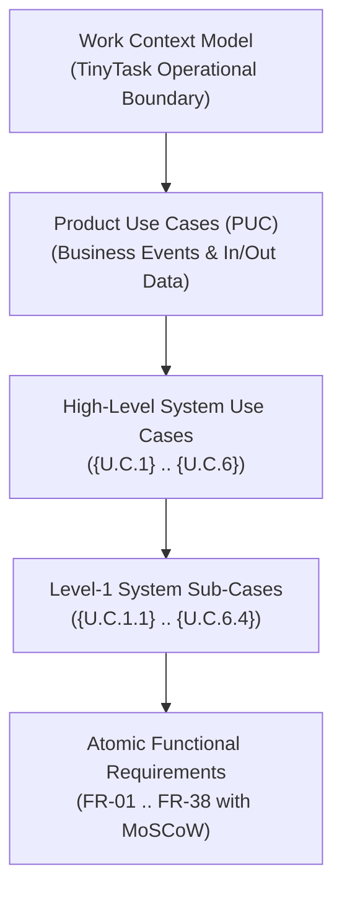
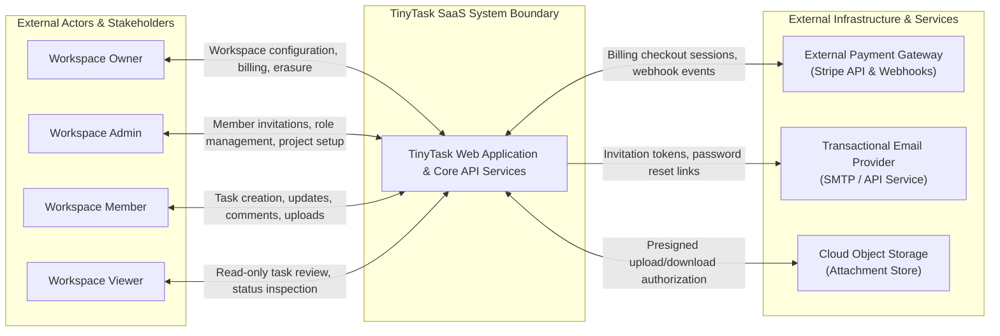

# Doc01 — Requirements Elicitation & Product Use Cases (TinyTask SaaS)

> **Document ID:** `TT-P3-DOC01`  
> **Lifecycle Phase:** AEGIS Phase 3 — Specification (Functional Baseline)  
> **Reference Standard:** Volere Requirements Specification & GPTools E1.1 Standard  
> **Prioritization Model:** MoSCoW (MUST, SHOULD, COULD, WON'T)  
> **Status:** Approved Baseline  

---

## Table of Contents

1. [Introduction & Methodological Framework](#1-introduction--methodological-framework)
   - 1.1 [Purpose & Scope](#11-purpose--scope)
   - 1.2 [The Volere Requirements Framework](#12-the-volere-requirements-framework)
   - 1.3 [Triangular Functional Decomposition](#13-triangular-functional-decomposition)
   - 1.4 [MoSCoW Prioritization Criteria](#14-moscow-prioritization-criteria)
2. [Work Context Model](#2-work-context-model)
   - 2.1 [Work Domain Narrative](#21-work-domain-narrative)
   - 2.2 [Context Boundary Diagram](#22-context-boundary-diagram)
   - 2.3 [External Interfaces](#23-external-interfaces)
3. [Data Entities & Data Flow Specifications](#3-data-entities--data-flow-specifications)
   - 3.1 [Entity: User Account & Authentication](#31-entity-user-account--authentication)
   - 3.2 [Entity: Workspace & Membership](#32-entity-workspace--membership)
   - 3.3 [Entity: Project & Task Entity](#33-entity-project--task-entity)
   - 3.4 [Entity: Task Attachment & Metadata](#34-entity-task-attachment--metadata)
   - 3.5 [Entity: Activity Feed & Comments](#35-entity-activity-feed--comments)
   - 3.6 [Entity: Subscription & Billing Record](#36-entity-subscription--billing-record)
   - 3.7 [Entity: Security Audit Log & Erasure Receipt](#37-entity-security-audit-log--erasure-receipt)
4. [System Actors & Profiles](#4-system-actors--profiles)
5. [Product Use Case (PUC) Summary Table](#5-product-use-case-puc-summary-table)
6. [Exhaustive Functional Requirements Catalog (MoSCoW)](#6-exhaustive-functional-requirements-catalog-moscow)
   - 6.1 [Requirements for {U.C.1} — Identity & Access Governance](#61-requirements-for-uc1--identity--access-governance)
   - 6.2 [Requirements for {U.C.2} — Workspace & Team Administration](#62-requirements-for-uc2--workspace--team-administration)
   - 6.3 [Requirements for {U.C.3} — Project & Task Lifecycle Management](#63-requirements-for-uc3--project--task-lifecycle-management)
   - 6.4 [Requirements for {U.C.4} — Task Attachment & Media Ingestion](#64-requirements-for-uc4--task-attachment--media-ingestion)
   - 6.5 [Requirements for {U.C.5} — Team Collaboration & Activity Feeds](#65-requirements-for-uc5--team-collaboration--activity-feeds)
   - 6.6 [Requirements for {U.C.6} — Subscriptions & Data Subject Lifecycle](#66-requirements-for-uc6--subscriptions--data-subject-lifecycle)
7. [Document History & Traceability Matrix](#7-document-history--traceability-matrix)

---

## 1. Introduction & Methodological Framework

### 1.1 Purpose & Scope

This document establishes the formal **Functional Requirements Baseline** and **Product Use Cases (PUC)** for **TinyTask SaaS** (Case 01). TinyTask is a cloud-native, multi-tenant B2B task management and team collaboration platform developed by a micro-enterprise of 8 engineers and operators based in Lisbon, Portugal.

The functional specification formalizes what the TinyTask platform accomplishes from a business and operational standpoint, independent of specific implementation technologies, software frameworks, or vendor choices. It acts as the core functional foundation to be integrated with the **Phase 2 Operational Objectives** (`Doc01_Operational_Objectives.md`) and **Secure Engineering Principles** (`Doc02_Secure_Design_Principles.md`) during the AEGIS Phase 3 specification process.

### 1.2 The Volere Requirements Framework

Requirements elicitation follows the **Volere Requirements Process** (Robertson & Robertson), adapted to modern SaaS multi-tenant architectures. Under Volere:
- Requirements emerge from an explicit understanding of the **Work Context** and the operational problems the product resolves for its stakeholders.
- Business events trigger **Product Use Cases (PUC)** that define the boundary interactions between external actors and the product.
- Individual **Functional Requirements (FR)** capture the atomic, testable system behaviors required to satisfy each PUC.

### 1.3 Triangular Functional Decomposition

Functional scoping is structured according to the **Triangular Functional Decomposition** model:
1. **Work Context / Product Use Cases (PUC):** Global business interactions capturing inputs (`in`) and outputs (`out`).
2. **System Use Cases (`{U.C.n}` and Level-1 `{U.C.n.m}`):** Decomposition of system capabilities into coherent operational areas, specifying participating actors, pre-conditions, and operational boundaries.
3. **Atomic Functional Requirements (`FR-XX`):** Unambiguous, testable functional statements tied directly to Level-1 sub-use cases and prioritized via MoSCoW.

### 1.4 MoSCoW Prioritization Criteria

Each functional requirement is classified according to the standardized **MoSCoW** convention:

| Priority | Designation | Operational Definition for TinyTask SaaS |
|---|---|---|
| **MUST** | Mandatory Core | Critical requirement mandatory for system operation, security baseline, or legal compliance. Non-negotiable for release. |
| **SHOULD** | High Value | Highly recommended functional capability. Required for a complete user experience; workaround exists only with friction. |
| **COULD** | Desirable Enhancer | Useful functional enhancement that can be deferred or omitted if schedule or budget constraints require. |
| **WON'T** | Out of Current Scope | Feature recognized but explicitly excluded from the current baseline release (may be evaluated in future iterations). |

---

## 2. Work Context Model

### 2.1 Work Domain Narrative

The TinyTask system operates as an authenticated multi-tenant SaaS environment. Users access the platform via modern web browsers and mobile application clients. The system manages organizational boundaries through **Workspaces**. Each workspace isolates projects, tasks, collaborative comments, uploaded file attachments, and subscription billing.

The system interacts directly with three primary external services:
1. **External Payment Gateway (Stripe):** Handles customer checkout, billing subscriptions, credit card tokenization, invoice generation, and asynchronous webhook delivery for subscription lifecycle events.
2. **Transactional Messaging Provider:** Dispatches invitation emails, password recovery verification tokens, and daily digest notifications.
3. **Managed Cloud Object Store:** Houses binary task attachments with presigned, expiring URL access.

### 2.2 Context Boundary Diagram

### 2.3 External Interfaces

| Interface ID | Connected Entity | Interaction Channel | Exchanged Data Payload | Direction |
|---|---|---|---|---|
| **`INT-EXT-01`** | Web Client / User | HTTPS / REST / WebSockets | User credentials, session tokens, task models, JSON payloads | Bidirectional |
| **`INT-EXT-02`** | Payment Gateway (Stripe) | HTTPS REST API | Checkout session creation, customer IDs, plan tier IDs | Outbound |
| **`INT-EXT-03`** | Payment Gateway (Stripe) | HTTPS Webhook Endpoint | Signed event notifications (`customer.subscription.updated`, etc.) | Inbound |
| **`INT-EXT-04`** | Transactional Mail Provider | HTTPS REST / TLS SMTP | Outbound invitation links, password reset tokens, activity digests | Outbound |
| **`INT-EXT-05`** | Object Storage Service | HTTPS REST API | File binary streams, presigned upload URLs, download metadata | Bidirectional |

---

## 3. Data Entities & Data Flow Specifications

The following tables define the primary business data entities manipulated by TinyTask, specifying attributes, types, and mandatory constraints.

### 3.1 Entity: User Account & Authentication

| Attribute Name | Data Type | Mandatory | Description & Constraints |
|---|---|---|---|
| `user_id` | UUIDv4 | Yes | System-wide unique identifier of the user account. |
| `email` | String (RFC 5322) | Yes | Primary email address; unique index; used for authentication and notifications. |
| `password_hash` | String | Yes | Salted cryptographic digest of user credential. Plaintext never persisted. |
| `full_name` | String (Max 100) | Yes | User display name. |
| `account_status` | Enum | Yes | Current state: `Pending_Verification`, `Active`, `Suspended`, `Marked_For_Deletion`. |
| `created_at` | Timestamp (UTC) | Yes | Timestamp of initial account registration. |
| `last_login_at` | Timestamp (UTC) | No | Timestamp of the most recent authenticated session. |

### 3.2 Entity: Workspace & Membership

| Attribute Name | Data Type | Mandatory | Description & Constraints |
|---|---|---|---|
| `workspace_id` | UUIDv4 | Yes | System-wide unique identifier of the workspace tenant. |
| `name` | String (Max 80) | Yes | User-facing organization or workspace name. |
| `slug` | String (Alphanumeric) | Yes | Unique URL-safe identifier for tenant routing. |
| `subscription_tier` | Enum | Yes | Active tier: `Free`, `Pro`, `Enterprise`. |
| `owner_id` | UUIDv4 | Yes | Foreign key referencing the `user_id` of the Workspace Owner. |
| `membership_role` | Enum | Yes | Scoped role per user: `Owner`, `Admin`, `Member`, `Viewer`. |
| `created_at` | Timestamp (UTC) | Yes | Workspace provisioning timestamp. |

### 3.3 Entity: Project & Task Entity

| Attribute Name | Data Type | Mandatory | Description & Constraints |
|---|---|---|---|
| `task_id` | UUIDv4 | Yes | System-wide unique identifier for the task. |
| `workspace_id` | UUIDv4 | Yes | Foreign key identifying tenant boundary. |
| `project_id` | UUIDv4 | Yes | Foreign key identifying the parent project. |
| `title` | String (Max 250) | Yes | Short summary description of the task. |
| `description` | Markdown / Text | No | Detailed narrative of the task requirements. |
| `status` | Enum | Yes | Workflow state: `To-Do`, `In-Progress`, `Under-Review`, `Done`. |
| `priority` | Enum | Yes | Urgency rating: `Low`, `Medium`, `High`, `Urgent`. |
| `assignee_id` | UUIDv4 | No | Foreign key referencing assigned `user_id`. |
| `due_date` | Date (ISO 8601) | No | Target completion date. |
| `created_by` | UUIDv4 | Yes | Foreign key referencing author `user_id`. |
| `updated_at` | Timestamp (UTC) | Yes | Timestamp of most recent modification. |

### 3.4 Entity: Task Attachment & Metadata

| Attribute Name | Data Type | Mandatory | Description & Constraints |
|---|---|---|---|
| `attachment_id` | UUIDv4 | Yes | Unique identifier of the uploaded attachment. |
| `task_id` | UUIDv4 | Yes | Foreign key referencing the parent task. |
| `workspace_id` | UUIDv4 | Yes | Foreign key enforcing tenant data isolation. |
| `original_filename` | String (Max 255) | Yes | Sanitized client filename. |
| `mime_type` | String | Yes | Content type validated against allowed whitelist. |
| `file_size_bytes` | Integer (BigInt) | Yes | File size in bytes (max 25 MB on Pro tier). |
| `storage_key` | String | Yes | Opaque object storage path / blob pointer. |
| `uploaded_by` | UUIDv4 | Yes | Foreign key referencing uploader `user_id`. |
| `uploaded_at` | Timestamp (UTC) | Yes | Timestamp of successful upload completion. |

### 3.5 Entity: Activity Feed & Comments

| Attribute Name | Data Type | Mandatory | Description & Constraints |
|---|---|---|---|
| `comment_id` | UUIDv4 | Yes | Unique identifier of the comment entry. |
| `task_id` | UUIDv4 | Yes | Foreign key referencing the target task. |
| `author_id` | UUIDv4 | Yes | Foreign key referencing author `user_id`. |
| `body` | Text (Max 5000) | Yes | Comment prose, supporting `@mention` syntax. |
| `created_at` | Timestamp (UTC) | Yes | Creation timestamp. |
| `updated_at` | Timestamp (UTC) | No | Modification timestamp if edited. |

### 3.6 Entity: Subscription & Billing Record

| Attribute Name | Data Type | Mandatory | Description & Constraints |
|---|---|---|---|
| `subscription_id` | String | Yes | External payment provider subscription reference (e.g., Stripe `sub_...`). |
| `workspace_id` | UUIDv4 | Yes | Foreign key referencing tenant workspace. |
| `plan_name` | Enum | Yes | Plan designation: `Free`, `Pro_Monthly`, `Pro_Annual`, `Enterprise`. |
| `billing_status` | Enum | Yes | State: `Active`, `Past_Due`, `Canceled`, `Incomplete`. |
| `current_period_end` | Timestamp (UTC) | Yes | Expiration timestamp of current prepaid cycle. |
| `seats_allocated` | Integer | Yes | Maximum active members permitted under quota. |

### 3.7 Entity: Security Audit Log & Erasure Receipt

| Attribute Name | Data Type | Mandatory | Description & Constraints |
|---|---|---|---|
| `log_id` | UUIDv4 | Yes | Immutable event entry identifier. |
| `workspace_id` | UUIDv4 | No | Workspace scope (nullable for cross-workspace auth events). |
| `actor_id` | UUIDv4 | Yes | Foreign key of acting user or system principal. |
| `action_type` | String | Yes | Canonical event code (e.g., `AUTH_SUCCESS`, `MEMBER_REMOVED`, `DATA_EXPORT_REQUESTED`). |
| `ip_address` | String (IPv4/IPv6) | Yes | Request client IP address. |
| `event_timestamp` | Timestamp (UTC) | Yes | Exact time of occurrence. |
| `status_code` | String | Yes | Result status: `SUCCESS`, `DENIED`, `ERROR`. |

---

## 4. System Actors & Profiles

The actors represent operational roles interacting with the TinyTask platform. A single human user may hold different roles across distinct workspaces (e.g., Owner in Workspace A, Viewer in Workspace B).

| Actor Name | Classification | Definition & Operational Scope | Interacting Functional Areas |
|---|---|---|---|
| **`Workspace Owner`** | Human User (Privileged) | The primary billing and legal administrator of a workspace. Holds exclusive privileges to manage billing subscriptions, initiate workspace deletion, and request organizational data export. | `{U.C.1}`, `{U.C.2}`, `{U.C.6}` |
| **`Workspace Admin`** | Human User (Privileged) | Designated project coordinator and team manager. Authorized to invite new members, adjust member roles (Admin, Member, Viewer), create projects, and archive workspace resources. | `{U.C.1}`, `{U.C.2}`, `{U.C.3}`, `{U.C.4}`, `{U.C.5}` |
| **`Workspace Member`** | Human User (Operational) | Standard team member. Can create, update, and reassign tasks; upload attachments; write comments; and view project boards. | `{U.C.1}`, `{U.C.3}`, `{U.C.4}`, `{U.C.5}` |
| **`Workspace Viewer`** | Human User (Read-Only) | External stakeholder, client, or auditor. Granted read-only visibility into projects, task lists, and discussions without modification rights. | `{U.C.1}`, `{U.C.3}`, `{U.C.5}` |
| **`External Payment Gateway`** | External System (API) | External processing engine (Stripe) delivering asynchronous webhooks regarding checkout results, subscription state transitions, and payment failures. | `{U.C.6}` |
| **`System Scheduler`** | Automated Background Process | Internal asynchronous execution worker that processes scheduled background tasks, reminder notifications, recurring digest emails, and batch retention cleanups. | `{U.C.5}`, `{U.C.6}` |

---

## 5. Product Use Case (PUC) Summary Table

The following table summarizes all **Product Use Cases (PUC)** across TinyTask's 6 functional domains, outlining input payloads (`in`) and output outcomes (`out`).

| PUC ID | PUC Name | Primary Actors | Input Data (`in`) | Output Data (`out`) |
|---|---|---|---|---|
| **`PUC 1.1`** | Register User Account | New User | Email address, password, full name, accepted terms. | Verification email dispatched; pending user account record created. |
| **`PUC 1.2`** | Authenticate & Establish Session | Registered User | Email, password (or authentication credentials). | Cryptographically signed session token; user workspace memberships list. |
| **`PUC 1.3`** | Recover & Reset Password | Registered User | Account email address; reset verification token; new password. | Password reset confirmation; invalidated active sessions; audit log entry. |
| **`PUC 1.4`** | Manage Profile & Active Sessions | Authenticated User | Updated profile attributes; request to terminate active session. | Updated profile record; terminated session token confirmation. |
| **`PUC 2.1`** | Provision New Workspace | Authenticated User | Workspace name, desired URL slug, initial subscription selection. | Provisioned workspace tenant; user assigned `Workspace Owner` role. |
| **`PUC 2.2`** | Invite Team Members | Workspace Admin / Owner | Invitee email address, assigned role (`Admin`, `Member`, `Viewer`). | Secure invitation token emailed; pending membership record listed. |
| **`PUC 2.3`** | Manage Member Roles & Access | Workspace Admin / Owner | Target member user ID, updated role, or removal command. | Updated workspace membership record; refreshed permission policy. |
| **`PUC 2.4`** | Inspect Workspace Quotas & Settings | Workspace Admin / Owner | Workspace settings query; updated workspace metadata. | Current member count, storage utilization, and quota status display. |
| **`PUC 3.1`** | Manage Project Containers | Workspace Admin / Member | Project name, description, privacy setting (public/private). | Created or updated project container; listing of active workspace projects. |
| **`PUC 3.2`** | Create & Attribute Task | Workspace Member / Admin | Task title, description, priority, assignee ID, due date. | Task entity created; activity event generated; assignee notified. |
| **`PUC 3.3`** | Update Task Status & Workflow State | Workspace Member / Admin | Target task ID, new status (`To-Do`, `In-Progress`, `Done`). | Updated task state; Kanban board column update; timestamped log. |
| **`PUC 3.4`** | Query & Filter Task Views | Workspace User | Filter parameters (status, assignee, priority, due date range). | Filtered task list or Kanban board view with matching items. |
| **`PUC 4.1`** | Upload & Ingest Task Attachment | Workspace Member / Admin | Target task ID, file binary, original filename, MIME type. | Presigned upload validated; attachment metadata record created. |
| **`PUC 4.2`** | Retrieve & Download Attachment | Workspace User | Attachment ID, parent task ID. | Time-limited presigned download URL; access audit record. |
| **`PUC 4.3`** | Delete Task Attachment | Workspace Member / Admin | Attachment ID, deletion confirmation. | Attachment record removed; binary marked for purge; task audit updated. |
| **`PUC 5.1`** | Post Task Comment & Mention | Workspace Member / Admin | Task ID, comment body prose, tagged user `@mentions`. | Comment record appended; notifications routed to tagged users. |
| **`PUC 5.2`** | Review Workspace Activity Feed | Workspace User | Workspace or project ID, pagination cursor. | Chronological list of recent team events, updates, and comments. |
| **`PUC 5.3`** | Dispatch Scheduled Digest | System Scheduler | Configured schedule trigger, pending unread notification records. | Consolidated notification emails dispatched to subscribed users. |
| **`PUC 6.1`** | Initiate Plan Upgrade / Downgrade | Workspace Owner | Selected plan tier (`Pro`, `Enterprise`), billing interval. | Redirect session to secure payment checkout; pending subscription state. |
| **`PUC 6.2`** | Process Billing Webhook Events | Payment Gateway | Signed webhook event payload (invoice paid, plan changed). | Updated workspace subscription tier, seat limits, and billing status. |
| **`PUC 6.3`** | Request Data Portability Export | Workspace Owner / User | Data export request, export format choice (JSON/ZIP). | Background export job queued; signed download link delivered. |
| **`PUC 6.4`** | Execute Account / Workspace Erasure | Workspace Owner / User | Deletion confirmation, re-authentication password. | Account/tenant marked for erasure; personal data redacted; audit receipt. |

---

## 6. Exhaustive Functional Requirements Catalog (MoSCoW)

This section provides the complete, unambiguous catalog of **Functional Requirements (`FR-01` to `FR-38`)** for TinyTask SaaS, mapped to their corresponding System Use Cases and classified by MoSCoW priority.

### 6.1 Requirements for {U.C.1} — Identity & Access Governance

| ID | Sub-ID | Functional Requirement Statement | MoSCoW | Mapped UC | Constraints / Rules |
|---|---|---|---|---|---|
| **`FR-01`** | `FR-01.1` | The platform **MUST** allow new users to register an account by submitting an email address, full name, and secure password. | **MUST** | `{U.C.1.1}` | Email must be unique across the platform. |
| **`FR-01`** | `FR-01.2` | The platform **MUST** dispatch a cryptographic verification link to the submitted email before account activation is finalized. | **MUST** | `{U.C.1.1}` | Verification token valid for 24 hours. |
| **`FR-02`** | `FR-02.1` | The platform **MUST** authenticate registered users against their email and password credentials, returning a signed session token. | **MUST** | `{U.C.1.2}` | Cryptographic token with strict expiry. |
| **`FR-02`** | `FR-02.2` | The platform **MUST** reject authentication attempts with invalid credentials and record a timestamped failed login event. | **MUST** | `{U.C.1.2}` | Generic error message to prevent enumeration. |
| **`FR-03`** | `FR-03.1` | The platform **MUST** provide a password recovery workflow that sends a single-use password reset token to the user's verified email. | **MUST** | `{U.C.1.3}` | Token expires in 1 hour; invalidated on first use. |
| **`FR-03`** | `FR-03.2` | Upon successful password reset, the platform **MUST** invalidate all existing active sessions for that user account across all devices. | **MUST** | `{U.C.1.3}` | Immediate token revocation. |
| **`FR-04`** | `FR-04.1` | The platform **MUST** enforce Role-Based Access Control (RBAC) differentiating permissions among four predefined roles: `Owner`, `Admin`, `Member`, and `Viewer`. | **MUST** | `{U.C.1.4}` | Roles are scoped per workspace tenant. |
| **`FR-04`** | `FR-04.2` | The platform **SHOULD** permit users to inspect a list of their active sessions and terminate any non-current session on demand. | **SHOULD** | `{U.C.1.4}` | Displays client user-agent and IP country. |
| **`FR-05`** | `FR-05.1` | The platform **COULD** support multi-factor authentication (MFA/TOTP) for user accounts requesting enhanced security. | **COULD** | `{U.C.1.2}` | Standard RFC 6238 TOTP authenticator app. |
| **`FR-06`** | `FR-06.1` | The platform **WON'T** support enterprise Single Sign-On (SAML 2.0 / OIDC) federation in the initial baseline release. | **WON'T** | `{U.C.1.2}` | Reserved for future Enterprise release. |

### 6.2 Requirements for {U.C.2} — Workspace & Team Administration

| ID | Sub-ID | Functional Requirement Statement | MoSCoW | Mapped UC | Constraints / Rules |
|---|---|---|---|---|---|
| **`FR-07`** | `FR-07.1` | The platform **MUST** allow an authenticated user to create a new workspace tenant, automatically assigning that user the `Workspace Owner` role. | **MUST** | `{U.C.2.1}` | Workspace URL slug must be globally unique. |
| **`FR-07`** | `FR-07.2` | The platform **MUST** strictly isolate all data, projects, tasks, and members of a workspace from all other workspaces. | **MUST** | `{U.C.2.1}` | Multi-tenant boundary enforced at database/query level. |
| **`FR-08`** | `FR-08.1` | The platform **MUST** allow Workspace Owners and Admins to invite new users to the workspace by specifying their email and assigned role. | **MUST** | `{U.C.2.2}` | Invitation token valid for 7 days. |
| **`FR-08`** | `FR-08.2` | The platform **MUST** prevent invitation dispatch if the active member count has reached the seat limit of the workspace's subscription tier. | **MUST** | `{U.C.2.2}` | Free tier capped at 5 active members. |
| **`FR-09`** | `FR-09.1` | The platform **MUST** permit Workspace Owners and Admins to update member roles (`Admin`, `Member`, `Viewer`) within the workspace. | **MUST** | `{U.C.2.3}` | Admins cannot demote or remove the Workspace Owner. |
| **`FR-09`** | `FR-09.2` | The platform **MUST** allow Workspace Owners and Admins to revoke a user's workspace membership, instantly terminating their access to workspace data. | **MUST** | `{U.C.2.3}` | Historical tasks created by user remain preserved. |
| **`FR-10`** | `FR-10.1` | The platform **SHOULD** allow Workspace Admins to update the workspace name and upload an organizational logo. | **SHOULD** | `{U.C.2.4}` | Logo image limited to standard PNG/JPEG format under 2 MB. |
| **`FR-11`** | `FR-11.1` | The platform **COULD** provide an activity dashboard displaying member onboarding history and weekly active contributor counts. | **COULD** | `{U.C.2.4}` | Visible only to Workspace Owners and Admins. |
| **`FR-12`** | `FR-12.1` | The platform **WON'T** support custom role definitions or fine-grained custom permission matrices in the initial baseline release. | **WON'T** | `{U.C.2.3}` | Limited to the 4 canonical RBAC roles. |

### 6.3 Requirements for {U.C.3} — Project & Task Lifecycle Management

| ID | Sub-ID | Functional Requirement Statement | MoSCoW | Mapped UC | Constraints / Rules |
|---|---|---|---|---|---|
| **`FR-13`** | `FR-13.1` | The platform **MUST** permit Workspace Admins and Members to create projects within the workspace with a title, description, and target completion date. | **MUST** | `{U.C.3.1}` | Projects belong strictly to one workspace. |
| **`FR-13`** | `FR-13.2` | The platform **SHOULD** allow Workspace Admins to archive completed projects, making them read-only while preserving all historical tasks. | **SHOULD** | `{U.C.3.1}` | Archived projects can be unarchived by Admins. |
| **`FR-14`** | `FR-14.1` | The platform **MUST** allow Members and Admins to create tasks within a project, specifying title, description, status, priority, assignee, and due date. | **MUST** | `{U.C.3.2}` | Title is mandatory; status defaults to `To-Do`. |
| **`FR-14`** | `FR-14.2` | The platform **MUST** restrict task assignment exclusively to active members of the containing workspace. | **MUST** | `{U.C.3.2}` | Users cannot assign tasks to external emails. |
| **`FR-15`** | `FR-15.1` | The platform **MUST** allow Members, Admins, and the task assignee to transition task status between `To-Do`, `In-Progress`, `Under-Review`, and `Done`. | **MUST** | `{U.C.3.3}` | Every status change records author and timestamp. |
| **`FR-15`** | `FR-15.2` | The platform **MUST** provide a Kanban board view grouping tasks by status columns and supporting real-time drag-and-drop state updates. | **MUST** | `{U.C.3.3}` | Immediate client update with optimistic UI. |
| **`FR-16`** | `FR-16.1` | The platform **MUST** allow users to filter tasks by status, priority, assignee, and due date range, and sort by due date or last updated. | **MUST** | `{U.C.3.4}` | Filters apply dynamically without full page reload. |
| **`FR-17`** | `FR-17.1` | The platform **SHOULD** allow users to define task priority ratings (`Low`, `Medium`, `High`, `Urgent`) with distinct visual badges. | **SHOULD** | `{U.C.3.2}` | Default priority is `Medium`. |
| **`FR-18`** | `FR-18.1` | The platform **COULD** support recurring tasks that automatically generate a clone upon marking the current task as `Done`. | **COULD** | `{U.C.3.3}` | Recurrence intervals: daily, weekly, monthly. |
| **`FR-19`** | `FR-19.1` | The platform **WON'T** provide Gantt chart project timeline dependencies or critical path computation in the initial release. | **WON'T** | `{U.C.3.4}` | Out of scope for micro-SaaS initial release. |

### 6.4 Requirements for {U.C.4} — Task Attachment & Media Ingestion

| ID | Sub-ID | Functional Requirement Statement | MoSCoW | Mapped UC | Constraints / Rules |
|---|---|---|---|---|---|
| **`FR-20`** | `FR-20.1` | The platform **MUST** permit Members and Admins to attach files (documents, spreadsheets, images) to any active task. | **MUST** | `{U.C.4.1}` | File size must not exceed 25 MB per file. |
| **`FR-20`** | `FR-20.2` | The platform **MUST** validate uploaded file MIME types against an approved whitelist (PDF, DOCX, XLSX, PNG, JPEG, SVG, TXT). | **MUST** | `{U.C.4.1}` | Executable files (`.exe`, `.sh`, `.bat`) must be rejected. |
| **`FR-21`** | `FR-21.1` | The platform **MUST** store file binaries in an isolated cloud object storage container using randomized, unguessable storage keys. | **MUST** | `{U.C.4.1}` | Direct public access to the storage bucket is blocked. |
| **`FR-22`** | `FR-22.1` | The platform **MUST** generate time-limited, signed download URLs (max expiry 15 minutes) for authorized workspace members requesting an attachment. | **MUST** | `{U.C.4.2}` | URLs must not be reusable across unauthorized sessions. |
| **`FR-23`** | `FR-23.1` | The platform **MUST** allow the uploader, Workspace Admins, or Owner to delete a task attachment, triggering permanent removal from storage. | **MUST** | `{U.C.4.3}` | Deletion removes metadata and physical object. |
| **`FR-24`** | `FR-24.1` | The platform **COULD** generate inline image thumbnails for preview within the task detail panel. | **COULD** | `{U.C.4.2}` | Generated on server upon upload completion. |

### 6.5 Requirements for {U.C.5} — Team Collaboration & Activity Feeds

| ID | Sub-ID | Functional Requirement Statement | MoSCoW | Mapped UC | Constraints / Rules |
|---|---|---|---|---|---|
| **`FR-25`** | `FR-25.1` | The platform **MUST** permit workspace members to post threaded comments on tasks with rich text formatting (Markdown). | **MUST** | `{U.C.5.1}` | Comments cannot be posted to archived projects. |
| **`FR-25`** | `FR-25.2` | The platform **MUST** support `@username` mentions within comments, generating an in-app notification for mentioned workspace members. | **MUST** | `{U.C.5.1}` | Mentions valid only for active workspace members. |
| **`FR-26`** | `FR-26.1` | The platform **MUST** record an immutable chronological activity event whenever a task is created, status-transitioned, reassigned, or commented upon. | **MUST** | `{U.C.5.2}` | Event logs author, timestamp, and previous/new values. |
| **`FR-27`** | `FR-27.1` | The platform **MUST** provide an in-app notification center showing unread task assignments, mentions, and due date alerts. | **MUST** | `{U.C.5.2}` | Users can mark individual or all notifications as read. |
| **`FR-28`** | `FR-28.1` | The platform **SHOULD** dispatch a daily email digest summarizing outstanding tasks and mentions if enabled in user preferences. | **SHOULD** | `{U.C.5.3}` | Dispatched by System Scheduler at 08:00 UTC. |
| **`FR-29`** | `FR-29.1` | The platform **COULD** support real-time WebSocket push updates to reflect collaborator comments and task moves without browser refresh. | **COULD** | `{U.C.5.1}` | Fallback to periodic polling if WebSocket unavailable. |

### 6.6 Requirements for {U.C.6} — Subscriptions & Data Subject Lifecycle

| ID | Sub-ID | Functional Requirement Statement | MoSCoW | Mapped UC | Constraints / Rules |
|---|---|---|---|---|---|
| **`FR-30`** | `FR-30.1` | The platform **MUST** allow the Workspace Owner to select and initiate a subscription upgrade from Free to Pro or Enterprise via Stripe Checkout. | **MUST** | `{U.C.6.1}` | Credit card information never touches TinyTask servers. |
| **`FR-31`** | `FR-31.1` | The platform **MUST** listen for and verify cryptographic signatures of incoming payment gateway webhooks before mutating subscription states. | **MUST** | `{U.C.6.2}` | Unsigned or invalid webhook requests are rejected with 401. |
| **`FR-32`** | `FR-32.1` | Upon receipt of a valid `invoice.payment_succeeded` webhook, the platform **MUST** automatically renew and update the workspace's active tier quota. | **MUST** | `{U.C.6.2}` | Updates current billing period end date. |
| **`FR-33`** | `FR-33.1` | Upon receipt of an `invoice.payment_failed` webhook, the platform **MUST** mark the workspace as `Past_Due` and notify the Workspace Owner. | **MUST** | `{U.C.6.2}` | 7-day grace period before feature restriction. |
| **`FR-34`** | `FR-34.1` | The platform **MUST** provide a self-service data portability export allowing any authenticated user to download all their personal data in machine-readable JSON format (GDPR Art. 20). | **MUST** | `{U.C.6.3}` | Includes profile, tasks created, and comments. |
| **`FR-35`** | `FR-35.1` | The platform **MUST** provide Workspace Owners a full workspace data export mechanism containing all projects, tasks, comments, and attachment archives. | **MUST** | `{U.C.6.3}` | Packaged as a secure encrypted ZIP archive. |
| **`FR-36`** | `FR-36.1` | The platform **MUST** provide an account deletion workflow allowing users to permanently erase their account and personal identifiers (GDPR Art. 17). | **MUST** | `{U.C.6.4}` | Re-authentication password verification required. |
| **`FR-37`** | `FR-37.1` | Upon execution of account erasure, the platform **MUST** redact or pseudonymize the user's name and email across all historical comments and task logs. | **MUST** | `{U.C.6.4}` | Erased user replaced with `[Deleted User]`. |
| **`FR-38`** | `FR-38.1` | The platform **SHOULD** issue an auditable, timestamped digital erasure receipt to the user upon successful completion of data erasure. | **SHOULD** | `{U.C.6.4}` | Retained in security audit trail for legal accountability. |

---

## 7. Document History & Traceability Matrix

### 7.1 Revision History

| Revision | Date | Author / Role | Summary of Changes |
|---|---|---|---|
| `v1.0.0` | 2026-09-23 | Requirements Engineering Team | Initial formal functional requirements baseline and PUC specification for TinyTask SaaS, adopting the Volere & GPTools E1.1 framework with MoSCoW prioritization. |

### 7.2 Functional Requirements to PUC Mapping Summary

| Functional Domain | System Use Case | Product Use Cases Covered | Functional Requirements Range | Total MUST | Total SHOULD | Total COULD | Total WON'T |
|---|---|---|---|---|---|---|---|
| **Identity & Access** | `{U.C.1}` | `PUC 1.1`, `PUC 1.2`, `PUC 1.3`, `PUC 1.4` | `FR-01` to `FR-06` | 6 | 1 | 1 | 1 |
| **Workspace & Team** | `{U.C.2}` | `PUC 2.1`, `PUC 2.2`, `PUC 2.3`, `PUC 2.4` | `FR-07` to `FR-12` | 5 | 1 | 1 | 1 |
| **Projects & Tasks** | `{U.C.3}` | `PUC 3.1`, `PUC 3.2`, `PUC 3.3`, `PUC 3.4` | `FR-13` to `FR-19` | 6 | 2 | 1 | 1 |
| **Attachments & Media** | `{U.C.4}` | `PUC 4.1`, `PUC 4.2`, `PUC 4.3` | `FR-20` to `FR-24` | 5 | 0 | 1 | 0 |
| **Collaboration & Feeds** | `{U.C.5}` | `PUC 5.1`, `PUC 5.2`, `PUC 5.3` | `FR-25` to `FR-29` | 4 | 1 | 1 | 0 |
| **Billing & Privacy** | `{U.C.6}` | `PUC 6.1`, `PUC 6.2`, `PUC 6.3`, `PUC 6.4` | `FR-30` to `FR-38` | 8 | 1 | 0 | 0 |
| **TOTALS** | — | **22 PUCs** | **38 Requirements (45 sub-items)** | **34** | **6** | **5** | **3** |
