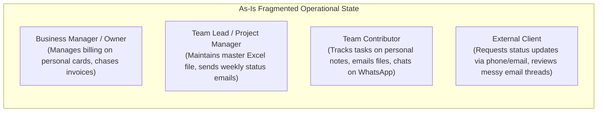

# Doc01 — AS-IS / TO-BE Model & Requirements Elicitation (TinyTask SaaS)

> **Deliverable Reference:** `E1.1 – TinyTask SaaS AS-IS / TO-BE Model & Requirements Elicitation`  
> **Lifecycle Phase:** AEGIS Phase 3 — Specification (Functional Baseline)  
> **Reference Standard:** GPTools Deliverable E1.1 Standard (`GPTools_ModeloASIS_TOBE V2.0`)  
> **Prioritization Model:** MoSCoW (MUST, SHOULD, COULD, WON'T)  
> **Language:** English  
> **Status:** Approved Baseline  

---

## Table of Contents

1. [Executive Summary](#1-executive-summary)
2. [Glossary & Acronyms](#2-glossary--acronyms)
3. [Part I — Scope](#3-part-i--scope)
   - 3.1 [Objective](#31-objective)
     - 3.1.1 [Problem Description](#311-problem-description)
     - 3.1.2 [Product Position Description](#312-product-position-description)
     - 3.1.3 [Expected Impact](#313-expected-impact)
     - 3.1.4 [Key Characteristics](#314-key-characteristics)
   - 3.2 [Stakeholders](#32-stakeholders)
   - 3.3 [System Users](#33-system-users)
   - 3.4 [Constraints](#34-constraints)
4. [Part II — As-Is Model](#4-part-ii--as-is-model)
   - 4.1 [Business Roles in Context](#41-business-roles-in-context)
   - 4.2 [As-Is Workflow & Information Fragmentation](#42-as-is-workflow--information-fragmentation)
     - 4.2.1 [Gathering Initial Task & Project Information](#421-gathering-initial-task--project-information)
     - 4.2.2 [Team Allocation, Scheduling, and Status Tracking](#422-team-allocation-scheduling-and-status-tracking)
     - 4.2.3 [Media, Document Sharing, and Attachment Handling](#423-media-document-sharing-and-attachment-handling)
     - 4.2.4 [Client Reporting and Progress Reviews](#424-client-reporting-and-progress-reviews)
   - 4.3 [Current IT Support & Identified Deficiencies](#43-current-it-support--identified-deficiencies)
     - 4.3.1 [Spreadsheet-Driven Tracking](#431-spreadsheet-driven-tracking)
     - 4.3.2 [Ad-Hoc Messaging & Email Threads](#432-ad-hoc-messaging--email-threads)
     - 4.3.3 [Unstructured Cloud Drives](#433-unstructured-cloud-drives)
     - 4.3.4 [Lack of Data Isolation & GDPR Compliance Deficits](#434-lack-of-data-isolation--gdpr-compliance-deficits)
5. [Part III — To-Be Model](#5-part-iii--to-be-model)
   - 5.1 [Initial Customer Expectations](#51-initial-customer-expectations)
   - 5.2 [System Actors](#52-system-actors)
   - 5.3 [Functional Requirements (MoSCoW)](#53-functional-requirements-moscow)
     - 5.3.1 [MoSCoW Prioritization Framework](#531-moscow-prioritization-framework)
     - 5.3.2 [Summary Table of Functional Requirements](#532-summary-table-of-functional-requirements)
     - 5.3.3 [Detailed Requirements Elaboration (R1 to R12)](#533-detailed-requirements-elaboration-r1-to-r12)
   - 5.4 [Non-Functional Requirements](#54-non-functional-requirements)
     - 5.4.1 [Domain Non-Functional Requirements](#541-domain-non-functional-requirements)
     - 5.4.2 [Management, Security & Infrastructure Non-Functional Requirements](#542-management-security--infrastructure-non-functional-requirements)
   - 5.5 [Business Use Cases & Product Use Cases (PUC)](#55-business-use-cases--product-use-cases-puc)
   - 5.6 [High-Level Use Case Model ({U.C.1} to {U.C.6})](#56-high-level-use-case-model-uc1-to-uc6)
6. [Bibliography](#6-bibliography)

---

## 1. Executive Summary

This report establishes the formal **AS-IS / TO-BE Functional Architecture** and **Requirements Elicitation** for **TinyTask SaaS** (Case 01). TinyTask is a modern, multi-tenant B2B task management and team collaboration web platform developed by an agile micro-enterprise of 8 engineers and operators located in Lisbon, Portugal.

Following the exact methodological structure of the CCG GPTools Deliverable E1.1 standard, this deliverable bridges the operational problem space with a rigorous, testable software engineering specification. It analyzes the existing, highly fragmented "As-Is" operational baseline (characterized by disparate spreadsheets, untracked email chains, unmanaged file storage, and acute GDPR compliance liabilities), formalizes customer expectations, and defines the "To-Be" functional baseline.

The deliverable articulates:
- The **System Context** and multi-tenant organizational scope;
- A detailed **As-Is analysis** of workflow deficiencies;
- **Customer Expectations** and **System Actors**;
- An exhaustive catalog of **Functional Requirements (`R1` through `R12`, decomposing into `FR-01` to `FR-38`)** prioritized via **MoSCoW**;
- Quality-defining **Non-Functional Requirements** across usability, performance, reliability, and security;
- A consolidated **Product Use Case (PUC)** model and Level-0 Use Case architecture (`{U.C.1}` to `{U.C.6}`).

---

## 2. Glossary & Acronyms

| Term | Expansion / Definition |
|---|---|
| **As-Is** | The current, baseline state of operations, workflows, and tools prior to the adoption of the system. |
| **To-Be** | The target operational state enabled by the implementation of the new software platform. |
| **B2B** | Business-to-Business commercial software model. |
| **GDPR** | General Data Protection Regulation (Regulation (EU) 2016/679). |
| **JWT** | JSON Web Token (RFC 7519) used for stateless, cryptographically signed session tokens. |
| **MFA / TOTP** | Multi-Factor Authentication via Time-based One-Time Password (RFC 6238). |
| **MoSCoW** | Prioritization methodology categorizing requirements into Must have, Should have, Could have, and Won't have. |
| **PUC** | Product Use Case — business-level interaction boundary defined in the Volere requirements process. |
| **RBAC** | Role-Based Access Control enforcing permission policies based on user organizational roles. |
| **SaaS** | Software-as-a-Service cloud delivery model. |
| **U.C.** | Use Case designation within the system functional decomposition. |
| **Workspace** | Tenant boundary isolating projects, tasks, members, and billing for an organization. |

---

## 3. Part I — Scope

### 3.1 Objective

#### 3.1.1 Problem Description
Small businesses, creative agencies, and agile engineering teams frequently suffer from severe operational friction in their daily project execution. Teams of 5 to 50 collaborators typically manage work through a disjointed patchwork of disconnected tools: shared spreadsheets that lack real-time synchronization, endless email chains with buried attachments, informal chat messages on WhatsApp or Slack where tasks are assigned without due dates or accountable ownership, and unmanaged cloud storage folders where document versions overwrite each other.

This operational fragmentation produces critical business failures:
1. **Lack of Centralized Visibility:** Project leaders and team managers cannot easily observe the real-time status of work items, resulting in missed customer deadlines and resource bottlenecks.
2. **Accountability Deficit:** Without formal assignment, status progression, and change auditing, tasks fall through organizational cracks.
3. **Data Security & Privacy Vulnerabilities:** Client files, sensitive commercial specifications, and personal data are shared through insecure email attachments and public links, directly violating GDPR confidentiality requirements (Art. 32) and exposing businesses to severe regulatory penalties.
4. **Administrative Overhead:** Significant billable hours are wasted manually updating tracking spreadsheets, chasing colleagues for status reports, and locating misplaced document revisions.

#### 3.1.2 Product Position Description
**TinyTask SaaS** is positioned as an intuitive, unified, cloud-native B2B productivity platform specifically engineered for small and medium-sized organizations. Unlike heavyweight enterprise project management suites that suffer from extreme configuration complexity and high licensing costs, TinyTask delivers a lean, focused workspace experience combining:
- Frictionless task lifecycle management across interactive Kanban and tabular views;
- Contextual team discussions directly embedded within task cards;
- Secure, validated file attachment ingestion with time-limited signed access;
- Multi-tenant organizational isolation with self-service subscription management and built-in GDPR data subject rights (portability and account erasure).

#### 3.1.3 Expected Impact
Implementing TinyTask yields direct, measurable organizational improvements:
- **Efficiency Gains:** Reduces internal status reporting and task lookup time by over 40% through centralized boards and automated notifications.
- **Delivery Reliability:** Decreases overdue task rates through clear attribution, explicit priority tagging, and automated deadline reminders.
- **Compliance Assurance:** Provides micro-enterprises with turnkey GDPR compliance (Articles 5, 17, 20, and 32) without requiring internal legal or dedicated security teams.
- **Commercial Scalability:** Enables the TinyTask enterprise to operate a sustainable, recurring subscription revenue model (Free, Pro, and Enterprise tiers) powered by automated payment gateway integration.

#### 3.1.4 Key Characteristics
The TinyTask platform delivers the following primary architectural and functional characteristics:
1. **Multi-Tenant Workspace Isolation:** Strict logical segregation ensuring an organization's projects, tasks, files, and users are never accessible to other tenants.
2. **Dynamic Work Views:** Instant switching between visual Kanban board workflows (drag-and-drop state progression) and filterable tabular task registers.
3. **Contextual In-Task Collaboration:** Rich-text Markdown comments with `@username` tagging that immediately alerts mentioned colleagues.
4. **Secure Ingest & Expiring Access:** Server-side file validation (MIME whitelisting, 25 MB quota) coupled with randomized storage pointers and time-limited presigned URLs.
5. **Role-Based Access Governance:** Granular permission enforcement across four canonical workspace roles (`Owner`, `Admin`, `Member`, `Viewer`).
6. **Turnkey Subscription Lifecycle:** Self-service checkout, automated tier provisioning, and webhook reconciliation via integration with external payment gateways (Stripe).
7. **Native Data Subject Rights:** Automated self-service data portability export (GDPR Art. 20) and permanent account erasure with audit receipts (GDPR Art. 17).

### 3.2 Stakeholders

The key stakeholders holding an interest in the success and operation of TinyTask SaaS include:

| Stakeholder Group | Representative Profile | Core Interest & Expectations |
|---|---|---|
| **Platform Founders & Executives** | TinyTask Micro-Enterprise Leadership (Lisbon) | Sustainable product-market fit, low operational overhead, high customer retention, and automated subscription revenue collection. |
| **Engineering & Operations Team** | TinyTask 8-Person Core Technical Team | Modular, maintainable codebase, low infrastructure maintenance burden, robust automated testing, and zero security vulnerabilities. |
| **Subscribing Organization Owners** | SME Business Owners, Agency Executives | High team productivity, affordable predictable software costs, secure workspace isolation, and full ownership of business data. |
| **Team Leaders & Project Managers** | Department Leads, Project Coordinators | Real-time operational visibility into task bottlenecks, seamless delegation, and automated progress notifications. |
| **Individual Contributors** | Engineers, Designers, Marketing Specialists | Clean, intuitive task tracking without administrative friction, clear priorities, and focused communication. |
| **External Clients & Auditors** | Third-Party Stakeholders, Regulatory Inspectors | Read-only inspection of deliverables, confidentiality of commercial exchanges, and verifiable GDPR compliance. |

### 3.3 System Users

System users correspond directly to the operational roles recognized by the TinyTask application:
- **Workspace Owner:** The commercial and organizational head of a tenant workspace. Controls billing, member quotas, data export, and tenant deletion.
- **Workspace Admin:** Team lead managing workspace configuration, project creation, member invitations, and role assignments.
- **Workspace Member:** Active collaborator authoring tasks, updating status, uploading files, and contributing comments.
- **Workspace Viewer:** External client or guest with read-only visibility into assigned projects and tasks.

### 3.4 Constraints

At the time of baseline specification, the following operational and engineering constraints govern TinyTask:
- **Team & Scale Constraint:** The development and maintenance organization consists of 8 persons; architecture must prioritize managed cloud services and avoid custom infrastructure management.
- **Regulatory Constraint:** The platform processes personal data of EU citizens and B2B client organizations, making strict adherence to GDPR (Regulation (EU) 2016/679) and NIS2/CRA product security standards non-negotiable.
- **Commercial Constraint:** Core billing workflows must integrate with Stripe without storing credit card numbers or primary financial secrets on TinyTask infrastructure.
- **Technology Neutrality:** Functional specifications must specify *what* capabilities must be delivered proportionately, avoiding prescriptive vendor lock-in at the functional stage.

---

## 4. Part II — As-Is Model

### 4.1 Business Roles in Context

In the baseline As-Is operational context—typical of small organizations prior to adopting TinyTask—collaborators execute multiple overlapping roles without formal system boundaries:

- **Business Owner:** Manages commercial commitments informally, tracking project expenditures and customer subscriptions on local accounting spreadsheets.
- **Project Lead:** Spends 2 to 3 hours daily consolidating status updates from team members across email and chat, manually editing a shared spreadsheet.
- **Team Contributor:** Manages personal work queues in disparate desktop note applications; has no central visibility into team dependencies or changing priorities.
- **External Client:** Receives sporadic project updates via email attachments; has no direct, secure window to review work in progress.

### 4.2 As-Is Workflow & Information Fragmentation

#### 4.2.1 Gathering Initial Task & Project Information
When a new project is initiated in the As-Is state, information is assembled through informal kickoff meetings and scattered email threads. Project goals are written in word-processor documents and stored on individual laptops. 

The initial project metadata is recorded manually in unstructured spreadsheets, as depicted in the typical As-Is data format below:

*Table 1 — Typical As-Is Project Tracking Spreadsheet Record*

| Field Name | Typical Format | Mandatory | Observed Operational Deficiencies |
|---|---|---|---|
| Project Name | Text | Yes | Duplicated or conflicting names across departments. |
| Client Name | Text | Yes | No link to contractual records; inconsistent spelling. |
| Start / Due Date | Freeform Text (e.g., "End of Q2") | No | Ambiguous deadlines; lacks automated alert mechanisms. |
| Budget / Hours Allocated | Number | No | Rarely updated after initial planning. |
| Assigned Team | Comma-separated names | No | No linkage to individual user accounts or access permissions. |

#### 4.2.2 Team Allocation, Scheduling, and Status Tracking
Task assignments are communicated verbally or through chat channels. Team members maintain their own daily to-do lists. The Project Lead attempts to keep a centralized spreadsheet synchronized:

*Table 2 — Typical As-Is Task Tracking Spreadsheet Record*

| Field Name | Typical Format | Mandatory | Observed Operational Deficiencies |
|---|---|---|---|
| Task Description | Freeform Text | Yes | Vague descriptions lacking acceptance criteria. |
| Assignee | Name string | No | Tasks frequently unassigned or assigned to multiple people without lead ownership. |
| Status | Text ("Done", "In progress", "Pending") | No | Out of sync; depends on manual user updates; no audit of who changed status. |
| Notes / Comments | Long text cell | No | Overwritten constantly; discussion history completely lost. |

#### 4.2.3 Media, Document Sharing, and Attachment Handling
Files (design mockups, technical specifications, spreadsheets) are shared as direct email attachments or uploaded to unmanaged cloud shared drives (e.g., personal Google Drive or Dropbox links).
- Files lack expiration dates; sensitive commercial assets remain publicly accessible via shared links indefinitely.
- Version control is handled by appending suffixes (`spec_v2_final_FINAL.docx`), causing critical misalignments.
- There are no file type validations or size restrictions, creating malware ingress vectors and unmanaged storage growth.

#### 4.2.4 Client Reporting and Progress Reviews
To report progress to clients, managers manually compile data from spreadsheets, compose status email summaries, and export slide decks. This manual process takes hours, presents stale data, and offers clients no interactive verification.

### 4.3 Current IT Support & Identified Deficiencies

#### 4.3.1 Spreadsheet-Driven Tracking
Spreadsheets are inherently unsuited for multi-user real-time workflow coordination:
- Concurrent editing collisions result in lost updates.
- No granular permission controls: a collaborator with access to the spreadsheet can accidentally edit or delete all team records.
- Complete absence of an automated audit trail to verify historical changes.

#### 4.3.2 Ad-Hoc Messaging & Email Threads
Using email and general instant messaging for task management causes severe information fragmentation:
- Decisions made in 1-on-1 chats are invisible to the wider team.
- Critical task assignments are buried under unrelated conversational chatter.
- Notifications cannot be scoped or prioritized, leading to "notification fatigue."

#### 4.3.3 Unstructured Cloud Drives
File sharing via generic cloud storage links creates significant governance gaps:
- No linkage between an uploaded asset and the specific task context it fulfills.
- Direct public sharing links cannot be audited, revoked, or automatically expired.

#### 4.3.4 Lack of Data Isolation & GDPR Compliance Deficits
The As-Is state poses immediate legal liabilities under EU data protection law:
- **No Data Isolation:** Files containing client personal data are commingled in shared folders without tenant boundaries.
- **No Portability Mechanism:** Exporting all data associated with a specific client requires days of manual data harvesting (violating GDPR Art. 20).
- **Impossible Right to Erasure:** When a user requests account deletion, their personal information (email, name, chat history) remains scattered across dozens of spreadsheets, email chains, and shared drives, making verifiable erasure impossible (violating GDPR Art. 17).

---

## 5. Part III — To-Be Model

### 5.1 Initial Customer Expectations

The target "To-Be" state formalizes the requirements of stakeholders into a cohesive, centralized SaaS platform. The following table details the core initial customer expectations derived from business discovery:

*Table 3 — Customer Initial Expectations*

| ID | Expectation Title | Operational Description |
|---|---|---|
| **`EXP-01`** | **Centralize Work in Tenant Workspaces** | Consolidate all projects, tasks, discussions, and files into strictly isolated organizational workspaces with role-based access. |
| **`EXP-02`** | **Visual & Intuitive Task Lifecycle** | Provide Kanban boards and list views with real-time drag-and-drop status transitions (`To-Do`, `In-Progress`, `Under-Review`, `Done`). |
| **`EXP-03`** | **Contextual In-Task Collaboration** | Embed Markdown discussions directly inside task cards with `@username` tagging and automated in-app notifications. |
| **`EXP-04`** | **Secure Attachment Ingestion & Access** | Eliminate unmanaged public links by enforcing server-side file validation, secure cloud storage, and time-limited presigned download URLs. |
| **`EXP-05`** | **Automated Subscription & Billing Management** | Enable self-service plan upgrades/downgrades via secure payment gateway integration without handling cardholder data. |
| **`EXP-06`** | **Turnkey GDPR Compliance by Design** | Provide self-service data portability export (Art. 20) and automated account erasure with auditable receipts (Art. 17). |

### 5.2 System Actors

The following table formally specifies the actors interacting with the TinyTask platform:

*Table 4 — System Actors*

| Actor ID | Actor Name | Classification | Description & System Permissions |
|---|---|---|---|
| **`ACT-01`** | **`Workspace Owner`** | Privileged Human User | The commercial authority and primary administrator of a workspace. Controls billing, subscription tiers, member quotas, workspace data export, and workspace deletion. |
| **`ACT-02`** | **`Workspace Admin`** | Privileged Human User | Operational manager within a workspace. Authorized to invite new members, modify roles (`Admin`, `Member`, `Viewer`), create/archive projects, and configure team settings. |
| **`ACT-03`** | **`Workspace Member`** | Operational Human User | Core collaborative team user. Creates, edits, assigns, and transitions tasks; uploads attachments; posts comments; and manages personal profile settings. |
| **`ACT-04`** | **`Workspace Viewer`** | Read-Only Human User | External client or auditor granted read-only visibility into projects, task lists, and comment feeds without modification or creation privileges. |
| **`ACT-05`** | **`External Payment Gateway`** | External System (Stripe) | External payment processing engine that interacts via secure HTTPS APIs and delivers signed asynchronous webhook notifications concerning subscription state changes. |
| **`ACT-06`** | **`System Scheduler`** | Automated Background Process | Internal background daemon executing periodic jobs, including daily email notification digests, token expiration sweeps, and retention cleanups. |

### 5.3 Functional Requirements (MoSCoW)

#### 5.3.1 MoSCoW Prioritization Framework
Requirements are classified according to the standardized **MoSCoW** convention:
- **MUST:** Mandatory core requirement essential for system viability, security baseline, or regulatory compliance.
- **SHOULD:** High-value requirement expected in a standard release; workarounds introduce significant operational friction.
- **COULD:** Desirable feature or enhancement that may be included if schedule and resources permit.
- **WON'T:** Out-of-scope requirement explicitly deferred to future platform iterations.

#### 5.3.2 Summary Table of Functional Requirements

*Table 5 — Summary Table of Functional Requirements (MoSCoW)*

| ID | Sub-ID | Requirement Statement | Priority | Constraints / Restrictions |
|---|---|---|---|---|
| **`R1`** | | **Identity & Access Governance** | **MUST** | Centralized authentication, RBAC, session lifecycle. |
| | `R1.1` | User registration with email verification link | MUST | Cryptographic token valid 24h. |
| | `R1.2` | Credential authentication returning signed session token | MUST | Generic error on failure; rate limited. |
| | `R1.3` | Password recovery via single-use email token | MUST | Token valid 1h; invalidates active sessions on reset. |
| | `R1.4` | Enforce 4 canonical workspace roles (Owner, Admin, Member, Viewer) | MUST | Scoped per tenant workspace. |
| | `R1.5` | User active session inspection and remote termination | SHOULD | Displays client IP country and user agent. |
| | `R1.6` | Multi-Factor Authentication (MFA / TOTP) support | COULD | Standard RFC 6238 authenticator app. |
| | `R1.7` | Enterprise Single Sign-On (SAML 2.0 / OIDC) | WON'T | Deferred to future enterprise iteration. |
| **`R2`** | | **Workspace & Multi-Tenant Provisioning** | **MUST** | Strict database-level tenant isolation. |
| | `R2.1` | Workspace creation assigning creator as Workspace Owner | MUST | Globally unique URL slug. |
| | `R2.2` | Member invitation workflow via email token | MUST | Capped by active subscription seat limit. |
| | `R2.3` | Role modification and membership revocation | MUST | Admin cannot demote Workspace Owner. |
| | `R2.4` | Workspace metadata customization (name, logo upload) | SHOULD | Logo under 2 MB (PNG/JPEG only). |
| | `R2.5` | Workspace onboarding and activity analytics dashboard | COULD | Visible only to Owners and Admins. |
| | `R2.6` | Custom fine-grained permission matrix editor | WON'T | Deferred to future enterprise iteration. |
| **`R3`** | | **Project Lifecycle & Containerization** | **MUST** | Logical encapsulation of work items. |
| | `R3.1` | Project creation with title, description, and privacy settings | MUST | Scoped to parent workspace. |
| | `R3.2` | Project archiving into read-only state | SHOULD | Preserves historical data integrity. |
| **`R4`** | | **Task Authoring & Attribution** | **MUST** | Core work item creation and ownership. |
| | `R4.1` | Task authoring with title, description, priority, assignee, due date | MUST | Title mandatory; defaults to `To-Do`. |
| | `R4.2` | Restrict task assignment exclusively to active workspace members | MUST | Cannot assign tasks to external emails. |
| | `R4.3` | Visual priority rating badges (Low, Medium, High, Urgent) | SHOULD | Default priority `Medium`. |
| **`R5`** | | **Workflow Progression & Kanban Board Views** | **MUST** | Real-time state machine transitions. |
| | `R5.1` | Status transitions between To-Do, In-Progress, Under-Review, Done | MUST | Records author and timestamp on every change. |
| | `R5.2` | Interactive Kanban board with drag-and-drop state update | MUST | Optimistic UI update with server sync. |
| | `R5.3` | Recurring task auto-cloning upon status completion | COULD | Daily, weekly, or monthly intervals. |
| **`R6`** | | **Multi-Dimensional Task Querying & Filtering** | **MUST** | Dynamic dataset filtering without reload. |
| | `R6.1` | Filter tasks by status, assignee, priority, and date range | MUST | Responsive client-side filter engine. |
| | `R6.2` | Gantt chart timeline dependencies and critical path | WON'T | Out of scope for micro-SaaS initial baseline. |
| **`R7`** | | **Secure Task Attachment Ingestion** | **MUST** | Validated ingestion and cloud storage. |
| | `R7.1` | File attachment to active tasks with 25 MB size cap | MUST | Maximum 25 MB per file. |
| | `R7.2` | Strict MIME type whitelist validation (PDF, Office, Images) | MUST | Executables (.exe, .sh, .bat) blocked. |
| | `R7.3` | Cloud object storage isolation with randomized storage keys | MUST | Direct public bucket access forbidden. |
| **`R8`** | | **Attachment Access & Lifecycle Governance** | **MUST** | Authorized, time-limited retrieval. |
| | `R8.1` | Time-limited signed download URLs (max 15-minute expiry) | MUST | Accessible only to authorized workspace users. |
| | `R8.2` | Permanent attachment deletion from database and storage | MUST | Triggered by uploader or workspace admin. |
| | `R8.3` | Server-side image thumbnail generation for task preview | COULD | Generated upon upload completion. |
| **`R9`** | | **Collaborative In-Task Discussions** | **MUST** | Markdown commentary and team tagging. |
| | `R9.1` | Threaded Markdown comments on task detail cards | MUST | Blocked on archived projects. |
| | `R9.2` | Real-time `@username` mentions dispatching notifications | MUST | Validated against active workspace users. |
| | `R9.3` | Real-time WebSocket push for instant comment sync | COULD | Graceful fallback to periodic polling. |
| **`R10`** | | **Activity Event Streaming & Alerts** | **MUST** | Immutable audit and user notification. |
| | `R10.1` | Immutable activity event logging for all state changes | MUST | Logs actor, timestamp, old/new values. |
| | `R10.2` | In-app notification center for assignments and mentions | MUST | Mark-as-read and filter capabilities. |
| | `R10.3` | Scheduled daily email summary digest | SHOULD | Dispatched by System Scheduler at 08:00 UTC. |
| **`R11`** | | **Commercial Subscription Lifecycle** | **MUST** | Turnkey payment provider integration. |
| | `R11.1` | Plan tier checkout initiation via Stripe Checkout | MUST | Zero cardholder data stored on platform. |
| | `R11.2` | Cryptographic signature verification of incoming webhooks | MUST | Invalid or unsigned requests rejected (401). |
| | `R11.3` | Automated tier quota reconciliation on payment success | MUST | Updates seat limits and active period. |
| | `R11.4` | Past-due grace period handling on payment failure | MUST | 7-day grace period before feature restriction. |
| **`R12`** | | **Data Subject Rights & GDPR Lifecycle** | **MUST** | Automated privacy and compliance tools. |
| | `R12.1` | Self-service personal data portability export (JSON format) | MUST | Fulfills GDPR Art. 20. |
| | `R12.2` | Workspace-wide data archive export (ZIP archive) | MUST | Available exclusively to Workspace Owner. |
| | `R12.3` | Verified account erasure with PII redaction | MUST | Fulfills GDPR Art. 17; password re-verified. |
| | `R12.4` | Cryptographic digital erasure receipt issuance | SHOULD | Timestamped record retained for legal defense. |

#### 5.3.3 Detailed Requirements Elaboration (R1 to R12)

##### `R1` — Identity & Access Governance
- **Description:** Implements secure user onboarding, credential hashing, session token generation, and tenant-scoped role-based access control (RBAC).
- **Origin:** TinyTask Security Architecture & GDPR Art. 32.
- **Interfaces:** Web Client, Transactional Mail Provider.
- **Dependencies:** User database, cryptographic signing service.
- **Identified Constraints:** Credential storage must use modern salted hashing algorithms; plaintext passwords must never be logged.
- **Priority:** **MUST**.

##### `R2` — Workspace & Multi-Tenant Provisioning
- **Description:** Governs organizational tenancy, ensuring that every project, task, and team record is strictly encapsulated within a workspace boundary.
- **Origin:** Business Model & Multi-Tenant Architecture.
- **Interfaces:** Web Client, Transactional Mail Provider.
- **Dependencies:** Database query filtering, `R1` authentication.
- **Identified Constraints:** Cross-tenant data leakage is a critical security vulnerability; tenant boundaries must be enforced at the data layer.
- **Priority:** **MUST**.

##### `R3` — Project Lifecycle & Containerization
- **Description:** Provides top-level containers to organize team tasks by objective, client, or work stream, including project archiving.
- **Origin:** Core Task Management Product Specification.
- **Interfaces:** Web Client.
- **Dependencies:** `R2` Workspace context.
- **Identified Constraints:** Archiving a project must render all constituent tasks read-only without deleting historical audit logs.
- **Priority:** **MUST**.

##### `R4` — Task Authoring & Attribution
- **Description:** Enables workspace members to create work items with explicit accountability, priority ratings, due dates, and descriptive context.
- **Origin:** Core Task Management Product Specification.
- **Interfaces:** Web Client.
- **Dependencies:** `R3` Project container, active workspace membership.
- **Identified Constraints:** Task assignment must be restricted to active members of the workspace.
- **Priority:** **MUST**.

##### `R5` — Workflow Progression & Kanban Board Views
- **Description:** Visualizes tasks across Kanban columns (`To-Do`, `In-Progress`, `Under-Review`, `Done`) and updates state machine transitions via drag-and-drop.
- **Origin:** User Experience & Agile Workflow Standard.
- **Interfaces:** Web Client (Interactive Kanban UI).
- **Dependencies:** `R4` Task entity, state transition validation logic.
- **Identified Constraints:** Status changes must update the database atomically and record the acting user and timestamp.
- **Priority:** **MUST**.

##### `R6` — Multi-Dimensional Task Querying & Filtering
- **Description:** Equips users with dynamic search and multi-parameter filters (by assignee, status, priority, due date) to quickly surface work items.
- **Origin:** User Experience & Daily Productivity.
- **Interfaces:** Web Client.
- **Dependencies:** `R4` Task attributes, database indexing.
- **Identified Constraints:** Filtering must operate responsively without requiring full-page application reloads.
- **Priority:** **MUST**.

##### `R7` — Secure Task Attachment Ingestion
- **Description:** Allows authorized users to upload documents, spreadsheets, and images to tasks, enforcing strict MIME validation and 25 MB file size caps.
- **Origin:** Collaboration Requirements & NIS2/CRA Secure Ingest.
- **Interfaces:** Cloud Object Storage (S3-compatible API).
- **Dependencies:** `R4` Task entity, storage authorization service.
- **Identified Constraints:** Executable binaries must be blocked; files must be stored with randomized storage keys in private buckets.
- **Priority:** **MUST**.

##### `R8` — Attachment Access & Lifecycle Governance
- **Description:** Generates time-limited, signed URLs for downloading attachments and coordinates permanent storage deletion upon task or attachment removal.
- **Origin:** Data Protection & Storage Hygiene.
- **Interfaces:** Cloud Object Storage.
- **Dependencies:** `R7` Attachment entity, IAM signing keys.
- **Identified Constraints:** Download links must expire within 15 minutes to prevent unauthorized distribution.
- **Priority:** **MUST**.

##### `R9` — Collaborative In-Task Discussions
- **Description:** Embeds threaded Markdown conversations directly within task cards, supporting `@username` mentions that trigger notifications.
- **Origin:** Team Collaboration Specification.
- **Interfaces:** Web Client, Notification Service.
- **Dependencies:** `R4` Task entity, `R1` User identity.
- **Identified Constraints:** Comments cannot be edited or deleted once older than 24 hours to preserve operational auditability.
- **Priority:** **MUST**.

##### `R10` — Activity Event Streaming & Alerts
- **Description:** Maintains an immutable historical log of all task updates and dispatches notifications via an in-app inbox and daily email digests.
- **Origin:** Accountability & Asynchronous Team Coordination.
- **Interfaces:** Web Client, Transactional Mail Provider, System Scheduler.
- **Dependencies:** State change event listeners, scheduler daemon.
- **Identified Constraints:** Digest emails must honor user opt-in notification preferences.
- **Priority:** **MUST**.

##### `R11` — Commercial Subscription Lifecycle
- **Description:** Orchestrates plan tier checkout via Stripe, verifies incoming webhook signatures, and reconciles workspace seat limits.
- **Origin:** Business Model & Revenue Operations.
- **Interfaces:** External Payment Gateway (Stripe API & Webhooks).
- **Dependencies:** `R2` Workspace entity, secure webhook endpoint.
- **Identified Constraints:** Payment card details must never be transmitted through or stored on TinyTask servers.
- **Priority:** **MUST**.

##### `R12` — Data Subject Rights & GDPR Lifecycle
- **Description:** Delivers self-service data portability export (Art. 20) and verified account/workspace erasure with PII redaction (Art. 17).
- **Origin:** GDPR Compliance & Privacy-by-Design Baseline.
- **Interfaces:** Web Client, Transactional Mail Provider, Storage Purge Worker.
- **Dependencies:** All system data entities, background archive worker.
- **Identified Constraints:** Account erasure must permanently redact personal identifiers while maintaining referential integrity for shared team tasks.
- **Priority:** **MUST**.

### 5.4 Non-Functional Requirements

#### 5.4.1 Domain Non-Functional Requirements
Domain non-functional requirements define the quality attributes governing user experience, performance, and reliability:

*Table 6 — Domain Non-Functional Requirements*

| ID | Non-Functional Requirement Statement | Priority | Category | Verification Method |
|---|---|---|---|---|
| **`NFR-01`** | The web application UI **MUST** achieve a First Contentful Paint (FCP) of under 1.5 seconds and an interactive response time under 200 ms for task board state updates under standard broadband connections. | **MUST** | Performance | Automated Lighthouse / Core Web Vitals CI testing. |
| **`NFR-02`** | The platform **MUST** be responsive and fully functional across modern standards-compliant desktop and mobile browsers (Chromium, Firefox, Safari) without requiring proprietary plugins. | **MUST** | Usability / Portability | Cross-browser automated end-to-end test suite. |
| **`NFR-03`** | The Kanban board **MUST** support at least 1,000 active tasks per project without degrading client-side scrolling or dragging performance. | **SHOULD** | Scalability | Synthetic load testing with large project task datasets. |
| **`NFR-04`** | The platform **MUST** maintain a minimum operational service availability of 99.5% uptime during business hours, excluding scheduled maintenance windows. | **MUST** | Reliability | Synthetic uptime monitoring and alerting. |

#### 5.4.2 Management, Security & Infrastructure Non-Functional Requirements
Management and infrastructure non-functional requirements define the security, data protection, and operational governance constraints:

*Table 7 — Management, Security & Infrastructure Non-Functional Requirements*

| ID | Non-Functional Requirement Statement | Priority | Category | Verification Method |
|---|---|---|---|---|
| **`NFR-05`** | All network communications between clients, internal services, and external APIs **MUST** be encrypted in transit using TLS 1.3 (with TLS 1.2 as minimum fallback). | **MUST** | Security | SSL Labs A+ cipher configuration validation. |
| **`NFR-06`** | All persisted application data (relational databases, caches, and cloud object storage) **MUST** be encrypted at rest using AES-256 or equivalent cryptographic standards. | **MUST** | Security | Cloud provider managed key encryption audits. |
| **`NFR-07`** | The platform **MUST** enforce multi-tenant isolation at the database layer, ensuring no database query executed in a tenant context can return data belonging to another workspace. | **MUST** | Security / Tenancy | Automated tenancy isolation integration tests. |
| **`NFR-08`** | Automated database backups **MUST** be executed daily, encrypted, and retained for 30 days with a verified Recovery Point Objective (RPO) of < 24 hours and Recovery Time Objective (RTO) of < 4 hours. | **MUST** | Disaster Recovery | Quarterly simulated backup restoration drills. |
| **`NFR-09`** | Personal identifiers (name, email, IP addresses) **MUST** be processed strictly in accordance with GDPR principles of data minimization and purpose limitation. | **MUST** | Privacy / Compliance | Annual Data Protection Impact Assessment (DPIA). |

### 5.5 Business Use Cases & Product Use Cases (PUC)

The following table synthesizes the complete **Product Use Cases (PUC)** bridging the As-Is operational deficiencies into the To-Be system capabilities:

*Table 8 — Product Use Case (PUC) Summary Table*

| PUC ID | PUC Name | Participating Actors | Input Data (`in`) | Output Data (`out`) |
|---|---|---|---|---|
| **`PUC 1.1`** | Register User Account | New User | Email address, password, full name, accepted terms. | Verification email dispatched; pending user account record created. |
| **`PUC 1.2`** | Authenticate & Establish Session | Registered User | Email, password (or authentication credentials). | Signed session token; user workspace memberships list. |
| **`PUC 1.3`** | Recover & Reset Password | Registered User | Account email address; reset verification token; new password. | Password reset confirmation; invalidated active sessions; audit log entry. |
| **`PUC 1.4`** | Manage Profile & Active Sessions | Authenticated User | Updated profile attributes; request to terminate active session. | Updated profile record; terminated session token confirmation. |
| **`PUC 2.1`** | Provision New Workspace | Authenticated User | Workspace name, desired URL slug, initial subscription selection. | Provisioned workspace tenant; user assigned `Workspace Owner` role. |
| **`PUC 2.2`** | Invite Team Members | Workspace Admin / Owner | Invitee email address, assigned role (`Admin`, `Member`, `Viewer`). | Secure invitation token emailed; pending membership record listed. |
| **`PUC 2.3`** | Manage Member Roles & Access | Workspace Admin / Owner | Target member user ID, updated role, or removal command. | Updated workspace membership record; refreshed permission policy. |
| **`PUC 2.4`** | Inspect Workspace Quotas & Settings | Workspace Admin / Owner | Workspace settings query; updated workspace metadata. | Current member count, storage utilization, and quota status display. |
| **`PUC 3.1`** | Manage Project Containers | Workspace Admin / Member | Project name, description, privacy setting (public/private). | Created or updated project container; listing of active workspace projects. |
| **`PUC 3.2`** | Create & Attribute Task | Workspace Member / Admin | Task title, description, priority, assignee ID, due date. | Task entity created; activity event generated; assignee notified. |
| **`PUC 3.3`** | Update Task Status & Workflow State | Workspace Member / Admin | Target task ID, new status (`To-Do`, `In-Progress`, `Done`). | Updated task state; Kanban board column update; timestamped log. |
| **`PUC 3.4`** | Query & Filter Task Views | Workspace User | Filter parameters (status, assignee, priority, due date range). | Filtered task list or Kanban board view with matching items. |
| **`PUC 4.1`** | Upload & Ingest Task Attachment | Workspace Member / Admin | Target task ID, file binary, original filename, MIME type. | Presigned upload validated; attachment metadata record created. |
| **`PUC 4.2`** | Retrieve & Download Attachment | Workspace User | Attachment ID, parent task ID. | Time-limited presigned download URL; access audit record. |
| **`PUC 4.3`** | Delete Task Attachment | Workspace Member / Admin | Attachment ID, deletion confirmation. | Attachment record removed; binary marked for purge; task audit updated. |
| **`PUC 5.1`** | Post Task Comment & Mention | Workspace Member / Admin | Task ID, comment body prose, tagged user `@mentions`. | Comment record appended; notifications routed to tagged users. |
| **`PUC 5.2`** | Review Workspace Activity Feed | Workspace User | Workspace or project ID, pagination cursor. | Chronological list of recent team events, updates, and comments. |
| **`PUC 5.3`** | Dispatch Scheduled Digest | System Scheduler | Configured schedule trigger, pending unread notification records. | Consolidated notification emails dispatched to subscribed users. |
| **`PUC 6.1`** | Initiate Plan Upgrade / Downgrade | Workspace Owner | Selected plan tier (`Pro`, `Enterprise`), billing interval. | Redirect session to secure payment checkout; pending subscription state. |
| **`PUC 6.2`** | Process Billing Webhook Events | Payment Gateway | Signed webhook event payload (invoice paid, plan changed). | Updated workspace subscription tier, seat limits, and billing status. |
| **`PUC 6.3`** | Request Data Portability Export | Workspace Owner / User | Data export request, export format choice (JSON/ZIP). | Background export job queued; signed download link delivered. |
| **`PUC 6.4`** | Execute Account / Workspace Erasure | Workspace Owner / User | Deletion confirmation, re-authentication password. | Account/tenant marked for erasure; personal data redacted; audit receipt. |

### 5.6 High-Level Use Case Model ({U.C.1} to {U.C.6})

The operational requirements of TinyTask coalesce into 6 canonical High-Level System Use Cases, detailed comprehensively in `Doc02_System_Use_Cases.md`:
1. **`{U.C.1}` Identity & Access Governance:** Account registration, credential authentication, session tokens, password recovery, and tenant role resolution.
2. **`{U.C.2}` Workspace & Team Administration:** Multi-tenant workspace provisioning, member invitations, role updates, and quota monitoring.
3. **`{U.C.3}` Project & Task Lifecycle Management:** Project containerization, task authoring, Kanban board progression, and dynamic filtering.
4. **`{U.C.4}` Task Attachment & Media Ingestion:** Presigned file upload, MIME validation, private cloud storage, and expiring download links.
5. **`{U.C.5}` Team Collaboration & Activity Feeds:** Threaded Markdown task comments, user mentions, activity stream tracking, and scheduled digest emails.
6. **`{U.C.6}` Subscriptions & Data Subject Lifecycle:** Stripe plan checkout, webhook reconciliation, self-service data portability (Art. 20), and account erasure (Art. 17).

---

## 6. Bibliography

1. Robertson, S., & Robertson, J. (2012). *Mastering the Requirements Process: Getting Requirements Right* (3rd ed.). Addison-Wesley Professional.
2. Centro de Computação Gráfica (CCG) & PIEP. (2023). *E1.1 – GPTools_ModeloASIS_TOBE V2.0: Relatório de Análise de Requisitos e Modelo As-Is / To-Be*. Guimarães, Portugal.
3. Centro de Computação Gráfica (CCG) & PIEP. (2023). *E1.2 – GPTools_AnáliseRequisitos_CasosDeUso_V4.0: Especificação de Casos de Uso e Decomposição Funcional*. Guimarães, Portugal.
4. European Parliament & Council of the European Union. (2016). *Regulation (EU) 2016/679 (General Data Protection Regulation)*. Official Journal of the European Union, L 119, 1–88.
5. National Institute of Standards and Technology (NIST). (2024). *The NIST Cybersecurity Framework (CSF) 2.0*. NIST Special Publication.
