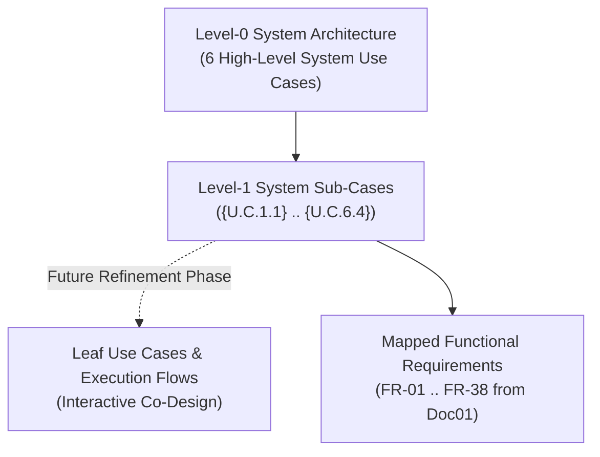
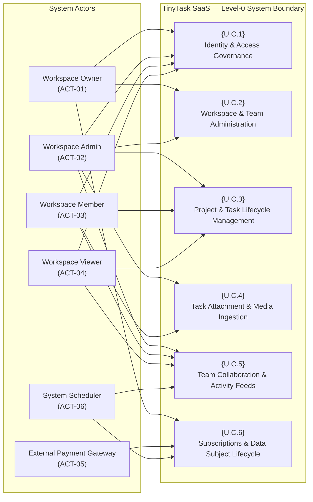
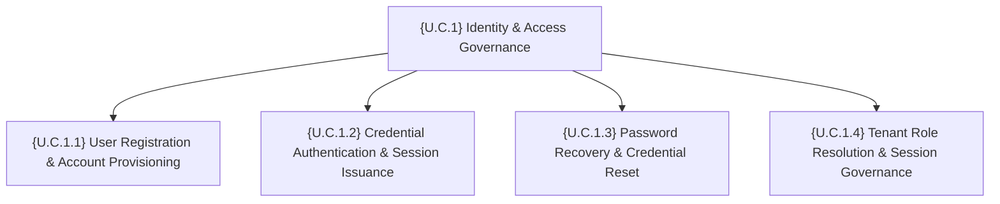
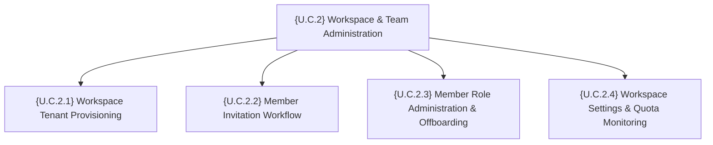
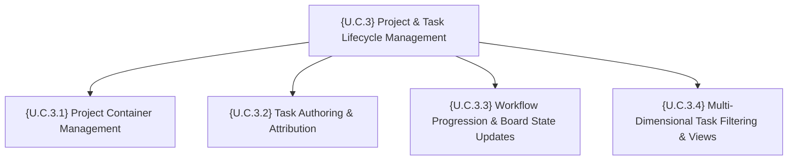
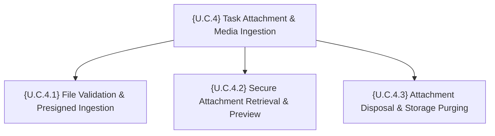
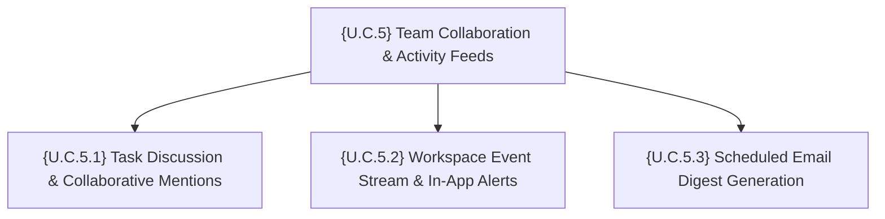
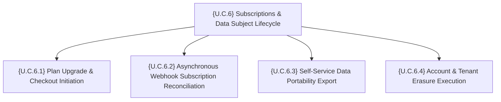

# Doc02 — System Use Cases (TinyTask SaaS)

> **Document ID:** `TT-P3-DOC02`  
> **Lifecycle Phase:** AEGIS Phase 3 — Specification (Functional Baseline)  
> **Reference Standard:** Triangular Functional Decomposition & GPTools E1.2 Standard  
> **Decomposition Level:** Level-0 to Level-1 System Use Cases (High-Level Baseline)  
> **Status:** Approved Baseline  

---

## Table of Contents

1. [Methodological Approach](#1-methodological-approach)
   - 1.1 [Volere Decomposition & System Use Cases](#11-volere-decomposition--system-use-cases)
   - 1.2 [Triangular Functional Decomposition Model](#12-triangular-functional-decomposition-model)
   - 1.3 [Scoping Constraint: High-Level Sub-Cases (No Leaf Nodes)](#13-scoping-constraint-high-level-sub-cases-no-leaf-nodes)
2. [System Actors & Operational Profiles](#2-system-actors--operational-profiles)
3. [Level-0 System Use Case Diagram](#3-level-0-system-use-case-diagram)
4. [High-Level System Use Cases ({U.C.1} to {U.C.6})](#4-high-level-system-use-cases-uc1-to-uc6)
   - 4.1 [{U.C.1} — Identity & Access Governance](#41-uc1--identity--access-governance)
     - 4.1.1 [Context & Business Objective](#411-context--business-objective)
     - 4.1.2 [Level-1 Refinement Diagram](#412-level-1-refinement-diagram)
     - 4.1.3 [Level-1 System Sub-Cases](#413-level-1-system-sub-cases)
   - 4.2 [{U.C.2} — Workspace & Team Administration](#42-uc2--workspace--team-administration)
     - 4.2.1 [Context & Business Objective](#421-context--business-objective)
     - 4.2.2 [Level-1 Refinement Diagram](#422-level-1-refinement-diagram)
     - 4.2.3 [Level-1 System Sub-Cases](#423-level-1-system-sub-cases)
   - 4.3 [{U.C.3} — Project & Task Lifecycle Management](#43-uc3--project--task-lifecycle-management)
     - 4.3.1 [Context & Business Objective](#431-context--business-objective)
     - 4.3.2 [Level-1 Refinement Diagram](#432-level-1-refinement-diagram)
     - 4.3.3 [Level-1 System Sub-Cases](#433-level-1-system-sub-cases)
   - 4.4 [{U.C.4} — Task Attachment & Media Ingestion](#44-uc4--task-attachment--media-ingestion)
     - 4.4.1 [Context & Business Objective](#441-context--business-objective)
     - 4.4.2 [Level-1 Refinement Diagram](#442-level-1-refinement-diagram)
     - 4.4.3 [Level-1 System Sub-Cases](#443-level-1-system-sub-cases)
   - 4.5 [{U.C.5} — Team Collaboration & Activity Feeds](#45-uc5--team-collaboration--activity-feeds)
     - 4.5.1 [Context & Business Objective](#451-context--business-objective)
     - 4.5.2 [Level-1 Refinement Diagram](#452-level-1-refinement-diagram)
     - 4.5.3 [Level-1 System Sub-Cases](#453-level-1-system-sub-cases)
   - 4.6 [{U.C.6} — Subscriptions & Data Subject Lifecycle](#46-uc6--subscriptions--data-subject-lifecycle)
     - 4.6.1 [Context & Business Objective](#461-context--business-objective)
     - 4.6.2 [Level-1 Refinement Diagram](#462-level-1-refinement-diagram)
     - 4.6.3 [Level-1 System Sub-Cases](#463-level-1-system-sub-cases)
5. [Summary of System Use Cases & Requirements Traceability](#5-summary-of-system-use-cases--requirements-traceability)

---

## 1. Methodological Approach

### 1.1 Volere Decomposition & System Use Cases

In accordance with the Volere requirements engineering methodology and the GPTools E1.2 specification standard, **System Use Cases** bridge the gap between high-level business goals (Product Use Cases, documented in `Doc01_Requirements_Elicitation_and_PUC.md`) and technical software architecture.

While Product Use Cases capture the business interactions between external stakeholders and the system boundary, System Use Cases structure the operational capabilities provided by the platform to support those business interactions.

### 1.2 Triangular Functional Decomposition Model

The triangular decomposition organizes functionality hierarchically:
- **Level-0 System Use Case Diagram:** Macro-level view depicting the system boundary and the assignment of human/system actors to the 6 primary capability domains.
- **High-Level System Use Cases (`{U.C.1}` to `{U.C.6}`):** Domain-level operational umbrellas describing the strategic objectives of each functional area.
- **Level-1 System Sub-Cases (`{U.C.n.m}`):** Coherent, semi-granular functional sub-cases establishing the primary capabilities, participating actors, operational pre-conditions, and mapped functional requirements (`FR-XX`).

### 1.3 Scoping Constraint: High-Level Sub-Cases (No Leaf Nodes)

> [!IMPORTANT]
> **Strict Baseline Scoping Constraint:**  
> In compliance with the project's phasing strategy, this document establishes the functional specification strictly down to **Level-1 System Sub-Cases (`{U.C.n.m}`)**.  
> **Leaf Use Cases** (e.g., sub-sub levels such as `{U.C.n.m.k}`, detailed step-by-step UI dialog sequences, alternative exception paths, and execution pseudocode) are **deliberately excluded** from this baseline. Leaf nodes will be developed subsequently in interactive collaboration with stakeholders and engineering leads.

---

## 2. System Actors & Operational Profiles

System actors designate formal operational roles interacting with the TinyTask platform. A single physical user may hold different roles across distinct workspace tenants.

| Actor ID | Actor Name | Classification | Primary Responsibilities & Permissions |
|---|---|---|---|
| **`ACT-01`** | **`Workspace Owner`** | Privileged Human User | Holds full administrative authority over a specific workspace tenant. Exclusively manages commercial subscription tiers, billing payment methods, tenant-wide data export, and workspace deletion (GDPR Art. 17). |
| **`ACT-02`** | **`Workspace Admin`** | Privileged Human User | Manages day-to-day organizational operations within a workspace. Authorized to invite new members, assign and modify member roles (`Admin`, `Member`, `Viewer`), create and archive projects, and manage team quotas. |
| **`ACT-03`** | **`Workspace Member`** | Operational Human User | Core collaborative user. Can create, edit, assign, and transition tasks; upload file attachments; post comments and `@mentions`; and inspect project Kanban boards. |
| **`ACT-04`** | **`Workspace Viewer`** | Read-Only Human User | External client, guest reviewer, or auditor. Granted read-only visibility into projects, task lists, and comment feeds. Cannot create, modify, or delete any workspace artifacts. |
| **`ACT-05`** | **`External Payment Gateway`** | External System (Stripe) | External payment processing engine that interacts via secure HTTPS APIs and delivers signed asynchronous webhook notifications concerning subscription state changes. |
| **`ACT-06`** | **`System Scheduler`** | Automated Background Process | Internal background daemon executing periodic jobs, including daily email notification digests, token expiration sweeps, and retention cleanups. |

---

## 3. Level-0 System Use Case Diagram

The Level-0 diagram illustrates the global system boundary and the interactions between all system actors and the 6 primary System Use Cases.

---

## 4. High-Level System Use Cases ({U.C.1} to {U.C.6})

### 4.1 {U.C.1} — Identity & Access Governance

#### 4.1.1 Context & Business Objective
Provides centralized identity verification, tenant membership resolution, credential management, and cryptographic session issuance for all users accessing the TinyTask platform. It guarantees that every operational request is authenticated and mapped to an authorized workspace role.

#### 4.1.2 Level-1 Refinement Diagram

#### 4.1.3 Level-1 System Sub-Cases

##### `{U.C.1.1}` — User Registration & Account Provisioning
- **Primary Actor:** `New User` (Unauthenticated)
- **Scope & Purpose:** Enable self-service registration of a new user account, validating email format, verifying email ownership via cryptographic verification link, and creating the core user profile.
- **Pre-conditions:** The user is unauthenticated and possesses an accessible email address.
- **Triggers:** User submits registration form on the public web application.
- **Data In / Out:**
  - `in`: Full name, email address, plaintext password, terms acceptance.
  - `out`: Verification email dispatched; pending user account record created.
- **Mapped Functional Requirements:** `FR-01.1`, `FR-01.2`.

##### `{U.C.1.2}` — Credential Authentication & Session Issuance
- **Primary Actor:** `Registered User`
- **Scope & Purpose:** Validate user-supplied credentials (email and password), generate cryptographically signed session tokens (JWT/bearer), record login metadata, and retrieve accessible workspace memberships.
- **Pre-conditions:** User account exists and email verification is complete.
- **Triggers:** User submits login credentials.
- **Data In / Out:**
  - `in`: Email address, password credentials, optional persistent session flag.
  - `out`: Signed session token, user profile, list of authorized workspace memberships; on failure, rate-limited error response.
- **Mapped Functional Requirements:** `FR-02.1`, `FR-02.2`, `FR-05.1`, `FR-06.1`.

##### `{U.C.1.3}` — Password Recovery & Credential Reset
- **Primary Actor:** `Registered User`
- **Scope & Purpose:** Allow users who have forgotten their password to safely regain account access via a single-use, time-limited reset token sent to their registered email address, terminating all active sessions upon password modification.
- **Pre-conditions:** User has an active, registered account.
- **Triggers:** User selects "Forgot Password" on login interface.
- **Data In / Out:**
  - `in`: Account email address; reset token; new password credentials.
  - `out`: Reset link email dispatched; updated password hash; revocation of active tokens across all user devices.
- **Mapped Functional Requirements:** `FR-03.1`, `FR-03.2`.

##### `{U.C.1.4}` — Tenant Role Resolution & Session Governance
- **Primary Actor:** `Workspace User` (`Owner`, `Admin`, `Member`, `Viewer`)
- **Scope & Purpose:** Evaluate the requesting user's active session against the target workspace boundary, enforce Role-Based Access Control (RBAC), and allow users to inspect and revoke active sessions on demand.
- **Pre-conditions:** User possesses a valid session token.
- **Triggers:** User navigates into a workspace context or inspects active sessions under account settings.
- **Data In / Out:**
  - `in`: Active session token, target `workspace_id`, session termination command.
  - `out`: Evaluated RBAC permission context; list of active sessions (device, IP country, timestamp); session termination confirmation.
- **Mapped Functional Requirements:** `FR-04.1`, `FR-04.2`.

---

### 4.2 {U.C.2} — Workspace & Team Administration

#### 4.2.1 Context & Business Objective
Governs multi-tenant isolation, organizational workspace creation, member invitation workflows, role administration, and subscription quota monitoring. It ensures organizations can manage their teams while preserving strict data segregation between workspaces.

#### 4.2.2 Level-1 Refinement Diagram

#### 4.2.3 Level-1 System Sub-Cases

##### `{U.C.2.1}` — Workspace Tenant Provisioning
- **Primary Actor:** `Authenticated User`
- **Scope & Purpose:** Provision a completely isolated workspace tenant with a custom organizational name and unique URL slug, establishing the creator as the initial `Workspace Owner`.
- **Pre-conditions:** User is authenticated.
- **Triggers:** User initiates workspace creation from the workspace switcher interface.
- **Data In / Out:**
  - `in`: Workspace name, unique URL slug, initial plan tier selection.
  - `out`: Provisioned workspace tenant, initial default project, `Workspace Owner` role binding.
- **Mapped Functional Requirements:** `FR-07.1`, `FR-07.2`.

##### `{U.C.2.2}` — Member Invitation Workflow
- **Primary Actor:** `Workspace Owner`, `Workspace Admin`
- **Scope & Purpose:** Invite team members to join the workspace by email, verifying that current member counts do not exceed the plan tier seat quota, and dispatching signed invitation tokens.
- **Pre-conditions:** Requesting user holds `Owner` or `Admin` privileges in the workspace.
- **Triggers:** Admin enters invitee email and selects an initial role.
- **Data In / Out:**
  - `in`: Invitee email address, target role (`Admin`, `Member`, `Viewer`).
  - `out`: Cryptographic invitation link emailed; pending membership record registered; quota count updated.
- **Mapped Functional Requirements:** `FR-08.1`, `FR-08.2`.

##### `{U.C.2.3}` — Member Role Administration & Offboarding
- **Primary Actor:** `Workspace Owner`, `Workspace Admin`
- **Scope & Purpose:** Modify assigned roles of active members or revoke membership entirely, instantly severing the user's access to the workspace while retaining historical audit and attribution data.
- **Pre-conditions:** Target user is an active member of the workspace; the `Workspace Owner` cannot be removed by an `Admin`.
- **Triggers:** Admin selects role change or member removal command in workspace settings.
- **Data In / Out:**
  - `in`: Target `user_id`, new role designation, or removal command.
  - `out`: Updated membership record; real-time revocation of permissions; audit event logged.
- **Mapped Functional Requirements:** `FR-09.1`, `FR-09.2`, `FR-12.1`.

##### `{U.C.2.4}` — Workspace Settings & Quota Monitoring
- **Primary Actor:** `Workspace Owner`, `Workspace Admin`
- **Scope & Purpose:** Review workspace resource utilization (active seats, project counts, attachment storage volume) against the active subscription tier limits, and manage general workspace metadata.
- **Pre-conditions:** User holds `Owner` or `Admin` role in the workspace.
- **Triggers:** Admin accesses the workspace settings dashboard.
- **Data In / Out:**
  - `in`: Workspace query parameters; optional updated organizational name/logo.
  - `out`: Utilization metrics display (allocated seats vs limit, storage used); updated workspace profile.
- **Mapped Functional Requirements:** `FR-10.1`, `FR-11.1`.

---

### 4.3 {U.C.3} — Project & Task Lifecycle Management

#### 4.3.1 Context & Business Objective
Forms the primary operational core of TinyTask. It provides project containerization, task creation, assignment, priority tagging, due date tracking, and workflow state progression across Kanban and list representations.

#### 4.3.2 Level-1 Refinement Diagram

#### 4.3.3 Level-1 System Sub-Cases

##### `{U.C.3.1}` — Project Container Management
- **Primary Actor:** `Workspace Admin`, `Workspace Member`
- **Scope & Purpose:** Create, configure, update, and archive project containers that house discrete sets of tasks and collaborative threads.
- **Pre-conditions:** User is an active workspace member with creation privileges.
- **Triggers:** User creates or modifies a project.
- **Data In / Out:**
  - `in`: Project name, description, privacy setting, archive command.
  - `out`: Created/updated project record; project listing update; audit event.
- **Mapped Functional Requirements:** `FR-13.1`, `FR-13.2`.

##### `{U.C.3.2}` — Task Authoring & Attribution
- **Primary Actor:** `Workspace Member`, `Workspace Admin`
- **Scope & Purpose:** Define new work items within a project, specifying task title, detailed description, priority level, target due date, and assigning responsibility to a workspace colleague.
- **Pre-conditions:** Containing project exists and is active (not archived).
- **Triggers:** User clicks "New Task" and submits form.
- **Data In / Out:**
  - `in`: Project ID, title, description, priority (`Low`, `Medium`, `High`, `Urgent`), assignee ID, due date.
  - `out`: Created task record; assignment notification routed to assignee; activity event.
- **Mapped Functional Requirements:** `FR-14.1`, `FR-14.2`, `FR-17.1`.

##### `{U.C.3.3}` — Workflow Progression & Board State Updates
- **Primary Actor:** `Workspace Member`, `Workspace Admin`
- **Scope & Purpose:** Transition tasks through standard operational stages (`To-Do`, `In-Progress`, `Under-Review`, `Done`), supporting drag-and-drop interactions on Kanban boards.
- **Pre-conditions:** Task exists; requesting user is an active workspace member.
- **Triggers:** User moves task card on Kanban board or changes status selector.
- **Data In / Out:**
  - `in`: Target `task_id`, new status value.
  - `out`: Updated task entity; board column reordering; activity log record; optional recurring task clone trigger.
- **Mapped Functional Requirements:** `FR-15.1`, `FR-15.2`, `FR-18.1`.

##### `{U.C.3.4}` — Multi-Dimensional Task Filtering & Views
- **Primary Actor:** `Workspace User` (`Owner`, `Admin`, `Member`, `Viewer`)
- **Scope & Purpose:** Query and display tasks according to selectable criteria, including assignee, status, priority, and date ranges, presented in customizable views.
- **Pre-conditions:** User has read access to the workspace.
- **Triggers:** User applies search keywords or filters on project view.
- **Data In / Out:**
  - `in`: Filter criteria (assignee ID, status list, priority list, due date range, sorting order).
  - `out`: Rendered task dataset matching filter criteria.
- **Mapped Functional Requirements:** `FR-16.1`, `FR-19.1`.

---

### 4.4 {U.C.4} — Task Attachment & Media Ingestion

#### 4.4.1 Context & Business Objective
Provides secure ingestion, storage, retrieval, and disposal of files and media assets associated with tasks, enforcing strict MIME validation, file size constraints, and time-limited access authorizations.

#### 4.4.2 Level-1 Refinement Diagram

#### 4.4.3 Level-1 System Sub-Cases

##### `{U.C.4.1}` — File Validation & Presigned Ingestion
- **Primary Actor:** `Workspace Member`, `Workspace Admin`
- **Scope & Purpose:** Authorize and process file uploads to a task, enforcing MIME whitelist checks, 25 MB size limits, and utilizing randomized storage keys in cloud object storage.
- **Pre-conditions:** Task exists; user is authorized to edit the task.
- **Triggers:** User drags a file into the task attachment dropzone.
- **Data In / Out:**
  - `in`: `task_id`, file binary, filename, declared MIME type, file size.
  - `out`: Presigned upload authorization; attachment metadata record; task attachment list update.
- **Mapped Functional Requirements:** `FR-20.1`, `FR-20.2`, `FR-21.1`.

##### `{U.C.4.2}` — Secure Attachment Retrieval & Preview
- **Primary Actor:** `Workspace User` (`Owner`, `Admin`, `Member`, `Viewer`)
- **Scope & Purpose:** Generate time-limited, cryptographically signed download URLs enabling authorized users to download or preview task attachments without exposing direct public storage endpoints.
- **Pre-conditions:** User belongs to the workspace containing the parent task.
- **Triggers:** User clicks on an attachment preview thumbnail or download button.
- **Data In / Out:**
  - `in`: `attachment_id`, `task_id`.
  - `out`: Expiring signed download URL (valid 15 minutes); optional thumbnail preview rendering.
- **Mapped Functional Requirements:** `FR-22.1`, `FR-24.1`.

##### `{U.C.4.3}` — Attachment Disposal & Storage Purging
- **Primary Actor:** `Workspace Member` (Uploader), `Workspace Admin`, `Workspace Owner`
- **Scope & Purpose:** Remove an attachment from a task, immediately deleting the database metadata record and purging the physical object from cloud storage.
- **Pre-conditions:** User is either the original uploader or holds `Admin`/`Owner` role.
- **Triggers:** User clicks "Delete Attachment" and confirms.
- **Data In / Out:**
  - `in`: `attachment_id`, deletion confirmation.
  - `out`: Removed attachment record; asynchronous storage purge dispatched; task audit log updated.
- **Mapped Functional Requirements:** `FR-23.1`.

---

### 4.5 {U.C.5} — Team Collaboration & Activity Feeds

#### 4.5.1 Context & Business Objective
Enables asynchronous communication among team members through Markdown task comments, user `@mentions`, real-time activity event tracking, and automated email summary notifications.

#### 4.5.2 Level-1 Refinement Diagram

#### 4.5.3 Level-1 System Sub-Cases

##### `{U.C.5.1}` — Task Discussion & Collaborative Mentions
- **Primary Actor:** `Workspace Member`, `Workspace Admin`
- **Scope & Purpose:** Enable threaded discussion on tasks using Markdown formatting, parsing `@username` mentions to trigger targeted notifications for mentioned colleagues.
- **Pre-conditions:** Target task exists in an active project.
- **Triggers:** User submits a comment on the task detail panel.
- **Data In / Out:**
  - `in`: `task_id`, Markdown comment text, tagged user references.
  - `out`: Appended comment record; parsed user mention notifications dispatched.
- **Mapped Functional Requirements:** `FR-25.1`, `FR-25.2`, `FR-29.1`.

##### `{U.C.5.2}` — Workspace Event Stream & In-App Alerts
- **Primary Actor:** `Workspace User` (`Owner`, `Admin`, `Member`, `Viewer`)
- **Scope & Purpose:** Record chronological audit events for all task transitions and deliver real-time notifications to the user's notification center.
- **Pre-conditions:** User is authenticated within a workspace.
- **Triggers:** Any state-changing event occurs on tasks assigned to or observed by the user.
- **Data In / Out:**
  - `in`: State-change event stream; user notification acknowledgment.
  - `out`: Notification badge counter update; chronological activity feed entries.
- **Mapped Functional Requirements:** `FR-26.1`, `FR-27.1`.

##### `{U.C.5.3}` — Scheduled Email Digest Generation
- **Primary Actor:** `System Scheduler`
- **Scope & Purpose:** Aggregate outstanding task due dates, overdue assignments, and unread mentions for each user into a structured daily email digest.
- **Pre-conditions:** Scheduler cron executes; user has daily digest enabled in preferences.
- **Triggers:** Daily schedule timer fires at 08:00 UTC.
- **Data In / Out:**
  - `in`: Pending unread notification records, user digest preferences.
  - `out`: Formatted summary email dispatched via transactional email provider.
- **Mapped Functional Requirements:** `FR-28.1`.

---

### 4.6 {U.C.6} — Subscriptions & Data Subject Lifecycle

#### 4.6.1 Context & Business Objective
Encompasses the commercial subscription lifecycle (plan checkout, tier upgrades, Stripe webhook processing) alongside compliance mechanisms for GDPR data subject rights (self-service data portability export under Art. 20, and account/workspace erasure under Art. 17).

#### 4.6.2 Level-1 Refinement Diagram

#### 4.6.3 Level-1 System Sub-Cases

##### `{U.C.6.1}` — Plan Upgrade & Checkout Initiation
- **Primary Actor:** `Workspace Owner`
- **Scope & Purpose:** Enable the Workspace Owner to select an upgraded plan tier (`Pro` or `Enterprise`), generating a secure Stripe Checkout session without exposing sensitive payment card details to TinyTask servers.
- **Pre-conditions:** Requesting user is the verified `Workspace Owner`.
- **Triggers:** Owner selects "Upgrade Plan" in workspace billing settings.
- **Data In / Out:**
  - `in`: Desired plan tier ID, billing cycle (monthly/annual), return URL.
  - `out`: Hosted Stripe Checkout session URL redirect.
- **Mapped Functional Requirements:** `FR-30.1`.

##### `{U.C.6.2}` — Asynchronous Webhook Subscription Reconciliation
- **Primary Actor:** `External Payment Gateway` (Stripe)
- **Scope & Purpose:** Ingest, verify cryptographic signatures, and process incoming webhook events from Stripe to update workspace subscription statuses, seat quotas, and payment failure states.
- **Pre-conditions:** Webhook payload is signed with the configured Stripe webhook secret.
- **Triggers:** Stripe delivers an HTTP POST request to the webhook endpoint.
- **Data In / Out:**
  - `in`: Signed webhook payload (`invoice.payment_succeeded`, `customer.subscription.deleted`, etc.), Stripe signature header.
  - `out`: Verified event acknowledgment (HTTP 200); updated workspace tier quota and billing status.
- **Mapped Functional Requirements:** `FR-31.1`, `FR-32.1`, `FR-33.1`.

##### `{U.C.6.3}` — Self-Service Data Portability Export
- **Primary Actor:** `Workspace Owner`, `Registered User`
- **Scope & Purpose:** Enable users to request an automated export of their personal data (GDPR Art. 20) or workspace data in structured, machine-readable formats (JSON and ZIP archive).
- **Pre-conditions:** User is authenticated and verifies intent.
- **Triggers:** User requests data export under account or workspace privacy settings.
- **Data In / Out:**
  - `in`: Export scope request (personal data or full workspace), export format selection.
  - `out`: Background export job queued; signed, time-limited download link emailed to requester upon completion.
- **Mapped Functional Requirements:** `FR-34.1`, `FR-35.1`.

##### `{U.C.6.4}` — Account & Tenant Erasure Execution
- **Primary Actor:** `Workspace Owner`, `Registered User`
- **Scope & Purpose:** Execute verified account deletion requests (GDPR Art. 17), redacting personal identifiers from historical task logs, purging personal profile data, and generating an auditable digital erasure receipt.
- **Pre-conditions:** User confirms deletion with valid password re-authentication; if Workspace Owner, either transfers ownership or deletes the workspace tenant.
- **Triggers:** User submits account/workspace deletion request.
- **Data In / Out:**
  - `in`: User password re-verification, confirmation token.
  - `out`: User record erased/redacted; historical comments attributed to `[Deleted User]`; digital erasure receipt generated.
- **Mapped Functional Requirements:** `FR-36.1`, `FR-37.1`, `FR-38.1`.

---

## 5. Summary of System Use Cases & Requirements Traceability

The matrix below provides complete bidirectional traceability between all **Level-1 System Sub-Cases** and the **Functional Requirements (`FR-XX`)** defined in `Doc01_Requirements_Elicitation_and_PUC.md`.

| High-Level UC | Level-1 Sub-Case | Sub-Case Title | Primary Actor | Mapped Functional Requirements |
|---|---|---|---|---|
| **`{U.C.1}`** | `{U.C.1.1}` | User Registration & Account Provisioning | New User | `FR-01.1`, `FR-01.2` |
| | `{U.C.1.2}` | Credential Authentication & Session Issuance | Registered User | `FR-02.1`, `FR-02.2`, `FR-05.1`, `FR-06.1` |
| | `{U.C.1.3}` | Password Recovery & Credential Reset | Registered User | `FR-03.1`, `FR-03.2` |
| | `{U.C.1.4}` | Tenant Role Resolution & Session Governance | Workspace User | `FR-04.1`, `FR-04.2` |
| **`{U.C.2}`** | `{U.C.2.1}` | Workspace Tenant Provisioning | Authenticated User | `FR-07.1`, `FR-07.2` |
| | `{U.C.2.2}` | Member Invitation Workflow | Workspace Owner / Admin | `FR-08.1`, `FR-08.2` |
| | `{U.C.2.3}` | Member Role Administration & Offboarding | Workspace Owner / Admin | `FR-09.1`, `FR-09.2`, `FR-12.1` |
| | `{U.C.2.4}` | Workspace Settings & Quota Monitoring | Workspace Owner / Admin | `FR-10.1`, `FR-11.1` |
| **`{U.C.3}`** | `{U.C.3.1}` | Project Container Management | Workspace Admin / Member | `FR-13.1`, `FR-13.2` |
| | `{U.C.3.2}` | Task Authoring & Attribution | Workspace Member / Admin | `FR-14.1`, `FR-14.2`, `FR-17.1` |
| | `{U.C.3.3}` | Workflow Progression & Board State Updates | Workspace Member / Admin | `FR-15.1`, `FR-15.2`, `FR-18.1` |
| | `{U.C.3.4}` | Multi-Dimensional Task Filtering & Views | Workspace User | `FR-16.1`, `FR-19.1` |
| **`{U.C.4}`** | `{U.C.4.1}` | File Validation & Presigned Ingestion | Workspace Member / Admin | `FR-20.1`, `FR-20.2`, `FR-21.1` |
| | `{U.C.4.2}` | Secure Attachment Retrieval & Preview | Workspace User | `FR-22.1`, `FR-24.1` |
| | `{U.C.4.3}` | Attachment Disposal & Storage Purging | Workspace Member / Admin | `FR-23.1` |
| **`{U.C.5}`** | `{U.C.5.1}` | Task Discussion & Collaborative Mentions | Workspace Member / Admin | `FR-25.1`, `FR-25.2`, `FR-29.1` |
| | `{U.C.5.2}` | Workspace Event Stream & In-App Alerts | Workspace User | `FR-26.1`, `FR-27.1` |
| | `{U.C.5.3}` | Scheduled Email Digest Generation | System Scheduler | `FR-28.1` |
| **`{U.C.6}`** | `{U.C.6.1}` | Plan Upgrade & Checkout Initiation | Workspace Owner | `FR-30.1` |
| | `{U.C.6.2}` | Asynchronous Webhook Subscription Reconciliation | External Payment Gateway | `FR-31.1`, `FR-32.1`, `FR-33.1` |
| | `{U.C.6.3}` | Self-Service Data Portability Export | Workspace Owner / User | `FR-34.1`, `FR-35.1` |
| | `{U.C.6.4}` | Account & Tenant Erasure Execution | Workspace Owner / User | `FR-36.1`, `FR-37.1`, `FR-38.1` |
