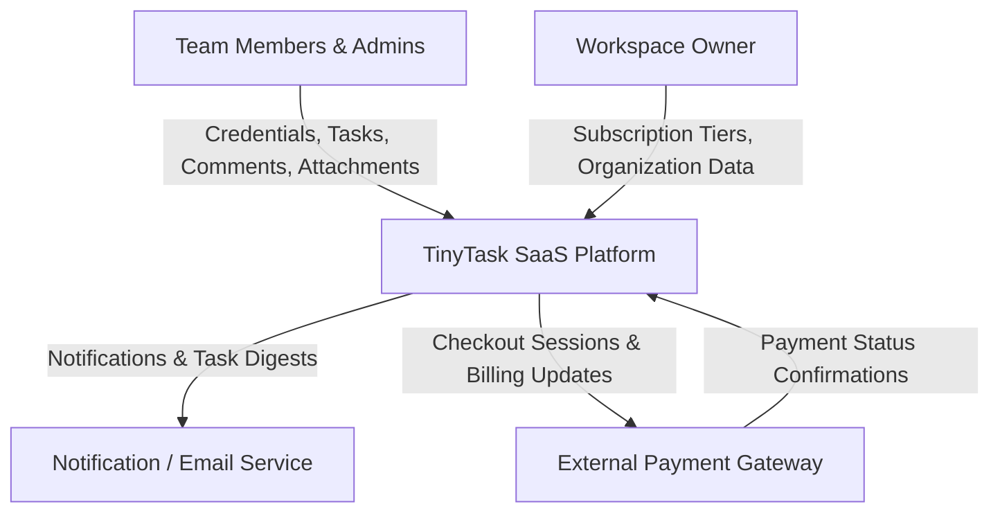

# E1.2 – TinyTask SaaS: System Use Cases

## Executive Summary

This deliverable specifies the formal **System Use Cases** for the **TinyTask SaaS** platform, elaborating the functional requirements elicited in `Doc01` into formal behavioral contracts. In strict accordance with the reference project standard (`E1.2 – GPTools_AnáliseRequisitos_CasosDeUso_V4.0`) and use case architecture literature (Alistair Cockburn, Robertson & Robertson), use case decomposition anchors rigorously at **Level 1 (`{U.C.n.m}`)**—Cockburn's "User Goal / Sea Level".

The specification contains zero leaf nodes (`{U.C.n.m.k}`) and zero procedural execution sequences, providing an unambiguous, technology-neutral functional canvas for subsequent AEGIS Phase 3 security synthesis.

---

## Table of Contents

- [1. Introduction](#1-introduction)
- [2. System Requirements Approach](#2-system-requirements-approach)
  - [2.1 Volere Approach and Triangular Functional Decomposition](#21-volere-approach-and-triangular-functional-decomposition)
  - [2.2 Refinement Boundary (No Leaf Nodes)](#22-refinement-boundary-no-leaf-nodes)
  - [2.3 Non-Functional Requirements](#23-non-functional-requirements)
- [3. Requirements Analysis](#3-requirements-analysis)
  - [3.1 Work Context Model](#31-work-context-model)
  - [3.2 Summary Table of Product Use Cases (PUC)](#32-summary-table-of-product-use-cases-puc)
- [4. Domain Application Use Cases](#4-domain-application-use-cases)
  - [4.1 System Actors](#41-system-actors)
  - [4.2 System Use Cases](#42-system-use-cases)
    - [{U.C. 1} Manage User Accounts and Authentication](#uc-1-manage-user-accounts-and-authentication)
    - [{U.C. 2} Manage Workspaces and Teams](#uc-2-manage-workspaces-and-teams)
    - [{U.C. 3} Manage Projects](#uc-3-manage-projects)
    - [{U.C. 4} Manage and Execute Tasks](#uc-4-manage-and-execute-tasks)
    - [{U.C. 5} Collaborate on Task Deliverables](#uc-5-collaborate-on-task-deliverables)
    - [{U.C. 6} Track Activity History and Notifications](#uc-6-track-activity-history-and-notifications)
    - [{U.C. 7} Manage Commercial Subscriptions](#uc-7-manage-commercial-subscriptions)
    - [{U.C. 8} Export Data and Close Accounts](#uc-8-export-data-and-close-accounts)
- [5. Non-Functional Requirements](#5-non-functional-requirements)
- [6. Conclusions](#6-conclusions)
- [7. Bibliography](#7-bibliography)
- [Version History](#version-history)

---

## 1. Introduction

The **TinyTask SaaS** platform delivers a lean, collaborative project and task management environment tailored for small agile teams, agencies, and consultancies. Following the operational elicitation established in `Doc01` (AS-IS and TO-BE models), this document defines the system-level operational use cases.

The objective is to establish an exhaustive behavioral specification defining how primary actors interact with the system boundary to achieve defined operational outcomes, preserving strict technology neutrality.

---

## 2. System Requirements Approach

### 2.1 Volere Approach and Triangular Functional Decomposition

The specification follows the Volere requirements engineering methodology (Robertson & Robertson). Each functional requirement traces through a triangular decomposition:

1. **Business Events:** Real-world occurrences in the stakeholder environment that trigger work.
2. **Product Use Cases (PUC):** The automated portion of the business response executed by the system.
3. **Atomic Functional Requirements:** Standalone behavioral assertions prioritized via MoSCoW.

### 2.2 Refinement Boundary (No Leaf Nodes)

In accordance with Cockburn's use case architecture and the GPTools standard:
- **Level 0 (`{U.C. N}`):** Summary-level macro functional capabilities.
- **Level 1 (`{U.C.n.m}`):** Elementary business user goals ("Sea Level"). Each use case describes a complete, atomic task completed by a single actor in a single operational context.
- **Refinement Boundary:** Decomposition strictly terminates at Level 1. **Zero leaf nodes (`{U.C.n.m.k}`) and zero step-by-step procedural sequences** are specified in the functional baseline.

### 2.3 Non-Functional Requirements

System qualities (performance, availability, recoverability) are maintained in Section 5 as global constraints governing all use case implementations.

---

## 3. Requirements Analysis

### 3.1 Work Context Model

The following diagram illustrates the information boundaries between TinyTask SaaS and adjacent entities:

### 3.2 Summary Table of Product Use Cases (PUC)

*Table 1. Summary of Product Use Cases*

| PUC ID | Business Trigger | Primary Actor | Target System Use Case |
|---|---|---|---|
| **PUC 1.1** | Visitor registers or requests access | Visitor / User | `{U.C. 1.1}` Register and authenticate user accounts |
| **PUC 1.2** | User updates profile details | Registered User | `{U.C. 1.2}` Manage user profile and account preferences |
| **PUC 2.1** | User instantiates a team workspace | Workspace Owner | `{U.C. 2.1}` Create and configure workspace |
| **PUC 2.2** | Admin manages member roster | Workspace Admin | `{U.C. 2.2}` Invite workspace members and manage access roles |
| **PUC 2.3** | Leadership requests usage metrics | Workspace Admin | `{U.C. 2.3}` Monitor workspace activity and operational metrics |
| **PUC 3.1** | Team initializes new project | Workspace Member | `{U.C. 3.1}` Create and configure projects |
| **PUC 3.2** | Team completes project lifecycle | Workspace Admin | `{U.C. 3.2}` Archive completed projects |
| **PUC 4.1** | Member authors new work item | Workspace Member | `{U.C. 4.1}` Create and assign tasks |
| **PUC 4.2** | Member transitions task or filters board | Workspace Member | `{U.C. 4.2}` Track and transition task workflow states on visual boards |
| **PUC 4.3** | Recurring task is completed | Automated Daemon | `{U.C. 4.3}` Configure recurring automated tasks |
| **PUC 5.1** | Member attaches deliverable file | Workspace Member | `{U.C. 5.1}` Manage task deliverable attachments |
| **PUC 5.2** | Member comments on work item | Workspace Member | `{U.C. 5.2}` Post in-task discussion comments and mention collaborators |
| **PUC 6.1** | User reviews task history | Workspace Member | `{U.C. 6.1}` Consult chronological audit history on task cards |
| **PUC 6.2** | User consults alerts or daily digest | Registered User | `{U.C. 6.2}` Receive workspace alerts and daily task digests |
| **PUC 7.1** | Owner upgrades commercial tier | Workspace Owner | `{U.C. 7.1}` Subscribe and manage workspace commercial plans |
| **PUC 7.2** | Automated renewal charge fails | Payment Gateway | `{U.C. 7.2}` Enforce operational grace period upon payment failure |
| **PUC 8.1** | User or Owner requests data export | User / Owner | `{U.C. 8.1}` Export personal and workspace data archives |
| **PUC 8.2** | User requests account closure | Registered User | `{U.C. 8.2}` Close user accounts and terminate workspace access |

---

## 4. Domain Application Use Cases

### 4.1 System Actors

The platform defines four human roles and two external service actors:
- **Workspace Owner:** Commercial and organizational administrative authority.
- **Workspace Admin:** Team manager managing members, roles, and project containers.
- **Workspace Member:** Standard contributor authoring tasks, comments, and attachments.
- **Workspace Viewer:** Read-only guest reviewer.
- **External Payment Gateway:** External billing processor handling subscriptions and payment confirmations.
- **Notification / Email Service:** Subsystem dispatching transactional emails and digests.

---

### 4.2 System Use Cases

### {U.C. 1} Manage User Accounts and Authentication

#### {U.C. 1.1} Register and authenticate user accounts
- **Primary Actor:** Unauthenticated Visitor / Registered User
- **Goal:** Create a verified account, authenticate with credentials to establish an active session, or autonomously request password recovery assistance.
- **Operational Scope:** The system validates registration details, sends email activation links, authenticates valid login submissions, and issues single-use reset links upon self-service recovery requests.

#### {U.C. 1.2} Manage user profile and account preferences
- **Primary Actor:** Authenticated User
- **Goal:** View and update personal profile details (full name, avatar, contact information) and configure operational notification preferences.
- **Operational Scope:** The system stores updated profile parameters and applies notification preference filters to alert channels.

---

### {U.C. 2} Manage Workspaces and Teams

#### {U.C. 2.1} Create and configure workspace
- **Primary Actor:** Workspace Owner / Admin
- **Goal:** Instantiate an isolated organizational workspace with unique URL slug and configure organization branding (name and logo).
- **Operational Scope:** The system allocates tenant resources, assigns the creator as primary Owner, and stores branding metadata.

#### {U.C. 2.2} Invite workspace members and manage access roles
- **Primary Actor:** Workspace Admin / Owner
- **Goal:** Invite team members via email, assign access roles (Owner, Admin, Member, Viewer), update member roles, or revoke workspace access.
- **Operational Scope:** The system verifies seat quotas, dispatches email invitations, and maintains the workspace authorization roster.

#### {U.C. 2.3} Monitor workspace activity and operational metrics
- **Primary Actor:** Workspace Admin / Owner
- **Goal:** Review aggregated operational metrics including active members, completed tasks, and total deliverable file storage consumed.
- **Operational Scope:** The system compiles activity statistics and displays real-time workspace resource utilization.

---

### {U.C. 3} Manage Projects

#### {U.C. 3.1} Create and configure projects
- **Primary Actor:** Workspace Admin / Member
- **Goal:** Create project containers with project name, deliverables description, and visibility settings (workspace-wide or restricted).
- **Operational Scope:** The system stores project records, initializes project board views, and restricts access to designated members.

#### {U.C. 3.2} Archive completed projects
- **Primary Actor:** Workspace Admin / Owner
- **Goal:** Transition completed projects to archived status to hide them from active operational views while preserving history.
- **Operational Scope:** The system marks the project read-only and archives all associated task boards.

---

### {U.C. 4} Manage and Execute Tasks

#### {U.C. 4.1} Create and assign tasks
- **Primary Actor:** Workspace Member / Admin
- **Goal:** Create task cards with title, description, priority (Low, Medium, High, Urgent), and due date, and assign tasks to active members.
- **Operational Scope:** The system stores task attributes in "To-Do" status and dispatches assignment alerts to designated members.

#### {U.C. 4.2} Track and transition task workflow states on visual boards
- **Primary Actor:** Workspace Member / Admin / Viewer
- **Goal:** Visualize tasks on interactive Kanban boards, transition cards across status columns (To-Do, In-Progress, Under-Review, Done), and filter board views.
- **Operational Scope:** The system updates task state models, records timestamped transitions, and applies real-time multi-criteria filters.

#### {U.C. 4.3} Configure recurring automated tasks
- **Primary Actor:** Workspace Member / Admin
- **Goal:** Define recurring schedules (weekly, monthly) that automatically generate a new task instance upon completion of the current task.
- **Operational Scope:** The system registers recurrence triggers and instantiates duplicated tasks in "To-Do" when marked "Done".

---

### {U.C. 5} Collaborate on Task Deliverables

#### {U.C. 5.1} Manage task deliverable attachments
- **Primary Actor:** Workspace Member / Admin / Viewer
- **Goal:** Upload deliverable files up to 25 MB directly to task cards, view inline previews, download deliverables, and remove outdated files.
- **Operational Scope:** The system stores files in the file storage service, indexes attachment metadata, and verifies download/removal rights.

#### {U.C. 5.2} Post in-task discussion comments and mention collaborators
- **Primary Actor:** Workspace Member / Admin
- **Goal:** Publish rich text Markdown comments in contextual task threads and @mention collaborators to trigger automated alerts.
- **Operational Scope:** The system records comments in chronological order and dispatches in-app alerts to mentioned collaborators.

---

### {U.C. 6} Track Activity History and Notifications

#### {U.C. 6.1} Consult chronological audit history on task cards
- **Primary Actor:** Authorized Workspace Users
- **Goal:** Inspect a chronological audit feed documenting all task modifications, assignee updates, state transitions, and file events.
- **Operational Scope:** The system queries audit log tables and renders an immutable historical timeline on the task card.

#### {U.C. 6.2} Receive workspace alerts and daily task digests
- **Primary Actor:** Registered User
- **Goal:** Consult an in-app notification center for direct assignments and mentions, and receive an automated morning email digest of pending tasks.
- **Operational Scope:** The system tracks unread notification counters and runs scheduled morning email digest jobs.

---

### {U.C. 7} Manage Commercial Subscriptions

#### {U.C. 7.1} Subscribe and manage workspace commercial plans
- **Primary Actor:** Workspace Owner
- **Goal:** Select plan tiers (Free, Pro, Enterprise) and complete checkout via the payment gateway, updating tier quotas upon payment confirmation.
- **Operational Scope:** The system redirects to hosted checkout sessions and updates workspace member quotas and renewal dates upon payment receipt.

#### {U.C. 7.2} Enforce operational grace period upon payment failure
- **Primary Actor:** External Payment Gateway / Workspace Owner
- **Goal:** Maintain operational access under a 7-day grace period following a payment failure while prompting for billing updates.
- **Operational Scope:** The system records billing status warnings, maintains normal operations, and restricts access if unresolved after 7 days.

---

### {U.C. 8} Export Data and Close Accounts

#### {U.C. 8.1} Export personal and workspace data archives
- **Primary Actor:** Authenticated User / Workspace Owner
- **Goal:** Download structured exports of personal profile data and authored tasks, or full workspace archive packages of projects and deliverables.
- **Operational Scope:** The system compiles structured data files and deliverable attachments into secure, downloadable archives.

#### {U.C. 8.2} Close user accounts and terminate workspace access
- **Primary Actor:** Authenticated User
- **Goal:** Autonomously close a user account, invalidating credentials and active sessions, and receiving an email confirmation receipt.
- **Operational Scope:** The system deactivates credentials, removes active workspace memberships, and dispatches a final confirmation receipt.

---

## 5. Non-Functional Requirements

*Table 2. Non-Functional Requirements Summary*

| ID | Quality Attribute | Verification Target |
|---|---|---|
| **RN1** | Performance | Page load under 500 ms for boards with up to 200 items. |
| **RN2** | Availability | Monthly availability of >= 99.5%, excluding announced maintenance. |
| **RN3** | Usability | Responsive interface supporting viewport widths down to 375 px. |
| **RN4** | Scalability | Support up to 50,000 active tasks per workspace without degradation. |
| **RN5** | Recoverability | Daily database backups with RPO < 24 hours. |
| **RN6** | Internationalization | Localization in English and Portuguese. |
| **RN7** | Interoperability | Secure API communication with external payment gateway. |
| **RN8** | Tenant Isolation | Strict logical database segregation across workspaces. |

---

## 6. Conclusions

The system use case model establishes an exhaustive, literature-aligned functional baseline for TinyTask SaaS:
1. **Total Sea-Level Fidelity:** 16 Level-1 use cases cleanly cover all operational capabilities.
2. **Pure Functionality:** Zero pre-baked security or vendor-specific technology lock-in.
3. **AEGIS Phase 3 Ready:** Provides an unambiguous canvas for security assertions, trust boundary mapping, and regulatory requirement derivation.

---

## 7. Bibliography

- Cockburn, A. (2000). *Writing Effective Use Cases*. Addison-Wesley Professional.
- Robertson, S., & Robertson, J. (2012). *Mastering the Requirements Process: Getting Requirements Right* (3rd ed.). Addison-Wesley Professional.
- Wiegers, K., & Beatty, J. (2013). *Software Requirements* (3rd ed.). Microsoft Press.

---

## Version History

| Version | Date | Author | Description of Changes |
|---|---|---|---|
| **1.0.0** | 2026-09-23 | Requirements Engineering Agent | Initial baseline System Use Cases (GPTools E1.2 model). |
| **2.0.0** | 2026-09-23 | Requirements Engineering Agent | Pure functional alignment, active English verbs, zero leaf nodes. |
| **2.1.0** | 2026-09-23 | Requirements Engineering Agent | Consolidated to 16 Sea-Level use cases matching consolidated business requirements. |
