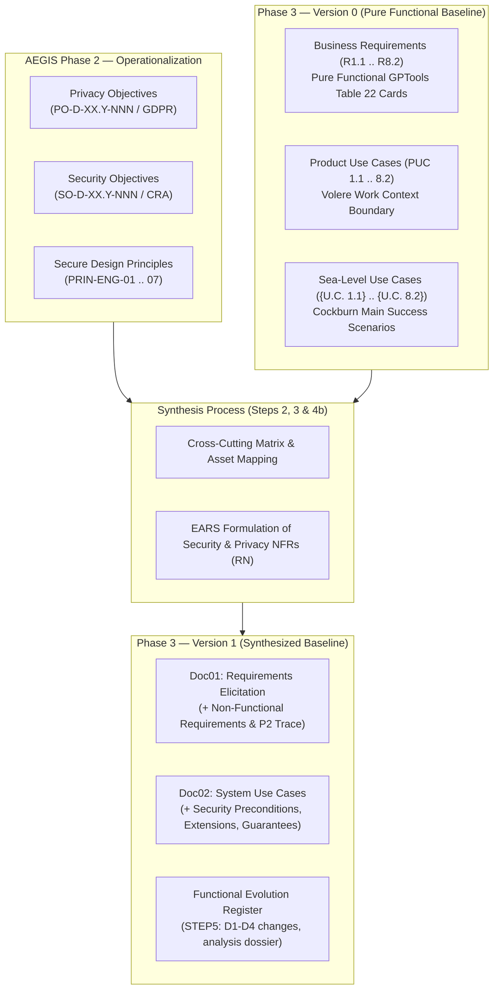

# AEGIS Phase 3 — Requirements Engineering & Security/Privacy Synthesis Methodology

> **Document Type:** Methodological Manual & Practical Process Guide  
> **Lifecycle Phase:** AEGIS Phase 3 — Specification  
> **Target Audience:** Systems Architects, Requirements Engineers, Security Officers, AI Agents  
> **Status:** Normative Methodology Reference  

---

## Executive Summary

This document establishes the formal, repeatable methodology for conducting **Phase 3 (Specification)** within the AEGIS Framework. It provides both the theoretical foundations drawn from classical requirements engineering literature and the concrete, step-by-step operational process required to take a pure functional software baseline (**Version 0**) and systematically synthesize it with upstream regulatory and secure design obligations (**Phase 2**) to generate an augmented, verifiable, and secure specification (**Version 1**).

By segregating functional elicitation from security synthesis across distinct versioned baselines, AEGIS eliminates the common pitfalls of requirements engineering: premature technology lock-in, unverified architectural constraints, and polluted functional user stories.

---

## 1. Foundational Theoretical Frameworks & Literature Grounding

The AEGIS Phase 3 methodology synthesizes four authoritative standards and theoretical frameworks from software engineering literature:

```text
+-----------------------------------------------------------------------------------+
|                            THEORETICAL FOUNDATIONS                                |
+-----------------------------------------------------------------------------------+
|  Suzanne & James Robertson (Volere)     |  Karl Wiegers & Joy Beatty               |
|  - Work Context & Business Events       |  - 3-Level Requirements Architecture     |
|  - Product Use Cases (PUC)              |  - EARS Syntax for Precise Constraints   |
|  - Snow Cards & Non-Functional Criteria |  - Quality Attributes vs Functionality   |
+-----------------------------------------+------------------------------------------+
|  Alistair Cockburn                      |  ISO/IEC/IEEE 29148:2018                 |
|  - Sea-Level (User Goal) Granularity    |  - Characteristics of Good Requirements  |
|  - Fully Dressed Behavioral Flows       |  - Complete Bidirectional Traceability   |
|  - Extension Points for Failure/Threats |  - Empirical Verification Methods        |
+-----------------------------------------------------------------------------------+
```

### 1.1 Suzanne & James Robertson: The Volere Approach
*Source: Suzanne Robertson & James Robertson, "Mastering the Requirements Process: Getting Requirements Right", 3rd ed., Addison-Wesley.*

The Volere methodology establishes that requirements do not exist in a vacuum; they stem from the **business context** and **business events**:
1. **The Work Context Model:** Defines the boundaries of the business domain being studied, identifying external adjacent systems, human business actors, and information flows entering and leaving the work.
2. **Business Events & Product Use Cases (PUC):** When a business event occurs (e.g., *Customer signs up*, *Member logs billable hours*), the organization responds. The portion of that response performed by software constitutes a **Product Use Case (PUC)**.
3. **Purity of Functional Scope:** Functional requirements define *what the system must do to support the business work*, completely decoupled from technological choices or non-functional constraints. Conflating functional requirements with security rules at the initial elicitation stage corrupts the baseline and hides true business needs.
4. **Non-Functional Fit Criteria:** Non-functional requirements (including security and privacy) must have an unambiguous, measurable **Fit Criterion** that allows engineers to objectively determine whether an implementation satisfies the requirement.

### 1.2 Karl Wiegers & Joy Beatty: Software Requirements Architecture
*Source: Karl Wiegers & Joy Beatty, "Software Requirements", 3rd ed., Microsoft Press.*

Wiegers and Beatty formalize the distinction between three hierarchical levels of requirements:
1. **Business Requirements:** The high-level objectives and business rationale of the enterprise sponsoring the product (captured in Phase 1 / Phase 3 Scope).
2. **User Requirements:** Tasks and goals that users must be able to accomplish with the product (captured via Sea-Level Use Cases).
3. **Functional vs. Non-Functional Requirements:**
   - *Functional Requirements:* Describe observable system behaviors and calculations under specific conditions.
   - *Non-Functional Requirements (Quality Attributes & Constraints):* Specify how well the system performs, detailing security, privacy, availability, and performance characteristics.
4. **EARS (Easy Approach to Requirements Syntax):** To eliminate ambiguity, Wiegers advocates the EARS syntax (developed by Alistair Mavin et al.), enforcing precise sentence templates for specifying constraints and unwanted behaviors:
   - *Ubiquitous:* `The <system> shall <system response>.`
   - *Event-Driven:* `When <trigger>, the <system> shall <system response>.`
   - *State-Driven:* `While <state>, the <system> shall <system response>.`
   - *Unwanted Behavior:* `If <condition/threat>, then the <system> shall <system response>.`
   - *Optional Feature:* `Where <feature is present>, the <system> shall <system response>.`

### 1.3 Alistair Cockburn: Writing Effective Use Cases
*Source: Alistair Cockburn, "Writing Effective Use Cases", Addison-Wesley.*

Cockburn establishes the standard for behavioral user requirements:
1. **Goal Granularity (The Sea-Level Standard):**
   - *Sky Level / Cloud Level:* Enterprise or summary goals (e.g., "Run SaaS Operations").
   - *Sea Level (User Goal):* A task completed by a primary actor in a single session to achieve a measurable business objective (e.g., "Log Billable Hours", "Create Project Workspace"). **Phase 3 operates strictly at this level.**
   - *Underwater / Clam Level:* Procedural micro-UI actions (clicking a button, entering text, validating email format). Cockburn warns against clam-level use cases as they clutter specifications with transient UI implementation details.
2. **The Fully Dressed Use Case Anatomy:**
   - *Primary & Supporting Actors:* Who initiates and who assists.
   - *Preconditions & Trigger:* The exact state required before execution and the event initiating it.
   - *Main Success Scenario (MSS):* The clean, happy-path sequence of actor action and system response.
   - *Extensions (Alternative & Exception Flows):* Explicit branches handling failures, edge cases, and unauthorized access attempts. This is the **primary functional anchor for security controls**.
   - *Postconditions (Minimal & Success Guarantees):* Guarantees maintained by the system, even when an extension fails (e.g., "Minimal Guarantee: No partial transaction is committed and security audit log records the failure").

### 1.4 ISO/IEC/IEEE 29148:2018 Requirements Engineering Standard
*Source: ISO/IEC/IEEE 29148:2018 Systems and software engineering — Life cycle processes — Requirements engineering.*

ISO 29148 dictates the mandatory quality characteristics of well-formed requirements:
- **Unambiguous:** Has only one possible interpretation.
- **Verifiable:** Can be validated through an objective, empirical method: Inspection (`INSPECT`), Demonstration (`DEMONSTRATE`), Analysis (`ANALYZE`), or Test (`TEST`).
- **Traceable:** Maintains bidirectional lineage from upstream regulatory mandates down to test procedures.
- **Necessary:** Essential to meet operational, stakeholder, or regulatory objectives.
- **Feasible:** Technically achievable within known organizational and technological constraints.

---

## 2. The AEGIS Methodological Synthesis: From Phase 2 to Phase 3

### 2.1 The Upstream Contract
In the AEGIS lifecycle, Phase 3 does not invent security or regulatory requirements from scratch. It consumes the formal outputs of **Phase 2 (Operationalization)**:
1. **Operational Objectives (`Doc01_Operational_Objectives.md`):**
   - Privacy Objectives (`PO-D-XX.Y-NNN`): Derived from GDPR articles (consent, data minimization, right to erasure, storage limitation).
   - Security Objectives (`SO-D-XX.Y-NNN`): Derived from EU Cyber Resilience Act (CRA) Annex I requirements (vulnerability handling, attack surface reduction, cryptographic protection, integrity monitoring).
2. **Secure Design Principles (`Doc02_Secure_Design_Principles.md`):**
   - 7 Engineering Principles (`PRIN-ENG-01` to `PRIN-ENG-07`): Least Privilege, Defense in Depth, Secure Defaults, Fail-Securely, Complete Mediation, Data Minimization, and Auditability.

### 2.2 The Separation of Concerns: Why Version 0 Must Be Purely Functional
Attempting to author functional requirements and security requirements simultaneously results in **The Pre-Baked Security/Privacy Trap**:
- An engineer writing a "User Login" requirement might write: *"The user must log in using 2FA, bcrypt password hashing, and session tokens stored in secure HttpOnly cookies."*
- **Why this fails:**
  - It specifies implementation technology (`bcrypt`, `HttpOnly cookies`), violating technology neutrality (Rule R13).
  - It prematurely dictates architecture without analyzing the actual risk profile or threat model.
  - It pollutes the business user goal with non-functional security controls.

**The AEGIS Solution:** 
1. Build **Version 0 (V0)** as a **100% pure functional baseline** representing only what the business and users need to accomplish.
2. Formally synthesize Phase 2 rules against V0 to produce **Version 1 (V1)**, which defines the testable security constraints, fit criteria, and use case extension points without distorting the underlying functional model.
3. Where the synthesis reveals a genuine functional gap — an obligation that requires user-visible, goal-level functionality absent from V0 — evolve the functional model through the controlled **Functional Refinement Pass (Step 4b)**: every change classified in the D1–D4 taxonomy, recorded in the Functional Evolution Register, with `v0_functional_baseline/` left untouched as the locked reference.



---

## 3. The 4-Step Progressive Synthesis Process

### Step 1: Elicitation and Freezing of Functional Baseline (V0)
- **Goal:** Capture the complete operational scope of the product in purely functional terms.
- **Process:**
  1. Identify Business Roles and Contextual Information Flows (Volere Work Context Model).
  2. Define the Business Expectations and Customer Goals.
  3. Formulate Atomic Business Requirements using the standardized GPTools Table 22 card format. Every requirement title MUST use an active verb in the infinitive (e.g., *Manage User Accounts*, *Log Billable Hours*).
  4. Ensure zero technology leakage (no references to specific databases, cloud services, or protocols).
  5. Derive Product Use Cases (PUC) mapping business events to boundary inputs and outputs.
  6. Author Cockburn Sea-Level Use Cases (`{U.C. n.m}`) focusing on the Main Success Scenario (MSS).
- **Result:** Locked `v0_functional_baseline/` containing `Doc01` and `Doc02`.

### Step 2: Cross-Cutting Regulatory & Threat Analysis
- **Goal:** Determine which Phase 2 objectives apply to which functional requirements and areas.
- **Process:**
  1. **Asset Identification:** Identify all business assets, user data, credentials, and system artifacts handled by each requirement `R...` and use case `{U.C. ...}`.
  2. **Trust Boundary Mapping:** Identify where data crosses organizational or system boundaries (e.g., user browser to application service, application service to external payment gateway, internal tenant to internal tenant).
  3. **Regulatory Rule Juxtaposition:**
     - For personal data processing (identity, contact details, logs), apply GDPR Operational Objectives (`PO-D-XX.Y-NNN`).
     - For software components, endpoints, storage, and interfaces, apply CRA Operational Objectives (`SO-D-XX.Y-NNN`).
     - For overall architectural behavior, apply Engineering Principles (`PRIN-ENG-01` to `PRIN-ENG-07`).
- **Result:** Cross-cutting Traceability Matrix linking `R...` and `{U.C. ...}` to `PO-*`, `SO-*`, and `PRIN-ENG-*`.

### Step 3: Formal Security & Privacy Specification (EARS Syntax & Volere Fit Criteria)
- **Goal:** Formulate unambiguous, testable security and privacy requirements.
- **Process:**
  1. Transform Phase 2 operational goals into concrete, technology-neutral system requirements using EARS sentence templates.
  2. Assign canonical identifiers:
     - Security & privacy requirements continue the existing `RN` numbering (e.g. `RN9` onwards, after the base NFR table), with the regulatory driver (CRA or GDPR) carried as data in the requirement's upstream-origin column — never as an ID prefix. CRA-derived: integrity, authentication, access control, audit, cryptography, vulnerability management.
     - GDPR-derived: consent tracking, data minimization, right to erasure, purpose limitation, subject export.
  3. Formulate unambiguous **Fit Criteria** (Volere standard) that define verifiable pass/fail thresholds.
  4. Bind each requirement to an empirical **Verification Method** (`TEST`, `INSPECT`, `DEMONSTRATE`, `ANALYZE`).
  5. Run the **Specificity Matching check** (guidelines §2.5): classify each formulated requirement at its altitude (L2 verifiable constraint / L3 mechanism category) and verify the wording stays within the level warranted by its cited chain (W1–W5: source statement, regulation verbatim, anchored objective, admitted good practice, company statement). Demote unwarranted mechanism-category wording — or add the missing warrant — before absorption. Quantitative fit criteria never count as a specificity descent.
- **Result:** The formulated EARS security & privacy requirement set (`RN9` onwards). Per the absorption rule (2026-09-23) it is absorbed into the V1 cards during Step 4 — no standalone catalog document is produced.

### Step 4: Functional Model Augmentation & Traceability Weaving (V1)
- **Goal:** Embed security and privacy constraints into the functional model without disrupting functional purity.
- **Process:**
  1. **Update Use Cases (`Doc02` in V1):**
     - Add **Security Preconditions** (e.g., *Actor must possess an authenticated, valid session token authorized for the target tenant*).
     - Add **Cockburn Extensions (Alternative Flows)** for security and threat scenarios (e.g., *3a. Invalid credentials provided: System increments failure counter, logs event, and rejects authentication without indicating which field failed*).
     - Add **Minimal Guarantees** to Postconditions (e.g., *Minimal Guarantee: No unauthorized data modification occurs; all access rejections are recorded in immutable audit logs*).
     - Add cross-reference tags to the corresponding security & privacy NFR cards (`RN9` onwards).
  2. **Update Functional Cards (`Doc01` in V1):**
     - Absorb each applicable NFR into its `R<n.m>` card as a **`Security & Privacy Constraints:` row** carrying the full `regulation article → Phase 2 rule → PRIN-ENG → control anchor` chain; keep cross-cutting NFRs standalone in the Quality Attributes table.
     - Add security and privacy dependency references to the `Dependencies` block of individual requirement cards.
- **Result:** Updated `v1_security_privacy_synthesis/` containing augmented `Doc01` and `Doc02`, plus the analysis dossier.

### Step 4b: Functional Refinement Pass (V1 Functional Evolution)
- **Goal:** Let the synthesis legitimately evolve the functional model where it revealed genuine gaps — without corrupting V0 and without re-opening elicitation.
- **Rationale:** Freezing V0 protects elicitation from premature security pre-baking, not functional progress. Security and privacy synthesis routinely exposes user-visible functionality that pure business elicitation could not see (e.g., a brute-force lockout creates the new user goal of recovering a locked account; irreversible erasure creates the obligation to offer a final export). A V1 that only appends constraint rows leaves those gaps undiscovered until implementation.
- **Allowed change types (exhaustive taxonomy):**
  - **D1 — Derived requirement:** an obligation (`RN` / `PO-` / `SO-` / regulation article) requires user-visible, Cockburn Sea-Level functionality not covered by any V0 card. Adds a new card continuing the canonical package numbering (`Rn.x`) and generates the matching PUC and fully dressed use case in `Doc02`. All R13 standards apply (active verb, technology neutrality, company-scale discipline).
  - **D2 — Description refinement:** the synthesis reveals ambiguity or omission in a V0 card's `Description` that prevents an absorbed constraint from binding. Rewrites only the `Description` (ID, origin, and scope preserved); targeted use cases gain steps or extensions — their Main Success Scenario is otherwise preserved.
  - **D3 — Priority re-evaluation:** a confirmed regulation converts a MoSCoW priority (typically `Should`/`Could` → `Must`). Requires the regulatory driver (article + Phase 2 objective) cited in the register; summary table, card, and traceability matrix are updated together.
  - **D4 — Card split:** distinct security surfaces within one V0 card demand separate lifecycle or priority. Highest ceremony; old→new renumbering is recorded; use only when D1–D3 demonstrably cannot express the change.
- **Prohibited:** deleting or silently shrinking V0 scope; inventing functionality without a traceable driver; technology leakage in any new or refined text; clam-level derived cards.
- **Change Register (mandatory):** every functional change — including `evaluated, no change` rows — is recorded as `type → from/to → driving RN/PO/SO/article → rationale` in the analysis dossier (`STEP5_FUNCTIONAL_EVOLUTION_REGISTER.md`), and the V1 document's Version History documents the pass in one row.
- **Result:** An evolved V1 whose functional set is a registered, traceable refinement of V0; `v0_functional_baseline/` untouched.

---

## 4. Version Evolution & Artifact Directory Architecture

To ensure strict configuration management and prevent confusing mixed revisions, the Phase 3 directory is structured into versioned folders:

```text
cases/Case_01_TinyTask_SaaS/03_PHASE3_SPEC/
├── README.md                                    # Master Phase 3 Navigation & Executive Index
├── PHASE3_PROCESS_AND_METHODOLOGY.md            # (This file) Complete normative methodology manual
│
├── v0_functional_baseline/                      # [VERSION 0] Locked Pure Functional Baseline
│   ├── README.md                                # V0 Scope, Rationale, and Architecture
│   ├── Doc01_Requirements_Elicitation_and_PUC.md# 18 Functional Requirements & 18 PUCs (Pure Functional)
│   └── Doc02_System_Use_Cases.md                # 18 Level-1 Sea-Level Use Cases (Main Success Scenarios)
│
├── v1_security_privacy_synthesis/               # [VERSION 1] Synthesized & Functionally Evolved Baseline
│   ├── README.md                                # V1 Synthesis Scope, Absorbed Constraints, and Refinement Pass
│   ├── Doc01_Requirements_Elicitation_and_PUC.md# Absorbed Security/Privacy Constraints + Functional Refinement Pass (D1-D4)
│   └── Doc02_System_Use_Cases.md                # Cockburn Security Extensions, Guarantees, and Derived Use Cases
│
└── analysis_v0_to_v1/                           # STEP1-STEP5 dossiers + V0/V1/V2 analysis tables (incl. Functional Evolution Register)
```

### Comparative Evolution Matrix

| Dimension | Version 0 (Functional Baseline) | Version 1 (Security/Privacy Synthesis) | Downstream Phase 4 (Verification / Impl.) |
|---|---|---|---|
| **Primary Focus** | What the business & user need to achieve | How the system protects assets & complies with law; functional gaps revealed by the synthesis are closed (Step 4b) | How the implementation is built and verified |
| **Input Sources** | Stakeholder goals, As-Is workflows, Product scope | V0 Functional Baseline + Phase 2 `PO-` and `SO-` | V1 Specification + Architecture Decisions |
| **Security Controls** | Zero (strictly excluded) | Fully specified via EARS (security & privacy NFRs `RN9`+) | Implemented as code, tests, CI/CD gates |
| **Use Case Content** | Main Success Scenario (Sea-Level) | MSS + Security Preconditions + Threat Extensions + derived use cases (D1) | Concrete UI/API procedural execution scripts |
| **Traceability** | Business Event -> Requirement -> PUC -> Use Case | Phase 2 Rules <-> Functional Scope <-> Security Reqs <-> Functional Change Register | Specification <-> Test Cases <-> Code Units |
| **Technology Neutrality**| Absolute (zero vendors, frameworks, protocols)| Absolute (pure functional security constraints) | Concrete technology stack selections |

---

## 5. Practical Guidelines & Anti-Pattern Catalog

To maintain the highest professional standard of requirements engineering, authors and agents must avoid the 8 canonical anti-patterns documented below:

### 1. The Pre-Baked Security/Privacy Trap
- **Anti-Pattern:** Writing *"User enters password which is encrypted using Argon2id"* in a functional requirement card.
- **Remedy:** Keep functional cards focused on the business functionality (*"Authenticate User Identity"*). Specify the cryptographic strength and algorithm constraints in the card's **`Security & Privacy Constraints:` row** under the absorbed security & privacy NFR IDs (or the Quality Attributes table for cross-cutting NFRs).

### 2. The Technology Leakage Trap
- **Anti-Pattern:** Writing *"Store task records in PostgreSQL database hosted in AWS Frankfurt"*.
- **Remedy:** Use technology-neutral conceptual designations: *"Internal Application Database"*, *"Encrypted Relational Storage"*.

### 3. The Clam-Level Decomposition Trap
- **Anti-Pattern:** Creating separate requirement cards for *"Click Submit Button"*, *"Validate Email Regex"*, or *"Display Error Banner"*.
- **Remedy:** Maintain Cockburn's Sea-Level granularity. Group these micro-actions into a single meaningful business transaction (*"Register Organization Account"*).

### 4. The Artificial Chaining Trap
- **Anti-Pattern:** Populating `Preceding Requirements` sequentially so that every card depends on the previous one.
- **Remedy:** Leave `Preceding Requirements` empty by default. Only record true operational prerequisites (e.g., you cannot log billable hours on a project before the project workspace exists).

### 5. The Phantom Restriction Trap
- **Anti-Pattern:** Inventing arbitrary narrative restrictions for every cell in the MoSCoW summary table.
- **Remedy:** Leave restrictions empty by default. Only record genuine business constraints (e.g., regulatory deadlines or contractual limits).

### 6. The Pseudo-Origin Trap
- **Anti-Pattern:** Listing internal software modules as requirement origins (e.g., *"Origin: TinyTask / User Module"*).
- **Remedy:** State the real business event, stakeholder, or operational intake (e.g., *"Founder Business Case & Multi-Tenant Onboarding Operational Intake"*).

### 7. The Passive Nominalization Trap
- **Anti-Pattern:** Using noun phrases for titles (e.g., *"User Account Management"*, *"Project Metadata Configuration"*).
- **Remedy:** Use active verb conjugations in the infinitive (e.g., *"Manage User Accounts"*, *"Configure Project Metadata"*).

### 8. The Vague Adjective Trap
- **Anti-Pattern:** Stating that the system must be *"fast"*, *"secure"*, *"intuitive"*, or *"reliable"*.
- **Remedy:** Use Volere Fit Criteria and EARS templates with testable, verifiable assertions (e.g., verifying that stored credentials cannot be recovered from any stored representation, or that unauthenticated access requests fail closed).

### 9. The Premature Solution Design & Over-Specific Parameter Trap
- **Anti-Pattern:** Prescribing arbitrary low-level operational numbers (*"30-minute idle session timeout"*, *"100 req/min rate limit"*, *"128-bit entropy"*, *"salt >= 16 bytes"*, *"export within 24 hours"*) into Phase 3 non-functional requirements.
- **Remedy:** Maintain high-level control abstraction. Non-functional requirements must follow the chain `Regulation → Article/Clause → Control Framework (NIST CSF 2.0 / NIST PF 1.1 / ISO) → High-Level Control Objective`. Define the defensive boundary and control state at high level; reserve fine-grained operational parameterization and algorithm tuning for Phase 4 (Architecture & Implementation).

---

## 6. Phase 3 Quality Checklist (Verification Gate)

Before declaring Phase 3 complete, verify that:
- [ ] **V0 Functional Integrity:** `v0_functional_baseline/` contains only pure functional requirements and use cases, with zero pre-baked security or vendor names.
- [ ] **Granularity Standard:** Every use case is at Cockburn Sea-Level (Level 1). Zero clam-level UI sequences.
- [ ] **Verbal Phrasing:** 100% of requirement titles, sub-requirements, and use case names use active verbs in the infinitive.
- [ ] **EARS Compliance:** 100% of security and privacy NFRs (`RN9` onwards) follow the EARS syntax templates.
- [ ] **High-Level Control Abstraction:** 100% of security and privacy NFRs express high-level control objectives anchored in regulatory clauses and NIST/ISO controls, without premature operational parameters.
- [ ] **Functional Evolution Control:** Every V1 functional change is classified in the D1–D4 taxonomy and recorded in the Functional Evolution Register with its `RN`/`PO-`/`SO-`/article driver; `v0_functional_baseline/` files are untouched.
- [ ] **Specificity Matching:** Every security & privacy NFR's wording stays within the altitude warranted by its cited chain (L0–L4 scale, warrants W1–W5 — guidelines §2.5); zero L4 vocabulary anywhere in Phase 3 deliverables.
- [ ] **Empirical Verification:** Every security requirement defines an unambiguous Fit Criterion and specifies one of the four ISO 29148 verification methods (`TEST`, `INSPECT`, `DEMONSTRATE`, `ANALYZE`).
- [ ] **Bidirectional Traceability:** A complete traceability matrix connects Phase 2 `PO-` and `SO-` objectives to functional requirements `R...`, use cases `{U.C. ...}`, and the security & privacy NFRs (`RN9` onwards).
- [ ] **Tooling Integrity:** Running `python scripts/doc_lint.py --strict` passes with 0 findings across the entire repository.


> **Absorption rule (2026-09-23):** the standalone security/privacy NFR catalog (former `Doc03`) is dissolved; NFRs are absorbed into the relevant R<n.m> cards with the full regulation → Phase 2 → PRIN-ENG → control anchor chain.
