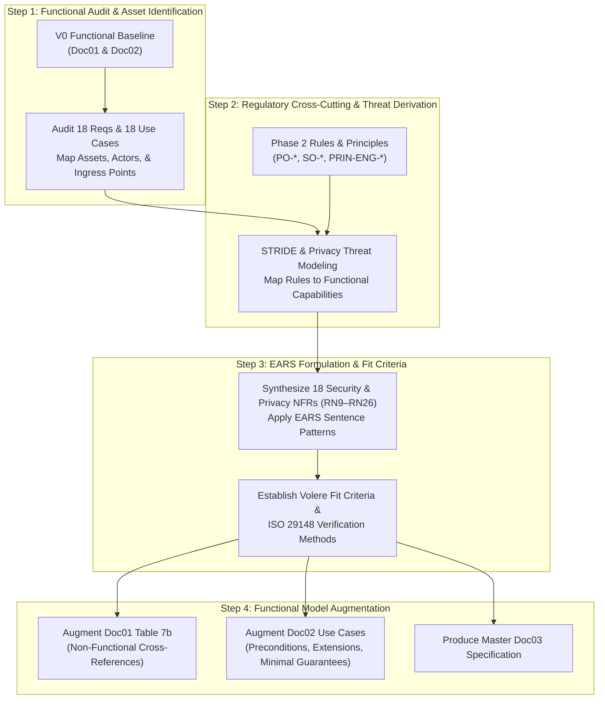

# Cognitive Trajectory & Step-by-Step Synthesis Analysis (V0 to V1)

> **Case Study:** Case 01 — TinyTask SaaS (B2B Task Management Multi-Tenant Platform)  
> **Lifecycle Phase:** AEGIS Phase 3 — Specification  
> **Purpose:** Detailed, reproducible step-by-step cognitive analysis of the transition from Version 0 (Pure Functional Baseline) to Version 1 (Security & Privacy Synthesis).  
> **Target Audience:** Systems Architects, Requirements Engineers, PhD Researchers, and Autonomous AI Agents (Training & Fine-Tuning Corpus).  
> **Status:** Normative Reasoning & Process Log  

---

## 1. Objective of this Analysis Dossier

This directory provides the complete **step-by-step cognitive trace** that guided the derivation of Phase 3 Version 1 from Version 0. 

Rather than presenting only the end results (the final documents), this dossier deconstructs:
1. **How each requirement and use case was analyzed.**
2. **What questions and threat hypotheses were raised at each step.**
3. **How upstream Phase 2 regulatory rules (`PO-` and `SO-`) and design principles (`PRIN-ENG-01` to `PRIN-ENG-07`) were cross-referenced with functional capabilities.**
4. **Why specific EARS syntactic patterns and Volere fit criteria were chosen for each requirement.**
5. **How the functional baseline was augmented without corrupting its underlying functional clarity.**

This structured trace serves as a **formal training dataset** for autonomous agents and engineers to repeat the AEGIS specification synthesis across any new domain or software product.

---

## 2. Directory Architecture & Document Map

```text
cases/Case_01_TinyTask_SaaS/03_PHASE3_SPEC/analysis_v0_to_v1/
├── README.md                                                     # (This file) Overview of cognitive trajectory and synthesis pipeline
├── STEP1_V0_FUNCTIONAL_AUDIT_AND_BOUNDARY_ANALYSIS.md            # Step 1: Deep audit of V0 pure functional baseline, assets, and boundaries
├── STEP2_REGULATORY_CROSS_CUTTING_AND_THREAT_DERIVATION.md       # Step 2: Juxtaposition of Phase 2 rules against V0 capabilities & threat modeling
├── STEP3_EARS_REQUIREMENT_FORMULATION_AND_FIT_CRITERIA.md        # Step 3: Formulating the security & privacy NFRs (RN9–RN26) using EARS & Volere fit criteria
└── STEP4_FUNCTIONAL_AUGMENTATION_AND_TRACEABILITY_WEAVING.md     # Step 4: Weaving security into Doc01 and Doc02 (Cockburn extensions & diffs)
```

---

## 3. The 4-Step Synthesis Pipeline Summary



---

## 4. Key Rules and Methodological Invariants Enforced

Throughout the four steps, the following rules are strictly enforced:
- **Rule R13 (Technology Neutrality):** Zero mention of concrete database engines, web frameworks, cloud providers, or technical protocols (e.g., PostgreSQL, Redis, React, AWS, Stripe). All systems are modeled functionally (e.g., *Internal Application Database*, *External Payment Gateway*, *File Storage Service*).
- **Active Verb Conjugation:** Every requirement and use case name uses active verbs in the infinitive (e.g., *Manage User Accounts*, *Attach Deliverable Files*).
- **Cockburn Sea-Level Granularity:** All use cases describe user goals achieved in a single session delivering business value. Zero micro-UI procedural scripts.
- **EARS Compliance:** All security and privacy requirements adhere to the 5 canonical EARS sentence patterns.
- **Empirical Verifiability:** Every requirement has an objective pass/fail threshold verifiable via `TEST`, `INSPECT`, `DEMONSTRATE`, or `ANALYZE`.
