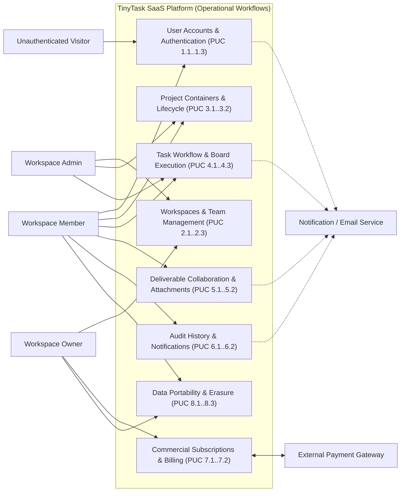

# E1.1a – TinyTask SaaS: Business Context, Process Models & Product Use Cases (PUC)

## Executive Summary

This deliverable establishes the operational and business process foundation for the **TinyTask SaaS** platform, detailing the existing operational model (*As-Is*), the target operational model (*To-Be*), and the formal catalog of Product Use Cases (*PUC*). 

In accordance with software and systems security engineering literature (IEEE 29148, ISO/IEC 12207, NIST SP 800-160 Vol. 1, and SecBPMN methodologies), this document models the dynamic, behavioral, and operational aspects of the organization. It deliberately separates the operational process flows—where actors interact, data transitions over time, and trust boundaries are crossed—from the atomic, contractual requirement specifications formalized in downstream deliverable [`Doc01_Requirements_Specification.md`](Doc01_Requirements_Specification.md).

Furthermore, each operational workflow is annotated with security and privacy attributes (identifying trust zone transitions, data residency checkpoints, and external boundary crossings), providing the direct architectural input for the Phase 3 Part 2 Threat Modeling and Attack Surface Analysis (DFD Level 1).

---

## Table of Contents

- [Part I – Scope and Organizational Context](#part-i--scope-and-organizational-context)
  - [1. Objective](#1-objective)
  - [2. Problem Description](#2-problem-description)
  - [3. Product Position Statement](#3-product-position-statement)
  - [4. Expected Impact](#4-expected-impact)
  - [5. Key Features](#5-key-features)
  - [6. Stakeholders](#6-stakeholders)
  - [7. System Users](#7-system-users)
  - [8. Operational Constraints](#8-operational-constraints)
- [Part II – As-Is Operational Model](#part-ii--as-is-operational-model)
  - [1. Business Roles in Context](#1-business-roles-in-context)
  - [2. Workflow Processes for Work Management](#2-workflow-processes-for-work-management)
    - [2.1 Task Allocation and Tracking (As-Is Process)](#21-task-allocation-and-tracking-as-is-process)
    - [2.2 Operational Inefficiencies Identified (As-Is)](#22-operational-inefficiencies-identified-as-is)
  - [3. IT Support Baseline](#3-it-support-baseline)
- [Part III – To-Be Operational Model & Workflows](#part-iii--to-be-operational-model--workflows)
  - [1. Initial Customer Expectations](#1-initial-customer-expectations)
  - [2. Operational Actors](#2-operational-actors)
  - [3. Product Use Cases (PUC) Catalog](#3-product-use-cases-puc-catalog)
  - [4. Process Model & Global Interaction Architecture](#4-process-model--global-interaction-architecture)
  - [5. Security & Trust Zone Process Annotations](#5-security--trust-zone-process-annotations)
- [Bibliography](#bibliography)
- [Version History](#version-history)

---

## Part I – Scope and Organizational Context

### 1. Objective

The primary objective of this project is to specify and engineer the **TinyTask SaaS** platform, a cloud-native multi-tenant solution designed for small-to-medium teams that need to coordinate projects, assign tasks, track deadlines, and centralize support documentation without the cumbersome complexity or administrative friction of traditional enterprise management software.

The platform establishes a single source of operational truth, delivering an intuitive and fluid collaborative experience that eliminates communication overhead across team leads, technical staff, and external clients.

### 2. Problem Description

Small organizations and agile teams currently suffer from severe operational fragmentation:

- **Decentralization and Data Silos:** Critical information regarding task statuses, deadlines, and responsibilities is scattered across uncoordinated spreadsheets, instant messaging threads, and disparate email chains.
- **Coordination Overhead:** Team leads spend hours every week manually chasing status updates and compiling ad-hoc reports across separate channels.
- **Lack of Operational Visibility:** Individual team members lack clear visibility into immediate priorities, dependencies, and blocked deliverables, leading to duplicate efforts and missed deadlines.
- **Document Management Friction:** Deliverable attachments are exchanged via email attachments or unmanaged folder links, resulting in lost version history and broken auditability.

### 3. Product Position Statement

TinyTask is positioned as an agile, lean, and collaborative SaaS productivity platform optimized for intuitive usability, rapid onboarding, and autonomous team execution:

- **For:** Small teams, startups, digital agencies, and independent consultancies;
- **Who:** Require a centralized and visual way to organize tasks, manage projects, and share deliverable documentation;
- **TinyTask is:** A collaborative SaaS platform built around interactive Kanban boards, dynamic task views, and contextual discussions;
- **That allows:** Real-time visibility into project execution, automated progress notifications, and self-service team subscription management;
- **Unlike:** Heavy, bloated enterprise project management tools that demand extensive configuration and steep learning curves;
- **Our product distinguishes itself by:** Offering a clean, friction-free, and delightful user experience focused strictly on high-impact coordination and execution.

### 4. Expected Impact

The deployment and adoption of TinyTask SaaS delivers the following organizational impacts:

1. **Reduce Coordination Overhead:** Estimated 60% reduction in time spent on manual status sync meetings and repetitive progress update inquiries.
2. **Centralize Operational Information:** 100% of projects, tasks, attachments, and discussions reside in a unified, searchable, and structured repository.
3. **Improve Delivery Predictability:** Increased on-time delivery rates through real-time bottleneck detection and automated deadline warning alerts.
4. **Accelerate User Onboarding:** Enable new team members and external guests to onboard and become productive in under five minutes through intuitive self-service workflows.

### 5. Key Features

The platform's functional baseline is structured into core operational functional areas:

- **Multi-Tenant Workspaces:** Complete logical isolation across organizations, supporting dedicated member rosters and role-based access control.
- **Visual Task Management:** Interactive Kanban boards (To-Do, In-Progress, Under-Review, Done) and tabular lists with multi-criteria dynamic filtering.
- **Contextual In-Task Collaboration:** Rich Markdown discussion threads directly embedded within task cards, supporting user mentions to trigger instant alerts.
- **Integrated Attachment Management:** Upload, preview, download, and delete deliverable files directly linked to task contexts.
- **Commercial Subscription Management:** Seamless self-service billing integration via external payment gateway to manage Free, Pro, and Enterprise plan tiers.
- **User Data Portability:** Self-service personal data export, workspace-level archive downloads, and autonomous account closure workflows.

### 6. Stakeholders

The following table details the key stakeholders invested in the TinyTask SaaS platform:

*Table 1. Stakeholders*

| Stakeholder | Representatives | Role and Interest in the System |
|---|---|---|
| **Executive Leadership & Founders** | TinyTask SaaS Founders | Business viability, user growth, paid tier conversion, and low customer churn. |
| **Team Leads & Project Managers** | Project Managers, Team Coordinators | Operational visibility into workloads, seamless task delegation, and deadline tracking. |
| **Individual Contributors & Specialists** | Software Engineers, Designers, Marketers | Daily task queue management, clear priorities, and distraction-free communication. |
| **External Clients & Observers** | Client Stakeholders, External Reviewers | Transparent read-only access to deliverable progress and project timelines. |

### 7. System Users

The application defines four distinct user roles:

*Table 2. System Users*

| System User | Description and Responsibilities |
|---|---|
| **Workspace Owner** | Ultimate commercial and administrative authority. Manages billing, subscriptions, seat quotas, organization export, and workspace deletion. |
| **Workspace Admin** | Operational team manager. Invites members, assigns roles, configures workspace settings, and creates new projects. |
| **Workspace Member** | Standard team contributor. Creates, edits, and transitions tasks; uploads attachments; posts comments; and manages personal profile settings. |
| **Workspace Viewer** | External guest or client granted read-only visibility into authorized projects, task boards, and discussion threads. |

### 8. Operational Constraints

The baseline product design operates under the following business and operational constraints:

- **Development Team Capacity:** The technical organization consists of 8 persons, requiring architectural simplicity, high modularity, and rapid maintainability.
- **Payment Processing:** The application delegates payment collection and billing transactions to an external payment gateway, avoiding local handling of credit card data.
- **Technology Neutrality:** This document defines pure operational and business flows from the user's perspective, maintaining technology neutrality across cloud vendors and storage backends.

---

## Part II – As-Is Operational Model

### 1. Business Roles in Context

In the baseline As-Is operational state—typical of small teams prior to adopting TinyTask—collaborators execute overlapping roles informally without standardized tooling:

- **Business Founder / Lead:** Manages commercial commitments, tracking client subscriptions and invoicing via local spreadsheets and direct email exchanges.
- **Project Lead:** Spends 2 to 3 hours daily consolidating manual status updates across chat messages and emails, manually updating a shared spreadsheet.
- **Collaborator / Contributor:** Receives assignments via ad-hoc verbal requests or instant message channels without centralized priority queues or clear due dates.
- **External Client:** Periodically inquires via email regarding deliverable progress, receiving static exported PDF status reports.

### 2. Workflow Processes for Work Management

#### 2.1 Task Allocation and Tracking (As-Is Process)
The As-Is task tracking workflow is characterized by manual coordination friction:

1. The Project Lead identifies an incoming project requirement from a client meeting.
2. The requirement is noted in a personal notebook or digital notepad.
3. The Project Lead drafts an email or instant message assigning the task to a team contributor.
4. The contributor acknowledges receipt; however, the task is not logged into a centralized status register.
5. Periodic follow-up messages are exchanged to ascertain whether the task has started, is blocked, or is finished.
6. Deliverables are sent back via email attachment, creating duplicate copies across multiple inboxes.

#### 2.2 Operational Inefficiencies Identified (As-Is)
The following table summarizes the primary operational deficiencies observed in the As-Is state:

*Table 3. Inefficiencies identified in As-Is work management*

| Inefficiency ID | Process Affected | Description | Impact |
|---|---|---|---|
| **INEF-01** | Task Allocation | Absence of centralized task backlog; assignments scattered across chat and email. | High risk of lost tasks and missed client deadlines. |
| **INEF-02** | Status Visibility | Progress tracking relies entirely on manual inquiry meetings and repetitive messaging. | Wasted productive time (~15 hours/week across team). |
| **INEF-03** | Deliverable Sharing | Deliverable files shared via unmanaged attachments; no version control or centralized search. | Broken audit trail; team members work on outdated file versions. |
| **INEF-04** | Client Reporting | External clients have zero real-time visibility, demanding manual weekly summary preparation. | Client dissatisfaction and communication delays. |

### 3. IT Support Baseline

In the baseline state, IT infrastructure is highly fragmented across separate cloud tools:
- General communication via standard instant messaging channels.
- Ad-hoc spreadsheet tables stored on shared personal cloud drives.
- Deliverables stored in local workstations and exchanged via email.
- Billing handled manually through one-off invoices generated in desktop office software.

---

## Part III – To-Be Operational Model & Workflows

### 1. Initial Customer Expectations

Based on preliminary user interviews and founder elicitation, the target To-Be system must satisfy the following core expectations:

*Table 4. Initial customer expectations*

| Expectation ID | Operational Expectation | Target Impact |
|---|---|---|
| **EXP-01** | Unified, self-service workspace setup where teams can register and invite members in minutes. | Immediate time-to-value; zero manual administrative provisioning. |
| **EXP-02** | Interactive Kanban board offering fluid visual drag-and-drop task state transitions and clear priorities. | Complete real-time operational transparency across all team deliverables. |
| **EXP-03** | In-task discussion threads with mentions (@collaborator) to eliminate external chat fragmentation. | Contextualized conversations directly tied to work deliverables. |
| **EXP-04** | Centralized attachment repository supporting deliverable uploads with instant previews. | Single source of truth for all project documentation. |
| **EXP-05** | Flexible, tiered self-service subscription billing with transparent seat quotas and upgrade workflows. | Predictable commercial scaling without manual sales friction. |
| **EXP-06** | Complete user data control, offering one-click data export and autonomous account closure. | High customer trust and autonomy over organizational data. |

### 2. Operational Actors

The following table formally defines the human and external system actors interacting with the system in the To-Be operational model:

*Table 5. List of operational actors*

| Actor | Description | Category |
|---|---|---|
| **Workspace Owner** | Ultimate commercial and administrative authority. Manages billing, subscriptions, seat quotas, organization export, and workspace deletion. | Internal User |
| **Workspace Admin** | Operational workspace manager. Invites members, modifies roles, configures organization profile settings, and initializes new projects. | Internal User |
| **Workspace Member** | Standard collaborative contributor. Creates, edits, and transitions tasks; uploads attachments; posts comments; and manages profile settings. | Internal User |
| **Workspace Viewer** | External guest or client granted read-only visibility into authorized projects and task lists. | External User |
| **External Payment Gateway** | External payment processing engine responsible for handling payment sessions, executing billing charges, and dispatching payment status confirmations. | External System |
| **Notification / Email Service** | Platform messaging subsystem responsible for dispatching verification emails, assignment notifications, and daily pending task digests. | External Subsystem |

### 3. Product Use Cases (PUC) Catalog

The operational workflows are structured into 20 Product Use Cases (*PUC*), formalizing the business triggers, actors, operational system boundaries, and deliverables:

*Table 6. Summary table of Product Use Cases (PUC)*

| PUC ID | Business Trigger | Primary Actor | System Operational Boundary | Deliverables & Outputs | Realizing Requirements |
|---|---|---|---|---|---|
| **PUC 1.1** | User registers or requests access | Visitor / User | Validate credentials, verify email, or issue password reset link | Active user session or email link | `R1.1` |
| **PUC 1.2** | User updates profile details | Registered User | Record updated personal details and preferences | Updated profile confirmation | `R1.2` |
| **PUC 1.3** | Account lockout blocks legitimate access | Locked-Out User | Verify recovery link, lift lockout, invalidate sessions | Restored account access | `R1.3` |
| **PUC 2.1** | User instantiates a team workspace | Workspace Owner | Provision workspace container and assign Owner role | Initialized workspace environment | `R2.1` |
| **PUC 2.2** | Admin manages member roster | Workspace Admin | Dispatch invitations, assign roles, or revoke access | Updated membership roster | `R2.2` |
| **PUC 2.3** | Leadership requests usage metrics | Workspace Admin | Aggregate member counts, completed tasks, and storage usage | Operational metrics dashboard | `R2.3` |
| **PUC 3.1** | Team initializes new project | Workspace Member | Create project container with description and visibility | Project workspace board | `R3.1` |
| **PUC 3.2** | Team completes project lifecycle | Workspace Admin | Transition project to read-only archive status | Archived project record | `R3.2` |
| **PUC 4.1** | Team member authors new work item | Workspace Member | Store task with title, priority, due date, and assignees | New task card in "To-Do" | `R4.1` |
| **PUC 4.2** | Member transitions task or filters board | Workspace Member | Update status state, record history, and filter view | Board state update | `R4.2` |
| **PUC 4.3** | Recurring task is completed | Automated Daemon | Duplicate task instance into "To-Do" on configured schedule | Next recurring task instance | `R4.3` |
| **PUC 5.1** | Member attaches deliverable file | Workspace Member | Upload file, generate preview, and link to task | Stored attachment record | `R5.1` |
| **PUC 5.2** | Member comments on work item | Workspace Member | Store Markdown comment and notify mentioned users | In-thread comment and alerts | `R5.2` |
| **PUC 6.1** | User reviews task history | Workspace Member | Query chronological audit logs for task modifications | Rendered audit timeline | `R6.1` |
| **PUC 6.2** | User consults alerts or daily digest | Registered User | Present in-app alerts and dispatch morning email digest | Notification feed & daily digest | `R6.2` |
| **PUC 7.1** | Owner upgrades commercial tier | Workspace Owner | Process checkout and adjust member seat quotas | Updated subscription status | `R7.1` |
| **PUC 7.2** | Automated renewal charge fails | Payment Gateway | Initiate 7-day grace period and notify Owner | Grace period notice | `R7.2` |
| **PUC 8.1** | User or Owner requests data export | User / Owner | Compile structured profile or workspace data archive | Downloadable data archive | `R8.1` |
| **PUC 8.2** | User requests account closure | Registered User | Deactivate credentials, cancel memberships, and send receipt | Account termination receipt | `R8.2` |
| **PUC 8.3** | Workspace Owner deletes a workspace | Workspace Owner | Permanently erase all workspace content and settings; issue deletion receipt | Workspace deletion receipt | `R8.3` |

### 4. Process Model & Global Interaction Architecture

The following interaction model maps operational actors to core functional process areas:

### 5. Security & Trust Zone Process Annotations

In alignment with **SecBPMN** and **NIST SP 800-160 Vol. 1**, the operational processes are contextualized across distinct security trust zones:

*Table 7. Trust Zone Characterization of Operational Workflows*

| Trust Zone | Zone Description | Participating Processes | Perimeter Boundary & Protection Mechanisms |
|---|---|---|---|
| **TZ-01: Public Untrusted** | External client browsers, unauthenticated visitors, and public internet routing. | Registration, Login, Public Onboarding (PUC 1.1, 1.3) | **TB-01:** Mandatory end-to-end transport encryption, public rate limiting, anti-brute-force defense. |
| **TZ-02: Authenticated Perimeter** | Active user sessions within authenticated workspace contexts. | Task board management, attachments, discussions (PUC 2.1–6.2) | **TB-02:** Strict session token validation, RBAC enforcement, workspace tenancy isolation. |
| **TZ-03: Core Data Persistence** | Multi-tenant relational databases and deliverable object storage. | Task persistence, audit trail logging, data export (PUC 4.1, 6.1, 8.1) | **TB-03:** Cryptographic storage at rest, tenant-keyed queries, strict query parameterization. |
| **TZ-04: External Payment Processor** | External PCI-DSS certified hosted checkout and subscription billing engine. | Plan checkout, automated renewal, webhook notifications (PUC 7.1, 7.2) | **TB-04:** Out-of-band payment tokenization, keyed cryptographic message authentication code webhook signature verification. |
| **TZ-05: Transactional Messaging** | External email delivery infrastructure for alerts and notifications. | Account verification, lockout recovery, daily digests (PUC 1.1, 1.3, 6.2) | **TB-05:** Authenticated messaging service credentials, message content sanitization, no sensitive secrets in transit. |

This trust zone breakdown serves as the direct formal bridge to **Phase 3 Part 2 (Step 1: System Model, Assets and Boundaries)**, where Trust Zones correspond to Trust Boundaries `TB-01` through `TB-05`.

---

## Bibliography

- Robertson, S., & Robertson, J. (2012). *Mastering the Requirements Process: Getting Requirements Right* (3rd ed.). Addison-Wesley Professional.
- Cockburn, A. (2000). *Writing Effective Use Cases*. Addison-Wesley Professional.
- Wiegers, K., & Beatty, J. (2013). *Software Requirements* (3rd ed.). Microsoft Press.
- Leffingwell, D., & Widrig, D. (2003). *Managing Software Requirements: A Use Case Approach* (2nd ed.). Addison-Wesley Professional.
- ISO/IEC/IEEE. (2018). *ISO/IEC/IEEE 29148: Systems and software engineering — Life cycle processes — Requirements engineering*.
- Ross, R. et al. (2016). *NIST SP 800-160 Vol. 1: Engineering Trustworthy Secure Systems*. National Institute of Standards and Technology.
- Rodriguez, A. et al. (2011). *SecBPMN: A security-oriented extension of BPMN 2.0*. Information and Software Technology.

---

## Version History

| Version | Date | Author | Description of Changes |
|---|---|---|---|
| **1.0.0** | 2026-10-01 | Requirements Engineering Agent | Initial modular extraction: decoupled business context, As-Is/To-Be models, and PUC catalog from contractual requirements into dedicated operational deliverable `Doc00`. Added SecBPMN / NIST SP 800-160 trust zone security annotations to bridge directly to Phase 3 Part 2 threat modeling. |
