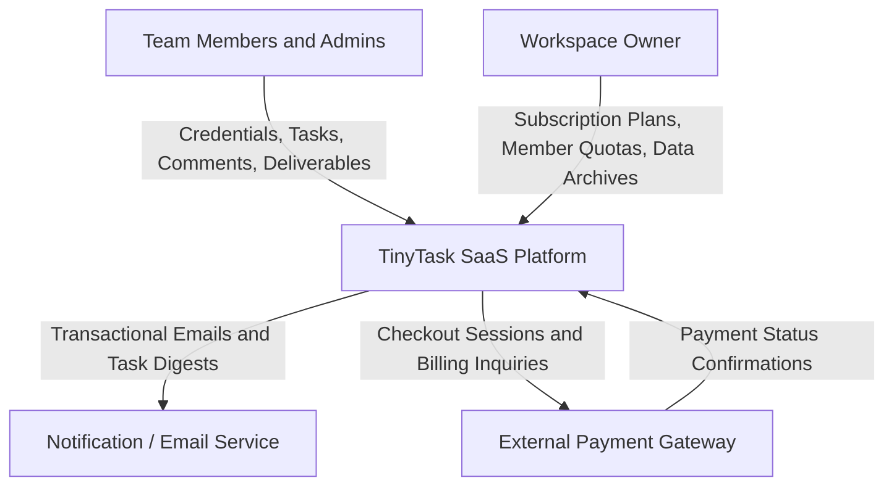
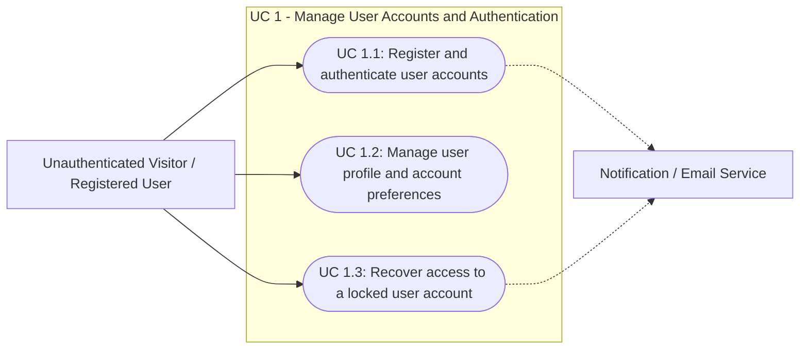
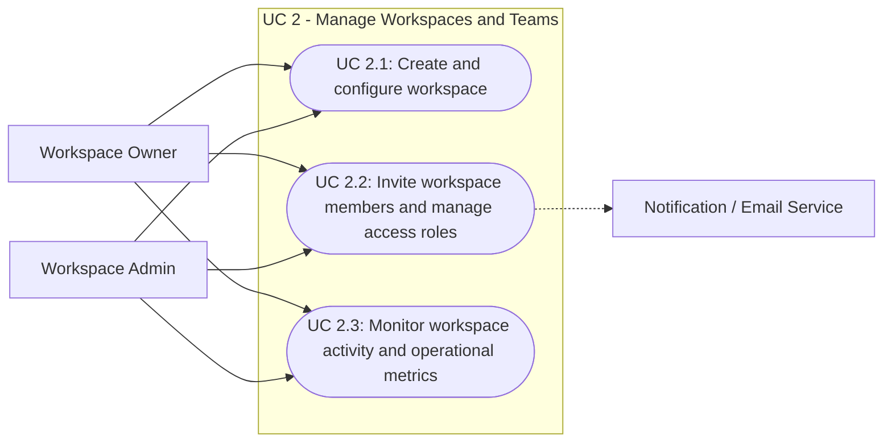
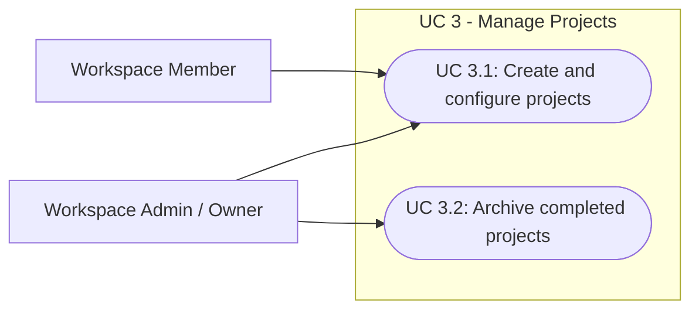
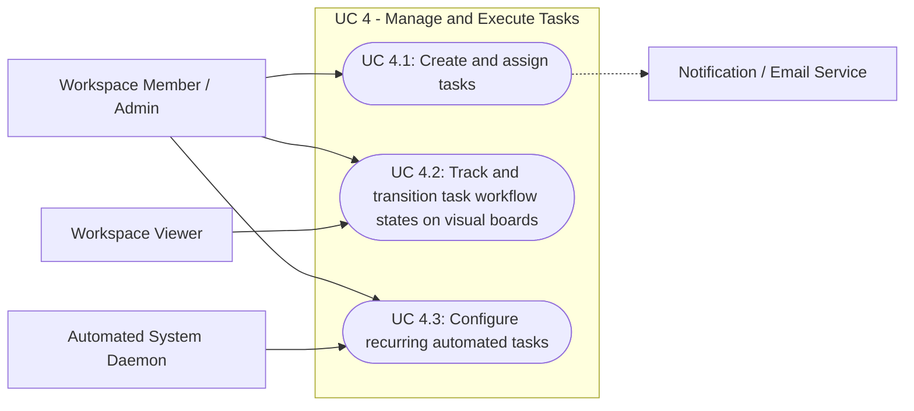
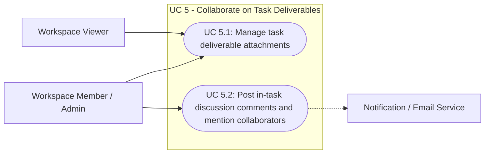
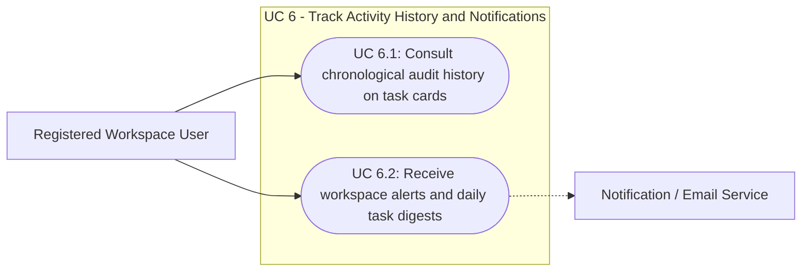
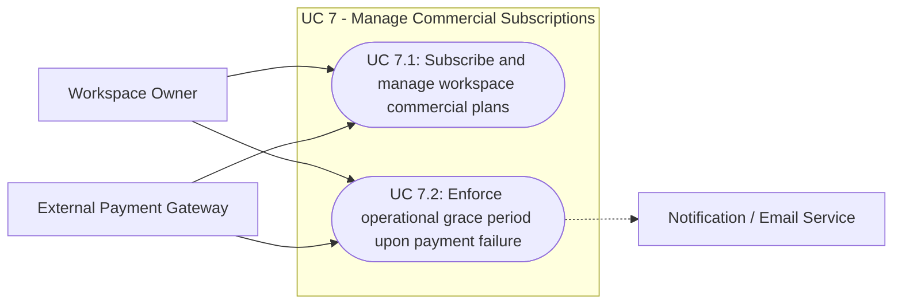
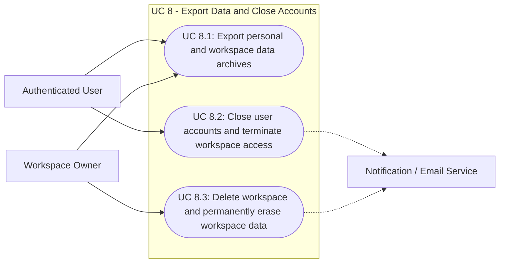

# E1.2 – TinyTask SaaS: System Use Cases

## Executive Summary

This deliverable establishes the formal **System Use Cases** for the **TinyTask SaaS** platform, translating the operational requirements and Product Use Cases (*PUC*) elicited in `Doc01` into rigorous, literature-grounded behavioral specifications and visual UML Use Case models. Grounded in foundational requirements engineering literature—specifically Alistair Cockburn's *Writing Effective Use Cases*, Craig Larman's *Applying UML and Patterns*, the OMG UML 2.5 standard, and the GPTools specification standard (`E1.2 – GPTools_AnáliseRequisitos_CasosDeUso_V4.0`)—this document specifies each elementary user goal at **Level 1 ("Sea Level")**.

To provide complete operational clarity, each macro functional area is modeled with a robust, error-free **UML Use Case Diagram** rendered natively in Markdown via Mermaid, and every individual Level-1 use case is formalized with a **Fully Dressed Specification Card** detailing primary and supporting actors, stakeholders and interests, preconditions, triggers, black-box main success scenarios, branching extensions and alternative flows, success guarantees, and minimal guarantees. The resulting specification maintains strict technology neutrality, providing a verified functional baseline that directly supports downstream AEGIS Phase 3 security and privacy synthesis.

---

## Table of Contents

- [1. Introduction](#1-introduction)
- [2. System Requirements Approach & Literature Foundations](#2-system-requirements-approach--literature-foundations)
  - [2.1 The Volere Triangular Decomposition: Business Events to System Use Cases](#21-the-volere-triangular-decomposition-business-events-to-system-use-cases)
  - [2.2 Use Case Architecture (Cockburn, Larman, Wiegers)](#22-use-case-architecture-cockburn-larman-wiegers)
  - [2.3 Visual UML Use Case Modeling in Markdown](#23-visual-uml-use-case-modeling-in-markdown)
  - [2.4 Anatomy of a Literature-Grounded Use Case](#24-anatomy-of-a-literature-grounded-use-case)
  - [2.5 Refinement Boundary: Cockburn's Sea Level (Level 1) vs. Micro-UI Anti-Patterns](#25-refinement-boundary-cockburns-sea-level-level-1-vs-micro-ui-anti-patterns)
- [3. Requirements Analysis](#3-requirements-analysis)
  - [3.1 Work Context Model](#31-work-context-model)
  - [3.2 Traceability Matrix: Requirements (Doc01) to System Use Cases (Doc02)](#32-traceability-matrix-requirements-doc01-to-system-use-cases-doc02)
- [4. Domain Application Use Cases](#4-domain-application-use-cases)
  - [4.1 System Actors](#41-system-actors)
  - [4.2 System Use Cases Specification](#42-system-use-cases-specification)
    - [{U.C. 1} Manage User Accounts and Authentication](#uc-1-manage-user-accounts-and-authentication)
      - [{U.C. 1.1} Register and authenticate user accounts](#uc-11-register-and-authenticate-user-accounts)
        - [{U.C. 1.1.1} Execute Secure Authentication Challenge & Progressive Lockout](#uc-111-execute-secure-authentication-challenge--progressive-lockout)
      - [{U.C. 1.2} Manage user profile and account preferences](#uc-12-manage-user-profile-and-account-preferences)
      - [{U.C. 1.3} Recover access to a locked user account](#uc-13-recover-access-to-a-locked-user-account)
    - [{U.C. 2} Manage Workspaces and Teams](#uc-2-manage-workspaces-and-teams)
      - [{U.C. 2.1} Create and configure workspace](#uc-21-create-and-configure-workspace)
      - [{U.C. 2.2} Invite workspace members and manage access roles](#uc-22-invite-workspace-members-and-manage-access-roles)
      - [{U.C. 2.3} Monitor workspace activity and operational metrics](#uc-23-monitor-workspace-activity-and-operational-metrics)
    - [{U.C. 3} Manage Projects](#uc-3-manage-projects)
      - [{U.C. 3.1} Create and configure projects](#uc-31-create-and-configure-projects)
      - [{U.C. 3.2} Archive completed projects](#uc-32-archive-completed-projects)
    - [{U.C. 4} Manage and Execute Tasks](#uc-4-manage-and-execute-tasks)
      - [{U.C. 4.1} Create and assign tasks](#uc-41-create-and-assign-tasks)
      - [{U.C. 4.2} Track and transition task workflow states on visual boards](#uc-42-track-and-transition-task-workflow-states-on-visual-boards)
      - [{U.C. 4.3} Configure recurring automated tasks](#uc-43-configure-recurring-automated-tasks)
    - [{U.C. 5} Collaborate on Task Deliverables](#uc-5-collaborate-on-task-deliverables)
      - [{U.C. 5.1} Manage task deliverable attachments](#uc-51-manage-task-deliverable-attachments)
        - [{U.C. 5.1.1} Validate, Decontaminate & Isolate Uploaded Deliverable Asset](#uc-511-validate-decontaminate--isolate-uploaded-deliverable-asset)
      - [{U.C. 5.2} Post in-task discussion comments and mention collaborators](#uc-52-post-in-task-discussion-comments-and-mention-collaborators)
    - [{U.C. 6} Track Activity History and Notifications](#uc-6-track-activity-history-and-notifications)
      - [{U.C. 6.1} Consult chronological audit history on task cards](#uc-61-consult-chronological-audit-history-on-task-cards)
      - [{U.C. 6.2} Receive workspace alerts and daily task digests](#uc-62-receive-workspace-alerts-and-daily-task-digests)
    - [{U.C. 7} Manage Commercial Subscriptions](#uc-7-manage-commercial-subscriptions)
      - [{U.C. 7.1} Subscribe and manage workspace commercial plans](#uc-71-subscribe-and-manage-workspace-commercial-plans)
      - [{U.C. 7.2} Enforce operational grace period upon payment failure](#uc-72-enforce-operational-grace-period-upon-payment-failure)
        - [{U.C. 7.2.1} Verify Cryptographic Signature & Replay Window for External Webhooks](#uc-721-verify-cryptographic-signature--replay-window-for-external-webhooks)
    - [{U.C. 8} Export Data and Close Accounts](#uc-8-export-data-and-close-accounts)
      - [{U.C. 8.1} Export personal and workspace data archives](#uc-81-export-personal-and-workspace-data-archives)
      - [{U.C. 8.2} Close user accounts and terminate workspace access](#uc-82-close-user-accounts-and-terminate-workspace-access)
      - [{U.C. 8.3} Delete workspace and permanently erase workspace data](#uc-83-delete-workspace-and-permanently-erase-workspace-data)
        - [{U.C. 8.3.1} Execute Irreversible Cryptographic Purge of Multi-Tenant Workspace Data](#uc-831-execute-irreversible-cryptographic-purge-of-multi-tenant-workspace-data)
- [5. Non-Functional Requirements](#5-non-functional-requirements)
- [6. Conclusions](#6-conclusions)
- [7. Bibliography](#7-bibliography)
- [Version History](#version-history)

---

## 1. Introduction

The **TinyTask SaaS** platform delivers a lean, collaborative project and task management environment tailored for small agile teams, agencies, and consultancies. Following the operational elicitation established in `Doc01` (AS-IS and TO-BE models), this deliverable establishes the formal **System Use Cases**.

In any mature software engineering lifecycle, requirements elicitation and use case modeling form a **sequential continuum**:
1. In `Doc01`, we identified business problems, established customer expectations, consolidated atomic functional requirements (prioritized via MoSCoW), and defined the Product Use Cases (*PUC*) boundary.
2. In `Doc02`, we take those requirements and PUCs and model the dynamic behavioral interactions between actors and the system, specifying how business goals are fulfilled in practice.

To prevent superficial or generic descriptions, this document adopts the best practices established in requirements engineering literature, formalizing each use case into an operational contract that details normal execution, edge cases, error conditions, and verifiable guarantees, accompanied by visual UML Use Case diagrams rendered directly in Markdown.

---

## 2. System Requirements Approach & Literature Foundations

### 2.1 The Volere Triangular Decomposition: Business Events to System Use Cases

The specification follows the Volere requirements engineering methodology (Robertson & Robertson, 2012). Every functional requirement traces through a triangular derivation:
- **Business Event:** An occurrence in the operational environment that demands a response (e.g., *a new team member needs onboarding*, *a project phase is completed*, *a task deliverable is updated*).
- **Product Use Case (PUC):** The automated partition of the business process executed within the system boundary (defined in `Doc01` Table 8).
- **System Use Case:** The structured behavioral interaction between the primary actor and the system required to achieve the goal (detailed herein).

### 2.2 Use Case Architecture (Cockburn, Larman, Wiegers)

According to Alistair Cockburn (*Writing Effective Use Cases*, 2000), Craig Larman (*Applying UML and Patterns*, 2004), and Karl Wiegers & Joy Beatty (*Software Requirements*, 2013), use cases represent **behavioral contracts** between stakeholders and the system. They describe the system's behavior under various conditions as it responds to a request from one of its stakeholders (the primary actor).

Key literature principles enforced throughout this specification include:
1. **Black-Box Perspective (Larman, 2004):** The use case specifies *what* the system does (its responsibilities and external contracts), never *how* internal components, database tables, or algorithms execute it.
2. **Goal-Driven Scope (Cockburn, 2000):** Every use case is titled with an active verb phrase representing a clear, valuable user goal.
3. **Dual Scenario Coverage (Cockburn, 2000):** A use case is incomplete if it only documents the "happy path". Literature mandates documenting both the **Main Success Scenario** (the typical, ideal progression) and **Extensions** (alternative flows, branch conditions, validation failures, and exception handling).
4. **Verifiable Guarantees (Cockburn, 2000):** Every use case explicitly declares its **Success Guarantees** (what must be true if the goal is achieved) and **Minimal Guarantees** (what the system guarantees even if the goal fails, protecting system and data integrity).

### 2.3 Visual UML Use Case Modeling in Markdown

In standard software engineering, text specifications and visual diagrams complement each other. To make the specification natively readable, version-controllable, and visually rich without relying on static external images, this document leverages **Mermaid.js**, the open industry standard for rendering UML directly inside Markdown:
- Each macro functional area (`{U.C. 1}` to `{U.C. 8}`) is preceded by an error-free **UML Use Case Diagram** (`flowchart LR`), depicting the human actors and supporting external services linked to oval use case goals in standard UML notation.
- Node identifiers and text labels avoid special bracket characters that disrupt Markdown parsers, ensuring 100% error-free visual rendering.

### 2.4 Anatomy of a Literature-Grounded Use Case

Each Level-1 System Use Case in this document follows the formal, fully dressed specification card:

| Field | Description & Literature Definition |
|---|---|
| **ID & Name** | Canonical identifier (`{U.C. n.m}`) and active verb phrase denoting the user goal. |
| **Traceability** | Direct mapping to the underlying Functional Requirement (`R...`) and Product Use Case (`PUC...`) from `Doc01`. |
| **Primary Actor** | The principal human user or external system initiating the interaction to achieve a business goal. |
| **Supporting Actors** | Auxiliary subsystems or external services participating in the execution (e.g., Payment Gateway, Email Service). |
| **Scope & Level** | System boundary: *TinyTask SaaS*; Level: *Sea Level (User Goal / Level 1)*. |
| **Stakeholders & Interests** | The list of organizational stakeholders who care about the outcome and their specific interests. |
| **Preconditions** | The state the system and actors must be in before the use case can be triggered. |
| **Trigger** | The specific business event that initiates execution. |
| **Main Success Scenario** | Numbered sequence of operational interactions between the Actor and the System (normal/happy path). |
| **Extensions** | Branching conditions, business rule variations, and exception flows (e.g., `2a`, `3a`) indicating recovery paths. |
| **Success Guarantees** | The postconditions that must hold when the use case completes successfully. |
| **Minimal Guarantees** | The system state guaranteed even if the use case terminates prematurely (rollback, security preservation). |

### 2.5 Refinement Boundary: Cockburn's Sea Level (Level 1) and Strict Level-2 Subfunction Criteria (ADR-009)

In accordance with Alistair Cockburn (*Writing Effective Use Cases*) and AEGIS Architecture Decision Record ADR-009:
- **Sea Level (User Goal — Level 1):** The interaction satisfies a complete, discrete business task in a single sitting that delivers measurable value to the user (e.g., *Create and assign tasks*, *Invite workspace members*, *Manage deliverable attachments*). By default, >85% of all system use cases anchor strictly at Level 1 (`{U.C. n.m}`).
- **Subfunction Level (Fish Level / Level 2 — `{U.C. n.m.k}`):** Decomposed sub-goals representing autonomous, complex security or cryptographic sub-transactions supporting one or more Sea-Level use cases.
- **Strict Level-2 Decomposition Criteria (ADR-009 D1):** A Level-2 subfunction is permitted only when it satisfies all three criteria:
  1. *Trust Boundary Crossing:* The transaction crosses distinct architectural trust zones (e.g., untrusted client to application backend; application backend to external isolated processor).
  2. *Autonomous Security Protocol & Multiple Failure Modes:* The transaction has dedicated security preconditions, challenge-response flows, multiple exception/attack branches, and distinct minimal guarantees.
  3. *Cross-Cutting Reusability or Direct Regulatory Imperative:* The subfunction is invoked across multiple Sea-Level use cases or realizes a non-negotiable regulatory mandate (e.g., cryptographic erasure proof, webhook signature validation, credential challenge with progressive lockout).
- **Zero Clam-Level Use Cases:** Decomposing standard CRUD operations into Level 2 or specifying micro-UI interactions (clicking buttons, entering form text) remains strictly prohibited.

---

## 3. Requirements Analysis

### 3.1 Work Context Model

The following diagram illustrates the information boundaries between TinyTask SaaS and adjacent external entities:

### 3.2 Traceability Matrix: Requirements (Doc01) to System Use Cases (Doc02)

The following matrix establishes strict bi-directional traceability between the 20 consolidated functional requirements from `Doc01` (18 elicited + `R1.3` derived in the V1 Refinement Pass + `R8.3` derived in Round 1) and the 20 Level-1 System Use Cases:

*Table 1. Traceability Matrix*

| Functional Req (Doc01) | Product Use Case (Doc01) | System Use Case (Doc02) | Use Case Title | Priority | Bound NFR-Security & Privacy (in-card) |
|---|---|---|---|---|---|
| **R1.1** | **PUC 1.1** | **{U.C. 1.1}** | Register and authenticate user accounts | MUST | NFR-RN10, NFR-RN11, NFR-RN19 |
| **R1.2** | **PUC 1.2** | **{U.C. 1.2}** | Manage user profile and account preferences | MUST | NFR-RN23, NFR-RN26 |
| **R1.3** | **PUC 1.3** | **{U.C. 1.3}** | Recover access to a locked user account | MUST | NFR-RN10, NFR-RN11 |
| **R2.1** | **PUC 2.1** | **{U.C. 2.1}** | Create and configure workspace | MUST | NFR-RN9, NFR-RN28 |
| **R2.2** | **PUC 2.2** | **{U.C. 2.2}** | Invite workspace members and manage access roles | MUST | NFR-RN12 |
| **R2.3** | **PUC 2.3** | **{U.C. 2.3}** | Monitor workspace activity and operational metrics | COULD | NFR-RN22 |
| **R3.1** | **PUC 3.1** | **{U.C. 3.1}** | Create and configure projects | MUST | NFR-RN9, NFR-RN28 |
| **R3.2** | **PUC 3.2** | **{U.C. 3.2}** | Archive completed projects | SHOULD | — |
| **R4.1** | **PUC 4.1** | **{U.C. 4.1}** | Create and assign tasks | MUST | — |
| **R4.2** | **PUC 4.2** | **{U.C. 4.2}** | Track and transition task workflow states on visual boards | MUST | — |
| **R4.3** | **PUC 4.3** | **{U.C. 4.3}** | Configure recurring automated tasks | COULD | — |
| **R5.1** | **PUC 5.1** | **{U.C. 5.1}** | Manage task deliverable attachments | MUST | NFR-RN13, NFR-RN25 |
| **R5.2** | **PUC 5.2** | **{U.C. 5.2}** | Post in-task discussion comments and mention collaborators | MUST | NFR-RN14 |
| **R6.1** | **PUC 6.1** | **{U.C. 6.1}** | Consult chronological audit history on task cards | MUST | NFR-RN22 |
| **R6.2** | **PUC 6.2** | **{U.C. 6.2}** | Receive workspace alerts and daily task digests | SHOULD | — |
| **R7.1** | **PUC 7.1** | **{U.C. 7.1}** | Subscribe and manage workspace commercial plans | MUST | NFR-RN15 |
| **R7.2** | **PUC 7.2** | **{U.C. 7.2}** | Enforce operational grace period upon payment failure | MUST | NFR-RN15, NFR-RN16 |
| **R8.1** | **PUC 8.1** | **{U.C. 8.1}** | Export personal and workspace data archives | MUST | NFR-RN20, NFR-RN27 |
| **R8.2** | **PUC 8.2** | **{U.C. 8.2}** | Close user accounts and terminate workspace access | MUST | NFR-RN21, NFR-RN27 |
| **R8.3** | **PUC 8.3** | **{U.C. 8.3}** | Delete workspace and permanently erase workspace data | MUST | NFR-RN30, NFR-RN21, NFR-RN18 |

---

## 4. Domain Application Use Cases

### 4.1 System Actors

The platform defines four human user roles and two external supporting system actors:
- **Workspace Owner:** Commercial and administrative authority. Controls billing, subscriptions, seat quotas, and organization-wide data archives.
- **Workspace Admin:** Operational team coordinator. Manages workspace configuration, invites members, allocates access roles, and initializes projects.
- **Workspace Member:** Standard contributor. Creates and updates tasks, uploads deliverables, participates in task discussions, and manages profile settings.
- **Workspace Viewer:** Read-only guest or client observer. Accesses authorized projects, boards, and task details without edit rights.
- **External Payment Gateway:** Third-party financial processor handling commercial plan checkout sessions and dispatching payment status confirmations.
- **Notification / Email Service:** Subsystem responsible for dispatching activation emails, password reset links, assignment alerts, and daily digests.

---

### 4.2 System Use Cases Specification

---

### {U.C. 1} Manage User Accounts and Authentication

#### UML Use Case Diagram: Functional Area {U.C. 1}

#### {U.C. 1.1} Register and authenticate user accounts
- **Traceability:** Requirement `R1.1` | Product Use Case `PUC 1.1`
- **Primary Actor:** Unauthenticated Visitor / Registered User
- **Supporting Actors:** Notification / Email Service
- **Scope & Level:** TinyTask SaaS Platform | Sea Level (User Goal / Level 1)
- **Stakeholders & Interests:**
  - *Platform Founders:* Fast, self-service onboarding with low drop-off.
  - *End Users:* Secure, reliable access to authorized team workspaces.
- **Preconditions:** network connection terminates over a secure encrypted channel (RN24); The user has access to a valid email inbox.
- **Trigger:** A prospective user initiates account registration, an existing user attempts login, or a user requests credential recovery.
- **Main Success Scenario (Happy Path):**
  1. Actor submits registration details including full name, email address, and desired credentials.
  2. System validates input format, verifies email address uniqueness, creates an unactivated account, and dispatches a time-limited email activation link.
  3. Actor accesses the activation link sent via email.
  4. System activates the account record and presents the login interface.
  5. Actor submits valid credentials.
  6. System executes authentication challenge subfunction ({U.C. 1.1.1}), creates an active authenticated session, and returns the user's authorized workspace dashboard.
- **Extensions (Alternative & Exception Flows):**
  - **1a. Email already registered:**
    - 1a1. System notifies actor that an account with that email already exists and offers login or password recovery options.
  - **1b. Invalid credential format:**
    - 1b1. System highlights formatting errors and prompts actor to supply conforming inputs.
  - **3a. Activation link expired or tampered:**
    - 3a1. System prompts actor that the link is invalid and offers to generate a fresh activation email.
  - **5a. Actor forgot credentials (Password Recovery Flow):**
    - 5a1. Actor submits registered email address on password recovery form.
    - 5a2. System verifies email existence and dispatches a single-use, time-limited reset link.
    - 5a3. Actor accesses reset link and provides a new password.
    - 5a4. System updates credentials and invalidates reset link. Use case resumes at step 5.
  - **5b. Invalid login credentials:**
    - 5b1. System informs actor of authentication failure and increments failed attempt counter without revealing whether the email or password was incorrect.
  - **5c. Repeated authentication failures exceed threshold:**
    - 5c1. System temporarily blocks authentication attempts for target account, returns generic throttling notice, and records security alert in audit log (RN11, RN18).
    - 5c2. System informs the actor of the self-service recovery path ({U.C. 1.3}).
- **Success Guarantees (Postconditions):** An authenticated session is issued to the user; the user has access to authorized workspace rosters.
- **Minimal Guarantees:** Failed attempts leave database credentials unmodified; security audit log records timestamp and client IP for every rejected attempt; zero credentials or session tokens are leaked (RN18).

##### {U.C. 1.1.1} Execute Secure Authentication Challenge & Progressive Lockout
- **Traceability:** Requirement `R1.1`, `R1.2` | NFR `RN10`, `RN11`, `RN18`, `RN24` | Parent `{U.C. 1.1}`
- **Primary Actor:** Unauthenticated Visitor / Registered User
- **Supporting Actors:** Internal Application Database, Security Audit Subsystem
- **Scope & Level:** TinyTask SaaS Platform | Subfunction (Level 2 / Fish Level)
- **Stakeholders & Interests:**
  - *Platform Founders:* Prevent unauthorized account compromise, credential stuffing, and brute-force enumeration.
  - *Registered Users:* Guarantee that account identity is strongly protected with verifiable access control.
- **Preconditions:** Connection is established across an authenticated and encrypted end-to-end communication channel (`RN24`).
- **Trigger:** Parent use case `{U.C. 1.1}` or step-up authentication invokes credential verification.
- **Main Success Scenario:**
  1. System extracts submitted identity identifier and credential secret from transport payload.
  2. System retrieves credential metadata (salt, memory-hard derivation parameters, reference hash, failed attempt counter, lockout expiry timestamp) from the internal application database.
  3. System verifies that the target account is not currently subject to an active lockout period.
  4. System executes the memory-hard adaptive cryptographic key derivation function using the submitted secret and the retrieved per-account salt (`RN10`).
  5. System executes a constant-time comparison between the computed hash and the reference hash.
  6. Hashes match: System resets the consecutive failed attempt counter to zero and clears any temporary lockout flags.
  7. System generates a cryptographically signed, time-bound session token with restricted validity period (`RN10`).
  8. System records the successful authentication challenge event in the immutable security audit log (`RN18`).
  9. System returns the signed session token to the invoking parent use case.
- **Extensions:**
  - **2a. Identity identifier does not exist in datastore:**
    - 2a1. System executes a dummy computation with identical computational duration using standard baseline parameters to prevent user enumeration via timing discrepancies (`RN10`).
    - 2a2. System records an unauthenticated challenge failure event in the audit log (`RN18`).
    - 2a3. System returns a generic authentication rejection message without disclosing whether the identifier or the credential was invalid.
  - **3a. Account is currently locked:**
    - 3a1. System evaluates the lockout expiry timestamp against the current monotonic clock.
    - 3a2. Lockout period is still active: System rejects authentication immediately, increments the blocked-attempt counter, logs the event (`RN18`), and returns a generic temporary throttling notice indicating when retry is permitted.
    - 3a3. Lockout period has elapsed: System resets failed attempt counter and resumes at step 4.
  - **5a. Hash mismatch (invalid credentials):**
    - 5a1. System increments the consecutive failed attempt counter in the datastore.
    - 5a2. Counter < 5 consecutive failures: System introduces a progressive computational delay before returning a generic authentication failure notice.
    - 5a3. Counter reaches 5 consecutive failures: System transitions account status to locked for a statutory duration, generates a security alert in the audit log (`RN11`, `RN18`), and dispatches an alert notification to the user's registered communication channel.
- **Success Guarantees (Postconditions):** A cryptographically signed session token is issued; failed attempt counter is cleared; successful authentication is audit-logged.
- **Minimal Guarantees (Fail-Secure):** No authentication state or token is granted on failure; no timing discrepancies are observable; generic error notices prevent user enumeration; all rejections are logged (`RN18`).

---

#### {U.C. 1.2} Manage user profile and account preferences
- **Traceability:** Requirement `R1.2` | Product Use Case `PUC 1.2`
- **Primary Actor:** Authenticated User
- **Supporting Actors:** None
- **Scope & Level:** TinyTask SaaS Platform | Sea Level (User Goal / Level 1)
- **Stakeholders & Interests:**
  - *Team Contributors:* Maintain accurate identity details and control personal notification volume.
- **Preconditions:** token is authenticated and bound to target organization (RN9); User possesses an active authenticated session.
- **Trigger:** User accesses account settings to update personal information or adjust notification channels.
- **Main Success Scenario:**
  1. Actor navigates to profile settings and requests profile modification.
  2. System displays current profile data (full name, avatar graphic, contact details, notification preferences).
  3. Actor updates desired fields (e.g., changes display name, uploads new profile avatar, toggles email digest settings) and submits changes.
  4. System validates inputs and checks avatar file size (maximum 2 MB).
  5. System persists updated profile attributes and displays confirmation of successful update.
- **Extensions:**
  - **4a. Avatar graphic exceeds maximum size:**
    - 4a1. System rejects file, informs actor of the 2 MB limit, and retains current avatar.
  - **4b. Empty mandatory fields (e.g., blank name):**
    - 4b1. System prompts actor that display name is mandatory and halts update.
  - **4c. Session timeout or invalid tenant context:**
    - 4c1. System halts transaction, invalidates expired token, and redirects actor to re-authenticate without saving changes (RN11).
- **Success Guarantees:** Updated personal details and notification preferences take effect across all workspace views immediately.
- **Minimal Guarantees:** Existing profile data remains unchanged if validation fails; profile modifications emit a structured privacy audit record (RN26).

---

#### {U.C. 1.3} Recover access to a locked user account
- **Traceability:** Requirement `R1.3` | Product Use Case `PUC 1.3`
- **Primary Actor:** Locked-Out Registered User
- **Supporting Actors:** Notification / Email Service
- **Scope & Level:** TinyTask SaaS Platform | Sea Level (User Goal / Level 1)
- **Stakeholders & Interests:**
  - *End Users:* Autonomous, immediate recovery of account access without support queues.
  - *Platform Founders:* Legitimate accounts remain reachable despite brute-force protection; low support burden.
- **Preconditions:** account exists and is registered to the actor's email address; account authentication is temporarily locked after repeated failed attempts ({U.C. 1.1} extension 5c).
- **Trigger:** Actor is denied login due to lockout and requests account recovery.
- **Main Success Scenario:**
  1. Actor opens the login interface and selects account recovery, submitting the registered email address.
  2. System verifies that an account exists for the submitted address and dispatches a single-use, time-limited recovery link.
  3. Actor accesses the recovery link from their email inbox.
  4. System validates the link, clears the failed-attempt counter, and lifts the temporary lockout.
  5. System invalidates all active sessions of the account (RN11) and guides the actor to authenticate with renewed credentials.
  6. Actor submits valid credentials; system establishes an active authenticated session ({U.C. 1.1} step 6).
- **Extensions:**
  - **2a. Submitted address does not match any account:**
    - 2a1. System returns a neutral confirmation regardless of account existence, preventing account enumeration (RN10).
  - **3a. Recovery link expired or already used:**
    - 3a1. System rejects the link and offers to dispatch a fresh recovery email.
  - **4a. Actor cannot access the registered email inbox:**
    - 4a1. System directs the actor to the platform's support channels; the lockout expires naturally after its time window.
- **Success Guarantees:** The lockout is lifted and the failure counter reset; all prior sessions are invalidated; the actor regains normal authentication.
- **Minimal Guarantees:** No credentials or session tokens are disclosed during recovery; every recovery attempt is recorded in the security audit log (RN18); a legitimate user is never permanently locked out.

---

### {U.C. 2} Manage Workspaces and Teams

#### UML Use Case Diagram: Functional Area {U.C. 2}

#### {U.C. 2.1} Create and configure workspace
- **Traceability:** Requirement `R2.1` | Product Use Case `PUC 2.1`
- **Primary Actor:** Authenticated User (becoming Workspace Owner) / Workspace Admin
- **Supporting Actors:** None
- **Scope & Level:** TinyTask SaaS Platform | Sea Level (User Goal / Level 1)
- **Stakeholders & Interests:**
  - *Business Customers:* Rapid creation of isolated, branded team collaboration environments.
  - *Platform Leadership:* Clear tenant separation and initial account ownership.
- **Preconditions:** actor possesses valid authenticated session (RN9); Actor has an active authenticated user account.
- **Trigger:** Actor requests the creation of a new organization workspace or edits an existing workspace profile.
- **Main Success Scenario:**
  1. Actor submits new workspace parameters: organization name, desired URL slug, and optional brand logo graphic.
  2. System validates name and verifies that the requested URL slug is globally unique.
  3. System provisions the isolated workspace container, sets default Free tier limits, initializes the restrictive secure-by-default configuration (RN28), and assigns the actor as the primary Workspace Owner.
  4. System routes actor into the newly initialized workspace environment ready for project setup.
- **Extensions:**
  - **2a. Requested URL slug is already taken:**
    - 2a1. System notifies actor and suggests available alternative slugs.
  - **2b. Workspace branding update on existing workspace:**
    - 2b1. Authorized Workspace Admin or Owner edits organization name or uploads new logo.
    - 2b2. System updates workspace metadata and renders updated branding to all active members.
  - **3c. Unauthorized tenant boundary manipulation attempt:**
    - 3c1. System refuses workspace container creation, terminates request, and emits high-priority security audit log (RN9, RN18).
- **Success Guarantees:** A logically isolated workspace is initialized under the restrictive secure-by-default configuration (RN28); the creator possesses full administrative and billing privileges.
- **Minimal Guarantees:** No partially provisioned workspace records remain if container provisioning fails; audit log records provisioning attempt (RN18).

---

#### {U.C. 2.2} Invite workspace members and manage access roles
- **Traceability:** Requirement `R2.2` | Product Use Case `PUC 2.2`
- **Primary Actor:** Workspace Admin / Workspace Owner
- **Supporting Actors:** Notification / Email Service
- **Scope & Level:** TinyTask SaaS Platform | Sea Level (User Goal / Level 1)
- **Stakeholders & Interests:**
  - *Team Leads:* Flexible team onboarding and role governance without administrative overhead.
  - *Executive Leadership:* Strict enforcement of subscription seat quotas and role boundaries.
- **Preconditions:** actor role verified via RBAC engine (RN12); Actor is authenticated with Admin or Owner privileges in the target workspace.
- **Trigger:** Admin decides to add team collaborators, adjust an existing member's operational role, or revoke access.
- **Main Success Scenario:**
  1. Actor accesses member management interface and submits one or more collaborator email addresses with assigned initial roles (Admin, Member, Viewer).
  2. System verifies that adding the requested users will not exceed the workspace's active member seat limit.
  3. System generates unique invitation tokens and dispatches invitation emails with onboarding links to invitees.
  4. System logs pending invitations in the workspace member roster.
- **Extensions:**
  - **2a. Member limit reached under active subscription plan:**
    - 2a1. System halts invitation, notifies actor that seat capacity is exhausted, and prompts the Workspace Owner to upgrade plan tier.
  - **2b. Modifying an existing member's role:**
    - 2b1. Actor selects an existing member and updates their role (e.g., Member to Admin).
    - 2b2. System verifies actor has authority (only Owners can appoint Admins) and commits the updated role.
  - **2c. Revoking workspace membership:**
    - 2c1. Actor selects member to remove and confirms revocation.
    - 2c2. System verifies member is not the Workspace Owner (Owner cannot be removed).
    - 2c3. System revokes workspace access tokens, ends active project assignments, and frees one seat in the member quota.
  - **4d. Actor lacks required administrative privilege (RBAC violation):**
    - 4d1. System rejects invitation or role mutation with HTTP 403 Forbidden and records access denial in security audit log (RN12, RN18).
- **Success Guarantees:** Roster reflects updated members and roles; authorization rules are strictly updated for subsequent actions.
- **Minimal Guarantees:** Member roster and seat quotas remain unaffected upon invitation or role assignment failures; all role modifications are permanently logged (RN18).

---

#### {U.C. 2.3} Monitor workspace activity and operational metrics
- **Traceability:** Requirement `R2.3` | Product Use Case `PUC 2.3`
- **Primary Actor:** Workspace Admin / Workspace Owner
- **Supporting Actors:** None
- **Scope & Level:** TinyTask SaaS Platform | Sea Level (User Goal / Level 1)
- **Stakeholders & Interests:**
  - *Team Leads & Owners:* Clear visibility into team productivity, task throughput, and resource utilization.
- **Preconditions:** tenant context verified (RN9); Actor holds Admin or Owner status in the workspace.
- **Trigger:** Actor accesses the workspace management dashboard to review operational performance.
- **Main Success Scenario:**
  1. Actor requests workspace operational metrics view.
  2. System queries operational data stores across projects and aggregates key performance metrics: total active members, tasks completed in current billing cycle, open overdue items, and total deliverable storage consumed.
  3. System renders an aggregated metrics dashboard with visual progress indicators and utilization percentages against plan limits.
- **Extensions:**
  - **2a. Workspace has zero completed tasks:**
    - 2a1. System displays baseline setup guide and empty-state placeholders.
  - **2a. Cross-tenant metrics query attempt detected:**
    - 2a1. System blocks query execution, logs isolation breach attempt, and renders only authorized tenant data (RN9, RN18).
- **Success Guarantees:** Accurate, read-only operational telemetry is delivered to authorized management.
- **Minimal Guarantees:** Zero cross-tenant metrics or data items are revealed; read failures produce no system state changes.

---

### {U.C. 3} Manage Projects

#### UML Use Case Diagram: Functional Area {U.C. 3}

#### {U.C. 3.1} Create and configure projects
- **Traceability:** Requirement `R3.1` | Product Use Case `PUC 3.1`
- **Primary Actor:** Workspace Admin / Workspace Member
- **Supporting Actors:** None
- **Scope & Level:** TinyTask SaaS Platform | Sea Level (User Goal / Level 1)
- **Stakeholders & Interests:**
  - *Project Managers:* Structuring client deliverables and team work streams into coherent containers.
  - *Team Contributors:* Clear organization and scope boundaries for tasks.
- **Preconditions:** actor role authorized to create projects (RN12); Actor is an active member or admin of the workspace.
- **Trigger:** Team initiates a new operational project or client engagement.
- **Main Success Scenario:**
  1. Actor requests project creation and submits project parameters: mandatory title, optional description of deliverables, and visibility setting (workspace-wide or private to designated members).
  2. System validates input data, assigns the actor as project creator, and initializes default task workflow columns (To-Do, In-Progress, Under-Review, Done).
  3. System records the project entity with the restrictive default visibility (RN28) and redirects actor to the initialized interactive project board.
- **Extensions:**
  - **1a. Blank project title:**
    - 1a1. System flags title as mandatory and prompts actor to provide a valid name.
  - **1b. Restricted project visibility configured:**
    - 1b1. Actor selects specific workspace members allowed to access the project.
    - 1b2. System restricts project board view strictly to the authorized subset of members.
  - **1c. Actor explicitly selects workspace-wide visibility:**
    - 1c1. System applies the explicit widening on creation and records the configuration change (RN28).
  - **3b. Actor lacks project creation privileges:**
    - 3b1. System returns permission error and records unauthorized access attempt in audit log (RN12, RN18).
- **Success Guarantees:** Project container is provisioned with default workflow columns and accessible according to visibility rules.
- **Minimal Guarantees:** No unassigned or unisolated project containers are created; security audit trail records creation event (RN18).

---

#### {U.C. 3.2} Archive completed projects
- **Traceability:** Requirement `R3.2` | Product Use Case `PUC 3.2`
- **Primary Actor:** Workspace Admin / Workspace Owner
- **Supporting Actors:** None
- **Scope & Level:** TinyTask SaaS Platform | Sea Level (User Goal / Level 1)
- **Stakeholders & Interests:**
  - *Team Leads:* Decluttering active workspaces while retaining complete historical deliverable auditability.
- **Preconditions:** actor possesses Admin or Owner role (RN12); Actor possesses Admin or Owner role in the workspace; project is active.
- **Trigger:** All project deliverables are finalized and the project lifecycle reaches completion.
- **Main Success Scenario:**
  1. Actor accesses project settings and selects the archive project option.
  2. System prompts for confirmation, detailing that the project will transition to read-only status and disappear from daily operational board menus.
  3. Actor confirms archival.
  4. System transitions project state to archived, marks all enclosed tasks and discussions as read-only, and records timestamp and actor identity in audit logs.
  5. System updates workspace navigation, removing the project from active lists and moving it to the archived repository view.
- **Extensions:**
  - **1a. Unarchiving an archived project:**
    - 1a1. Actor locates project in archived repository and selects "Restore Project".
    - 1a2. System restores project to active status and enables editing functionality.
  - **3b. Unauthorized member attempts project archive:**
    - 3b1. System denies archive transition, preserves active project state, and logs access violation (RN12, RN18).
- **Success Guarantees:** Project is read-only; historical tasks, discussions, and attachments remain accessible for compliance and reference.
- **Minimal Guarantees:** Project state remains unmodified if archive authorization check fails.

---

### {U.C. 4} Manage and Execute Tasks

#### UML Use Case Diagram: Functional Area {U.C. 4}

#### {U.C. 4.1} Create and assign tasks
- **Traceability:** Requirement `R4.1` | Product Use Case `PUC 4.1`
- **Primary Actor:** Workspace Member / Workspace Admin
- **Supporting Actors:** Notification / Email Service
- **Scope & Level:** TinyTask SaaS Platform | Sea Level (User Goal / Level 1)
- **Stakeholders & Interests:**
  - *Team Contributors & Leads:* Rapid, frictionless capture of actionable work items with clear ownership and deadlines.
- **Preconditions:** actor belongs to authorized workspace project (RN9); Actor has member access to the parent active project.
- **Trigger:** A new actionable work item or deliverable requirement arises.
- **Main Success Scenario:**
  1. Actor initiates task creation within a project and submits task attributes: mandatory title, optional description, priority level (Low, Medium, High, Urgent), target due date, and assigns one or more active workspace members.
  2. System validates input data, initializes task in the "To-Do" status column, and assigns a unique task identifier.
  3. System records task creation event in task audit history.
  4. System generates internal assignment notifications for each assigned collaborator and dispatches notification alerts.
  5. System displays the new task card on the project visual board.
- **Extensions:**
  - **1a. Missing mandatory title:**
    - 1a1. System prompts actor to enter a descriptive title.
  - **1b. Due date specified in the past:**
    - 1b1. System alerts actor that due date is prior to current date, permitting override if intentional for historical logging.
  - **1c. Assignee is not a member of the project:**
    - 1c1. System limits member picker strictly to users authorized on the project container.
  - **3b. Task creation payload contains unescaped malicious scripts:**
    - 3b1. System neutralizes title and description text, disarming embedded active payloads (RN14).
- **Success Guarantees:** Task card exists in the project backlog with assigned collaborators and initial status; assignees receive notifications.
- **Minimal Guarantees:** No partial task records exist without an assigned project identifier and tenant context.

---

#### {U.C. 4.2} Track and transition task workflow states on visual boards
- **Traceability:** Requirement `R4.2` | Product Use Case `PUC 4.2`
- **Primary Actor:** Workspace Member / Workspace Admin / Workspace Viewer
- **Supporting Actors:** None
- **Scope & Level:** TinyTask SaaS Platform | Sea Level (User Goal / Level 1)
- **Stakeholders & Interests:**
  - *Team Contributors:* Real-time operational visibility into workload, bottlenecks, and delivery progress.
  - *Clients & Viewers:* Transparent status updates without interrupting contributors.
- **Preconditions:** actor session is active; User has access rights to the project board.
- **Trigger:** Actor accesses the project board to inspect progress, filters the view, or moves a task card to reflect progress.
- **Main Success Scenario:**
  1. Actor opens the project board view.
  2. System queries active tasks and renders them categorized in visual status columns: To-Do, In-Progress, Under-Review, Done.
  3. Actor applies filter parameters (e.g., filter by specific assignee, urgent priority, or overdue due dates).
  4. System dynamically refreshes displayed task cards matching filter criteria.
  5. Actor transitions a task card from current column to a target status column (e.g., from "In-Progress" to "Under-Review").
  6. System verifies actor's edit authorization, updates the task state, records the transition event (author, prior state, new state, timestamp) in the task history, and updates board counters.
- **Extensions:**
  - **5a. Actor holds Viewer role (Read-Only):**
    - 5a1. System prevents state transitions and presents read-only board controls.
  - **5b. Task moved directly to "Done":**
    - 5b1. System records completion timestamp and checks whether task recurrence rules apply (triggering {U.C. 4.3} if configured).
  - **2b. High-frequency state transition requests exceed rate limit:**
    - 2b1. System throttles requests, returns HTTP 429 Too Many Requests, and preserves current board state (RN17).
- **Success Guarantees:** Task state transition is committed and reflected immediately across all team views; audit trail is updated.
- **Minimal Guarantees:** Task status updates are atomic; concurrent transition collisions are resolved without data corruption.

---

#### {U.C. 4.3} Configure recurring automated tasks
- **Traceability:** Requirement `R4.3` | Product Use Case `PUC 4.3`
- **Primary Actor:** Workspace Member / Workspace Admin (supported by Automated System Daemon)
- **Supporting Actors:** Automated System Daemon
- **Scope & Level:** TinyTask SaaS Platform | Sea Level (User Goal / Level 1)
- **Stakeholders & Interests:**
  - *Team Contributors:* Eliminate manual effort in recreating repetitive operational duties (e.g., weekly syncs, monthly reviews).
- **Preconditions:** daemon executes within isolated service context (RN9); Task exists within an active project.
- **Trigger:** User sets a recurrence schedule on a task, or a recurring task is transitioned to "Done".
- **Main Success Scenario:**
  1. Actor opens task details and configures a recurrence rule (e.g., every Monday, or 1st of every month).
  2. System validates schedule and attaches the recurrence rule to the task record.
  3. During operational execution, a team member transitions the current task instance to "Done".
  4. System marks the current instance "Done" and automatically instantiates a new duplicate task card in the "To-Do" column with due date set to the next scheduled interval.
  5. System copies task title, description, priority, and assignees to the new instance, leaving previous comments and attachments attached to the completed historical instance.
- **Extensions:**
  - **1a. Actor disables recurrence:**
    - 1a1. Actor removes recurrence schedule.
    - 1a2. System updates task record; task behaves as standard one-off item upon completion.
  - **2a. Recurring automation rule disabled or project archived:**
    - 2a1. Daemon skips execution, logs informational status, and schedules no new instances (RN18).
- **Success Guarantees:** Future recurring work items are scheduled and automatically instantiated without manual overhead.
- **Minimal Guarantees:** Automation failures log diagnostic traces and do not generate duplicate task instances.

---

### {U.C. 5} Collaborate on Task Deliverables

#### UML Use Case Diagram: Functional Area {U.C. 5}

#### {U.C. 5.1} Manage task deliverable attachments
- **Traceability:** Requirement `R5.1` | Product Use Case `PUC 5.1`
- **Primary Actor:** Workspace Member / Workspace Admin / Workspace Viewer
- **Supporting Actors:** None
- **Scope & Level:** TinyTask SaaS Platform | Sea Level (User Goal / Level 1)
- **Stakeholders & Interests:**
  - *Contributors & Clients:* Centralize deliverable files in context, eliminating lost attachments and email silos.
- **Preconditions:** actor possesses Member role; storage quota not exceeded; User has access to the task card; member rights required for upload/delete; view rights sufficient for download.
- **Trigger:** Actor attaches a supporting document, downloads a deliverable, or deletes an obsolete file.
- **Main Success Scenario:**
  1. Actor accesses task card attachment section and selects a local file to upload.
  2. System validates file size against the 25 MB ceiling and verifies authorized file extensions (documents, spreadsheets, images).
  3. System invokes deliverable validation and isolation subfunction ({U.C. 5.1.1}), streaming the sanitized asset into the file storage service, indexing metadata, and binding it to the task.
  4. System generates and displays an inline preview thumbnail and updates the task attachment badge counter.
  5. System records attachment upload in task audit history.
- **Extensions:**
  - **2a. File exceeds 25 MB size limit:**
    - 2a1. System rejects file upload, notifies actor of size violation, and prompts to select a smaller file.
  - **2b. Downloading an attachment:**
    - 2b1. Actor (Member, Admin, or Viewer) clicks download on an attachment.
    - 2b2. System delivers the file binary stream.
  - **2c. Removing an attachment:**
    - 2c1. Authorized actor (uploader or Admin) requests attachment deletion.
    - 2c2. System verifies deletion rights, removes file from storage service, detaches metadata, and logs deletion event in audit history.
  - **4c. Disallowed file type or executable binary signature detected:**
    - 4c1. System rejects upload, purges temporary buffer immediately, and records file security event (RN13).
- **Success Guarantees:** Deliverable file is stored, indexed, and available for authorized team retrieval; audit log records file lifecycle.
- **Minimal Guarantees:** Incomplete or corrupted file fragments are automatically purged from storage buffers; deleted attachments are marked for irreversible cleanup and purged on the configured retention schedule (RN25).

##### {U.C. 5.1.1} Validate, Decontaminate & Isolate Uploaded Deliverable Asset
- **Traceability:** Requirement `R5.1` | NFR `RN13`, `RN25`, `RN18` | Parent `{U.C. 5.1}`
- **Primary Actor:** Workspace Member / Workspace Admin
- **Supporting Actors:** Internal File Storage Service, Deliverable Processing Engine
- **Scope & Level:** TinyTask SaaS Platform | Subfunction (Level 2 / Fish Level)
- **Stakeholders & Interests:**
  - *Workspace Collaborators:* Exchange deliverable files safely without risking malware execution or server compromise.
  - *Security Operations:* Prevent remote code execution, format spoofing, and malicious payload distribution.
- **Preconditions:** Actor possesses an authenticated session with active Member rights for the parent task; storage quota allows additional file bytes.
- **Trigger:** Parent use case `{U.C. 5.1}` receives a file upload stream for a task deliverable.
- **Main Success Scenario:**
  1. System buffers the initial bytes of the incoming deliverable payload in an isolated temporary staging buffer.
  2. System evaluates payload size against the 25 MB ceiling and rejects streams that exceed the limit.
  3. System inspects the payload binary header (*magic bytes*) to verify structural conformity with declared allowed deliverable formats (documents, spreadsheets, standard image formats) (`RN13`).
  4. System executes file sanitization, stripping embedded executable macros, active scripts, and non-essential file metadata.
  5. System generates a random, cryptographically collision-resistant storage identifier decoupled from the original user filename.
  6. System streams the sanitized file into the dedicated file storage service, marked with restricted execution permissions (`no-exec`) on a segregated storage domain (`RN13`).
  7. System records file attachment metadata (sanitized display filename, storage identifier, calculated byte length, uploader identity, timestamp) in the datastore and task audit history.
  8. System returns the storage reference and thumbnail metadata to parent use case `{U.C. 5.1}`.
- **Extensions:**
  - **2a. Payload exceeds 25 MB size limit:**
    - 2a1. System immediately terminates stream ingestion, deletes the temporary staging buffer, and returns a size limit violation error to the parent use case.
  - **3a. Magic bytes mismatch or disallowed executable signature detected:**
    - 3a1. System immediately aborts ingestion, purges the staging buffer irreversibly, records a file security alert in the audit log (`RN13`, `RN18`), and returns an invalid format rejection notice.
  - **4a. Sanitization engine detects corrupted or unparseable file structures:**
    - 4a1. System purges staging buffer, logs the parse failure, and notifies the uploader that the file structure is unreadable.
- **Success Guarantees (Postconditions):** The deliverable file is validated, decontaminated, and persisted in an isolated storage domain with execution disabled; metadata is indexed and bound to the task card.
- **Minimal Guarantees (Fail-Secure):** No unverified or executable byte stream is persisted in permanent storage; rejected or incomplete files leave zero residual fragments in staging buffers; security events are audit-logged (`RN18`).

---

#### {U.C. 5.2} Post in-task discussion comments and mention collaborators
- **Traceability:** Requirement `R5.2` | Product Use Case `PUC 5.2`
- **Primary Actor:** Workspace Member / Workspace Admin
- **Supporting Actors:** Notification / Email Service
- **Scope & Level:** TinyTask SaaS Platform | Sea Level (User Goal / Level 1)
- **Stakeholders & Interests:**
  - *Team Contributors:* Maintain focused, contextual communication directly bound to deliverables.
- **Preconditions:** actor belongs to workspace team; Actor has member access to the project.
- **Trigger:** Collaborator posts a status note, asks a question, or tags a teammate on a task card.
- **Main Success Scenario:**
  1. Actor opens task card discussion section and enters comment text utilizing Markdown formatting.
  2. Actor types collaborator mention (`@collaborator`) selecting a target workspace member from the auto-complete suggestion list.
  3. Actor submits comment.
  4. System parses text, validates non-empty content, records comment in the task thread with author identity and timestamp.
  5. System identifies mentioned users and generates in-app notification alerts linking directly to the comment.
  6. System displays the new comment at the end of the chronological discussion thread.
- **Extensions:**
  - **1a. Empty comment submission:**
    - 1a1. System disables submission until non-whitespace text is entered.
  - **4a. Mentioned user has disabled email alerts:**
    - 4a1. System respects user preferences, generating in-app notification while suppressing external email dispatch.
  - **3c. Comment body contains malicious script or disallowed HTML tags:**
    - 3c1. System neutralizes the submitted input, rendering any embedded payload as inert text (RN14).
- **Success Guarantees:** Comment is permanently appended to task context; tagged collaborators are alerted immediately.
- **Minimal Guarantees:** Unsubmitted draft comments are not stored; rendered comments cannot carry executable payloads (RN14).

---

### {U.C. 6} Track Activity History and Notifications

#### UML Use Case Diagram: Functional Area {U.C. 6}

#### {U.C. 6.1} Consult chronological audit history on task cards
- **Traceability:** Requirement `R6.1` | Product Use Case `PUC 6.1`
- **Primary Actor:** Authorized Workspace Users (Member, Admin, Owner, Viewer)
- **Supporting Actors:** None
- **Scope & Level:** TinyTask SaaS Platform | Sea Level (User Goal / Level 1)
- **Stakeholders & Interests:**
  - *Project Managers & Team Leads:* Complete traceability and operational accountability for all task modifications.
- **Preconditions:** actor possesses read permissions for target task (RN9); User has access rights to view the task card.
- **Trigger:** Actor opens the task details card and navigates to the activity history tab.
- **Main Success Scenario:**
  1. Actor opens the activity history tab on a task card.
  2. System queries the immutable audit log table for all events tied to the task identifier.
  3. System renders a chronological timeline displaying: task creation, state transitions, assignee reallocations, due date changes, and attachment uploads/deletions, detailing the performing actor and exact timestamp for each event.
- **Extensions:**
  - **2a. Task has no historical modifications beyond creation:**
    - 2a1. System displays task creation event as the solitary timeline entry.
  - **2a. Audit log query exceeds pagination threshold:**
    - 2a1. System throttles the query and returns a paginated result set (RN17).
- **Success Guarantees:** Complete, tamper-evident audit history is presented to authorized users.
- **Minimal Guarantees:** Audit records are read-only; history entries cannot be modified or deleted via user interfaces (RN18).

---

#### {U.C. 6.2} Receive workspace alerts and daily task digests
- **Traceability:** Requirement `R6.2` | Product Use Case `PUC 6.2`
- **Primary Actor:** Registered User
- **Supporting Actors:** Notification / Email Service
- **Scope & Level:** TinyTask SaaS Platform | Sea Level (User Goal / Level 1)
- **Stakeholders & Interests:**
  - *Team Contributors:* Stay informed of immediate assignments and critical deadlines without notification overload.
- **Preconditions:** actor preferences permit notifications; User holds an active account in one or more workspaces.
- **Trigger:** User logs into the platform and checks the notification center, or scheduled morning digest daemon triggers.
- **Main Success Scenario:**
  1. Actor accesses platform interface and inspects notification bell icon displaying an unread alert counter.
  2. Actor clicks notification center; System displays an actionable list of recent notifications (task assignments, @mentions).
  3. Actor clicks a notification item; System marks the notification as read and navigates directly to the target task card.
  4. Concurrently, at scheduled morning time (08:00 local workspace time), system identifies all tasks due today or overdue for the user and dispatches a consolidated email digest.
- **Extensions:**
  - **1a. User has zero unread notifications:**
    - 1a1. System displays empty notification state ("All caught up").
  - **4a. User has opted out of daily email digests in profile preferences:**
    - 4a1. System skips email compilation for that user, preserving in-app notifications only.
  - **3a. External notification service unavailable:**
    - 3a1. System enqueues notifications in retry buffer and logs temporary transport failure without impacting core platform operations.
- **Success Guarantees:** User receives timely operational alerts and morning work prioritization guidance.
- **Minimal Guarantees:** Notification deliveries contain only authorized user task snippets and exclude sensitive credentials.

---

### {U.C. 7} Manage Commercial Subscriptions

#### UML Use Case Diagram: Functional Area {U.C. 7}

#### {U.C. 7.1} Subscribe and manage workspace commercial plans
- **Traceability:** Requirement `R7.1` | Product Use Case `PUC 7.1`
- **Primary Actor:** Workspace Owner
- **Supporting Actors:** External Payment Gateway
- **Scope & Level:** TinyTask SaaS Platform | Sea Level (User Goal / Level 1)
- **Stakeholders & Interests:**
  - *Workspace Owner:* Transparent self-service billing, predictable licensing, and instant seat capacity expansion.
  - *Platform Leadership:* Automated subscription revenue capture and accurate quota management.
- **Preconditions:** actor has Owner role; session authenticated (RN12); Actor is authenticated and holds the Workspace Owner role.
- **Trigger:** Owner decides to upgrade from Free tier to Pro or Enterprise, or updates payment details.
- **Main Success Scenario:**
  1. Actor navigates to workspace billing management and selects desired commercial plan tier and seat quantity.
  2. System initiates checkout session with the external payment gateway, transferring plan metadata and success/cancel callback parameters.
  3. System redirects actor's browser to the payment gateway's secure hosted payment page.
  4. Actor completes payment transaction with the external payment provider.
  5. External payment gateway records successful payment and dispatches asynchronous signed payment confirmation to the platform core.
  6. System verifies payment confirmation signature, updates workspace subscription record (plan tier, renewal date, payment status), and instantly expands the authorized member seat quota.
  7. Actor returns to TinyTask workspace, which displays confirmed active tier status and expanded member capacity.
- **Extensions:**
  - **4a. Actor cancels checkout on external gateway page:**
    - 4a1. Payment gateway redirects actor back to TinyTask workspace via cancel callback.
    - 4a2. System retains current plan status and presents checkout cancellation notice.
  - **5a. Payment authorization rejected by financial institution:**
    - 5a1. Payment gateway notifies actor of rejection and prompts for alternative payment method.
  - **5c. Payment webhook signature validation fails:**
    - 5c1. System rejects webhook as untrusted/forged, makes zero modifications to workspace subscription tier, and alerts security operations (RN15, RN16, RN18).
- **Success Guarantees:** Subscription plan and member seat limits are automatically upgraded upon payment confirmation.
- **Minimal Guarantees:** No commercial plan upgrades or quota adjustments occur without verified cryptographic payment receipt (RN15, RN18).

---

#### {U.C. 7.2} Enforce operational grace period upon payment failure
- **Traceability:** Requirement `R7.2` | Product Use Case `PUC 7.2`
- **Primary Actor:** External Payment Gateway / Workspace Owner
- **Supporting Actors:** External Payment Gateway, Notification / Email Service
- **Scope & Level:** TinyTask SaaS Platform | Sea Level (User Goal / Level 1)
- **Stakeholders & Interests:**
  - *Business Customers:* Business continuity and prevention of abrupt work stoppage due to transient card failures.
  - *Finance Operations:* Systematic recovery of unpaid renewals before service termination.
- **Preconditions:** external payment webhook verified via cryptographic signature (RN16); Workspace possesses an active paid commercial subscription reaching its renewal billing cycle.
- **Trigger:** Automated recurring subscription renewal payment fails at the external payment gateway.
- **Main Success Scenario:**
  1. External payment gateway attempts recurring subscription charge; transaction fails (e.g., expired card, insufficient funds).
  2. External payment gateway dispatches payment event to TinyTask platform, invoking cryptographic signature and replay verification ({U.C. 7.2.1}).
  3. System registers payment failure and initiates a 7-day operational grace period.
  4. System dispatches urgent notification email to the Workspace Owner and displays an administrative payment warning banner within the workspace.
  5. During the 7-day grace period, all workspace members retain full normal operational access to projects and tasks.
  6. Workspace Owner accesses billing settings and updates payment credentials via the external payment gateway.
  7. Payment gateway successfully charges renewal and dispatches payment confirmation.
  8. System lifts the grace period and clears warning banners.
- **Extensions:**
  - **6a. Grace period expires without payment resolution (Day 8):**
    - 6a1. System automatically transitions the workspace to a restricted read-only state — preserving project consultation and data export ({U.C. 8.1}) while suspending content modifications and member invitations — until billing is rectified (R7.2).
  - **3a. Webhook timestamp exceeds allowable replay window:**
    - 3a1. System rejects expired webhook payload, logs replay detection event, and halts state transition (RN16, RN18).
- **Success Guarantees:** Team operations are shielded from immediate disruption during temporary financial glitches; resolution restores normal status cleanly.
- **Minimal Guarantees:** Grace period state changes require verified payment gateway origin and emit immutable billing audit records (RN18).

##### {U.C. 7.2.1} Verify Cryptographic Signature & Replay Window for External Webhooks
- **Traceability:** Requirement `R7.1`, `R7.2` | NFR `RN15`, `RN16`, `RN18` | Parent `{U.C. 7.1}`, `{U.C. 7.2}`
- **Primary Actor:** External Payment Gateway
- **Supporting Actors:** Internal Application Database, Security Audit Subsystem
- **Scope & Level:** TinyTask SaaS Platform | Subfunction (Level 2 / Fish Level)
- **Stakeholders & Interests:**
  - *Finance Operations:* Ensure commercial subscription states reflect only authentic, untampered billing events.
  - *System Administrators:* Prevent payment fraud, subscription spoofing, and replay attacks on billing endpoints.
- **Preconditions:** Incoming webhook notification is delivered over an authenticated and encrypted communication channel (`RN24`); shared billing signing secret is configured in application secrets storage.
- **Trigger:** External payment gateway dispatches an asynchronous event notification (e.g., payment succeeded, payment failed, subscription renewed) to the platform webhook endpoint.
- **Main Success Scenario:**
  1. System captures the raw incoming HTTP request payload, signature header, and transmission timestamp.
  2. System extracts event timestamp and verifies that it falls within the acceptable 300-second clock-drift window relative to the monotonic system clock (`RN16`).
  3. System extracts the external event unique identifier and verifies idempotency against the internal datastore of processed webhook events.
  4. System computes the expected signature over the raw payload and timestamp using the pre-shared secret and a keyed cryptographic message authentication code algorithm (`RN16`).
  5. System executes a constant-time cryptographic comparison between the received signature and the locally computed signature.
  6. Signatures match: System records the external event identifier in the processed events ledger to guarantee idempotency.
  7. System records the verified billing event in the immutable security audit log (`RN18`).
  8. System parses the verified event payload and returns the validated commercial event data to the parent use case (`{U.C. 7.1}` or `{U.C. 7.2}`) for subscription state processing.
- **Extensions:**
  - **2a. Webhook timestamp falls outside the 300-second allowable window:**
    - 2a1. System rejects webhook notification, records a replay alert in the security audit log (`RN16`, `RN18`), and returns an HTTP client rejection status without executing any billing logic.
  - **3a. Event identifier already exists in processed events ledger:**
    - 3a1. System identifies duplicate transmission, returns an acknowledgment status to the payment gateway without re-executing state transitions, and logs the duplicate receipt (`RN16`).
  - **5a. Signature mismatch or malformed signature header:**
    - 5a1. System halts processing immediately, discards payload, records an invalid signature security alert in the audit log (`RN16`, `RN18`), and returns an unauthorized rejection status.
- **Success Guarantees (Postconditions):** The webhook payload is proven authentic, untampered, timely, and non-duplicate; the event is logged; valid billing data is passed to subscription handlers.
- **Minimal Guarantees (Fail-Secure):** Zero subscription or account status modifications occur on unverified webhooks; rejected requests emit security audit alerts; pre-shared signing secrets are never exposed in log outputs (`RN18`).

---

### {U.C. 8} Export Data and Close Accounts

#### UML Use Case Diagram: Functional Area {U.C. 8}

#### {U.C. 8.1} Export personal and workspace data archives
- **Traceability:** Requirement `R8.1` | Product Use Case `PUC 8.1`
- **Primary Actor:** Authenticated User / Workspace Owner
- **Supporting Actors:** None
- **Scope & Level:** TinyTask SaaS Platform | Sea Level (User Goal / Level 1)
- **Stakeholders & Interests:**
  - *End Users & Customers:* Autonomous data portability, offline backup functionality, and complete vendor autonomy.
- **Preconditions:** actor possesses valid session; organization export requires Owner role (RN12); Actor possesses valid authenticated session; workspace export restricted to Workspace Owner.
- **Trigger:** User requests export of personal profile and task data, or Workspace Owner requests full organization archive.
- **Main Success Scenario:**
  1. Actor accesses data export options in settings menu and selects desired export scope (personal data export or full workspace archive).
  2. System verifies actor's authorization (Owner role required for workspace-level export) and verifies the requester's identity before executing the export (RN27).
  3. System initiates background archive compilation, aggregating user profile records, project details, task cards, comment histories, and deliverable attachments into structured JSON and standard archive formats.
  4. System compiles package and presents a secure, authenticated download link to the actor.
  5. Actor downloads the comprehensive archive package to their local workstation.
- **Extensions:**
  - **2a. Non-Owner attempts workspace-level export:**
    - 2a1. System rejects request with authorization notice, permitting personal data export only.
  - **2b. Requester identity verification fails:**
    - 2b1. System halts the export, records the failed verification attempt, and requires identity re-confirmation before execution (RN27, RN18).
  - **3a. Large workspace archive compilation:**
    - 3a1. System notifies actor that compilation is queued and sends an email notification with download link once ready.
  - **2a. Workspace Member attempts organization-wide export:**
    - 2a1. System restricts export options strictly to the member's own profile and authored contributions (RN12).
  - **4b. Archive download link expires (link lifetime per the export policy):**
    - 4b1. System invalidates expired download token and prompts actor to request a fresh export archive (RN11).
- **Success Guarantees:** Complete, structured operational and personal data is delivered to the user without data omission.
- **Minimal Guarantees:** Personal data of third parties is strictly excluded from individual user data archives; exported archive package is encrypted at rest prior to download (RN20, RN23).

---

#### {U.C. 8.2} Close user accounts and terminate workspace access
- **Traceability:** Requirement `R8.2` | Product Use Case `PUC 8.2`
- **Primary Actor:** Authenticated User
- **Supporting Actors:** Notification / Email Service
- **Scope & Level:** TinyTask SaaS Platform | Sea Level (User Goal / Level 1)
- **Stakeholders & Interests:**
  - *End Users:* Full sovereignty over account lifecycle and certainty of credential deactivation.
  - *Workspace Admins:* Immediate revocation of departed member access privileges.
- **Preconditions:** actor possesses active session; identity confirmed (RN11); Actor possesses an active authenticated user account.
- **Trigger:** User chooses to terminate their platform account.
- **Main Success Scenario:**
  1. Actor accesses account security settings and selects "Close Account".
  2. System presents warning regarding permanent loss of credentials and severance of workspace memberships, requiring explicit confirmation.
  3. System presents the final personal data export option ({U.C. 8.1}) prior to irreversible erasure and requests explicit confirmation of the closure.
  4. Actor confirms account termination.
  5. System performs the final requester identity verification (RN27) and, upon confirmation, invalidates all active sessions, revokes authentication tokens, marks the user account as closed, and removes active workspace memberships.
  6. System dispatches a formal digital confirmation receipt via email certifying account termination date and time.
  7. System terminates user session and redirects browser to public landing page.
- **Extensions:**
  - **3a. Actor requests the final data export at the closure prompt:**
    - 3a1. System initiates the personal data export flow ({U.C. 8.1}) and resumes the closure confirmation once the archive is delivered or declined.
  - **4a. Actor is the sole Workspace Owner of an active multi-member workspace:**
    - 4a1. System halts account closure, notifying actor that workspace ownership must be transferred to another administrator or the workspace deleted before closing the personal account.
  - **5a. Requester identity verification fails:**
    - 5a1. System halts the closure, records the failed verification, and requires identity re-confirmation (RN27, RN18).
  - **5b. Closure confirmed by single user:**
    - 5b1. System deactivates personal credentials, removes user from team rosters, and pseudonymizes authored task comments in accordance with RN21.
  - **5c. Session invalidation fails during closure:**
    - 5c1. System executes emergency forced server-side token revocation to prevent unauthorized post-closure access (RN11).
- **Success Guarantees:** User credentials and sessions are permanently deactivated; workspace access is revoked; the final export was offered before irreversible erasure; confirmation receipt is sent.
- **Minimal Guarantees:** Account deactivation immediately revokes authentication tokens, preventing subsequent API or UI access; personal data is pseudonymized within 30 days and audit logged (RN21, RN18).

---

#### {U.C. 8.3} Delete workspace and permanently erase workspace data
- **Traceability:** Requirement `R8.3` | Product Use Case `PUC 8.3`
- **Primary Actor:** Workspace Owner
- **Supporting Actors:** Notification / Email Service
- **Scope & Level:** TinyTask SaaS Platform | Sea Level (User Goal / Level 1)
- **Stakeholders & Interests:**
  - *Business Customers:* Complete data sovereignty — abandoned workspaces leave no residual content behind.
  - *Workspace Members:* Advance certainty that workspace deletion terminates their access and removes the content irrevocably.
- **Preconditions:** Actor holds the Workspace Owner role for the target workspace (RN12); actor possesses a valid authenticated session.
- **Trigger:** Owner decides to permanently retire a workspace and all of its contents.
- **Main Success Scenario:**
  1. Owner selects workspace deletion in workspace administration settings and submits the deletion request.
  2. System presents the irreversible-deletion warning, enumerating the scope (projects, tasks, comments, attachments, settings), and requires explicit confirmation.
  3. Owner confirms the permanent deletion.
  4. System performs the final requester identity verification (RN27), invokes irreversible cryptographic purge subfunction ({U.C. 8.3.1}) across datastores and file storage (RN30), revokes all member access to the workspace, and frees consumed seat quotas.
  5. System records the deletion event in the security audit log (RN18) and dispatches a deletion receipt to the Owner's registered email address.
- **Extensions:**
  - **2a. Active paid subscription on the workspace:**
    - 2a1. System requires the Owner to acknowledge that the deletion also terminates the subscription and ceases billing at the end of the current cycle before confirmation proceeds.
  - **4a. Requester identity verification fails:**
    - 4a1. System halts the deletion, records the failed verification, and requires identity re-confirmation (RN27, RN18).
  - **4b. Partial erasure failure across stores:**
    - 4b1. System completes the remaining erasure before finalizing, keeps the workspace in a pending-erasure state with no member access, and never returns the workspace to active status (RN30).
- **Success Guarantees:** No workspace content or settings remain retrievable after deletion; the Owner receives a deletion receipt; member access ends immediately.
- **Minimal Guarantees:** The deletion is recorded in the audit log (RN18); the Owner's own account remains intact, and erasure of the owner's personal data in the workspace follows RN21.

##### {U.C. 8.3.1} Execute Irreversible Cryptographic Purge of Multi-Tenant Workspace Data
- **Traceability:** Requirement `R8.3` | NFR `RN21`, `RN30`, `RN18` | Parent `{U.C. 8.3}`
- **Primary Actor:** Workspace Owner
- **Supporting Actors:** Internal Application Database, File Storage Service, Audit Subsystem
- **Scope & Level:** TinyTask SaaS Platform | Subfunction (Level 2 / Fish Level)
- **Stakeholders & Interests:**
  - *Departing Customers & Data Subjects:* Complete, verifiable realization of the right to erasure (GDPR Art. 17).
  - *Data Protection Officer:* Assurance that multi-tenant isolation guarantees are maintained and no orphaned personal data persists.
- **Preconditions:** Parent use case `{U.C. 8.3}` has successfully validated the Workspace Owner identity and confirmed irreversible deletion intent (`RN27`).
- **Trigger:** Parent use case `{U.C. 8.3}` initiates the permanent workspace purge transaction.
- **Main Success Scenario:**
  1. System transitions the workspace entity into an immutable `PURGING` state, revoking active session tokens for all associated members immediately (`RN11`).
  2. System identifies the dedicated tenant-specific cryptographic key wrapping the workspace data in the internal datastore.
  3. System executes cryptographic key erasure (*crypto-shredding*), permanently destroying the workspace encryption key from the key management repository (`RN30`).
  4. System executes cascading database purges, removing all relational task entities, kanban boards, project configurations, and membership rosters bound to the workspace tenant identifier (`RN21`).
  5. System traverses file attachment storage, issuing irreversible deletion commands for all object files associated with the tenant storage container (`RN25`).
  6. System scans collaboration comments: comments authored by members are pseudonymized and decoupled from personal profile identifiers in accordance with statutory retention policies (`RN21`).
  7. System generates a cryptographically signed deletion confirmation receipt containing a timestamp, workspace identifier, and hash proof of completed purge operations (`RN30`).
  8. System records the final disposal event in the immutable security audit log (`RN18`) and returns the signed receipt to parent use case `{U.C. 8.3}` for dispatch to the Owner.
- **Extensions:**
  - **4a. Transient database or storage service failure during cascade:**
    - 4a1. System retains workspace in the non-operational `PURGING` state, enqueues remaining deletion steps in an isolated retry queue, alerts system administrators, and prevents any resurrection or read access to the workspace (`RN30`).
- **Success Guarantees (Postconditions):** All workspace data is destroyed or rendered unrecoverable via key erasure; relational records and attachments are purged; member access is terminated; a signed deletion receipt is generated and audit-logged.
- **Minimal Guarantees (Fail-Secure):** Once initiated, the purge cannot be reversed; the workspace never transitions back to active status; security audit log preserves proof of erasure without retaining sensitive personal payload data (`RN18`).

---

## 5. Non-Functional Requirements

The non-functional requirements define the platform's performance, availability, and usability targets governing all use cases:

*Table 2. Non-Functional Requirements Summary*

| ID | Quality Attribute | Verification Target |
|---|---|---|
| **RN1** | Performance | Page load under 500 ms for boards with up to 200 items. |
| **RN2** | Availability | Monthly availability of >= 99.5%, excluding announced maintenance. |
| **RN3** | Usability | Responsive interface supporting viewport widths down to 375 px. |
| **RN4** | Scalability | Support up to 50,000 active tasks per workspace without degradation. |
| **RN5** | Recoverability | Daily database backups with RPO < 24 hours. |
| **RN6** | Internationalization | Localization in English and Portuguese. |
| **RN7** | Interoperability | Secure API communication with external payment gateway. |
| **RN8** | Tenant Isolation | Strict logical database segregation across workspaces. |

---

## 6. Conclusions

The system use case model establishes an exhaustive, literature-aligned functional baseline for TinyTask SaaS:
1. **Total Sea-Level Fidelity:** 20 Level-1 use cases cleanly cover all operational requirements without leaf-node noise or micro-UI procedural scripts.
2. **Exhaustive Behavioral Contracts:** Each use case specifies pre/post conditions, black-box main success scenarios, and branching alternative/exception flows.
3. **Visual UML Coverage:** Every macro functional area is illustrated with an error-free, native Markdown UML Use Case diagram.
4. **Seamless Sequential Traceability:** Direct 1:1 mapping from `Doc01` requirements (`R1.1`–`R8.3`, 20 cards including derived `R1.3` and `R8.3`) and PUCs (`PUC 1.1`–`PUC 8.3`, 20 entries) to System Use Cases (`{U.C. 1.1}`–`{U.C. 8.3}`, 20 cases).
5. **AEGIS Phase 3 Synthesis Ready:** Provides a rich, verified functional canvas for security & privacy synthesis; formal threat analysis is out of Phase 3 — it belongs to Phase 4 (ADR-005).

---

## 7. Bibliography

- Cockburn, A. (2000). *Writing Effective Use Cases*. Addison-Wesley Professional.
- Larman, C. (2004). *Applying UML and Patterns: An Introduction to Object-Oriented Analysis and Design and Iterative Development* (3rd ed.). Prentice Hall.
- Robertson, S., & Robertson, J. (2012). *Mastering the Requirements Process: Getting Requirements Right* (3rd ed.). Addison-Wesley Professional.
- Wiegers, K., & Beatty, J. (2013). *Software Requirements* (3rd ed.). Microsoft Press.
- Object Management Group (OMG). (2017). *OMG Unified Modeling Language (OMG UML) Version 2.5.1*.
- Centro de Computação Gráfica (CCG) & PIEP. (2023). *E1.2 – GPTools_AnáliseRequisitos_CasosDeUso_V4.0: Especificação de Casos de Uso e Decomposição Funcional*. Guimarães, Portugal.

---

## Version History

| Version | Date | Author | Description of Changes |
|---|---|---|---|
| **1.0.0** | 2026-09-23 | Requirements Engineering Agent | Initial baseline System Use Cases (GPTools E1.2 model). |
| **2.0.0** | 2026-09-23 | Requirements Engineering Agent | Pure functional alignment, active English verbs, zero leaf nodes. |
| **2.1.0** | 2026-09-23 | Requirements Engineering Agent | Consolidated to 18 Sea-Level use cases matching consolidated business requirements. |
| **3.0.0** | 2026-09-23 | Requirements Engineering Agent | Literature-grounded overhaul (Cockburn, Larman, Wiegers) with full pre/post conditions, main success scenarios, and extension flows for all 18 use cases. |
| **3.1.0** | 2026-09-23 | Requirements Engineering Agent | Added visual UML Use Case diagrams in native Markdown for each macro functional cluster, removing sequence diagrams. |
| **3.2.0** | 2026-09-23 | Requirements Engineering Agent | V1 Functional Refinement Pass: added {U.C. 1.3} with PUC 1.3 (locked-account recovery, `R1.3`), final-export-offer step in {U.C. 8.2}, restricted-state alignment in {U.C. 7.2}; traceability matrix updated to 19 requirements. |
| **3.2.1** | 2026-09-24 | Requirements Engineering Agent | Specificity Matching pass: neutralized implementation and attack-class vocabulary in {U.C. 4.1}/{U.C. 5.2} flows (RN14 wording demoted to warranted altitude); behavior and IDs unchanged. |
| **4.0.0** | 2026-09-28 | Requirements Engineering Agent | Round 1 synthesis (ADR-005, `part1_security_privacy/synthesis_rounds/ROUND1_REGISTER.md`): added `{U.C. 8.3}` workspace permanent deletion (derived `R8.3`, PUC 8.3); identity-verification steps and refusal flows in `{U.C. 8.1}`/`{U.C. 8.2}` (RN27); secure-by-default initialization in `{U.C. 2.1}`/`{U.C. 3.1}` (RN28); traceability matrix and use-case totals updated to 20. |
