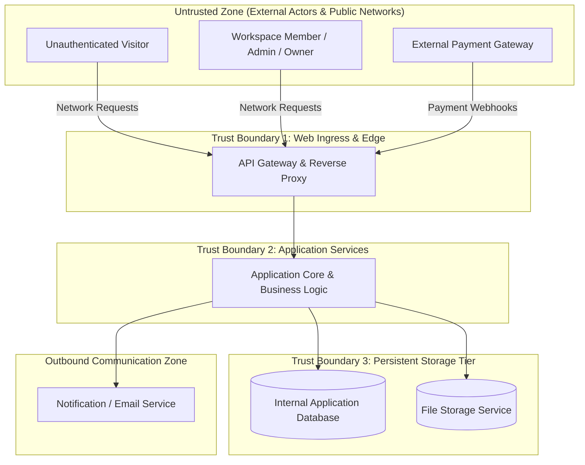

# Step 1: V0 Functional Audit & Boundary Analysis

## 1. Purpose & Methodological Rationale

The objective of Step 1 is to conduct an exhaustive, rigorous audit of the **pure functional baseline (Version 0)** before any security or privacy constraints are introduced. 

In classical requirements engineering (Robertson & Robertson, 2012; Wiegers & Beatty, 2013), introducing security constraints prematurely leads to **The Pre-Baked Security Trap**: developers confuse the *essence of the business functionality* with the *defensive mechanisms* used to secure it. 

Step 1 ensures that:
1. Every business functionality is defined in pure, technology-neutral terms.
2. All business assets, personal data entities, and system state transitions are identified.
3. Every human and system boundary crossing is cataloged.

---

## 2. Audit of the 8 Functional Areas (V0)

The functional baseline of TinyTask SaaS comprises 8 functional areas containing 18 atomic functional requirements (`R1.1` to `R8.2`), 18 Product Use Cases (`PUC 1.1` to `PUC 8.2`), and 18 Sea-Level System Use Cases (`{U.C. 1.1}` to `{U.C. 8.2}`).

### Functional Area 1: Manage User Accounts and Authentication
- **Requirements:**
  - `R1.1`: *Register and authenticate user accounts* (MUST)
  - `R1.2`: *Manage user profile and account preferences* (SHOULD)
- **Use Cases:** `{U.C. 1.1}`, `{U.C. 1.2}` | **PUCs:** `PUC 1.1`, `PUC 1.2`
- **Functional Intent:** Enable users to establish identity, confirm email ownership via time-limited activation links, authenticate with credentials, and maintain personal profile metadata and notification preferences.
- **Why Pure Functional in V0:** V0 specifies *that* users authenticate and receive sessions, but strictly omits *how* passwords are encrypted, what entropy tokens require, or session timeout thresholds. These belong to non-functional security.

### Functional Area 2: Manage Workspaces and Teams
- **Requirements:**
  - `R2.1`: *Create and configure workspace* (MUST)
  - `R2.2`: *Invite workspace members and manage access roles* (MUST)
  - `R2.3`: *Monitor workspace activity and operational metrics* (COULD)
- **Use Cases:** `{U.C. 2.1}`, `{U.C. 2.2}`, `{U.C. 2.3}` | **PUCs:** `PUC 2.1`, `PUC 2.2`, `PUC 2.3`
- **Functional Intent:** Allow workspace instantiation, organizational branding via unique URL slugs, role delegation (Owner, Admin, Member, Viewer), and aggregate activity monitoring.
- **Why Pure Functional in V0:** V0 defines the roles and business workflows, but leaves tenant-boundary enforcement mechanisms, IAM wildcard bans, and access mediation to security synthesis.

### Functional Area 3: Manage Projects
- **Requirements:**
  - `R3.1`: *Create and configure projects* (MUST)
  - `R3.2`: *Archive completed projects* (SHOULD)
- **Use Cases:** `{U.C. 3.1}`, `{U.C. 3.2}` | **PUCs:** `PUC 3.1`, `PUC 3.2`
- **Functional Intent:** Organize team work into scoped project containers with dedicated visual boards, descriptions, and lifecycle states (Active vs. Archived).

### Functional Area 4: Manage and Execute Tasks
- **Requirements:**
  - `R4.1`: *Create and assign tasks* (MUST)
  - `R4.2`: *Track and transition task workflow states on visual boards* (MUST)
  - `R4.3`: *Configure recurring automated tasks* (COULD)
- **Use Cases:** `{U.C. 4.1}`, `{U.C. 4.2}`, `{U.C. 4.3}` | **PUCs:** `PUC 4.1`, `PUC 4.2`, `PUC 4.3`
- **Functional Intent:** Core operational engine of the SaaS platform. Supports task creation, priority assignment, Kanban column drag-and-drop transitions, and scheduled recurrence.

### Functional Area 5: Collaborate on Task Deliverables
- **Requirements:**
  - `R5.1`: *Manage task deliverable attachments* (MUST)
  - `R5.2`: *Post in-task discussion comments and mention collaborators* (MUST)
- **Use Cases:** `{U.C. 5.1}`, `{U.C. 5.2}` | **PUCs:** `PUC 5.1`, `PUC 5.2`
- **Functional Intent:** Team collaboration. Attaching files to tasks (25 MB cap) and posting threaded discussion comments with `@mentions`.

### Functional Area 6: Track Activity History and Notifications
- **Requirements:**
  - `R6.1`: *Consult chronological audit history on task cards* (MUST)
  - `R6.2`: *Receive workspace alerts and daily task digests* (SHOULD)
- **Use Cases:** `{U.C. 6.1}`, `{U.C. 6.2}` | **PUCs:** `PUC 6.1`, `PUC 6.2`
- **Functional Intent:** Transparency. Real-time chronological audit trail of all field changes and asynchronous email digest dispatching.

### Functional Area 7: Manage Commercial Subscriptions
- **Requirements:**
  - `R7.1`: *Subscribe and manage workspace commercial plans* (MUST)
  - `R7.2`: *Enforce operational grace period upon payment failure* (MUST)
- **Use Cases:** `{U.C. 7.1}`, `{U.C. 7.2}` | **PUCs:** `PUC 7.1`, `PUC 7.2`
- **Functional Intent:** Monetization. Commercial tier upgrades, seat quota management, checkout session handoff, and 7-day payment failure grace period.

### Functional Area 8: Export Data and Close Accounts
- **Requirements:**
  - `R8.1`: *Export personal and workspace data archives* (MUST)
  - `R8.2`: *Close user accounts and terminate workspace access* (MUST)
- **Use Cases:** `{U.C. 8.1}`, `{U.C. 8.2}` | **PUCs:** `PUC 8.1`, `PUC 8.2`
- **Functional Intent:** Lifecycle termination. Self-service data export packages and account/workspace deactivation.

---

## 3. Comprehensive Asset & Data Entity Inventory

From the functional audit of V0, we extract the primary information assets handled by TinyTask SaaS:

| Asset Category | Data Entities | Business Value & Sensitivity | Primary Functional Owner |
|---|---|---|---|
| **Identity & Authentication** | User full name, business email, hashed credentials, activation tokens, session cookies | High (Personal Data + Critical Security Token) | `R1.1`, `R1.2` |
| **Organizational Context** | Workspace names, URL slugs, member rosters, allocated roles, seat quotas | High (Commercial + Tenant Isolation Boundary) | `R2.1`, `R2.2` |
| **Project & Task Records** | Project titles, task descriptions, priorities, due dates, assignees, Kanban status | Medium (Proprietary Business Data) | `R3.1`, `R4.1`, `R4.2` |
| **Deliverable Binary Assets** | Uploaded documents, specifications, image attachments, file previews | High (Proprietary Files + Potential Malware Vector)| `R5.1` |
| **Collaborative Content** | Discussion threads, Markdown comments, user `@mentions`, broadcast alerts | Medium (Personal Interactions) | `R5.2`, `R6.2` |
| **Operational History** | Task update logs, timestamped state changes, timesheets | High (Regulatory Audit Trail + Personal Data) | `R6.1` |
| **Financial & Commercial** | Subscription plan tier, billing contacts, checkout session tokens, payment receipts | High (Financial Compliance + Sensitive Metadata)| `R7.1`, `R7.2` |
| **Export Archives** | Consolidated JSON/ZIP packages of workspace and profile data | High (Consolidated Personal & Proprietary Data) | `R8.1`, `R8.2` |

---

## 4. Work Context & Trust Boundary Analysis

By analyzing the Volere Work Context Model and Cockburn Actor Interactions in V0, we map the external communication boundaries and interfaces:

### Critical Boundary Crossings Identified:
1. **Boundary Crossing 1 (Public User to Ingress):** Registration credentials, login attempts, profile changes. Requires strict encryption in transit, rate limiting, and input sanitization.
2. **Boundary Crossing 2 (External Payment Gateway to Ingress):** Asynchronous billing status updates and payment receipts. Requires origin verification, cryptographic signatures, and replay prevention.
3. **Boundary Crossing 3 (Application Core to Internal Storage):** Multi-tenant records residing in a shared database. Requires complete mediation so that tenant A cannot access tenant B's records under any circumstance.
4. **Boundary Crossing 4 (File Uploads to Storage Service):** User-supplied binary blobs. Requires strict file-type/signature validation, file size limits, and access control.

---

## 5. Synthesis Readiness Checklist

- [x] All 18 functional requirements verified as strictly technology-neutral.
- [x] All 18 use cases confirmed at Cockburn Sea-Level granularity (Level 1).
- [x] Complete asset inventory established across personal data and product resilience.
- [x] 4 critical trust boundaries demarcated for Phase 2 juxtaposition.
