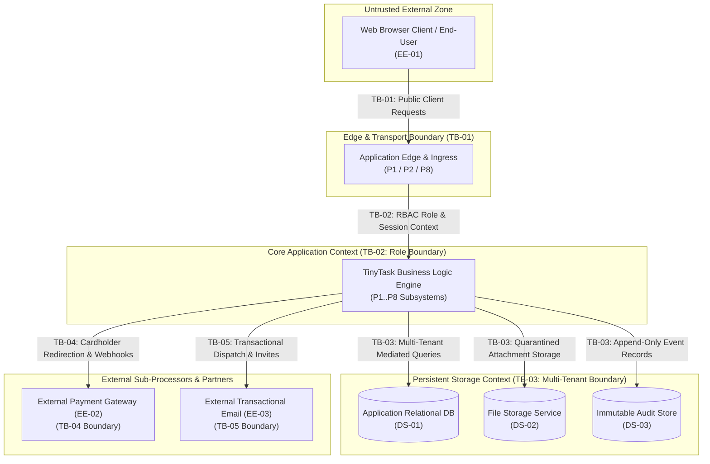

# AEGIS Phase 3 — Part 2: Step 1 — Assets, Boundaries & Data Flow Modeling (TinyTask SaaS)

> **Case Study:** Case 01 — TinyTask SaaS (B2B Task Management Multi-Tenant Platform)  
> **Lifecycle Phase:** AEGIS Phase 3 — Specification, **Part 2 of 2 (Threat & Risk Analysis)**  
> **Step Deliverable:** Step 1 of 5 (`01_SYSTEM_MODEL_ASSETS_AND_BOUNDARIES.md`)  
> **Upstream Inputs:** Phase 3 Part 1 Approved Baseline Version 2 (4.0.0) — [`../part1_security_privacy/v2_security_privacy_synthesis/Doc00_Process_and_Operational_Workflows.md`](../part1_security_privacy/v2_security_privacy_synthesis/Doc00_Process_and_Operational_Workflows.md) (Workflows & PUCs), [`../part1_security_privacy/v2_security_privacy_synthesis/Doc01_Requirements_Specification.md`](../part1_security_privacy/v2_security_privacy_synthesis/Doc01_Requirements_Specification.md) (20 Cards `R1.1`–`R8.3`) & [`../part1_security_privacy/v2_security_privacy_synthesis/Doc02_System_Use_Cases.md`](../part1_security_privacy/v2_security_privacy_synthesis/Doc02_System_Use_Cases.md) (20 Use Cases `{U.C. 1.1}`–`{U.C. 8.3}`)  
> **Methodological Standard:** [`../../../templates/phase3_threat_risk_guidelines.md`](../../../templates/phase3_threat_risk_guidelines.md) §6.1 & [`00_METHODOLOGY_AND_EXECUTION_GUIDE.md`](00_METHODOLOGY_AND_EXECUTION_GUIDE.md) §6.1  

---

## 1. Executive Summary & Purpose

This document establishes the **structural context, asset inventory, trust boundary catalog, and Data Flow Diagram (DFD Level 1)** for TinyTask SaaS under Phase 3 Part 2. It serves as the foundational baseline for all subsequent threat elicitation and adversary modeling steps.

### 1.1 Artefact Lifecycle & Pipeline Transitions

| Transition Dimension | Content & Operational Flow |
|---|---|
| **Upstream Inputs (from Part 1)** | Consumes the certified Version 2 baseline: Operational Workflows & PUCs ([`Doc00`](../part1_security_privacy/v2_security_privacy_synthesis/Doc00_Process_and_Operational_Workflows.md)), 20 Requirement Cards (`R1.1`–`R8.3`), 30 EARS non-functional constraints (`RN1`–`RN30`) ([`Doc01`](../part1_security_privacy/v2_security_privacy_synthesis/Doc01_Requirements_Specification.md)), and 20 Cockburn Sea-Level Use Cases (`{U.C. 1.1}`–`{U.C. 8.3}`) ([`Doc02`](../part1_security_privacy/v2_security_privacy_synthesis/Doc02_System_Use_Cases.md)). |
| **Analytical Transformation** | Decomposes the operational workflows and functional system into: (1) 10 critical assets (`AST-01`–`AST-10`) categorized under CIA-A and GDPR; (2) 5 formal trust boundaries (`TB-01`–`TB-05`) derived from the `Doc00` trust zones; (3) 10 inter-entity data flows (`DF-01`–`DF-10`) formalized in a DFD Level 1. |
| **Downstream Handoff $\rightarrow$ Step 2** | Transfers all boundary-crossing interactions to [`02_TECHNICAL_THREATS_STRIDE.md`](02_TECHNICAL_THREATS_STRIDE.md) for technical threat elicitation per functional package. |
| **Downstream Handoff $\rightarrow$ Step 3** | Transfers all personal data flows to [`03_PRIVACY_THREATS_LINDDUN.md`](03_PRIVACY_THREATS_LINDDUN.md) for data subject privacy threat modeling. |
| **Downstream Handoff $\rightarrow$ Step 4** | Anchors the root targets (`AST-01` Credentials, `AST-02` Tenant Files, `TB-02` Role Boundary, `TB-03` Multi-Tenant Storage) for Attack Tree decomposition in [`04_ATTACK_VECTORS_AND_DEFENSE_TREES.md`](04_ATTACK_VECTORS_AND_DEFENSE_TREES.md). |

All entities, boundaries, and data flows are derived strictly from the approved Version 2 functional baseline without fabricating unstated infrastructure or tools (Rule R6).

---

## 2. Asset Identification & Sensitivity Classification

Every asset manipulated, processed, or persisted by TinyTask SaaS across requirements `R1.1` to `R8.3` is cataloged below, classified under the CIA-A security triad (Confidentiality, Integrity, Availability, Accountability) and European statutory data protection categories.

### 2.1 Complete Asset Inventory

| Asset ID | Asset Title & Functional Description | Persistent Store | Conf. (C) | Integ. (I) | Avail. (A) | Acc. (A) | Statutory & Regulatory Classification |
|---|---|---|---|---|---|---|---|
| **AST-01** | **User Account & Credential State:** User email, salted cryptographic password hashes, multi-factor tokens, account status, active session identifiers. | `DS-01` (App DB) & `DS-04` (Session Store) | **Critical** | **Critical** | High | **Critical** | Personal Data (GDPR Art. 4(1)); Authentication Secret (CRA Annex I (2)(a)) |
| **AST-02** | **Workspace Governance & Membership Roster:** Workspace name, unique workspace ID, member roster, role assignments (Owner, Admin, Member, Viewer), active seat counts. | `DS-01` (App DB) | High | **Critical** | High | **Critical** | Commercial State; Personal Data (GDPR Art. 4(1)); RBAC State (CRA Annex I (2)(d)) |
| **AST-03** | **Project Containers & Configuration:** Project name, description, assigned team members, visibility flags (workspace-wide or private to selected members). | `DS-01` (App DB) | High | High | High | High | Commercial Project Data |
| **AST-04** | **Task Definitions & Operational Work Items:** Task titles, operational descriptions, assignees, due dates, priority tiers, custom execution statuses. | `DS-01` (App DB) | High | High | High | High | Customer Operational Content; Work Context |
| **AST-05** | **Task Deliverables & Binary File Attachments:** Uploaded project files, binary documents, deliverable artifacts linked to task cards. | `DS-02` (File Storage Service) | **Critical** | High | Medium | High | Proprietary Customer Deliverables; Potential PII in Document Bodies |
| **AST-06** | **Task Collaboration Comments & Feed:** Member discussion threads, contextual task feedback, timestamps, member references. | `DS-01` (App DB) | High | High | High | High | Customer Collaboration Content; Employee Communications |
| **AST-07** | **Security Event Audit Trail:** Immutable security event logs (authentication failures, role revocations, tenant boundary violations, permission denials under `RN18`). | `DS-03` (Audit Store) | Medium | **Critical** | High | **Critical** | Security Telemetry (CRA Annex I (2)(g)); Evidence of Compliance |
| **AST-08** | **Privacy Event & Subject Rights Audit Trail:** Timestamped records of GDPR rights requests (access, export, rectification, erasure under `RN26`), verification proofs. | `DS-03` (Audit Store) | High | **Critical** | High | **Critical** | Accountability Ledger (GDPR Art. 5(2), Art. 24, Art. 30); Legal Evidence |
| **AST-09** | **Commercial Billing & Subscription State:** External payment customer reference IDs, active subscription tier, seat quota thresholds, billing period timestamps. | `DS-01` (App DB) | High | **Critical** | High | High | Commercial Financial State; Contractual Enforceability |
| **AST-10** | **Cryptographic Key Material:** Symmetric at-rest data encryption keys, envelope keys, session signing secrets, webhook validation secrets. | `DS-04` (Key/Session Store) | **Critical** | **Critical** | **Critical** | **Critical** | Cryptographic Material (CRA Annex I (2)(e); CSF PR.DS-01) |

---

## 3. Formal Trust Boundaries Catalog

A **Trust Boundary** exists wherever data, commands, or execution control cross between entities operating under different privilege levels, network zones, or operational jurisdictions.

Across the 20 Cockburn Sea-Level Use Cases (`{U.C. 1.1}` to `{U.C. 8.3}`), five distinct Trust Boundaries are established:

### 3.1 Trust Boundary Specifications

#### TB-01: Public Client / Network Edge Boundary
- **Boundary Type:** Network / Transport / Authentication Zone Crossing.
- **Source Entity:** Untrusted External User / Web Client (`EE-01`).
- **Destination Entity:** Application Ingress & Authentication Service (`P1`, `P2`, `P8`).
- **Data Flows Crossing:** `DF-01` (User credentials, login requests), `DF-02` (Registration payloads), `DF-10` (Subject rights requests).
- **Threat Exposure:** Spoofing (credential brute force, credential stuffing, token forgery, recovery flow abuse); Denial of Service (HTTP connection flooding); Information Disclosure (unencrypted transport).
- **Target Use Cases:** `{U.C. 1.1}` (Register and authenticate user accounts), `{U.C. 1.2}` (Manage user profile), `{U.C. 1.3}` (Recover access to a locked account), `{U.C. 2.1}` (Create workspace), `{U.C. 8.1}` (Export data archive), `{U.C. 8.2}` (Close user account).
- **Mitigating Constraints in Baseline:** `RN10` (Credential Confidentiality Protection), `RN11` (Session Management & Invalidation), `RN18` (Security Audit Logging), `RN24` (Transport Cryptographic Protection), `RN27` (Requester Identity Verification).

#### TB-02: Role & Authorization Mediation Boundary
- **Boundary Type:** Privilege Level / Authorization Context Crossing.
- **Source Entity:** Authenticated User Session (carrying standard `Member` or `Viewer` role).
- **Destination Entity:** Core Application Subsystems & Elevated Administrative Operations (`P2`, `P3`, `P7`, `P8`).
- **Data Flows Crossing:** Role assignment commands, project configuration and visibility modifications, workspace billing changes, member revoking.
- **Threat Exposure:** Elevation of Privilege (horizontal and vertical role escalation); Tampering with authorization tokens or role claims; Repudiation of administrative modifications.
- **Target Use Cases:** `{U.C. 2.2}` (Invite Members & Assign Roles), `{U.C. 3.1}` (Create & Configure Projects), `{U.C. 3.2}` (Archive Projects), `{U.C. 7.1}` (Subscribe & Manage Commercial Plans), `{U.C. 8.3}` (Delete Workspace).
- **Mitigating Constraints in Baseline:** `RN12` (Role-Based Access Control & Action Mediation), `RN18` (Security Audit Logging), `RN28` (Secure-by-Default Configuration).

#### TB-03: Multi-Tenant Data Storage Boundary
- **Boundary Type:** Multi-Tenant Context / Storage Tier Crossing.
- **Source Entity:** Application Business Logic Engine (`P3`, `P4`, `P5`, `P8`).
- **Destination Entity:** Shared Relational Database (`DS-01`), File Storage Service (`DS-02`), and Audit Store (`DS-03`).
- **Data Flows Crossing:** Database queries, entity modifications, file binary uploads/downloads, audit event appends.
- **Threat Exposure:** Information Disclosure (cross-tenant data leakage, Insecure Direct Object References - IDOR); Tampering (cross-tenant payload modification); Denial of Service (storage exhaustion).
- **Target Use Cases:** `{U.C. 3.1}` (Create & Configure Projects), `{U.C. 4.1}` (Create Task), `{U.C. 4.2}` (Transition Task States), `{U.C. 4.3}` (Configure Recurring Tasks), `{U.C. 5.1}` (Manage Attachments), `{U.C. 5.2}` (Post Comments), `{U.C. 6.1}` (Consult Audit History), `{U.C. 8.3}` (Permanent Erasure).
- **Mitigating Constraints in Baseline:** `RN9` (Multi-Tenant Data Isolation & Query Mediation), `RN13` (File Upload Strict Validation & Content Isolation), `RN25` (Automated Orphan File Asset Cleanup & Expiration), `RN30` (Workspace Permanent Removal).

#### TB-04: External Payment Gateway Boundary
- **Boundary Type:** External Third-Party Service / Financial Isolation Boundary.
- **Source Entity:** TinyTask Billing Subsystem (`P7`).
- **Destination Entity:** External Payment Processor (`EE-02`).
- **Data Flows Crossing:** `DF-08` (Hosted checkout redirect requests), `DF-09` (Payment status and webhook callback events).
- **Threat Exposure:** Spoofing (forged webhook callbacks triggering unauthorized subscription upgrades); Tampering (manipulation of seat counts or plan identifiers in transit); Information Disclosure (accidental exposure of cardholder data).
- **Target Use Cases:** `{U.C. 7.1}` (Subscribe & Manage Commercial Plans), `{U.C. 7.2}` (Enforce Operational Grace Period).
- **Mitigating Constraints in Baseline:** `RN7` (Payment Gateway Authenticated Channels & Webhook Signature Verification), `RN15` (Cryptographic Billing Invariant Protection), `RN16` (Cryptographic Webhook Origin Verification), `RN18` (Security Audit Logging).

#### TB-05: External Transactional Messaging Boundary
- **Boundary Type:** External Third-Party Service / Asynchronous Dispatch Boundary.
- **Source Entity:** TinyTask Notification & Collaboration Subsystems (`P1`, `P2`, `P6`).
- **Destination Entity:** External Transactional Email Service (`EE-03`).
- **Data Flows Crossing:** `DF-03` (Member invitation and account-recovery dispatch), `DF-07` (Aggregated notification email digests).
- **Threat Exposure:** Information Disclosure (leakage of proprietary task titles, invitation or recovery tokens in cleartext email); Tampering (manipulation of recipient addresses); Denial of Service (notification flooding).
- **Target Use Cases:** `{U.C. 1.3}` (Recover Access — recovery dispatch), `{U.C. 2.2}` (Invite Workspace Members), `{U.C. 6.2}` (Receive Workspace Alerts & Daily Task Digests).
- **Mitigating Constraints in Baseline:** `RN10` (Neutral Recovery Responses), `RN24` (Transport Cryptographic Protection), `RN28` (Secure-by-Default — expiring invitation tokens), `RN29` (Secure-Use Guidance).

---

## 4. Data Flow Diagram (DFD Level 1)

The following diagram formalizes the system processes, data stores, external interactors, and trust boundaries governing TinyTask SaaS:

```mermaid
flowchart TD
    subgraph EE["External Interactors"]
        EE1["EE-01: Authenticated & Anonymous Web Client"]
        EE2["EE-02: External Payment Gateway (PCI-DSS)"]
        EE3["EE-03: External Transactional Email Service"]
    end

    subgraph Processes["TinyTask Functional Subsystems (Processes)"]
        P1["P1: Identity & Authentication<br>(R1.1, R1.2)"]
        P2["P2: Workspace Governance<br>(R2.1, R2.2, R2.3)"]
        P3["P3: Project Management<br>(R3.1, R3.2)"]
        P4["P4: Task & Deliverable Engine<br>(R4.1, R4.2, R4.3)"]
        P5["P5: Collaboration & Commenting<br>(R5.1, R5.2)"]
        P6["P6: Notification Dispatch<br>(R6.1, R6.2)"]
        P7["P7: Billing & Quota Management<br>(R7.1, R7.2, R7.3)"]
        P8["P8: Subject Rights & Data Erasure<br>(R8.1, R8.2, R8.3)"]
    end

    subgraph DataStores["Persistent & Ephemeral Data Stores"]
        DS1[("DS-01: Application Relational Database<br>(Multi-Tenant Tenant-Isolated)")]
        DS2[("DS-02: Deliverables File Storage<br>(Quarantined Object Store)")]
        DS3[("DS-03: Immutable Audit Store<br>(Security & Privacy Events)")]
        DS4[("DS-04: Session & Cryptographic Cache<br>(Tokens & Encryption Keys)")]
    end

    %% Client Interactions crossing TB-01
    EE1 -->|"DF-01: Auth & Login (crosses TB-01)"| P1
    EE1 -->|"DF-02: Workspace Administration (crosses TB-01/TB-02)"| P2
    EE1 -->|"DF-04: Project Operations (crosses TB-01/TB-02)"| P3
    EE1 -->|"DF-05: Task & File Interactions (crosses TB-01/TB-02)"| P4
    EE1 -->|"DF-06: Comments & Discussion (crosses TB-01/TB-02)"| P5
    EE1 -->|"DF-07: In-App Alerts (crosses TB-01)"| P6
    EE1 -->|"DF-08: Subscription Changes (crosses TB-01/TB-02)"| P7
    EE1 -->|"DF-10: Subject Rights & Erasure (crosses TB-01/TB-02)"| P8

    %% Inter-process and External Interactions
    P2 -->|"DF-03: Invitation Dispatch (crosses TB-05)"| EE3
    P6 -->|"DF-07: Notification Email (crosses TB-05)"| EE3
    P7 -->|"DF-08: Hosted Checkout Redirect (crosses TB-04)"| EE2
    EE2 -->|"DF-09: Webhook Status Callback (crosses TB-04)"| P7

    %% Data Store Interactions crossing TB-03
    P1 <-->|"Credentials & Profile Queries (TB-03)"| DS1
    P1 <-->|"Session Token State"| DS4
    P2 <-->|"Roster & Roles Queries (TB-03)"| DS1
    P3 <-->|"Project Metadata Queries (TB-03)"| DS1
    P4 <-->|"Task Entity Queries (TB-03)"| DS1
    P4 <-->|"Binary File Payloads (TB-03)"| DS2
    P5 <-->|"Comment Entity Queries (TB-03)"| DS1
    P7 <-->|"Billing State Queries (TB-03)"| DS1
    P8 <-->|"Personal Data Extraction & Purge (TB-03)"| DS1
    P8 <-->|"Attachment Purge (TB-03)"| DS2

    %% Audit Logging
    P1 -.->|"RN18: Auth Events"| DS3
    P2 -.->|"RN18: Admin Events"| DS3
    P7 -.->|"RN18: Billing Events"| DS3
    P8 -.->|"RN26: Privacy Events"| DS3
```

---

## 5. Comprehensive Data Flow Inventory

The following table catalogs all 10 major data flows within TinyTask SaaS, identifying the source, destination, payload data items, crossing trust boundaries, and governing baseline constraints:

| Flow ID | Flow Name & Description | Source Entity | Destination Entity | Data Items / Assets Transferred | Boundaries Crossed | Governing Part 1 Constraints |
|---|---|---|---|---|---|---|
| **DF-01** | User Authentication & Registration | `EE-01` (Client) | `P1` (Identity) | Email, plaintext password, salted hash, cryptographically signed session token | `TB-01` | `RN10`, `RN11`, `RN18`, `RN24` |
| **DF-02** | Workspace Provisioning & Administration | `EE-01` (Client) | `P2` (Workspace) | Workspace name, owner role, member role modifications | `TB-01`, `TB-02` | `RN12`, `RN18`, `RN28` |
| **DF-03** | Member Invitation & Recovery Dispatch | `P2` (Workspace) | `EE-03` (Email) | Recipient email, cryptographic invitation/recovery token, workspace ID | `TB-05` | `RN10`, `RN24`, `RN28` |
| **DF-04** | Project Configuration & Management | `EE-01` (Client) | `P3` (Projects) | Project title, deliverable description, visibility settings | `TB-01`, `TB-02` | `RN9`, `RN12`, `RN28` |
| **DF-05** | Task CRUD & File Attachment Upload/Download | `EE-01` (Client) | `P4` (Tasks) | Task details, status, binary file payloads, MIME headers | `TB-01`, `TB-02`, `TB-03` | `RN9`, `RN12`, `RN13`, `RN25` |
| **DF-06** | Task Collaboration Comments | `EE-01` (Client) | `P5` (Comments) | Comment text body, timestamp, author member reference | `TB-01`, `TB-02`, `TB-03` | `RN9`, `RN14` |
| **DF-07** | Notification Alerts & Email Digests | `P6` (Notifications) | `EE-01` & `EE-03` | Task update alert, minimal task identifier, email digest | `TB-01`, `TB-05` | `RN24` |
| **DF-08** | Subscription Checkout & Tier Elevation | `EE-01` (Client) | `P7` (Billing) $\rightarrow$ `EE-02` | Plan identifier, active seat count, Stripe hosted checkout URL | `TB-01`, `TB-02`, `TB-04` | `RN7`, `RN12`, `RN15` |
| **DF-09** | External Payment Webhook Synchronization | `EE-02` (Payment GW) | `P7` (Billing) | Signed webhook payload, event type, subscription status | `TB-04` | `RN15`, `RN16`, `RN18` |
| **DF-10** | GDPR Subject Rights Export & Erasure | `EE-01` (Client) | `P8` (Subject Rights) | Verified requester proof, structured JSON export, purge signal | `TB-01`, `TB-02`, `TB-03` | `RN20`, `RN21`, `RN27`, `RN30` |

---

## 6. Bidirectional Traceability: Use Cases $\longleftrightarrow$ Boundaries $\longleftrightarrow$ Assets

This matrix guarantees that 100% of the 20 functional requirement cards and 20 Cockburn Sea-Level Use Cases are mapped to their operational assets and trust boundaries:

| Req Card | Cockburn Sea-Level Use Case | Primary Assets Manipulated | Trust Boundaries Traversed | Critical Threat Surfaces | Governing Constraints |
|---|---|---|---|---|---|
| `R1.1` | `{U.C. 1.1}` Register and authenticate user accounts | `AST-01`, `AST-07` | `TB-01` | Brute force, credential stuffing, unencrypted transport | `RN10`, `RN11`, `RN18`, `RN19`, `RN24` |
| `R1.2` | `{U.C. 1.2}` Manage user profile and account preferences | `AST-01`, `AST-07`, `AST-08` | `TB-01` | Unauthorized profile alteration, session hijacking | `RN23`, `RN26`, `RN24` |
| `R1.3` | `{U.C. 1.3}` Recover access to a locked user account | `AST-01`, `AST-07` | `TB-01`, `TB-05` | Recovery flow abuse, account enumeration, token interception | `RN10`, `RN11`, `RN18` |
| `R2.1` | `{U.C. 2.1}` Create and configure workspace | `AST-02`, `AST-07` | `TB-01`, `TB-02` | Insecure initial settings, missing owner binding | `RN9`, `RN18`, `RN28` |
| `R2.2` | `{U.C. 2.2}` Invite workspace members and manage access roles | `AST-01`, `AST-02`, `AST-07` | `TB-01`, `TB-02`, `TB-05` | Privilege escalation, token interception, identity enumeration | `RN12`, `RN18` |
| `R2.3` | `{U.C. 2.3}` Monitor workspace activity and operational metrics | `AST-02`, `AST-07`, `AST-08` | `TB-01`, `TB-02` | Worker productivity profiling, telemetry leakage | `RN22` |
| `R3.1` | `{U.C. 3.1}` Create and configure projects | `AST-03`, `AST-07` | `TB-01`, `TB-02`, `TB-03` | Cross-tenant visibility leak, unauthorized project configuration | `RN9`, `RN12`, `RN18`, `RN28` |
| `R3.2` | `{U.C. 3.2}` Archive completed projects | `AST-03`, `AST-07` | `TB-01`, `TB-02` | Unauthorized archive transition | `RN12`, `RN18` |
| `R4.1` | `{U.C. 4.1}` Create and assign tasks | `AST-04`, `AST-07` | `TB-01`, `TB-02`, `TB-03` | Cross-tenant task access (IDOR), assignment manipulation | `RN9`, `RN12` |
| `R4.2` | `{U.C. 4.2}` Track and transition task workflow states on visual boards | `AST-04`, `AST-07` | `TB-01`, `TB-02`, `TB-03` | Cross-tenant IDOR parameter tampering, request flooding | `RN9`, `RN17` |
| `R4.3` | `{U.C. 4.3}` Configure recurring automated tasks | `AST-04`, `AST-07` | `TB-01`, `TB-02`, `TB-03` | Recurrence automation abuse, scheduler exhaustion | `RN9`, `RN17`, `RN18` |
| `R5.1` | `{U.C. 5.1}` Manage task deliverable attachments | `AST-05`, `AST-07` | `TB-01`, `TB-02`, `TB-03` | Malicious file upload, storage exhaustion, direct object retrieval | `RN13`, `RN25` |
| `R5.2` | `{U.C. 5.2}` Post in-task discussion comments and mention collaborators | `AST-06`, `AST-07` | `TB-01`, `TB-02`, `TB-03` | Stored Cross-Site Scripting (XSS), collaboration record tampering | `RN14`, `RN18` |
| `R6.1` | `{U.C. 6.1}` Consult chronological audit history on task cards | `AST-07`, `AST-08` | `TB-01`, `TB-02`, `TB-03` | Cross-task audit history probing, audit log re-identification | `RN9`, `RN17`, `RN18`, `RN22` |
| `R6.2` | `{U.C. 6.2}` Receive workspace alerts and daily task digests | `AST-04`, `AST-06` | `TB-01`, `TB-05` | Notification flooding, PII exposure in cleartext email | `RN24` |
| `R7.1` | `{U.C. 7.1}` Subscribe and manage workspace commercial plans | `AST-08`, `AST-09` | `TB-01`, `TB-02`, `TB-04` | Webhook forgery, cardholder leakage, non-owner plan manipulation | `RN7`, `RN12`, `RN15`, `RN16`, `RN18` |
| `R7.2` | `{U.C. 7.2}` Enforce operational grace period upon payment failure | `AST-08`, `AST-09` | `TB-01`, `TB-02`, `TB-04` | Webhook replay, unauthorized grace-period transitions | `RN15`, `RN16`, `RN18` |
| `R8.1` | `{U.C. 8.1}` Export personal and workspace data archives | `AST-01`, `AST-04`, `AST-08` | `TB-01`, `TB-02`, `TB-03` | Spoofed subject export, PII exfiltration, portability obstruction | `RN20`, `RN27` |
| `R8.2` | `{U.C. 8.2}` Close user accounts and terminate workspace access | `AST-01`, `AST-06`, `AST-08` | `TB-01`, `TB-02`, `TB-03` | Unauthorized account closure, incomplete pseudonymization | `RN18`, `RN21`, `RN27` |
| `R8.3` | `{U.C. 8.3}` Delete workspace and permanently erase workspace data | `AST-02`..`AST-09` | `TB-01`, `TB-02`, `TB-03` | Unauthorized workspace destruction, incomplete file purge | `RN12`, `RN18`, `RN21`, `RN27`, `RN30` |

---

## 7. Step 1 Sign-Off & Verification

This document satisfies all requirements of **Step 1 of Phase 3 Part 2**:
- [x] **100% Asset Coverage:** All 10 persistent, authentication, and compliance asset types classified under CIA-A and statutory categories.
- [x] **100% Trust Boundary Definition:** All 5 trust boundaries ($TB_{01}$ to $TB_{05}$) formalized with traversed entities, data flows, and target use cases.
- [x] **Valid DFD Level 1:** Data Flow Diagram fully rendered in valid Mermaid syntax with complete data flow matrix.
- [x] **Bidirectional Traceability Matrix:** Full mapping across all 20 requirement cards and 20 Cockburn Sea-Level Use Cases.

**Step 1 is COMPLETE and APPROVED.** Cleared to proceed to **Step 2 ([`02_TECHNICAL_THREATS_STRIDE.md`](02_TECHNICAL_THREATS_STRIDE.md))**.
