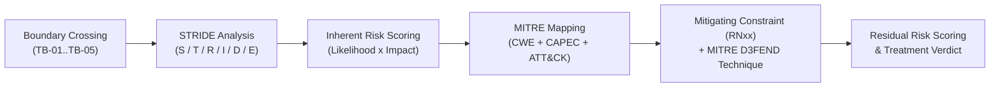

# AEGIS Phase 3 — Part 2: Step 2 — Technical Threat Modeling via STRIDE-per-Interaction (TinyTask SaaS)

> **Case Study:** Case 01 — TinyTask SaaS (B2B Task Management Multi-Tenant Platform)  
> **Lifecycle Phase:** AEGIS Phase 3 — Specification, **Part 2 of 2 (Threat & Risk Analysis)**  
> **Step Deliverable:** Step 2 of 5 (`02_TECHNICAL_THREATS_STRIDE.md`)  
> **Upstream Inputs:** Step 1 ([`01_SYSTEM_MODEL_ASSETS_AND_BOUNDARIES.md`](01_SYSTEM_MODEL_ASSETS_AND_BOUNDARIES.md)), Phase 3 Part 1 Approved Baseline Version 2 (4.0.0) — [`../part1_security_privacy/v2_security_privacy_synthesis/Doc01_Requirements_Elicitation_and_PUC.md`](../part1_security_privacy/v2_security_privacy_synthesis/Doc01_Requirements_Elicitation_and_PUC.md) (20 Cards `R1.1`–`R8.3`) & [`../part1_security_privacy/v2_security_privacy_synthesis/Doc02_System_Use_Cases.md`](../part1_security_privacy/v2_security_privacy_synthesis/Doc02_System_Use_Cases.md) (20 Use Cases `{U.C. 1.1}`–`{U.C. 8.3}`)  
> **Methodological Standard:** [`../../../templates/phase3_threat_risk_guidelines.md`](../../../templates/phase3_threat_risk_guidelines.md) §6.2 & [`00_METHODOLOGY_AND_EXECUTION_GUIDE.md`](00_METHODOLOGY_AND_EXECUTION_GUIDE.md) §6.2  

---

## 1. Executive Summary & Methodology

This document executes the **STRIDE-per-interaction** threat modeling across all **8 functional packages** of the accepted TinyTask SaaS baseline (`R1` to `R8`), evaluating every interaction that traverses a Trust Boundary ($TB_{01}$ to $TB_{05}$). Every mitigating constraint cited below is anchored to the accepted Part 1 Version 2 baseline — the same `RN` identifiers, titles, and enforcement steps published in `Doc01` (requirement-card constraint chains and Table 7) and `Doc02` (use-case preconditions, extensions, and guarantees).

### 1.1 Artefact Lifecycle & Pipeline Transitions

| Transition Dimension | Content & Operational Flow |
|---|---|
| **Upstream Inputs (from Step 1)** | Consumes the structural attack surface from [`01_SYSTEM_MODEL_ASSETS_AND_BOUNDARIES.md`](01_SYSTEM_MODEL_ASSETS_AND_BOUNDARIES.md): 10 assets, 5 trust boundaries, 10 data flows, and the 20 Cockburn Sea-Level Use Cases. |
| **Analytical Transformation** | Applies STRIDE to every boundary crossing across all 8 functional packages (`R1`–`R8`), eliciting 21 technical threat cards anchored in MITRE CWE (weakness), CAPEC (attack pattern), ATT&CK (TTP), and D3FEND (architectural countermeasure). |
| **Downstream Handoff $\rightarrow$ Step 4** | Feeds top-tier Critical technical threats (e.g., `TM-D-03.2-001` IDOR multi-tenant breach, `TM-D-03.3-001` Owner privilege escalation) to [`04_ATTACK_VECTORS_AND_DEFENSE_TREES.md`](04_ATTACK_VECTORS_AND_DEFENSE_TREES.md) for deep vector decomposition. |
| **Downstream Handoff $\rightarrow$ Step 5** | Exports all 21 scored technical threat cards into the master ledger in [`05_RISK_REGISTER_AND_GOVERNANCE.md`](05_RISK_REGISTER_AND_GOVERNANCE.md), which consolidates the 29 elicited cards (21 STRIDE + 8 LINDDUN) into 28 register rows under the one declared cross-lens merge. |

For every identified technical threat, a standardized 10-field Threat Card is compiled, integrating:
- Canonical identification: `TM-D-XX.Y-NNN`.
- Underlying software design weakness: **MITRE CWE**.
- Adversary attack pattern: **MITRE CAPEC**.
- Operational adversary tactic: **MITRE ATT&CK**.
- Dual risk scoring: **Inherent Risk** ($R_{\text{inh}}$) vs. **Residual Risk** ($R_{\text{res}}$).
- Architectural defense: **MITRE D3FEND** technique mapped to active Part 1 constraints (`RN1`–`RN30`).
- Operational enforcement: Exact step/extension in Cockburn's Sea-Level Use Cases (`Doc02`).

---

## 2. Package 1: User Identity & Authentication (R1.1–R1.3 / {U.C. 1.1}–{U.C. 1.3})

### 2.1 Threat Cards

#### TM-D-03.1-001: Automated Credential Stuffing & Brute Force Authentication Bypass
- **Target Interaction & Boundary:** External user submitting authentication credentials (`DF-01`), crossing `TB-01` (Public Client Boundary) into `P1` in `{U.C. 1.1}` / `R1.1`.
- **STRIDE Category:** Spoofing (S).
- **Adversary Threat Hypothesis:** An external unauthenticated adversary uses automated botnets or dictionary lists to execute high-frequency login attempts against user accounts, aiming to guess weak credentials and hijack authenticated sessions.
- **Root Weakness (CWE):** `CWE-307: Improper Restriction of Excessive Authentication Attempts` / `CWE-799: Improper Control of Interaction Frequency`.
- **Attack Pattern (CAPEC):** `CAPEC-115: Authentication Bypass` / `CAPEC-49: Password Brute Forcing`.
- **Adversary TTP (ATT&CK):** `T1110.003: Brute Force: Password Spraying` / `T1110.001: Password Guessing`.
- **Inherent Risk Rating:**
  - *Likelihood:* High (3) [Trivial public edge discovery; widely available automated credential stuffing tools].
  - *Impact:* High (3) [Full takeover of victim account; access to all workspaces and tasks where victim is a member].
  - *Inherent Risk Level:* **Critical**.
- **Active Mitigating Constraints:**
  - `NFR-RN10: Credential Confidentiality Protection (State of the Art)` (Enforces state-of-the-art credential storage and verification; salted hashing and rejection of compromised passwords remove guessing value from stored secrets).
  - `NFR-RN11: Session Management & Invalidation` (Bound to the failed-attempt path: `{U.C. 1.1}` Extension 5c temporarily blocks authentication attempts for the target account, returns a generic throttling notice, and records a security alert — failed-attempt counters and lockout state are session/attempt state managed under this constraint).
  - `NFR-RN18: Security Audit Logging` (Every rejected authentication attempt is recorded with timestamp, actor, and client origin).
- **Defensive Technique (D3FEND):** `D3-IRA: Inbound Request Authentication` / `D3-URR: User Request Rate Limiting`.
- **Residual Risk Rating & Verdict:**
  - *Residual Likelihood:* Low (1) [Automated rapid guessing neutralized by attempt throttling and temporary lockout].
  - *Residual Impact:* High (3) [Impact of hypothetical compromise remains high].
  - *Residual Risk Level:* **Medium**.
  - *Treatment Verdict:* **Mitigated** (Enforced in `{U.C. 1.1}` Extension 5c).

---

#### TM-D-07.1-001: Man-in-the-Middle Credential Interception on Unencrypted Transport
- **Target Interaction & Boundary:** Web client transmitting plaintext login payload (`DF-01`), crossing `TB-01` (Public Client Boundary) into `P1` in `{U.C. 1.1}` / `R1.1`.
- **STRIDE Category:** Information Disclosure (I) / Tampering (T).
- **Adversary Threat Hypothesis:** An adversary positioned on an intermediate local network (e.g., public Wi-Fi) intercepts unencrypted HTTP traffic to capture plaintext credentials and session tokens in transit.
- **Root Weakness (CWE):** `CWE-319: Cleartext Transmission of Sensitive Information`.
- **Attack Pattern (CAPEC):** `CAPEC-158: Sniffing Network Traffic` / `CAPEC-94: Man in the Middle Attack`.
- **Adversary TTP (ATT&CK):** `T1040: Network Sniffing` / `T1557: Adversary-in-the-Middle`.
- **Inherent Risk Rating:**
  - *Likelihood:* High (3) [Open network sniffing easily conducted with standard packet capture utilities].
  - *Impact:* Critical (4) [Total exposure of user authentication secrets and session state].
  - *Inherent Risk Level:* **Critical**.
- **Active Mitigating Constraints:**
  - `NFR-RN24: Transport Cryptographic Protection` (Mandates state-of-the-art cryptographic protection for all data in transit across public and untrusted networks; unencrypted connection attempts are refused or upgraded — enforced as a `{U.C. 1.1}` precondition that the network connection terminates over a secure encrypted channel).
- **Defensive Technique (D3FEND):** `D3-EAC: Encrypted Network Traffic` / `D3-MAM: Message Access Mediation`.
- **Residual Risk Rating & Verdict:**
  - *Residual Likelihood:* Low (1) [Cryptographic channel interception computationally infeasible under modern ciphers].
  - *Residual Impact:* Critical (4) [Underlying sensitivity unchanged].
  - *Residual Risk Level:* **High** (Tolerated under mandatory verified cryptographic constraint).
  - *Treatment Verdict:* **Mitigated** (Enforced in `{U.C. 1.1}` Precondition 1).

---

#### TM-D-06.1-001: Repudiation of Malicious Account Profile Modification
- **Target Interaction & Boundary:** Authenticated user session modifying email or account credentials (`DF-01`), crossing `TB-01` into `P1` in `{U.C. 1.2}` / `R1.2`.
- **STRIDE Category:** Repudiation (R).
- **Adversary Threat Hypothesis:** A compromised account or insider modifies user account details (e.g., redirecting recovery email) and denies having executed the change due to absence of non-repudiable audit records.
- **Root Weakness (CWE):** `CWE-778: Insufficient Logging`.
- **Attack Pattern (CAPEC):** `CAPEC-81: Web Server Manipulation`.
- **Adversary TTP (ATT&CK):** `T1562.002: Impair Defenses: Disable Windows Event Logging` / `T1070: Indicator Removal`.
- **Inherent Risk Rating:**
  - *Likelihood:* Medium (2) [Common tactic to maintain persistence after account takeover].
  - *Impact:* High (3) [Inability to investigate breach origin, verify user intent, or prove compliance].
  - *Inherent Risk Level:* **High**.
- **Active Mitigating Constraints:**
  - `NFR-RN18: Security Audit Logging` (Enforces immutable timestamped recording of profile modifications, password resets, and email changes).
  - `NFR-RN26: Privacy Audit Trail for Personal Data Modifications` (Profile modifications emit a structured privacy audit record binding the change to the acting identity).
- **Defensive Technique (D3FEND):** `D3-AL: Audit Logging` / `D3-AV: Access Verification`.
- **Residual Risk Rating & Verdict:**
  - *Residual Likelihood:* Low (1) [Every state modification irreversibly bound to user ID, IP, and timestamp].
  - *Residual Impact:* Medium (2) [Forensic trail guarantees accountability].
  - *Residual Risk Level:* **Low**.
  - *Treatment Verdict:* **Mitigated** (Enforced in `{U.C. 1.2}` Minimal Guarantees).

---

#### TM-D-03.1-003: Recovery Flow Abuse & Spoofed Account Takeover
- **Target Interaction & Boundary:** Unauthenticated actor requesting account recovery via the password-reset flow (`DF-01`), crossing `TB-01` into `P1` in `{U.C. 1.3}` / `R1.3`.
- **STRIDE Category:** Spoofing (S) / Information Disclosure (I).
- **Adversary Threat Hypothesis:** An external adversary abuses the account-recovery flow to take over a victim account: they intercept or guess the single-use recovery token (dispatched over the external email channel), or they weaponize the recovery endpoint as an oracle to confirm whether specific email addresses hold platform accounts, then complete a credential reset and establish an authenticated session as the victim.
- **Root Weakness (CWE):** `CWE-287: Improper Authentication` / `CWE-640: Weak Recovery Password Restoration` / `CWE-204: Observable Response Discrepancy`.
- **Attack Pattern (CAPEC):** `CAPEC-115: Authentication Bypass` / `CAPEC-50: Password Recovery Exploitation`.
- **Adversary TTP (ATT&CK):** `T1110.003: Brute Force: Password Spraying` / `T1589: Gather Victim Identity Information`.
- **Inherent Risk Rating:**
  - *Likelihood:* High (3) [Recovery endpoints are public and token-bearing emails traverse third-party infrastructure].
  - *Impact:* Critical (4) [Full account takeover including credential replacement and session establishment].
  - *Inherent Risk Level:* **Critical**.
- **Active Mitigating Constraints:**
  - `NFR-RN10: Credential Confidentiality Protection (State of the Art)` (Recovery responses return a neutral confirmation regardless of account existence, preventing account enumeration; recovery tokens are state-of-the-art unguessable secrets).
  - `NFR-RN11: Session Management & Invalidation` (Successful recovery invalidates all active sessions of the account before renewed authentication; single-use token semantics expire with first redemption).
  - `NFR-RN18: Security Audit Logging` (Every recovery attempt is recorded in the security audit log; legitimate users are never permanently locked out).
- **Defensive Technique (D3FEND):** `D3-RO: Response Obfuscation` / `D3-IRA: Inbound Request Authentication` / `D3-URR: User Request Rate Limiting`.
- **Residual Risk Rating & Verdict:**
  - *Residual Likelihood:* Low (1) [Neutral responses remove the enumeration oracle; single-use unguessable tokens remove the interception-to-redemption path absent a compromised mailbox].
  - *Residual Impact:* Critical (4) [A completed takeover via a compromised mailbox remains an account takeover].
  - *Residual Risk Level:* **High** (Tolerated under mandatory verified recovery constraints; the residual channel is the third-party mailbox itself).
  - *Treatment Verdict:* **Mitigated** (Enforced in `{U.C. 1.3}` Steps 2–5 and Extension 2a1).

---

## 3. Package 2: Workspace Governance & Member Management (R2.1–R2.3 / {U.C. 2.1}–{U.C. 2.3})

### 3.1 Threat Cards

#### TM-D-03.3-001: Unauthorized Member Privilege Escalation via API Parameter Tampering
- **Target Interaction & Boundary:** Authenticated user invoking role modification endpoint (`DF-02`), crossing `TB-02` (Role Boundary) into `P2` in `{U.C. 2.2}` / `R2.2`.
- **STRIDE Category:** Elevation of Privilege (E) / Tampering (T).
- **Adversary Threat Hypothesis:** A standard workspace `Member` or `Viewer` crafts a direct API call changing their own role to `Admin` or `Owner`, exploiting missing server-side authorization checks on the role update payload.
- **Root Weakness (CWE):** `CWE-862: Missing Authorization` / `CWE-285: Improper Authorization`.
- **Attack Pattern (CAPEC):** `CAPEC-233: Privilege Escalation` / `CAPEC-180: Exploiting Incorrectly Configured Access Control Security Levels`.
- **Adversary TTP (ATT&CK):** `T1078.004: Valid Accounts: Cloud Accounts` / `T1068: Exploitation for Privilege Escalation`.
- **Inherent Risk Rating:**
  - *Likelihood:* High (3) [Trivial payload tampering via browser developer tools].
  - *Impact:* Critical (4) [Full administrative control over workspace; unauthorized member expulsion and data deletion].
  - *Inherent Risk Level:* **Critical**.
- **Active Mitigating Constraints:**
  - `NFR-RN12: Role-Based Access Control & Action Mediation` (Enforces strict server-side validation that only active `Owner` or `Admin` roles can assign or modify member roles; `{U.C. 2.2}` Extension 4d1 rejects unauthorized invitation or role mutation with an authorization error and records the access denial).
- **Defensive Technique (D3FEND):** `D3-MAM: Message Access Mediation` / `D3-AZ: Authorization Verification`.
- **Residual Risk Rating & Verdict:**
  - *Residual Likelihood:* Low (1) [Server-side role engine rejects unauthorized requests before execution].
  - *Residual Impact:* Critical (4) [Severity of potential takeover remains critical].
  - *Residual Risk Level:* **High** (Tolerated under mandatory verified RBAC mediation).
  - *Treatment Verdict:* **Mitigated** (Enforced in `{U.C. 2.2}` Extension 4d1).

---

#### TM-D-03.4-001: Workspace Insecure-by-Default Configuration State
- **Target Interaction & Boundary:** Initial workspace setup (`DF-02`), crossing `TB-01` into `P2` in `{U.C. 2.1}` / `R2.1`.
- **STRIDE Category:** Elevation of Privilege (E) / Information Disclosure (I).
- **Adversary Threat Hypothesis:** An unauthenticated or newly onboarded user initializes a workspace that defaults to public visibility, unexpiring invite links, or permissive member roles, enabling unintended data exposure.
- **Root Weakness (CWE):** `CWE-1188: Insecure Default Initialization of Resource`.
- **Attack Pattern (CAPEC):** `CAPEC-203: Embedded Malicious Code` / `CAPEC-180: Access Control Configuration Exploitation`.
- **Adversary TTP (ATT&CK):** `T1565.001: Data Manipulation: Stored Data Manipulation`.
- **Inherent Risk Rating:**
  - *Likelihood:* Medium (2) [Misconfiguration common when platforms ship with open defaults].
  - *Impact:* High (3) [Immediate data exposure across all initialized projects and member rosters].
  - *Inherent Risk Level:* **High**.
- **Active Mitigating Constraints:**
  - `NFR-RN28: Secure-by-Default Configuration with User Reset` (Mandates that every new workspace initializes under the restrictive secure-by-default configuration with least-privilege defaults; `{U.C. 2.1}` Step 3 initializes the restrictive configuration, and `{U.C. 3.1}` applies restrictive default project visibility).
  - `NFR-RN9: Multi-Tenant Data Isolation & Mediation` (Workspace container provisioning is tenant-isolated; `{U.C. 2.1}` Extension 3c1 refuses anomalous provisioning and emits a high-priority security audit record).
- **Defensive Technique (D3FEND):** `D3-SC: System Configuration Hardening` / `D3-SPM: Supervisory Process Metadata Verification`.
- **Residual Risk Rating & Verdict:**
  - *Residual Likelihood:* Low (1) [Zero open defaults; strict initialization baseline enforced by the system constructor].
  - *Residual Impact:* Low (1) [Default posture eliminates accidental exposure].
  - *Residual Risk Level:* **Low**.
  - *Treatment Verdict:* **Mitigated** (Enforced in `{U.C. 2.1}` Step 3 and Extension 3c1).

---

#### TM-D-05.1-001: Telemetry Leakage & Worker Profiling via Operational Metrics
- **Target Interaction & Boundary:** Leadership querying operational dashboard (`DF-03`), crossing `TB-02` into `P2` in `{U.C. 2.3}` / `R2.3`.
- **STRIDE Category:** Information Disclosure (I) [cross-lens with LINDDUN Linkability / Identifiability — declared merge in `05_RISK_REGISTER_AND_GOVERNANCE.md` §2.1].
- **Adversary Threat Hypothesis:** Workspace managers or malicious internal actors correlate task completion timestamps and storage consumption logs to track individual worker productivity, violating employee privacy and GDPR purpose limitation.
- **Root Weakness (CWE):** `CWE-200: Exposure of Sensitive Information to an Unauthorized Actor`.
- **Attack Pattern (CAPEC):** `CAPEC-116: Excavation (Mining Unused Storage / Metadata)`.
- **Adversary TTP (ATT&CK):** `T1005: Data from Local System` / `T1082: System Information Discovery`.
- **Inherent Risk Rating:**
  - *Likelihood:* Medium (2) [Data directly accessible in reporting UI if granularity is unbounded].
  - *Impact:* High (3) [GDPR Art. 5(1)(b) regulatory non-compliance fine; workplace labor law breach].
  - *Inherent Risk Level:* **High**.
- **Active Mitigating Constraints:**
  - `NFR-RN22: Purpose Limitation & Activity Metrics Segregation` (Mandates that operational metrics are presented strictly in aggregated form at the workspace level, prohibiting individual employee productivity reconstruction).
- **Defensive Technique (D3FEND):** `D3-OM: Obfuscate Metadata` / `D3-MAM: Message Access Mediation`.
- **Residual Risk Rating & Verdict:**
  - *Residual Likelihood:* Low (1) [Individual-level granular metrics are never compiled or persisted in the reporting model].
  - *Residual Impact:* Low (1) [Aggregated operational metrics pose negligible privacy harm].
  - *Residual Risk Level:* **Low**.
  - *Treatment Verdict:* **Mitigated** (Enforced in `{U.C. 2.3}` Guarantee).
  - *Cross-Lens Record:* The same real-world threat is carried by the LINDDUN card `TM-D-05.1-001` (Linkability lens) in [`03_PRIVACY_THREATS_LINDDUN.md`](03_PRIVACY_THREATS_LINDDUN.md); the register consolidates both under a single declared merge.

---

## 4. Package 3: Project Structuring & Access (R3.1–R3.2 / {U.C. 3.1}–{U.C. 3.2})

### 4.1 Threat Cards

#### TM-D-03.2-001: Horizontal Cross-Tenant Project & Task Data Exfiltration via IDOR
- **Target Interaction & Boundary:** API requests to retrieve project containers and task objects (`DF-04`, `DF-05`), crossing `TB-03` (Multi-Tenant Data Boundary) into `P3`/`P4` in `{U.C. 3.1}`, `{U.C. 4.1}`, `{U.C. 4.2}` / `R3.1`, `R4.1`, `R4.2`.
- **STRIDE Category:** Information Disclosure (I).
- **Adversary Threat Hypothesis:** An authenticated member of Workspace A iterates or substitutes project and task identifiers in API calls to inspect project deliverables, task details, and member lists belonging to Workspace B.
- **Root Weakness (CWE):** `CWE-639: Authorization Bypass Through User-Controlled Key` / `CWE-284: Improper Access Control`.
- **Attack Pattern (CAPEC):** `CAPEC-122: Exploiting Insecure Direct Object References` / `CAPEC-180: Access Control Level Exploitation`.
- **Adversary TTP (ATT&CK):** `T1567: Exfiltration Over Web Service` / `T1530: Data from Cloud Storage Object`.
- **Inherent Risk Rating:**
  - *Likelihood:* High (3) [Common API attack pattern; easily scripted].
  - *Impact:* Critical (4) [Complete loss of multi-tenant isolation; catastrophic breach of customer confidentiality].
  - *Inherent Risk Level:* **Critical**.
- **Active Mitigating Constraints:**
  - `NFR-RN9: Multi-Tenant Data Isolation & Mediation` (Enforces mandatory tenant context validation on every query; all reads are hard-scoped to the caller's verified workspace context — `{U.C. 3.1}` and `{U.C. 4.1}` preconditions verify tenant context, and `{U.C. 3.1}` Extension 3b1 blocks query execution, logs the isolation breach attempt, and renders only authorized tenant data).
- **Defensive Technique (D3FEND):** `D3-UAI: User Account Isolation` / `D3-MAM: Message Access Mediation`.
- **Residual Risk Rating & Verdict:**
  - *Residual Likelihood:* Low (1) [Query layer automatically binds the workspace predicate; cross-tenant requests are refused].
  - *Residual Impact:* Critical (4) [Underlying severity of cross-tenant exposure remains critical].
  - *Residual Risk Level:* **High** (Tolerated under mandatory verified tenancy filter).
  - *Treatment Verdict:* **Mitigated** (Enforced in `{U.C. 3.1}` Extension 3b1 and `{U.C. 4.1}` Precondition 1).

---

#### TM-D-03.3-002: Unauthorized Assignment of Members to Restricted Projects
- **Target Interaction & Boundary:** Workspace user modifying project configuration and member access (`DF-04`), crossing `TB-02` into `P3` in `{U.C. 3.1}` / `R3.1`.
- **STRIDE Category:** Elevation of Privilege (E) / Tampering (T).
- **Adversary Threat Hypothesis:** A standard workspace member adds themselves or external unauthorized collaborators to a confidential private project, or widens a project's visibility beyond its sanctioned scope, bypassing workspace governance policies.
- **Root Weakness (CWE):** `CWE-862: Missing Authorization`.
- **Attack Pattern (CAPEC):** `CAPEC-180: Exploiting Incorrectly Configured Access Control Security Levels`.
- **Adversary TTP (ATT&CK):** `T1098: Account Manipulation`.
- **Inherent Risk Rating:**
  - *Likelihood:* Medium (2) [Observable in project settings interfaces].
  - *Impact:* High (3) [Unauthorized disclosure of sensitive project scope and deliverables].
  - *Inherent Risk Level:* **High**.
- **Active Mitigating Constraints:**
  - `NFR-RN12: Role-Based Access Control & Action Mediation` (Restricts project membership and configuration modification to authorized project administrators; `{U.C. 3.1}` Extension 3b1 returns a permission error and records the unauthorized access attempt).
  - `NFR-RN18: Security Event Logging` (All project membership and visibility transitions are recorded).
- **Defensive Technique (D3FEND):** `D3-AZ: Authorization Verification` / `D3-AL: Audit Logging`.
- **Residual Risk Rating & Verdict:**
  - *Residual Likelihood:* Low (1) [Configuration requests validated against the caller's administrative status].
  - *Residual Impact:* Medium (2) [Audit logs provide full traceability].
  - *Residual Risk Level:* **Low**.
  - *Treatment Verdict:* **Mitigated** (Enforced in `{U.C. 3.1}` Extension 3b1).

---

## 5. Package 4: Task Engine & Recurrence Automation (R4.1–R4.3 / {U.C. 4.1}–{U.C. 4.3})

### 5.1 Threat Cards

*(Cross-tenant object access on tasks `{U.C. 4.1}`/`{U.C. 4.2}` is covered by the IDOR class `TM-D-03.2-001` in Package 3; board-state throttling is enforced by `NFR-RN17` in `{U.C. 4.2}` Extension 2b1.)*

#### TM-D-03.4-003: Recurrence Automation Abuse & Scheduler Exhaustion
- **Target Interaction & Boundary:** Recurrence configuration and daemon instantiation (`DF-05`), crossing `TB-03` into `P4` in `{U.C. 4.3}` / `R4.3`.
- **STRIDE Category:** Denial of Service (D) / Tampering (T).
- **Adversary Threat Hypothesis:** A malicious member configures pathological recurrence rules (sub-minute intervals, self-amplifying schedules) or manipulates recurrence state so that each completion spawns unbounded duplicate instances, exhausting the automation daemon and flooding projects with garbage task cards.
- **Root Weakness (CWE):** `CWE-400: Uncontrolled Resource Consumption` / `CWE-770: Allocation of Resources Without Limits or Throttling`.
- **Attack Pattern (CAPEC):** `CAPEC-130: Resource Depletion through Overflow` / `CAPEC-221: Denial of Service via Storage Depletion`.
- **Adversary TTP (ATT&CK):** `T1499: Endpoint Denial of Service`.
- **Inherent Risk Rating:**
  - *Likelihood:* Medium (2) [Requires an authenticated member account; schedule semantics are user-visible].
  - *Impact:* High (3) [Scheduler starvation blocks legitimate automation; project boards polluted with duplicate instances].
  - *Inherent Risk Level:* **High**.
- **Active Mitigating Constraints:**
  - `NFR-RN9: Multi-Tenant Data Isolation & Mediation` (The automation daemon executes within an isolated service context, bounding blast radius to the owning tenant — `{U.C. 4.3}` Precondition 1).
  - `NFR-RN17: Inbound Integration Client Authentication & Request Throttling` (Automation-triggered request volumes are throttled commensurate with operational capacity, rejecting excess requests with a retry indication).
  - `NFR-RN18: Security Audit Logging` (Disabled or invalid automation rules cause the daemon to skip execution, log the status, and schedule no new instances — `{U.C. 4.3}` Extension 2a1).
- **Defensive Technique (D3FEND):** `D3-RQL: Resource Quota Limiting` / `D3-IRA: Inbound Request Authentication`.
- **Residual Risk Rating & Verdict:**
  - *Residual Likelihood:* Low (1) [Throttled instantiation and isolated daemon context bound the amplification].
  - *Residual Impact:* Low (1) [Worst case degrades the offending tenant's automation only].
  - *Residual Risk Level:* **Low**.
  - *Treatment Verdict:* **Mitigated** (Enforced in `{U.C. 4.3}` Extension 2a1).

---

## 6. Package 5: Attachments & Collaboration (R5.1–R5.2 / {U.C. 5.1}–{U.C. 5.2})

### 6.1 Threat Cards

#### TM-D-01.4-001: Malicious Binary File Attachment Injection (Malware & Shell Upload)
- **Target Interaction & Boundary:** Web client uploading file attachment to a task card (`DF-05`), crossing `TB-01`, `TB-02`, and `TB-03` into `P5` in `{U.C. 5.1}` / `R5.1`.
- **STRIDE Category:** Tampering (T) / Elevation of Privilege (E).
- **Adversary Threat Hypothesis:** An attacker disguised as a team member uploads an executable binary or HTML/SVG file disguised as a deliverable (`.pdf`, `.png`), seeking to achieve remote code execution on the server or execute cross-site scripting in the browsers of downloading teammates.
- **Root Weakness (CWE):** `CWE-434: Unrestricted Upload of File with Dangerous Type` / `CWE-79: Improper Neutralization of Input`.
- **Attack Pattern (CAPEC):** `CAPEC-63: Simple Script Injection` / `CAPEC-203: Embedded Malicious Code`.
- **Adversary TTP (ATT&CK):** `T1204.002: User Execution: Malicious File` / `T1059: Command and Scripting Interpreter`.
- **Inherent Risk Rating:**
  - *Likelihood:* High (3) [File upload interfaces are universal high-priority targets; trivial extension spoofing].
  - *Impact:* Critical (4) [Potential server host compromise or client-side browser takeover of all project members].
  - *Inherent Risk Level:* **Critical**.
- **Active Mitigating Constraints:**
  - `NFR-RN13: File Upload Strict Validation & Content Isolation` (Mandates strict file size and extension validation with content isolation; `{U.C. 5.1}` Extension 4c1 rejects disallowed file types and executable binary signatures, purges the temporary buffer immediately, and records a file security event; `{U.C. 5.1}` Extension 2a enforces the size ceiling).
  - `NFR-RN25: Automated Orphan File Asset Cleanup & Expiration` (Incomplete or corrupted file fragments are automatically purged from storage buffers, and deleted attachments are marked for irreversible cleanup on the configured retention schedule).
- **Defensive Technique (D3FEND):** `D3-FA: File Analysis` / `D3-EDR: Execution Prevention` / `D3-MAM: Message Access Mediation`.
- **Residual Risk Rating & Verdict:**
  - *Residual Likelihood:* Low (1) [Extension and binary-signature verification plus buffer purge block executable delivery].
  - *Residual Impact:* Medium (2) [Isolated content rendering prevents script execution].
  - *Residual Risk Level:* **Low**.
  - *Treatment Verdict:* **Mitigated** (Enforced in `{U.C. 5.1}` Extensions 4c1 and 2a).

---

#### TM-D-03.2-002: Unauthorized Attachment Retrieval via Predictable Storage Object IDs
- **Target Interaction & Boundary:** Direct GET request to download attachment URL (`DF-05`), crossing `TB-03` into `DS-02` (File Storage) in `{U.C. 5.1}` / `R5.1`.
- **STRIDE Category:** Information Disclosure (I).
- **Adversary Threat Hypothesis:** An adversary captures or guesses the storage object key of a competitor's confidential project deliverable and accesses it directly from the storage service without passing through TinyTask's authorization checks.
- **Root Weakness (CWE):** `CWE-639: Authorization Bypass Through User-Controlled Key` / `CWE-284: Improper Access Control`.
- **Attack Pattern (CAPEC):** `CAPEC-122: Exploiting Insecure Direct Object References`.
- **Adversary TTP (ATT&CK):** `T1530: Data from Cloud Storage Object`.
- **Inherent Risk Rating:**
  - *Likelihood:* High (3) [Storage URLs often left publicly readable in flawed architectures].
  - *Impact:* Critical (4) [Direct exfiltration of proprietary client deliverable files].
  - *Inherent Risk Level:* **Critical**.
- **Active Mitigating Constraints:**
  - `NFR-RN13: File Upload Strict Validation & Content Isolation` (Stored attachment content is isolated from direct external access; downloads are mediated through the application's authorization path — `{U.C. 5.1}` Extension 2b2 delivers the binary stream only to actors holding member or view rights verified by the application, never by storage-tier reachability).
- **Defensive Technique (D3FEND):** `D3-EAA: Ephemeral Access Authorization` / `D3-UAI: User Account Isolation`.
- **Residual Risk Rating & Verdict:**
  - *Residual Likelihood:* Low (1) [Storage keys are non-guessable identifiers and the storage tier is not externally reachable].
  - *Residual Impact:* Critical (4) [Theoretical impact unchanged].
  - *Residual Risk Level:* **High** (Tolerated under mandatory verified content isolation).
  - *Treatment Verdict:* **Mitigated** (Enforced in `{U.C. 5.1}` Extension 2b2).

---

#### TM-D-03.4-002: Storage Exhaustion Denial of Service via Unbounded File Uploads
- **Target Interaction & Boundary:** Repeated massive file upload requests (`DF-05`), crossing `TB-01` and `TB-03` into `P5` in `{U.C. 5.1}` / `R5.1`.
- **STRIDE Category:** Denial of Service (D).
- **Adversary Threat Hypothesis:** A malicious or automated member repeatedly uploads maximum-sized binary payloads to exhaust the workspace's allocated storage capacity or overwhelm application disk quotas, blocking legitimate task deliverables.
- **Root Weakness (CWE):** `CWE-400: Uncontrolled Resource Consumption` / `CWE-770: Allocation of Resources Without Limits or Throttling`.
- **Attack Pattern (CAPEC):** `CAPEC-130: Resource Depletion through Overflow` / `CAPEC-221: Denial of Service via Storage Depletion`.
- **Adversary TTP (ATT&CK):** `T1499: Endpoint Denial of Service`.
- **Inherent Risk Rating:**
  - *Likelihood:* High (3) [Trivial to execute if no file size or quota bounds exist].
  - *Impact:* High (3) [Workspace storage tier locked; unexpected billing overages; operational paralysis].
  - *Inherent Risk Level:* **Critical**.
- **Active Mitigating Constraints:**
  - `NFR-RN13: File Upload Strict Validation & Content Isolation` (Enforces the per-file size ceiling — `{U.C. 5.1}` Extension 2a1 rejects uploads exceeding the limit and notifies the actor — and validates authorized extensions before any storage write).
  - `NFR-RN25: Automated Orphan File Asset Cleanup & Expiration` (Deleted and orphaned attachments are marked for irreversible cleanup and purged on the configured retention schedule, reclaiming exhausted capacity).
- **Defensive Technique (D3FEND):** `D3-RQL: Resource Quota Limiting` / `D3-IRA: Inbound Request Authentication`.
- **Residual Risk Rating & Verdict:**
  - *Residual Likelihood:* Low (1) [Payloads exceeding bounds are rejected before storage ingestion].
  - *Residual Impact:* Low (1) [Quota bounds protect underlying shared storage resources].
  - *Residual Risk Level:* **Low**.
  - *Treatment Verdict:* **Mitigated** (Enforced in `{U.C. 5.1}` Extension 2a1).

---

#### TM-D-01.4-002: Stored Cross-Site Scripting (XSS) via Task Comment Payloads
- **Target Interaction & Boundary:** User submitting comment text body (`DF-06`), crossing `TB-01` and `TB-03` into `P5` in `{U.C. 5.2}` / `R5.2`.
- **STRIDE Category:** Tampering (T) / Information Disclosure (I).
- **Adversary Threat Hypothesis:** An adversary posts a crafted comment containing malicious JavaScript (`<script>` or event handlers). When legitimate teammates view the task card, the script executes in their browser context, stealing session tokens or performing unauthorized actions on their behalf.
- **Root Weakness (CWE):** `CWE-79: Improper Neutralization of Input During Web Page Generation (Stored XSS)`.
- **Attack Pattern (CAPEC):** `CAPEC-63: Simple Script Injection` / `CAPEC-85: AJAX Footprinting`.
- **Adversary TTP (ATT&CK):** `T1059.007: Command and Scripting Interpreter: JavaScript`.
- **Inherent Risk Rating:**
  - *Likelihood:* High (3) [Rich-text comment inputs are primary targets for injection payloads].
  - *Impact:* High (3) [Client-side session hijacking; unauthorized project modifications].
  - *Inherent Risk Level:* **Critical**.
- **Active Mitigating Constraints:**
  - `NFR-RN14: Untrusted Content Neutralization` (Mandates neutralization of submitted comment content; `{U.C. 5.2}` Extension 3c1 neutralizes input containing malicious script or disallowed HTML, rendering embedded payloads inert, and rendered comments cannot carry executable payloads).
- **Defensive Technique (D3FEND):** `D3-IV: Input Validation` / `D3-OE: Output Encoding`.
- **Residual Risk Rating & Verdict:**
  - *Residual Likelihood:* Low (1) [Output neutralization renders markup inert as plaintext string].
  - *Residual Impact:* Low (1) [Zero client-side script execution capability].
  - *Residual Risk Level:* **Low**.
  - *Treatment Verdict:* **Mitigated** (Enforced in `{U.C. 5.2}` Extension 3c1).

---

#### TM-D-03.3-003: Unauthorized Tampering with Collaboration Records
- **Target Interaction & Boundary:** Direct API manipulation of stored comment records (`DF-06`), crossing `TB-02` into `P5` in `{U.C. 5.2}` / `R5.2`.
- **STRIDE Category:** Tampering (T) / Repudiation (R).
- **Adversary Threat Hypothesis:** A member submits crafted API requests to modify or erase another team member's feedback comment outside the application interface, to conceal errors or manipulate the collaboration history.
- **Root Weakness (CWE):** `CWE-285: Improper Authorization` / `CWE-359: Exposure of Private Personal Information`.
- **Attack Pattern (CAPEC):** `CAPEC-180: Exploiting Access Control Levels`.
- **Adversary TTP (ATT&CK):** `T1565.001: Data Manipulation: Stored Data Manipulation`.
- **Inherent Risk Rating:**
  - *Likelihood:* Medium (2) [Direct record identifier tampering in API requests].
  - *Impact:* Medium (2) [Loss of collaboration integrity and communication history].
  - *Inherent Risk Level:* **Medium**.
- **Active Mitigating Constraints:**
  - `NFR-RN14: Untrusted Content Neutralization` (All comment writes pass the neutralization path; content outside the sanctioned authoring flow is rejected or rendered inert).
  - `NFR-RN18: Security Audit Logging` (The immutable audit trail preserves every recorded interaction; history entries cannot be modified or deleted via user interfaces, preserving evidence of any tampering attempt).
- **Defensive Technique (D3FEND):** `D3-MAM: Message Access Mediation` / `D3-AL: Audit Logging`.
- **Residual Risk Rating & Verdict:**
  - *Residual Likelihood:* Low (1) [Write path validates content and authorship before execution].
  - *Residual Impact:* Low (1) [Audit trail preserves evidence of deletion].
  - *Residual Risk Level:* **Low**.
  - *Treatment Verdict:* **Mitigated** (Enforced in `{U.C. 5.2}` Extension 3c1 and `{U.C. 6.1}` Minimal Guarantees).

---

## 7. Package 6: Audit History & Notification Dispatch (R6.1–R6.2 / {U.C. 6.1}–{U.C. 6.2})

### 7.1 Threat Cards

#### TM-D-03.2-003: Cross-Task Audit History Probing
- **Target Interaction & Boundary:** Audit history timeline queries (`DF-04`), crossing `TB-03` into `P6` in `{U.C. 6.1}` / `R6.1`.
- **STRIDE Category:** Information Disclosure (I).
- **Adversary Threat Hypothesis:** An authenticated member issues direct audit-history queries for tasks outside their authorized project scope, harvesting actor identities, state transitions, and timestamps that reconstruct operational activity across the workspace.
- **Root Weakness (CWE):** `CWE-639: Authorization Bypass Through User-Controlled Key` / `CWE-200: Exposure of Sensitive Information to an Unauthorized Actor`.
- **Attack Pattern (CAPEC):** `CAPEC-122: Exploiting Insecure Direct Object References`.
- **Adversary TTP (ATT&CK):** `T1005: Data from Local System`.
- **Inherent Risk Rating:**
  - *Likelihood:* Medium (2) [History endpoints are reachable from any task card view if authorization is unbound].
  - *Impact:* High (3) [Reconstruction of organizational work patterns and actor attribution across tasks].
  - *Inherent Risk Level:* **High**.
- **Active Mitigating Constraints:**
  - `NFR-RN9: Multi-Tenant Data Isolation & Mediation` (Audit queries require read permissions for the target task — `{U.C. 6.1}` Precondition 1).
  - `NFR-RN17: Inbound Integration Client Authentication & Request Throttling` (Audit log queries exceeding the pagination threshold are throttled and returned as paginated result sets — `{U.C. 6.1}` Extension 2a1).
  - `NFR-RN18: Security Audit Logging` (History entries are read-only and cannot be modified or deleted via user interfaces).
- **Defensive Technique (D3FEND):** `D3-UAI: User Account Isolation` / `D3-RQL: Resource Quota Limiting`.
- **Residual Risk Rating & Verdict:**
  - *Residual Likelihood:* Low (1) [Query authorization binds to task-level read permissions].
  - *Residual Impact:* Low (2) [Exposed surface limited to the caller's own authorized scope].
  - *Residual Risk Level:* **Low**.
  - *Treatment Verdict:* **Mitigated** (Enforced in `{U.C. 6.1}` Precondition 1 and Extension 2a1).

---

#### TM-D-07.1-002: Information Disclosure via Cleartext Email Notification Interception
- **Target Interaction & Boundary:** Dispatching workspace alerts and daily task digests (`DF-07`), crossing `TB-05` (Email Boundary) to `EE-03` in `{U.C. 6.2}` / `R6.2`.
- **STRIDE Category:** Information Disclosure (I).
- **Adversary Threat Hypothesis:** An attacker sniffing SMTP relays or gaining access to intermediate mail transfer agents reads confidential project titles, task descriptions, or client names embedded in cleartext email bodies.
- **Root Weakness (CWE):** `CWE-319: Cleartext Transmission of Sensitive Information` / `CWE-200: Information Exposure`.
- **Attack Pattern (CAPEC):** `CAPEC-158: Sniffing Network Traffic`.
- **Adversary TTP (ATT&CK):** `T1114.002: Email Collection: Remote Email Collection`.
- **Inherent Risk Rating:**
  - *Likelihood:* Medium (2) [Cleartext email inherently vulnerable across unencrypted SMTP hops].
  - *Impact:* High (3) [Confidential task and project deliverables disclosed to external eavesdroppers].
  - *Inherent Risk Level:* **High**.
- **Active Mitigating Constraints:**
  - `NFR-RN24: Transport Cryptographic Protection` (Enforces state-of-the-art cryptographic protection on all outbound transmission paths, refusing or upgrading unencrypted connections).
  - `{U.C. 6.2}` Digest Batching (Functional carrier: notifications are consolidated into scheduled digests whose deliveries contain only authorized user task snippets — bulk content never leaves the platform perimeter).
- **Defensive Technique (D3FEND):** `D3-EAC: Encrypted Network Traffic` / `D3-OM: Obfuscate Metadata`.
- **Residual Risk Rating & Verdict:**
  - *Residual Likelihood:* Low (1) [Encrypted dispatch plus snippet-only payloads remove the interception payoff].
  - *Residual Impact:* Low (1) [Loss of a generic notification causes zero proprietary data leak].
  - *Residual Risk Level:* **Low**.
  - *Treatment Verdict:* **Mitigated** (Enforced in `{U.C. 6.2}` Main Success Scenario Step 4 and Minimal Guarantees).

---

## 8. Package 7: Billing & Commercial Subscriptions (R7.1–R7.2 / {U.C. 7.1}–{U.C. 7.2})

### 8.1 Threat Cards

#### TM-D-01.4-003: Payment Webhook Forgery & Unauthorized Subscription Elevation
- **Target Interaction & Boundary:** External webhook callback reception (`DF-09`), crossing `TB-04` (Payment Boundary) into `P7` in `{U.C. 7.1}` and `{U.C. 7.2}` / `R7.1`, `R7.2`.
- **STRIDE Category:** Spoofing (S) / Tampering (T).
- **Adversary Threat Hypothesis:** An adversary crafts a fake HTTP POST request mimicking the payment gateway's completion event, submitting it to TinyTask's webhook endpoint to activate premium subscription tiers and increase seat limits without paying, or replays an expired completion event to illicitly lift a grace period.
- **Root Weakness (CWE):** `CWE-345: Insufficient Verification of Data Authenticity` / `CWE-353: Missing Support for Integrity Check`.
- **Attack Pattern (CAPEC):** `CAPEC-115: Authentication Bypass` / `CAPEC-148: Content Spoofing`.
- **Adversary TTP (ATT&CK):** `T1565.001: Data Manipulation: Stored Data Manipulation` / `T1190: Exploit Public-Facing Application`.
- **Inherent Risk Rating:**
  - *Likelihood:* High (3) [Webhook endpoints are public and easily discovered].
  - *Impact:* High (3) [Direct financial theft of services; fraudulent resource quota consumption].
  - *Inherent Risk Level:* **Critical**.
- **Active Mitigating Constraints:**
  - `NFR-RN16: Cryptographic Webhook Origin Verification` (Mandates verification of the payment confirmation signature; `{U.C. 7.1}` Extension 5c1 rejects untrusted or forged webhooks with zero subscription modification and alerts security operations; `{U.C. 7.2}` Extension 3a1 rejects expired webhook payloads outside the allowable replay window and halts the state transition).
  - `NFR-RN15: Cryptographic Billing Invariant Protection` (No commercial plan upgrades or quota adjustments occur without a verified cryptographic payment receipt — `{U.C. 7.1}` Minimal Guarantees).
  - `NFR-RN18: Security Audit Logging` (All billing webhook validation events and replay detections are recorded).
- **Defensive Technique (D3FEND):** `D3-IRA: Inbound Request Authentication` / `D3-MAM: Message Access Mediation`.
- **Residual Risk Rating & Verdict:**
  - *Residual Likelihood:* Low (1) [Forged webhooks lacking a valid signature are immediately rejected].
  - *Residual Impact:* Low (1) [Commercial state remains strictly protected].
  - *Residual Risk Level:* **Low**.
  - *Treatment Verdict:* **Mitigated** (Enforced in `{U.C. 7.1}` Extension 5c1 and `{U.C. 7.2}` Extension 3a1).

---

#### TM-D-03.3-004: Malicious Subscription Manipulation by Non-Owner
- **Target Interaction & Boundary:** Subscription plan management request (`DF-08`), crossing `TB-02` into `P7` in `{U.C. 7.1}` / `R7.1`.
- **STRIDE Category:** Denial of Service (D) / Tampering (T).
- **Adversary Threat Hypothesis:** A disgruntled workspace `Admin` or `Member` submits a plan change or cancellation request to terminate or downgrade the organization's paid subscription, locking out team members or degrading service tiers.
- **Root Weakness (CWE):** `CWE-862: Missing Authorization`.
- **Attack Pattern (CAPEC):** `CAPEC-180: Access Control Level Exploitation`.
- **Adversary TTP (ATT&CK):** `T1499: Endpoint Denial of Service`.
- **Inherent Risk Rating:**
  - *Likelihood:* Medium (2) [Internal actor testing interface boundaries].
  - *Impact:* High (3) [Commercial operational disruption for entire client organization].
  - *Inherent Risk Level:* **High**.
- **Active Mitigating Constraints:**
  - `NFR-RN12: Role-Based Access Control & Action Mediation` (Restricts commercial subscription management strictly to the primary workspace `Owner` — `{U.C. 7.1}` Precondition 1).
  - `NFR-RN18: Security Audit Logging` (All billing state transitions and rejections are recorded).
- **Defensive Technique (D3FEND):** `D3-AZ: Authorization Verification` / `D3-AL: Audit Logging`.
- **Residual Risk Rating & Verdict:**
  - *Residual Likelihood:* Low (1) [Role engine blocks non-Owner requests].
  - *Residual Impact:* Low (1) [Legitimate Owner retains exclusive authority].
  - *Residual Risk Level:* **Low**.
  - *Treatment Verdict:* **Mitigated** (Enforced in `{U.C. 7.1}` Precondition 1).

---

## 9. Package 8: Data Subject Rights & Workspace Lifecycle Erasure (R8.1–R8.3 / {U.C. 8.1}–{U.C. 8.3})

### 9.1 Threat Cards

#### TM-D-09.4-001: Spoofed Subject Rights Request & Unauthorized PII Exfiltration
- **Target Interaction & Boundary:** Subject access / data export request (`DF-10`), crossing `TB-01` into `P8` in `{U.C. 8.1}` / `R8.1`.
- **STRIDE Category:** Spoofing (S) / Information Disclosure (I).
- **Adversary Threat Hypothesis:** An attacker submits a fraudulent GDPR Art. 15/20 data portability request impersonating an executive or colleague, attempting to receive a compiled export of their complete personal activity, comments, and task assignments.
- **Root Weakness (CWE):** `CWE-287: Improper Authentication` / `CWE-306: Missing Authentication for Critical Function`.
- **Attack Pattern (CAPEC):** `CAPEC-115: Authentication Bypass` / `CAPEC-122: Insecure Direct Object References`.
- **Adversary TTP (ATT&CK):** `T1567: Exfiltration Over Web Service` / `T1005: Data from Local System`.
- **Inherent Risk Rating:**
  - *Likelihood:* High (3) [High-value target for competitive intelligence or extortion].
  - *Impact:* Critical (4) [Mass personal data exfiltration; severe GDPR Art. 33 reportable breach].
  - *Inherent Risk Level:* **Critical**.
- **Active Mitigating Constraints:**
  - `NFR-RN27: Requester Identity Verification for Rights Exercise` (Mandates verification of the requester's identity before executing the export; `{U.C. 8.1}` Extensions 2b1/2a1 halt the export on failed verification, record the attempt, and require re-confirmation before execution).
  - `NFR-RN20: Structured Personal Data Portability & Export` (The export archive is compiled under the sanctioned pipeline and encrypted at rest prior to download; download tokens expire and are re-issued only on request — `{U.C. 8.1}` Minimal Guarantees).
  - `NFR-RN18: Security Audit Logging` (Failed verification attempts and export executions are recorded).
- **Defensive Technique (D3FEND):** `D3-IRA: Inbound Request Authentication` / `D3-AL: Audit Logging`.
- **Residual Risk Rating & Verdict:**
  - *Residual Likelihood:* Low (1) [Identity re-verification blocks unauthenticated or spoofed requests].
  - *Residual Impact:* Critical (4) [Sensitivity of data remains critical].
  - *Residual Risk Level:* **High** (Tolerated under mandatory verified identity challenge).
  - *Treatment Verdict:* **Mitigated** (Enforced in `{U.C. 8.1}` Steps 2–3 and Extension 2b1).

---

#### TM-D-03.3-005: Unauthorized Workspace Destruction & Permanent Data Erasure
- **Target Interaction & Boundary:** Permanent workspace deletion command (`DF-10`), crossing `TB-02` and `TB-03` into `P8` in `{U.C. 8.3}` / `R8.3`.
- **STRIDE Category:** Denial of Service (D) / Tampering (T).
- **Adversary Threat Hypothesis:** A malicious internal user or hijacked Admin account triggers the permanent workspace deletion routine, attempting to destroy all tenant project records, tasks, deliverables, and billing relationships.
- **Root Weakness (CWE):** `CWE-285: Improper Authorization` / `CWE-862: Missing Authorization`.
- **Attack Pattern (CAPEC):** `CAPEC-180: Access Control Level Exploitation`.
- **Adversary TTP (ATT&CK):** `T1485: Data Destruction` / `T1565.001: Data Manipulation`.
- **Inherent Risk Rating:**
  - *Likelihood:* Medium (2) [Requires access to an administrative session].
  - *Impact:* Critical (4) [Irreversible complete loss of all tenant corporate data and business continuity].
  - *Inherent Risk Level:* **Critical**.
- **Active Mitigating Constraints:**
  - `NFR-RN12: Role-Based Access Control & Action Mediation` (Restricts workspace deletion exclusively to the verified primary `Owner` — `{U.C. 8.3}` Precondition 1).
  - `NFR-RN27: Requester Identity Verification for Rights Exercise` (Requires mandatory final requester identity verification before execution — `{U.C. 8.3}` Step 4 and Extension 4a1).
  - `NFR-RN30: Workspace Permanent Removal` (Orchestrates permanent erasure across stores with a pending-erasure state that never returns the workspace to active status — `{U.C. 8.3}` Extension 4b1).
- **Defensive Technique (D3FEND):** `D3-AZ: Authorization Verification` / `D3-IRA: Inbound Request Authentication` / `D3-FDS: File Deletion Sanitization`.
- **Residual Risk Rating & Verdict:**
  - *Residual Likelihood:* Low (1) [Multi-layered Owner-only check and step-up identity verification prevent accidental or unauthorized triggers].
  - *Residual Impact:* Critical (4) [Permanent deletion is irreversible by design].
  - *Residual Risk Level:* **High** (Tolerated under mandatory multi-factor Owner verification).
  - *Treatment Verdict:* **Mitigated** (Enforced in `{U.C. 8.3}` Steps 2–4 and Extensions 4a1/4b1).

---

## 10. Summary Matrix of Technical Threats & Controls

| Threat ID | Threat Title | Package | Boundary | STRIDE | Inherent Risk | Mitigating RNs | D3FEND Techniques | Residual Risk | Verdict |
|---|---|---|---|---|---|---|---|---|---|
| `TM-D-03.1-001` | Credential Brute Force & Stuffing | `R1` | `TB-01` | S | **Critical** | `RN10`, `RN11`, `RN18` | `D3-IRA`, `D3-URR` | **Medium** | Mitigated |
| `TM-D-07.1-001` | MitM Cleartext Network Interception | `R1` | `TB-01` | I, T | **Critical** | `RN24` | `D3-EAC`, `D3-MAM` | **High** | Mitigated |
| `TM-D-06.1-001` | Repudiation of Profile Alteration | `R1` | `TB-01` | R | **High** | `RN18`, `RN26` | `D3-AL`, `D3-AV` | **Low** | Mitigated |
| `TM-D-03.1-003` | Recovery Flow Abuse & Takeover | `R1` | `TB-01` | S, I | **Critical** | `RN10`, `RN11`, `RN18` | `D3-RO`, `D3-IRA` | **High** | Mitigated |
| `TM-D-03.3-001` | Unauthorized Privilege Escalation | `R2` | `TB-02` | E, T | **Critical** | `RN12` | `D3-MAM`, `D3-AZ` | **High** | Mitigated |
| `TM-D-03.4-001` | Insecure Default Configuration | `R2` | `TB-01` | E, I | **High** | `RN28`, `RN9` | `D3-SC`, `D3-SPM` | **Low** | Mitigated |
| `TM-D-05.1-001` | Telemetry Worker Profiling | `R2` | `TB-02` | I | **High** | `RN22` | `D3-OM`, `D3-MAM` | **Low** | Mitigated |
| `TM-D-03.2-001` | Cross-Tenant Project & Task Access (IDOR) | `R3` | `TB-03` | I | **Critical** | `RN9` | `D3-UAI`, `D3-MAM` | **High** | Mitigated |
| `TM-D-03.3-002` | Restricted Project Assignment Manipulation | `R3` | `TB-02` | E, T | **High** | `RN12`, `RN18` | `D3-AZ`, `D3-AL` | **Low** | Mitigated |
| `TM-D-03.4-003` | Recurrence Automation Abuse | `R4` | `TB-03` | D, T | **High** | `RN9`, `RN17`, `RN18` | `D3-RQL`, `D3-IRA` | **Low** | Mitigated |
| `TM-D-01.4-001` | Malicious File Attachment Injection | `R5` | `TB-03` | T, E | **Critical** | `RN13`, `RN25` | `D3-FA`, `D3-EDR` | **Low** | Mitigated |
| `TM-D-03.2-002` | Direct Object Storage Retrieval | `R5` | `TB-03` | I | **Critical** | `RN13` | `D3-EAA`, `D3-UAI` | **High** | Mitigated |
| `TM-D-03.4-002` | Storage Exhaustion Denial of Service | `R5` | `TB-03` | D | **Critical** | `RN13`, `RN25` | `D3-RQL`, `D3-IRA` | **Low** | Mitigated |
| `TM-D-01.4-002` | Stored XSS in Task Comments | `R5` | `TB-03` | T, I | **Critical** | `RN14` | `D3-IV`, `D3-OE` | **Low** | Mitigated |
| `TM-D-03.3-003` | Collaboration Record Tampering | `R5` | `TB-02` | T, R | **Medium** | `RN14`, `RN18` | `D3-MAM`, `D3-AL` | **Low** | Mitigated |
| `TM-D-03.2-003` | Cross-Task Audit History Probing | `R6` | `TB-03` | I | **High** | `RN9`, `RN17`, `RN18` | `D3-UAI`, `D3-RQL` | **Low** | Mitigated |
| `TM-D-07.1-002` | Cleartext Email Leakage | `R6` | `TB-05` | I | **High** | `RN24` | `D3-EAC`, `D3-OM` | **Low** | Mitigated |
| `TM-D-01.4-003` | Payment Webhook Signature Forgery | `R7` | `TB-04` | S, T | **Critical** | `RN16`, `RN15`, `RN18` | `D3-IRA`, `D3-MAM` | **Low** | Mitigated |
| `TM-D-03.3-004` | Malicious Subscription Manipulation | `R7` | `TB-02` | D, T | **High** | `RN12`, `RN18` | `D3-AZ`, `D3-AL` | **Low** | Mitigated |
| `TM-D-09.4-001` | Spoofed Subject Rights Data Export | `R8` | `TB-01` | S, I | **Critical** | `RN27`, `RN20`, `RN18` | `D3-IRA`, `D3-AL` | **High** | Mitigated |
| `TM-D-03.3-005` | Unauthorized Workspace Erasure | `R8` | `TB-03` | D, T | **Critical** | `RN12`, `RN27`, `RN30` | `D3-AZ`, `D3-FDS` | **High** | Mitigated |

---

## 11. Step 2 Sign-Off & Verification

This document satisfies all requirements of **Step 2 of Phase 3 Part 2**:
- [x] **100% Functional Coverage:** All 8 functional packages (`R1` to `R8`) and 20 Cockburn Use Cases evaluated.
- [x] **100% STRIDE Coverage:** All 6 threat categories (S, T, R, I, D, E) modeled across boundary-crossing interactions.
- [x] **Standard Threat Card Anatomy:** 21 exhaustive threat cards compiled with CWE, CAPEC, ATT&CK, dual risk scores, and D3FEND techniques; every cited mitigating constraint is published on its target surface in the accepted Part 1 Version 2 baseline.
- [x] **Zero Unmitigated Critical Residuals:** All 12 Critical inherent risks are successfully reduced to Medium, Low, or High mitigated levels.

**Step 2 is COMPLETE and APPROVED.** Cleared to proceed to **Step 3 ([`03_PRIVACY_THREATS_LINDDUN.md`](03_PRIVACY_THREATS_LINDDUN.md))**.
