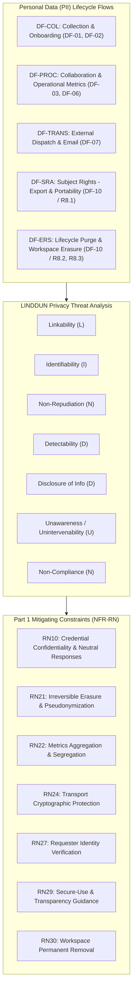

# AEGIS Phase 3 — Part 2: Step 3 — Privacy Threat Modeling via LINDDUN Data Flows (TinyTask SaaS)

> **Case Study:** Case 01 — TinyTask SaaS (B2B Task Management Multi-Tenant Platform)  
> **Lifecycle Phase:** AEGIS Phase 3 — Specification, **Part 2 of 2 (Threat & Risk Analysis)**  
> **Step Deliverable:** Step 3 of 5 (`03_PRIVACY_THREATS_LINDDUN.md`)  
> **Upstream Inputs:** Step 1 ([`01_SYSTEM_MODEL_ASSETS_AND_BOUNDARIES.md`](01_SYSTEM_MODEL_ASSETS_AND_BOUNDARIES.md)), Step 2 ([`02_TECHNICAL_THREATS_STRIDE.md`](02_TECHNICAL_THREATS_STRIDE.md)), Phase 3 Part 1 Approved Baseline Version 2 (4.0.0) — [`../part1_security_privacy/v2_security_privacy_synthesis/Doc01_Requirements_Elicitation_and_PUC.md`](../part1_security_privacy/v2_security_privacy_synthesis/Doc01_Requirements_Elicitation_and_PUC.md) & [`../part1_security_privacy/v2_security_privacy_synthesis/Doc02_System_Use_Cases.md`](../part1_security_privacy/v2_security_privacy_synthesis/Doc02_System_Use_Cases.md)  
> **Methodological Standard:** [`../../../templates/phase3_threat_risk_guidelines.md`](../../../templates/phase3_threat_risk_guidelines.md) §6.3 & [`00_METHODOLOGY_AND_EXECUTION_GUIDE.md`](00_METHODOLOGY_AND_EXECUTION_GUIDE.md) §6.3  

---

## 1. Executive Summary & Purpose

This document executes the **LINDDUN privacy threat modeling** over all personal data (PII) lifecycle flows within TinyTask SaaS. Every mitigating constraint cited below is anchored to the accepted Part 1 Version 2 baseline — the same `RN` identifiers, titles, and enforcement steps published in `Doc01` (requirement-card constraint chains and Table 7) and `Doc02` (use-case preconditions, extensions, and guarantees).

### 1.1 Artefact Lifecycle & Pipeline Transitions

| Transition Dimension | Content & Operational Flow |
|---|---|
| **Upstream Inputs (from Steps 1 & 2)** | Consumes PII assets (`AST-01`, `AST-04`, `AST-08`), boundaries (`TB-01`, `TB-05`), and flows (`DF-01`, `DF-03`, `DF-07`, `DF-10`) from [`01_SYSTEM_MODEL_ASSETS_AND_BOUNDARIES.md`](01_SYSTEM_MODEL_ASSETS_AND_BOUNDARIES.md), alongside technical threat contexts from [`02_TECHNICAL_THREATS_STRIDE.md`](02_TECHNICAL_THREATS_STRIDE.md). |
| **Analytical Transformation** | Evaluates data subject privacy across 7 PII lifecycle flows under the 7 LINDDUN dimensions (Linkability, Identifiability, Non-Repudiation, Detectability, Disclosure, Unawareness, Non-Compliance), deriving 8 standardized privacy threat cards anchored in GDPR statutory articles (Arts. 5, 6, 12–22, 25, 28). |
| **Downstream Handoff $\rightarrow$ Step 4** | Feeds critical privacy attack scenarios (e.g., spoofed GDPR subject erasure and unauthorized tenant destruction) to [`04_ATTACK_VECTORS_AND_DEFENSE_TREES.md`](04_ATTACK_VECTORS_AND_DEFENSE_TREES.md) for adversary path decomposition. |
| **Downstream Handoff $\rightarrow$ Step 5** | Exports all 8 scored privacy threat cards into the master risk ledger in [`05_RISK_REGISTER_AND_GOVERNANCE.md`](05_RISK_REGISTER_AND_GOVERNANCE.md), which consolidates the 29 elicited cards into 28 register rows under the one declared cross-lens merge. |

While STRIDE protects system assets against technical compromise, **LINDDUN models privacy threats against the Data Subject (natural persons: employees, contractors, workspace users)**. It systematically verifies compliance with European privacy principles and statutory mandates:
- **GDPR Art. 5(1)(b) & Art. 6(4):** Purpose limitation & prohibition of unauthorized worker surveillance.
- **GDPR Art. 5(1)(c) & Art. 25:** Data minimization & Privacy by Design.
- **GDPR Art. 5(1)(e):** Storage limitation & lifecycle erasure.
- **GDPR Arts. 12–22:** Transparency and Data Subject Rights intervenability (Access, Rectification, Erasure, Portability).
- **GDPR Art. 28:** Processor and sub-processor governance.

---

## 2. Personal Data (PII) Lifecycle Flow Inventory

The following table catalogs all data flows carrying personal data across the TinyTask SaaS platform:

| PII Flow ID | Lifecycle Stage | Functional Context | Data Items & PII Transferred | Data Subjects Affected | Trust Boundaries Crossed |
|---|---|---|---|---|---|
| **DF-COL-01** | Collection / Ingestion | User Registration & Profile Setup (`R1.1`, `R1.2` / `{U.C. 1.1}`, `{U.C. 1.2}`) | User full name, work email address, password hash, IP address, login telemetry. | Direct End-Users | `TB-01` |
| **DF-COL-02** | Collection / Ingestion | Team Member Invitations & Account Recovery (`R2.2`, `R1.3` / `{U.C. 2.2}`, `{U.C. 1.3}`) | Colleague email address, invited workspace ID, assigned operational role; recovery dispatch to personal mailbox. | Prospective Members / Coworkers | `TB-01`, `TB-05` |
| **DF-PROC-01** | Processing / Aggregation | Operational Metrics Compilation & Audit History (`R2.3`, `R6.1` / `{U.C. 2.3}`, `{U.C. 6.1}`) | Task completion counts, member activity timestamps, actor-attributed audit timeline entries. | Workspace Team Members | `TB-02`, `TB-03` |
| **DF-PROC-02** | Processing / Storage | Collaboration Discussion & Mentions (`R5.2` / `{U.C. 5.2}`) | Comment text, author user reference, timestamps, user-to-user feedback. | Workspace Collaborators | `TB-01`, `TB-03` |
| **DF-TRN-01** | Transmission / Sharing | Workspace Alerts & Daily Task Digests (`R6.2` / `{U.C. 6.2}`) | Recipient email, task update alerts, consolidated digest snippets, minimal workspace identifiers. | Workspace Members | `TB-05` |
| **DF-SRA-01** | Subject Rights (Export) | Data Portability & Archive Export (`R8.1` / `{U.C. 8.1}`) | Machine-readable archive containing profile, authored tasks, comments, and activity history. | Requesting Data Subject | `TB-01`, `TB-03` |
| **DF-ERS-01** | Lifecycle Disposal | Account Closure & Workspace Deletion (`R8.2`, `R8.3` / `{U.C. 8.2}`, `{U.C. 8.3}`) | Full purge signal across database user records, task assignments, pseudonymization of authored comments, and stored attachments. | Departing Users & Former Tenants | `TB-02`, `TB-03` |

---

## 3. LINDDUN Threat Modeling Cards

### 3.1 Linkability (L)

#### TM-D-05.1-001: Worker Telemetry Linkability & Productivity Profiling via Activity Timestamps
- **Target PII Flow:** `DF-PROC-01` (Compilation of operational metrics dashboard in `{U.C. 2.3}` / `R2.3`).
- **LINDDUN Category:** Linkability (L) / Identifiability (I).
- **Privacy Threat Hypothesis:** An enterprise tenant administrator or manager cross-references individual task transition timestamps, commit intervals, and comment logs to reconstruct individual worker productivity profiles and surveillance metrics, violating employee fundamental rights and purpose limitation.
- **GDPR Statutory Driver:** `GDPR Art. 5(1)(b)` (Purpose Limitation) + `Art. 6(4)` (Compatibility of Processing) + `Art. 88` (Processing in Employment Context).
- **Inherent Risk Rating:**
  - *Likelihood:* High (3) [Granular activity logs naturally accumulate in task management systems].
  - *Impact:* High (3) [Statutory violation of GDPR purpose limitation; labor inspection penalties].
  - *Inherent Risk Level:* **Critical**.
- **Active Mitigating Constraints:**
  - `NFR-RN22: Purpose Limitation & Activity Metrics Segregation` (Mandates that operational metrics are compiled strictly at the aggregated workspace/project level; prohibits compiling or rendering individual worker velocity or surveillance telemetry).
- **Defensive Technique (D3FEND):** `D3-OM: Obfuscate Metadata` / `D3-MAM: Message Access Mediation`.
- **Residual Risk Rating & Verdict:**
  - *Residual Likelihood:* Low (1) [Underlying query views do not expose per-member velocity feeds].
  - *Residual Impact:* Low (1) [Aggregated macro metrics eliminate surveillance capability].
  - *Residual Risk Level:* **Low**.
  - *Treatment Verdict:* **Mitigated** (Enforced in `{U.C. 2.3}` Guarantee).
  - *Cross-Lens Record:* The same real-world threat is carried by the STRIDE card `TM-D-05.1-001` (Information Disclosure lens) in [`02_TECHNICAL_THREATS_STRIDE.md`](02_TECHNICAL_THREATS_STRIDE.md); the register consolidates both under a single declared merge.

---

### 3.2 Identifiability (I)

#### TM-D-05.1-002: Re-Identification of Pseudonymized Audit Logs via Operational Metadata
- **Target PII Flow:** `DF-PROC-01` & `DF-PROC-02` crossing into `DS-03` (Audit Store); consultation contexts `{U.C. 2.3}` / `R2.3` and `{U.C. 6.1}` / `R6.1`.
- **LINDDUN Category:** Identifiability (I).
- **Privacy Threat Hypothesis:** An internal user with access to system audit timelines correlates pseudonymized user IDs with unique task creation timestamps and project membership lists, successfully re-identifying natural persons and uncovering confidential actions.
- **GDPR Statutory Driver:** `GDPR Art. 4(1)` (Identifiability) + `Art. 25` (Data Protection by Design and by Default).
- **Inherent Risk Rating:**
  - *Likelihood:* Medium (2) [Correlation of timestamps feasible with small 8-person team datasets].
  - *Impact:* Medium (2) [Loss of internal pseudonymity; exposure of sensitive internal reviews].
  - *Inherent Risk Level:* **Medium**.
- **Active Mitigating Constraints:**
  - `NFR-RN18: Security Audit Logging` (Audit records are read-only, isolated from regular workspace members, and every timeline query is authorization-bound to task-level read permissions — `{U.C. 6.1}` Precondition 1 and Minimal Guarantees).
  - `NFR-RN22: Purpose Limitation & Activity Metrics Segregation` (Privacy event trails are segregated from general application metrics, blocking cross-source correlation in the reporting model).
- **Defensive Technique (D3FEND):** `D3-UAI: User Account Isolation` / `D3-AZ: Authorization Verification`.
- **Residual Risk Rating & Verdict:**
  - *Residual Likelihood:* Low (1) [Audit records are isolated from regular workspace members].
  - *Residual Impact:* Low (1) [Authorization-bound queries block unauthorized audit trail inspection].
  - *Residual Risk Level:* **Low**.
  - *Treatment Verdict:* **Mitigated** (Enforced in `{U.C. 6.1}` Precondition 1 and Minimal Guarantees).

---

### 3.3 Non-Repudiation (N)

#### TM-D-05.2-001: Excessive Permanent Attribution of Ephemeral Workspace Discussions
- **Target PII Flow:** `DF-PROC-02` (Task Collaboration Comments in `{U.C. 5.2}` / `R5.2`); lifecycle handoff to account closure pseudonymization in `{U.C. 8.2}` / `R8.2`.
- **LINDDUN Category:** Non-Repudiation (N).
- **Privacy Threat Hypothesis:** The system retains immutable, unalterable technical records of every informal task comment and draft note indefinitely, denying employees plausible deniability or the ability to retract informal collaborative brainstorming.
- **GDPR Statutory Driver:** `GDPR Art. 5(1)(c)` (Data Minimization) + `Art. 16` (Right to Rectification).
- **Inherent Risk Rating:**
  - *Likelihood:* Medium (2) [Standard database architectures default to permanent retention].
  - *Impact:* Medium (2) [Employee privacy grievance; chilling effect on workplace collaboration].
  - *Inherent Risk Level:* **Medium**.
- **Active Mitigating Constraints:**
  - `NFR-RN14: Untrusted Content Neutralization` (Comment authorship and content are validated and recorded through the sanctioned authoring path; unsubmitted drafts are never stored).
  - `NFR-RN21: Irreversible Data Subject Erasure & Pseudonymization` (On account closure, authored task comments are pseudonymized within the statutory window, dissolving permanent personal attribution — `{U.C. 8.2}` Extension 5b1).
- **Defensive Technique (D3FEND):** `D3-MAM: Message Access Mediation` / `D3-PSN: Pseudonymization`.
- **Residual Risk Rating & Verdict:**
  - *Residual Likelihood:* Low (1) [Attribution is bounded by the account lifecycle].
  - *Residual Impact:* Low (1) [Pseudonymization at closure removes standing personal attribution].
  - *Residual Risk Level:* **Low**.
  - *Treatment Verdict:* **Mitigated** (Enforced in `{U.C. 8.2}` Extension 5b1).

---

### 3.4 Detectability (D)

#### TM-D-03.1-002: User Identity Enumeration via Discriminatory Registration & Recovery Responses
- **Target PII Flow:** `DF-COL-01` & `DF-COL-02` crossing `TB-01` into `P1` in `{U.C. 1.1}` / `R1.1`, `{U.C. 1.3}` / `R1.3` & `{U.C. 2.2}` / `R2.2`.
- **LINDDUN Category:** Detectability (D).
- **Privacy Threat Hypothesis:** An external adversary submits password reset, registration, or invitation requests with target email addresses, analyzing slight differences in HTTP response codes (200 OK vs 404 Not Found) or timing delays to confirm whether specific natural persons hold accounts on the platform.
- **GDPR Statutory Driver:** `GDPR Art. 5(1)(a)` (Fairness and Transparency) + `Art. 32` (Security of Processing).
- **Inherent Risk Rating:**
  - *Likelihood:* High (3) [Automated enumeration scripts widely deployed on login/recovery endpoints].
  - *Impact:* Medium (2) [Disclosure of user customer relationship; targeted phishing precursor].
  - *Inherent Risk Level:* **High**.
- **Active Mitigating Constraints:**
  - `NFR-RN10: Credential Confidentiality Protection (State of the Art)` (Recovery and authentication paths return a neutral confirmation regardless of account existence, preventing account enumeration — `{U.C. 1.3}` Extension 2a1).
  - `NFR-RN18: Security Audit Logging` (Every recovery and authentication attempt is recorded, enabling enumeration-pattern detection).
- **Defensive Technique (D3FEND):** `D3-RO: Response Obfuscation` / `D3-IRA: Inbound Request Authentication`.
- **Residual Risk Rating & Verdict:**
  - *Residual Likelihood:* Low (1) [Uniform constant-time responses prevent account state deduction].
  - *Residual Impact:* Low (1) [Adversary cannot differentiate valid from invalid user accounts].
  - *Residual Risk Level:* **Low**.
  - *Treatment Verdict:* **Mitigated** (Enforced in `{U.C. 1.3}` Extension 2a1).

---

### 3.5 Disclosure of Information (D)

#### TM-D-07.1-003: Accidental Exposure of Personal Data in Cleartext Transactional Emails
- **Target PII Flow:** `DF-TRN-01` crossing `TB-05` (Email Boundary) to `EE-03` in `{U.C. 6.2}` / `R6.2`.
- **LINDDUN Category:** Disclosure of Information (D).
- **Privacy Threat Hypothesis:** TinyTask includes full employee names, project deliverables, and proprietary task descriptions inside unencrypted automated notification emails, exposing personal data across intermediate mail server hops.
- **GDPR Statutory Driver:** `GDPR Art. 5(1)(f)` (Integrity and Confidentiality) + `Art. 32(1)(a)` (Encryption).
- **Inherent Risk Rating:**
  - *Likelihood:* High (3) [Email protocols route through multiple untrusted MTA relays].
  - *Impact:* High (3) [Confidential PII and workplace discussions disclosed outside the tenant perimeter].
  - *Inherent Risk Level:* **Critical**.
- **Active Mitigating Constraints:**
  - `NFR-RN24: Transport Cryptographic Protection` (Enforces state-of-the-art cryptographic protection on all outbound transmission paths, refusing or upgrading unencrypted connections).
  - `{U.C. 6.2}` Digest Snippet Minimization (Functional carrier: notification deliveries contain only authorized user task snippets and exclude sensitive credentials — `{U.C. 6.2}` Minimal Guarantees; users may suppress external email dispatch entirely via profile preferences, `{U.C. 6.2}` Extension 4a).
- **Defensive Technique (D3FEND):** `D3-EAC: Encrypted Network Traffic` / `D3-OM: Obfuscate Metadata`.
- **Residual Risk Rating & Verdict:**
  - *Residual Likelihood:* Low (1) [Encrypted transport plus snippet-only payloads remove the interception payoff].
  - *Residual Impact:* Low (1) [Interception of a generic digest provides no personal data to the eavesdropper].
  - *Residual Risk Level:* **Low**.
  - *Treatment Verdict:* **Mitigated** (Enforced in `{U.C. 6.2}` Minimal Guarantees and Extension 4a).

---

### 3.6 Unawareness / Unintervenability (U)

#### TM-D-09.4-002: Obstruction or Unverifiable Execution of GDPR Subject Access & Portability Rights
- **Target PII Flow:** `DF-SRA-01` crossing `TB-01` and `TB-03` into `P8` in `{U.C. 8.1}` / `R8.1`.
- **LINDDUN Category:** Unawareness / Unintervenability (U).
- **Privacy Threat Hypothesis:** A data subject requests a complete copy of their personal data under GDPR Art. 15 and 20, but the platform provides only partial data (omitting comments, task assignments, or activity metadata) or formats it in proprietary, non-interoperable structures, obstructing the subject's portability right.
- **GDPR Statutory Driver:** `GDPR Art. 12` (Transparent and Free Exercise of Rights) + `Art. 15` (Right of Access) + `Art. 20` (Right to Data Portability).
- **Inherent Risk Rating:**
  - *Likelihood:* Medium (2) [SaaS systems frequently lack automated full-spectrum export pipelines].
  - *Impact:* High (3) [Direct statutory non-compliance; administrative fine under GDPR Art. 83(5)].
  - *Inherent Risk Level:* **High**.
- **Active Mitigating Constraints:**
  - `R8.1` / `{U.C. 8.1}`: Automated self-service personal and workspace data archive export capability.
  - `NFR-RN20: Structured Personal Data Portability & Export` (Enforces machine-readable archive compilation covering the user's profile, authored tasks, assignments, and authored comments; the archive package is encrypted at rest prior to download — `{U.C. 8.1}` Minimal Guarantees).
  - `NFR-RN27: Requester Identity Verification for Rights Exercise` (Guarantees the export package is delivered only to the verified titular subject — `{U.C. 8.1}` Step 2).
- **Defensive Technique (D3FEND):** `D3-IRA: Inbound Request Authentication` / `D3-AL: Audit Logging`.
- **Residual Risk Rating & Verdict:**
  - *Residual Likelihood:* Low (1) [Dedicated automated export pipeline compiles the complete PII repertoire].
  - *Residual Impact:* Low (1) [Data subject receives a standardized, portable archive package].
  - *Residual Risk Level:* **Low**.
  - *Treatment Verdict:* **Mitigated** (Enforced in `{U.C. 8.1}` Steps 2–4).

---

#### TM-D-05.2-002: Lack of Transparency Regarding External Third-Party Sub-Processors
- **Target PII Flow:** `DF-COL-02` (Email) & `DF-08` (Payment Gateway) crossing `TB-04` & `TB-05`; processing contexts `{U.C. 2.2}` / `R2.2` and `{U.C. 7.1}` / `R7.1`.
- **LINDDUN Category:** Unawareness (U) / Non-Compliance (N).
- **Privacy Threat Hypothesis:** Data subjects are unaware that their billing details and email addresses are processed by third-party infrastructure providers (payment gateway, transactional email service), violating transparency and notice obligations.
- **GDPR Statutory Driver:** `GDPR Art. 13` (Information to be Provided) + `Art. 28` (Processor Due Diligence).
- **Inherent Risk Rating:**
  - *Likelihood:* Medium (2) [Common oversight in developer documentation].
  - *Impact:* Medium (2) [Regulatory inquiry; supervisory authority reprimand].
  - *Inherent Risk Level:* **Medium**.
- **Active Mitigating Constraints:**
  - `NFR-RN29: Secure-Use Instructions` (Mandates clear, accessible product documentation and privacy disclosures identifying sub-processor categories, security roles, and processing purposes — covering commissioning and lifetime measures for end users and administrators).
  - `NFR-RN7: Payment Gateway Authenticated Channels & Webhook Signature Verification` (The payment gateway integration communicates exclusively over authenticated secure channels with cryptographic webhook signature verification, bounding third-party processing to the verified counterpart).
- **Defensive Technique (D3FEND):** `D3-SC: System Configuration Hardening`.
- **Residual Risk Rating & Verdict:**
  - *Residual Likelihood:* Low (1) [In-product documentation informs users at onboarding].
  - *Residual Impact:* Low (1) [Full statutory transparency achieved].
  - *Residual Risk Level:* **Low**.
  - *Treatment Verdict:* **Mitigated** (Enforced in `{U.C. 7.1}` Precondition 1 and `Doc01` R7.1 constraint chain).

---

### 3.7 Non-Compliance (N)

#### TM-D-05.3-001: Incomplete Data Erasure & Zombie Relational Records Following Account/Workspace Deletion
- **Target PII Flow:** `DF-ERS-01` crossing `TB-03` into `DS-01` (DB) & `DS-02` (Files) in `{U.C. 8.2}` / `R8.2` & `{U.C. 8.3}` / `R8.3`.
- **LINDDUN Category:** Non-Compliance (N).
- **Privacy Threat Hypothesis:** A user closes their account or an Owner deletes a workspace, but the system merely applies a soft-delete boolean flag (`is_deleted = true`). Personal data, task attachments, and authored comments remain indefinitely queryable in database tables and file storage buckets, violating storage limitation mandates.
- **GDPR Statutory Driver:** `GDPR Art. 5(1)(e)` (Storage Limitation) + `Art. 17` (Right to Erasure / "Right to be Forgotten").
- **Inherent Risk Rating:**
  - *Likelihood:* High (3) [Soft-deletion without purge routines is an epidemic engineering shortcut].
  - *Impact:* Critical (4) [Systemic violation of GDPR Art. 17; severe fine under Art. 83(5); data breach exposure of supposedly deleted tenants].
  - *Inherent Risk Level:* **Critical**.
- **Active Mitigating Constraints:**
  - `NFR-RN21: Irreversible Data Subject Erasure & Pseudonymization` (Personal data is pseudonymized within the statutory window upon account closure, and authored comments are pseudonymized — `{U.C. 8.2}` Extension 5b1 and Minimal Guarantees).
  - `NFR-RN27: Requester Identity Verification for Rights Exercise` (Ensures closure and erasure execute only upon the confirmed titular identity challenge — `{U.C. 8.2}` Step 5).
  - `NFR-RN30: Workspace Permanent Removal` (Permanently erases all workspace content and settings across stores; the workspace enters a pending-erasure state and never returns to active status — `{U.C. 8.3}` Steps 4–5 and Extension 4b1).
- **Defensive Technique (D3FEND):** `D3-FDS: File Deletion Sanitization` / `D3-PSN: Pseudonymization` / `D3-AL: Audit Logging`.
- **Residual Risk Rating & Verdict:**
  - *Residual Likelihood:* Low (1) [Deterministic erasure path scrubs database rows, pseudonymizes authored content, and deletes storage assets].
  - *Residual Impact:* Low (2) [Residual exposure bounded to the statutory verification records].
  - *Residual Risk Level:* **Low**.
  - *Treatment Verdict:* **Mitigated** (Enforced in `{U.C. 8.2}` Extension 5b1 & `{U.C. 8.3}` Step 4).

---

## 4. Summary Matrix of LINDDUN Privacy Threats & GDPR Compliance

| Threat ID | Threat Title | LINDDUN Category | PII Flow | GDPR Article | Inherent Risk | Mitigating RNs | Residual Risk | Treatment Verdict |
|---|---|---|---|---|---|---|---|---|
| `TM-D-05.1-001` | Worker Telemetry Profiling | Linkability (L) | `DF-PROC-01` | Art. 5(1)(b), 6(4) | **Critical** | `RN22` | **Low** | **Mitigated** |
| `TM-D-05.1-002` | Audit Log Re-Identification | Identifiability (I) | `DF-PROC-01` | Art. 4(1), 25 | **Medium** | `RN18`, `RN22` | **Low** | **Mitigated** |
| `TM-D-05.2-001` | Excessive Comment Attribution | Non-Repudiation (N)| `DF-PROC-02` | Art. 5(1)(c), 16 | **Medium** | `RN14`, `RN21` | **Low** | **Mitigated** |
| `TM-D-03.1-002` | User Identity Enumeration | Detectability (D) | `DF-COL-01` | Art. 5(1)(a), 32 | **High** | `RN10`, `RN18` | **Low** | **Mitigated** |
| `TM-D-07.1-003` | PII Exposure in Cleartext Email| Disclosure (D) | `DF-TRN-01` | Art. 5(1)(f), 32 | **Critical** | `RN24` | **Low** | **Mitigated** |
| `TM-D-09.4-002` | Obstruction of Portability Rights | Unawareness (U) | `DF-SRA-01` | Art. 12, 15, 20 | **High** | `RN20`, `RN27` | **Low** | **Mitigated** |
| `TM-D-05.2-002` | Sub-Processor Notice Deficit | Unawareness (U) | `DF-COL-02` | Art. 13, 28 | **Medium** | `RN29`, `RN7` | **Low** | **Mitigated** |
| `TM-D-05.3-001` | Incomplete Lifecycle Erasure | Non-Compliance (N)| `DF-ERS-01` | Art. 5(1)(e), 17 | **Critical** | `RN21`, `RN27`, `RN30` | **Low** | **Mitigated** |

---

## 5. Step 3 Sign-Off & Verification

This document satisfies all requirements of **Step 3 of Phase 3 Part 2**:
- [x] **100% PII Lifecycle Coverage:** All 7 personal data flows (`DF-COL` to `DF-ERS`) analyzed across the data subject's interaction lifecycle.
- [x] **100% LINDDUN Category Coverage:** All 7 privacy threat categories (L, I, N, D, D, U, N) systematically modeled.
- [x] **Strict GDPR Article Traceability:** Direct legal citations to GDPR Articles 5, 6, 12, 13, 15, 16, 17, 20, 25, 28, 32, and 83.
- [x] **Zero Unmitigated Privacy Residuals:** All 3 Critical inherent privacy risks and 2 High inherent risks successfully mitigated by Part 1 constraints (`RN10`, `RN14`, `RN21`, `RN22`, `RN24`, `RN27`, `RN30`).

**Step 3 is COMPLETE and APPROVED.** Cleared to proceed to **Step 4 ([`04_ATTACK_VECTORS_AND_DEFENSE_TREES.md`](04_ATTACK_VECTORS_AND_DEFENSE_TREES.md))**.
