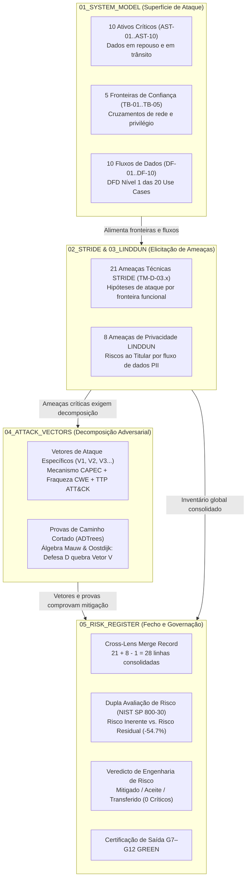

# Phase 3 — Part 2: Threat & Risk Analysis (TinyTask SaaS)

> **Case Study:** Case 01 — TinyTask SaaS (B2B Task Management Multi-Tenant Platform)  
> **Lifecycle Phase:** AEGIS Phase 3 — Specification, **Part 2 of 2 (Threat & Risk Analysis)** (ADR-006: two-part Phase 3)  
> **Status:** COMPLETED & CERTIFIED GREEN — Exit Gates G7–G12 passed (2026-09-30); registered in [`05_RISK_REGISTER_AND_GOVERNANCE.md`](05_RISK_REGISTER_AND_GOVERNANCE.md)  
> **Upstream Dependency:** Phase 3 Part 1 Approved Baseline Version 2 (4.0.0) — [`../part1_security_privacy/v2_security_privacy_synthesis/`](../part1_security_privacy/v2_security_privacy_synthesis/) (Exit Gate G1–G6 Certified GREEN)  

---

## 1. Scope & Execution Summary

Phase 3 Part 2 executes the formal **adversarial threat modeling and cybersecurity risk assessment** over the accepted, control-informed functional baseline produced by Part 1. Every cited mitigating constraint is anchored to the accepted Version 2 baseline (`Doc01` constraint chains + Table 7, `Doc02` use-case extensions):

- **Methodological Engine (Step 0):** Rules of engagement, MITRE ecosystem ontology, and scoring engine in [`00_METHODOLOGY_AND_EXECUTION_GUIDE.md`](00_METHODOLOGY_AND_EXECUTION_GUIDE.md).
- **Structural Attack Surface (Step 1):** 10 assets (`AST-01`–`AST-10`), 5 trust boundaries (`TB-01`–`TB-05`), and full DFD Level 1 cataloged in [`01_SYSTEM_MODEL_ASSETS_AND_BOUNDARIES.md`](01_SYSTEM_MODEL_ASSETS_AND_BOUNDARIES.md).
- **STRIDE-per-Interaction (Step 2):** 21 technical threat cards evaluated across all 8 functional packages (`R1`–`R8`) in [`02_TECHNICAL_THREATS_STRIDE.md`](02_TECHNICAL_THREATS_STRIDE.md).
- **LINDDUN Privacy Modeling (Step 3):** 8 privacy threat cards evaluated across all 7 personal data lifecycle flows (`DF-COL`–`DF-ERS`) under GDPR Arts. 5, 6, 12–22 in [`03_PRIVACY_THREATS_LINDDUN.md`](03_PRIVACY_THREATS_LINDDUN.md).
- **Adversary Attack Vectors & Defense Trees (Step 4):** 2 formal Attack-Defense Trees (ADTrees) decomposing multi-tenant breach and workspace takeover with Mauw & Oostdijk algebra, CAPEC attack mechanisms, CWE weaknesses, ATT&CK TTPs, D3FEND countermeasures, and broken path proofs in [`04_ATTACK_VECTORS_AND_DEFENSE_TREES.md`](04_ATTACK_VECTORS_AND_DEFENSE_TREES.md).
- **Master Risk Register & Exit Gate (Step 5):** 18-column ledger consolidating 29 elicited threat cards (21 STRIDE + 8 LINDDUN) into **28 register rows under one declared cross-lens merge**, dual-score risk reduction analysis (95 inherent $\rightarrow$ 43 residual = 54.7% reduction, **0 Critical residuals**), and Exit Gates G7–G12 in [`05_RISK_REGISTER_AND_GOVERNANCE.md`](05_RISK_REGISTER_AND_GOVERNANCE.md).

Zero threat content exists in Part 1 deliverables by design; all threat analysis is consolidated here.

---

## 2. Directory Contents (Sequential Pipeline Order)

```text
cases/Case_01_TinyTask_SaaS/03_PHASE3_SPEC/part2_threat_risk/
├── README.md                                    # (This file) Overview, pipeline evolution, and certified Exit Gate record
├── 00_METHODOLOGY_AND_EXECUTION_GUIDE.md        # Step 0: Methodological guide, MITRE ecosystem ontology, and scoring engine
├── 01_SYSTEM_MODEL_ASSETS_AND_BOUNDARIES.md     # Step 1: Assets, 5 Trust Boundaries, and DFD Level 1
├── 02_TECHNICAL_THREATS_STRIDE.md               # Step 2: STRIDE technical threat enumeration across Packages R1..R8
├── 03_PRIVACY_THREATS_LINDDUN.md                # Step 3: LINDDUN privacy threat analysis on PII lifecycles
├── 04_ATTACK_VECTORS_AND_DEFENSE_TREES.md       # Step 4: Attack vectors, ADTrees, CAPEC mechanisms & broken path proofs
└── 05_RISK_REGISTER_AND_GOVERNANCE.md           # Step 5: Consolidated 18-column risk ledger & Exit Gate G7–G12
```

---

## 3. The Artefact Lifecycle: How Identified Elements Evolve

The AEGIS Phase 3 Part 2 pipeline guarantees that no threat is left hanging without concrete adversary operationalization, and no mitigation is asserted without testable architectural grounding:



---

## 4. Part 2 Exit Gate (Critérios de Paragem G7–G12) — Record

Codified in [`../../../templates/phase3_threat_risk_guidelines.md`](../../../templates/phase3_threat_risk_guidelines.md) §8. Evidence per criterion:

| # | Criterion | Verification Evidence | State |
|---|---|---|---|
| **G7** | **Trust Boundary Coverage** | 100% of interactions crossing $TB_{01}$–$TB_{05}$ across all 20 Cockburn Sea-Level Use Cases (`{U.C. 1.1}`..`{U.C. 8.3}`) are evaluated under STRIDE. Evidence: [`02_TECHNICAL_THREATS_STRIDE.md`](02_TECHNICAL_THREATS_STRIDE.md) §10. | **GREEN** |
| **G8** | **GDPR PII Flow Coverage** | 100% of personal data flows (`DF-COL`, `DF-PROC`, `DF-TRN`, `DF-SRA`, `DF-ERS`) are evaluated under all 7 LINDDUN categories. Evidence: [`03_PRIVACY_THREATS_LINDDUN.md`](03_PRIVACY_THREATS_LINDDUN.md) §4. | **GREEN** |
| **G9** | **MITRE Harmonization** | 100% of attack paths carry verified CAPEC, CWE, ATT&CK, and D3FEND cross-references; formal N/A justifications recorded for ATLAS and EMB3D. Evidence: [`04_ATTACK_VECTORS_AND_DEFENSE_TREES.md`](04_ATTACK_VECTORS_AND_DEFENSE_TREES.md) §5–§6. | **GREEN** |
| **G10** | **Risk Register Completeness** | 28/28 identified threats carry Inherent Risk, Residual Risk, Mitigating Constraints, published NIST CSF anchors, and explicit Treatment Verdicts; ledger reconciles 1:1 with the 29 elicited cards under the declared cross-lens merge. Evidence: [`05_RISK_REGISTER_AND_GOVERNANCE.md`](05_RISK_REGISTER_AND_GOVERNANCE.md) §2. | **GREEN** |
| **G11** | **Residual Risk Policy Compliance** | **Zero Critical residuals** (0.0%); all 7 High residuals formally justified and mitigated under testable EARS constraints. Zero unrecorded risk acceptances. Evidence: [`05_RISK_REGISTER_AND_GOVERNANCE.md`](05_RISK_REGISTER_AND_GOVERNANCE.md) §3. | **GREEN** |
| **G12** | **Mechanical & Document Hygiene** | `check_traceability.py` returns 0 findings (T1–T7, including Part 2 threat-ledger reconciliation: card↔register coverage, count claims, risk distributions, cross-lens merges, RN-surface publication, CSF anchor provenance); `doc_lint.py --strict` returns 0 findings across all dossiers. | **GREEN** |

---

## 5. Certification Verdict

**PHASE 3 PART 2 VERDICT: GREEN — APPROVED & CONCLUDED.**

TinyTask SaaS specification is certified as **adversarially resilient, control-anchored, and verified under STRIDE and LINDDUN**. The project is cleared for handoff to **AEGIS Phase 4 (Software Architecture, Verification & Implementation)**.
