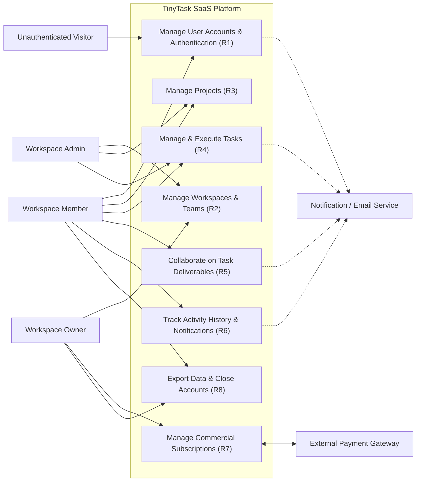

# E1.1 – TinyTask SaaS: AS-IS and TO-BE Model (Requirements Elicitation & PUC)

## Executive Summary

This report establishes the baseline requirements elicitation and analysis for the **TinyTask SaaS** platform, detailing the existing operational model (*As-Is*) and the target model (*To-Be*). The primary objective is to define exhaustively the product's functional scope, identifying actors, operational workflows, functional requirements prioritized using the MoSCoW methodology, and the formal Product Use Cases (*PUC*) catalog.

In accordance with software engineering literature (Robertson & Robertson, Cockburn, Wiegers & Beatty), this document focuses strictly on user operational and business needs, maintaining a pure functional approach. Security, privacy, and regulatory compliance overlays derived from the AEGIS methodology will be systematically integrated and mapped in downstream Phase 3 engineering steps.

---

## Table of Contents

- [Part I – Scope](#part-i--scope)
  - [1. Objective](#1-objective)
  - [2. Problem Description](#2-problem-description)
  - [3. Product Position Statement](#3-product-position-statement)
  - [4. Expected Impact](#4-expected-impact)
  - [5. Key Features](#5-key-features)
  - [6. Stakeholders](#6-stakeholders)
  - [7. System Users](#7-system-users)
  - [8. Constraints](#8-constraints)
- [Part II – As-Is](#part-ii--as-is)
  - [1. Business Roles in Context](#1-business-roles-in-context)
  - [2. Workflow Processes for Work Management](#2-workflow-processes-for-work-management)
  - [3. IT Support](#3-it-support)
- [Part III – To-Be](#part-iii--to-be)
  - [1. Initial Customer Expectations](#1-initial-customer-expectations)
  - [2. Functional and Non-Functional Requirements](#2-functional-and-non-functional-requirements)
    - [2.1 Actors](#21-actors)
    - [2.2 Functional Requirements](#22-functional-requirements)
    - [2.3 Non-Functional Requirements](#23-non-functional-requirements)
  - [3. Business Product Use Cases (PUC) Definition](#3-business-product-use-cases-puc-definition)
  - [4. System Use Case Model](#4-system-use-case-model)
- [Bibliography](#bibliography)
- [Version History](#version-history)

---

## Part I – Scope

### 1. Objective

The primary objective of this project is to specify and engineer the **TinyTask SaaS** platform, a cloud-native multi-tenant solution designed for small-to-medium teams that need to coordinate projects, assign tasks, track deadlines, and centralize support documentation without the cumbersome complexity or administrative friction of traditional enterprise management software.

The platform establishes a single source of operational truth, delivering an intuitive and fluid collaborative experience that eliminates communication overhead across team leads, technical staff, and external clients.

### 2. Problem Description

Small organizations and agile teams currently suffer from severe operational fragmentation:

- **Decentralization and Data Silos:** Critical information regarding task statuses, deadlines, and responsibilities is scattered across uncoordinated spreadsheets, instant messaging threads, and disparate email chains.
- **Coordination Overhead:** Team leads spend hours every week manually chasing status updates and compiling ad-hoc reports across separate channels.
- **Lack of Operational Visibility:** Individual team members lack clear visibility into immediate priorities, dependencies, and blocked deliverables, leading to duplicate efforts and missed deadlines.
- **Document Management Friction:** Deliverable attachments are exchanged via email attachments or unmanaged folder links, resulting in lost version history and broken auditability.

### 3. Product Position Statement

TinyTask is positioned as an agile, lean, and collaborative SaaS productivity platform optimized for intuitive usability, rapid onboarding, and autonomous team execution:

- **For:** Small teams, startups, digital agencies, and independent consultancies;
- **Who:** Require a centralized and visual way to organize tasks, manage projects, and share deliverable documentation;
- **TinyTask is:** A collaborative SaaS platform built around interactive Kanban boards, dynamic task views, and contextual discussions;
- **That allows:** Real-time visibility into project execution, automated progress notifications, and self-service team subscription management;
- **Unlike:** Heavy, bloated enterprise project management tools that demand extensive configuration and steep learning curves;
- **Our product distinguishes itself by:** Offering a clean, friction-free, and delightful user experience focused strictly on high-impact coordination and execution.

### 4. Expected Impact

The deployment and adoption of TinyTask SaaS delivers the following organizational impacts:

1. **Reduce Coordination Overhead:** Estimated 60% reduction in time spent on manual status sync meetings and repetitive progress update inquiries.
2. **Centralize Operational Information:** 100% of projects, tasks, attachments, and discussions reside in a unified, searchable, and structured repository.
3. **Improve Delivery Predictability:** Increased on-time delivery rates through real-time bottleneck detection and automated deadline warning alerts.
4. **Accelerate User Onboarding:** Enable new team members and external guests to onboard and become productive in under five minutes through intuitive self-service workflows.

### 5. Key Features

The platform's functional baseline is structured into core operational functional areas:

- **Multi-Tenant Workspaces:** Complete logical isolation across organizations, supporting dedicated member rosters and role-based access control.
- **Visual Task Management:** Interactive Kanban boards (To-Do, In-Progress, Under-Review, Done) and tabular lists with multi-criteria dynamic filtering.
- **Contextual In-Task Collaboration:** Rich Markdown discussion threads directly embedded within task cards, supporting user mentions to trigger instant alerts.
- **Integrated Attachment Management:** Upload, preview, download, and delete deliverable files directly linked to task contexts.
- **Commercial Subscription Management:** Seamless self-service billing integration via external payment gateway to manage Free, Pro, and Enterprise plan tiers.
- **User Data Portability:** Self-service personal data export, workspace-level archive downloads, and autonomous account closure workflows.

### 6. Stakeholders

The following table details the key stakeholders invested in the TinyTask SaaS platform:

*Table 1. Stakeholders*

| Stakeholder | Representatives | Role and Interest in the System |
|---|---|---|
| **Executive Leadership & Founders** | TinyTask SaaS Founders | Business viability, user growth, paid tier conversion, and low customer churn. |
| **Team Leads & Project Managers** | Project Managers, Team Coordinators | Operational visibility into workloads, seamless task delegation, and deadline tracking. |
| **Individual Contributors & Specialists** | Software Engineers, Designers, Marketers | Daily task queue management, clear priorities, and distraction-free communication. |
| **External Clients & Observers** | Client Stakeholders, External Reviewers | Transparent read-only access to deliverable progress and project timelines. |

### 7. System Users

The application defines four distinct user roles:

*Table 2. System Users*

| System User | Description and Responsibilities |
|---|---|
| **Workspace Owner** | Ultimate commercial and administrative authority. Manages billing, subscriptions, seat quotas, organization export, and workspace deletion. |
| **Workspace Admin** | Operational team manager. Invites members, assigns roles, configures workspace settings, and creates new projects. |
| **Workspace Member** | Standard team contributor. Creates, edits, and transitions tasks; uploads attachments; posts comments; and manages personal profile settings. |
| **Workspace Viewer** | External guest or client granted read-only visibility into authorized projects, task boards, and discussion threads. |

### 8. Constraints

The baseline product design operates under the following business and operational constraints:

- **Development Team Capacity:** The technical organization consists of 8 persons, requiring architectural simplicity, high modularity, and rapid maintainability.
- **Payment Processing:** The application delegates payment collection and billing transactions to an external payment gateway, avoiding local handling of credit card data.
- **Technology Neutrality:** This document defines pure functional requirements from the user's perspective, without pre-baking technical security controls, which will be formally synthesized in subsequent AEGIS phases.

---

## Part II – As-Is

### 1. Business Roles in Context

In the baseline As-Is operational state—typical of small teams prior to adopting TinyTask—collaborators execute overlapping roles informally without standardized tooling:

- **Business Founder / Lead:** Manages commercial commitments, tracking client subscriptions and invoicing via local spreadsheets and direct email exchanges.
- **Project Lead:** Spends 2 to 3 hours daily consolidating manual status updates across chat messages and emails, manually updating a shared spreadsheet.
- **Collaborator / Contributor:** Receives assignments via ad-hoc verbal requests or instant message channels without centralized priority queues or clear due dates.
- **External Client:** Periodically inquires via email regarding deliverable progress, receiving static exported PDF status reports.

### 2. Workflow Processes for Work Management

#### 2.1 Task Allocation and Tracking (As-Is Process)
The As-Is task tracking workflow is characterized by manual coordination friction:

1. The Project Lead identifies an incoming project requirement from a client meeting.
2. The requirement is noted in a personal notebook or digital notepad.
3. The Project Lead drafts an email or instant message assigning the task to a team contributor.
4. The contributor acknowledges receipt; however, the task is not logged into a centralized status register.
5. Periodic follow-up messages are exchanged to ascertain whether the task has started, is blocked, or is finished.
6. Deliverables are sent back via email attachment, creating duplicate copies across multiple inboxes.

#### 2.2 Operational Inefficiencies Identified (As-Is)
The following table summarizes the primary operational deficiencies observed in the As-Is state:

*Table 3. Inefficiencies identified in As-Is work management*

| Inefficiency ID | Process Affected | Description | Impact |
|---|---|---|---|
| **INEF-01** | Task Allocation | Absence of centralized task backlog; assignments scattered across chat and email. | High risk of lost tasks and missed client deadlines. |
| **INEF-02** | Status Visibility | Progress tracking relies entirely on manual inquiry meetings and repetitive messaging. | Wasted productive time (~15 hours/week across team). |
| **INEF-03** | Deliverable Sharing | Deliverable files shared via unmanaged attachments; no version control or centralized search. | Broken audit trail; team members work on outdated file versions. |
| **INEF-04** | Client Reporting | External clients have zero real-time visibility, demanding manual weekly summary preparation. | Client dissatisfaction and communication delays. |

### 3. IT Support

In the baseline state, IT infrastructure is highly fragmented across separate cloud tools:
- General communication via standard instant messaging channels.
- Ad-hoc spreadsheet tables stored on shared personal cloud drives.
- Deliverables stored in local workstations and exchanged via email.
- Billing handled manually through one-off invoices generated in desktop office software.

---

## Part III – To-Be

### 1. Initial Customer Expectations

Based on preliminary user interviews and founder elicitation, the target To-Be system must satisfy the following core expectations:

*Table 4. Initial customer expectations*

| Expectation ID | Operational Expectation | Target Impact |
|---|---|---|
| **EXP-01** | Unified, self-service workspace setup where teams can register and invite members in minutes. | Immediate time-to-value; zero manual administrative provisioning. |
| **EXP-02** | Interactive Kanban board offering fluid visual drag-and-drop task state transitions and clear priorities. | Complete real-time operational transparency across all team deliverables. |
| **EXP-03** | In-task discussion threads with mentions (@collaborator) to eliminate external chat fragmentation. | Contextualized conversations directly tied to work deliverables. |
| **EXP-04** | Centralized attachment repository supporting deliverable uploads with instant previews. | Single source of truth for all project documentation. |
| **EXP-05** | Flexible, tiered self-service subscription billing with transparent seat quotas and upgrade workflows. | Predictable commercial scaling without manual sales friction. |
| **EXP-06** | Complete user data control, offering one-click data export and autonomous account closure. | High customer trust and autonomy over organizational data. |

---

### 2. Functional and Non-Functional Requirements

#### 2.1 Actors

The following table formally defines the actors interacting with the system in the To-Be model:

*Table 5. List of actors*

| Actor | Description |
|---|---|
| **Workspace Owner** | Ultimate commercial and administrative authority. Manages billing, subscriptions, seat quotas, organization export, and workspace deletion. |
| **Workspace Admin** | Operational workspace manager. Invites members, modifies roles, configures organization profile settings, and initializes new projects. |
| **Workspace Member** | Standard collaborative contributor. Creates, edits, and transitions tasks; uploads attachments; posts comments; and manages profile settings. |
| **Workspace Viewer** | External guest or client granted read-only visibility into authorized projects and task lists. |
| **External Payment Gateway** | External payment processing engine responsible for handling payment sessions, executing billing charges, and dispatching payment status confirmations. |
| **Notification / Email Service** | Platform messaging subsystem responsible for dispatching verification emails, assignment notifications, and daily pending task digests. |

---

#### 2.2 Functional Requirements

##### 2.2.1 MoSCoW Prioritization Method
Functional requirements are prioritized using the MoSCoW methodology:
- **MUST:** Mandatory requirement that must be satisfied in the baseline release for the system to be viable.
- **SHOULD:** High-impact requirement that should be satisfied unless critical delivery constraints dictate deferral.
- **COULD:** Desirable functionality or enhancement that can be included if schedule and resources permit.
- **WON'T:** Out-of-scope feature that will not be implemented in the initial baseline release, reserved for future iterations.

##### 2.2.2 Summary Table of Functional Requirements

*Table 6. List of functional requirements*

| ID | ID | Requirement | Priority | Restrictions |
|---|---|---|---|---|
| **R1** | | **Manage User Accounts and Authentication** | **MUST** | |
| | R1.1 | Register and authenticate user accounts | MUST | Unique email |
| | R1.2 | Manage user profile and account preferences | MUST | |
| | R1.3 | Recover access to a locked user account | MUST | |
| **R2** | | **Manage Workspaces and Teams** | **MUST** | |
| | R2.1 | Create and configure workspace | MUST | Unique URL slug |
| | R2.2 | Invite workspace members and manage access roles | MUST | Seat quota |
| | R2.3 | Monitor workspace activity and operational metrics | COULD | |
| **R3** | | **Manage Projects** | **MUST** | |
| | R3.1 | Create and configure projects | MUST | |
| | R3.2 | Archive completed projects | SHOULD | |
| **R4** | | **Manage and Execute Tasks** | **MUST** | |
| | R4.1 | Create and assign tasks | MUST | |
| | R4.2 | Track and transition task workflow states on visual boards | MUST | |
| | R4.3 | Configure recurring automated tasks | COULD | |
| **R5** | | **Collaborate on Task Deliverables** | **MUST** | |
| | R5.1 | Manage task deliverable attachments | MUST | 25 MB cap |
| | R5.2 | Post in-task discussion comments and mention collaborators | MUST | |
| **R6** | | **Track Activity History and Notifications** | **MUST** | |
| | R6.1 | Consult chronological audit history on task cards | MUST | |
| | R6.2 | Receive workspace alerts and daily task digests | SHOULD | |
| **R7** | | **Manage Commercial Subscriptions** | **MUST** | |
| | R7.1 | Subscribe and manage workspace commercial plans | MUST | |
| | R7.2 | Enforce operational grace period upon payment failure | MUST | 7-day limit |
| **R8** | | **Export Data and Close Accounts** | **MUST** | |
| | R8.1 | Export personal and workspace data archives | MUST | |
| | R8.2 | Close user accounts and terminate workspace access | MUST | |

---

##### 2.2.3 Detailed Specification Cards for Functional Requirements

The detailed functional requirement cards follow the exact 7-row single-column format established in the reference project standard:

#### R1 – Manage User Accounts and Authentication

##### R1.1 – Register and authenticate user accounts

| Requirement |
|---|
| **ID:** R1.1 **Name:** Register and authenticate user accounts |
| **Description:** The system must allow prospective users to create an account with email verification, authenticate using valid credentials to establish an active session, and autonomously request password reset assistance via email. |
| **Requirement Origin:** Founders Business Case & User Onboarding Workflow |
| **Security & Privacy Constraints:** **NFR-RN10** Credential Confidentiality Protection (State of the Art) — `CRA Annex I Part I (2)(d) + (2)(j)` → `SO-D-02.1-002, SO-D-01.1-002` → `PRIN-ENG-04` → CSF PR.AA-03, PR.DS-01 **NFR-RN11** Session Management & Invalidation — `CRA Annex I Part I (2)(d) + (2)(j)` → `SO-D-02.2-002` → `PRIN-ENG-04` → CSF PR.AA-03, PR.DS-02 **NFR-RN19** Registration Data Minimization by Default — `GDPR Art. 5(1)(c)` → `PO-D-06.1-001` → `PRIN-ENG-06` → CSF PR.DS-10, GV.OC-03 / PF CT.DP-P2 |
| **Interfaces:** Registration screen; Login screen; Password recovery flow; Transactional email interface |
| **Dependencies:** • **Stakeholders:** Platform Founders, All End Users • **Data Sources:** Registration form submissions; Credential verification requests; Password reset requests • **Extraction Periodicity:** on demand • **Information Systems / Databases:** Identity and Credential Store; Notification / Email Service • **Preceding Requirements:** |
| **Identified Problems:** |
| **Priority:** Must |

##### R1.2 – Manage user profile and account preferences

| Requirement |
|---|
| **ID:** R1.2 **Name:** Manage user profile and account preferences |
| **Description:** The system must allow an authenticated user to view and update their personal profile details (full name, avatar image, and contact details) and configure notification preferences. |
| **Requirement Origin:** User Account Personalization Needs |
| **Security & Privacy Constraints:** **NFR-RN23** Personal Data Cryptographic Protection at Rest — `GDPR Art. 32(1)(a) + Art. 5(1)(f)` → `PO-D-01.1-001` → `PRIN-ENG-01` → CSF PR.DS-01, PR.DS-10 / PF PR.DS-P1 **NFR-RN26** Privacy Audit Trail for Personal Data Modifications — `GDPR Art. 30` → `PO-D-03.1-001` → `PRIN-ENG-07` → CSF PR.PT-01, DE.CM-01 / PF CM.AW-P2 |
| **Interfaces:** Profile settings screen; Notification preferences panel |
| **Dependencies:** • **Stakeholders:** Team Contributors • **Data Sources:** Profile update submissions; Preference selections • **Extraction Periodicity:** on demand • **Information Systems / Databases:** Internal Application Database (user profile records) • **Preceding Requirements:** |
| **Identified Problems:** |
| **Priority:** Must |

---

##### R1.3 – Recover access to a locked user account

| Requirement |
|---|
| **ID:** R1.3 **Name:** Recover access to a locked user account |
| **Description:** The system must allow a user whose account is temporarily locked after repeated failed authentication attempts to autonomously regain access: the user requests recovery via the registered email address, receives a single-use time-limited recovery link, and upon following it the system lifts the lockout, invalidates all active sessions, and restores normal authentication. |
| **Requirement Origin:** User Account Availability & Self-Service Recovery Needs (V1 Refinement Pass — derived from NFR-RN10/NFR-RN11 lockout behavior) |
| **Security & Privacy Constraints:** **NFR-RN10** Credential Confidentiality Protection (State of the Art) — `CRA Annex I Part I (2)(d) + (2)(j)` → `SO-D-02.1-002, SO-D-01.1-002` → `PRIN-ENG-04` → CSF PR.AA-03, PR.DS-01 **NFR-RN11** Session Management & Invalidation — `CRA Annex I Part I (2)(d) + (2)(j)` → `SO-D-02.2-002` → `PRIN-ENG-04` → CSF PR.AA-03, PR.DS-02 |
| **Interfaces:** Account recovery request form; Recovery email link; Login screen |
| **Dependencies:** • **Stakeholders:** All End Users, Platform Founders • **Data Sources:** Account recovery requests; Lockout state records • **Extraction Periodicity:** on demand • **Information Systems / Databases:** Identity and Credential Store; Notification / Email Service • **Preceding Requirements:** |
| **Identified Problems:** |
| **Priority:** Must |

---

#### R2 – Manage Workspaces and Teams

##### R2.1 – Create and configure workspace

| Requirement |
|---|
| **ID:** R2.1 **Name:** Create and configure workspace |
| **Description:** The system must allow an authenticated user to instantiate an isolated organizational workspace by specifying a workspace name and unique URL slug, automatically assigning the creator as Workspace Owner and permitting subsequent configuration of workspace branding and organization name. |
| **Requirement Origin:** Multi-Tenant Organization Needs & Customer Expectation EXP-01 |
| **Security & Privacy Constraints:** **NFR-RN9** Multi-Tenant Data Isolation & Mediation — `CRA Annex I Part I (2)(d)` → `SO-D-02.1-002` → `PRIN-ENG-03` → CSF PR.AA-05, PR.DS-01 |
| **Interfaces:** Workspace setup wizard; Organization branding settings |
| **Dependencies:** • **Stakeholders:** Platform Founders, Business Customers • **Data Sources:** Workspace creation form; Branding configuration • **Extraction Periodicity:** on demand • **Information Systems / Databases:** Internal Application Database (workspace registry); File Storage Service (branding assets) • **Preceding Requirements:** |
| **Identified Problems:** |
| **Priority:** Must |

##### R2.2 – Invite workspace members and manage access roles

| Requirement |
|---|
| **ID:** R2.2 **Name:** Invite workspace members and manage access roles |
| **Description:** The system must allow Workspace Admins and Owners to invite team members via email, assign access roles (Owner, Admin, Member, Viewer) that govern operational permissions within the workspace, modify member roles, or revoke membership, respecting active seat limits. |
| **Requirement Origin:** Team Collaboration Needs & Governance |
| **Security & Privacy Constraints:** **NFR-RN12** Role-Based Access Control & Action Mediation — `CRA Annex I Part I (2)(d)` → `SO-D-02.1-002` → `PRIN-ENG-03` → CSF PR.AA-05, PR.AA-06 |
| **Interfaces:** Member invitation dialog; Role management console; Invitation email interface |
| **Dependencies:** • **Stakeholders:** Team Leads, Project Managers • **Data Sources:** Invitation submissions; Role assignments • **Extraction Periodicity:** on demand • **Information Systems / Databases:** Internal Application Database (membership roster) • **Preceding Requirements:** |
| **Identified Problems:** |
| **Priority:** Must |

##### R2.3 – Monitor workspace activity and operational metrics

| Requirement |
|---|
| **ID:** R2.3 **Name:** Monitor workspace activity and operational metrics |
| **Description:** The system must compile and present aggregated operational metrics to workspace leadership, displaying active member counts, tasks completed during the billing cycle, and total deliverable file storage consumed. |
| **Requirement Origin:** Team Coordination Needs & Management Reporting |
| **Security & Privacy Constraints:** **NFR-RN22** Purpose Limitation & Activity Metrics Segregation — `GDPR Art. 5(1)(b) + Art. 6(4)` → `PO-D-06.1-001` → `PRIN-ENG-03` → CSF GV.OC-03, PR.DS-10 / PF CM.PO-P2 |
| **Interfaces:** Operational metrics dashboard |
| **Dependencies:** • **Stakeholders:** Team Leads, Executive Leadership • **Data Sources:** Workspace activity records • **Extraction Periodicity:** on demand (continuous aggregation) • **Information Systems / Databases:** Internal Application Database (activity aggregation) • **Preceding Requirements:** |
| **Identified Problems:** |
| **Priority:** Could |

---

#### R3 – Manage Projects

##### R3.1 – Create and configure projects

| Requirement |
|---|
| **ID:** R3.1 **Name:** Create and configure projects |
| **Description:** The system must allow Workspace Admins and Members to initialize distinct project containers within a workspace, specifying project name, description of deliverables, and visibility settings (workspace-wide or restricted to selected members). |
| **Requirement Origin:** Project Work Structuring Needs & As-Is Pain Point 2.1 |
| **Security & Privacy Constraints:** **NFR-RN9** Multi-Tenant Data Isolation & Mediation — `CRA Annex I Part I (2)(d)` → `SO-D-02.1-002` → `PRIN-ENG-03` → CSF PR.AA-05, PR.DS-01 |
| **Interfaces:** Project creation form; Project settings screen |
| **Dependencies:** • **Stakeholders:** Project Managers, Team Contributors • **Data Sources:** Project creation submissions • **Extraction Periodicity:** on demand • **Information Systems / Databases:** Internal Application Database (project records) • **Preceding Requirements:** |
| **Identified Problems:** |
| **Priority:** Must |

##### R3.2 – Archive completed projects

| Requirement |
|---|
| **ID:** R3.2 **Name:** Archive completed projects |
| **Description:** The system must allow Workspace Admins and Owners to transition completed projects into archived status, rendering all tasks and discussions read-only and hiding the project from daily operational views while preserving historical data. |
| **Requirement Origin:** Project Lifecycle Management Needs |
| **Interfaces:** Project lifecycle controls (archive action) |
| **Dependencies:** • **Stakeholders:** Project Managers • **Data Sources:** Project lifecycle actions • **Extraction Periodicity:** on demand • **Information Systems / Databases:** Internal Application Database (project records) • **Preceding Requirements:** |
| **Identified Problems:** |
| **Priority:** Should |

---

#### R4 – Manage and Execute Tasks

##### R4.1 – Create and assign tasks

| Requirement |
|---|
| **ID:** R4.1 **Name:** Create and assign tasks |
| **Description:** The system must allow authorized team members to create tasks within a project by specifying a mandatory title, optional description, priority level (Low, Medium, High, Urgent), and target due date, and assign execution responsibility to one or more active workspace members. |
| **Requirement Origin:** Work Item Authoring Needs & As-Is Pain Point 2.2 |
| **Interfaces:** Task editor; Assignee picker |
| **Dependencies:** • **Stakeholders:** Team Contributors, Project Managers • **Data Sources:** Task creation form; Member picker selections • **Extraction Periodicity:** on demand • **Information Systems / Databases:** Internal Application Database (task records) • **Preceding Requirements:** |
| **Identified Problems:** |
| **Priority:** Must |

##### R4.2 – Track and transition task workflow states on visual boards

| Requirement |
|---|
| **ID:** R4.2 **Name:** Track and transition task workflow states on visual boards |
| **Description:** The system must render tasks in interactive Kanban boards with standard status columns (To-Do, In-Progress, Under-Review, Done) and tabular views, allowing members to transition cards between states and filter tasks dynamically by assignee, status, priority, or overdue status. |
| **Requirement Origin:** Agile Workflow Tracking Needs & Customer Expectation EXP-02 |
| **Interfaces:** Kanban board view; Task list view; Filter controls |
| **Dependencies:** • **Stakeholders:** Team Contributors, Project Leads • **Data Sources:** Task state transitions; Filter criteria • **Extraction Periodicity:** on demand • **Information Systems / Databases:** Internal Application Database (task state records) • **Preceding Requirements:** |
| **Identified Problems:** |
| **Priority:** Must |

##### R4.3 – Configure recurring automated tasks

| Requirement |
|---|
| **ID:** R4.3 **Name:** Configure recurring automated tasks |
| **Description:** The system must allow users to configure recurrence schedules (weekly or monthly) on a task, automatically creating a duplicate task instance in the "To-Do" column once the current instance is marked "Done". |
| **Requirement Origin:** Repetitive Task Automation Needs |
| **Interfaces:** Recurrence configuration panel |
| **Dependencies:** • **Stakeholders:** Team Contributors • **Data Sources:** Recurrence schedule settings • **Extraction Periodicity:** per recurrence schedule • **Information Systems / Databases:** Internal Application Database (recurrence rules, task instances) • **Preceding Requirements:** |
| **Identified Problems:** |
| **Priority:** Could |

---

#### R5 – Collaborate on Task Deliverables

##### R5.1 – Manage task deliverable attachments

| Requirement |
|---|
| **ID:** R5.1 **Name:** Manage task deliverable attachments |
| **Description:** The system must allow authorized team members to upload deliverable files (supporting documents, spreadsheets, presentations, and images) up to 25 MB in size per file directly into a task card, view inline previews, download attached files, and remove outdated attachments. |
| **Requirement Origin:** Document Centralization Needs & Customer Expectation EXP-04 |
| **Security & Privacy Constraints:** **NFR-RN13** File Upload Strict Validation & Content Isolation — `CRA Annex I Part I (2)(j)` → `SO-D-07.1-002` → `PRIN-ENG-02` → CSF PR.PS-06, PR.PS-02 **NFR-RN25** Automated Orphan File Asset Cleanup & Expiration — `GDPR Art. 5(1)(e)` → `PO-D-06.1-001` → `PRIN-ENG-07` → CSF PR.IP-06, PR.DS-10 / PF CT.DM-P3 |
| **Interfaces:** File upload control; Inline preview pane; Download interface |
| **Dependencies:** • **Stakeholders:** Team Contributors, Clients • **Data Sources:** Uploaded deliverable files • **Extraction Periodicity:** on demand • **Information Systems / Databases:** File Storage Service; Internal Application Database (attachment metadata) • **Preceding Requirements:** |
| **Identified Problems:** |
| **Priority:** Must |

##### R5.2 – Post in-task discussion comments and mention collaborators

| Requirement |
|---|
| **ID:** R5.2 **Name:** Post in-task discussion comments and mention collaborators |
| **Description:** The system must provide a contextual comment thread inside each task card supporting rich text Markdown formatting and parsing collaborator mentions (@user) to automatically dispatch in-app notifications to tagged users. |
| **Requirement Origin:** In-Context Collaboration Needs & Customer Expectation EXP-03 |
| **Security & Privacy Constraints:** **NFR-RN14** Untrusted Content Neutralization — `CRA Annex I Part I (2)(l)` → `SO-D-07.1-002` → `PRIN-ENG-04` → CSF PR.PS-06 |
| **Interfaces:** Comment thread editor; Mention interface |
| **Dependencies:** • **Stakeholders:** Team Contributors, Clients • **Data Sources:** Comment submissions; Mention references • **Extraction Periodicity:** on demand • **Information Systems / Databases:** Internal Application Database (comment records) • **Preceding Requirements:** |
| **Identified Problems:** |
| **Priority:** Must |

---

#### R6 – Track Activity History and Notifications

##### R6.1 – Consult chronological audit history on task cards

| Requirement |
|---|
| **ID:** R6.1 **Name:** Consult chronological audit history on task cards |
| **Description:** The system must record and display a chronological audit feed on each task card documenting state changes, assignee reallocations, due date adjustments, and attachment events, identifying author and timestamp. |
| **Requirement Origin:** Operational Transparency Needs & Team Accountability |
| **Security & Privacy Constraints:** **NFR-RN22** Purpose Limitation & Activity Metrics Segregation — `GDPR Art. 5(1)(b) + Art. 6(4)` → `PO-D-06.1-001` → `PRIN-ENG-03` → CSF GV.OC-03, PR.DS-10 / PF CM.PO-P2 |
| **Interfaces:** Task card audit timeline |
| **Dependencies:** • **Stakeholders:** Project Managers, Contributors • **Data Sources:** Task change events • **Extraction Periodicity:** on demand • **Information Systems / Databases:** Internal Application Database (audit event records) • **Preceding Requirements:** |
| **Identified Problems:** |
| **Priority:** Must |

##### R6.2 – Receive workspace alerts and daily task digests

| Requirement |
|---|
| **ID:** R6.2 **Name:** Receive workspace alerts and daily task digests |
| **Description:** The system must provide an in-app notification center for direct assignments and @mentions, and automatically dispatch a daily summary email digest listing upcoming and overdue tasks assigned to the user. |
| **Requirement Origin:** User Attention Management & As-Is Pain Point 2.3 |
| **Security & Privacy Constraints:** **NFR-RN16** Cryptographic Webhook Origin Verification — `CRA Annex I Part I (2)(l)` → `SO-D-05.1-002, SO-D-08.1-002` → `PRIN-ENG-01` → CSF PR.DS-02, PR.AA-05 |
| **Interfaces:** In-app notification center; Daily digest email interface |
| **Dependencies:** • **Stakeholders:** Contributors, Team Leads • **Data Sources:** Assignment events; Mention events; Due-date schedule • **Extraction Periodicity:** on event / daily digest • **Information Systems / Databases:** Internal Application Database (notification records); Notification / Email Service • **Preceding Requirements:** |
| **Identified Problems:** |
| **Priority:** Should |

---

#### R7 – Manage Commercial Subscriptions

##### R7.1 – Subscribe and manage workspace commercial plans

| Requirement |
|---|
| **ID:** R7.1 **Name:** Subscribe and manage workspace commercial plans |
| **Description:** The system must allow the Workspace Owner to select a commercial plan tier (Free, Pro, Enterprise) and complete checkout via the external payment gateway, automatically updating workspace plan status, renewal date, and authorized member seat quotas upon payment confirmation. |
| **Requirement Origin:** Customer Subscription Needs & Commercial Policy |
| **Security & Privacy Constraints:** **NFR-RN15** Cryptographic Billing Invariant Protection — `CRA Annex I Part I (2)(l)` → `SO-D-01.1-002, SO-D-08.1-002` → `PRIN-ENG-01` → CSF PR.DS-01, PR.DS-02 |
| **Interfaces:** Plan selection screen; Hosted checkout interface |
| **Dependencies:** • **Stakeholders:** Executive Leadership, Business Customers • **Data Sources:** Pricing catalog; Payment confirmation events • **Extraction Periodicity:** on demand • **Information Systems / Databases:** Internal Application Database (subscription records); External Payment Gateway • **Preceding Requirements:** |
| **Identified Problems:** |
| **Priority:** Must |

##### R7.2 – Enforce operational grace period upon payment failure

| Requirement |
|---|
| **ID:** R7.2 **Name:** Enforce operational grace period upon payment failure |
| **Description:** The system must grant a 7-day operational grace period if an automated subscription renewal payment fails, maintaining normal workspace access while presenting payment update notices to the Workspace Owner. Upon grace period expiry without resolution, the system must transition the workspace to a restricted read-only state that preserves project consultation and data export while suspending content modifications and member invitations until billing is rectified. |
| **Requirement Origin:** Customer Retention & Business Continuity |
| **Security & Privacy Constraints:** **NFR-RN15** Cryptographic Billing Invariant Protection — `CRA Annex I Part I (2)(l)` → `SO-D-01.1-002, SO-D-08.1-002` → `PRIN-ENG-01` → CSF PR.DS-01, PR.DS-02 |
| **Interfaces:** Billing status banner; Payment update prompt |
| **Dependencies:** • **Stakeholders:** Customers, Finance Operations • **Data Sources:** Payment failure events • **Extraction Periodicity:** on event • **Information Systems / Databases:** Internal Application Database (subscription records); External Payment Gateway (payment status) • **Preceding Requirements:** |
| **Identified Problems:** |
| **Priority:** Must |

---

#### R8 – Export Data and Close Accounts

##### R8.1 – Export personal and workspace data archives

| Requirement |
|---|
| **ID:** R8.1 **Name:** Export personal and workspace data archives |
| **Description:** The system must allow authenticated users to download a structured export of their personal profile and authored tasks, and allow Workspace Owners to export a comprehensive archive of workspace projects, tasks, comments, and attachments. |
| **Requirement Origin:** Data Portability Needs & Customer Expectation EXP-06 |
| **Security & Privacy Constraints:** **NFR-RN20** Structured Personal Data Portability & Export — `GDPR Art. 20 + Art. 15(3) + Art. 12(3)` → `PO-D-06.2-001` → `PRIN-ENG-06` → CSF PR.DS-10 / PF CT.DM-P1 |
| **Interfaces:** Export request screen; Archive download interface |
| **Dependencies:** • **Stakeholders:** End Users, Business Customers • **Data Sources:** User profile records; Workspace content records • **Extraction Periodicity:** on demand • **Information Systems / Databases:** Internal Application Database (profile, task, comment records); File Storage Service (attachments) • **Preceding Requirements:** |
| **Identified Problems:** |
| **Priority:** Must |

##### R8.2 – Close user accounts and terminate workspace access

| Requirement |
|---|
| **ID:** R8.2 **Name:** Close user accounts and terminate workspace access |
| **Description:** The system must allow users to autonomously terminate their accounts, presenting a final personal data export option (R8.1) prior to irreversible erasure, invalidating active credentials and sessions, ending active workspace memberships, and dispatching a formal confirmation receipt via email. |
| **Requirement Origin:** Self-Service Account Termination & Customer Expectation EXP-06 |
| **Security & Privacy Constraints:** **NFR-RN21** Irreversible Data Subject Erasure & Pseudonymization — `GDPR Art. 17 + Art. 28(3)(g)` → `PO-D-06.2-001` → `PRIN-ENG-07` → CSF PR.DS-10 / PF CT.DM-P1 |
| **Interfaces:** Account closure flow; Confirmation email interface |
| **Dependencies:** • **Stakeholders:** End Users, Workspace Admins • **Data Sources:** Account closure requests • **Extraction Periodicity:** on demand • **Information Systems / Databases:** Internal Application Database (user account records, memberships); Notification / Email Service • **Preceding Requirements:** |
| **Identified Problems:** |
| **Priority:** Must |

---

#### 2.3 Non-Functional Requirements

The platform non-functional requirements comprise the general operational quality attributes and the cross-cutting security & privacy requirements listed in Table 7; function-specific security & privacy NFRs are absorbed directly into the corresponding requirement cards as `Security & Privacy Constraints` rows (§2.2.3):

*Table 7. General Operational Quality Attributes*

| ID | Requirement | Priority | Type |
|---|---|---|---|
| **RN1** | The platform must achieve a page load response time of under 500 ms for Kanban boards and task list views containing up to 200 items. | MUST | Performance & Efficiency |
| **RN2** | The system must maintain monthly service availability of at least 99.5%, excluding scheduled maintenance windows announced in advance. | MUST | Availability |
| **RN3** | The web application interface must be fully responsive, ensuring correct rendering on modern desktop and mobile viewports (minimum width of 375 px). | MUST | Usability |
| **RN4** | The storage architecture must support up to 50,000 active tasks per workspace without degradation in search, filter, or rendering speed. | SHOULD | Scalability |
| **RN5** | The system must execute automated daily database backups and maintain data recovery functionality with an RPO under 24 hours. | MUST | Recoverability |
| **RN6** | The user interface must support internationalization (i18n), offering full system localization in English and Portuguese. | SHOULD | Internationalization |
| **RN7** | The payment gateway integration must communicate exclusively over authenticated secure channels and enforce cryptographic webhook signature verification. | MUST | Interoperability |
| **RN8** | The system architecture must enforce strict logical data segregation across workspaces (multi-tenancy), preventing cross-tenant access. | MUST | Architectural Integrity |
| **RN24** | The system shall cryptographically protect all data in transit across public and untrusted networks using state-of-the-art mechanisms, refusing or upgrading unencrypted connection attempts. | MUST | Security — Transport (GDPR Art. 32(1)(a)+Art. 32(2) → PO-D-01.2-001 → PRIN-ENG-01 → CSF PR.DS-02, PR.IR-01 / PF PR.DS-P2) |
| **RN18** | The system shall record an immutable security audit entry for every authentication attempt, privilege elevation, permission rejection, and subscription modification, retaining actor, action, timestamp, and origin. | MUST | Security — Auditability (CRA Annex I Part I (2)(l) → SO-D-03.1-002 → PRIN-ENG-07 → CSF PR.PS-04, DE.AE-02) |
| **RN17** | The system shall authenticate inbound integration clients and throttle request volumes commensurate with operational capacity to protect availability against resource exhaustion, rejecting excess requests with a retry indication. | MUST | Security — Attack Surface (CRA Annex I Part I (2)(d)+(2)(j) → SO-D-02.1-002, SO-D-05.1-002 → PRIN-ENG-02 → CSF PR.AA-01, PR.IR-01) |

*Table 8. Summary table of Product Use Cases (PUC)*

| PUC ID | Business Trigger | Primary Actor | System Operational Boundary | Deliverables & Outputs |
|---|---|---|---|---|
| **PUC 1.1** | User registers or requests access | Visitor / User | Validate credentials, verify email, or issue password reset link | Active user session or email link |
| **PUC 1.2** | User updates profile details | Registered User | Record updated personal details and preferences | Updated profile confirmation |
| **PUC 1.3** | Account lockout blocks legitimate access | Locked-Out User | Verify recovery link, lift lockout, invalidate sessions | Restored account access |
| **PUC 2.1** | User instantiates a team workspace | Workspace Owner | Provision workspace container and assign Owner role | Initialized workspace environment |
| **PUC 2.2** | Admin manages member roster | Workspace Admin | Dispatch invitations, assign roles, or revoke access | Updated membership roster |
| **PUC 2.3** | Leadership requests usage metrics | Workspace Admin | Aggregate member counts, completed tasks, and storage usage | Operational metrics dashboard |
| **PUC 3.1** | Team initializes new project | Workspace Member | Create project container with description and visibility | Project workspace board |
| **PUC 3.2** | Team completes project lifecycle | Workspace Admin | Transition project to read-only archive status | Archived project record |
| **PUC 4.1** | Team member authors new work item | Workspace Member | Store task with title, priority, due date, and assignees | New task card in "To-Do" |
| **PUC 4.2** | Member transitions task or filters board | Workspace Member | Update status state, record history, and filter view | Board state update |
| **PUC 4.3** | Recurring task is completed | Automated Daemon | Duplicate task instance into "To-Do" on configured schedule | Next recurring task instance |
| **PUC 5.1** | Member attaches deliverable file | Workspace Member | Upload file, generate preview, and link to task | Stored attachment record |
| **PUC 5.2** | Member comments on work item | Workspace Member | Store Markdown comment and notify mentioned users | In-thread comment and alerts |
| **PUC 6.1** | User reviews task history | Workspace Member | Query chronological audit logs for task modifications | Rendered audit timeline |
| **PUC 6.2** | User consults alerts or daily digest | Registered User | Present in-app alerts and dispatch morning email digest | Notification feed & daily digest |
| **PUC 7.1** | Owner upgrades commercial tier | Workspace Owner | Process checkout and adjust member seat quotas | Updated subscription status |
| **PUC 7.2** | Automated renewal charge fails | Payment Gateway | Initiate 7-day grace period and notify Owner | Grace period notice |
| **PUC 8.1** | User or Owner requests data export | User / Owner | Compile structured profile or workspace data archive | Downloadable data archive |
| **PUC 8.2** | User requests account closure | Registered User | Deactivate credentials, cancel memberships, and send receipt | Account termination receipt |

---

### 4. System Use Case Model

The following diagram illustrates the primary system actors and functional areas:

---

## Bibliography

- Robertson, S., & Robertson, J. (2012). *Mastering the Requirements Process: Getting Requirements Right* (3rd ed.). Addison-Wesley Professional.
- Cockburn, A. (2000). *Writing Effective Use Cases*. Addison-Wesley Professional.
- Wiegers, K., & Beatty, J. (2013). *Software Requirements* (3rd ed.). Microsoft Press.
- Leffingwell, D., & Widrig, D. (2003). *Managing Software Requirements: A Use Case Approach* (2nd ed.). Addison-Wesley Professional.

---

## Version History

| Version | Date | Author | Description of Changes |
|---|---|---|---|
| **1.0.0** | 2026-09-23 | Requirements Engineering Agent | Initial baseline elicitation (GPTools E1.1 structural model). |
| **2.0.0** | 2026-09-23 | Requirements Engineering Agent | Purified functional scope, removed pre-baked security controls, enforced English active verbs. |
| **2.1.0** | 2026-09-23 | Requirements Engineering Agent | Consolidated redundant requirements into 16 pure business requirements at Cockburn Sea Level. |
| **3.0.0** | 2026-09-23 | Requirements Engineering Agent | V1 Functional Refinement Pass (Step 4b): added derived requirement `R1.3` (locked-account recovery, from NFR-RN10/RN11), refined `R7.2` restricted-state and `R8.2` final-export-offer descriptions, elevated `R1.2` to MUST (GDPR Art. 5(1)(d) + Art. 16, `PO-D-01.4-001`); register in `analysis_v0_to_v1/STEP5_FUNCTIONAL_EVOLUTION_REGISTER.md`. |
| **3.0.1** | 2026-09-24 | Requirements Engineering Agent | Specificity Matching audit (STEP6): demoted unwarranted mechanism-category wording in absorbed constraint names (RN10, RN11, RN14, RN22) to the altitude warranted by the cited chains; IDs and chains unchanged. |
