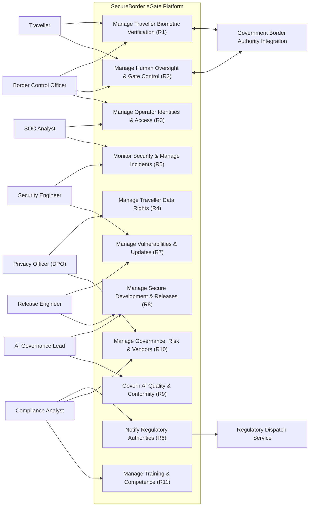

# E1.1 – SecureBorder eGate: AS-IS and TO-BE Model (Requirements Elicitation & PUC)

## Executive Summary

This report establishes the baseline requirements elicitation and analysis for the **SecureBorder eGate** platform, detailing the existing operational model (*As-Is*) and the target model (*To-Be*). The primary objective is to define exhaustively the product's functional scope, identifying actors, operational workflows, functional requirements prioritized using the MoSCoW methodology, and the formal Product Use Cases (*PUC*) catalog.

In accordance with software engineering literature (Robertson & Robertson, Cockburn, Wiegers & Beatty), this document focuses strictly on user operational and business needs, maintaining a pure functional approach. Security, privacy, and regulatory compliance overlays derived from the AEGIS methodology will be systematically integrated and mapped in downstream Phase 3 engineering steps.

---

## Table of Contents

- [Part I – Scope](#part-i--scope)
  - [1. Objective](#1-objective)
  - [2. Problem Description](#2-problem-description)
  - [3. Product Position Statement](#3-product-position-statement)
  - [4. Expected Impact](#4-expected-impact)
  - [5. Key Features](#5-key-features)
  - [6. Stakeholders](#6-stakeholders)
  - [7. System Users](#7-system-users)
  - [8. Constraints](#8-constraints)
- [Part II – As-Is](#part-ii--as-is)
  - [1. Business Roles in Context](#1-business-roles-in-context)
  - [2. Workflow Processes for Border Control Operations](#2-workflow-processes-for-border-control-operations)
  - [3. IT Support](#3-it-support)
- [Part III – To-Be](#part-iii--to-be)
  - [1. Initial Customer Expectations](#1-initial-customer-expectations)
  - [2. Functional and Non-Functional Requirements](#2-functional-and-non-functional-requirements)
    - [2.1 Actors](#21-actors)
    - [2.2 Functional Requirements](#22-functional-requirements)
    - [2.3 Non-Functional Requirements](#23-non-functional-requirements)
  - [3. Business Product Use Cases (PUC) Definition](#3-business-product-use-cases-puc-definition)
  - [4. System Use Case Model](#4-system-use-case-model)
- [Bibliography](#bibliography)
- [Version History](#version-history)

---

## Part I – Scope

### 1. Objective

The primary objective of this project is to specify and engineer the **SecureBorder eGate** platform: an automated border-control solution combining self-service gates with on-board biometric verification, a management back-office, and integrations with government border authorities, deployed at airports and Schengen border crossings.

The platform establishes a single operational pipeline for traveller passage: automated biometric verification with human oversight, token-only decision record-keeping, and fleet-wide operations management — eliminating manual-lane bottlenecks while preserving officer authority over every passage decision.

### 2. Problem Description

Border-control authorities and airport operators currently face severe operational constraints:

- **Manual Lane Bottlenecks:** Fully manual border checks require officers per traveller, creating queues that scale with traffic peaks and staffing shortfalls.
- **Inconsistent Decision Records:** Manual checks produce fragmented, paper-based or locally stored records, impeding audits, statistics, and cross-border cooperation.
- **No Automated Oversight Path:** Without an automated lane, every routine check consumes scarce officer attention, while genuinely suspicious cases receive the same scrutiny as routine passages.
- **Fragmented Fleet Operations:** Deployed self-service units are monitored per-site with no unified fleet view of incidents, updates, or model behaviour, delaying corrections and compliance reporting.
- **Growing Regulatory Reporting Burden:** Multiple regulatory regimes impose strict, differently-timed notification and documentation duties that manual processes cannot reliably meet.

### 3. Product Position Statement

SecureBorder eGate is positioned as a certified, oversight-first automated border-control platform optimized for throughput, auditability, and officer authority:

- **For:** Government border authorities and airport operators in Schengen Member States;
- **Who:** Must process growing traveller volumes without compromising decision quality, human oversight, or statutory reporting;
- **SecureBorder eGate is:** An automated border-control gate family with on-board biometric verification, a unified management back-office, and government authority integrations;
- **That allows:** Automated passage decisions with real-time officer review and override, token-only decision record-keeping, and fleet-wide operational monitoring;
- **Unlike:** Per-site self-service kiosks without unified oversight, record integrity, or cross-border deployment support;
- **Our product distinguishes itself by:** Treating human oversight and decision explainability as first-class product capabilities rather than add-ons.

### 4. Expected Impact

The deployment and adoption of SecureBorder eGate delivers the following operational impacts:

1. **Increase Lane Throughput:** Up to 500 travellers per hour per gate with automated decision in under 3 seconds from capture.
2. **Preserve Officer Authority:** 100% of automated decisions reviewable and overridable in real time by border control officers.
3. **Unify Decision Records:** 100% of passage decisions recorded as token-only, tamper-evident entries available for audit and statistics.
4. **Consolidate Fleet Operations:** One operational view across all deployed gates — incidents, updates, model behaviour, and per-site isolation status.
5. **Meet Reporting Deadlines:** Regulatory notifications dispatched from a single workflow respecting the shortest applicable statutory clock.

### 5. Key Features

The platform's functional baseline is structured into core operational capabilities:

- **Automated Biometric Verification:** Traveller enrolment (capture, template extraction, immediate raw-capture discard) and 1:1 verification with confidence-scored pass/refer decisions.
- **Human Oversight & Gate Control:** Real-time officer review of automated decisions, override with recorded justification, and managed fallback to the manual lane.
- **Unified Identity & Access:** Operator identity lifecycle integrated with government identity systems, multi-factor authentication, and role-based operational access.
- **Traveller Data Rights Operations:** Controller-facing handling of access, erasure, and portability requests with irreversible de-linking of biometric material.
- **Security Operations & Notification:** Fleet-wide event collection, incident management, and a unified regulatory notification workflow across multiple statutory clocks.
- **Managed Releases & AI Lifecycle:** Signed software and AI model updates with versioning and rollback, plus continuous accuracy, drift, and bias monitoring.
- **Governance & Reporting:** Unified impact and risk assessments, vendor due diligence, compliance reporting, and role-based training including oversight competence.

### 6. Stakeholders

The following table details the key stakeholders invested in the SecureBorder eGate platform:

*Table 1. Stakeholders*

| Stakeholder | Representatives | Role and Interest in the System |
|---|---|---|
| **Government Border Authorities** | National Border Control Agencies, Schengen Authorities | Lawful, accurate, and auditable border control; data-controller oversight of traveller data; statutory reporting. |
| **Airport Operators** | Airport Operations Management | Passenger-flow throughput, minimal queue times, and reliable gate operation within terminal infrastructure. |
| **Travellers (Data Subjects)** | Cross-border passengers | Fast, fair, and non-discriminatory passage; lawful handling of biometric data; effective rights exercise. |
| **SecureBorder Executive Leadership** | CEO, Board | Contract growth (Schengen expansion), regulatory conformity, and public trust. |
| **SecureBorder Operations & Security** | CISO, SOC Manager, Security Engineer, Operations Lead | Fleet availability, incident response, vulnerability management, and certified operations. |
| **SecureBorder AI Governance & Privacy** | AI Governance Lead, DPO | High-risk AI conformity, fairness monitoring, and data-subject rights operations. |
| **Suppliers & Assessors** | Hardware Suppliers, Notified Body, External Auditors | Component quality, conformity assessment, and certification maintenance. |

### 7. System Users

The application defines the following user roles:

*Table 2. System Users*

| System User | Description and Responsibilities |
|---|---|
| **Border Control Officer** | Government-authority officer at the border. Reviews automated decisions, overrides outcomes with recorded justification, and manages manual-lane referrals. |
| **SOC Analyst** | SecureBorder security operations centre staff. Monitors fleet events, triages incidents, and executes response runbooks. |
| **Security Engineer** | SecureBorder engineering staff. Manages vulnerabilities, prepares updates, and operates the coordinated disclosure process. |
| **Release Engineer** | SecureBorder engineering staff. Operates the release pipeline, maintains software bills of materials, and versions AI models. |
| **AI Governance Lead** | SecureBorder governance staff. Maintains the AI risk-management file, conformity documentation, and fairness monitoring programmes. |
| **Privacy Officer (DPO)** | SecureBorder privacy staff. Handles traveller and employee data-subject operations, records of processing, and impact assessments. |
| **Compliance Analyst** | SecureBorder compliance staff. Maintains compliance reporting, vendor assessments, and the unified notification calendar. |
| **Site Operations Technician** | Airport-site staff (SecureBorder or operator). Performs physical gate maintenance, hardware replacement, and on-site configuration under supervision. |

### 8. Constraints

The baseline product design operates under the following business and operational constraints:

- **Organisation Capacity:** The technical organisation comprises 450 staff with a dedicated security organisation, supporting parallel deployments across multiple Member States; the design must remain maintainable by named, accountable teams.
- **Government Data Custody:** Traveller biometric data is processed on behalf of government authorities (processor role); decision records are retained per the applicable authority's statutory floors.
- **Statutory Clocks:** Incident and conformity notifications are bound to multiple statutory deadlines; the baseline must operate on the shortest applicable clock (24 hours).
- **Technology Neutrality:** This document defines pure functional capabilities from the user's perspective, without pre-baking technical security controls, which will be formally synthesized in subsequent AEGIS phases.

---

## Part II – As-Is

### 1. Business Roles in Context

In the baseline As-Is operational state — border lanes not yet equipped with automated gates — collaborators execute border control through manual processes:

- **Border Control Officer:** Performs every check manually at the booth: document inspection, traveller questioning, and watchlist consultation through separate authority systems.
- **Shift Supervisor:** Allocates officers to lanes, consolidates shift incident notes, and compiles manual statistics for the authority.
- **Site Maintenance Staff:** Inspects and repairs lane equipment reactively after failure reports from terminal staff.
- **Authority Compliance Clerk:** Collects statutory reports from spreadsheets and paper forms, with no unified notification calendar.

### 2. Workflow Processes for Border Control Operations

#### 2.1 Manual Border Check (As-Is Process)
The As-Is border check workflow is characterized by full manual processing:

1. The traveller queues in the manual lane and presents travel documents at the booth.
2. The officer visually inspects the document and compares the holder's face against the portrait.
3. The officer consults the authority's watchlist systems through separate terminals.
4. The decision is recorded in the authority's local log; supporting notes remain paper-based.
5. Suspicious cases escalate to a secondary inspection area, consuming additional officers.

#### 2.2 Operational Inefficiencies Identified (As-Is)

*Table 3. Inefficiencies identified in As-Is border control operations*

| Inefficiency ID | Process Affected | Description | Impact |
|---|---|---|---|
| **INEF-01** | Traveller Processing | Every routine check consumes a full officer interaction. | Queue growth at traffic peaks; staffing shortfalls directly reduce lane capacity. |
| **INEF-02** | Decision Records | Manual, fragmented record-keeping with paper notes. | Slow audits, unreliable statistics, weakened cross-border cooperation evidence. |
| **INEF-03** | Oversight Allocation | Routine and suspicious cases receive the same manual scrutiny. | Officer attention diverted from genuinely risky passages. |
| **INEF-04** | Fleet Operations (early deployments) | Self-service units monitored per-site with no unified view. | Delayed incident response; inconsistent update and model-behaviour tracking. |
| **INEF-05** | Regulatory Reporting | Statutory notifications assembled manually from scattered sources. | Missed deadlines carry fines and conformity risk under multiple regimes. |

### 3. IT Support

In the baseline state, supporting IT is fragmented across authority and site systems:
- Officer checks performed through separate authority terminals per function.
- Watchlist consultation through dedicated authority channels, disconnected from lane operations.
- Site equipment monitored by local alarms only, without central fleet telemetry.
- Reports compiled in desktop office software and dispatched through manual channels.

---

## Part III – To-Be

### 1. Initial Customer Expectations

Based on authority and operator elicitation, the target To-Be system must satisfy the following core expectations:

*Table 4. Initial customer expectations*

| Expectation ID | Operational Expectation | Target Impact |
|---|---|---|
| **EXP-01** | Automated passage lane with biometric verification completing decisions in seconds. | Manual-lane relief; officer attention reserved for referred cases. |
| **EXP-02** | Every automated decision reviewable and overridable by an officer in real time, with the override recorded. | Officer authority preserved; oversight is a product capability, not an afterthought. |
| **EXP-03** | Traveller biometric data minimized by design: templates only, raw captures discarded immediately. | Data-subject trust; lawful processing under special-category rules. |
| **EXP-04** | Unified fleet operations view covering incidents, updates, and model behaviour across all sites. | Faster response; consistent per-site compliance. |
| **EXP-05** | Statutory notifications dispatched from one workflow respecting the shortest applicable clock. | Zero missed regulatory deadlines across regimes. |
| **EXP-06** | Auditable, tamper-evident decision records without biometric content, retained per statutory floors. | Reliable audits, statistics, and cross-border cooperation. |
| **EXP-07** | Per-country deployments isolated from each other, with authority-specific configuration. | Multi-Schengen expansion without cross-border data commingling. |

### 2. Functional and Non-Functional Requirements

#### 2.1 Actors

The following table formally defines the actors interacting with the system in the To-Be model:

*Table 5. List of actors*

| Actor | Description |
|---|---|
| **Border Control Officer** | Government-authority officer who reviews automated decisions, performs overrides with justification, and manages manual-lane referrals. |
| **SOC Analyst** | SecureBorder operations-centre staff monitoring fleet events and managing incidents. |
| **Security Engineer** | SecureBorder staff managing vulnerabilities, updates, and coordinated disclosure. |
| **Release Engineer** | SecureBorder staff operating the release pipeline, component records, and AI model versioning. |
| **AI Governance Lead** | SecureBorder governance staff maintaining AI risk, conformity, fairness, and explainability programmes. |
| **Privacy Officer (DPO)** | SecureBorder privacy staff handling data-subject operations, records of processing, and impact assessments. |
| **Compliance Analyst** | SecureBorder compliance staff maintaining reporting, vendor assessments, and the notification calendar. |
| **Site Operations Technician** | Site staff performing physical gate maintenance and supervised on-site configuration. |
| **Government Border Authority Integration** | External authority systems providing identity verification data, watchlist inputs, and receiving decision referrals. |
| **Regulatory Dispatch Service** | External official channels through which statutory notifications reach authorities. |

#### 2.2 Functional Requirements

##### 2.2.1 MoSCoW Prioritization Method
Functional requirements are prioritized using the MoSCoW methodology:
- **MUST:** Mandatory requirement that must be satisfied in the baseline release for the system to be viable.
- **SHOULD:** High-impact requirement that should be satisfied unless critical delivery constraints dictate deferral.
- **COULD:** Desirable capability or enhancement that can be included if schedule and resources permit.
- **WON'T:** Out-of-scope feature that will not be implemented in the initial baseline release, reserved for future iterations.

##### 2.2.2 Summary Table of Functional Requirements

*Table 6. List of functional requirements*

| ID | ID | Requirement | Priority | Restrictions |
|---|---|---|---|---|
| **R1** | | **Manage Traveller Biometric Verification** | **MUST** | |
| | R1.1 | Enrol traveller biometric reference | MUST | Raw-capture discard ≤5 s |
| | R1.2 | Perform biometric verification and gate decision | MUST | Decision ≤3 s |
| | R1.3 | Consult traveller passage decision records | SHOULD | Token-only content |
| **R2** | | **Manage Human Oversight and Gate Control** | **MUST** | |
| | R2.1 | Review and override automated decisions | MUST | Justification recorded |
| | R2.2 | Manage manual-lane referrals | MUST | |
| **R3** | | **Manage Operator Identities and Access** | **MUST** | |
| | R3.1 | Manage operator identity lifecycle | MUST | 24 h deprovisioning |
| | R3.2 | Authenticate operators with multi-factor verification | MUST | |
| | R3.3 | Assign and review operational access roles | MUST | Quarterly review |
| **R4** | | **Manage Traveller Data Rights** | **MUST** | |
| | R4.1 | Process traveller data-subject requests | MUST | 30-day statutory window |
| | R4.2 | Maintain records of processing activities | MUST | |
| **R5** | | **Monitor Security and Manage Incidents** | **MUST** | |
| | R5.1 | Collect and correlate fleet security events | MUST | |
| | R5.2 | Triage and manage incidents | MUST | |
| | R5.3 | Recover services and exercise continuity | MUST | RTO <1 h |
| **R6** | | **Notify Regulatory Authorities** | **MUST** | |
| | R6.1 | Execute unified regulatory notifications | MUST | 24 h max-SLA clock |
| **R7** | | **Manage Vulnerabilities and Updates** | **MUST** | |
| | R7.1 | Identify and remediate vulnerabilities | MUST | |
| | R7.2 | Distribute signed software and model updates | MUST | |
| | R7.3 | Operate coordinated vulnerability disclosure | MUST | |
| **R8** | | **Manage Secure Development and Releases** | **MUST** | |
| | R8.1 | Enforce release pipeline security gates | MUST | |
| | R8.2 | Maintain software bills of materials | MUST | Per release |
| | R8.3 | Version and roll back AI models | MUST | Rollback <30 min |
| **R9** | | **Govern AI Quality and Conformity** | **MUST** | |
| | R9.1 | Maintain AI risk management and conformity documentation | MUST | |
| | R9.2 | Monitor AI accuracy, drift, and bias | MUST | Quarterly bias cycle |
| | R9.3 | Test AI systems adversarially and explain decisions | SHOULD | |
| **R10** | | **Manage Governance, Risk, and Vendors** | **MUST** | |
| | R10.1 | Maintain unified impact and risk assessments | MUST | Annual review |
| | R10.2 | Assess vendors and record component provenance | MUST | |
| | R10.3 | Maintain compliance reporting and audits | SHOULD | |
| **R11** | | **Manage Training and Competence** | **MUST** | |
| | R11.1 | Deliver security and privacy awareness training | MUST | Annual cadence |
| | R11.2 | Deliver oversight and AI competence training | MUST | |

---

##### 2.2.3 Detailed Specification Cards for Functional Requirements

The detailed functional requirement cards follow the exact 7-row single-column format established in the reference project standard:

#### R1 – Manage Traveller Biometric Verification

##### R1.1 – Enrol traveller biometric reference

| Requirement |
|---|
| **ID:** R1.1 **Name:** Enrol traveller biometric reference |
| **Description:** The system must capture the traveller's facial image at the gate, extract a biometric verification template, apply irreversible de-linking to the template, and discard the raw capture immediately after extraction. |
| **Requirement Origin:** Border Authority Service Contract & Passenger-Flow Programme |
| **Security & Privacy Constraints:** **NFR-RN11** Biometric Template Protection at Rest — `GDPR Art. 32(1)(a)+(b)+Art. 5(1)(f)` → `PO-D-01.1-001` · `CRA Annex I Part I (2)(e)` → `SO-D-01.1-002` → `PRIN-ENG-01` → CSF PR.DS-01, PR.DS-10 **NFR-RN12** Cryptographic Key Custody Separation — `GDPR Art. 4(5)+Art. 32(1)(a)` → `PO-D-01.3-001` · `CRA Annex I Part I (2)(d)+(e)` → `SO-D-01.3-002` → `PRIN-ENG-03` → CSF PR.DS-01, PR.AA-05 **Chain** Data Minimization at Enrolment — `GDPR Art. 5(1)(c)` → `PO-D-05.1-001` · `CRA Annex I` → `SO-D-05.1-002` → `PRIN-ENG-06` → CSF ID.AM-08, ID.AM-03 **Chain** Retention Limitation — `GDPR Art. 5(1)(e)` → `PO-D-05.2-001` → `PRIN-ENG-07` → CSF ID.AM-08, ID.AM-03 |
| **Interfaces:** Traveller, Border Control Officer, and Government Border Authority Integration |
| **Dependencies:** • **Stakeholders:** Government Border Authorities, Airport Operators • **Data Sources:** Gate Capture Session, Authority Enrolment Record • **Extraction Periodicity:** on demand • **Information Systems / Databases:** Internal Application Database • **Preceding Requirements:** |
| **Identified Problems:** |
| **Priority:** Must |

##### R1.2 – Perform biometric verification and gate decision

| Requirement |
|---|
| **ID:** R1.2 **Name:** Perform biometric verification and gate decision |
| **Description:** The system must verify the traveller's live capture against the enrolled template (1:1 match), consult the authority watchlist input, and produce a confidence-scored passage decision (pass or refer) within the statutory service target, opening the gate only on a pass outcome. |
| **Requirement Origin:** Passenger-Flow Programme & Border Authority Service Contract |
| **Security & Privacy Constraints:** **NFR-RN12** Cryptographic Key Custody Separation — `GDPR Art. 4(5)+Art. 32(1)(a)` → `PO-D-01.3-001` · `CRA Annex I Part I (2)(d)+(e)` → `SO-D-01.3-002` → `PRIN-ENG-03` → CSF PR.DS-01, PR.AA-05 **NFR-RN13** Data-in-Transit Protection (cross-cutting, Table 7) — `GDPR Art. 32(1)(b)+Art. 32(2)` → `PO-D-01.2-001` · `CRA Annex I Part I (2)(e)+(j)` → `SO-D-01.2-002` → `PRIN-ENG-01` → CSF PR.DS-02, PR.IR-01 **NFR-RN14** Record & Command Integrity Protection — `CRA Annex I Part I (2)(f)+(l)` → `SO-D-01.4-002` → `PRIN-ENG-07` → CSF PR.DS-01, PR.DS-10, PR.PS-04 **NFR-RN15** AI Model Resilience & Fail-Safe Reversion — `AI Act Art. 15(3)` → `SO-D-01.4-004` → `PRIN-ENG-04` → CSF PR.IR-03, PR.IR-04, PR.DS-11 **NFR-RN20** Secure-by-Default Configuration & Reset — `GDPR Art. 25(2)` → `PO-D-03.4-001` · `CRA Annex I 2(b)+(c)` → `SO-D-03.4-002` → `PRIN-ENG-04` → CSF PR.PS-01 **NFR-RN22** Product Activity Recording & Tamper Evidence — `CRA Annex I Part I (2)(l)` → `SO-D-04.1-002`, `SO-D-10.1-002` → `PRIN-ENG-07` → CSF DE.CM-01, DE.CM-09 **NFR-RN24** AI Event Logging over Lifetime — `AI Act Art. 12(1)+Art. 19` → `SO-D-10.2-004`, `SO-D-05.2-004` → `PRIN-ENG-07` → CSF PR.PS-04, DE.CM-09, DE.AE-03 |
| **Interfaces:** Traveller, Border Control Officer, and Government Border Authority Integration |
| **Dependencies:** • **Stakeholders:** Government Border Authorities, Airport Operators, Travellers • **Data Sources:** Enrolment Template, Watchlist Input, Decision Record • **Extraction Periodicity:** on demand • **Information Systems / Databases:** Internal Application Database • **Preceding Requirements:** |
| **Identified Problems:** |
| **Priority:** Must |

##### R1.3 – Consult traveller passage decision records

| Requirement |
|---|
| **ID:** R1.3 **Name:** Consult traveller passage decision records |
| **Description:** The system must allow authorized officers and authority users to consult past passage decisions — token-only entries with timestamp, gate, decision, confidence band, and override status — filtered by traveller token, date range, gate, and outcome. |
| **Requirement Origin:** Authority Audit & Statistics Needs |
| **Security & Privacy Constraints:** **NFR-RN11** Biometric Template Protection at Rest — `GDPR Art. 32(1)(a)+(b)+Art. 5(1)(f)` → `PO-D-01.1-001` · `CRA Annex I Part I (2)(e)` → `SO-D-01.1-002` → `PRIN-ENG-01` → CSF PR.DS-01, PR.DS-10 **NFR-RN14** Record & Command Integrity Protection — `CRA Annex I Part I (2)(f)+(l)` → `SO-D-01.4-002` → `PRIN-ENG-07` → CSF PR.DS-01, PR.DS-10, PR.PS-04 **Chain** Retention Limitation on Decision Records — `GDPR Art. 5(1)(e)` → `PO-D-05.2-001` → `PRIN-ENG-07` → CSF ID.AM-08, ID.AM-03 |
| **Interfaces:** Border Control Officer, Compliance Analyst |
| **Dependencies:** • **Stakeholders:** Government Border Authorities • **Data Sources:** Decision Record Store • **Extraction Periodicity:** on demand • **Information Systems / Databases:** Internal Application Database • **Preceding Requirements:** |
| **Identified Problems:** |
| **Priority:** Should |

---

#### R2 – Manage Human Oversight and Gate Control

##### R2.1 – Review and override automated decisions

| Requirement |
|---|
| **ID:** R2.1 **Name:** Review and override automated decisions |
| **Description:** The system must present each referred or challenged decision to a border control officer with the decision basis (confidence band and contributing factors) and allow the officer to confirm or override the outcome in real time, recording the justification with the decision entry. |
| **Requirement Origin:** Human-Oversight Obligation & Border Officer Operational Intake |
| **Security & Privacy Constraints:** **NFR-RN19** Authorized-Actor Instruction Mediation — `GDPR Art. 29+Art. 32(4)` → `PO-D-03.2-001`, `PO-D-03.3-001` · `CRA Annex I Part I (2)(d)` → `SO-D-03.3-002` · `NIS 2 Art. 21(2)` → `SO-D-03.3-003` → `PRIN-ENG-03` → CSF PR.AA-05, PR.AA-06 **NFR-RN29** Human Oversight Effectiveness — `AI Act Art. 14` → `SO-D-08.2-004` → `PRIN-ENG-01` → CSF PR.AT-02, PR.AT-01, GV.RR-02 |
| **Interfaces:** Border Control Officer |
| **Dependencies:** • **Stakeholders:** Government Border Authorities • **Data Sources:** Decision Queue, Override Record • **Extraction Periodicity:** on demand • **Information Systems / Databases:** Internal Application Database • **Preceding Requirements:** |
| **Identified Problems:** |
| **Priority:** Must |

##### R2.2 – Manage manual-lane referrals

| Requirement |
|---|
| **ID:** R2.2 **Name:** Manage manual-lane referrals |
| **Description:** The system must route referred travellers to the manual lane with a referral ticket, notify the officer desk, and track the referral to closure; on any gate fault the system must fail toward the manual lane automatically. |
| **Requirement Origin:** Border Officer Operational Intake & Site Contingency Procedure |
| **Interfaces:** Border Control Officer, Traveller |
| **Dependencies:** • **Stakeholders:** Government Border Authorities, Airport Operators • **Data Sources:** Referral Ticket, Gate Status Record • **Extraction Periodicity:** on demand • **Information Systems / Databases:** Internal Application Database • **Preceding Requirements:** |
| **Identified Problems:** |
| **Priority:** Must |

---

#### R3 – Manage Operator Identities and Access

##### R3.1 – Manage operator identity lifecycle

| Requirement |
|---|
| **ID:** R3.1 **Name:** Manage operator identity lifecycle |
| **Description:** The system must manage operational identities for officers and SecureBorder staff across their engagement lifecycle — provisioning on induction (verifiable against government identity systems for officers), entitlement review on role change, and revocation within 24 hours of separation. |
| **Requirement Origin:** Government Identity Federation Programme & HR Separation Workflow |
| **Security & Privacy Constraints:** **NFR-RN17** Operator Identity Lifecycle Management — `NIS 2 Art. 21(2)(i)` → `SO-D-03.1-003` · `CRA Annex I Part I (2)(d)+Art. 13(15)` → `SO-D-03.1-002` → `PRIN-ENG-03` → CSF PR.AA-01, PR.AA-05 |
| **Interfaces:** Border Control Officer, SOC Analyst, Government Border Authority Integration |
| **Dependencies:** • **Stakeholders:** Government Border Authorities, SecureBorder Operations & Security • **Data Sources:** Authority Identity Record, HR Engagement Record • **Extraction Periodicity:** on demand • **Information Systems / Databases:** Internal Application Database • **Preceding Requirements:** |
| **Identified Problems:** |
| **Priority:** Must |

##### R3.2 – Authenticate operators with multi-factor verification

| Requirement |
|---|
| **ID:** R3.2 **Name:** Authenticate operators with multi-factor verification |
| **Description:** The system must authenticate all operational users — including every remote access to the management plane — using multi-factor verification before granting access, and lock accounts after repeated failed attempts. |
| **Requirement Origin:** Certified Operations Baseline & SOC Access Policy |
| **Security & Privacy Constraints:** **NFR-RN18** Strong Operator Authentication — `NIS 2 Art. 21(2)(j)` → `SO-D-03.2-003` · `CRA Annex I Part I (2)(d)` → `SO-D-03.2-002` → `PRIN-ENG-01` → CSF PR.AA-03, PR.AA-05, PR.AA-06 |
| **Interfaces:** All Operational Users |
| **Dependencies:** • **Stakeholders:** SecureBorder Operations & Security • **Data Sources:** Authentication Event Record • **Extraction Periodicity:** on demand • **Information Systems / Databases:** Internal Application Database • **Preceding Requirements:** |
| **Identified Problems:** |
| **Priority:** Must |

##### R3.3 – Assign and review operational access roles

| Requirement |
|---|
| **ID:** R3.3 **Name:** Assign and review operational access roles |
| **Description:** The system must let administrators assign least-privilege operational roles (oversight, monitoring, engineering, governance, site) and enforce a quarterly access-rights review with recorded outcomes. |
| **Requirement Origin:** Certified Operations Baseline & Access Governance Policy |
| **Security & Privacy Constraints:** **NFR-RN17** Operator Identity Lifecycle Management — `NIS 2 Art. 21(2)(i)` → `SO-D-03.1-003` · `CRA Annex I Part I (2)(d)+Art. 13(15)` → `SO-D-03.1-002` → `PRIN-ENG-03` → CSF PR.AA-01, PR.AA-05 **NFR-RN19** Authorized-Actor Instruction Mediation — `GDPR Art. 29+Art. 32(4)` → `PO-D-03.2-001`, `PO-D-03.3-001` · `CRA Annex I Part I (2)(d)` → `SO-D-03.3-002` · `NIS 2 Art. 21(2)` → `SO-D-03.3-003` → `PRIN-ENG-03` → CSF PR.AA-05, PR.AA-06 |
| **Interfaces:** Compliance Analyst, SOC Analyst, CISO |
| **Dependencies:** • **Stakeholders:** SecureBorder Operations & Security • **Data Sources:** Role Assignment Record, Access Review Record • **Extraction Periodicity:** quarterly • **Information Systems / Databases:** Internal Application Database • **Preceding Requirements:** |
| **Identified Problems:** |
| **Priority:** Must |

---

#### R4 – Manage Traveller Data Rights

##### R4.1 – Process traveller data-subject requests

| Requirement |
|---|
| **ID:** R4.1 **Name:** Process traveller data-subject requests |
| **Description:** The system must receive traveller rights requests (access, erasure, portability) routed via the government controller, locate all linked biometric material and decision records for the traveller token, irreversibly de-link and purge biometric material on erasure while preserving lawful token-only decision records, and produce the response artefact within the statutory window. |
| **Requirement Origin:** Traveller Rights Requests via Government Controller |
| **Security & Privacy Constraints:** **NFR-RN16** Rights-Requester Identity Verification — `GDPR Art. 12(6)+Art. 11(2)+Art. 5(1)(c)` → `PO-D-03.1-001` → `PRIN-ENG-01` → CSF PR.AA-03, PR.AA-02 **NFR-RN28** Traveller Erasure & Portability Delivery — `GDPR Art. 17+Art. 20+Art. 15(3)` → `PO-D-05.3-001`, `PO-D-05.4-001` → `PRIN-ENG-07` → CSF PR.DS-10, ID.AM-08 / PF CT.DM-P4 **Chain** Rectification Cascade — `GDPR Art. 16+Art. 19` → `PO-D-01.4-001` → `PRIN-ENG-07` → CSF PR.DS-01, ID.AM-08, PR.DS-10 **Chain** Permanent Product-Data Removal — `CRA Annex I Part I (2)(m)` → `SO-D-05.3-002` → `PRIN-ENG-07` → CSF PR.DS-10, ID.AM-08, PR.DS-02 |
| **Interfaces:** Privacy Officer (DPO), Government Border Authority Integration |
| **Dependencies:** • **Stakeholders:** Government Border Authorities, Travellers • **Data Sources:** Rights Request Record, Enrolment Template Store, Decision Record Store • **Extraction Periodicity:** on demand • **Information Systems / Databases:** Internal Application Database • **Preceding Requirements:** |
| **Identified Problems:** |
| **Priority:** Must |

##### R4.2 – Maintain records of processing activities

| Requirement |
|---|
| **ID:** R4.2 **Name:** Maintain records of processing activities |
| **Description:** The system must maintain structured records of processing activities for both processing roles (traveller data on behalf of authorities; employee data under company responsibility), kept current and exportable on authority request. |
| **Requirement Origin:** Statutory Documentation Obligation & Authority Inspection Readiness |
| **Security & Privacy Constraints:** **Chain** Records of Processing Activities — `GDPR Art. 30` → `PO-D-09.4-001` → `PRIN-ENG-05` → CSF ID.AM-03, GV.PO-02, PR.PS-04 |
| **Interfaces:** Privacy Officer (DPO), Compliance Analyst |
| **Dependencies:** • **Stakeholders:** Government Border Authorities, SecureBorder Executive Leadership • **Data Sources:** Processing Inventory Record • **Extraction Periodicity:** on demand • **Information Systems / Databases:** Internal Application Database • **Preceding Requirements:** |
| **Identified Problems:** |
| **Priority:** Must |

---

#### R5 – Monitor Security and Manage Incidents

##### R5.1 – Collect and correlate fleet security events

| Requirement |
|---|
| **ID:** R5.1 **Name:** Collect and correlate fleet security events |
| **Description:** The system must collect security-relevant events from all gates, the back-office, and the verification AI — including access events, decision anomalies, integrity warnings, and model-behaviour signals — and correlate them into actionable alerts in the operations centre view. |
| **Requirement Origin:** Security Operations Centre Handover & Fleet Monitoring Programme |
| **Security & Privacy Constraints:** **NFR-RN22** Product Activity Recording & Tamper Evidence — `CRA Annex I Part I (2)(l)` → `SO-D-04.1-002`, `SO-D-10.1-002` → `PRIN-ENG-07` → CSF DE.CM-01, DE.CM-09 **NFR-RN25** AI Post-Market Monitoring Integration — `AI Act Art. 72` → `SO-D-10.1-004` → `PRIN-ENG-02` → CSF DE.CM-09, ID.IM-04 |
| **Interfaces:** SOC Analyst, Site Operations Technician |
| **Dependencies:** • **Stakeholders:** SecureBorder Operations & Security • **Data Sources:** Gate Event Stream, Back-Office Event Stream, AI Monitoring Stream • **Extraction Periodicity:** continuous • **Information Systems / Databases:** Internal Application Database, Event Store • **Preceding Requirements:** |
| **Identified Problems:** |
| **Priority:** Must |

##### R5.2 – Triage and manage incidents

| Requirement |
|---|
| **ID:** R5.2 **Name:** Triage and manage incidents |
| **Description:** The system must classify and prioritize incidents by statutory impact, support containment actions per incident class (gate tamper, network intrusion, model misbehaviour), and maintain the incident record through resolution with response timestamps. |
| **Requirement Origin:** Incident Response Runbook & Statutory Notification Obligation |
| **Security & Privacy Constraints:** **NFR-RN23** Incident-Handling Lifecycle Closure — `NIS 2 Art. 21(2)(c)` → `SO-D-04.1-003`, `SO-D-04.2-003` → `PRIN-ENG-02` → CSF RS.MA-01, RS.AN-03 **NFR-RN26** Breach Awareness & Containment Record — `GDPR Art. 33(1)+Art. 33(5)` → `PO-D-04.1-001`, `PO-D-04.2-001` → `PRIN-ENG-07` → CSF DE.CM-01, RS.MI-01, RS.MA-02 |
| **Interfaces:** SOC Analyst, Security Engineer, Compliance Analyst |
| **Dependencies:** • **Stakeholders:** SecureBorder Operations & Security • **Data Sources:** Alert Queue, Incident Record • **Extraction Periodicity:** on demand • **Information Systems / Databases:** Internal Application Database • **Preceding Requirements:** |
| **Identified Problems:** |
| **Priority:** Must |

##### R5.3 – Recover services and exercise continuity

| Requirement |
|---|
| **ID:** R5.3 **Name:** Recover services and exercise continuity |
| **Description:** The system must support service recovery within the continuity targets for the back-office and gate management functions, restore from protected copies, and record continuity exercises (at least annual) with findings. |
| **Requirement Origin:** Business Continuity Programme & Authority Service-Level Commitments |
| **Security & Privacy Constraints:** **NFR-RN23** Incident-Handling Lifecycle Closure — `NIS 2 Art. 21(2)(c)` → `SO-D-04.1-003`, `SO-D-04.2-003` → `PRIN-ENG-02` → CSF RS.MA-01, RS.AN-03 **Chain** Post-Incident Availability Protection — `CRA Annex I Part I (2)` → `SO-D-04.2-002`, `SO-D-04.4-002` → `PRIN-ENG-04` → CSF PR.IR-03, ID.AM-08 **Chain** Continuity & Disaster Recovery — `NIS 2 Art. 21(2)(c)` → `SO-D-04.4-003` → `PRIN-ENG-04` → CSF RC.RP-04, PR.DS-11 **Chain** Ongoing CIA + Resilience — `GDPR Art. 32(1)(b)` → `PO-D-04.4-001`, `PO-D-10.1-001` → `PRIN-ENG-04` → CSF PR.IR-04, PR.DS-11, RC.RP-04 |
| **Interfaces:** SOC Analyst, Site Operations Technician |
| **Dependencies:** • **Stakeholders:** SecureBorder Operations & Security, Airport Operators • **Data Sources:** Recovery Runbook, Continuity Exercise Record • **Extraction Periodicity:** annual • **Information Systems / Databases:** Internal Application Database • **Preceding Requirements:** |
| **Identified Problems:** |
| **Priority:** Must |

---

#### R6 – Notify Regulatory Authorities

##### R6.1 – Execute unified regulatory notifications

| Requirement |
|---|
| **ID:** R6.1 **Name:** Execute unified regulatory notifications |
| **Description:** The system must generate and dispatch regulatory notifications from a single incident record — early warnings on the 24-hour clock, follow-up notifications within 72 hours, serious-incident reports per the AI statutory matrix, and conformity reports — tracking each obligation to acknowledgement. |
| **Requirement Origin:** Multi-Regime Notification Obligation & Compliance Calendar |
| **Security & Privacy Constraints:** **NFR-RN21** Unified Regulatory Notification Timeline Enforcement — `GDPR Art. 33(1)` → `PO-D-04.3-001` · `CRA Art. 14` → `SO-D-04.3-002` · `NIS 2 Art. 23` → `SO-D-04.3-003` · `AI Act Art. 73` → `SO-D-04.3-004` → `PRIN-ENG-05` → CSF RS.MA-04, RS.MA-02, RS.CO-02 **NFR-RN14** Record & Command Integrity Protection — `CRA Annex I Part I (2)(f)+(l)` → `SO-D-01.4-002` → `PRIN-ENG-07` → CSF PR.DS-01, PR.DS-10, PR.PS-04 **NFR-RN26** Breach Awareness & Containment Record — `GDPR Art. 33(1)+Art. 33(5)` → `PO-D-04.1-001`, `PO-D-04.2-001` → `PRIN-ENG-07` → CSF DE.CM-01, RS.MI-01, RS.MA-02 **Chain** Cross-Border Incident Routing — `NIS 2 Art. 23` → `SO-D-06.4-003` → `PRIN-ENG-05` → CSF RS.MA-04, RS.CO-02 |
| **Interfaces:** Compliance Analyst, Regulatory Dispatch Service |
| **Dependencies:** • **Stakeholders:** SecureBorder Operations & Security, Government Border Authorities • **Data Sources:** Incident Record, Notification Obligation Calendar, Notification Receipt • **Extraction Periodicity:** on demand • **Information Systems / Databases:** Internal Application Database • **Preceding Requirements:** |
| **Identified Problems:** |
| **Priority:** Must |

---

#### R7 – Manage Vulnerabilities and Updates

##### R7.1 – Identify and remediate vulnerabilities

| Requirement |
|---|
| **ID:** R7.1 **Name:** Identify and remediate vulnerabilities |
| **Description:** The system must maintain a vulnerability register across gates, back-office, and AI components with risk-based remediation targets (critical items within 24 hours), and support periodic offensive testing of the verification pipeline. |
| **Requirement Origin:** Vulnerability Management Programme & Offensive Testing Cycle |
| **Security & Privacy Constraints:** **Chain** Vulnerability Identification & Testing Family — `CRA Annex I Part I (2)(a)+Part II (1),(3)` → `SO-D-02.1-002`, `SO-D-02.4-002` · `NIS 2 Art. 21(2)(e)` → `SO-D-02.1-003`, `SO-D-07.3-003` · `GDPR Art. 32(1)(d)` → `PO-D-02.1-001` · `CRA Annex I Part II (3)` → `SO-D-10.3-002` (co) → `PRIN-ENG-02` → CSF ID.RA-01, ID.AM-02, PR.PS-02, PR.PS-06, GV.SC-04, DE.CM-09 |
| **Interfaces:** Security Engineer, SOC Analyst |
| **Dependencies:** • **Stakeholders:** SecureBorder Operations & Security • **Data Sources:** Vulnerability Register, Test Findings Record • **Extraction Periodicity:** continuous / annual • **Information Systems / Databases:** Internal Application Database • **Preceding Requirements:** |
| **Identified Problems:** |
| **Priority:** Must |

##### R7.2 – Distribute signed software and model updates

| Requirement |
|---|
| **ID:** R7.2 **Name:** Distribute signed software and model updates |
| **Description:** The system must distribute software and AI model updates to the gate fleet only as verifiable signed artefacts, staged per site with automatic rollback on failed health checks, with security updates prioritized over functional releases. |
| **Requirement Origin:** Release Operations Procedure & Field Fleet Programme |
| **Security & Privacy Constraints:** **NFR-RN27** Secure Update Distribution across Support Period — `CRA Annex I Part I (2)(c)+Part II (2),(7),(8)` → `SO-D-07.3-002`, `SO-D-02.2-002`, `SO-D-05.2-002` → `PRIN-ENG-02` → CSF ID.AM-02, GV.SC-03 **Chain** Secure-Use Advisories — `CRA Annex II §8` → `SO-D-08.1-002` → `PRIN-ENG-01` → CSF PR.AT-01 |
| **Interfaces:** Release Engineer, Site Operations Technician |
| **Dependencies:** • **Stakeholders:** SecureBorder Operations & Security, Airport Operators • **Data Sources:** Release Calendar, Update Package Record, Deployment Status • **Extraction Periodicity:** per release • **Information Systems / Databases:** Internal Application Database, Release Store • **Preceding Requirements:** |
| **Identified Problems:** |
| **Priority:** Must |

##### R7.3 – Operate coordinated vulnerability disclosure

| Requirement |
|---|
| **ID:** R7.3 **Name:** Operate coordinated vulnerability disclosure |
| **Description:** The system must operate a publicly identifiable disclosure intake for security researchers, triage submissions through the vulnerability process, and publish advisories once fixes are available. |
| **Requirement Origin:** Disclosure Policy & Security Researcher Community |
| **Security & Privacy Constraints:** **Chain** Coordinated Vulnerability Disclosure — `CRA Annex I Part II (4)-(6)+Art. 13(8),(17)` → `SO-D-02.3-002` · `NIS 2 Art. 21(2)(e)` → `SO-D-02.3-003` → `PRIN-ENG-02` → CSF ID.RA-01, GV.SC-04 |
| **Interfaces:** Security Engineer, Compliance Analyst |
| **Dependencies:** • **Stakeholders:** SecureBorder Operations & Security • **Data Sources:** Disclosure Intake Record, Advisory Record • **Extraction Periodicity:** on demand • **Information Systems / Databases:** Internal Application Database • **Preceding Requirements:** |
| **Identified Problems:** |
| **Priority:** Must |

---

#### R8 – Manage Secure Development and Releases

##### R8.1 – Enforce release pipeline security gates

| Requirement |
|---|
| **ID:** R8.1 **Name:** Enforce release pipeline security gates |
| **Description:** The system must enforce blocking security checks on every release candidate — code scanning, dependency analysis, and secret detection — with override restricted to named approvers and every override recorded. |
| **Requirement Origin:** Secure Development Lifecycle Policy & Release Operations Procedure |
| **Security & Privacy Constraints:** **NFR-RN20** Secure-by-Default Configuration & Reset — `GDPR Art. 25(2)` → `PO-D-03.4-001` · `CRA Annex I 2(b)+(c)` → `SO-D-03.4-002` → `PRIN-ENG-04` → CSF PR.PS-01 **Chain** Attack-Surface Limitation in Production — `CRA Annex I Part I (2)(j)` → `SO-D-07.1-002`, `SO-D-07.2-002` → `PRIN-ENG-02` → CSF PR.PS-06, GV.PO-02, PR.PS-01, PR.PS-02 |
| **Interfaces:** Release Engineer, Security Engineer |
| **Dependencies:** • **Stakeholders:** SecureBorder Operations & Security • **Data Sources:** Pipeline Gate Record, Override Record • **Extraction Periodicity:** per release • **Information Systems / Databases:** Internal Application Database • **Preceding Requirements:** |
| **Identified Problems:** |
| **Priority:** Must |

##### R8.2 – Maintain software bills of materials

| Requirement |
|---|
| **ID:** R8.2 **Name:** Maintain software bills of materials |
| **Description:** The system must generate and maintain a software bill of materials for every release — including third-party and open-source components — retained per release and producible for conformity assessment. |
| **Requirement Origin:** Conformity Assessment Requirement & Component Governance Programme |
| **Security & Privacy Constraints:** **Chain** SBOM Maintenance — `CRA Annex I Part II (1)+Art. 13(6)` → `SO-D-06.2-002` → `PRIN-ENG-05` → CSF ID.AM-02, GV.SC-04 |
| **Interfaces:** Release Engineer, AI Governance Lead |
| **Dependencies:** • **Stakeholders:** SecureBorder Operations & Security, Suppliers & Assessors • **Data Sources:** Component Inventory Record • **Extraction Periodicity:** per release • **Information Systems / Databases:** Internal Application Database • **Preceding Requirements:** |
| **Identified Problems:** |
| **Priority:** Must |

##### R8.3 – Version and roll back AI models

| Requirement |
|---|
| **ID:** R8.3 **Name:** Version and roll back AI models |
| **Description:** The system must version every verification model with its lineage (training data reference, evaluation results) and support rollback to the previous model version within 30 minutes of a triggering quality or safety event. |
| **Requirement Origin:** AI Model Lifecycle Procedure & Field Quality Escalations |
| **Security & Privacy Constraints:** **NFR-RN15** AI Model Resilience & Fail-Safe Reversion — `AI Act Art. 15(3)` → `SO-D-01.4-004` → `PRIN-ENG-04` → CSF PR.IR-03, PR.IR-04, PR.DS-11 |
| **Interfaces:** Release Engineer, AI Governance Lead |
| **Dependencies:** • **Stakeholders:** SecureBorder Operations & Security • **Data Sources:** Model Version Record, Model Evaluation Record • **Extraction Periodicity:** per model release • **Information Systems / Databases:** Internal Application Database, Release Store • **Preceding Requirements:** |
| **Identified Problems:** |
| **Priority:** Must |

---

#### R9 – Govern AI Quality and Conformity

##### R9.1 – Maintain AI risk management and conformity documentation

| Requirement |
|---|
| **ID:** R9.1 **Name:** Maintain AI risk management and conformity documentation |
| **Description:** The system must maintain the AI risk-management file (continuous identification, evaluation, and treatment of risks across the lifecycle) and the complete conformity documentation set — technical file, instructions, and assessment records — kept current for the statutory retention period. |
| **Requirement Origin:** High-Risk AI Conformity Programme & Notified Body Assessment |
| **Security & Privacy Constraints:** **Chain** AI Risk-Management & Documentation Family — `AI Act Art. 9` → `SO-D-02.1-004`, `SO-D-09.2-004` · `AI Act Art. 10` → `SO-D-05.1-004` · `AI Act Art. 15(1)` → `SO-D-07.1-004` · `AI Act Art. 11+Annex IV` → `SO-D-09.4-004` → `PRIN-ENG-05` → CSF GV.RM-01, GV.RM-06, ID.RA-03, ID.RA-04, PR.PS-06 |
| **Interfaces:** AI Governance Lead, Compliance Analyst |
| **Dependencies:** • **Stakeholders:** SecureBorder AI Governance & Privacy, Suppliers & Assessors • **Data Sources:** AI Risk File, Conformity Documentation Set • **Extraction Periodicity:** on demand • **Information Systems / Databases:** Internal Application Database • **Preceding Requirements:** |
| **Identified Problems:** |
| **Priority:** Must |

##### R9.2 – Monitor AI accuracy, drift, and bias

| Requirement |
|---|
| **ID:** R9.2 **Name:** Monitor AI accuracy, drift, and bias |
| **Description:** The system must continuously monitor verification accuracy against the quality baseline, alert on degradation beyond the agreed threshold, run quarterly fairness assessments across demographic groups with disparity reporting, and feed post-market data back into the risk file. |
| **Requirement Origin:** Post-Market Monitoring Programme & Fairness Assurance Commitments |
| **Security & Privacy Constraints:** **NFR-RN24** AI Event Logging over Lifetime — `AI Act Art. 12(1)+Art. 19` → `SO-D-10.2-004`, `SO-D-05.2-004` → `PRIN-ENG-07` → CSF PR.PS-04, DE.CM-09, DE.AE-03 **NFR-RN25** AI Post-Market Monitoring Integration — `AI Act Art. 72` → `SO-D-10.1-004` → `PRIN-ENG-02` → CSF DE.CM-09, ID.IM-04 **NFR-RN15** AI Model Resilience & Fail-Safe Reversion — `AI Act Art. 15(3)` → `SO-D-01.4-004` → `PRIN-ENG-04` → CSF PR.IR-03, PR.IR-04, PR.DS-11 |
| **Interfaces:** AI Governance Lead, SOC Analyst |
| **Dependencies:** • **Stakeholders:** SecureBorder AI Governance & Privacy, Government Border Authorities • **Data Sources:** Decision Metrics Store, Fairness Assessment Record • **Extraction Periodicity:** continuous / quarterly • **Information Systems / Databases:** Internal Application Database • **Preceding Requirements:** |
| **Identified Problems:** |
| **Priority:** Must |

##### R9.3 – Test AI systems adversarially and explain decisions

| Requirement |
|---|
| **ID:** R9.3 **Name:** Test AI systems adversarially and explain decisions |
| **Description:** The system must support scheduled adversarial testing of the verification pipeline (presentation-attack and evasion exercises) and produce per-decision explainability output (confidence band and contributing factors) for officer review and oversight reporting. |
| **Requirement Origin:** Adversarial Testing Cycle & Human-Oversight Obligation |
| **Security & Privacy Constraints:** **NFR-RN30** AI Transparency & Deployer Interpretability — `AI Act Art. 13` → `SO-D-09.1-004` → `PRIN-ENG-05` → CSF GV.OC-03, GV.RM-01 **Chain** AI Adversarial & Real-World Testing — `AI Act Art. 9(6)-(7)+Art. 15(4)-(5)+Art. 60` → `SO-D-02.4-004`, `SO-D-07.2-004`, `SO-D-10.3-004` → `PRIN-ENG-02` → CSF ID.RA-01, ID.RA-04, PR.PS-06, GV.SC-04 |
| **Interfaces:** AI Governance Lead, Security Engineer, Border Control Officer |
| **Dependencies:** • **Stakeholders:** SecureBorder AI Governance & Privacy, SecureBorder Operations & Security • **Data Sources:** Adversarial Test Record, Decision Explainability Record • **Extraction Periodicity:** quarterly • **Information Systems / Databases:** Internal Application Database • **Preceding Requirements:** |
| **Identified Problems:** |
| **Priority:** Should |

---

#### R10 – Manage Governance, Risk, and Vendors

##### R10.1 – Maintain unified impact and risk assessments

| Requirement |
|---|
| **ID:** R10.1 **Name:** Maintain unified impact and risk assessments |
| **Description:** The system must maintain the unified assessment record — privacy impact, fundamental-rights leg, AI risk file linkage, and enterprise risk analysis — as one evidence base with dual outputs, reviewed on material change and at least annually. |
| **Requirement Origin:** Unified Assessment Approach & Annual Governance Cycle |
| **Security & Privacy Constraints:** **Chain** Unified Lifecycle Assessment Family (T-003) — `GDPR Art. 35` → `PO-D-09.2-001` · `CRA Art. 13(2)` → `SO-D-09.2-002` · `NIS 2 Art. 21(2)(a)` → `SO-D-09.2-003` · `AI Act Art. 9(1)` → `SO-D-09.2-004` → `PRIN-ENG-05` → CSF ID.RA-01, ID.RA-05, ID.RA-06, GV.RM-01, GV.RM-06, RS.AN-03 **Chain** Governance Policy Family — `GDPR Art. 24` → `PO-D-09.1-001` · `NIS 2 Art. 20` → `SO-D-09.1-003` · `NIS 2 Art. 21(2)(h)` → `SO-D-01.1-003` → `PRIN-ENG-05` → CSF GV.PO-01, GV.PO-02, GV.RM-04, GV.OV-03, PR.DS-01, PR.DS-02 |
| **Interfaces:** Privacy Officer (DPO), AI Governance Lead, Compliance Analyst |
| **Dependencies:** • **Stakeholders:** SecureBorder AI Governance & Privacy, SecureBorder Executive Leadership • **Data Sources:** Assessment Record, Risk Register • **Extraction Periodicity:** annual / on change • **Information Systems / Databases:** Internal Application Database • **Preceding Requirements:** |
| **Identified Problems:** |
| **Priority:** Must |

##### R10.2 – Assess vendors and record component provenance

| Requirement |
|---|
| **ID:** R10.2 **Name:** Assess vendors and record component provenance |
| **Description:** The system must maintain vendor assessments covering security practices and component quality, record provenance for supplied hardware and software components, and track vendor findings to closure. |
| **Requirement Origin:** Supplier Due Diligence Programme & Vendor Assessment Cycle |
| **Security & Privacy Constraints:** **Chain** Vendor & Supply-Chain Family (T-004) — `GDPR Art. 28` → `PO-D-06.1-001`, `PO-D-06.3-001` · `CRA Annex I Part I (2)` → `SO-D-06.1-002` · `NIS 2 Art. 21(2)-(3)` → `SO-D-06.1-003`, `SO-D-06.3-003`, `SO-D-07.1-003` → `PRIN-ENG-05` → CSF GV.SC-01, GV.SC-02, GV.SC-03, GV.SC-04, ID.RA-02 |
| **Interfaces:** Compliance Analyst, CISO |
| **Dependencies:** • **Stakeholders:** SecureBorder Operations & Security, Suppliers & Assessors • **Data Sources:** Vendor Assessment Record, Component Provenance Record • **Extraction Periodicity:** annual / per vendor • **Information Systems / Databases:** Internal Application Database • **Preceding Requirements:** |
| **Identified Problems:** |
| **Priority:** Must |

##### R10.3 – Maintain compliance reporting and audits

| Requirement |
|---|
| **ID:** R10.3 **Name:** Maintain compliance reporting and audits |
| **Description:** The system must produce compliance reports on request within the committed service window and track internal and external audit findings to closure. |
| **Requirement Origin:** Certified Management System Cycle & Authority Inspection Readiness |
| **Security & Privacy Constraints:** **Chain** Documentation & Compliance Family — `CRA Art. 13+Annex VII` → `SO-D-09.4-002`, `SO-D-10.2-002` · `GDPR Art. 5(2)+Art. 24` → `PO-D-10.2-001`, `PO-D-10.3-001` · `NIS 2 Art. 21(2)(f)` → `SO-D-10.3-003` → `PRIN-ENG-05` → CSF GV.OC-03, GV.OV-01, GV.OV-03, GV.PO-02, ID.AM-03, PR.PS-04 |
| **Interfaces:** Compliance Analyst, CISO |
| **Dependencies:** • **Stakeholders:** SecureBorder Executive Leadership, Suppliers & Assessors • **Data Sources:** Compliance Report Record, Audit Finding Record • **Extraction Periodicity:** on demand / annual • **Information Systems / Databases:** Internal Application Database • **Preceding Requirements:** |
| **Identified Problems:** |
| **Priority:** Should |

---

#### R11 – Manage Training and Competence

##### R11.1 – Deliver security and privacy awareness training

| Requirement |
|---|
| **ID:** R11.1 **Name:** Deliver security and privacy awareness training |
| **Description:** The system must track delivery of the annual security and privacy awareness programme to the whole workforce, recording completion and overdue status per person. |
| **Requirement Origin:** Annual Awareness Programme & Workforce Compliance Tracking |
| **Security & Privacy Constraints:** **Chain** Awareness & Hygiene Training — `NIS 2 Art. 21(2)(g), Art. 21(3)` → `SO-D-08.1-003`, `SO-D-08.2-003` → `PRIN-ENG-01` → CSF PR.AT-01, PR.PS-01 |
| **Interfaces:** HR, Compliance Analyst |
| **Dependencies:** • **Stakeholders:** SecureBorder Operations & Security • **Data Sources:** Training Assignment Record, Completion Record • **Extraction Periodicity:** annual • **Information Systems / Databases:** Internal Application Database • **Preceding Requirements:** |
| **Identified Problems:** |
| **Priority:** Must |

##### R11.2 – Deliver oversight and AI competence training

| Requirement |
|---|
| **ID:** R11.2 **Name:** Deliver oversight and AI competence training |
| **Description:** The system must track role-specific competence delivery — oversight tools and override logic for border control officers, AI limitations and escalation for oversight staff, and board-level briefings — with completion recorded before role activation. |
| **Requirement Origin:** Human-Oversight Obligation & Role Activation Workflow |
| **Security & Privacy Constraints:** **NFR-RN29** Human Oversight Effectiveness — `AI Act Art. 14` → `SO-D-08.2-004` → `PRIN-ENG-01` → CSF PR.AT-02, PR.AT-01, GV.RR-02 |
| **Interfaces:** HR, AI Governance Lead |
| **Dependencies:** • **Stakeholders:** SecureBorder AI Governance & Privacy, Government Border Authorities • **Data Sources:** Competence Curriculum Record, Role Activation Record • **Extraction Periodicity:** on assignment • **Information Systems / Databases:** Internal Application Database • **Preceding Requirements:** |
| **Identified Problems:** |
| **Priority:** Must |

---

#### 2.3 Non-Functional Requirements

Function-specific security & privacy NFRs are absorbed directly into the corresponding requirement cards as `Security & Privacy Constraints` rows (§2.2.3); only the cross-cutting transport constraint stays in this table.

The non-functional requirements define the platform's performance, availability, and quality targets:

*Table 7. List of non-functional requirements*

| ID | Requirement | Priority | Type |
|---|---|---|---|
| **RN1** | The gate must produce a passage decision within 3 seconds of capture and complete enrolment within 60 seconds. | MUST | Performance & Efficiency |
| **RN2** | The verification service must maintain 99.99% monthly availability during published border-opening hours, excluding announced maintenance. | MUST | Availability |
| **RN3** | The platform must sustain 500 travellers per hour per gate and absorb 3× peak surge without degradation. | MUST | Scalability |
| **RN4** | The back-office must support recovery within 1 hour (RTO) with at most 15 minutes of data loss (RPO). | MUST | Recoverability |
| **RN5** | Raw biometric captures must be discarded within 5 seconds of template extraction; traveller rights responses must complete within the 30-day statutory window. | MUST | Privacy Responsiveness |
| **RN6** | 100% of passage decisions must be recorded as token-only entries in tamper-evident storage retained for the statutory floor (10 years). | MUST | Auditability |
| **RN7** | The verification AI must sustain ≥99.5% measured accuracy with an automatic alert on degradation beyond 1%. | MUST | AI Quality |
| **RN8** | Quarterly fairness assessments must evidence false-accept disparity below 1% and false-reject disparity below 2% across demographic groups. | MUST | AI Fairness |
| **RN9** | All integrations with government authority systems must communicate exclusively over authenticated, integrity-protected channels. | MUST | Interoperability |
| **RN10** | Per-country deployments must remain logically and physically isolated from each other, with no cross-border data commingling. | MUST | Deployment Isolation |
| **RN13** | All data crossing the gate–back-office, back-office–authority, and fleet–update channels shall be cryptographically protected in transit with state-of-the-art mechanisms and integrity verification, refusing unauthenticated channels. | MUST | Security — Transport (GDPR Art. 32(1)(b)+Art. 32(2) → PO-D-01.2-001 · CRA Annex I Part I (2)(e)+(j) → SO-D-01.2-002 → PRIN-ENG-01 → CSF PR.DS-02, PR.IR-01) |

---

### 3. Business Product Use Cases (PUC) Definition

The Product Use Cases (*PUC*) delineate the functional boundary of the SecureBorder eGate platform, mapping input payloads, processing boundaries, and output deliverables:

*Table 8. Summary table of Product Use Cases (PUC)*

| PUC ID | Business Trigger | Primary Actor | System Operational Boundary | Deliverables & Outputs |
|---|---|---|---|---|
| **PUC 1.1** | Traveller presents at gate | Traveller | Capture image, extract template, discard raw capture | Enrolled verification template |
| **PUC 1.2** | Traveller seeks automated passage | Traveller | Match live capture, consult watchlist input, score decision | Pass/refer decision and gate control |
| **PUC 1.3** | Officer or authority audits passages | Border Control Officer | Query token-only decision records by token, date, gate, outcome | Decision record report |
| **PUC 2.1** | Officer reviews referred decision | Border Control Officer | Present decision basis; record confirmation or override | Final decision with justification |
| **PUC 2.2** | Gate fault or low-confidence outcome occurs | Border Control Officer | Route traveller to manual lane and track referral | Referral ticket to closure |
| **PUC 3.1** | Operator joins, changes role, or separates | HR / Authority | Provision, review, or revoke operational identity | Updated identity record |
| **PUC 3.2** | Operator requests access | Operational User | Verify multi-factor credentials; lock on repeated failures | Authenticated session |
| **PUC 3.3** | Quarterly access review is due | Compliance Analyst | Present role assignments; record review outcomes | Access review record |
| **PUC 4.1** | Traveller rights request arrives via controller | Privacy Officer (DPO) | Locate linked material; de-link and purge on erasure; compile response | Statutory response artefact |
| **PUC 4.2** | Processing inventory changes | Privacy Officer (DPO) | Update records of processing for both roles | Current processing record |
| **PUC 5.1** | Fleet events stream in | SOC Analyst | Collect, correlate, and alert on security-relevant events | Actionable alert |
| **PUC 5.2** | Alert is confirmed as incident | SOC Analyst | Classify, prioritize, contain, and track to resolution | Incident record with timestamps |
| **PUC 5.3** | Continuity exercise or recovery is due | SOC Analyst | Restore services within targets; record exercise findings | Recovery/exercise record |
| **PUC 6.1** | Notification obligation triggers | Compliance Analyst | Generate submissions from one incident record per statutory matrix | Dispatched notification + acknowledgement |
| **PUC 7.1** | Vulnerability is identified | Security Engineer | Register, prioritize, and remediate; record offensive test findings | Updated vulnerability register |
| **PUC 7.2** | Release is ready for the fleet | Release Engineer | Distribute signed artefacts staged per site with rollback | Deployment status record |
| **PUC 7.3** | Researcher submits a vulnerability report | Security Engineer | Triage submission; publish advisory once fixed | Disclosure advisory |
| **PUC 8.1** | Release candidate enters the pipeline | Release Engineer | Enforce blocking security gates; record overrides | Gate record per release |
| **PUC 8.2** | Release is cut | Release Engineer | Generate and retain component inventory per release | Software bill of materials |
| **PUC 8.3** | Model release or rollback is required | Release Engineer | Version model with lineage; execute rollback on trigger | Model version/rollback record |
| **PUC 9.1** | Risk or conformity documentation changes | AI Governance Lead | Update risk file and conformity documentation set | Current conformity file |
| **PUC 9.2** | Monitoring cycle completes | AI Governance Lead | Evaluate accuracy, drift, and demographic disparities | Accuracy/bias monitoring report |
| **PUC 9.3** | Adversarial or explainability cycle is due | AI Governance Lead | Run adversarial exercises; produce per-decision explainability | Test and explainability records |
| **PUC 10.1** | Annual assessment review is due | Privacy Officer (DPO) | Update unified assessment record with dual outputs | Current assessment record |
| **PUC 10.2** | Vendor onboarding or review is due | Compliance Analyst | Assess vendor; record component provenance and findings | Vendor assessment record |
| **PUC 10.3** | Audit or report request arrives | Compliance Analyst | Produce compliance report; track findings to closure | Compliance report pack |
| **PUC 11.1** | Annual training cycle opens | HR | Assign awareness programme; track completion | Completion/overdue report |
| **PUC 11.2** | Role activation requires competence | HR / AI Governance Lead | Assign and track oversight/AI competence curricula | Competence record per role |

---

### 4. System Use Case Model

The following diagram illustrates the primary system actors and functional capability clusters:

---

## Bibliography

- Robertson, S., & Robertson, J. (2012). *Mastering the Requirements Process: Getting Requirements Right* (3rd ed.). Addison-Wesley Professional.
- Cockburn, A. (2000). *Writing Effective Use Cases*. Addison-Wesley Professional.
- Wiegers, K., & Beatty, J. (2013). *Software Requirements* (3rd ed.). Microsoft Press.
- Leffingwell, D., & Widrig, D. (2003). *Managing Software Requirements: A Use Case Approach* (2nd ed.). Addison-Wesley Professional.

---

## Version History

| Version | Date | Author | Description of Changes |
|---|---|---|---|
| **1.0.0** | 2026-09-23 | Requirements Engineering Agent | Initial baseline elicitation (GPTools E1.1 structural model): 11 requirement groups, 28 Level-1 capabilities, 10 measurable NFRs. |
| **2.0.0** | 2026-09-28 | Requirements Engineering Agent | Round 1 synthesis (ADR-005, `synthesis_rounds/ROUND1_REGISTER.md`, 20/20 accepts): 20 new security & privacy constraints `RN11`–`RN30` absorbed in-card (RN13 cross-cutting in Table 7), 51 regulatory chain rows bound to existing functional cards, tensions T-001..T-004 realized; 28 requirement cards, 28 PUCs. |
