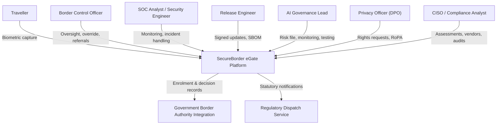

# E1.2 – SecureBorder eGate: System Use Cases

## Executive Summary

This document specifies the **System Use Case model** for the SecureBorder eGate platform: 28 Level-1 (Sea-Level) use cases across 11 functional areas, elaborated to the fully-dressed Cockburn anatomy with the security & privacy behavior accepted in the Round-1 risk-acceptance synthesis (`RN11`–`RN30`). It is the E1.2 companion of `Doc01_Requirements_Elicitation_and_PUC.md` (2.0.0), maintaining strict 1:1 traceability between requirements, Product Use Cases, and System Use Cases, technology-neutral throughout.

---

## Table of Contents

- [1. Introduction](#1-introduction)
- [2. System Requirements Approach & Literature Foundations](#2-system-requirements-approach--literature-foundations)
  - [2.1 The Volere Triangular Decomposition](#21-the-volere-triangular-decomposition)
  - [2.2 Use Case Architecture & Anatomy (Cockburn, Larman, Wiegers)](#22-use-case-architecture--anatomy-cockburn-larman-wiegers)
  - [2.3 Refinement Boundary: Sea Level vs. Micro-UI Anti-Patterns](#23-refinement-boundary-sea-level-vs-micro-ui-anti-patterns)
- [3. Requirements Analysis](#3-requirements-analysis)
  - [3.1 Work Context Model](#31-work-context-model)
  - [3.2 Traceability Matrix: Requirements to System Use Cases](#32-traceability-matrix-requirements-to-system-use-cases)
- [4. Domain Application Use Cases](#4-domain-application-use-cases)
  - [4.1 System Actors](#41-system-actors)
  - [4.2 System Use Cases Specification](#42-system-use-cases-specification)
- [5. Non-Functional Requirements](#5-non-functional-requirements)
- [6. Conclusions](#6-conclusions)
- [7. Bibliography](#7-bibliography)
- [Version History](#version-history)

---

## 1. Introduction

The SecureBorder eGate platform performs automated border-control verification with an on-board high-risk AI, operated across a multi-country fleet under four regulatory ambits (GDPR, CRA, NIS 2, AI Act). This use case model specifies, for each user-goal-level interaction, the black-box behavioral contract between actors and the system — including the accepted security & privacy behavior: cryptographic protection of biometric flows (RN11–RN14), effective human oversight of the AI (RN15, RN29, RN30), mediated operator access (RN16–RN20), unified incident notification under four statutory timelines (RN21–RN26), secure update distribution (RN27), and lifecycle erasure with token-only decision records (RN28).

## 2. System Requirements Approach & Literature Foundations

### 2.1 The Volere Triangular Decomposition

Following Robertson & Robertson, business events drive Product Use Cases (Doc01 §3), which are realized as System Use Cases here; the triangular decomposition connects business events → product use cases → system use cases with the requirement cards as the central vertex.

### 2.2 Use Case Architecture & Anatomy (Cockburn, Larman, Wiegers)

Each use case is specified at Cockburn's Sea Level (User Goal, Level 1) in the fully-dressed format: traceability, primary & supporting actors, stakeholders, preconditions, trigger, main success scenario (black-box actor–system exchanges), extensions (alternative/exception flows), success and minimal guarantees.

### 2.3 Refinement Boundary: Sea Level vs. Micro-UI Anti-Patterns

Refinement stops strictly at Level 1 (`{U.C. n.m}`); there are **zero leaf nodes** and **zero micro-UI procedural scripts**. Security behavior appears as preconditions (state that must hold), extensions (accepted refusal/failure behavior), and guarantees (non-repudiable records) — never as procedural scripts, and never as threat models (formal threat analysis is Phase 3 Part 2, ADR-006).

## 3. Requirements Analysis

### 3.1 Work Context Model

### 3.2 Traceability Matrix: Requirements to System Use Cases

*Table 1. Traceability Matrix — 28 requirements ↔ 28 PUCs ↔ 28 System Use Cases*

| Req (Doc01) | PUC | System Use Case | Title | Priority | Bound NFR-Security & Privacy |
|---|---|---|---|---|---|
| **R1.1** | **PUC 1.1** | **{U.C. 1.1}** | Enrol traveller biometric reference | MUST | NFR-RN11, NFR-RN12 |
| **R1.2** | **PUC 1.2** | **{U.C. 1.2}** | Perform biometric verification and gate decision | MUST | NFR-RN13, NFR-RN14, NFR-RN15, NFR-RN20, NFR-RN22, NFR-RN24 |
| **R1.3** | **PUC 1.3** | **{U.C. 1.3}** | Consult traveller passage decision records | MUST | NFR-RN11, NFR-RN14 |
| **R2.1** | **PUC 2.1** | **{U.C. 2.1}** | Review and override automated decisions | MUST | NFR-RN19, NFR-RN29 |
| **R2.2** | **PUC 2.2** | **{U.C. 2.2}** | Manage manual-lane referrals | MUST | NFR-RN18 (UC level) |
| **R3.1** | **PUC 3.1** | **{U.C. 3.1}** | Manage operator identity lifecycle | MUST | NFR-RN17 |
| **R3.2** | **PUC 3.2** | **{U.C. 3.2}** | Authenticate operators with multi-factor verification | MUST | NFR-RN18 |
| **R3.3** | **PUC 3.3** | **{U.C. 3.3}** | Assign and review operational access roles | MUST | NFR-RN17, NFR-RN19 |
| **R4.1** | **PUC 4.1** | **{U.C. 4.1}** | Process traveller data-subject requests | MUST | NFR-RN16, NFR-RN28 |
| **R4.2** | **PUC 4.2** | **{U.C. 4.2}** | Maintain records of processing activities | MUST | chain (PO-D-09.4-001) |
| **R5.1** | **PUC 5.1** | **{U.C. 5.1}** | Collect and correlate fleet security events | MUST | NFR-RN22, NFR-RN25 |
| **R5.2** | **PUC 5.2** | **{U.C. 5.2}** | Triage and manage incidents | MUST | NFR-RN23, NFR-RN26 |
| **R5.3** | **PUC 5.3** | **{U.C. 5.3}** | Recover services and exercise continuity | MUST | NFR-RN23 + chains |
| **R6.1** | **PUC 6.1** | **{U.C. 6.1}** | Execute unified regulatory notifications | MUST | NFR-RN21, NFR-RN14, NFR-RN26 |
| **R7.1** | **PUC 7.1** | **{U.C. 7.1}** | Identify and remediate vulnerabilities | MUST | chains |
| **R7.2** | **PUC 7.2** | **{U.C. 7.2}** | Distribute signed software and model updates | MUST | NFR-RN27 |
| **R7.3** | **PUC 7.3** | **{U.C. 7.3}** | Operate coordinated vulnerability disclosure | SHOULD | chains |
| **R8.1** | **PUC 8.1** | **{U.C. 8.1}** | Enforce release pipeline security gates | MUST | NFR-RN20 + chains |
| **R8.2** | **PUC 8.2** | **{U.C. 8.2}** | Maintain software bills of materials | MUST | chain (SO-D-06.2-002) |
| **R8.3** | **PUC 8.3** | **{U.C. 8.3}** | Version and roll back AI models | MUST | NFR-RN15 |
| **R9.1** | **PUC 9.1** | **{U.C. 9.1}** | Maintain AI risk management and conformity documentation | MUST | chains |
| **R9.2** | **PUC 9.2** | **{U.C. 9.2}** | Monitor AI accuracy, drift, and bias | MUST | NFR-RN24, NFR-RN25, NFR-RN15 |
| **R9.3** | **PUC 9.3** | **{U.C. 9.3}** | Test AI systems adversarially and explain decisions | MUST | NFR-RN30 + chains |
| **R10.1** | **PUC 10.1** | **{U.C. 10.1}** | Maintain unified impact and risk assessments | MUST | chains (T-003) |
| **R10.2** | **PUC 10.2** | **{U.C. 10.2}** | Assess vendors and record component provenance | MUST | chains (T-004) |
| **R10.3** | **PUC 10.3** | **{U.C. 10.3}** | Maintain compliance reporting and audits | MUST | chains |
| **R11.1** | **PUC 11.1** | **{U.C. 11.1}** | Deliver security and privacy awareness training | MUST | chains |
| **R11.2** | **PUC 11.2** | **{U.C. 11.2}** | Deliver oversight and AI competence training | MUST | NFR-RN29 |

---

## 4. Domain Application Use Cases

### 4.1 System Actors

- **Traveller:** border-crossing subject presenting at the gate for biometric verification; data subject under GDPR.
- **Border Control Officer / overseer:** empowered human oversight over automated decisions (AI Act Art. 14).
- **SOC Analyst / Security Engineer:** fleet monitoring, incident handling, vulnerability management.
- **Release Engineer:** signed software and model update distribution.
- **AI Governance Lead:** AI risk management, conformity documentation, monitoring, adversarial testing.
- **Privacy Officer (DPO):** rights requests, RoPA, privacy compliance.
- **CISO / Compliance Analyst:** unified assessments, vendor management, compliance reporting.
- **Site Operations Technician:** per-site gate operations.
- **Government Border Authority Integration:** external enrolment/decision record exchange.
- **Regulatory Dispatch Service:** external statutory notification transport.

---

### 4.2 System Use Cases Specification

---

### {U.C. 1} Manage Traveller Biometric Verification

#### {U.C. 1.1} Enrol traveller biometric reference
- **Traceability:** `R1.1` | `PUC 1.1`
- **Primary Actor:** Traveller (via gate session) / Border Control Officer
- **Supporting Actors:** Government Border Authority Integration
- **Stakeholders & Interests:** *Border authorities:* trustworthy enrolment records. *Travellers:* biometric content minimized and protected from birth.
- **Preconditions:** Gate session authenticated; authority record available; enrolment configuration at the restrictive secure-by-default state (RN20).
- **Trigger:** Traveller consents to enrolment at the gate.
- **Main Success Scenario:**
  1. Traveller presents at the gate and the system captures the biometric image.
  2. System extracts the verification template, applies irreversible de-linking, and discards the raw capture immediately (V0 functional).
  3. System stores the template encrypted at rest under separated key custody (RN11, RN12).
  4. System registers the enrolment against the authority record over the authenticated transit channel (RN13) and emits the audit event (RN22).
- **Extensions:**
  - **2a. Capture quality insufficient:** 2a1. System re-prompts capture within policy bounds and never stores the rejected raw capture.
  - **3a. Key custody unavailable:** 3a1. System aborts enrolment, discards the capture, and logs the failure (RN12, RN22).
- **Success Guarantees:** Template stored encrypted and de-linked; raw capture discarded; authority record updated.
- **Minimal Guarantees:** No plaintext biometric content remains in any store; failed enrolments leave no residue (RN11, RN12).

#### {U.C. 1.2} Perform biometric verification and gate decision
- **Traceability:** `R1.2` | `PUC 1.2`
- **Primary Actor:** Traveller (via gate session)
- **Supporting Actors:** Border Control Officer; Government Border Authority Integration
- **Stakeholders & Interests:** *Travellers:* fair, accurate, explainable decisions. *State:* border integrity. *Provider:* AI Act conformity.
- **Preconditions:** Verification service available; model version verified (RN15); operator oversight active (RN29); encrypted session established (RN13).
- **Trigger:** Traveller enters the gate and requests passage.
- **Main Success Scenario:**
  1. System captures the live biometric sample and compares it against the stored template.
  2. System records the decision with automatic event logging over the lifetime (RN24) and integrity protection (RN14).
  3. System produces the passage decision within the performance envelope (RN1) and opens or keeps closed the gate accordingly.
  4. System emits the decision record (token-only) to the decision store and the authority integration over the protected channel (RN13).
- **Extensions:**
  - **2a. AI fault or inconsistent state:** 2a1. System keeps the gate in a safe closed state and reverts to the last verified model version (RN15).
  - **2b. Confidence below threshold:** 2b1. System routes the traveller to manual-lane referral ({U.C. 2.2}) and records the referral (RN22).
  - **2c. Tampering detected on records/commands:** 2c1. System reports the corruption and refuses to act on the affected data (RN14).
- **Success Guarantees:** Decision recorded tamper-evidently; gate state consistent with the decision; logs complete (RN24).
- **Minimal Guarantees:** On any fault the gate fails closed (RN15); no plaintext biometric content outside the protected boundary (RN13).

#### {U.C. 1.3} Consult traveller passage decision records
- **Traceability:** `R1.3` | `PUC 1.3`
- **Primary Actor:** Border Control Officer / Compliance Analyst
- **Supporting Actors:** None
- **Stakeholders & Interests:** *Authorities:* auditable decision history. *Travellers:* token-only records without biometric content.
- **Preconditions:** Actor authenticated with consult role (RN19); encrypted session (RN13).
- **Trigger:** Actor queries decision records for a case or audit.
- **Main Success Scenario:**
  1. Actor queries the decision record store with scope parameters.
  2. System returns the token-only decision records with integrity verification (RN14), templates remaining encrypted at rest (RN11).
  3. System logs the consultation (RN22).
- **Extensions:**
  - **1a. Scope exceeds actor role:** 1a1. System refuses and records the denial (RN19, RN22).
- **Success Guarantees:** Complete, integrity-verified records delivered within scope.
- **Minimal Guarantees:** No biometric content is exposed through consultation (RN11, RN28).

---

### {U.C. 2} Manage Human Oversight and Gate Control

#### {U.C. 2.1} Review and override automated decisions
- **Traceability:** `R2.1` | `PUC 2.1`
- **Primary Actor:** Border Control Officer (overseer)
- **Supporting Actors:** None
- **Stakeholders & Interests:** *Travellers:* human review of AI decisions (AI Act Art. 14). *Provider:* non-repudiable oversight records.
- **Preconditions:** Overseer authenticated and role-authorized (RN19); overseer competence current via training (RN29); AI logs available for interpretation (RN24, RN30).
- **Trigger:** Overseer selects a flagged or requested decision for review.
- **Main Success Scenario:**
  1. Overseer opens the decision with its interpretability information and logs (RN30, RN24).
  2. Overseer confirms, corrects, or reverses the automated decision.
  3. System records the override as a first-class, attributed, tamper-evident decision (RN19, RN22).
  4. System propagates the corrected state to the authority integration over the protected channel (RN13).
- **Extensions:**
  - **2a. Overseer lacks authority for the decision class:** 2a1. System refuses and records the attempt (RN19).
  - **3a. Propagation failure:** 3a1. System queues the correction and flags the discrepancy until resolved (RN14).
- **Success Guarantees:** Override recorded non-repudiably; corrected state consistent across stores.
- **Minimal Guarantees:** No override executes without role authorization and competence record (RN19, RN29).

#### {U.C. 2.2} Manage manual-lane referrals
- **Traceability:** `R2.2` | `PUC 2.2`
- **Primary Actor:** Border Control Officer
- **Supporting Actors:** Traveller
- **Stakeholders & Interests:** *Travellers:* dignified manual processing. *Operator:* authenticated referral handling.
- **Preconditions:** Officer authenticated with strong authentication (RN18).
- **Trigger:** System routes a traveller to the manual lane (verification below threshold).
- **Main Success Scenario:**
  1. Officer opens the referral ticket and processes the traveller manually.
  2. Officer records the manual decision and closes the referral.
  3. System stores the outcome with the standard decision-record protections ({U.C. 1.2} guarantees).
- **Extensions:**
  - **1a. Traveller declines manual processing:** 1a1. System records the refusal and the refusal outcome per authority policy.
- **Success Guarantees:** Referral closed with a recorded, integrity-protected outcome.
- **Minimal Guarantees:** Referral records never bypass the decision-record protections (RN14, RN22).

---

### {U.C. 3} Manage Operator Identities and Access

#### {U.C. 3.1} Manage operator identity lifecycle
- **Traceability:** `R3.1` | `PUC 3.1`
- **Primary Actor:** CISO / Site Operations Technician
- **Supporting Actors:** None
- **Stakeholders & Interests:** *Entity:* workforce identity discipline (NIS 2). *Product:* verifiable component identities (CRA).
- **Preconditions:** Actor authorized for identity administration (RN19).
- **Trigger:** Operator induction, role change, or separation event.
- **Main Success Scenario:**
  1. Administrator provisions the operator identity with role-appropriate entitlements (RN17).
  2. On role change, system reviews and adjusts entitlements (RN17).
  3. On separation, system revokes entitlements and sessions and records the revocation (RN17, RN22).
- **Extensions:**
  - **1a. Duplicate or invalid identity data:** 1a1. System refuses provisioning and flags the record.
- **Success Guarantees:** Identity state matches the employment lifecycle at every event.
- **Minimal Guarantees:** No orphaned active entitlements remain after separation (RN17).

#### {U.C. 3.2} Authenticate operators with multi-factor verification
- **Traceability:** `R3.2` | `PUC 3.2`
- **Primary Actor:** All operator roles
- **Supporting Actors:** None
- **Stakeholders & Interests:** *Entity:* strong access boundary (NIS 2 Art. 21(2)(j)). *Provider:* product access-control duty (CRA).
- **Preconditions:** Operator identity active (RN17).
- **Trigger:** Operator session establishment.
- **Main Success Scenario:**
  1. Operator presents credentials per the entity authentication policy (multi-factor where mandated).
  2. System verifies the factors and establishes the session with the role context (RN18).
  3. System records the authentication event (RN22).
- **Extensions:**
  - **1a. Factor failure beyond policy threshold:** 1a1. System refuses and locks per policy, recording the lockout (RN18, RN22).
  - **1b. Weaker modality requested by policy exception:** 1b1. System refuses non-policy modalities (RN18).
- **Success Guarantees:** Only policy-mandated authentication strengths reach the back-office.
- **Minimal Guarantees:** Authentication failures are recorded and never silently retried without limit (RN18).

#### {U.C. 3.3} Assign and review operational access roles
- **Traceability:** `R3.3` | `PUC 3.3`
- **Primary Actor:** CISO
- **Supporting Actors:** None
- **Stakeholders & Interests:** *Entity:* least-privilege discipline. *GDPR:* authorized persons act on documented instructions only.
- **Preconditions:** Administrator authenticated (RN18); role catalog maintained.
- **Trigger:** Role assignment or periodic entitlement review.
- **Main Success Scenario:**
  1. Administrator assigns the role scoped to documented instructions (RN19).
  2. System applies the entitlement and records the assignment (RN17).
  3. On review cycle, system reports entitlements for verification and adjustment (RN17).
- **Extensions:**
  - **1a. Assignment outside the instruction scope:** 1a1. System requires explicit re-authorization or refuses (RN19).
- **Success Guarantees:** Entitlements reflect documented instructions and least privilege.
- **Minimal Guarantees:** All assignments and reviews are recorded (RN17, RN22).

---

### {U.C. 4} Manage Traveller Data Rights

#### {U.C. 4.1} Process traveller data-subject requests
- **Traceability:** `R4.1` | `PUC 4.1`
- **Primary Actor:** Privacy Officer (DPO) / Traveller
- **Supporting Actors:** None
- **Stakeholders & Interests:** *Travellers:* GDPR rights over biometric data. *Provider:* statutory compliance (Art. 15–22).
- **Preconditions:** Requester identity verified proportionately (RN16); case recorded.
- **Trigger:** Traveller or employee submits an access, rectification, erasure, or portability request.
- **Main Success Scenario:**
  1. System verifies the requester's identity and records the verification (RN16).
  2. For erasure: system destroys the biometric template, its de-linking key material, and raw-capture derivatives permanently, keeping only token-only decision records under the statutory floor (RN28, T-002).
  3. For portability/access: system delivers the structured, machine-readable export of the requester's data, excluding third-party content (RN28).
  4. For rectification: system executes the correction and the downstream recipient cascade (chain: PO-D-01.4-001).
  5. System records the response against the 30-day statutory clock and updates the RoPA (R4.2).
- **Extensions:**
  - **1a. Identity verification fails:** 1a1. System halts execution, records the failed attempt, and requests re-confirmation (RN16).
  - **2a. Erasure conflicts with a statutory retention floor:** 2a1. System applies the token-only separation per T-002 and records the legal basis (RN28).
  - **4a. Recipient cascade unreachable:** 4a1. System queues the cascade and records the pending state (chain: PO-D-01.4-001).
- **Success Guarantees:** Rights executed within statutory deadlines; biometric content destroyed including key material (RN28).
- **Minimal Guarantees:** No request executes without identity verification (RN16); every response is recorded against the clock.

#### {U.C. 4.2} Maintain records of processing activities
- **Traceability:** `R4.2` | `PUC 4.2`
- **Primary Actor:** Privacy Officer (DPO)
- **Supporting Actors:** None
- **Stakeholders & Interests:** *Entity:* Art. 30 accountability.
- **Preconditions:** DPO authenticated (RN19).
- **Trigger:** New or changed processing activity, or periodic review.
- **Main Success Scenario:**
  1. DPO records or updates the processing-activity entry with purposes, categories, recipients, and retention.
  2. System maintains the record with integrity and traceability (chain: PO-D-09.4-001) and exposes it for authority access.
- **Extensions:**
  - **1a. Entry incomplete per the Art. 30(1) minimum:** 1a1. System marks the entry incomplete until remedied.
- **Success Guarantees:** RoPA complete and current for all processing under responsibility.
- **Minimal Guarantees:** Records integrity-protected and authority-accessible (chain: PO-D-09.4-001).

---

### {U.C. 5} Monitor Security and Manage Incidents

#### {U.C. 5.1} Collect and correlate fleet security events
- **Traceability:** `R5.1` | `PUC 5.1`
- **Primary Actor:** SOC Analyst
- **Supporting Actors:** None
- **Stakeholders & Interests:** *Entity:* NIS 2 detection duty. *Provider:* CRA activity-recording duty; AI Act post-market loop.
- **Preconditions:** Fleet devices enrolled; monitoring channel protected (RN13).
- **Trigger:** Gates and back-office emit security-relevant events.
- **Main Success Scenario:**
  1. System collects gate and back-office activity events in tamper-evident storage (RN22).
  2. System correlates events into security insights for the SOC.
  3. System feeds AI post-market monitoring data into the risk-management loop (RN25).
- **Extensions:**
  - **1a. Tamper attempt detected:** 1a1. System raises a priority alert and preserves the evidence (RN22).
- **Success Guarantees:** Complete, tamper-evident event coverage across the fleet.
- **Minimal Guarantees:** Monitoring data reaching the AI risk system is traceable (RN25).

#### {U.C. 5.2} Triage and manage incidents
- **Traceability:** `R5.2` | `PUC 5.2`
- **Primary Actor:** SOC Analyst / CISO
- **Supporting Actors:** Regulatory Dispatch Service
- **Stakeholders & Interests:** *Entity:* NIS 2 incident-handling duty. *GDPR:* 72-hour clock discipline.
- **Preconditions:** Incident detected via {U.C. 5.1}; handler authenticated (RN18).
- **Trigger:** Security or personal-data incident raised.
- **Main Success Scenario:**
  1. System records the awareness moment, anchoring the notification clock (RN26).
  2. Analyst triages the incident and records containment/mitigation measures (RN26).
  3. System supports the six lifecycle actions with CSIRT-ready evidence (RN23).
  4. System routes the incident to notification when statutory criteria are met ({U.C. 6.1}, RN21).
- **Extensions:**
  - **2a. Containment requires isolating assets:** 2a1. System applies the isolation measure per policy and records it (RN26).
- **Success Guarantees:** Awareness timestamp, containment record, and lifecycle evidence complete.
- **Minimal Guarantees:** The clock-start is never absent for a notifiable breach (RN26, RN21).

#### {U.C. 5.3} Recover services and exercise continuity
- **Traceability:** `R5.3` | `PUC 5.3`
- **Primary Actor:** Site Operations Technician / SOC Analyst
- **Supporting Actors:** None
- **Stakeholders & Interests:** *Entity:* business continuity (NIS 2 Art. 21(2)(c)); *GDPR/CRA:* resilience of processing and essential functions.
- **Preconditions:** Continuity plan in force; backups available (V0 RN4).
- **Trigger:** Service disruption or disaster-recovery exercise.
- **Main Success Scenario:**
  1. Operations executes recovery per the continuity plan within the RTO/RPO envelope (V0 RN4).
  2. System protects the availability of essential functions during and after the incident (chains: SO-D-04.2-002, SO-D-04.4-002/003, PO-D-04.4-001, PO-D-10.1-001).
  3. System records the recovery and feeds lessons into the incident record (RN23).
- **Extensions:**
  - **1a. Recovery exceeds RTO:** 1a1. System escalates per crisis-management procedure and records the breach of envelope (chains).
- **Success Guarantees:** Essential functions restored within the continuity envelope.
- **Minimal Guarantees:** Recovery actions recorded; post-incident availability protections active (chains).

---

### {U.C. 6} Notify Regulatory Authorities

#### {U.C. 6.1} Execute unified regulatory notifications
- **Traceability:** `R6.1` | `PUC 6.1`
- **Primary Actor:** CISO / DPO / AI Governance Lead
- **Supporting Actors:** Regulatory Dispatch Service
- **Stakeholders & Interests:** *Authorities:* timely statutory notifications under four regimes. *Entity:* one clock-start discipline (T-001).
- **Preconditions:** Incident record with recorded awareness/trigger moment (RN26); dispatch channel authenticated and integrity-protected (RN13).
- **Trigger:** An incident meets a statutory notification criterion (GDPR breach · CRA actively-exploited vulnerability · NIS 2 significant incident · AI Act serious incident).
- **Main Success Scenario:**
  1. System routes the incident dossier to the competent authorities per the four applicable timelines from the single clock-start: 24-hour early warnings (CRA/NIS 2), 72-hour notifications (GDPR/NIS 2), AI Act serious-incident matrix (RN21).
  2. System assembles the dossier with integrity-protected content (RN14) and dispatches via the Regulatory Dispatch Service.
  3. System records the dispatch, the timeline met, and the receipt (RN21, RN22).
  4. For incidents affecting multiple Member States, system routes to the affected Member States' authorities per the cross-border duty (chain: SO-D-06.4-003).
- **Extensions:**
  - **1a. Concurrent regimes apply:** 1a1. System generates the concurrent notifications from one incident record without re-starting the clock (RN21, T-001).
  - **2a. Dispatch channel unavailable:** 2a1. System retries per policy and records the delay cause against the clock (RN21, RN14).
- **Success Guarantees:** All statutory deadlines met and evidenced from one clock-start.
- **Minimal Guarantees:** Notification dossiers integrity-protected; timelines traceable (RN14, RN21).

---

### {U.C. 7} Manage Vulnerabilities and Updates

#### {U.C. 7.1} Identify and remediate vulnerabilities
- **Traceability:** `R7.1` | `PUC 7.1`
- **Primary Actor:** Security Engineer
- **Supporting Actors:** None
- **Stakeholders & Interests:** *Market:* no known exploitable vulnerabilities (CRA). *Entity:* NIS 2 handling duty. *GDPR:* measures effectiveness testing.
- **Preconditions:** SBOM current ({U.C. 8.2}); testing cadence defined.
- **Trigger:** Scheduled scan, test report, or external advisory.
- **Main Success Scenario:**
  1. Engineer identifies and documents vulnerabilities across product components and SBOM items (chains: SO-D-02.1-002/003, PO-D-02.1-001).
  2. Security testing produces conformity evidence per the regular cadence (chains: SO-D-02.4-002, SO-D-10.3-002).
  3. Remediation flows to the update pipeline ({U.C. 7.2}) and maintenance stays within the security measures (chain: SO-D-07.3-003).
- **Extensions:**
  - **1a. Actively-exploited vulnerability found:** 1a1. System escalates to the notification clock ({U.C. 6.1}, RN21).
- **Success Guarantees:** Vulnerability register complete; remediation pipeline fed.
- **Minimal Guarantees:** Identification artefacts feed the disclosure and notification cascades (chains).

#### {U.C. 7.2} Distribute signed software and model updates
- **Traceability:** `R7.2` | `PUC 7.2`
- **Primary Actor:** Release Engineer
- **Supporting Actors:** None
- **Stakeholders & Interests:** *Fleet:* fleet integrity (RN14). *Market:* CRA secure-distribution duty (RN27).
- **Preconditions:** Update package integrity-verified in the pipeline ({U.C. 8.1}); distribution channel separated and secured.
- **Trigger:** Security update release (software or AI model).
- **Main Success Scenario:**
  1. Release Engineer publishes the signed update through the secure, separated channel (RN27).
  2. System disseminates it to the fleet without delay with advisory messages (RN27; chain: SO-D-08.1-002).
  3. System keeps the update and advisory available across the support period (RN27).
- **Extensions:**
  - **2a. Update fails integrity verification at the gate:** 2a1. Gate refuses the update and alerts the SOC (RN14, RN22).
- **Success Guarantees:** Fleet reaches the patched state; advisories delivered; availability window met.
- **Minimal Guarantees:** No unsigned or out-of-channel update is accepted by any fleet device (RN27, RN14).

#### {U.C. 7.3} Operate coordinated vulnerability disclosure
- **Traceability:** `R7.3` | `PUC 7.3`
- **Primary Actor:** Security Engineer
- **Supporting Actors:** None
- **Stakeholders & Interests:** *Researchers:* reporting contact. *Market:* CRA/NIS 2 disclosure duties.
- **Preconditions:** CVD policy published; contact address identifiable.
- **Trigger:** External or internal vulnerability report.
- **Main Success Scenario:**
  1. System registers the report through the contact address (chains: SO-D-02.3-002/003).
  2. Engineer triages, remediates via {U.C. 7.1}/{U.C. 7.2}, and publishes the disclosure per policy with the justified-delay check.
- **Extensions:**
  - **2a. Publication risk outweighs benefit:** 2a1. System records the justified delay and re-evaluates on schedule (chains).
- **Success Guarantees:** Reports handled per policy; disclosures complete.
- **Minimal Guarantees:** Disclosure records traceable to the handled vulnerability (chains).

---

### {U.C. 8} Manage Secure Development and Releases

#### {U.C. 8.1} Enforce release pipeline security gates
- **Traceability:** `R8.1` | `PUC 8.1`
- **Primary Actor:** Release Engineer
- **Supporting Actors:** None
- **Stakeholders & Interests:** *Market:* Annex I conformity of release artefacts (chains). *Entity:* secure development (NIS 2).
- **Preconditions:** Pipeline configuration at secure-by-default state (RN20).
- **Trigger:** Release candidate enters the pipeline.
- **Main Success Scenario:**
  1. Pipeline executes the security gates (testing, signing, attack-surface checks) (chains: SO-D-07.1-002, SO-D-07.2-002).
  2. Artifacts are born with the restrictive default configuration (RN20).
  3. System records gate outcomes in the release record (RN22).
- **Extensions:**
  - **1a. Gate failure:** 1a1. Pipeline blocks the release and records the failing gate (chains).
- **Success Guarantees:** Only gate-passing artefacts reach distribution ({U.C. 7.2}).
- **Minimal Guarantees:** Gate outcomes recorded and tamper-evident (RN22).

#### {U.C. 8.2} Maintain software bills of materials
- **Traceability:** `R8.2` | `PUC 8.2`
- **Primary Actor:** Release Engineer
- **Supporting Actors:** None
- **Stakeholders & Interests:** *Market:* CRA SBOM duty. *Entity:* supply-chain visibility.
- **Preconditions:** Component inventory from the pipeline.
- **Trigger:** Each release, and on component change.
- **Main Success Scenario:**
  1. System generates/updates the SBOM in a commonly accepted machine-readable format (chain: SO-D-06.2-002).
  2. SBOM feeds vulnerability identification ({U.C. 7.1}) and vendor provenance ({U.C. 10.2}).
- **Extensions:**
  - **1a. Component provenance incomplete:** 1a1. System flags the SBOM entry as provisional until resolved.
- **Success Guarantees:** SBOM current per release.
- **Minimal Guarantees:** SBOM machine-readable and versioned (chain: SO-D-06.2-002).

#### {U.C. 8.3} Version and roll back AI models
- **Traceability:** `R8.3` | `PUC 8.3`
- **Primary Actor:** AI Governance Lead / Release Engineer
- **Supporting Actors:** None
- **Stakeholders & Interests:** *Travellers:* no degraded model at the boundary. *Provider:* AI Act Art. 15(3) robustness.
- **Preconditions:** Model versions signed and verified ({U.C. 8.1}).
- **Trigger:** Model release, or fault detection ({U.C. 9.2}).
- **Main Success Scenario:**
  1. System versions the model release with verification metadata.
  2. On fault, system reverts the gate to the last verified model version and keeps the safe closed state meanwhile (RN15).
- **Extensions:**
  - **2a. Rollback itself fails:** 2a1. System holds the safe closed state and escalates to manual-lane operation (RN15, {U.C. 2.2}).
- **Success Guarantees:** Gate never operates a known-faulty model; rollback deterministic.
- **Minimal Guarantees:** Fail-safe closed state prevails on any model fault (RN15).

---

### {U.C. 9} Govern AI Quality and Conformity

#### {U.C. 9.1} Maintain AI risk management and conformity documentation
- **Traceability:** `R9.1` | `PUC 9.1`
- **Primary Actor:** AI Governance Lead
- **Supporting Actors:** None
- **Stakeholders & Interests:** *Authorities:* Annex IV conformity. *Entity:* Art. 9 risk management.
- **Preconditions:** Unified assessment inputs ({U.C. 10.1}, T-003).
- **Trigger:** Lifecycle event, post-market data, or periodic review.
- **Main Success Scenario:**
  1. Governance Lead maintains the risk-management file across the lifecycle, including AI-specific attack risks (chains: SO-D-02.1-004, SO-D-09.2-004).
  2. System maintains training/validation/test data governance records (chain: SO-D-05.1-004) and the Annex IV technical documentation (chain: SO-D-09.4-004) with the accuracy/robustness design leg (chain: SO-D-07.1-004).
- **Extensions:**
  - **1a. Post-market data indicates new risk:** 1a1. Risk file updated with the traced trigger (RN25).
- **Success Guarantees:** Risk file and documentation current and conformity-ready.
- **Minimal Guarantees:** All updates traceable to their lifecycle trigger (chains).

#### {U.C. 9.2} Monitor AI accuracy, drift, and bias
- **Traceability:** `R9.2` | `PUC 9.2`
- **Primary Actor:** AI Governance Lead
- **Supporting Actors:** SOC Analyst
- **Stakeholders & Interests:** *Travellers:* non-discriminatory accuracy (AI Act). *Provider:* V0 RN7/RN8 targets.
- **Preconditions:** AI event logging active (RN24).
- **Trigger:** Continuous monitoring cycle.
- **Main Success Scenario:**
  1. System monitors accuracy, drift, and fairness disparities against the V0 targets (RN7/RN8).
  2. System logs the monitored events over the lifetime (RN24) and feeds post-market data into the risk loop (RN25).
  3. On degradation beyond the alert threshold, system triggers the fail-safe/rollback path (RN15).
- **Extensions:**
  - **3a. Fairness disparity beyond threshold:** 3a1. System alerts and opens a risk-file action (RN25; V0 RN8).
- **Success Guarantees:** Degradation detected and acted on within the alert window.
- **Minimal Guarantees:** Monitoring records complete and tamper-evident (RN24, RN22).

#### {U.C. 9.3} Test AI systems adversarially and explain decisions
- **Traceability:** `R9.3` | `PUC 9.3`
- **Primary Actor:** AI Governance Lead
- **Supporting Actors:** Security Engineer
- **Stakeholders & Interests:** *Deployers:* interpretability (AI Act Art. 13). *Provider:* Art. 15(4)-(5) resistance.
- **Preconditions:** Test environment isolated from production gates.
- **Trigger:** Scheduled adversarial testing cycle, or post-market trigger.
- **Main Success Scenario:**
  1. Governance Lead runs adversarial/real-world testing per Art. 9(6)-(7) and Art. 60 (chains: SO-D-02.4-004, SO-D-07.2-004, SO-D-10.3-004).
  2. System produces decision-interpretability information enabling deployers to interpret outputs (RN30) and sustaining human oversight (RN29).
  3. Test reports join the technical documentation ({U.C. 10.3}).
- **Extensions:**
  - **1a. Adversarial success found:** 1a1. System files the finding into the risk file with a targeted measure (RN25, chains).
- **Success Guarantees:** Testing evidence current; interpretability information available per decision class.
- **Minimal Guarantees:** Findings never silently discarded — each enters the risk-management file (chains, RN25).

---

### {U.C. 10} Manage Governance, Risk, and Vendors

#### {U.C. 10.1} Maintain unified impact and risk assessments
- **Traceability:** `R10.1` | `PUC 10.1`
- **Primary Actor:** CISO / DPO / AI Governance Lead
- **Supporting Actors:** None
- **Stakeholders & Interests:** *Entity:* one evidence pass feeding four regimes (T-003).
- **Preconditions:** Processing/product context current.
- **Trigger:** Material change, or at least the annual cycle.
- **Main Success Scenario:**
  1. One evidence-gathering pass produces the DPIA (chain: PO-D-09.2-001), the CRA risk assessment (chain: SO-D-09.2-002), the NIS 2 risk analysis (chain: SO-D-09.2-003), and the AI risk-management leg (chain: SO-D-09.2-004).
  2. Governance policies reflect the outcomes (chains: PO-D-09.1-001, SO-D-09.1-003, SO-D-01.1-003) with management-body approval recorded.
  3. Assessments update on material change and at least annually.
- **Extensions:**
  - **1a. Regime-specific gap found:** 1a1. System records the gap against the specific regime requirement and tracks remediation.
- **Success Guarantees:** Four-regime documentation consistent and current.
- **Minimal Guarantees:** Every assessment update traceable to its trigger (chains).

#### {U.C. 10.2} Assess vendors and record component provenance
- **Traceability:** `R10.2` | `PUC 10.2`
- **Primary Actor:** CISO / Compliance Analyst
- **Supporting Actors:** None
- **Stakeholders & Interests:** *Entity:* NIS 2 three-prong supplier assessment. *GDPR:* processor guarantees. *CRA:* component due diligence (T-004).
- **Preconditions:** Supplier universe documented under the direct scope-limiter.
- **Trigger:** Supplier onboarding, change, or periodic reassessment.
- **Main Success Scenario:**
  1. One due-diligence pass produces processor documentation (chains: PO-D-06.1-001, PO-D-06.3-001), component/provenance records (chain: SO-D-06.1-002), and the NIS 2 three-prong supplier assessment (chains: SO-D-06.1-003, SO-D-06.3-003, SO-D-07.1-003).
  2. System records outcomes and feeds contract management.
- **Extensions:**
  - **1a. Supplier fails the assessment:** 1a1. System records the finding and gates the engagement per policy.
- **Success Guarantees:** Supplier universe covered by the unified assessment.
- **Minimal Guarantees:** Assessment records traceable per supplier and component (chains).

#### {U.C. 10.3} Maintain compliance reporting and audits
- **Traceability:** `R10.3` | `PUC 10.3`
- **Primary Actor:** Compliance Analyst
- **Supporting Actors:** None
- **Stakeholders & Interests:** *Authorities:* conformity evidence. *Entity:* audit readiness.
- **Preconditions:** Documentation sources current ({U.C. 9.1}, {U.C. 8.2}).
- **Trigger:** Audit, market-surveillance request, or periodic cycle.
- **Main Success Scenario:**
  1. System assembles the compliance dossier: CRA technical documentation (chains: SO-D-09.4-002, SO-D-10.2-002), GDPR compliance records (chains: PO-D-10.2-001, PO-D-10.3-001), NIS 2 effectiveness-assessment evidence (chain: SO-D-10.3-003).
  2. System maintains records with integrity and traceability for authority access.
- **Extensions:**
  - **1a. Evidence gap identified:** 1a1. System records the gap with an owner and deadline.
- **Success Guarantees:** Audit-ready dossier across the four regimes.
- **Minimal Guarantees:** Records integrity-protected and traceable (chains).

---

### {U.C. 11} Manage Training and Competence

#### {U.C. 11.1} Deliver security and privacy awareness training
- **Traceability:** `R11.1` | `PUC 11.1`
- **Primary Actor:** CISO / DPO
- **Supporting Actors:** None
- **Stakeholders & Interests:** *Entity:* NIS 2 hygiene and training duties.
- **Preconditions:** Training program defined.
- **Trigger:** Onboarding and periodic cycle.
- **Main Success Scenario:**
  1. Entity delivers security/privacy awareness and cyber-hygiene training (chains: SO-D-08.1-003, SO-D-08.2-003).
  2. System records completion per employee.
- **Extensions:**
  - **2a. Completion overdue:** 2a1. System flags the record to the identity review ({U.C. 3.3}).
- **Success Guarantees:** Workforce awareness current per the NIS 2 duties.
- **Minimal Guarantees:** Completion records maintained (chains).

#### {U.C. 11.2} Deliver oversight and AI competence training
- **Traceability:** `R11.2` | `PUC 11.2`
- **Primary Actor:** AI Governance Lead
- **Supporting Actors:** None
- **Stakeholders & Interests:** *Travellers:* effective human oversight (AI Act Art. 14). *Overseers:* real competence.
- **Preconditions:** Oversight role assignment ({U.C. 3.3}).
- **Trigger:** Oversight onboarding, model change, and periodic cycle.
- **Main Success Scenario:**
  1. Entity delivers oversight and AI competence training covering interpretation of outputs, bias awareness, and intervention authority (RN29).
  2. System maintains the competence records gating oversight shifts ({U.C. 2.1} precondition).
- **Extensions:**
  - **2a. Competence lapsed:** 2a1. System disqualifies the overseer from active shifts until retrained (RN29).
- **Success Guarantees:** Every active overseer holds current competence (RN29).
- **Minimal Guarantees:** No oversight shift runs without a competent, trained overseer (RN29).

---

## 5. Non-Functional Requirements

*Table 2. Non-Functional Requirements Summary (V0 quality attributes + cross-cutting security)*

| ID | Quality Attribute | Verification Target |
|---|---|---|
| **RN1** | Performance | Decision within 3 s of capture; enrolment within 60 s. |
| **RN2** | Availability | 99.99% monthly during border-opening hours, excluding announced maintenance. |
| **RN3** | Scalability | 500 travellers/hour/gate; 3× peak surge absorbed. |
| **RN4** | Recoverability | RTO 1 h; RPO 15 min. |
| **RN5** | Privacy Responsiveness | Raw captures discarded within 5 s of extraction; rights responses within 30 days. |
| **RN6** | Auditability | 100% of decisions as token-only records in tamper-evident storage, statutory floor retention. |
| **RN7** | AI Quality | ≥ 99.5% measured accuracy; alert on degradation beyond 1%. |
| **RN8** | AI Fairness | Quarterly fairness assessments: FA disparity < 1%, FR disparity < 2%. |
| **RN9** | Interoperability | Authority integrations over authenticated, integrity-protected channels. |
| **RN10** | Deployment Isolation | Per-country isolation, no cross-border data commingling. |
| **RN13** | Security — Transport | All boundary flows authenticated, encrypted, integrity-verified (GDPR Art. 32 + CRA 2(e)/(j) → PO-D-01.2-001, SO-D-01.2-002 → PRIN-ENG-01 → CSF PR.DS-02, PR.IR-01). |

---

## 6. Conclusions

The system use case model establishes the round-converged behavioral contract for the SecureBorder eGate platform:
1. **Sea-Level fidelity:** 28 Level-1 fully-dressed use cases; zero leaf nodes, zero procedural scripts.
2. **Accepted security behavior:** preconditions, extensions, and guarantees trace to `RN11`–`RN30` and the 51 chain bindings — every protection entered through an explicit client verdict (Round 1: 20/20 accepts + 51/51 chain bindings).
3. **Four-regulation visibility:** each protection carries its GDPR/CRA/NIS 2/AI Act chain into the use-case behavior, with T-001..T-004 harmonizations realized (unified notification clock, token-only erasure, unified assessments, unified vendor pass).
4. **Part 2 readiness:** assets, trust boundaries, and the accepted baseline are in place for Phase 3 Part 2 — Threat & Risk Analysis (ADR-006), gated by the Part 1 Exit Gate.

## 7. Bibliography

- Cockburn, A. (2000). *Writing Effective Use Cases*. Addison-Wesley Professional.
- Larman, C. (2004). *Applying UML and Patterns* (3rd ed.). Prentice Hall.
- Robertson, S., & Robertson, J. (2012). *Mastering the Requirements Process* (3rd ed.). Addison-Wesley.
- Wiegers, K., & Beatty, J. (2013). *Software Requirements* (3rd ed.). Microsoft Press.
- Object Management Group (OMG). (2017). *OMG UML Version 2.5.1*.
- Centro de Computação Gráfica (CCG) & PIEP. (2023). *E1.2 – GPTools_AnáliseRequisitos_CasosDeUso_V4.0*. Guimarães, Portugal.

---

## Version History

| Version | Date | Author | Description of Changes |
|---|---|---|---|
| **1.0.0** | 2026-09-23 | Requirements Engineering Agent | Initial baseline System Use Cases (GPTools E1.2 model): 11 Level-0 groups, 28 Sea-Level use cases, zero leaf nodes. |
| **2.0.0** | 2026-09-28 | Requirements Engineering Agent | Round 1 synthesis (ADR-005, `synthesis_rounds/ROUND1_REGISTER.md`, 20/20 accepts + 51/51 chain bindings): 28 use cases elaborated to the fully-dressed Cockburn anatomy with security preconditions, extensions, and guarantees from the accepted constraint set (`RN11`–`RN30`); traceability matrix updated with bound NFRs; T-001..T-004 harmonizations realized in {U.C. 6.1}, {U.C. 4.1}, {U.C. 10.1}, {U.C. 10.2}; threat analysis remains Phase 3 Part 2 (ADR-006). |
