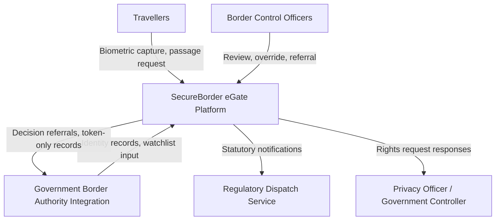

# E1.2 – SecureBorder eGate: System Use Cases

## Executive Summary

This deliverable specifies the formal **System Use Cases** for the **SecureBorder eGate** platform, elaborating the functional requirements elicited in `Doc01` into formal behavioral contracts. In strict accordance with the reference project standard (`E1.2 – GPTools_AnáliseRequisitos_CasosDeUso_V4.0`) and use case architecture literature (Alistair Cockburn, Robertson & Robertson), use case decomposition anchors rigorously at **Level 1 (`{U.C.n.m}`)**—Cockburn's "User Goal / Sea Level".

The specification contains zero leaf nodes (`{U.C.n.m.k}`) and zero procedural execution sequences, providing an unambiguous, technology-neutral functional canvas for subsequent AEGIS Phase 3 security synthesis.

---

## Table of Contents

- [1. Introduction](#1-introduction)
- [2. System Requirements Approach](#2-system-requirements-approach)
  - [2.1 Volere Approach and Triangular Functional Decomposition](#21-volere-approach-and-triangular-functional-decomposition)
  - [2.2 Refinement Boundary (No Leaf Nodes)](#22-refinement-boundary-no-leaf-nodes)
  - [2.3 Non-Functional Requirements](#23-non-functional-requirements)
- [3. Requirements Analysis](#3-requirements-analysis)
  - [3.1 Work Context Model](#31-work-context-model)
  - [3.2 Summary Table of Product Use Cases (PUC)](#32-summary-table-of-product-use-cases-puc)
- [4. Domain Application Use Cases](#4-domain-application-use-cases)
  - [4.1 System Actors](#41-system-actors)
  - [4.2 System Use Cases](#42-system-use-cases)
    - [{U.C. 1} Manage Traveller Biometric Verification](#uc-1-manage-traveller-biometric-verification)
    - [{U.C. 2} Manage Human Oversight and Gate Control](#uc-2-manage-human-oversight-and-gate-control)
    - [{U.C. 3} Manage Operator Identities and Access](#uc-3-manage-operator-identities-and-access)
    - [{U.C. 4} Manage Traveller Data Rights](#uc-4-manage-traveller-data-rights)
    - [{U.C. 5} Monitor Security and Manage Incidents](#uc-5-monitor-security-and-manage-incidents)
    - [{U.C. 6} Notify Regulatory Authorities](#uc-6-notify-regulatory-authorities)
    - [{U.C. 7} Manage Vulnerabilities and Updates](#uc-7-manage-vulnerabilities-and-updates)
    - [{U.C. 8} Manage Secure Development and Releases](#uc-8-manage-secure-development-and-releases)
    - [{U.C. 9} Govern AI Quality and Conformity](#uc-9-govern-ai-quality-and-conformity)
    - [{U.C. 10} Manage Governance, Risk, and Vendors](#uc-10-manage-governance-risk-and-vendors)
    - [{U.C. 11} Manage Training and Competence](#uc-11-manage-training-and-competence)
- [5. Non-Functional Requirements](#5-non-functional-requirements)
- [6. Conclusions](#6-conclusions)
- [7. Bibliography](#7-bibliography)
- [Version History](#version-history)

---

## 1. Introduction

The **SecureBorder eGate** platform delivers automated, oversight-first border control for government authorities and airport operators across Schengen crossings. Following the operational elicitation established in `Doc01` (AS-IS and TO-BE models), this document defines the system-level operational use cases.

The objective is to establish an exhaustive behavioral specification defining how primary actors interact with the system boundary to achieve defined operational outcomes, preserving strict technology neutrality.

---

## 2. System Requirements Approach

### 2.1 Volere Approach and Triangular Functional Decomposition

The specification follows the Volere requirements engineering methodology (Robertson & Robertson). Each functional requirement traces through a triangular decomposition:

1. **Business Events:** Real-world occurrences in the stakeholder environment that trigger work (traveller arrival, authority request, statutory clock, monitoring cycle).
2. **Product Use Cases (PUC):** The automated portion of the business response executed by the system.
3. **Atomic Functional Requirements:** Standalone behavioral assertions prioritized via MoSCoW.

### 2.2 Refinement Boundary (No Leaf Nodes)

In accordance with Cockburn's use case architecture and the GPTools standard:
- **Level 0 (`{U.C. N}`):** Summary-level macro functional capabilities.
- **Level 1 (`{U.C.n.m}`):** Elementary business user goals ("Sea Level"). Each use case describes a complete, atomic task completed by a single actor in a single operational context.
- **Refinement Boundary:** Decomposition strictly terminates at Level 1. **Zero leaf nodes (`{U.C.n.m.k}`) and zero step-by-step procedural sequences** are specified in the functional baseline.

### 2.3 Non-Functional Requirements

System qualities (performance, availability, fairness, recoverability) are maintained in Section 5 as global constraints governing all use case implementations.

---

## 3. Requirements Analysis

### 3.1 Work Context Model

The following diagram illustrates the information boundaries between the SecureBorder eGate platform and adjacent entities:

### 3.2 Summary Table of Product Use Cases (PUC)

*Table 1. Summary of Product Use Cases*

| PUC ID | Business Trigger | Primary Actor | Target System Use Case |
|---|---|---|---|
| **PUC 1.1** | Traveller presents at gate | Traveller | `{U.C. 1.1}` Enrol traveller biometric reference |
| **PUC 1.2** | Traveller seeks automated passage | Traveller | `{U.C. 1.2}` Perform biometric verification and gate decision |
| **PUC 1.3** | Officer or authority audits passages | Border Control Officer | `{U.C. 1.3}` Consult traveller passage decision records |
| **PUC 2.1** | Officer reviews referred decision | Border Control Officer | `{U.C. 2.1}` Review and override automated decisions |
| **PUC 2.2** | Gate fault or low-confidence outcome occurs | Border Control Officer | `{U.C. 2.2}` Manage manual-lane referrals |
| **PUC 3.1** | Operator joins, changes role, or separates | HR / Authority | `{U.C. 3.1}` Manage operator identity lifecycle |
| **PUC 3.2** | Operator requests access | Operational User | `{U.C. 3.2}` Authenticate operators with multi-factor verification |
| **PUC 3.3** | Quarterly access review is due | Compliance Analyst | `{U.C. 3.3}` Assign and review operational access roles |
| **PUC 4.1** | Traveller rights request arrives via controller | Privacy Officer (DPO) | `{U.C. 4.1}` Process traveller data-subject requests |
| **PUC 4.2** | Processing inventory changes | Privacy Officer (DPO) | `{U.C. 4.2}` Maintain records of processing activities |
| **PUC 5.1** | Fleet events stream in | SOC Analyst | `{U.C. 5.1}` Collect and correlate fleet security events |
| **PUC 5.2** | Alert is confirmed as incident | SOC Analyst | `{U.C. 5.2}` Triage and manage incidents |
| **PUC 5.3** | Continuity exercise or recovery is due | SOC Analyst | `{U.C. 5.3}` Recover services and exercise continuity |
| **PUC 6.1** | Notification obligation triggers | Compliance Analyst | `{U.C. 6.1}` Execute unified regulatory notifications |
| **PUC 7.1** | Vulnerability is identified | Security Engineer | `{U.C. 7.1}` Identify and remediate vulnerabilities |
| **PUC 7.2** | Release is ready for the fleet | Release Engineer | `{U.C. 7.2}` Distribute signed software and model updates |
| **PUC 7.3** | Researcher submits a vulnerability report | Security Engineer | `{U.C. 7.3}` Operate coordinated vulnerability disclosure |
| **PUC 8.1** | Release candidate enters the pipeline | Release Engineer | `{U.C. 8.1}` Enforce release pipeline security gates |
| **PUC 8.2** | Release is cut | Release Engineer | `{U.C. 8.2}` Maintain software bills of materials |
| **PUC 8.3** | Model release or rollback is required | Release Engineer | `{U.C. 8.3}` Version and roll back AI models |
| **PUC 9.1** | Risk or conformity documentation changes | AI Governance Lead | `{U.C. 9.1}` Maintain AI risk management and conformity documentation |
| **PUC 9.2** | Monitoring cycle completes | AI Governance Lead | `{U.C. 9.2}` Monitor AI accuracy, drift, and bias |
| **PUC 9.3** | Adversarial or explainability cycle is due | AI Governance Lead | `{U.C. 9.3}` Test AI systems adversarially and explain decisions |
| **PUC 10.1** | Annual assessment review is due | Privacy Officer (DPO) | `{U.C. 10.1}` Maintain unified impact and risk assessments |
| **PUC 10.2** | Vendor onboarding or review is due | Compliance Analyst | `{U.C. 10.2}` Assess vendors and record component provenance |
| **PUC 10.3** | Audit or report request arrives | Compliance Analyst | `{U.C. 10.3}` Maintain compliance reporting and audits |
| **PUC 11.1** | Annual training cycle opens | HR | `{U.C. 11.1}` Deliver security and privacy awareness training |
| **PUC 11.2** | Role activation requires competence | HR / AI Governance Lead | `{U.C. 11.2}` Deliver oversight and AI competence training |

---

## 4. Domain Application Use Cases

### 4.1 System Actors

The platform defines eight human roles and two external service actors:
- **Border Control Officer:** Government-authority officer reviewing, overriding, and managing referrals.
- **SOC Analyst:** Operations-centre staff monitoring fleet events and managing incidents.
- **Security Engineer:** Staff managing vulnerabilities, updates, and coordinated disclosure.
- **Release Engineer:** Staff operating the release pipeline, component records, and model versioning.
- **AI Governance Lead:** Staff maintaining AI risk, conformity, fairness, and explainability programmes.
- **Privacy Officer (DPO):** Staff handling data-subject operations, processing records, and assessments.
- **Compliance Analyst:** Staff maintaining reporting, vendor assessments, and the notification calendar.
- **Site Operations Technician:** Site staff performing physical maintenance and supervised configuration.
- **Government Border Authority Integration:** External authority systems for identity, watchlist, and decision referral.
- **Regulatory Dispatch Service:** External official channels for statutory notifications.

---

### 4.2 System Use Cases

### {U.C. 1} Manage Traveller Biometric Verification

#### {U.C. 1.1} Enrol traveller biometric reference
- **Primary Actor:** Traveller (via gate session) / Border Control Officer
- **Goal:** Capture the traveller's facial image, extract a verification template, and discard the raw capture immediately after extraction.
- **Operational Scope:** The system runs the capture session at the gate, applies irreversible de-linking to the template, and registers the enrolment against the authority record.

#### {U.C. 1.2} Perform biometric verification and gate decision
- **Primary Actor:** Traveller (via gate session)
- **Goal:** Produce a confidence-scored pass/refer passage decision within the statutory service target, opening the gate only on a pass outcome.
- **Operational Scope:** The system matches the live capture against the enrolled template (1:1), consults the watchlist input, records a token-only decision entry, and controls the gate.

#### {U.C. 1.3} Consult traveller passage decision records
- **Primary Actor:** Border Control Officer / Compliance Analyst
- **Goal:** Consult token-only decision records filtered by traveller token, date range, gate, and outcome for audit and statistics.
- **Operational Scope:** The system queries the decision record store and renders filtered, non-biometric decision reports.

---

### {U.C. 2} Manage Human Oversight and Gate Control

#### {U.C. 2.1} Review and override automated decisions
- **Primary Actor:** Border Control Officer
- **Goal:** Confirm or override a referred decision in real time with a recorded justification.
- **Operational Scope:** The system presents the decision basis (confidence band, contributing factors), captures the officer outcome, and finalizes the decision entry.

#### {U.C. 2.2} Manage manual-lane referrals
- **Primary Actor:** Border Control Officer / Traveller
- **Goal:** Route referred or fault-affected travellers to the manual lane and track each referral to closure.
- **Operational Scope:** The system issues referral tickets, notifies the officer desk, and fails toward the manual lane automatically on gate faults.

---

### {U.C. 3} Manage Operator Identities and Access

#### {U.C. 3.1} Manage operator identity lifecycle
- **Primary Actor:** HR / Government Border Authority Integration
- **Goal:** Provision identities on induction, review entitlements on role change, and revoke access within 24 hours of separation.
- **Operational Scope:** The system verifies officer identities against government identity records and maintains the operational identity roster.

#### {U.C. 3.2} Authenticate operators with multi-factor verification
- **Primary Actor:** Operational User
- **Goal:** Grant access only after multi-factor verification, locking accounts after repeated failed attempts.
- **Operational Scope:** The system evaluates authentication events and maintains lockout state, covering every remote access to the management plane.

#### {U.C. 3.3} Assign and review operational access roles
- **Primary Actor:** Compliance Analyst / CISO
- **Goal:** Assign least-privilege operational roles and complete the quarterly access-rights review with recorded outcomes.
- **Operational Scope:** The system maintains role assignments and renders review workloads with overdue tracking.

---

### {U.C. 4} Manage Traveller Data Rights

#### {U.C. 4.1} Process traveller data-subject requests
- **Primary Actor:** Privacy Officer (DPO)
- **Goal:** Fulfil access, erasure, and portability requests within the statutory window.
- **Operational Scope:** The system locates all linked material for the traveller token, irreversibly de-links and purges biometric material on erasure while preserving lawful token-only records, and compiles the response artefact.

#### {U.C. 4.2} Maintain records of processing activities
- **Primary Actor:** Privacy Officer (DPO)
- **Goal:** Keep structured processing records current for both processing roles and export them on authority request.
- **Operational Scope:** The system maintains the processing inventory and produces inspection-ready extracts.

---

### {U.C. 5} Monitor Security and Manage Incidents

#### {U.C. 5.1} Collect and correlate fleet security events
- **Primary Actor:** SOC Analyst
- **Goal:** Correlate gate, back-office, and AI events into actionable alerts.
- **Operational Scope:** The system ingests event streams continuously and renders the correlated operations-centre view.

#### {U.C. 5.2} Triage and manage incidents
- **Primary Actor:** SOC Analyst
- **Goal:** Classify, prioritize, contain, and resolve incidents with full response timestamps.
- **Operational Scope:** The system maintains incident records by class (gate tamper, network intrusion, model misbehaviour) and tracks containment actions.

#### {U.C. 5.3} Recover services and exercise continuity
- **Primary Actor:** SOC Analyst
- **Goal:** Restore services within continuity targets and record annual continuity exercises.
- **Operational Scope:** The system supports recovery from protected copies and records exercise findings with follow-up actions.

---

### {U.C. 6} Notify Regulatory Authorities

#### {U.C. 6.1} Execute unified regulatory notifications
- **Primary Actor:** Compliance Analyst
- **Goal:** Generate and dispatch statutory notifications from one incident record, respecting each applicable clock.
- **Operational Scope:** The system derives submissions from the notification obligation calendar, dispatches through official channels, and tracks acknowledgements.

---

### {U.C. 7} Manage Vulnerabilities and Updates

#### {U.C. 7.1} Identify and remediate vulnerabilities
- **Primary Actor:** Security Engineer
- **Goal:** Maintain the vulnerability register with risk-based remediation and record offensive-testing findings.
- **Operational Scope:** The system tracks findings from discovery to closure with statutory-priority targets.

#### {U.C. 7.2} Distribute signed software and model updates
- **Primary Actor:** Release Engineer
- **Goal:** Stage verified signed artefacts per site with automatic rollback on failed health checks.
- **Operational Scope:** The system executes the release calendar, tracks deployment status, and prioritizes security updates.

#### {U.C. 7.3} Operate coordinated vulnerability disclosure
- **Primary Actor:** Security Engineer
- **Goal:** Triage researcher submissions and publish advisories once fixes are available.
- **Operational Scope:** The system maintains the public intake record and links disclosures to the vulnerability process.

---

### {U.C. 8} Manage Secure Development and Releases

#### {U.C. 8.1} Enforce release pipeline security gates
- **Primary Actor:** Release Engineer
- **Goal:** Block release candidates failing security checks, with overrides restricted to named approvers.
- **Operational Scope:** The system records gate outcomes and every override with approver identity.

#### {U.C. 8.2} Maintain software bills of materials
- **Primary Actor:** Release Engineer
- **Goal:** Generate and retain a component inventory per release for conformity assessment.
- **Operational Scope:** The system compiles third-party and open-source component records into the release inventory.

#### {U.C. 8.3} Version and roll back AI models
- **Primary Actor:** Release Engineer
- **Goal:** Version verification models with lineage and roll back to the previous version within 30 minutes of a trigger.
- **Operational Scope:** The system maintains model version records with training-data references and evaluation results, executing controlled rollbacks.

---

### {U.C. 9} Govern AI Quality and Conformity

#### {U.C. 9.1} Maintain AI risk management and conformity documentation
- **Primary Actor:** AI Governance Lead
- **Goal:** Keep the risk-management file and conformity documentation set current for the statutory retention period.
- **Operational Scope:** The system maintains lifecycle risk records and the technical file with assessment evidence.

#### {U.C. 9.2} Monitor AI accuracy, drift, and bias
- **Primary Actor:** AI Governance Lead
- **Goal:** Detect accuracy degradation beyond threshold and evidence demographic fairness each quarter.
- **Operational Scope:** The system maintains decision metrics, issues degradation alerts, produces disparity reports, and feeds post-market data into the risk file.

#### {U.C. 9.3} Test AI systems adversarially and explain decisions
- **Primary Actor:** AI Governance Lead / Security Engineer
- **Goal:** Run scheduled adversarial exercises and produce per-decision explainability output.
- **Operational Scope:** The system records presentation-attack and evasion exercise outcomes and renders confidence bands with contributing factors for officer review.

---

### {U.C. 10} Manage Governance, Risk, and Vendors

#### {U.C. 10.1} Maintain unified impact and risk assessments
- **Primary Actor:** Privacy Officer (DPO) / AI Governance Lead
- **Goal:** Keep one evidence base with dual outputs current, reviewed on material change and at least annually.
- **Operational Scope:** The system maintains the unified assessment record linking privacy impact, fundamental-rights leg, AI risk linkage, and enterprise risk analysis.

#### {U.C. 10.2} Assess vendors and record component provenance
- **Primary Actor:** Compliance Analyst
- **Goal:** Maintain vendor assessments and component provenance with findings tracked to closure.
- **Operational Scope:** The system records vendor review outcomes and links supplied-component provenance to the inventory.

#### {U.C. 10.3} Maintain compliance reporting and audits
- **Primary Actor:** Compliance Analyst
- **Goal:** Produce compliance reports within the committed window and track audit findings to closure.
- **Operational Scope:** The system compiles report packs and maintains finding status across internal and external audits.

---

### {U.C. 11} Manage Training and Competence

#### {U.C. 11.1} Deliver security and privacy awareness training
- **Primary Actor:** HR
- **Goal:** Run the annual awareness programme with completion tracked per person.
- **Operational Scope:** The system assigns the programme across the workforce and reports completion and overdue status.

#### {U.C. 11.2} Deliver oversight and AI competence training
- **Primary Actor:** HR / AI Governance Lead
- **Goal:** Ensure oversight competence before role activation for officers and oversight staff.
- **Operational Scope:** The system tracks role-specific curricula — oversight tools, override logic, AI limitations, board briefings — and gates role activation on completion.

---

## 5. Non-Functional Requirements

*Table 2. Non-Functional Requirements Summary*

| ID | Quality Attribute | Verification Target |
|---|---|---|
| **RN1** | Performance | Passage decision ≤3 s from capture; enrolment ≤60 s. |
| **RN2** | Availability | 99.99% monthly during border-opening hours, excluding announced maintenance. |
| **RN3** | Scalability | 500 travellers/hour per gate; 3× peak surge without degradation. |
| **RN4** | Recoverability | RTO <1 h; RPO <15 min for the back-office. |
| **RN5** | Privacy Responsiveness | Raw-capture discard ≤5 s; rights responses ≤30-day statutory window. |
| **RN6** | Auditability | 100% token-only decision entries in tamper-evident storage, 10-year retention floor. |
| **RN7** | AI Quality | ≥99.5% measured accuracy; alert on degradation >1%. |
| **RN8** | AI Fairness | False-accept disparity <1%; false-reject disparity <2% (quarterly evidence). |
| **RN9** | Interoperability | Authenticated, integrity-protected channels for all authority integrations. |
| **RN10** | Deployment Isolation | Per-country deployments logically and physically isolated; no cross-border commingling. |

---

## 6. Conclusions

The system use case model establishes an exhaustive, literature-aligned functional baseline for the SecureBorder eGate platform:
1. **Total Sea-Level Fidelity:** 28 Level-1 use cases cleanly cover all operational capabilities across the 11 functional groups.
2. **Pure Functionality:** Zero pre-baked security or vendor-specific technology lock-in.
3. **AEGIS Phase 3 Ready:** Provides an unambiguous canvas for security assertions, trust boundary mapping, and regulatory requirement derivation.

---

## 7. Bibliography

- Cockburn, A. (2000). *Writing Effective Use Cases*. Addison-Wesley Professional.
- Robertson, S., & Robertson, J. (2012). *Mastering the Requirements Process: Getting Requirements Right* (3rd ed.). Addison-Wesley Professional.
- Wiegers, K., & Beatty, J. (2013). *Software Requirements* (3rd ed.). Microsoft Press.

---

## Version History

| Version | Date | Author | Description of Changes |
|---|---|---|---|
| **1.0.0** | 2026-09-23 | Requirements Engineering Agent | Initial baseline System Use Cases (GPTools E1.2 model): 11 Level-0 groups, 28 Sea-Level use cases, zero leaf nodes. |
