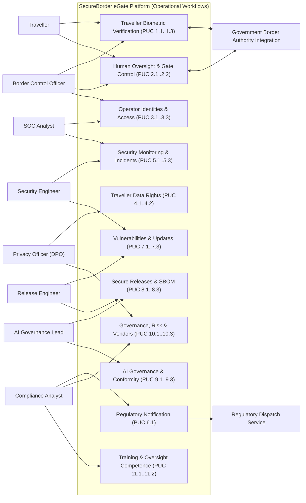

# E1.1a – SecureBorder eGate: Business Context, Process Models & Product Use Cases (PUC)

## Executive Summary

This deliverable establishes the operational and business process foundation for the **SecureBorder eGate** platform, detailing the existing operational model (*As-Is*), the target operational model (*To-Be*), and the formal catalog of Product Use Cases (*PUC*). 

In accordance with systems engineering and security literature (IEEE 29148, ISO/IEC 12207, NIST SP 800-160 Vol. 1, and SecBPMN methodologies), this document models the dynamic, operational, and temporal aspects of automated border-control operations. It deliberately separates the operational process flows—where travellers present, biometric data is captured, officers execute real-time oversight, and trust boundaries are crossed—from the atomic, contractual requirement specifications formalized in downstream deliverable [`Doc01_Requirements_Specification.md`](Doc01_Requirements_Specification.md).

Furthermore, each operational workflow is annotated with security and privacy attributes (identifying trust zone transitions, biometric template extraction enclaves, data residency checkpoints, and external government authority crossings), providing the direct architectural input for the Phase 3 Part 2 Threat Modeling and Attack Surface Analysis (DFD Level 1).

---

## Table of Contents

- [Part I – Scope and Organizational Context](#part-i--scope-and-organizational-context)
  - [1. Objective](#1-objective)
  - [2. Problem Description](#2-problem-description)
  - [3. Product Position Statement](#3-product-position-statement)
  - [4. Expected Impact](#4-expected-impact)
  - [5. Key Features](#5-key-features)
  - [6. Stakeholders](#6-stakeholders)
  - [7. System Users](#7-system-users)
  - [8. Operational Constraints](#8-operational-constraints)
- [Part II – As-Is Operational Model](#part-ii--as-is-operational-model)
  - [1. Business Roles in Context](#1-business-roles-in-context)
  - [2. Workflow Processes for Border Control Operations](#2-workflow-processes-for-border-control-operations)
    - [2.1 Manual Border Check (As-Is Process)](#21-manual-border-check-as-is-process)
    - [2.2 Operational Inefficiencies Identified (As-Is)](#22-operational-inefficiencies-identified-as-is)
  - [3. IT Support Baseline](#3-it-support-baseline)
- [Part III – To-Be Operational Model & Workflows](#part-iii--to-be-operational-model--workflows)
  - [1. Initial Customer Expectations](#1-initial-customer-expectations)
  - [2. Operational Actors](#2-operational-actors)
  - [3. Product Use Cases (PUC) Catalog](#3-product-use-cases-puc-catalog)
  - [4. Process Model & Global Interaction Architecture](#4-process-model--global-interaction-architecture)
  - [5. Security & Trust Zone Process Annotations](#5-security--trust-zone-process-annotations)
- [Bibliography](#bibliography)
- [Version History](#version-history)

---

## Part I – Scope and Organizational Context

### 1. Objective

The primary objective of this project is to specify and engineer the **SecureBorder eGate** platform: an automated border-control solution combining self-service gates with on-board biometric verification, a management back-office, and integrations with government border authorities, deployed at airports and Schengen border crossings.

The platform establishes a single operational pipeline for traveller passage: automated biometric verification with human oversight, token-only decision record-keeping, and fleet-wide operations management — eliminating manual-lane bottlenecks while preserving officer authority over every passage decision.

### 2. Problem Description

Border-control authorities and airport operators currently face severe operational constraints:

- **Manual Lane Bottlenecks:** Fully manual border checks require officers per traveller, creating queues that scale with traffic peaks and staffing shortfalls.
- **Inconsistent Decision Records:** Manual checks produce fragmented, paper-based or locally stored records, impeding audits, statistics, and cross-border cooperation.
- **No Automated Oversight Path:** Without an automated lane, every routine check consumes scarce officer attention, while genuinely suspicious cases receive the same scrutiny as routine passages.
- **Fragmented Fleet Operations:** Deployed self-service units are monitored per-site with no unified fleet view of incidents, updates, or model behaviour, delaying corrections and compliance reporting.
- **Growing Regulatory Reporting Burden:** Multiple regulatory regimes impose strict, differently-timed notification and documentation duties that manual processes cannot reliably meet.

### 3. Product Position Statement

SecureBorder eGate is positioned as a certified, oversight-first automated border-control platform optimized for throughput, auditability, and officer authority:

- **For:** Government border authorities and airport operators in Schengen Member States;
- **Who:** Must process growing traveller volumes without compromising decision quality, human oversight, or statutory reporting;
- **SecureBorder eGate is:** An automated border-control gate family with on-board biometric verification, a unified management back-office, and government authority integrations;
- **That allows:** Automated passage decisions with real-time officer review and override, token-only decision record-keeping, and fleet-wide operational monitoring;
- **Unlike:** Per-site self-service kiosks without unified oversight, record integrity, or cross-border deployment support;
- **Our product distinguishes itself by:** Treating human oversight and decision explainability as first-class product capabilities rather than add-ons.

### 4. Expected Impact

The deployment and adoption of SecureBorder eGate delivers the following operational impacts:

1. **Increase Lane Throughput:** Up to 500 travellers per hour per gate with automated decision in under 3 seconds from capture.
2. **Preserve Officer Authority:** 100% of automated decisions reviewable and overridable in real time by border control officers.
3. **Unify Decision Records:** 100% of passage decisions recorded as token-only, tamper-evident entries available for audit and statistics.
4. **Consolidate Fleet Operations:** One operational view across all deployed gates — incidents, updates, model behaviour, and per-site isolation status.
5. **Meet Reporting Deadlines:** Regulatory notifications dispatched from a single workflow respecting the shortest applicable statutory clock.

### 5. Key Features

The platform's functional baseline is structured into core operational capabilities:

- **Automated Biometric Verification:** Traveller enrolment (capture, template extraction, immediate raw-capture discard) and 1:1 verification with confidence-scored pass/refer decisions.
- **Human Oversight & Gate Control:** Real-time officer review of automated decisions, override with recorded justification, and managed fallback to the manual lane.
- **Unified Identity & Access:** Operator identity lifecycle integrated with government identity systems, multi-factor authentication, and role-based operational access.
- **Traveller Data Rights Operations:** Controller-facing handling of access, erasure, and portability requests with irreversible de-linking of biometric material.
- **Security Operations & Notification:** Fleet-wide event collection, incident management, and a unified regulatory notification workflow across multiple statutory clocks.
- **Managed Releases & AI Lifecycle:** Signed software and AI model updates with versioning and rollback, plus continuous accuracy, drift, and bias monitoring.
- **Governance & Reporting:** Unified impact and risk assessments, vendor due diligence, compliance reporting, and role-based training including oversight competence.

### 6. Stakeholders

The following table details the key stakeholders invested in the SecureBorder eGate platform:

*Table 1. Stakeholders*

| Stakeholder | Representatives | Role and Interest in the System |
|---|---|---|
| **Government Border Authorities** | National Border Control Agencies, Schengen Authorities | Lawful, accurate, and auditable border control; data-controller oversight of traveller data; statutory reporting. |
| **Airport Operators** | Airport Operations Management | Passenger-flow throughput, minimal queue times, and reliable gate operation within terminal infrastructure. |
| **Travellers (Data Subjects)** | Cross-border passengers | Fast, fair, and non-discriminatory passage; lawful handling of biometric data; effective rights exercise. |
| **SecureBorder Executive Leadership** | CEO, Board | Contract growth (Schengen expansion), regulatory conformity, and public trust. |
| **SecureBorder Operations & Security** | CISO, SOC Manager, Security Engineer, Operations Lead | Fleet availability, incident response, vulnerability management, and certified operations. |
| **SecureBorder AI Governance & Privacy** | AI Governance Lead, DPO | High-risk AI conformity, fairness monitoring, and data-subject rights operations. |
| **Suppliers & Assessors** | Hardware Suppliers, Notified Body, External Auditors | Component quality, conformity assessment, and certification maintenance. |

### 7. System Users

The application defines the following user roles:

*Table 2. System Users*

| System User | Description and Responsibilities |
|---|---|
| **Border Control Officer** | Government-authority officer at the border. Reviews automated decisions, overrides outcomes with recorded justification, and manages manual-lane referrals. |
| **SOC Analyst** | SecureBorder security operations centre staff. Monitors fleet events, triages incidents, and executes response runbooks. |
| **Security Engineer** | SecureBorder engineering staff. Manages vulnerabilities, prepares updates, and operates the coordinated disclosure process. |
| **Release Engineer** | SecureBorder engineering staff. Operates the release pipeline, maintains software bills of materials, and versions AI models. |
| **AI Governance Lead** | SecureBorder governance staff. Maintains the AI risk-management file, conformity documentation, and fairness monitoring programmes. |
| **Privacy Officer (DPO)** | SecureBorder privacy staff. Handles traveller and employee data-subject operations, records of processing, and impact assessments. |
| **Compliance Analyst** | SecureBorder compliance staff. Maintains compliance reporting, vendor assessments, and the unified notification calendar. |
| **Site Operations Technician** | Airport-site staff (SecureBorder or operator). Performs physical gate maintenance, hardware replacement, and on-site configuration under supervision. |

### 8. Operational Constraints

The baseline product design operates under the following business and operational constraints:

- **Organisation Capacity:** The technical organisation comprises 450 staff with a dedicated security organisation, supporting parallel deployments across multiple Member States; the design must remain maintainable by named, accountable teams.
- **Government Data Custody:** Traveller biometric data is processed on behalf of government authorities (processor role); decision records are retained per the applicable authority's statutory floors.
- **Statutory Clocks:** Incident and conformity notifications are bound to multiple statutory deadlines; the baseline must operate on the shortest applicable clock (24 hours).
- **Technology Neutrality:** This document defines pure operational and business flows from the user's perspective, maintaining technology neutrality across hardware vendors and cloud/on-premise backends.

---

## Part II – As-Is Operational Model

### 1. Business Roles in Context

In the baseline As-Is operational state — border lanes not yet equipped with automated gates — collaborators execute border control through manual processes:

- **Border Control Officer:** Performs every check manually at the booth: document inspection, traveller questioning, and watchlist consultation through separate authority systems.
- **Shift Supervisor:** Allocates officers to lanes, consolidates shift incident notes, and compiles manual statistics for the authority.
- **Site Maintenance Staff:** Inspects and repairs lane equipment reactively after failure reports from terminal staff.
- **Authority Compliance Clerk:** Collects statutory reports from spreadsheets and paper forms, with no unified notification calendar.

### 2. Workflow Processes for Border Control Operations

#### 2.1 Manual Border Check (As-Is Process)
The As-Is border check workflow is characterized by full manual processing:

1. The traveller queues in the manual lane and presents travel documents at the booth.
2. The officer visually inspects the document and compares the holder's face against the portrait.
3. The officer consults the authority's watchlist systems through separate terminals.
4. The decision is recorded in the authority's local log; supporting notes remain paper-based.
5. Suspicious cases escalate to a secondary inspection area, consuming additional officers.

#### 2.2 Operational Inefficiencies Identified (As-Is)

*Table 3. Inefficiencies identified in As-Is border control operations*

| Inefficiency ID | Process Affected | Description | Impact |
|---|---|---|---|
| **INEF-01** | Traveller Processing | Every routine check consumes a full officer interaction. | Queue growth at traffic peaks; staffing shortfalls directly reduce lane capacity. |
| **INEF-02** | Decision Records | Manual, fragmented record-keeping with paper notes. | Slow audits, unreliable statistics, weakened cross-border cooperation evidence. |
| **INEF-03** | Oversight Allocation | Routine and suspicious cases receive the same manual scrutiny. | Officer attention diverted from genuinely risky passages. |
| **INEF-04** | Fleet Operations (early deployments) | Self-service units monitored per-site with no unified view. | Delayed incident response; inconsistent update and model-behaviour tracking. |
| **INEF-05** | Regulatory Reporting | Statutory notifications assembled manually from scattered sources. | Missed deadlines carry fines and conformity risk under multiple regimes. |

### 3. IT Support Baseline

In the baseline state, supporting IT is fragmented across authority and site systems:
- Officer checks performed through separate authority terminals per function.
- Watchlist consultation through dedicated authority channels, disconnected from lane operations.
- Site equipment monitored by local alarms only, without central fleet telemetry.
- Reports compiled in desktop office software and dispatched through manual channels.

---

## Part III – To-Be Operational Model & Workflows

### 1. Initial Customer Expectations

Based on authority and operator elicitation, the target To-Be system must satisfy the following core expectations:

*Table 4. Initial customer expectations*

| Expectation ID | Operational Expectation | Target Impact |
|---|---|---|
| **EXP-01** | Automated passage lane with biometric verification completing decisions in seconds. | Manual-lane relief; officer attention reserved for referred cases. |
| **EXP-02** | Every automated decision reviewable and overridable by an officer in real time, with the override recorded. | Officer authority preserved; oversight is a product capability, not an afterthought. |
| **EXP-03** | Traveller biometric data minimized by design: templates only, raw captures discarded immediately. | Data-subject trust; lawful processing under special-category rules. |
| **EXP-04** | Unified fleet operations view covering incidents, updates, and model behaviour across all sites. | Faster response; consistent per-site compliance. |
| **EXP-05** | Statutory notifications dispatched from one workflow respecting the shortest applicable clock. | Zero missed regulatory deadlines across regimes. |
| **EXP-06** | Auditable, tamper-evident decision records without biometric content, retained per statutory floors. | Reliable audits, statistics, and cross-border cooperation. |
| **EXP-07** | Per-country deployments isolated from each other, with authority-specific configuration. | Multi-Schengen expansion without cross-border data commingling. |

### 2. Operational Actors

The following table formally defines the human and external system actors interacting with the system in the To-Be model:

*Table 5. List of operational actors*

| Actor | Category | Description |
|---|---|---|
| **Border Control Officer** | External Authority | Government-authority officer who reviews automated decisions, performs overrides with justification, and manages manual-lane referrals. |
| **SOC Analyst** | Internal Operations | SecureBorder operations-centre staff monitoring fleet events and managing incidents. |
| **Security Engineer** | Internal Engineering | SecureBorder staff managing vulnerabilities, updates, and coordinated disclosure. |
| **Release Engineer** | Internal Engineering | SecureBorder staff operating the release pipeline, component records, and AI model versioning. |
| **AI Governance Lead** | Internal Governance | SecureBorder governance staff maintaining AI risk, conformity, fairness, and explainability programmes. |
| **Privacy Officer (DPO)** | Internal Privacy | SecureBorder privacy staff handling data-subject operations, records of processing, and impact assessments. |
| **Compliance Analyst** | Internal Compliance | SecureBorder compliance staff maintaining reporting, vendor assessments, and the notification calendar. |
| **Site Operations Technician** | Field Operations | Site staff performing physical gate maintenance and supervised on-site configuration. |
| **Government Border Authority Integration** | External System | External authority systems providing identity verification data, watchlist inputs, and receiving decision referrals. |
| **Regulatory Dispatch Service** | External System | External official channels through which statutory notifications reach authorities. |

### 3. Product Use Cases (PUC) Catalog

The Product Use Cases (*PUC*) delineate the functional boundary of the SecureBorder eGate platform, mapping input payloads, processing boundaries, and output deliverables:

*Table 6. Summary table of Product Use Cases (PUC)*

| PUC ID | Business Trigger | Primary Actor | System Operational Boundary | Deliverables & Outputs | Realizing Requirements |
|---|---|---|---|---|---|
| **PUC 1.1** | Traveller presents at gate | Traveller | Capture image, extract template, discard raw capture | Enrolled verification template | `R1.1` |
| **PUC 1.2** | Traveller seeks automated passage | Traveller | Match live capture, consult watchlist input, score decision | Pass/refer decision and gate control | `R1.2` |
| **PUC 1.3** | Officer or authority audits passages | Border Control Officer | Query token-only decision records by token, date, gate, outcome | Decision record report | `R1.3` |
| **PUC 2.1** | Officer reviews referred decision | Border Control Officer | Present decision basis; record confirmation or override | Final decision with justification | `R2.1` |
| **PUC 2.2** | Gate fault or low-confidence outcome occurs | Border Control Officer | Route traveller to manual lane and track referral | Referral ticket to closure | `R2.2` |
| **PUC 3.1** | Operator joins, changes role, or separates | HR / Authority | Provision, review, or revoke operational identity | Updated identity record | `R3.1` |
| **PUC 3.2** | Operator requests access | Operational User | Verify multi-factor credentials; lock on repeated failures | Authenticated session | `R3.2` |
| **PUC 3.3** | Quarterly access review is due | Compliance Analyst | Present role assignments; record review outcomes | Access review record | `R3.3` |
| **PUC 4.1** | Traveller rights request arrives via controller | Privacy Officer (DPO) | Locate linked material; de-link and purge on erasure; compile response | Statutory response artefact | `R4.1` |
| **PUC 4.2** | Processing inventory changes | Privacy Officer (DPO) | Update records of processing for both roles | Current processing record | `R4.2` |
| **PUC 5.1** | Fleet events stream in | SOC Analyst | Collect, correlate, and alert on security-relevant events | Actionable alert | `R5.1` |
| **PUC 5.2** | Alert is confirmed as incident | SOC Analyst | Classify, prioritize, contain, and track to resolution | Incident record with timestamps | `R5.2` |
| **PUC 5.3** | Continuity exercise or recovery is due | SOC Analyst | Restore services within targets; record exercise findings | Recovery/exercise record | `R5.3` |
| **PUC 6.1** | Notification obligation triggers | Compliance Analyst | Generate submissions from one incident record per statutory matrix | Dispatched notification + acknowledgement | `R6.1` |
| **PUC 7.1** | Vulnerability is identified | Security Engineer | Register, prioritize, and remediate; record offensive test findings | Updated vulnerability register | `R7.1` |
| **PUC 7.2** | Release is ready for the fleet | Release Engineer | Distribute signed artefacts staged per site with rollback | Deployment status record | `R7.2` |
| **PUC 7.3** | Researcher submits a vulnerability report | Security Engineer | Triage submission; publish advisory once fixed | Disclosure advisory | `R7.3` |
| **PUC 8.1** | Release candidate enters the pipeline | Release Engineer | Enforce blocking security gates; record overrides | Gate record per release | `R8.1` |
| **PUC 8.2** | Release is cut | Release Engineer | Generate and retain component inventory per release | Software bill of materials | `R8.2` |
| **PUC 8.3** | Model release or rollback is required | Release Engineer | Version model with lineage; execute rollback on trigger | Model version/rollback record | `R8.3` |
| **PUC 9.1** | Risk or conformity documentation changes | AI Governance Lead | Update risk file and conformity documentation set | Current conformity file | `R9.1` |
| **PUC 9.2** | Monitoring cycle completes | AI Governance Lead | Evaluate accuracy, drift, and demographic disparities | Accuracy/bias monitoring report | `R9.2` |
| **PUC 9.3** | Adversarial or explainability cycle is due | AI Governance Lead | Run adversarial exercises; produce per-decision explainability | Test and explainability records | `R9.3` |
| **PUC 10.1** | Annual assessment review is due | Privacy Officer (DPO) | Update unified assessment record with dual outputs | Current assessment record | `R10.1` |
| **PUC 10.2** | Vendor onboarding or review is due | Compliance Analyst | Assess vendor; record component provenance and findings | Vendor assessment record | `R10.2` |
| **PUC 10.3** | Audit or report request arrives | Compliance Analyst | Produce compliance report; track findings to closure | Compliance report pack | `R10.3` |
| **PUC 11.1** | Annual training cycle opens | HR | Assign awareness programme; track completion | Completion/overdue report | `R11.1` |
| **PUC 11.2** | Role activation requires competence | HR / AI Governance Lead | Assign and track oversight/AI competence curricula | Competence record per role | `R11.2` |

### 4. Process Model & Global Interaction Architecture

The following interaction model maps operational actors to core functional capability clusters:

### 5. Security & Trust Zone Process Annotations

In alignment with **SecBPMN** and **NIST SP 800-160 Vol. 1**, the operational border-control workflows are contextualized across 5 critical trust zones:

*Table 7. Trust Zone Characterization of SecureBorder eGate Operational Workflows*

| Trust Zone | Zone Description | Participating Processes | Perimeter Boundary & Protection Mechanisms |
|---|---|---|---|
| **TZ-01: Public Border Lane & Traveller Kiosk** | Physical airport terminal lane, camera station, and traveller optical document reader. | Traveller enrolment, live capture, barrier opening (PUC 1.1, 1.2, 2.2) | **TB-01:** Immediate raw-image discard within $\le$5 seconds; tamper-resistant physical kiosk casing; local sensor-to-controller encryption. |
| **TZ-02: Local Gate Embedded Controller** | Hardened edge controller running on-gate biometric template extraction, 1:1 matching, and physical barrier control. | Biometric match, local decision scoring, gate actuation (PUC 1.1, 1.2, 2.1) | **TB-02:** Local cryptographic key isolation; secure boot anchored in hardware trust roots; isolated optical barrier trigger signals. |
| **TZ-03: Border Authority Back-Office & Watchlist** | Government-controlled border management systems, officer oversight terminal, and watchlist channels. | Officer real-time review, override logging, watchlist checks (PUC 1.2, 1.3, 2.1, 2.2) | **TB-03:** Mutually authenticated encrypted transport channel; cryptographic message authentication signature on override records; strict separation of officer credentials. |
| **TZ-04: Central Fleet Operations & SOC** | SecureBorder centralized operations center, remote firmware distribution, and telemetry collectors. | Event ingestion, incident management, staged updates, SBOM records (PUC 5.1, 5.2, 7.1, 7.2, 8.2) | **TB-04:** Out-of-band management network; cryptographic signature verification before update installation; immutable security event logging. |
| **TZ-05: AI Governance & Model Registry** | High-risk AI governance repository, fairness assessment datasets, and explainability records. | Model versioning, bias assessment, adversarial test execution (PUC 8.3, 9.1, 9.2, 9.3) | **TB-05:** Air-gapped model signing enclave; integrity-protected training lineage metadata; demographic privacy protections during bias testing. |

This trust zone decomposition maps directly into **Phase 3 Part 2 (Step 1: System Model, Assets and Boundaries)**, anchoring Trust Boundaries `TB-01` through `TB-05`.

---

## Bibliography

- Robertson, S., & Robertson, J. (2012). *Mastering the Requirements Process: Getting Requirements Right* (3rd ed.). Addison-Wesley Professional.
- Cockburn, A. (2000). *Writing Effective Use Cases*. Addison-Wesley Professional.
- Wiegers, K., & Beatty, J. (2013). *Software Requirements* (3rd ed.). Microsoft Press.
- Leffingwell, D., & Widrig, D. (2003). *Managing Software Requirements: A Use Case Approach* (2nd ed.). Addison-Wesley Professional.
- ISO/IEC/IEEE. (2018). *ISO/IEC/IEEE 29148: Systems and software engineering — Life cycle processes — Requirements engineering*.
- Ross, R. et al. (2016). *NIST SP 800-160 Vol. 1: Engineering Trustworthy Secure Systems*. National Institute of Standards and Technology.
- Rodriguez, A. et al. (2011). *SecBPMN: A security-oriented extension of BPMN 2.0*. Information and Software Technology.

---

## Version History

| Version | Date | Author | Description of Changes |
|---|---|---|---|
| **1.0.0** | 2026-10-01 | Requirements Engineering Agent | Initial modular extraction: decoupled business context, As-Is/To-Be models, and PUC catalog into dedicated operational deliverable `Doc00`. Added SecBPMN / NIST SP 800-160 trust zone annotations bridging directly to Phase 3 Part 2 threat modeling. |
