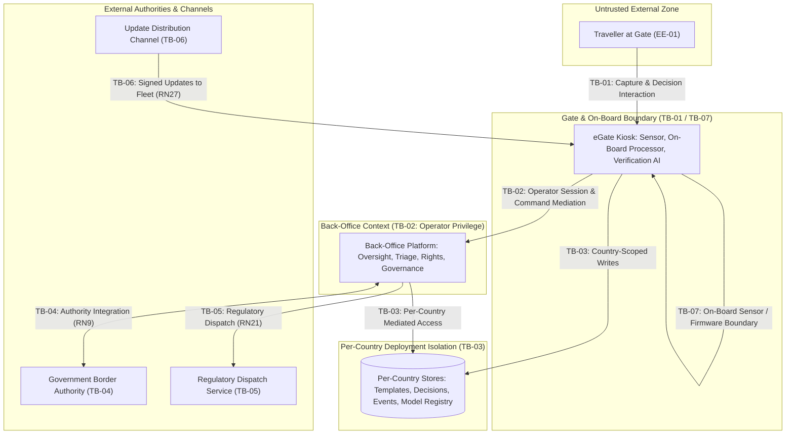

# AEGIS Phase 3 — Part 2: Step 1 — Assets, Boundaries & Data Flow Modeling (SecureBorder eGate)

> **Case Study:** Case 02 — SecureBorder Solutions B.V. (Automated Border-Control Gates with On-Board Biometric Verification AI)  
> **Lifecycle Phase:** AEGIS Phase 3 — Specification, **Part 2 of 2 (Threat & Risk Analysis)**  
> **Step Deliverable:** Step 1 of 5 (`01_SYSTEM_MODEL_ASSETS_AND_BOUNDARIES.md`)  
> **Upstream Inputs:** Phase 3 Part 1 Approved Baseline Version 2 — [`../part1_security_privacy/v2_security_privacy_synthesis/Doc01_Requirements_Elicitation_and_PUC.md`](../part1_security_privacy/v2_security_privacy_synthesis/Doc01_Requirements_Elicitation_and_PUC.md) (28 Cards `R1.1`–`R11.2`) & [`../part1_security_privacy/v2_security_privacy_synthesis/Doc02_System_Use_Cases.md`](../part1_security_privacy/v2_security_privacy_synthesis/Doc02_System_Use_Cases.md) (28 Use Cases `{U.C. 1.1}`–`{U.C. 11.2}`)  
> **Methodological Standard:** [`../../../templates/phase3_threat_risk_guidelines.md`](../../../templates/phase3_threat_risk_guidelines.md) §6.1 & [`00_METHODOLOGY_AND_EXECUTION_GUIDE.md`](00_METHODOLOGY_AND_EXECUTION_GUIDE.md) §6.1  

---

## 1. Executive Summary & Purpose

This document establishes the **structural context, asset inventory, trust boundary catalog, and Data Flow Diagram (DFD Level 1)** for SecureBorder eGate under Phase 3 Part 2.

### 1.1 Artefact Lifecycle & Pipeline Transitions

| Transition Dimension | Content & Operational Flow |
|---|---|
| **Upstream Inputs (from Part 1)** | Consumes the certified Version 2 functional baseline: 28 Requirement Cards (`R1.1`–`R11.2`), 30 EARS non-functional constraints (`RN1`–`RN30`), and 28 Cockburn Sea-Level Use Cases (`{U.C. 1.1}`–`{U.C. 11.2}`). |
| **Analytical Transformation** | Decomposes the functional system into: (1) 16 critical assets (`AST-01`–`AST-16`) under CIA-A, GDPR (incl. Art. 9 biometrics), CRA (Critical Class hardware), and AI Act obligations; (2) 7 formal trust boundaries (`TB-01`–`TB-07`); (3) 14 inter-entity data flows (`DF-01`–`DF-14`) formalized in a DFD Level 1. |
| **Downstream Handoff $\rightarrow$ Step 2** | Transfers all boundary-crossing interactions to [`02_TECHNICAL_THREATS_STRIDE.md`](02_TECHNICAL_THREATS_STRIDE.md) for technical threat elicitation per functional package, including the ATLAS AI lane. |
| **Downstream Handoff $\rightarrow$ Step 3** | Transfers all personal data flows to [`03_PRIVACY_THREATS_LINDDUN.md`](03_PRIVACY_THREATS_LINDDUN.md) for data subject privacy threat modeling. |
| **Downstream Handoff $\rightarrow$ Step 4** | Anchors the root targets (`AST-01` Templates, `AST-03` Decision Records, `AST-05` AI Model, `AST-13` Update Packages, `TB-02` Operator Privilege, `TB-03` Per-Country Isolation) for Attack Tree decomposition in [`04_ATTACK_VECTORS_AND_DEFENSE_TREES.md`](04_ATTACK_VECTORS_AND_DEFENSE_TREES.md). |

All entities, boundaries, and data flows are derived strictly from the approved Version 2 functional baseline without fabricating unstated infrastructure or tools (Rule R6).

---

## 2. Asset Identification & Sensitivity Classification

| Asset ID | Asset Title & Functional Description | Persistent Store | Conf. (C) | Integ. (I) | Avail. (A) | Acc. (A) | Statutory & Regulatory Classification |
|---|---|---|---|---|---|---|---|
| **AST-01** | **Traveller Biometric Templates:** irreversible verification templates derived from facial captures (Art. 9 special category), token-referenced. | Template Store (per country) | **Critical** | **Critical** | High | **Critical** | Special Category Personal Data (GDPR Art. 9(2)(g)); CRA Annex I (2)(e) Cryptographic Material |
| **AST-02** | **Raw Biometric Capture Buffer:** transient facial images during enrolment/verification, discarded within 5 s (`RN5`). | Gate On-Board Memory | **Critical** | High | Medium | **Critical** | Special Category Personal Data (GDPR Art. 9); AI Act Annex III Input Data |
| **AST-03** | **Passage Decision Records:** 100% token-only decision entries, tamper-evident, statutory retention floor (`RN6`). | Decision Record Store (per country) | High | **Critical** | High | **Critical** | Personal Data (GDPR Art. 4(1)); Statutory Border Records |
| **AST-04** | **Gate Configuration & Decision Thresholds:** liveness settings, decision thresholds, secure-by-default state (`RN20`). | Gate Config Store | High | **Critical** | High | **Critical** | CRA Annex I (2)(b)-(d) Secure Configuration |
| **AST-05** | **AI Verification Model & Version Registry:** model artifacts, versions, rollback lineage (`RN15`, `RN24`). | Model Registry (per country) | **Critical** | **Critical** | High | **Critical** | AI Act Annex III High-Risk System Component; CRA Annex I (2)(j) |
| **AST-06** | **Fleet Security Event & Monitoring Trail:** gate/back-office/AI event streams correlated for triage (`RN22`, `RN25`). | Event Store | Medium | **Critical** | High | **Critical** | Security Telemetry (CRA Annex I (2)(g)); NIS 2 Art. 21 Logging |
| **AST-07** | **Privacy & Rights Records:** traveller rights ledger (erasure/portability), RoPA, impact assessments (`RN28`). | Rights Ledger | High | **Critical** | High | **Critical** | Accountability Records (GDPR Arts. 5(2), 24, 30) |
| **AST-08** | **Incident & Notification Records:** incident lifecycle state, unified regulatory notification content and clocks (`RN21`, `RN23`, `RN26`). | Incident Store | High | **Critical** | High | **Critical** | NIS 2 Art. 23 / CRA Art. 14 / GDPR Art. 33 Notification Evidence |
| **AST-09** | **Operator Identity & Role State:** operator accounts, MFA state, role assignments, quarterly review records (`RN17`–`RN19`). | Identity Store | High | **Critical** | High | **Critical** | Personal Data (GDPR Art. 4(1)); RBAC State (CRA Annex I (2)(d)) |
| **AST-10** | **Cryptographic Key Material:** template-encryption keys, update signing keys, channel credentials with custody separation (`RN12`). | Key Custody Service | **Critical** | **Critical** | **Critical** | **Critical** | Cryptographic Material (CRA Annex I (2)(e); CSF PR.DS-01) |
| **AST-11** | **Release Artifacts & SBOMs:** signed software/model release packages, SBOM per release (`RN27`, R8.2). | Release Store | **Critical** | **Critical** | High | High | CRA Annex I (2)(j) Secure Update; Supply-Chain Integrity |
| **AST-12** | **Vendor & Component Provenance Register:** vendor assessments, component lineage (R10.2). | Provenance Register | Medium | High | Medium | High | CRA Supply-Chain Duties; NIS 2 Art. 21(2)(d) |
| **AST-13** | **Update Packages & Signatures:** in-flight software/model update payloads and signatures crossing the fleet–update channel (`RN27`). | Update Staging | **Critical** | **Critical** | High | **Critical** | CRA Annex I (2)(j); AI Act Model Change Records |
| **AST-14** | **Manual-Lane Referral Records:** referral decisions and manual inspection outcomes (`R2.2`). | Referral Log | Medium | High | Medium | High | Personal Data (GDPR Art. 4(1)) |
| **AST-15** | **Oversight Override Records:** human-review outcomes, override rationale, operator attribution (`RN29`). | Oversight Ledger | Medium | **Critical** | High | **Critical** | AI Act Art. 14 Human Oversight Evidence |
| **AST-16** | **Conformity & Training Documentation:** AI risk management file, conformity records, competence training evidence (R9.1, R11.x). | Document Store | Medium | High | Medium | High | AI Act Art. 9/43 Conformity File; CRA Annex II Documentation |

---

## 3. Formal Trust Boundaries Catalog

Across the 28 Cockburn Sea-Level Use Cases (`{U.C. 1.1}` to `{U.C. 11.2}`), seven distinct Trust Boundaries are established:

### 3.1 Trust Boundary Specifications

#### TB-01: Traveller Capture & Gate Interaction Boundary
- **Boundary Type:** Physical / Network / Untrusted-Public Crossing.
- **Source Entity:** Untrusted Traveller at the eGate (`EE-01`).
- **Destination Entity:** eGate Kiosk — Sensor, On-Board Processor, Verification AI (`P1`).
- **Data Flows Crossing:** `DF-01` (live capture, presentation attempt), `DF-02` (decision presentation).
- **Threat Exposure:** Spoofing (presentation attacks, adversarial patterns); Denial of Service (gate occupancy flooding); Information Disclosure (shoulder-surfing of decision displays).
- **Target Use Cases:** `{U.C. 1.1}` (Enrol Traveller), `{U.C. 1.2}` (Verify & Gate Decision), `{U.C. 2.2}` (Manual-Lane Referral).
- **Mitigating Constraints in Baseline:** `RN15` (AI Model Resilience & Fail-Safe Reversion), `RN20` (Secure-by-Default Configuration & Reset), `RN22` (Product Activity Recording & Tamper Evidence).

#### TB-02: Operator & Back-Office Privilege Boundary
- **Boundary Type:** Privilege Level / Authorization Context Crossing.
- **Source Entity:** Authenticated Operator Session (Site Operations Technician, Control-Room Operator, Administrator).
- **Destination Entity:** Back-Office Platform elevated operations (`P2`–`P6`, `P8`–`P11`).
- **Data Flows Crossing:** Override commands, role assignments, rights processing, incident triage, release promotion.
- **Threat Exposure:** Elevation of Privilege; Tampering with oversight and configuration commands; Repudiation of administrative actions.
- **Target Use Cases:** `{U.C. 2.1}` (Review & Override), `{U.C. 3.1}`–`{U.C. 3.3}` (Identity & Access), `{U.C. 4.1}` (Rights), `{U.C. 5.2}` (Triage), `{U.C. 8.1}` (Pipeline Gates).
- **Mitigating Constraints in Baseline:** `RN17` (Operator Identity Lifecycle Management), `RN18` (Strong Operator Authentication), `RN19` (Authorized-Actor Instruction Mediation), `RN29` (Human Oversight Effectiveness).

#### TB-03: Per-Country Deployment Isolation Boundary
- **Boundary Type:** Tenancy / Jurisdiction / Storage Tier Crossing.
- **Source Entity:** Gate Fleet and Back-Office Platform (`P1`–`P6`).
- **Destination Entity:** Per-Country Stores — Templates, Decision Records, Events, Model Registry.
- **Data Flows Crossing:** Country-scoped template writes, decision writes/reads, event ingestion, model version promotion.
- **Threat Exposure:** Information Disclosure (cross-country data commingling, IDOR on decision records); Tampering (record manipulation); Denial of Service (store exhaustion).
- **Target Use Cases:** `{U.C. 1.1}`–`{U.C. 1.3}` (Enrol, Verify, Consult), `{U.C. 4.1}` (Rights), `{U.C. 5.1}` (Events), `{U.C. 8.3}` (Model Versions).
- **Mitigating Constraints in Baseline:** `RN10` (Per-Country Logical & Physical Isolation, no cross-border commingling), `RN11` (Biometric Template Protection at Rest), `RN14` (Record & Command Integrity Protection), `RN6` (Token-Only Tamper-Evident Decision Records).

#### TB-04: Government Authority Integration Boundary
- **Boundary Type:** External Third-Party / State System Crossing.
- **Source Entity:** Back-Office Platform (`P6`, `P4`).
- **Destination Entity:** Government Border Authority Systems (`EE-02`).
- **Data Flows Crossing:** `DF-11` (authority queries, watchlist input, referral hand-off), `DF-08` (rights-linked authority data).
- **Threat Exposure:** Spoofing (spoofed authority instructions); Tampering (manipulated referral payloads); Information Disclosure (over-broad data transfer).
- **Target Use Cases:** `{U.C. 2.2}` (Manual-Lane Referral), `{U.C. 6.1}` (Unified Notifications), `{U.C. 4.1}` (Rights Processing).
- **Mitigating Constraints in Baseline:** `RN9` (Authenticated, Integrity-Protected Authority Channels), `RN14` (Record & Command Integrity Protection), `RN19` (Authorized-Actor Instruction Mediation).

#### TB-05: Regulatory Dispatch Channel Boundary
- **Boundary Type:** External Third-Party / Statutory Notification Crossing.
- **Source Entity:** Back-Office Platform (`P6`).
- **Destination Entity:** Regulatory Dispatch Service (`EE-03`).
- **Data Flows Crossing:** `DF-10` (unified regulatory notifications under the enforced clock).
- **Threat Exposure:** Spoofing (forged notifications); Tampering (notification content manipulation); Denial of Service (clock-bypass delay).
- **Target Use Cases:** `{U.C. 6.1}` (Execute Unified Regulatory Notifications).
- **Mitigating Constraints in Baseline:** `RN21` (Unified Regulatory Notification Timeline Enforcement), `RN14` (Record & Command Integrity Protection), `RN26` (Breach Awareness & Containment Record).

#### TB-06: Fleet Update Distribution Channel Boundary
- **Boundary Type:** External Channel / Supply-Chain Crossing.
- **Source Entity:** Update Distribution Infrastructure (`EE-04`).
- **Destination Entity:** Gate Fleet (`P1`, `P8`).
- **Data Flows Crossing:** `DF-12` (signed software and model update packages).
- **Threat Exposure:** Tampering (trojanized update injection); Spoofing (spoofed distribution origin); Denial of Service (update withholding over the support period).
- **Target Use Cases:** `{U.C. 7.2}` (Distribute Signed Updates), `{U.C. 8.3}` (Model Versions & Rollback).
- **Mitigating Constraints in Baseline:** `RN27` (Secure Update Distribution across Support Period), `RN12` (Cryptographic Key Custody Separation), `RN9` (Authenticated, Integrity-Protected Channels).

#### TB-07: On-Board Hardware & Firmware Boundary
- **Boundary Type:** Physical / Embedded Hardware Crossing (EMB3D lane).
- **Source Entity:** Physical Presence at the Gate (traveller, Site Operations Technician, attacker with physical access).
- **Destination Entity:** On-Board Sensor, Processor, and Firmware.
- **Data Flows Crossing:** `DF-01` (analog capture), `DF-12` (firmware loading), physical maintenance interfaces.
- **Threat Exposure:** Tampering (sensor manipulation, firmware modification, debug-port access); Spoofing (sensor replay); Denial of Service (physical damage, power manipulation).
- **Target Use Cases:** `{U.C. 1.1}`–`{U.C. 1.2}` (Capture & Verification), `{U.C. 7.2}` (Updates).
- **Mitigating Constraints in Baseline:** `RN14` (Record & Command Integrity Protection), `RN20` (Secure-by-Default Configuration & Reset), `RN22` (Product Activity Recording & Tamper Evidence).

---

## 4. Data Flow Diagram (DFD Level 1)

```mermaid
flowchart TD
    subgraph EE["External Interactors"]
        EE1["EE-01: Traveller at Gate"]
        EE2["EE-02: Government Border Authority"]
        EE3["EE-03: Regulatory Dispatch Service"]
        EE4["EE-04: Update Distribution Infrastructure"]
    end

    subgraph Processes["SecureBorder Functional Subsystems (Processes)"]
        P1["P1: Biometric Verification & Gate Decision<br>(R1.1, R1.2, R1.3)"]
        P2["P2: Human Oversight & Gate Control<br>(R2.1, R2.2)"]
        P3["P3: Operator Identity & Access<br>(R3.1, R3.2, R3.3)"]
        P4["P4: Traveller Data Rights<br>(R4.1, R4.2)"]
        P5["P5: Security Monitoring & Incidents<br>(R5.1, R5.2, R5.3)"]
        P6["P6: Regulatory Notifications<br>(R6.1)"]
        P7["P7: Vulnerabilities & Updates<br>(R7.1, R7.2, R7.3)"]
        P8["P8: Secure Development & Releases<br>(R8.1, R8.2, R8.3)"]
        P9["P9: AI Quality & Conformity<br>(R9.1, R9.2, R9.3)"]
        P10["P10: Governance, Risk & Vendors<br>(R10.1, R10.2, R10.3)"]
        P11["P11: Training & Competence<br>(R11.1, R11.2)"]
    end

    subgraph DataStores["Per-Country Isolated Data Stores"]
        DS1[("DS-01: Template Store<br>(Art. 9, RN11)")]
        DS2[("DS-02: Decision Record Store<br>(token-only, RN6)")]
        DS3[("DS-03: Event & Incident Store<br>(RN22, RN23)")]
        DS4[("DS-04: Model Registry<br>(RN15, RN24)")]
        DS5[("DS-05: Rights & Governance Ledger<br>(RN28)")]
        DS6[("DS-06: Release & Key Stores<br>(RN12, RN27)")]
    end

    EE1 -->|"DF-01: Live Capture (TB-01/TB-07)"| P1
    P1 -->|"DF-02: Decision Presentation (TB-01)"| EE1
    P1 -->|"DF-03: Template Write (TB-03)"| DS1
    P1 -->|"DF-04: Decision Write (TB-03)"| DS2
    P1 -->|"DF-05: Decision Consultation (TB-02/TB-03)"| DS2
    P2 -->|"DF-06: Override Commands (TB-02)"| P1
    P2 -->|"DF-07: Referral Records (TB-03)"| DS3
    P3 -->|"DF-13: Identity & Role Changes (TB-02/TB-03)"| DS5
    P4 -->|"DF-08: Rights Request/Response (TB-01/TB-03)"| DS5
    P4 <-->|"TB-04: Authority Data"| EE2
    P5 -->|"DF-09: Fleet Event Ingestion (TB-03)"| DS3
    P6 -->|"DF-10: Regulatory Dispatch (TB-05)"| EE3
    P6 <-->|"TB-04: Authority Channel (RN9)"| EE2
    P7 -->|"DF-12: Signed Update Distribution (TB-06)"| EE4
    P8 -->|"DF-14: Model Version Promotion & Rollback (TB-03)"| DS4
    P9 -->|"DF-11: AI Monitoring & Conformity Records (TB-03)"| DS4
```

---

## 5. Comprehensive Data Flow Inventory

| Flow ID | Flow Name & Description | Source Entity | Destination Entity | Data Items / Assets Transferred | Boundaries Crossed | Governing Part 1 Constraints |
|---|---|---|---|---|---|---|
| **DF-01** | Live Biometric Capture & Presentation Attempt | `EE-01` (Traveller) | `P1` (Verification) | Raw facial capture, presentation attempt, sensor telemetry | `TB-01`, `TB-07` | `RN5`, `RN15`, `RN22` |
| **DF-02** | Gate Decision Presentation | `P1` (Verification) | `EE-01` (Traveller) | Passage decision indicator, referral instruction | `TB-01` | `RN1`, `RN15` |
| **DF-03** | Template Enrolment Write | `P1` (Verification) | `DS-01` (Template Store) | Irreversible biometric template, token reference | `TB-03` | `RN11`, `RN12` |
| **DF-04** | Passage Decision Write | `P1` (Verification) | `DS-02` (Decision Store) | Token-only decision entry, timestamp | `TB-03` | `RN6`, `RN14` |
| **DF-05** | Decision Record Consultation | `P2`/`P4` (Back-Office) | `DS-02` (Decision Store) | Token-only decision entries, query context | `TB-02`, `TB-03` | `RN11`, `RN14` |
| **DF-06** | Oversight Override Command | `P2` (Oversight) | `P1` (Verification) | Override decision, operator attribution, rationale | `TB-02` | `RN19`, `RN29` |
| **DF-07** | Manual-Lane Referral Record | `P2` (Oversight) | `DS-03` (Event Store) | Referral decision, manual inspection outcome | `TB-03` | `RN18`, `RN22` |
| **DF-08** | Traveller Rights Request & Response | `EE-01`/`P4` (Rights) | `DS-05` (Rights Ledger) | Verified rights request, erasure/portability delivery | `TB-01`, `TB-03` | `RN16`, `RN28` |
| **DF-09** | Fleet Security Event Ingestion | `P1` (Fleet Gates) | `DS-03` (Event Store) | Gate/back-office/AI event streams | `TB-03` | `RN22`, `RN25` |
| **DF-10** | Unified Regulatory Notification Dispatch | `P6` (Notifications) | `EE-03` (Dispatch) | Statutory notification content, clock metadata | `TB-05` | `RN14`, `RN21`, `RN26` |
| **DF-11** | Authority Integration Exchange | `P6`/`P4` (Back-Office) | `EE-02` (Authority) | Referral payload, watchlist input, authority instruction | `TB-04` | `RN9`, `RN14`, `RN19` |
| **DF-12** | Signed Software & Model Update Distribution | `P7`/`P8` (Updates) | `EE-04` (Fleet) | Signed update package, model artifact, signature metadata | `TB-06` | `RN27`, `RN12` |
| **DF-13** | Operator Identity & Role Change | `P3` (Identity) | `DS-05` (Ledger) | Operator account state, MFA enrollment, role assignment | `TB-02`, `TB-03` | `RN17`, `RN18`, `RN19` |
| **DF-14** | AI Model Version Promotion & Rollback | `P8`/`P9` (Releases) | `DS-04` (Model Registry) | Model artifact, version lineage, rollback record | `TB-03` | `RN15`, `RN24` |

---

## 6. Bidirectional Traceability: Use Cases $\longleftrightarrow$ Boundaries $\longleftrightarrow$ Assets

This matrix guarantees that 100% of the 28 functional requirement cards and 28 Cockburn Sea-Level Use Cases are mapped to their operational assets and trust boundaries:

| Req Card | Cockburn Sea-Level Use Case | Primary Assets Manipulated | Trust Boundaries Traversed | Critical Threat Surfaces | Governing Constraints |
|---|---|---|---|---|---|
| `R1.1` | `{U.C. 1.1}` Enrol traveller biometric reference | `AST-01`, `AST-02`, `AST-10` | `TB-01`, `TB-03`, `TB-07` | Template theft, raw-capture retention, sensor spoofing at enrolment | `RN11`, `RN12` |
| `R1.2` | `{U.C. 1.2}` Perform biometric verification and gate decision | `AST-01`, `AST-03`, `AST-04`, `AST-05` | `TB-01`, `TB-02`, `TB-03`, `TB-07` | Presentation/evasion spoofing, channel interception, fail-open bypass, model inversion, model exfiltration | `RN13`, `RN14`, `RN15`, `RN20`, `RN22`, `RN24` |
| `R1.3` | `{U.C. 1.3}` Consult traveller passage decision records | `AST-03` | `TB-02`, `TB-03` | Record tampering, cross-country IDOR, presence detectability, movement linkability | `RN11`, `RN14` |
| `R2.1` | `{U.C. 2.1}` Review and override automated decisions | `AST-15`, `AST-03` | `TB-02` | Oversight override bypass, operator profiling | `RN19`, `RN29` |
| `R2.2` | `{U.C. 2.2}` Manage manual-lane referrals | `AST-14` | `TB-01`, `TB-02` | Manual-lane impersonation/collusion | `RN18` |
| `R3.1` | `{U.C. 3.1}` Manage operator identity lifecycle | `AST-09` | `TB-02`, `TB-03` | Operator identity residue after departure | `RN17` |
| `R3.2` | `{U.C. 3.2}` Authenticate operators with multi-factor verification | `AST-09`, `AST-10` | `TB-02` | Credential compromise, MFA bypass | `RN18` |
| `R3.3` | `{U.C. 3.3}` Assign and review operational access roles | `AST-09` | `TB-02`, `TB-03` | Role escalation, cross-country reach | `RN17`, `RN19` |
| `R4.1` | `{U.C. 4.1}` Process traveller data-subject requests | `AST-07`, `AST-01` | `TB-01`, `TB-03` | Spoofed rights request, rights obstruction, cross-country erasure gap | `RN16`, `RN28` |
| `R4.2` | `{U.C. 4.2}` Maintain records of processing activities | `AST-07` | `TB-03` | RoPA record tampering (carried by `TM-D-01.4-001`), transparency deficit | chains (`RN14` via multi-target) |
| `R5.1` | `{U.C. 5.1}` Collect and correlate fleet security events | `AST-06` | `TB-02`, `TB-03` | Event suppression/tampering, monitoring concealment | `RN22`, `RN25` |
| `R5.2` | `{U.C. 5.2}` Triage and manage incidents | `AST-08`, `AST-06` | `TB-02`, `TB-03` | Containment circumvention, notification-clock bypass | `RN23`, `RN26` |
| `R5.3` | `{U.C. 5.3}` Recover services and exercise continuity | `AST-08`, `AST-06` | `TB-03` | Backup and recovery sabotage | `RN23` (+ `RN4` RTO/RPO) |
| `R6.1` | `{U.C. 6.1}` Execute unified regulatory notifications | `AST-08` | `TB-04`, `TB-05` | Forged notification injection, PII over-disclosure, clock circumvention (carried by `TM-D-04.1-001`) | `RN14`, `RN21`, `RN26` |
| `R7.1` | `{U.C. 7.1}` Identify and remediate vulnerabilities | `AST-11` | `TB-03` | Process lane: remediation tracking crosses no untrusted boundary beyond the record-integrity class | chains |
| `R7.2` | `{U.C. 7.2}` Distribute signed software and model updates | `AST-13`, `AST-11` | `TB-06` | Malicious update injection, signing-key compromise | `RN27` |
| `R7.3` | `{U.C. 7.3}` Operate coordinated vulnerability disclosure | `AST-06` | `TB-05` | Process lane: inbound advisory channel crosses no product-verifiable surface beyond the `TB-06` channel class | chains |
| `R8.1` | `{U.C. 8.1}` Enforce release pipeline security gates | `AST-11`, `AST-13` | `TB-02`, `TB-03` | Pipeline gate bypass, SBOM/provenance falsification | `RN20` |
| `R8.2` | `{U.C. 8.2}` Maintain software bills of materials | `AST-11`, `AST-12` | `TB-03` | Provenance falsification (carried by `TM-D-06.2-001`) | chains |
| `R8.3` | `{U.C. 8.3}` Version and roll back AI models | `AST-05`, `AST-13` | `TB-03` | Registry/rollback tampering, training-data poisoning (carried by `TM-D-06.2-003`) | `RN15` |
| `R9.1` | `{U.C. 9.1}` Maintain AI risk management and conformity documentation | `AST-16` | `TB-03` | Governance lane: documentation integrity crosses no untrusted boundary | chains |
| `R9.2` | `{U.C. 9.2}` Monitor AI accuracy, drift, and bias | `AST-05`, `AST-06` | `TB-02`, `TB-03` | Monitoring concealment, poisoning detection | `RN15`, `RN24`, `RN25` |
| `R9.3` | `{U.C. 9.3}` Test AI systems adversarially and explain decisions | `AST-05` | `TB-02`, `TB-03` | Explainability obstruction (LINDDUN unawareness lane) | `RN30` |
| `R10.1` | `{U.C. 10.1}` Maintain unified impact and risk assessments | `AST-07` | `TB-03` | Governance lane: assessment records cross no untrusted boundary | chains |
| `R10.2` | `{U.C. 10.2}` Assess vendors and record component provenance | `AST-12` | `TB-03` | Provenance falsification (carried by `TM-D-06.2-001`) | chains |
| `R10.3` | `{U.C. 10.3}` Maintain compliance reporting and audits | `AST-07` | `TB-03` | Governance lane: reporting integrity crosses no untrusted boundary | chains |
| `R11.1` | `{U.C. 11.1}` Deliver security and privacy awareness training | — | — | Human-factors lane: no product threat surface | chains |
| `R11.2` | `{U.C. 11.2}` Deliver oversight and AI competence training | — | — | Human-factors lane: oversight-effectiveness context (`RN29`) carried by `TM-D-03.3-001` | `RN29` |

---

## 7. Step 1 Sign-Off & Verification

This document satisfies all requirements of **Step 1 of Phase 3 Part 2**:
- [x] **100% Asset Coverage:** All 16 persistent, on-board, and compliance asset types classified under CIA-A and statutory categories (GDPR Art. 9, CRA Critical Class, AI Act Annex III).
- [x] **100% Trust Boundary Definition:** All 7 trust boundaries ($TB_{01}$ to $TB_{07}$) formalized with traversed entities, data flows, and target use cases — including the per-country isolation boundary and the on-board hardware boundary (EMB3D lane).
- [x] **Valid DFD Level 1:** Data Flow Diagram fully rendered in valid Mermaid syntax with complete data flow matrix.
- [x] **Bidirectional Traceability Matrix:** Full mapping across all 28 requirement cards and 28 Cockburn Sea-Level Use Cases.

**Step 1 is COMPLETE and APPROVED.** Cleared to proceed to **Step 2 ([`02_TECHNICAL_THREATS_STRIDE.md`](02_TECHNICAL_THREATS_STRIDE.md))**.
