# AEGIS Phase 3 — Part 2: Step 3 — Privacy Threat Modeling via LINDDUN Data Flows (SecureBorder eGate)

> **Case Study:** Case 02 — SecureBorder Solutions B.V. (Automated Border-Control Gates with On-Board Biometric Verification AI)  
> **Lifecycle Phase:** AEGIS Phase 3 — Specification, **Part 2 of 2 (Threat & Risk Analysis)**  
> **Step Deliverable:** Step 3 of 5 (`03_PRIVACY_THREATS_LINDDUN.md`)  
> **Upstream Inputs:** Step 1 ([`01_SYSTEM_MODEL_ASSETS_AND_BOUNDARIES.md`](01_SYSTEM_MODEL_ASSETS_AND_BOUNDARIES.md)), Step 2 ([`02_TECHNICAL_THREATS_STRIDE.md`](02_TECHNICAL_THREATS_STRIDE.md)), Phase 3 Part 1 Approved Baseline Version 2 — [`../part1_security_privacy/v2_security_privacy_synthesis/Doc01_Requirements_Elicitation_and_PUC.md`](../part1_security_privacy/v2_security_privacy_synthesis/Doc01_Requirements_Elicitation_and_PUC.md) & [`../part1_security_privacy/v2_security_privacy_synthesis/Doc02_System_Use_Cases.md`](../part1_security_privacy/v2_security_privacy_synthesis/Doc02_System_Use_Cases.md)  
> **Methodological Standard:** [`../../../templates/phase3_threat_risk_guidelines.md`](../../../templates/phase3_threat_risk_guidelines.md) §6.3 & [`00_METHODOLOGY_AND_EXECUTION_GUIDE.md`](00_METHODOLOGY_AND_EXECUTION_GUIDE.md) §6.3  

---

## 1. Executive Summary & Purpose

This document executes the **LINDDUN privacy threat modeling** over all personal data (PII) lifecycle flows within SecureBorder eGate. The data-subject population is exceptional: travellers' biometric data is **Art. 9 special-category data processed under Art. 9(2)(g) substantial public interest**, at scale, by an AI Act Annex III high-risk system — making linkability, identifiability, and non-compliance the dominant privacy risks.

### 1.1 Artefact Lifecycle & Pipeline Transitions

| Transition Dimension | Content & Operational Flow |
|---|---|
| **Upstream Inputs (from Steps 1 & 2)** | Consumes PII assets (`AST-01`, `AST-02`, `AST-03`, `AST-07`, `AST-09`, `AST-14`, `AST-15`), boundaries (`TB-01`–`TB-05`), and flows (`DF-01`–`DF-11`) from [`01_SYSTEM_MODEL_ASSETS_AND_BOUNDARIES.md`](01_SYSTEM_MODEL_ASSETS_AND_BOUNDARIES.md), alongside technical threat contexts from [`02_TECHNICAL_THREATS_STRIDE.md`](02_TECHNICAL_THREATS_STRIDE.md). |
| **Analytical Transformation** | Evaluates data-subject privacy across 8 PII lifecycle flows under the 7 LINDDUN dimensions, deriving 10 standardized privacy threat cards anchored in GDPR statutory articles (Arts. 5, 6, 9, 12–22, 25, 26, 28, 35). |
| **Downstream Handoff $\rightarrow$ Step 4** | Feeds critical privacy attack scenarios (spoofed rights requests, cross-border erasure gaps) to [`04_ATTACK_VECTORS_AND_DEFENSE_TREES.md`](04_ATTACK_VECTORS_AND_DEFENSE_TREES.md). |
| **Downstream Handoff $\rightarrow$ Step 5** | Exports all 10 scored privacy threat cards into the master risk ledger in [`05_RISK_REGISTER_AND_GOVERNANCE.md`](05_RISK_REGISTER_AND_GOVERNANCE.md) (33 rows total, no cross-lens merges required). |

While STRIDE protects system assets against technical compromise, **LINDDUN models privacy threats against the Data Subject (travellers, operators, employees)**:
- **GDPR Art. 5(1)(b) & Art. 6(4):** Purpose limitation & prohibition of movement surveillance beyond the statutory border purpose.
- **GDPR Art. 9:** Special-category biometric processing (Art. 9(2)(g)); DPIA mandatory by statute.
- **GDPR Art. 5(1)(e):** Storage limitation (5-second raw-capture envelope; token-only statutory floor).
- **GDPR Arts. 12–22:** Transparency and Data Subject Rights intervenability.
- **GDPR Art. 26/28:** Joint control with border authorities; processor duties.

```mermaid
flowchart TD
    subgraph PII_Lifecycles["Personal Data (PII) Lifecycle Flows"]
        DF_P1["DF-P1: Enrolment & Template Creation (R1.1)"]
        DF_P2["DF-P2: Verification & Decision Recording (R1.2)"]
        DF_P3["DF-P3: Decision Record Consultation (R1.3)"]
        DF_P4["DF-P4: Human Oversight & Override (R2.1)"]
        DF_P5["DF-P5: Traveller Rights Execution (R4.1)"]
        DF_P6["DF-P6: Operator & Employee Data (R3.1)"]
        DF_P7["DF-P7: Regulatory & Authority Dispatch (R6.1)"]
        DF_P8["DF-P8: Manual-Lane Referral Records (R2.2)"]
    end

    subgraph LINDDUN_Categories["LINDDUN Privacy Threat Analysis"]
        L["Linkability (L)"]
        I["Identifiability (I)"]
        N["Non-Repudiation (N)"]
        D["Detectability (D)"]
        DI["Disclosure of Info (D)"]
        U["Unawareness / Unintervenability (U)"]
        NC["Non-Compliance (N)"]
    end

    subgraph Mitigations["Part 1 Mitigating Constraints (NFR-RN)"]
        RN5["RN5: Raw-Capture 5s Envelope"]
        RN6["RN6: Token-Only Tamper-Evident Records"]
        RN10["RN10: Per-Country Isolation"]
        RN11["RN11: Template Protection at Rest"]
        RN16["RN16: Requester Identity Verification"]
        RN17["RN17: Operator Lifecycle Management"]
        RN28["RN28: Traveller Erasure & Portability"]
        RN29["RN29: Human Oversight Effectiveness"]
    end

    PII_Lifecycles --> LINDDUN_Categories
    LINDDUN_Categories --> Mitigations
```

---

## 2. Personal Data (PII) Lifecycle Flow Inventory

| PII Flow ID | Lifecycle Stage | Functional Context | Data Items & PII Transferred | Data Subjects Affected | Trust Boundaries Crossed |
|---|---|---|---|---|---|
| **DF-P1** | Collection / Enrolment | Traveller biometric enrolment (`R1.1` / `{U.C. 1.1}`) | Raw facial capture (≤5 s envelope), derived irreversible template (Art. 9). | Travellers | `TB-01`, `TB-03`, `TB-07` |
| **DF-P2** | Processing / Decision | Biometric verification & gate decision (`R1.2` / `{U.C. 1.2}`) | Live capture vs template comparison, token-only decision entry. | Travellers | `TB-01`, `TB-03` |
| **DF-P3** | Consultation | Passage decision record consultation (`R1.3` / `{U.C. 1.3}`) | Token-only decision records, query context. | Travellers | `TB-02`, `TB-03` |
| **DF-P4** | Oversight | Human review & override (`R2.1` / `{U.C. 2.1}`) | Operator identity, decision outcome, override rationale. | Travellers + Operators | `TB-02` |
| **DF-P5** | Subject Rights | Traveller rights execution (`R4.1` / `{U.C. 4.1}`) | Verified rights request, erasure/portability delivery. | Travellers | `TB-01`, `TB-03` |
| **DF-P6** | Employment | Operator identity lifecycle (`R3.1` / `{U.C. 3.1}`) | Operator account data, MFA state, role history. | Operators / Employees | `TB-02`, `TB-03` |
| **DF-P7** | Transmission / Sharing | Regulatory & authority dispatch (`R6.1` / `{U.C. 6.1}`) | Notification content, referral payload, authority instruction. | Travellers | `TB-04`, `TB-05` |
| **DF-P8** | Processing / Referral | Manual-lane referral records (`R2.2` / `{U.C. 2.2}`) | Referral decision, manual inspection outcome, operator attribution. | Travellers + Operators | `TB-01`, `TB-03` |

---

## 3. LINDDUN Threat Modeling Cards

### 3.1 Linkability (L)

#### TM-D-05.1-001: Traveller Movement Linkability via Passage Decision Records
- **Target PII Flow:** `DF-P2` & `DF-P3` (decision recording and consultation in `{U.C. 1.2}`, `{U.C. 1.3}` / `R1.2`, `R1.3`).
- **LINDDUN Category:** Linkability (L).
- **Privacy Threat Hypothesis:** An authority or operator correlates token-only passage records across gates, dates, and countries to reconstruct a traveller's complete cross-border movement profile beyond the statutory border-control purpose — general surveillance drift.
- **GDPR Statutory Driver:** `GDPR Art. 5(1)(b)` (Purpose Limitation) + `Art. 6(4)` (Compatibility of Processing).
- **Inherent Risk Rating:**
  - *Likelihood:* High (3) [Passage records accumulate universally by statutory design].
  - *Impact:* Critical (4) [Systematic movement surveillance of the general travelling public].
  - *Inherent Risk Level:* **Critical**.
- **Active Mitigating Constraints:**
  - `NFR-RN6: Token-Only Tamper-Evident Decision Records` (Decision records carry token-only references — no raw identifiers — so cross-correlation requires access to the token-mapping layer).
  - `NFR-RN10: Per-Country Deployment Isolation` (Records are isolated per country with no cross-border commingling; movement-profile reconstruction across deployments is structurally blocked).
- **Defensive Technique (D3FEND):** `D3-PSN: Pseudonymization` / `D3-UAI: User Account Isolation`.
- **Residual Risk Rating & Verdict:**
  - *Residual Likelihood:* Low (1) [Token-only records plus per-country isolation remove the cross-correlation path].
  - *Residual Impact:* Low (2) [Within one country, statutory-purpose consultation remains lawful].
  - *Residual Risk Level:* **Low**.
  - *Treatment Verdict:* **Mitigated** (Enforced in `{U.C. 1.3}` consultation flow).

---

#### TM-D-05.1-002: Biometric Re-Identification from Pseudonymized Stores
- **Target PII Flow:** `DF-P1` & `DF-P2` (template creation and verification in `{U.C. 1.1}`, `{U.C. 1.2}` / `R1.1`, `R1.2`).
- **LINDDUN Category:** Identifiability (I).
- **Privacy Threat Hypothesis:** An insider with store access re-identifies token-referenced travellers by correlating template metadata, decision timestamps, and gate assignments — dissolving the pseudonymized token-only design from the inside.
- **GDPR Statutory Driver:** `GDPR Art. 4(1)` (Identifiability) + `Art. 25` (Data Protection by Design and by Default).
- **Inherent Risk Rating:**
  - *Likelihood:* High (3) [Correlation signals (timestamps, gate IDs) accumulate naturally].
  - *Impact:* Critical (4) [Art. 9 special-category identity disclosure].
  - *Inherent Risk Level:* **Critical**.
- **Active Mitigating Constraints:**
  - `NFR-RN11: Biometric Template Protection at Rest` (Templates are cryptographically protected at rest — protected form denies raw biometric correlation).
  - `NFR-RN12: Cryptographic Key Custody Separation` (Custody separation prevents single-position re-identification).
  - `NFR-RN5: Raw-Capture 5-Second Envelope` (Raw captures are discarded within 5 s of template extraction — the re-identifiable raw layer does not persist).
- **Defensive Technique (D3FEND):** `D3-DE: Data Encryption` / `D3-PSN: Pseudonymization`.
- **Residual Risk Rating & Verdict:**
  - *Residual Likelihood:* Low (1) [Protected-form templates under separated custody defeat insider correlation].
  - *Residual Impact:* High (3) [Partial metadata correlation retains residual value].
  - *Residual Risk Level:* **Medium**.
  - *Treatment Verdict:* **Mitigated** (Enforced in `{U.C. 1.1}` enrolment flow).

---

### 3.2 Identifiability (I)

*(Covered by `TM-D-05.1-002` above — the identifiability lens over the biometric store is the case's dominant identifiability threat.)*

---

### 3.3 Non-Repudiation (N)

#### TM-D-05.2-001: Excessive Permanent Attribution of Oversight & Referral Actions
- **Target PII Flow:** `DF-P4` & `DF-P8` (oversight overrides and manual-lane referrals in `{U.C. 2.1}`, `{U.C. 2.2}` / `R2.1`, `R2.2`).
- **LINDDUN Category:** Non-Repudiation (N).
- **Privacy Threat Hypothesis:** Every operator override and referral is permanently attributed to a named operator with rationale; excessive or unbounded retention of these attribution records enables long-tail internal profiling and chilling of legitimate discretionary decisions.
- **GDPR Statutory Driver:** `GDPR Art. 5(1)(c)` (Data Minimization) + `Art. 88` (Processing in Employment Context).
- **Inherent Risk Rating:**
  - *Likelihood:* Medium (2) [Attribution records accumulate by accountability design].
  - *Impact:* Medium (2) [Employee privacy grievance; chilling of lawful discretionary oversight].
  - *Inherent Risk Level:* **Medium**.
- **Active Mitigating Constraints:**
  - `NFR-RN29: Human Oversight Effectiveness` (Oversight records exist for the statutory purpose of evidencing effective human oversight — the purpose bound is the AI Act oversight duty, not general performance surveillance).
  - `NFR-RN19: Authorized-Actor Instruction Mediation` (Attribution is bound to verified authorized actors only, limiting the attribution surface).
- **Defensive Technique (D3FEND):** `D3-MAM: Message Access Mediation` / `D3-PSN: Pseudonymization`.
- **Residual Risk Rating & Verdict:**
  - *Residual Likelihood:* Low (1) [Purpose-bound, mediated attribution records].
  - *Residual Impact:* Low (1) [Statutory oversight purpose legitimizes the retained record].
  - *Residual Risk Level:* **Low**.
  - *Treatment Verdict:* **Mitigated** (Enforced in `{U.C. 2.1}` oversight flow).

---

### 3.4 Detectability (D)

#### TM-D-05.2-002: Traveller Presence Detection via Consultation Response Discrepancies
- **Target PII Flow:** `DF-P3` (decision record consultation in `{U.C. 1.3}` / `R1.3`).
- **LINDDUN Category:** Detectability (D).
- **Privacy Threat Hypothesis:** An authorized consultation user probes the decision-record service with differing tokens or query timings and observes response discrepancies (hit vs miss latency, record counts) to detect whether a specific person has crossed the border — without ever reading a record.
- **GDPR Statutory Driver:** `GDPR Art. 5(1)(a)` (Fairness) + `Art. 32` (Security of Processing).
- **Inherent Risk Rating:**
  - *Likelihood:* Medium (2) [Authorized consultation channel; discrepancy probing is a standard oracle class].
  - *Impact:* Medium (2) [Presence/absence disclosure of border crossings].
  - *Inherent Risk Level:* **Medium**.
- **Active Mitigating Constraints:**
  - `NFR-RN14: Record & Command Integrity Protection` (Consultation commands are mediated and integrity-protected; responses are uniform for miss and hit contexts).
  - `NFR-RN6: Token-Only Tamper-Evident Decision Records` (Token-only records deny raw-identity probing).
- **Defensive Technique (D3FEND):** `D3-RO: Response Obfuscation` / `D3-MAM: Message Access Mediation`.
- **Residual Risk Rating & Verdict:**
  - *Residual Likelihood:* Low (1) [Uniform mediated responses remove the discrepancy oracle].
  - *Residual Impact:* Low (1) [No presence information derivable].
  - *Residual Risk Level:* **Low**.
  - *Treatment Verdict:* **Mitigated** (Enforced in `{U.C. 1.3}` consultation flow).

---

### 3.5 Disclosure of Information (D)

#### TM-D-07.1-001: Personal Data Over-Disclosure in Regulatory & Authority Dispatch
- **Target PII Flow:** `DF-P7` (regulatory and authority dispatch in `{U.C. 6.1}` / `R6.1`).
- **LINDDUN Category:** Disclosure of Information (D).
- **Privacy Threat Hypothesis:** Incident notifications and authority referrals embed more personal data than the statutory purpose requires (full traveller context where a token reference suffices), over-disclosing Art. 9 data across state channels.
- **GDPR Statutory Driver:** `GDPR Art. 5(1)(f)` (Integrity and Confidentiality) + `Art. 33` (Breach Notification — data minimization in notification content).
- **Inherent Risk Rating:**
  - *Likelihood:* Medium (2) [Multi-authority channels; content templates drift toward over-inclusion].
  - *Impact:* High (3) [Art. 9 data spread across additional state systems beyond purpose].
  - *Inherent Risk Level:* **High**.
- **Active Mitigating Constraints:**
  - `NFR-RN14: Record & Command Integrity Protection` (Notification content is generated through the integrity-protected sanctioned pipeline).
  - `NFR-RN21: Unified Regulatory Notification Timeline Enforcement` (Notifications flow through the single unified pipeline — no ad-hoc side channels with uncontrolled content).
  - `NFR-RN26: Breach Awareness & Containment Record` (Breach records evidence what was disclosed, to whom, and under which statutory trigger).
- **Defensive Technique (D3FEND):** `D3-MAM: Message Access Mediation` / `D3-OM: Obfuscate Metadata`.
- **Residual Risk Rating & Verdict:**
  - *Residual Likelihood:* Low (1) [Single-pipeline dispatch with recorded disclosure evidence].
  - *Residual Impact:* Low (2) [Statutorily required disclosures remain lawful].
  - *Residual Risk Level:* **Low**.
  - *Treatment Verdict:* **Mitigated** (Enforced in `{U.C. 6.1}` notification flow).

---

### 3.6 Unawareness / Unintervenability (U)

#### TM-D-05.2-003: Lack of Traveller Transparency Regarding Authority Processing
- **Target PII Flow:** `DF-P7` & `DF-P5` (authority dispatch and rights execution in `{U.C. 6.1}`, `{U.C. 4.1}` / `R6.1`, `R4.1`).
- **LINDDUN Category:** Unawareness (U) / Non-Compliance (N).
- **Privacy Threat Hypothesis:** Travellers are unaware which authorities receive their biometric-linked data under the joint-control arrangement (Art. 26), and lack functional channels to discover or contest authority-side processing of their referral data.
- **GDPR Statutory Driver:** `GDPR Art. 13` (Information to be Provided) + `Art. 26` (Joint Controllers) + `Art. 35` (DPIA transparency duties).
- **Inherent Risk Rating:**
  - *Likelihood:* Medium (2) [Joint-control transparency is a known statutory friction point].
  - *Impact:* High (3) [Data subjects unable to exercise rights against authority-side processing].
  - *Inherent Risk Level:* **High**.
- **Active Mitigating Constraints:**
  - `NFR-RN28: Traveller Erasure & Portability Delivery` (The rights channel delivers erasure and portability outcomes to the verified traveller — the intervenability surface).
  - `NFR-RN16: Rights-Requester Identity Verification` (Rights processing binds the verified titular subject into the transparency loop).
- **Defensive Technique (D3FEND):** `D3-IRA: Inbound Request Authentication` / `D3-AL: Audit Logging`.
- **Residual Risk Rating & Verdict:**
  - *Residual Likelihood:* Low (1) [Rights-channel delivery provides the functional transparency and intervention path].
  - *Residual Impact:* Low (1) [Authority-side duties are documented in the RoPA and joint-control arrangement].
  - *Residual Risk Level:* **Low**.
  - *Treatment Verdict:* **Mitigated** (Enforced in `{U.C. 4.1}` rights flow).

---

#### TM-D-09.4-002: Obstruction or Unverifiable Execution of Traveller Erasure & Portability
- **Target PII Flow:** `DF-P5` (rights execution in `{U.C. 4.1}` / `R4.1`).
- **LINDDUN Category:** Unawareness / Unintervenability (U).
- **Privacy Threat Hypothesis:** A verified traveller requests erasure or portability, but the platform delivers only partial data (omitting referral or decision tokens) or executes erasure that leaves unverifiable residue — obstructing Arts. 17/20.
- **GDPR Statutory Driver:** `GDPR Art. 12` (Transparent Exercise of Rights) + `Art. 17` (Erasure) + `Art. 20` (Portability).
- **Inherent Risk Rating:**
  - *Likelihood:* Medium (2) [Multi-store per-country architecture complicates full-spectrum execution].
  - *Impact:* High (3) [Direct statutory non-compliance; AI Act registry transparency linkage].
  - *Inherent Risk Level:* **High**.
- **Active Mitigating Constraints:**
  - `R4.1` / `{U.C. 4.1}`: Verified traveller data-subject request processing capability.
  - `NFR-RN28: Traveller Erasure & Portability Delivery` (Erasure and portability are delivered through the managed rights pipeline across the per-country stores).
  - `NFR-RN16: Rights-Requester Identity Verification` (Execution is bound to the verified titular subject).
- **Defensive Technique (D3FEND):** `D3-FDS: File Deletion Sanitization` / `D3-IRA: Inbound Request Authentication`.
- **Residual Risk Rating & Verdict:**
  - *Residual Likelihood:* Low (1) [Managed rights pipeline executes across stores].
  - *Residual Impact:* Low (1) [Delivery evidence is recorded in the rights ledger].
  - *Residual Risk Level:* **Low**.
  - *Treatment Verdict:* **Mitigated** (Enforced in `{U.C. 4.1}` rights flow).

---

### 3.7 Non-Compliance (N)

#### TM-D-05.3-001: Raw Biometric Capture Retention Beyond the 5-Second Envelope
- **Target PII Flow:** `DF-P1` (enrolment capture in `{U.C. 1.1}` / `R1.1`).
- **LINDDUN Category:** Non-Compliance (N).
- **Privacy Threat Hypothesis:** Raw facial captures persist beyond the 5-second discard envelope (debug dumps, cache retention, capture-on-error paths), creating an unminimized Art. 9 raw-image store that the DPIA and Art. 25 design never sanctioned.
- **GDPR Statutory Driver:** `GDPR Art. 5(1)(e)` (Storage Limitation) + `Art. 25` (Data Minimization by Design) + `Art. 9(2)(g)` (Proportionality of the public-interest basis).
- **Inherent Risk Rating:**
  - *Likelihood:* High (3) [Capture-on-error and debug paths are classic envelope violations].
  - *Impact:* Critical (4) [Unsanctioned raw Art. 9 image store — systemic proportionality failure].
  - *Inherent Risk Level:* **Critical**.
- **Active Mitigating Constraints:**
  - `NFR-RN5: Raw-Capture 5-Second Envelope` (Raw biometric captures must be discarded within 5 seconds of template extraction — enforced across all capture paths).
  - `NFR-RN11: Biometric Template Protection at Rest` (Only the irreversible, protected-form template persists).
- **Defensive Technique (D3FEND):** `D3-FDS: File Deletion Sanitization` / `D3-DE: Data Encryption`.
- **Residual Risk Rating & Verdict:**
  - *Residual Likelihood:* Low (1) [The 5-second envelope is enforced as a hard constraint on all capture paths].
  - *Residual Impact:* Low (1) [No persistent raw layer exists to leak].
  - *Residual Risk Level:* **Low**.
  - *Treatment Verdict:* **Mitigated** (Enforced in `{U.C. 1.1}` enrolment flow).

---

#### TM-D-05.3-002: Cross-Country Erasure Gap (Zombie Records in Sibling Deployments)
- **Target PII Flow:** `DF-P5` (rights execution across per-country stores in `{U.C. 4.1}` / `R4.1`).
- **LINDDUN Category:** Non-Compliance (N).
- **Privacy Threat Hypothesis:** Erasure executes in the country of request but leaves zombie template or decision records in sibling country deployments — a direct violation of the no-commingling mandate combined with Art. 17 non-compliance.
- **GDPR Statutory Driver:** `GDPR Art. 17` (Right to Erasure) + `Art. 5(1)(e)` (Storage Limitation).
- **Inherent Risk Rating:**
  - *Likelihood:* Medium (2) [Per-country isolation complicates orchestrated erasure].
  - *Impact:* Critical (4) [Art. 9 zombie records persisting across jurisdictions].
  - *Inherent Risk Level:* **Critical**.
- **Active Mitigating Constraints:**
  - `NFR-RN28: Traveller Erasure & Portability Delivery` (Erasure is delivered through the managed rights pipeline across the per-country stores — orchestration is the constraint's duty).
  - `NFR-RN16: Rights-Requester Identity Verification` (Execution binds to the verified titular subject, so erasure state is attributable and auditable).
  - `NFR-RN10: Per-Country Deployment Isolation` (Isolation makes any residual foreign-country record detectable by audit rather than reachable in service).
- **Defensive Technique (D3FEND):** `D3-FDS: File Deletion Sanitization` / `D3-AL: Audit Logging`.
- **Residual Risk Rating & Verdict:**
  - *Residual Likelihood:* Low (1) [Orchestrated rights pipeline with auditable execution state].
  - *Residual Impact:* Low (2) [Residues are audit-detectable and unreachable in service].
  - *Residual Risk Level:* **Low**.
  - *Treatment Verdict:* **Mitigated** (Enforced in `{U.C. 4.1}` rights flow).

---

#### TM-D-05.3-003: Operator Identity Residue After Departure
- **Target PII Flow:** `DF-P6` (operator identity lifecycle in `{U.C. 3.1}` / `R3.1`).
- **LINDDUN Category:** Non-Compliance (N).
- **Privacy Threat Hypothesis:** Departed operators' identity records, role histories, and oversight attributions persist beyond the employment purpose — an employment-context storage-limitation violation (Art. 88 friction).
- **GDPR Statutory Driver:** `GDPR Art. 5(1)(e)` (Storage Limitation) + `Art. 88` (Employment Context).
- **Inherent Risk Rating:**
  - *Likelihood:* Medium (2) [Deprovisioning commonly stops at access revocation, not record lifecycle].
  - *Impact:* Medium (2) [Employment-data retention violation; audit noise].
  - *Inherent Risk Level:* **Medium**.
- **Active Mitigating Constraints:**
  - `NFR-RN17: Operator Identity Lifecycle Management` (Operator identities are lifecycle-managed — creation, mutation, and deprovisioning are managed states of the identity lifecycle).
- **Defensive Technique (D3FEND):** `D3-AV: Access Verification` / `D3-PSN: Pseudonymization`.
- **Residual Risk Rating & Verdict:**
  - *Residual Likelihood:* Low (1) [Lifecycle-managed identity state includes deprovisioning].
  - *Residual Impact:* Low (1) [Retention bounded by the lifecycle policy].
  - *Residual Risk Level:* **Low**.
  - *Treatment Verdict:* **Mitigated** (Enforced in `{U.C. 3.1}` identity lifecycle flow).

---

## 4. Summary Matrix of LINDDUN Privacy Threats & GDPR Compliance

| Threat ID | Threat Title | LINDDUN Category | PII Flow | GDPR Article | Inherent Risk | Mitigating RNs | Residual Risk | Treatment Verdict |
|---|---|---|---|---|---|---|---|---|
| `TM-D-05.1-001` | Traveller Movement Linkability | Linkability (L) | `DF-P2`, `DF-P3` | Art. 5(1)(b), 6(4) | **Critical** | `RN6`, `RN10` | **Low** | **Mitigated** |
| `TM-D-05.1-002` | Biometric Re-Identification from Stores | Identifiability (I) | `DF-P1`, `DF-P2` | Art. 4(1), 25 | **Critical** | `RN11`, `RN12`, `RN5` | **Medium** | **Mitigated** |
| `TM-D-05.2-001` | Oversight Action Attribution Retention | Non-Repudiation (N) | `DF-P4`, `DF-P8` | Art. 5(1)(c), 88 | **Medium** | `RN29`, `RN19` | **Low** | **Mitigated** |
| `TM-D-05.2-002` | Presence Detection via Response Discrepancies | Detectability (D) | `DF-P3` | Art. 5(1)(a), 32 | **Medium** | `RN14`, `RN6` | **Low** | **Mitigated** |
| `TM-D-07.1-001` | PII Over-Disclosure in Authority Dispatch | Disclosure (D) | `DF-P7` | Art. 5(1)(f), 33 | **High** | `RN14`, `RN21`, `RN26` | **Low** | **Mitigated** |
| `TM-D-05.2-003` | Authority-Processing Transparency Deficit | Unawareness (U) | `DF-P7`, `DF-P5` | Art. 13, 26, 35 | **High** | `RN28`, `RN16` | **Low** | **Mitigated** |
| `TM-D-09.4-002` | Erasure & Portability Obstruction | Unawareness (U) | `DF-P5` | Art. 12, 17, 20 | **High** | `RN28`, `RN16` | **Low** | **Mitigated** |
| `TM-D-05.3-001` | Raw Capture Retention Beyond Envelope | Non-Compliance (N) | `DF-P1` | Art. 5(1)(e), 25, 9(2)(g) | **Critical** | `RN5`, `RN11` | **Low** | **Mitigated** |
| `TM-D-05.3-002` | Cross-Country Erasure Gap | Non-Compliance (N) | `DF-P5` | Art. 17, 5(1)(e) | **Critical** | `RN28`, `RN16`, `RN10` | **Low** | **Mitigated** |
| `TM-D-05.3-003` | Operator Identity Residue After Departure | Non-Compliance (N) | `DF-P6` | Art. 5(1)(e), 88 | **Medium** | `RN17` | **Low** | **Mitigated** |

---

## 5. Step 3 Sign-Off & Verification

This document satisfies all requirements of **Step 3 of Phase 3 Part 2**:
- [x] **100% PII Lifecycle Coverage:** All 8 personal data flows (`DF-P1` to `DF-P8`) analyzed across the data subject's interaction lifecycle.
- [x] **100% LINDDUN Category Coverage:** All 7 privacy threat categories (L, I, N, D, D, U, N) systematically modeled.
- [x] **Strict GDPR Article Traceability:** Direct legal citations to GDPR Articles 4, 5, 6, 9, 12, 13, 17, 20, 25, 26, 32, 33, 35, and 88.
- [x] **Zero Unmitigated Privacy Residuals:** All 4 Critical inherent privacy risks and 3 High inherent risks successfully mitigated by Part 1 constraints (`RN5`, `RN6`, `RN10`, `RN11`, `RN16`, `RN17`, `RN21`, `RN26`, `RN28`, `RN29`).

**Step 3 is COMPLETE and APPROVED.** Cleared to proceed to **Step 4 ([`04_ATTACK_VECTORS_AND_DEFENSE_TREES.md`](04_ATTACK_VECTORS_AND_DEFENSE_TREES.md))**.
