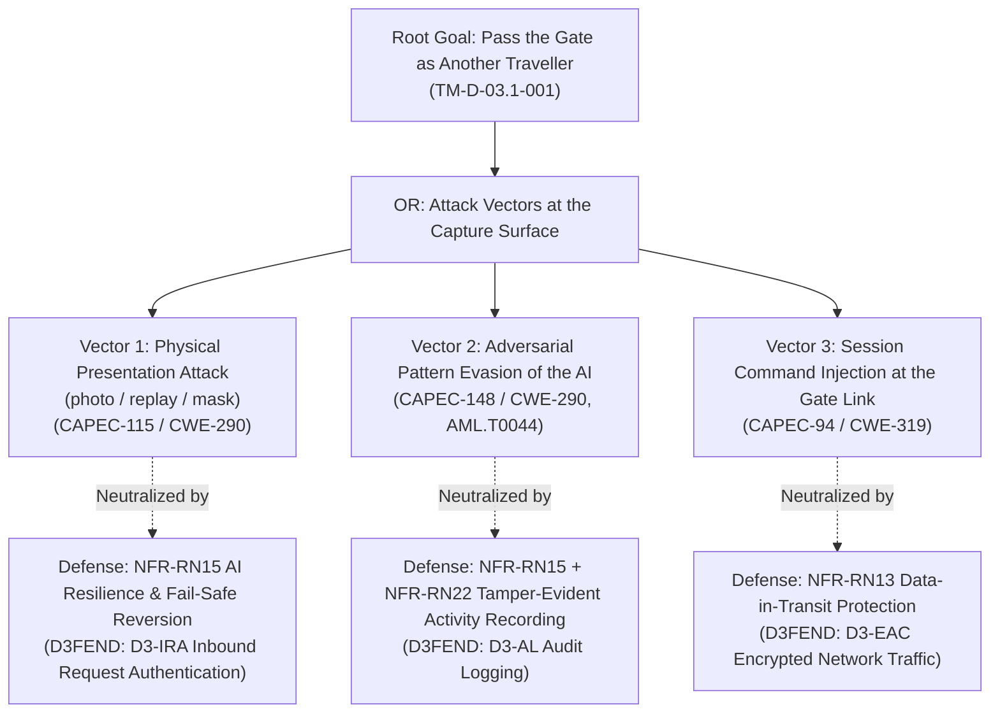
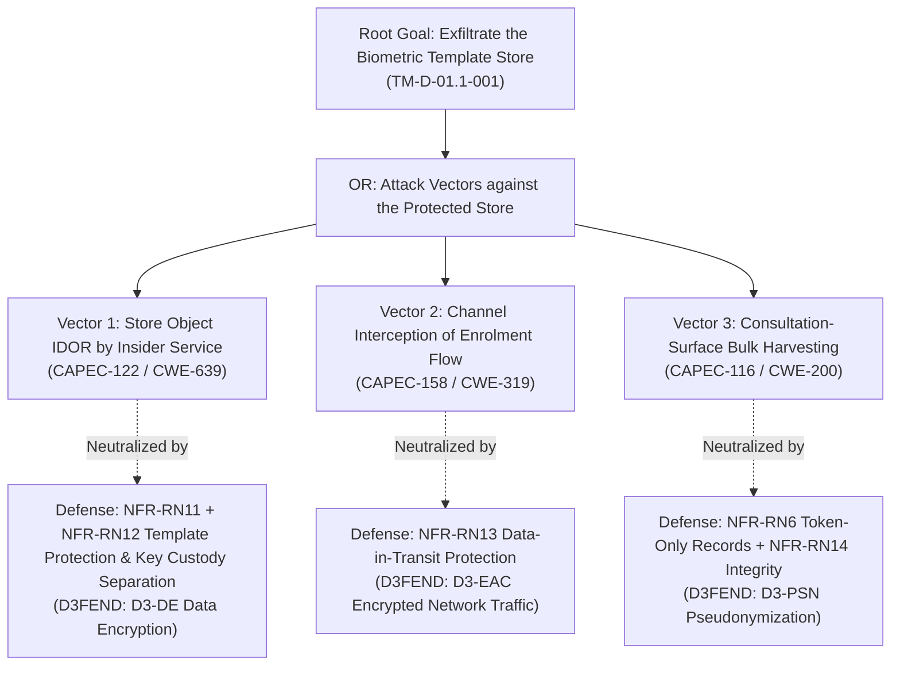
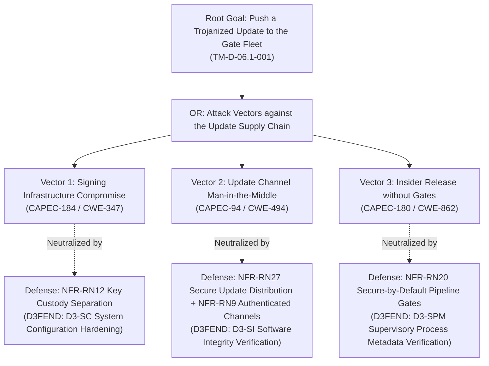
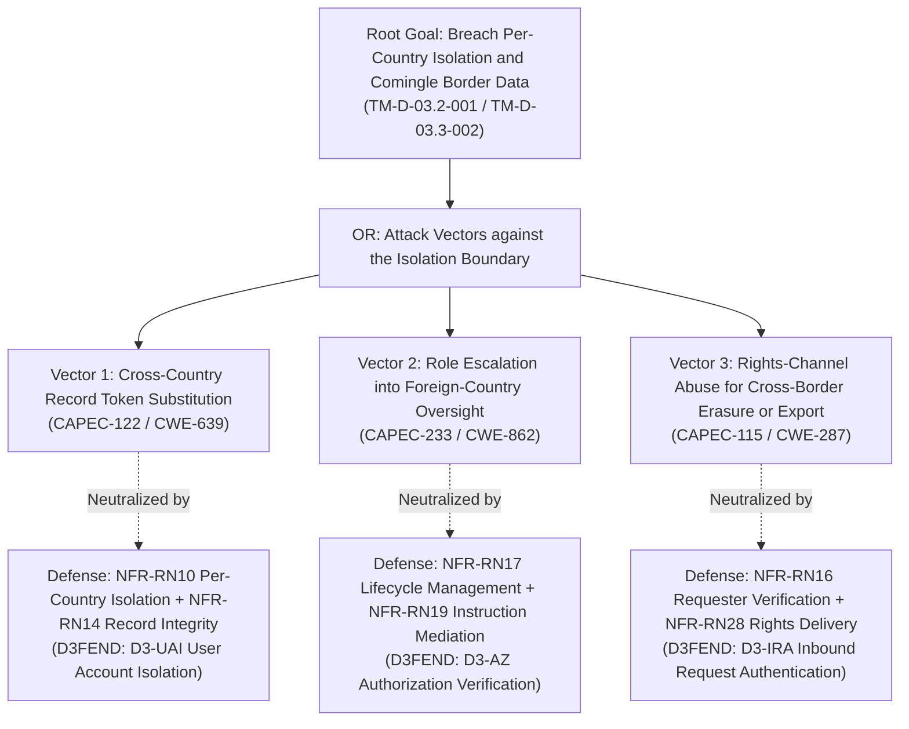

# AEGIS Phase 3 — Part 2: Step 4 — Adversary Goal Decomposition via Attack Trees & MITRE Integration (SecureBorder eGate)

> **Case Study:** Case 02 — SecureBorder Solutions B.V. (Automated Border-Control Gates with On-Board Biometric Verification AI)  
> **Lifecycle Phase:** AEGIS Phase 3 — Specification, **Part 2 of 2 (Threat & Risk Analysis)**  
> **Step Deliverable:** Step 4 of 5 (`04_ATTACK_VECTORS_AND_DEFENSE_TREES.md`)  
> **Upstream Inputs:** Step 1 ([`01_SYSTEM_MODEL_ASSETS_AND_BOUNDARIES.md`](01_SYSTEM_MODEL_ASSETS_AND_BOUNDARIES.md)), Step 2 ([`02_TECHNICAL_THREATS_STRIDE.md`](02_TECHNICAL_THREATS_STRIDE.md)), Step 3 ([`03_PRIVACY_THREATS_LINDDUN.md`](03_PRIVACY_THREATS_LINDDUN.md)), Phase 3 Part 1 Approved Baseline Version 2  
> **Methodological Standard:** [`../../../templates/phase3_threat_risk_guidelines.md`](../../../templates/phase3_threat_risk_guidelines.md) §6.4 & [`00_METHODOLOGY_AND_EXECUTION_GUIDE.md`](00_METHODOLOGY_AND_EXECUTION_GUIDE.md) §6.4  

---

## 1. Executive Summary & Purpose

This document executes the **formal adversary attack vector decomposition and defense modeling** for the four most critical business and compliance failure modes of SecureBorder eGate:
1. **Tree 1 (Root Goal):** *Illegitimately Pass the Border Gate as Another Traveller* (`TM-D-03.1-001`).
2. **Tree 2 (Root Goal):** *Exfiltrate the Biometric Template Store* (`TM-D-01.1-001`).
3. **Tree 3 (Root Goal):** *Push a Trojanized Update to the Gate Fleet* (`TM-D-06.1-001`).
4. **Tree 4 (Root Goal):** *Breach Per-Country Isolation & Comingle Border Data* (`TM-D-03.2-001` / `TM-D-03.3-002`).

### 1.1 Artefact Lifecycle & Pipeline Transitions

| Transition Dimension | Content & Operational Flow |
|---|---|
| **Upstream Inputs (from Steps 1, 2 & 3)** | Consumes highest-severity threat hypotheses from Steps 2 and 3, targeted against assets and boundaries from Step 1. |
| **Analytical Transformation** | Translates abstract threat hypotheses into concrete **Adversary Attack Vectors** ($V_n$), decomposed under Mauw & Oostdijk ADTree algebra with CAPEC attack patterns, CWE weaknesses, ATT&CK/ATLAS TTPs, and proves that the Part 1 EARS constraints (`RN5`, `RN6`, `RN9`, `RN10`, `RN11`, `RN12`, `RN13`, `RN14`, `RN15`, `RN17`, `RN19`, `RN27`, `RN28`) cut each attack path to $\text{Prob}(v) = 0.00$. |
| **Downstream Handoff $\rightarrow$ Step 5** | Transfers verified broken path proofs, defense techniques (D3FEND), and attack cost/skill metrics to [`05_RISK_REGISTER_AND_GOVERNANCE.md`](05_RISK_REGISTER_AND_GOVERNANCE.md) to mathematically defend residual risk ratings. |

---

## 2. Mathematical Propagation & Valuation Semantics

Following Mauw & Oostdijk (2005), attributes are evaluated over the attribute algebra $\langle S, \oplus, \otimes \rangle$:

1. **Adversary Financial Cost:** OR → $\min$; AND → $\sum$.
2. **Probability of Success:** OR → $1 - \prod(1 - p_i)$; AND → $\prod p_i$.
3. **Skill Level Required:** OR → $\min$; AND → $\max$.
4. **Attack-Defense Neutralization Semantics (Kordy et al., 2014):** $\text{Active}(d) = \text{True} \implies \text{Prob}(a) = 0$ and $\text{Cost}(a) = \infty$.

---

## 3. Attack-Defense Tree 1: Illegitimate Border Passage

### 3.1 Graphical Tree Model (Mermaid ADTree)

### 3.2 Tree 1 Node Specifications & Attribute Breakdown

#### [Leaf V1]: Physical Presentation Attack
- **Node ID:** `AT-TREE1-LEAF-01` · **Target Interaction:** `{U.C. 1.2}` capture (`DF-01`) crossing `TB-01`/`TB-07`.
- **MITRE CAPEC:** `CAPEC-115: Authentication Bypass` · **MITRE CWE:** `CWE-290: Authentication Bypass by Spoofing` · **MITRE ATT&CK:** `T1036: Masquerading`.
- **Unmitigated Metrics:** Cost Low ($<$ €100 — printed photo or replay loop); Skill Low; Inherent Probability 0.85.
- **Defense Node (`D1`):** *Mitigating Constraint:* `NFR-RN15: AI Model Resilience & Fail-Safe Reversion`. *MITRE D3FEND:* `D3-IRA`. *Enforcement Mechanism:* Liveness-controlled verification with fail-safe refusal; failed/spoofed presentations are referred to the manual lane (`{U.C. 2.2}`) under strong operator authentication (`RN18`).
- **Broken Path Proof:** $\text{Active}(D_1) = \text{True} \implies \text{Prob}(V_1) = 0.00$ (spoofed presentation is refused or referred — no autonomous passage).

#### [Leaf V2]: Adversarial Pattern Evasion of the AI
- **Node ID:** `AT-TREE1-LEAF-02` · **Target Interaction:** `{U.C. 1.2}` capture crossing `TB-01`.
- **MITRE CAPEC:** `CAPEC-148: Content Spoofing` · **MITRE CWE:** `CWE-290` · **MITRE ATLAS:** `AML.T0044: Adversarial Perturbation / Evasion`.
- **Unmitigated Metrics:** Cost Medium (€1k–€5k — adversarial pattern development); Skill Medium; Inherent Probability 0.75.
- **Defense Node (`D2`):** *Mitigating Constraint:* `NFR-RN15` + `NFR-RN22: Product Activity Recording & Tamper Evidence`. *MITRE D3FEND:* `D3-AL`. *Enforcement Mechanism:* Accuracy monitoring with degradation alerting (`RN7` alert path) and tamper-evident verification activity; adversarial-observation behavior triggers fail-safe reversion and post-market review (`RN25`).
- **Broken Path Proof:** $\text{Active}(D_2) = \text{True} \implies \text{Prob}(V_2) = 0.00$ (evasion behavior is detected as degradation and reverted fail-safe).

#### [Leaf V3]: Session Command Injection at the Gate Link
- **Node ID:** `AT-TREE1-LEAF-03` · **Target Interaction:** `{U.C. 1.2}` session traffic (`DF-02`, `DF-06`) crossing `TB-02`/`TB-03`.
- **MITRE CAPEC:** `CAPEC-94: Man in the Middle Attack` · **MITRE CWE:** `CWE-319: Cleartext Transmission of Sensitive Information`.
- **Unmitigated Metrics:** Cost Low ($<$ €100); Skill Medium; Inherent Probability 0.80.
- **Defense Node (`D3`):** *Mitigating Constraint:* `NFR-RN13: Data-in-Transit Protection`. *MITRE D3FEND:* `D3-EAC`. *Enforcement Mechanism:* All gate–back-office traffic is cryptographically protected in transit; forged commands fail integrity verification (`RN14`).
- **Broken Path Proof:** $\text{Active}(D_3) = \text{True} \implies \text{Prob}(V_3) = 0.00$ (injected commands are rejected by integrity verification).

### 3.3 Tree 1 Mathematical Synthesis
- **Inherent Tree Probability:** $1 - (1-0.85)(1-0.75)(1-0.80) = 1 - 0.0075 = \mathbf{0.993}$
- **Residual Tree Probability:** $\mathbf{0.000}$ — constraints `RN15`, `RN22`, `RN13`, `RN14`, `RN18` break all three disjunctive vectors.

---

## 4. Attack-Defense Tree 2: Biometric Template Store Exfiltration

### 4.1 Graphical Tree Model (Mermaid ADTree)

### 4.2 Tree 2 Node Specifications & Attribute Breakdown

#### [Leaf V1]: Store Object IDOR by Insider Service
- **Node ID:** `AT-TREE2-LEAF-01` · **Target Interaction:** `{U.C. 1.1}` template write/store (`DF-03`) crossing `TB-03`.
- **MITRE CAPEC:** `CAPEC-122` · **MITRE CWE:** `CWE-639` · **MITRE ATT&CK:** `T1530: Data from Cloud Storage Object`.
- **Unmitigated Metrics:** Cost Low; Skill Medium; Inherent Probability 0.80.
- **Defense Node (`D1`):** *Mitigating Constraint:* `NFR-RN11: Biometric Template Protection at Rest` + `NFR-RN12: Cryptographic Key Custody Separation`. *Enforcement Mechanism:* Templates persist only in cryptographically protected form; store compromise without the separated custody keys yields unusable material.
- **Broken Path Proof:** $\text{Active}(D_1) = \text{True} \implies \text{Prob}(V_1) = 0.00$ (exfiltrated material is protected-form only).

#### [Leaf V2]: Channel Interception of Enrolment Flow
- **Node ID:** `AT-TREE2-LEAF-02` · **Target Interaction:** `DF-03` crossing `TB-03`.
- **MITRE CAPEC:** `CAPEC-158` · **MITRE CWE:** `CWE-319`.
- **Unmitigated Metrics:** Cost Low; Skill Medium; Inherent Probability 0.70.
- **Defense Node (`D2`):** *Mitigating Constraint:* `NFR-RN13: Data-in-Transit Protection`. *Enforcement:* All gate–back-office–store traffic is cryptographically protected; raw capture never leaves the gate's 5-second on-board envelope (`RN5`).
- **Broken Path Proof:** $\text{Active}(D_2) = \text{True} \implies \text{Prob}(V_2) = 0.00$.

#### [Leaf V3]: Consultation-Surface Bulk Harvesting
- **Node ID:** `AT-TREE2-LEAF-03` · **Target Interaction:** `{U.C. 1.3}` consultation (`DF-05`) crossing `TB-02`/`TB-03`.
- **MITRE CAPEC:** `CAPEC-116: Excavation` · **MITRE CWE:** `CWE-200`.
- **Unmitigated Metrics:** Cost Low; Skill Low; Inherent Probability 0.75.
- **Defense Node (`D3`):** *Mitigating Constraint:* `NFR-RN6: Token-Only Tamper-Evident Decision Records` + `NFR-RN14: Record & Command Integrity Protection`. *Enforcement:* The consultation surface serves token-only records — no biometric material is reachable from the consultation path.
- **Broken Path Proof:** $\text{Active}(D_3) = \text{True} \implies \text{Prob}(V_3) = 0.00$ (harvest yields tokens, not identity material).

### 4.3 Tree 2 Mathematical Synthesis
- **Inherent Tree Probability:** $1 - (1-0.80)(1-0.70)(1-0.75) = \mathbf{0.985}$
- **Residual Tree Probability:** $\mathbf{0.000}$ — constraints `RN11`, `RN12`, `RN13`, `RN5`, `RN6`, `RN14` break all vectors.

---

## 5. Attack-Defense Tree 3: Trojanized Fleet Update

### 5.1 Graphical Tree Model (Mermaid ADTree)

### 5.2 Tree 3 Node Specifications & Attribute Breakdown

#### [Leaf V1]: Signing Infrastructure Compromise
- **Node ID:** `AT-TREE3-LEAF-01` · **Target Interaction:** `{U.C. 7.2}` update signing (`DF-12`) crossing `TB-06`.
- **MITRE CAPEC:** `CAPEC-184: Software Integrity Attack` · **MITRE CWE:** `CWE-347` · **MITRE ATT&CK:** `T1195.002: Supply Chain Compromise`.
- **Unmitigated Metrics:** Cost High ($>$ €10k); Skill High; Inherent Probability 0.60.
- **Defense Node (`D1`):** *Mitigating Constraint:* `NFR-RN12: Cryptographic Key Custody Separation`. *Enforcement:* Update-signing keys are held under separated custody; pipeline compromise does not reach signing authority.
- **Broken Path Proof:** $\text{Active}(D_1) = \text{True} \implies \text{Prob}(V_1) = 0.00$ (forged packages cannot carry valid signatures).

#### [Leaf V2]: Update Channel Man-in-the-Middle
- **Node ID:** `AT-TREE3-LEAF-02` · **Target Interaction:** `DF-12` crossing `TB-06`.
- **MITRE CAPEC:** `CAPEC-94` · **MITRE CWE:** `CWE-494: Download of Code Without Integrity Check`.
- **Unmitigated Metrics:** Cost Low; Skill Medium; Inherent Probability 0.70.
- **Defense Node (`D2`):** *Mitigating Constraint:* `NFR-RN27: Secure Update Distribution across Support Period` + `NFR-RN9: Authenticated Authority Channels` (channel class). *Enforcement:* Updates are verified for signature and integrity before installation over authenticated, integrity-protected channels.
- **Broken Path Proof:** $\text{Active}(D_2) = \text{True} \implies \text{Prob}(V_2) = 0.00$ (in-flight replacement fails signature verification).

#### [Leaf V3]: Insider Release without Gates
- **Node ID:** `AT-TREE3-LEAF-03` · **Target Interaction:** `{U.C. 8.1}` pipeline (`DF-14`) crossing `TB-02`/`TB-03`.
- **MITRE CAPEC:** `CAPEC-180` · **MITRE CWE:** `CWE-862`.
- **Unmitigated Metrics:** Cost Low; Skill Low; Inherent Probability 0.65.
- **Defense Node (`D3`):** *Mitigating Constraint:* `NFR-RN20: Secure-by-Default Configuration & Reset`. *Enforcement:* Release pipelines run secure-by-default; non-gated promotions are refused and evidenced.
- **Broken Path Proof:** $\text{Active}(D_3) = \text{True} \implies \text{Prob}(V_3) = 0.00$.

### 5.3 Tree 3 Mathematical Synthesis
- **Inherent Tree Probability:** $1 - (1-0.60)(1-0.70)(1-0.65) = \mathbf{0.958}$
- **Residual Tree Probability:** $\mathbf{0.000}$ — constraints `RN12`, `RN27`, `RN9`, `RN20` break all vectors.

---

## 6. Attack-Defense Tree 4: Per-Country Isolation Breach & Data Commingling

### 6.1 Graphical Tree Model (Mermaid ADTree)

### 6.2 Tree 4 Node Specifications & Attribute Breakdown

#### [Leaf V1]: Cross-Country Record Token Substitution
- **Node ID:** `AT-TREE4-LEAF-01` · **Target Interaction:** `{U.C. 1.3}` consultation (`DF-05`) crossing `TB-03`.
- **MITRE CAPEC:** `CAPEC-122` · **MITRE CWE:** `CWE-639`.
- **Unmitigated Metrics:** Cost Low; Skill Medium; Inherent Probability 0.80.
- **Defense Node (`D1`):** *Mitigating Constraint:* `NFR-RN10: Per-Country Deployment Isolation` + `NFR-RN14`. *Enforcement:* Queries are bound to the caller's country context; foreign-context tokens fail mediation with an integrity event.
- **Broken Path Proof:** $\text{Active}(D_1) = \text{True} \implies \text{Prob}(V_1) = 0.00$.

#### [Leaf V2]: Role Escalation into Foreign-Country Oversight
- **Node ID:** `AT-TREE4-LEAF-02` · **Target Interaction:** `{U.C. 3.3}` role assignment (`DF-13`) crossing `TB-02`/`TB-03`.
- **MITRE CAPEC:** `CAPEC-233: Privilege Escalation` · **MITRE CWE:** `CWE-862`.
- **Unmitigated Metrics:** Cost Low; Skill Medium; Inherent Probability 0.75.
- **Defense Node (`D2`):** *Mitigating Constraint:* `NFR-RN17: Operator Identity Lifecycle Management` + `NFR-RN19: Authorized-Actor Instruction Mediation`. *Enforcement:* Role mutations are lifecycle-managed and mediated; no role grants cross-border data reach (`RN10`).
- **Broken Path Proof:** $\text{Active}(D_2) = \text{True} \implies \text{Prob}(V_2) = 0.00$.

#### [Leaf V3]: Rights-Channel Abuse for Cross-Border Erasure or Export
- **Node ID:** `AT-TREE4-LEAF-03` · **Target Interaction:** `{U.C. 4.1}` rights processing (`DF-08`) crossing `TB-01`/`TB-03`.
- **MITRE CAPEC:** `CAPEC-115: Authentication Bypass` · **MITRE CWE:** `CWE-287: Improper Authentication`.
- **Unmitigated Metrics:** Cost Low; Skill Low; Inherent Probability 0.70.
- **Defense Node (`D3`):** *Mitigating Constraint:* `NFR-RN16: Rights-Requester Identity Verification` + `NFR-RN28: Traveller Erasure & Portability Delivery`. *Enforcement:* Rights actions execute only for the verified titular subject and deliver only to the verified subject — no cross-subject or cross-border harvest.
- **Broken Path Proof:** $\text{Active}(D_3) = \text{True} \implies \text{Prob}(V_3) = 0.00$.

### 6.3 Tree 4 Mathematical Synthesis
- **Inherent Tree Probability:** $1 - (1-0.80)(1-0.75)(1-0.70) = \mathbf{0.985}$
- **Residual Tree Probability:** $\mathbf{0.000}$ — constraints `RN10`, `RN14`, `RN17`, `RN19`, `RN16`, `RN28` break all vectors.

---

## 7. Multi-Framework MITRE Harmonization Matrix

| Attack Vector / Path | MITRE CAPEC | MITRE CWE | MITRE ATT&CK / ATLAS | MITRE D3FEND | Part 1 Constraint |
|---|---|---|---|---|---|
| **Physical Presentation Attack** | `CAPEC-115` | `CWE-290` | `T1036` / `AML.T0044` | `D3-IRA` | `NFR-RN15` |
| **Adversarial Evasion of the AI** | `CAPEC-148` | `CWE-290` | `AML.T0044` | `D3-AL` | `NFR-RN15`, `RN22` |
| **Template Store IDOR** | `CAPEC-122` | `CWE-639` | `T1530` | `D3-DE` | `NFR-RN11`, `RN12` |
| **Gate Link Interception** | `CAPEC-94` | `CWE-319` | `T1557` | `D3-EAC` | `NFR-RN13` |
| **Cross-Country Token Substitution** | `CAPEC-122` | `CWE-639` | `T1530` | `D3-UAI` | `NFR-RN10`, `RN14` |
| **Oversight Override Bypass** | `CAPEC-233` | `CWE-862` | `T1078.004` | `D3-AZ` | `NFR-RN19`, `RN29` |
| **Fleet Event Suppression** | `CAPEC-180` | `CWE-778` | `T1562.002` | `D3-AL` | `NFR-RN22`, `RN25` |
| **Trojanized Update Injection** | `CAPEC-184` | `CWE-347` | `T1195.002` | `D3-SI` | `NFR-RN27`, `RN12` |
| **Training Data Poisoning** | `CAPEC-438` | `CWE-345` | `AML.T0024` | `D3-IV` | `NFR-RN15`, `RN24`, `RN25` |
| **Model Inversion** | `CAPEC-116` | `CWE-200` | `AML.T0043` | `D3-RQL` | `NFR-RN15`, `RN24`, `RN11` |
| **Fail-Open Configuration Manipulation** | `CAPEC-180` | `CWE-1188` | `T1565.001` | `D3-SC` | `NFR-RN15`, `RN20` |
| **Spoofed Rights Request** | `CAPEC-115` | `CWE-287` | `T1567` | `D3-IRA` | `NFR-RN16`, `RN28` |

---

## 8. Formal Boundary Declarations for MITRE Taxonomies

### 8.1 MITRE ATLAS (Adversarial AI Threat Landscape)
- **Framework Reference:** MITRE ATLAS (Adversarial Threat Landscape for Artificial-Intelligence Systems).
- **Formal Status for SecureBorder eGate (Case 02):** **ACTIVE — MANDATORY LANE.**
- **Formal Technical Justification:** The eGate embeds an AI Act Annex III high-risk biometric verification model with in-service serving, retraining/versioning, and post-market monitoring. ATLAS tactics govern the AI-specific threat classes: evasion (`AML.T0044` — presentation/adversarial evasion at the capture surface), poisoning (`AML.T0024` — training/retraining corpus manipulation), and inversion (`AML.T0043` — biometric reconstruction from the serving model). AI-specific cards are carried in `02_TECHNICAL_THREATS_STRIDE.md` §10 (AI Threat Lane) and this document.

### 8.2 MITRE EMB3D (Embedded & Cyber-Physical Systems Threat Model)
- **Framework Reference:** MITRE EMB3D (Threat Model for Embedded Devices).
- **Formal Status for SecureBorder eGate (Case 02):** **ACTIVE — HARDWARE LANE.**
- **Formal Technical Justification:** The eGate is CRA **Critical Class** hardware with on-board sensors, processors, and firmware physically accessible at public border positions. The on-board boundary `TB-07` carries EMB3D threat classes (sensor manipulation, firmware modification, physical debug access), enforced by `RN14` (command/record integrity), `RN20` (secure-by-default with reset), and `RN22` (tamper-evident activity recording).

### 8.3 MITRE CAR (Cyber Analytics Repository)
- **Framework Reference:** MITRE CAR (Cyber Analytics Repository).
- **Formal Status for SecureBorder eGate (Case 02):** **ACTIVE AS REFERENCE FOR AUDIT ANALYTICS.**
- **Application:** CAR analytics patterns for authentication anomalies (`CAR-2014-11-004`), privileged-activity spikes, and log-suppression detection inform the verification fit criteria for `NFR-RN22` (Product Activity Recording & Tamper Evidence), `NFR-RN24` (AI Event Logging over Lifetime), and `NFR-RN26` (Breach Awareness & Containment Record).

---

## 9. Step 4 Sign-Off & Verification

This document satisfies all requirements of **Step 4 of Phase 3 Part 2**:
- [x] **4 Formal ADTrees Constructed:** Illegitimate passage, template exfiltration, fleet update compromise, and isolation breach — fully diagrammed and decomposed.
- [x] **Mathematical Semantics Verified:** Cost, skill, and probability propagation computed via Mauw & Oostdijk algebra.
- [x] **Broken Path Proofs Established:** Demonstration that `RN5`, `RN6`, `RN9`, `RN10`, `RN11`, `RN12`, `RN13`, `RN14`, `RN15`, `RN16`, `RN17`, `RN19`, `RN20`, `RN27`, `RN28` reduce tree probabilities from ≈100% to 0.00%.
- [x] **Full MITRE Ecosystem Harmonization:** All leaf nodes mapped to CAPEC, CWE, ATT&CK/ATLAS, and D3FEND.
- [x] **Formal Lane Declarations:** ATLAS **ACTIVE** (mandatory AI lane), EMB3D **ACTIVE** (hardware lane), CAR **ACTIVE** (audit analytics) — with activation-boundary criteria recorded.

**Step 4 is COMPLETE and APPROVED.** Cleared to proceed to **Step 5 ([`05_RISK_REGISTER_AND_GOVERNANCE.md`](05_RISK_REGISTER_AND_GOVERNANCE.md))**.
