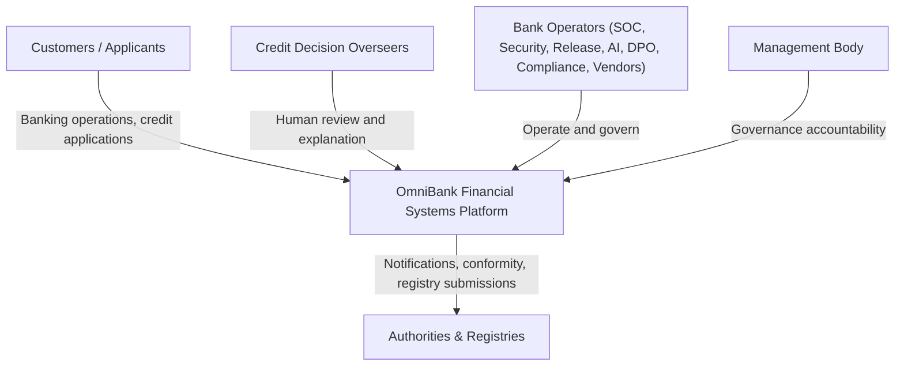

# E1.2 – OmniBank Financial Systems: System Use Cases

## Executive Summary

This deliverable specifies the formal **System Use Cases** for the **OmniBank Financial Systems** platform, elaborating the functional requirements elicited in `Doc01` into behavioral contracts. Use case decomposition anchors rigorously at **Level 1 (`{U.C.n.m}`)** — Cockburn’s "User Goal / Sea Level" — with zero leaf nodes and zero procedural execution sequences, providing an unambiguous, technology-neutral functional canvas for the AEGIS Phase 3 security synthesis. In this baseline version the use cases carry the light identification format (Primary Actor / Goal / Operational Scope); the fully-dressed anatomy is elaborated during the V1 synthesis together with the accepted security behavior.

---

## 1. Introduction

The OmniBank platform serves retail customers through mobile and web channels, produces automated credit decisions with the OmniScore AI platform under human oversight, and operates the banking-grade security, resilience, and governance functions required of a five-regulation essential financial entity.

## 2. System Requirements Approach

### 2.1 Volere Approach and Triangular Functional Decomposition

Business events drive Product Use Cases (`Doc01` §3), realized here as System Use Cases; the triangular decomposition connects business events → product use cases → system use cases with the requirement cards as the central vertex.

### 2.2 Refinement Boundary (No Leaf Nodes)

Refinement stops strictly at Level 1; zero leaf nodes, zero procedural scripts, active-verb naming throughout.

### 2.3 Non-Functional Requirements

The measurable quality targets are carried in `Doc01` Table 7 (`RN1`–`RN10`) and mirrored in §5 of this document.

## 3. Requirements Analysis

### 3.1 Work Context Model

### 3.2 Summary Table of Product Use Cases (PUC)

Each PUC maps to its Level-1 System Use Case below (1:1 with `Doc01` Table 6).

---

## 4. Domain Application Use Cases

### 4.1 System Actors

- **Customer / Applicant:** retail customer; credit applicant; data subject.
- **Credit Decision Overseer:** empowered human reviewer of automated credit decisions.
- **Bank Operators:** SOC analysts, security engineers, release engineers, AI data engineers and operations, DPO team, compliance officers, vendor risk managers, training officers.
- **Management Body:** board with governance accountability.
- **Authorities & Registries:** supervisory authorities, CSIRT, market-surveillance authorities, AI registry.

### 4.2 System Use Cases

### {U.C. R1} Manage Banking Services and Credit Decisions

#### {U.C. 1.1} Operate customer banking channels
- **Traceability:** Requirement `R1.1` | Product Use Case `PUC 1.1`
- **Primary Actor:** Customer
- **Goal:** Provide self-service accounts, payments, and card services with attributed operations.
- **Operational Scope:** The system serves mobile and web channel operations end-to-end.

#### {U.C. 1.2} Process credit applications through automated scoring
- **Traceability:** Requirement `R1.2` | Product Use Case `PUC 1.2`
- **Primary Actor:** Customer
- **Goal:** Collect application data, produce the OmniScore score and access decision, and communicate the outcome with reasons.
- **Operational Scope:** The system runs the scoring flow from application to communicated decision.

#### {U.C. 1.3} Provide human review and explanation of credit decisions
- **Traceability:** Requirement `R1.3` | Product Use Case `PUC 1.3`
- **Primary Actor:** Overseer
- **Goal:** Review flagged or declined decisions with decision drivers, record the attributed outcome, and support applicant explanation.
- **Operational Scope:** The system mediates human review of automated decisions.

#### {U.C. 1.4} Maintain AI model releases and versions
- **Traceability:** Requirement `R1.4` | Product Use Case `PUC 1.4`
- **Primary Actor:** AI Governance Lead
- **Goal:** Version model releases with verification metadata, govern promotion, and retire versions.
- **Operational Scope:** The system maintains the model release lifecycle.

### {U.C. R2} Manage Cryptographic Protection

#### {U.C. 2.1} Configure data-at-rest encryption
- **Traceability:** Requirement `R2.1` | Product Use Case `PUC 2.1`
- **Primary Actor:** Security Engineer
- **Goal:** Protect stored estates with state-of-the-art at-rest encryption incl. field-level protection.
- **Operational Scope:** The system enforces at-rest protection across storage estates.

#### {U.C. 2.2} Protect data in transit
- **Traceability:** Requirement `R2.2` | Product Use Case `PUC 2.2`
- **Primary Actor:** Security Engineer
- **Goal:** Protect customer, inter-service, and third-party flows with channel encryption and integrity verification.
- **Operational Scope:** The system enforces transit protection on all boundary flows.

#### {U.C. 2.3} Manage cryptographic key lifecycle and custody
- **Traceability:** Requirement `R2.3` | Product Use Case `PUC 2.3`
- **Primary Actor:** Cryptographic Officer
- **Goal:** Manage key generation, rotation, and destruction with separated custody.
- **Operational Scope:** The system runs the key lifecycle under separated custody.

### {U.C. R3} Manage Vulnerabilities and Patches

#### {U.C. 3.1} Identify and assess vulnerabilities
- **Traceability:** Requirement `R3.1` | Product Use Case `PUC 3.1`
- **Primary Actor:** Security Engineer
- **Goal:** Identify and document vulnerabilities across estate, product, and AI models with severity assessment.
- **Operational Scope:** The system maintains the vulnerability register.

#### {U.C. 3.2} Remediate vulnerabilities through security updates
- **Traceability:** Requirement `R3.2` | Product Use Case `PUC 3.2`
- **Primary Actor:** Security Engineer
- **Goal:** Deploy severity-driven security updates including model updates.
- **Operational Scope:** The system patches the estate without delay per severity.

#### {U.C. 3.3} Operate coordinated vulnerability disclosure
- **Traceability:** Requirement `R3.3` | Product Use Case `PUC 3.3`
- **Primary Actor:** Security Engineer
- **Goal:** Provide the researcher channel, triage reports, and publish disclosures under policy.
- **Operational Scope:** The system runs the disclosure process.

#### {U.C. 3.4} Execute security and threat-led testing
- **Traceability:** Requirement `R3.4` | Product Use Case `PUC 3.4`
- **Primary Actor:** Security Engineer
- **Goal:** Execute regular and threat-led testing producing conformity evidence.
- **Operational Scope:** The system runs the testing programmes.

### {U.C. R4} Manage Identities and Access

#### {U.C. 4.1} Manage identity lifecycle
- **Traceability:** Requirement `R4.1` | Product Use Case `PUC 4.1`
- **Primary Actor:** Identity Administrator
- **Goal:** Provision, review, and revoke identities and entitlements across the employment lifecycle.
- **Operational Scope:** The system mirrors employment lifecycle states.

#### {U.C. 4.2} Enforce multi-factor authentication for privileged access
- **Traceability:** Requirement `R4.2` | Product Use Case `PUC 4.2`
- **Primary Actor:** Privileged Operator
- **Goal:** Require policy-strength multi-factor verification for privileged access.
- **Operational Scope:** The system mediates privileged authentication.

#### {U.C. 4.3} Review and reconcile access rights
- **Traceability:** Requirement `R4.3` | Product Use Case `PUC 4.3`
- **Primary Actor:** Compliance Officer
- **Goal:** Reconcile entitlements against authorizations and record outcomes.
- **Operational Scope:** The system runs periodic access reviews.

#### {U.C. 4.4} Maintain hardened secure configurations
- **Traceability:** Requirement `R4.4` | Product Use Case `PUC 4.4`
- **Primary Actor:** Security Engineer
- **Goal:** Deploy from hardened baselines and restore known secure states.
- **Operational Scope:** The system maintains configuration baselines.

### {U.C. R5} Detect and Respond to Incidents

#### {U.C. 5.1} Monitor and correlate security events
- **Traceability:** Requirement `R5.1` | Product Use Case `PUC 5.1`
- **Primary Actor:** SOC Analyst
- **Goal:** Collect and correlate events from estate, fleet, and AI platform for detection and triage.
- **Operational Scope:** The system provides the monitoring fabric.

#### {U.C. 5.2} Triage incidents and execute unified regulatory notification
- **Traceability:** Requirement `R5.2` | Product Use Case `PUC 5.2`
- **Primary Actor:** SOC Manager
- **Goal:** Triage from one incident record and dispatch per-regime notifications from a single clock-start.
- **Operational Scope:** The system runs incident triage and the notification matrix.

#### {U.C. 5.3} Maintain backups and execute disaster recovery
- **Traceability:** Requirement `R5.3` | Product Use Case `PUC 5.3`
- **Primary Actor:** IT Operations
- **Goal:** Maintain backups and execute recovery within objectives.
- **Operational Scope:** The system provides continuity execution.

#### {U.C. 5.4} Investigate and recover AI system after failure
- **Traceability:** Requirement `R5.4` | Product Use Case `PUC 5.4`
- **Primary Actor:** AI Operations
- **Goal:** Investigate anomalies, restore verified states, and feed findings to model owners.
- **Operational Scope:** The system recovers the AI service after failure.

### {U.C. R6} Manage Data Lifecycle and Rights

#### {U.C. 6.1} Minimize data collection
- **Traceability:** Requirement `R6.1` | Product Use Case `PUC 6.1`
- **Primary Actor:** DPO
- **Goal:** Limit collected data to what is necessary per stated purpose.
- **Operational Scope:** The system enforces collection minimization.

#### {U.C. 6.2} Enforce tiered retention schedules
- **Traceability:** Requirement `R6.2` | Product Use Case `PUC 6.2`
- **Primary Actor:** Compliance Officer
- **Goal:** Retain per schedule and purge or de-identify on expiry.
- **Operational Scope:** The system enforces retention tiers.

#### {U.C. 6.3} Process data-subject requests
- **Traceability:** Requirement `R6.3` | Product Use Case `PUC 6.3`
- **Primary Actor:** DPO Team
- **Goal:** Verify and fulfil access, rectification, and erasure requests within the statutory window.
- **Operational Scope:** The system mediates rights fulfilment.

#### {U.C. 6.4} Deliver data exports and portability
- **Traceability:** Requirement `R6.4` | Product Use Case `PUC 6.4`
- **Primary Actor:** DPO Team
- **Goal:** Deliver structured machine-readable exports excluding third-party data.
- **Operational Scope:** The system produces subject exports.

#### {U.C. 6.5} Manage AI training-data lifecycle
- **Traceability:** Requirement `R6.5` | Product Use Case `PUC 6.5`
- **Primary Actor:** AI Data Engineer
- **Goal:** Govern training, validation, and test datasets with relevance and representativeness checks.
- **Operational Scope:** The system governs the AI dataset lifecycle.

### {U.C. R7} Manage Vendors and Supply Chain

#### {U.C. 7.1} Assess ICT third-party providers and maintain the register
- **Traceability:** Requirement `R7.1` | Product Use Case `PUC 7.1`
- **Primary Actor:** Vendor Risk Manager
- **Goal:** Assess providers and maintain the ICT third-party register with criticality.
- **Operational Scope:** The system runs third-party assessment and the register.

#### {U.C. 7.2} Maintain software bills of materials
- **Traceability:** Requirement `R7.2` | Product Use Case `PUC 7.2`
- **Primary Actor:** Release Engineer
- **Goal:** Generate and maintain machine-readable bills of materials for releases and model components.
- **Operational Scope:** The system maintains SBOMs.

#### {U.C. 7.3} Enforce contractual security terms
- **Traceability:** Requirement `R7.3` | Product Use Case `PUC 7.3`
- **Primary Actor:** Procurement
- **Goal:** Record and track supplier and processor security terms incl. sub-processor chains.
- **Operational Scope:** The system tracks contractual security.

#### {U.C. 7.4} Manage provider and vendor exit
- **Traceability:** Requirement `R7.4` | Product Use Case `PUC 7.4`
- **Primary Actor:** Vendor Risk Manager
- **Goal:** Execute planned exits with data return or deletion and access revocation.
- **Operational Scope:** The system supports vendor exit.

### {U.C. R8} Develop and Release Securely

#### {U.C. 8.1} Apply secure development standards
- **Traceability:** Requirement `R8.1` | Product Use Case `PUC 8.1`
- **Primary Actor:** Development Manager
- **Goal:** Enforce design review, coding outcomes, and code review for components and model code.
- **Operational Scope:** The system enforces secure development.

#### {U.C. 8.2} Secure the release pipeline
- **Traceability:** Requirement `R8.2` | Product Use Case `PUC 8.2`
- **Primary Actor:** Release Engineer
- **Goal:** Enforce build verification, dependency and artefact checks, and signing before distribution.
- **Operational Scope:** The system runs the release gates.

#### {U.C. 8.3} Approve production changes
- **Traceability:** Requirement `R8.3` | Product Use Case `PUC 8.3`
- **Primary Actor:** Change Advisory Board
- **Goal:** Route production changes through recorded approval decisions.
- **Operational Scope:** The system mediates change approval.

#### {U.C. 8.4} Secure the AI training and serving pipeline
- **Traceability:** Requirement `R8.4` | Product Use Case `PUC 8.4`
- **Primary Actor:** ML Engineer
- **Goal:** Protect ingestion, training, and serving against unauthorized modification with model verification.
- **Operational Scope:** The system secures the AI pipeline.

### {U.C. R9} Train and Sustain Competence

#### {U.C. 9.1} Deliver security and privacy awareness training
- **Traceability:** Requirement `R9.1` | Product Use Case `PUC 9.1`
- **Primary Actor:** Awareness Officer
- **Goal:** Deliver and record awareness training at onboarding and periodic cadence.
- **Operational Scope:** The system runs the awareness programme.

#### {U.C. 9.2} Maintain role-specific competence programs
- **Traceability:** Requirement `R9.2` | Product Use Case `PUC 9.2`
- **Primary Actor:** HR Manager
- **Goal:** Maintain role curricula and record competence states.
- **Operational Scope:** The system tracks role competence.

#### {U.C. 9.3} Deliver board and oversight-body security training
- **Traceability:** Requirement `R9.3` | Product Use Case `PUC 9.3`
- **Primary Actor:** Board Secretariat
- **Goal:** Deliver and record management-body security and resilience training.
- **Operational Scope:** The system runs board training.

### {U.C. R10} Govern Security and AI Compliance

#### {U.C. 10.1} Maintain the unified management system
- **Traceability:** Requirement `R10.1` | Product Use Case `PUC 10.1`
- **Primary Actor:** CISO
- **Goal:** Maintain policies, procedures, and certified management system documentation.
- **Operational Scope:** The system maintains the governance documentation set.

#### {U.C. 10.2} Execute unified risk and impact assessments
- **Traceability:** Requirement `R10.2` | Product Use Case `PUC 10.2`
- **Primary Actor:** CISO
- **Goal:** Run the unified lifecycle assessment feeding the five regimes, updated on material change.
- **Operational Scope:** The system produces the unified assessments.

#### {U.C. 10.3} Maintain asset and AI documentation inventories
- **Traceability:** Requirement `R10.3` | Product Use Case `PUC 10.3`
- **Primary Actor:** IT Asset Manager
- **Goal:** Maintain asset inventory and product/AI technical documentation current.
- **Operational Scope:** The system maintains inventories and documentation.

#### {U.C. 10.4} Generate regulatory compliance reports
- **Traceability:** Requirement `R10.4` | Product Use Case `PUC 10.4`
- **Primary Actor:** Compliance Officer
- **Goal:** Generate required reports and register updates from recorded evidence.
- **Operational Scope:** The system produces regulatory reporting.

### {U.C. R11} Test and Assure Continuously

#### {U.C. 11.1} Operate threat detection capabilities
- **Traceability:** Requirement `R11.1` | Product Use Case `PUC 11.1`
- **Primary Actor:** SOC Analyst
- **Goal:** Operate detection raising alerts on malicious or anomalous activity.
- **Operational Scope:** The system operates detection.

#### {U.C. 11.2} Maintain immutable audit logging
- **Traceability:** Requirement `R11.2` | Product Use Case `PUC 11.2`
- **Primary Actor:** Internal Audit
- **Goal:** Record events in tamper-evident storage with integrity verification per statutory floors.
- **Operational Scope:** The system maintains the audit fabric.

#### {U.C. 11.3} Execute penetration and resilience testing
- **Traceability:** Requirement `R11.3` | Product Use Case `PUC 11.3`
- **Primary Actor:** Penetration Tester
- **Goal:** Run penetration and resilience programmes with tracked findings.
- **Operational Scope:** The system runs the testing programmes.

#### {U.C. 11.4} Test AI adversarial robustness and explainability
- **Traceability:** Requirement `R11.4` | Product Use Case `PUC 11.4`
- **Primary Actor:** AI Governance Lead
- **Goal:** Test models against adversarial manipulation and produce explainability artefacts.
- **Operational Scope:** The system validates AI robustness and explainability.

---

## 5. Non-Functional Requirements

Mirrors `Doc01` Table 7 (`RN1`–`RN10`) — performance, availability, scalability, recoverability, privacy responsiveness, auditability, AI quality, AI fairness, interoperability, architectural integrity.

## 6. Conclusions

The system use case model provides the functional canvas for the Phase 3 synthesis: 11 Level-1 groups covering the customer/AI product core and the banking-grade operational functions, with zero leaf nodes and zero pre-baked security.

## 7. Bibliography

- Cockburn, A. (2000). *Writing Effective Use Cases*. Addison-Wesley.
- Robertson, S., & Robertson, J. (2012). *Mastering the Requirements Process* (3rd ed.). Addison-Wesley.
- Centro de Computação Gráfica (CCG) & PIEP. (2023). *E1.2 – GPTools_AnáliseRequisitos_CasosDeUso_V4.0*. Guimarães, Portugal.

---

## Version History

| Version | Date | Author | Description of Changes |
|---|---|---|---|
| **1.0.0** | 2026-09-28 | Requirements Engineering Agent | Initial baseline System Use Cases (GPTools E1.2 model): 11 Level-0 groups, 43 Sea-Level use cases, zero leaf nodes; light identification format pending the V1 fully-dressed elaboration. |
