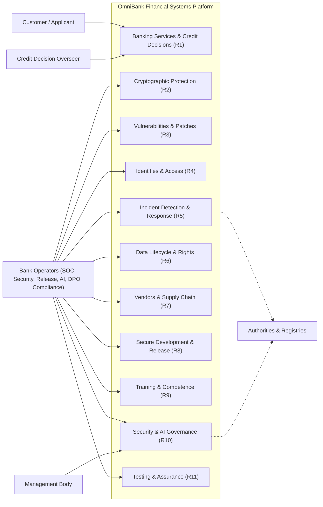

# E1.1a – OmniBank Financial Systems: Business Context, Process Models & Product Use Cases (PUC)

## Executive Summary

This deliverable establishes the operational and business process foundation for the **OmniBank Financial Systems** platform — the consumer mobile and web banking channels, the payment services, and the OmniScore AI credit-scoring platform — operated by a LARGE-scale ECB-supervised credit institution subject to GDPR, CRA, NIS 2, DORA, and the AI Act.

In accordance with banking systems and security engineering literature (IEEE 29148, ISO/IEC 12207, NIST SP 800-160 Vol. 1, DORA regulatory technical standards, and SecBPMN methodologies), this document models the dynamic, operational, and temporal aspects of banking and AI decision processes. It deliberately separates operational workflows—where retail customers apply for credit, payments are cleared, overseers review AI outcomes, and ICT third-party boundaries are crossed—from the atomic, contractual requirement specifications formalized in downstream deliverable [Doc01_Requirements_Specification.md](Doc01_Requirements_Specification.md).

Furthermore, each operational workflow is annotated with security, operational resilience, and trust zone attributes (identifying trust zone transitions, DORA ICT critical dependency checkpoints, and supervisory reporting boundaries), providing the direct architectural input for the Phase 3 Part 2 Threat Modeling and Attack Surface Analysis (DFD Level 1).

---

## Table of Contents

- [Part I – Scope](#part-i--scope)
- [Part II – As-Is](#part-ii--as-is)
- [Part III – To-Be](#part-iii--to-be)
  - [1. Initial Customer Expectations](#1-initial-customer-expectations)
  - [2. Operational Actors](#2-operational-actors)
  - [3. Product Use Cases (PUC) Catalog](#3-product-use-cases-puc-catalog)
  - [4. Process Model & Global Interaction Architecture](#4-process-model--global-interaction-architecture)
  - [5. Security & Trust Zone Process Annotations](#5-security--trust-zone-process-annotations)
- [Bibliography](#bibliography)
- [Version History](#version-history)

---
## Part I – Scope

### 1. Objective

Specify and engineer the OmniBank Financial Systems platform: retail banking channels (mobile application and web platform), payment services, and the OmniScore AI credit-scoring platform operated as an in-house high-risk AI system, for a LARGE-scale ECB-supervised credit institution subject to GDPR, CRA, NIS 2, DORA, and the AI Act.

### 2. Problem Description

The bank operates fragmented legacy estates (mainframe core, EU cloud services, custom AI/ML platform) with banking-grade supervisory obligations across five regulatory regimes. Operational inefficiencies identified: manual evidence assembly across regimes for audits and notifications; separate risk-assessment processes per regime; inconsistent retention enforcement between statutory floors and erasure duties; and manual, late-stage compliance checks in the release pipeline.

### 3. Product Position Statement

For retail customers of OmniBank, the platform is the single self-service channel for accounts, payments, and credit, delivering automated credit decisions with human oversight and explanation. Unlike standalone fintech lenders, OmniBank combines full banking services with in-house AI governance under banking supervision.

### 4. Expected Impact

One governed operating model across banking, payments, and credit scoring; supervisory-ready evidence produced continuously; decisions explainable and reviewable by empowered humans.

### 5. Key Features

Self-service banking channels; automated credit scoring with human review; unified incident triage and notification; unified risk and impact assessment; machine-readable compliance reporting.

### 6. Stakeholders

Retail customers; Board and management body; CISO and security organization (~100 FTE); DPO; AI Governance Lead; Compliance; Internal Audit; supervisory authorities (ECB, BSI/CSIRT, market-surveillance authorities); ICT third-party providers.

### 7. System Users

Customers (applicants, account holders); bank operators (overseers, SOC analysts, security engineers, release engineers, AI operations, AI governance lead, DPO, compliance officers); management body.

### 8. Constraints

ECB supervision; statutory financial-record retention floors; four-plus-one incident-notification regimes with distinct clocks; AI Act high-risk conformity and registration duties for OmniScore (provider and deployer); DORA register of ICT third-party providers.

---

## Part II – As-Is

### 1. Business Roles in Context

Customer operations run through branch and remote channels; credit decisions are produced by the OmniScore platform with manual review of a subset of declines; security operations run 24/7 from the SOC; compliance evidence is assembled manually per regime at audit time.

### 2. Workflow Processes (As-Is)

Credit origination: application intake → data collection → OmniScore scoring → manual review of flagged cases → decision communication. Incident handling: detection at the SOC → per-regime manual notification paths. Evidence: per-regime collection at audit time.

### 3. IT Support

Mainframe core banking; EU cloud customer services; custom AI/ML platform (training and serving); HSM key custody; SIEM/SOAR monitoring; signed-release pipeline with model registry.

---

## Part III – To-Be

### 1. Initial Customer Expectations

| Expectation ID | Operational Expectation | Target Impact |
|---|---|---|
| **EXP-01** | Immediate, explainable credit decisions with human recourse. | Trust and regulatory-defensible decisions. |
| **EXP-02** | Seamless self-service banking across mobile and web. | Channel consolidation without service loss. |
| **EXP-03** | Transparent handling of personal data rights (access, correction, deletion) within statutory windows. | Rights fulfilment as a service, not a case queue. |
| **EXP-04** | Continuous availability of payment and banking functions, including during incidents. | Operational resilience visible to customers. |

### 2. Functional and Non-Functional Requirements

#### 2.1 Actors

| Actor | Description |
|---|---|
| **Customer / Applicant** | Retail customer using the channels; credit applicant; data subject. |
| **Credit Decision Overseer** | Empowered human reviewer of automated credit decisions. |
| **SOC Analyst / Security Engineer** | Security monitoring, incident handling, vulnerability management. |
| **Release Engineer / Developer** | Secure development, pipeline, model releases. |
| **AI Governance Lead** | AI risk management, conformity documentation, adversarial testing. |
| **DPO / Compliance Officer** | Data rights, records, regulatory reporting. |
| **CISO / Management Body** | Governance accountability, board training. |
| **Vendor Risk Manager** | ICT third-party assessments and register. |
| **Government / Registry Interfaces** | External supervisory, CSIRT, market-surveillance, and registry channels. |

### 3. Product Use Cases (PUC) Catalog

The Product Use Cases (*PUC*) delineate the functional boundary of the OmniBank platform, mapping input payloads, processing boundaries, and realizing functional requirements:

*Table 10. Summary table of Product Use Cases (PUC)*

| PUC ID | Business Trigger | Primary Actor | System Operational Boundary | Realizing Requirements |
|---|---|---|---|---|
| **PUC 1.1** | Operate customer banking channels | Customer | Account, payment, and card operations executed with customer attribution | R1.1 |
| **PUC 1.2** | Process credit applications through automated scoring | Customer | Application intake to credit decision, with the reasons communicated | R1.2 |
| **PUC 1.3** | Provide human review and explanation of credit decisions | Credit Decision Overseer | Flagged or contested decision opened, reviewed, and recorded as an attributed outcome | R1.3 |
| **PUC 1.4** | Maintain AI model releases and versions | AI Governance Lead | Model release registered, promoted to serving, or withdrawn from service | R1.4 |
| **PUC 2.1** | Configure data-at-rest encryption | Security Engineer | Storage estate configured with the mandated at-rest protection | R2.1 |
| **PUC 2.2** | Protect data in transit | Security Engineer | Channel established with authenticated, integrity-protected transit | R2.2 |
| **PUC 2.3** | Manage cryptographic key lifecycle and custody | Cryptographic Officer | Key lifecycle executed under separated custody, with destruction evidence | R2.3 |
| **PUC 3.1** | Identify and assess vulnerabilities | Security Engineer | Vulnerability identified, assessed by severity, and registered | R3.1 |
| **PUC 3.2** | Remediate vulnerabilities through security updates | Security Engineer | Security update deployed across the estate and the model fleet | R3.2 |
| **PUC 3.3** | Operate coordinated vulnerability disclosure | Security Engineer | External report received, triaged, and disclosed under policy | R3.3 |
| **PUC 3.4** | Execute security and threat-led testing | Security Engineer | Security and threat-led testing executed; findings registered | R3.4 |
| **PUC 4.1** | Manage identity lifecycle | Identity Administrator | Identity provisioned, reviewed, or revoked per lifecycle event | R4.1 |
| **PUC 4.2** | Enforce multi-factor authentication for privileged access | Privileged Operator | Privileged session established at the policy authentication strength | R4.2 |
| **PUC 4.3** | Review and reconcile access rights | Compliance Officer | Entitlements reconciled against documented authorizations | R4.3 |
| **PUC 4.4** | Maintain hardened secure configurations | Security Engineer | Platform deployed from the hardened baseline; drift corrected to the default | R4.4 |
| **PUC 5.1** | Monitor and correlate security events | SOC Analyst | Estate, fleet, and AI events collected and correlated | R5.1 |
| **PUC 5.2** | Triage incidents and execute unified regulatory notification | SOC Manager | Incident triaged from one record; per-regime notifications dispatched | R5.2 |
| **PUC 5.3** | Maintain backups and execute disaster recovery | IT Operations | Recovery executed within the continuity envelope | R5.3 |
| **PUC 5.4** | Investigate and recover AI system after failure | AI Operations | AI anomaly contained; last verified model version restored | R5.4 |
| **PUC 6.1** | Minimize data collection | DPO | Collection points bound to the declared purposes | R6.1 |
| **PUC 6.2** | Enforce tiered retention schedules | Compliance Officer | Retention schedule executed; records purged or de-identified | R6.2 |
| **PUC 6.3** | Process data-subject requests | DPO Team | Rights request verified and fulfilled; identifiers destroyed on erasure | R6.3 |
| **PUC 6.4** | Deliver data exports and portability | DPO Team | Structured, machine-readable export delivered to the verified requester | R6.4 |
| **PUC 6.5** | Manage AI training-data lifecycle | AI Data Engineer | Training, validation, and test datasets governed and versioned | R6.5 |
| **PUC 7.1** | Assess ICT third-party providers and maintain the register | Vendor Risk Manager | Third party assessed; register entry maintained with criticality | R7.1 |
| **PUC 7.2** | Maintain software bills of materials | Release Engineer | Bill of materials generated per release and per model component set | R7.2 |
| **PUC 7.3** | Enforce contractual security terms | Procurement | Supplier and processor security terms recorded and tracked | R7.3 |
| **PUC 7.4** | Manage provider and vendor exit | Vendor Risk Manager | Exit plan executed; data handling and access revocation evidenced | R7.4 |
| **PUC 8.1** | Apply secure development standards | Development Manager | Change admitted to the build only after standards review | R8.1 |
| **PUC 8.2** | Secure the release pipeline | Release Engineer | Artefact distributed only after the pipeline gates pass and signing | R8.2 |
| **PUC 8.3** | Approve production changes | Change Advisory Board | Production change approved, implemented, and verified under record | R8.3 |
| **PUC 8.4** | Secure the AI training and serving pipeline | ML Engineer | Model served only after artefact integrity verification | R8.4 |
| **PUC 9.1** | Deliver security and privacy awareness training | Awareness Officer | Awareness and hygiene training delivered and recorded | R9.1 |
| **PUC 9.2** | Maintain role-specific competence programs | HR Manager | Role competence maintained; oversight eligibility gated on currency | R9.2 |
| **PUC 9.3** | Deliver board and oversight-body security training | Board Secretariat | Management-body training delivered and evidenced | R9.3 |
| **PUC 10.1** | Maintain the unified management system | CISO | Policy and procedure set maintained, approved, and versioned | R10.1 |
| **PUC 10.2** | Execute unified risk and impact assessments | CISO | Unified assessment produced and refreshed on the declared triggers | R10.2 |
| **PUC 10.3** | Maintain asset and AI documentation inventories | IT Asset Manager | Asset inventory and technical documentation kept current | R10.3 |
| **PUC 10.4** | Generate regulatory compliance reports | Compliance Officer | Report or register update submitted from recorded evidence | R10.4 |
| **PUC 11.1** | Operate threat detection capabilities | SOC Analyst | Detection alert raised and routed to triage | R11.1 |
| **PUC 11.2** | Maintain immutable audit logging | Internal Audit | Security and decision events recorded with integrity verification | R11.2 |
| **PUC 11.3** | Execute penetration and resilience testing | Penetration Tester | Penetration and resilience scenarios executed; findings tracked | R11.3 |
| **PUC 11.4** | Test AI adversarial robustness and explainability | AI Governance Lead | Adversarial validation executed; explainability artefacts published | R11.4 |

---

### 4. System Use Case Model

The following diagram illustrates the primary system actors and functional areas:

---

### 5. Security & Trust Zone Process Annotations

In alignment with **SecBPMN**, **DORA Article 9**, and **NIST SP 800-160 Vol. 1**, the operational banking and AI credit-scoring workflows are contextualized across 6 critical trust zones:

*Table 9. Trust Zone Characterization of OmniBank Operational Workflows*

| Trust Zone | Zone Description | Participating Processes | Perimeter Boundary & Protection Mechanisms |
|---|---|---|---|
| **TZ-01: Public Consumer Edge & Client Tier** | Consumer mobile apps, browser web banking, and public internet access channels. | Account login, balance query, credit application intake (PUC 1.1, 1.2) | **TB-01:** Mandatory encrypted transport channels, public client rate-limiting, hardened API credential handling. |
| **TZ-02: Banking Ingress & PSD2 Gateway** | Demilitarized ingress zone, API reverse proxies, and Open Banking interfaces. | Ingress routing, customer authentication mediation, webhook ingestion (PUC 1.1, 2.2) | **TB-02:** Strict token validation and mutual channel verification, perimeter web application boundary filtering, denial-of-service mitigation. |
| **TZ-03: Core Banking & Transaction Estate** | Transaction processing, account ledgers, payments, and statutory record persistence. | Payment execution, account management, tiered retention purge (PUC 1.1, 6.2, 11.2) | **TB-03:** Hardware-backed cryptographic key custody, tenant/account data segregation, tamper-evident audit logging. |
| **TZ-04: High-Risk AI Scoring Enclave (OmniScore)** | In-house credit-scoring ML pipeline, feature store, inference serving, and overseer console. | Automated scoring, human review & override, model retraining (PUC 1.2, 1.3, 1.4, 6.5, 8.4) | **TB-04:** Air-gapped model registry, feature store integrity validation, real-time explainability generation, human override audit trail. |
| **TZ-05: Critical ICT Third-Party & Cloud Providers** | External cloud hosting providers, external KYC/credit bureaus, and critical IT vendors. | Vendor register tracking, third-party SLA monitoring, exit management (PUC 7.1, 7.3, 7.4) | **TB-05:** DORA Art. 28 contractual safeguards, mutual cryptographic channel authentication, comprehensive vendor risk register. |
| **TZ-06: Supervisory & Regulatory Gateway** | Dedicated reporting channels to ECB, national CSIRT, market surveillance authorities. | Multi-regime incident dispatch, compliance report delivery (PUC 5.2, 10.4) | **TB-06:** Multi-clock statutory dispatch workflow, authenticated regulatory endpoints, non-repudiation receipts. |

This trust zone breakdown serves as the direct formal bridge to **Phase 3 Part 2 (Step 1: System Model, Assets and Boundaries)**, where Trust Zones correspond directly to Trust Boundaries TB-01 through TB-06.

---

## Bibliography

- Robertson, S., & Robertson, J. (2012). *Mastering the Requirements Process: Getting Requirements Right* (3rd ed.). Addison-Wesley Professional.
- Cockburn, A. (2000). *Writing Effective Use Cases*. Addison-Wesley Professional.
- Wiegers, K., & Beatty, J. (2013). *Software Requirements* (3rd ed.). Microsoft Press.
- ISO/IEC/IEEE. (2018). *ISO/IEC/IEEE 29148: Systems and software engineering — Life cycle processes — Requirements engineering*.
- Ross, R. et al. (2016). *NIST SP 800-160 Vol. 1: Engineering Trustworthy Secure Systems*. National Institute of Standards and Technology.
- European Parliament and Council. (2022). *Digital Operational Resilience Act (DORA) — Regulation (EU) 2022/2554*.
- Rodriguez, A. et al. (2011). *SecBPMN: A security-oriented extension of BPMN 2.0*. Information and Software Technology.

---

## Version History

| Version | Date | Author | Description of Changes |
|---|---|---|---|
| **1.0.0** | 2026-10-01 | Requirements Engineering Agent | Initial modular extraction: decoupled business context, As-Is/To-Be models, and PUC catalog into dedicated operational deliverable Doc00. Added SecBPMN / NIST SP 800-160 / DORA trust zone security annotations bridging directly to Phase 3 Part 2 threat modeling. |
