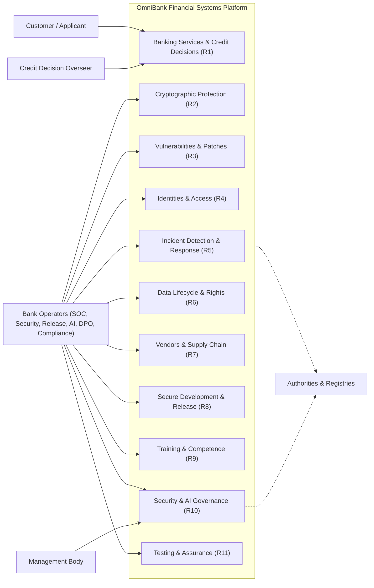

# E1.1 – OmniBank Financial Systems: AS-IS and TO-BE Model (Requirements Elicitation & PUC)

## Executive Summary

This report establishes the baseline requirements elicitation and analysis for the **OmniBank Financial Systems** platform — the consumer mobile and web banking channels, the payment services, and the OmniScore AI credit-scoring platform — detailing the existing operational model (*As-Is*) and the target model (*To-Be*). It defines the functional scope, actors, workflows, functional requirements prioritized with MoSCoW, and the Product Use Case catalog, in a pure functional and technology-neutral form; security, privacy, and regulatory constraint overlays are integrated in the downstream Phase 3 synthesis.

## Table of Contents

- [Part I – Scope](#part-i--scope)
- [Part II – As-Is](#part-ii--as-is)
- [Part III – To-Be](#part-iii--to-be)
  - [2. Functional and Non-Functional Requirements](#2-functional-and-non-functional-requirements)
  - [3. Business Product Use Cases (PUC) Definition](#3-business-product-use-cases-puc-definition)
  - [4. System Use Case Model](#4-system-use-case-model)
- [Bibliography](#bibliography)
- [Version History](#version-history)

---

## Part I – Scope

### 1. Objective

Specify and engineer the OmniBank Financial Systems platform: retail banking channels (mobile application and web platform), payment services, and the OmniScore AI credit-scoring platform operated as an in-house high-risk AI system, for a LARGE-scale ECB-supervised credit institution subject to GDPR, CRA, NIS 2, DORA, and the AI Act.

### 2. Problem Description

The bank operates fragmented legacy estates (mainframe core, EU cloud services, custom AI/ML platform) with banking-grade supervisory obligations across five regulatory regimes. Operational inefficiencies identified: manual evidence assembly across regimes for audits and notifications; separate risk-assessment processes per regime; inconsistent retention enforcement between statutory floors and erasure duties; and manual, late-stage compliance checks in the release pipeline.

### 3. Product Position Statement

For retail customers of OmniBank, the platform is the single self-service channel for accounts, payments, and credit, delivering automated credit decisions with human oversight and explanation. Unlike standalone fintech lenders, OmniBank combines full banking services with in-house AI governance under banking supervision.

### 4. Expected Impact

One governed operating model across banking, payments, and credit scoring; supervisory-ready evidence produced continuously; decisions explainable and reviewable by empowered humans.

### 5. Key Features

Self-service banking channels; automated credit scoring with human review; unified incident triage and notification; unified risk and impact assessment; machine-readable compliance reporting.

### 6. Stakeholders

Retail customers; Board and management body; CISO and security organization (~100 FTE); DPO; AI Governance Lead; Compliance; Internal Audit; supervisory authorities (ECB, BSI/CSIRT, market-surveillance authorities); ICT third-party providers.

### 7. System Users

Customers (applicants, account holders); bank operators (overseers, SOC analysts, security engineers, release engineers, AI operations, AI governance lead, DPO, compliance officers); management body.

### 8. Constraints

ECB supervision; statutory financial-record retention floors; four-plus-one incident-notification regimes with distinct clocks; AI Act high-risk conformity and registration duties for OmniScore (provider and deployer); DORA register of ICT third-party providers.

---

## Part II – As-Is

### 1. Business Roles in Context

Customer operations run through branch and remote channels; credit decisions are produced by the OmniScore platform with manual review of a subset of declines; security operations run 24/7 from the SOC; compliance evidence is assembled manually per regime at audit time.

### 2. Workflow Processes (As-Is)

Credit origination: application intake → data collection → OmniScore scoring → manual review of flagged cases → decision communication. Incident handling: detection at the SOC → per-regime manual notification paths. Evidence: per-regime collection at audit time.

### 3. IT Support

Mainframe core banking; EU cloud customer services; custom AI/ML platform (training and serving); HSM key custody; SIEM/SOAR monitoring; signed-release pipeline with model registry.

---

## Part III – To-Be

### 1. Initial Customer Expectations

| Expectation ID | Operational Expectation | Target Impact |
|---|---|---|
| **EXP-01** | Immediate, explainable credit decisions with human recourse. | Trust and regulatory-defensible decisions. |
| **EXP-02** | Seamless self-service banking across mobile and web. | Channel consolidation without service loss. |
| **EXP-03** | Transparent handling of personal data rights (access, correction, deletion) within statutory windows. | Rights fulfilment as a service, not a case queue. |
| **EXP-04** | Continuous availability of payment and banking functions, including during incidents. | Operational resilience visible to customers. |

### 2. Functional and Non-Functional Requirements

#### 2.1 Actors

| Actor | Description |
|---|---|
| **Customer / Applicant** | Retail customer using the channels; credit applicant; data subject. |
| **Credit Decision Overseer** | Empowered human reviewer of automated credit decisions. |
| **SOC Analyst / Security Engineer** | Security monitoring, incident handling, vulnerability management. |
| **Release Engineer / Developer** | Secure development, pipeline, model releases. |
| **AI Governance Lead** | AI risk management, conformity documentation, adversarial testing. |
| **DPO / Compliance Officer** | Data rights, records, regulatory reporting. |
| **CISO / Management Body** | Governance accountability, board training. |
| **Vendor Risk Manager** | ICT third-party assessments and register. |
| **Government / Registry Interfaces** | External supervisory, CSIRT, market-surveillance, and registry channels. |

#### 2.2 Functional Requirements

##### 2.2.1 MoSCoW Prioritization Method

Functional requirements are prioritized using the MoSCoW methodology: **MUST** (mandatory for baseline viability), **SHOULD** (high-impact unless critical constraints dictate deferral), **COULD** (desirable), **WON'T** (out of scope for the baseline).

##### 2.2.2 Summary Table of Functional Requirements

*Table 6. List of functional requirements*

| ID | ID | Requirement | Priority | Restrictions |
|---|---|---|---|---|
| **R1** | | **Manage Banking Services and Credit Decisions** | **MUST** | |
| | R1.1 | Operate customer banking channels | MUST | |
| | R1.2 | Process credit applications through automated scoring | MUST | |
| | R1.3 | Provide human review and explanation of credit decisions | MUST | |
| | R1.4 | Maintain AI model releases and versions | MUST | |
| **R2** | | **Manage Cryptographic Protection** | **MUST** | |
| | R2.1 | Configure data-at-rest encryption | MUST | |
| | R2.2 | Protect data in transit | MUST | |
| | R2.3 | Manage cryptographic key lifecycle and custody | MUST | |
| **R3** | | **Manage Vulnerabilities and Patches** | **MUST** | |
| | R3.1 | Identify and assess vulnerabilities | MUST | |
| | R3.2 | Remediate vulnerabilities through security updates | MUST | |
| | R3.3 | Operate coordinated vulnerability disclosure | MUST | |
| | R3.4 | Execute security and threat-led testing | MUST | |
| **R4** | | **Manage Identities and Access** | **MUST** | |
| | R4.1 | Manage identity lifecycle | MUST | |
| | R4.2 | Enforce multi-factor authentication for privileged access | MUST | |
| | R4.3 | Review and reconcile access rights | MUST | |
| | R4.4 | Maintain hardened secure configurations | MUST | |
| **R5** | | **Detect and Respond to Incidents** | **MUST** | |
| | R5.1 | Monitor and correlate security events | MUST | |
| | R5.2 | Triage incidents and execute unified regulatory notification | MUST | |
| | R5.3 | Maintain backups and execute disaster recovery | MUST | |
| | R5.4 | Investigate and recover AI system after failure | MUST | |
| **R6** | | **Manage Data Lifecycle and Rights** | **MUST** | |
| | R6.1 | Minimize data collection | MUST | |
| | R6.2 | Enforce tiered retention schedules | MUST | |
| | R6.3 | Process data-subject requests | MUST | |
| | R6.4 | Deliver data exports and portability | MUST | |
| | R6.5 | Manage AI training-data lifecycle | MUST | |
| **R7** | | **Manage Vendors and Supply Chain** | **MUST** | |
| | R7.1 | Assess ICT third-party providers and maintain the register | MUST | |
| | R7.2 | Maintain software bills of materials | MUST | |
| | R7.3 | Enforce contractual security terms | MUST | |
| | R7.4 | Manage provider and vendor exit | SHOULD | |
| **R8** | | **Develop and Release Securely** | **MUST** | |
| | R8.1 | Apply secure development standards | MUST | |
| | R8.2 | Secure the release pipeline | MUST | |
| | R8.3 | Approve production changes | MUST | |
| | R8.4 | Secure the AI training and serving pipeline | MUST | |
| **R9** | | **Train and Sustain Competence** | **MUST** | |
| | R9.1 | Deliver security and privacy awareness training | MUST | |
| | R9.2 | Maintain role-specific competence programs | MUST | |
| | R9.3 | Deliver board and oversight-body security training | MUST | |
| **R10** | | **Govern Security and AI Compliance** | **MUST** | |
| | R10.1 | Maintain the unified management system | MUST | |
| | R10.2 | Execute unified risk and impact assessments | MUST | |
| | R10.3 | Maintain asset and AI documentation inventories | MUST | |
| | R10.4 | Generate regulatory compliance reports | MUST | |
| **R11** | | **Test and Assure Continuously** | **MUST** | |
| | R11.1 | Operate threat detection capabilities | MUST | |
| | R11.2 | Maintain immutable audit logging | MUST | |
| | R11.3 | Execute penetration and resilience testing | MUST | |
| | R11.4 | Test AI adversarial robustness and explainability | MUST | |

---

##### 2.2.3 Detailed Specification Cards for Functional Requirements

The detailed functional requirement cards follow the exact 7-row single-column format established in the reference project standard:

#### R1 – Manage Banking Services and Credit Decisions

##### R1.1 – operate customer banking channels

| Requirement |
|---|
| **ID:** R1.1 **Name:** Operate customer banking channels |
| **Description:** The system must provide retail customers with self-service account management, payments, and card services through the mobile application and web platform, recording all customer-initiated operations with attribution. |
| **Requirement Origin:** Retail Banking Service Portfolio & Customer Channel Strategy |
| **Interfaces:** Mobile banking application; Web banking portal |
| **Dependencies:** • **Stakeholders:** Retail Customers, Channel Product Owner • **Data Sources:** Customer session events; payment and account operations • **Extraction Periodicity:** on demand • **Information Systems / Databases:** Internal Application Database (accounts and transactions) • **Preceding Requirements:** |
| **Identified Problems:** |
| **Priority:** Must |

##### R1.2 – process credit applications through automated scoring

| Requirement |
|---|
| **ID:** R1.2 **Name:** Process credit applications through automated scoring |
| **Description:** The system must accept a credit application, collect the applicant and financial data necessary for the assessment, produce an automated credit score and access decision through the OmniScore platform, and communicate the outcome with the reasons underlying it. |
| **Requirement Origin:** Consumer Credit Programme & OmniScore Governance Charter |
| **Security & Privacy Constraints:** **NFR-RN11** OmniScore Decision & Model Integrity at Serving — `GDPR Art. 5(1)(f)` · `CRA Annex I Part I (2)(f)+(l)` · `AI Act Art. 15` · `DORA Art. 9` → `PO-D-01.4-001`/`SO-D-01.4-002`/`SO-D-01.4-003`/`SO-D-01.4-004` → `PRIN-ENG-07` → CSF PR.DS-01, PR.DS-10 **NFR-RN12** Scoring Data Minimization & Purpose Binding — `GDPR Art. 5(1)(c)+Art. 6` · `AI Act Art. 10` → `PO-D-05.1-001`/`SO-D-05.1-003` → `PRIN-ENG-06` → CSF ID.AM-08 **NFR-RN23** AI Event Logging over Lifetime — `AI Act Art. 12(1)+Art. 19` → `SO-D-10.2-004`/`SO-D-05.2-003` → `PRIN-ENG-07` → CSF PR.PS-04, DE.CM-09, DE.AE-03 |
| **Interfaces:** Credit application form; Decision notification interface |
| **Dependencies:** • **Stakeholders:** Retail Customers, Consumer Credit Programme Owner • **Data Sources:** Credit applications; applicant and financial data • **Extraction Periodicity:** on demand • **Information Systems / Databases:** Internal Application Database (applications); AI Model Serving Platform • **Preceding Requirements:** |
| **Identified Problems:** |
| **Priority:** Must |

##### R1.3 – provide human review and explanation of credit decisions

| Requirement |
|---|
| **ID:** R1.3 **Name:** Provide human review and explanation of credit decisions |
| **Description:** The system must route flagged, declined, or contested automated credit decisions to an empowered human reviewer, provide the reviewer with the decision drivers and the applicant data on which the decision was based, record the review outcome as an attributed decision, and support the delivery of the explanation to the applicant. |
| **Requirement Origin:** Consumer Credit Programme & AI Act Human-Oversight Commitments |
| **Security & Privacy Constraints:** **NFR-RN22** Human Oversight Effectiveness (OmniScore) — `AI Act Art. 14` → `SO-D-08.2-005` → `PRIN-ENG-01` → CSF PR.AT-02, PR.AT-01, GV.RR-02 **Chain** AI Transparency for Applicants and Overseers — `AI Act Art. 13` → `SO-D-09.1-005` → `PRIN-ENG-05` → CSF GV.OC-03, GV.RM-01 |
| **Interfaces:** Review worklist; Explanation delivery interface |
| **Dependencies:** • **Stakeholders:** Credit Decision Overseers, Compliance • **Data Sources:** Flagged decision records; decision drivers • **Extraction Periodicity:** on event • **Information Systems / Databases:** Internal Application Database (decision records) • **Preceding Requirements:** |
| **Identified Problems:** |
| **Priority:** Must |

##### R1.4 – maintain AI model releases and versions

| Requirement |
|---|
| **ID:** R1.4 **Name:** Maintain AI model releases and versions |
| **Description:** The system must version every OmniScore model release with its verification metadata, govern its promotion to production, and support retiring a version from the serving estate. |
| **Requirement Origin:** Model Governance Standard & Release Management Policy |
| **Interfaces:** Model registry console; Release calendar |
| **Dependencies:** • **Stakeholders:** AI Governance Lead, Release Engineers • **Data Sources:** Model versions; verification metadata • **Extraction Periodicity:** on release • **Information Systems / Databases:** AI Model Registry • **Preceding Requirements:** |
| **Identified Problems:** |
| **Priority:** Must |

#### R2 – Manage Cryptographic Protection

##### R2.1 – configure data-at-rest encryption

| Requirement |
|---|
| **ID:** R2.1 **Name:** Configure data-at-rest encryption |
| **Description:** The system must protect stored personal, financial, and AI-related data with state-of-the-art at-rest encryption across the storage estates, applying field-level protection to the most sensitive data categories. |
| **Requirement Origin:** Group Cryptographic Standard & Data Protection Policy |
| **Security & Privacy Constraints:** **Chain** GDPR Art. 5(1)(f) → `PO-D-01.1-001` **Chain** **NFR-RN14** Data-at-Rest Encryption with Field-Level Protection — `GDPR Art. 32(1)(a)+Art. 5(1)(f)` · `CRA Annex I Part I (2)(e)` · `NIS 2 Art. 21(2)(h)` · `DORA Art. 9` → `SO-D-01.1-004`/`SO-D-01.1-002`/`SO-D-01.1-003`/`SO-D-01.1-004` → `PRIN-ENG-01` → CSF PR.DS-01, PR.DS-10 **Chain** GDPR Art. 5(1)(f) → `PO-D-01.1-001` |
| **Interfaces:** Storage configuration interface |
| **Dependencies:** • **Stakeholders:** Security Engineers, Database Administrators • **Data Sources:** Storage estate inventory; encryption state • **Extraction Periodicity:** on change • **Information Systems / Databases:** Key Custody Service; Storage Estate • **Preceding Requirements:** |
| **Identified Problems:** |
| **Priority:** Must |

##### R2.2 – protect data in transit

| Requirement |
|---|
| **ID:** R2.2 **Name:** Protect data in transit |
| **Description:** The system must protect customer, inter-service, and third-party data flows in transit with state-of-the-art channel encryption and integrity verification, refusing unauthenticated channels. |
| **Requirement Origin:** Group Cryptographic Standard & Network Security Policy |
| **Interfaces:** Channel configuration interface |
| **Dependencies:** • **Stakeholders:** Security Engineers, Network Operations • **Data Sources:** Channel inventory; connection states • **Extraction Periodicity:** on change • **Information Systems / Databases:** Key Custody Service (channel material) • **Preceding Requirements:** |
| **Identified Problems:** |
| **Priority:** Must |

##### R2.3 – manage cryptographic key lifecycle and custody

| Requirement |
|---|
| **ID:** R2.3 **Name:** Manage cryptographic key lifecycle and custody |
| **Description:** The system must manage the full lifecycle of cryptographic keys and related material — generation, distribution, rotation, and destruction — with custody separated from the operational environments that use the protected data. |
| **Requirement Origin:** Key Custody Standard |
| **Security & Privacy Constraints:** **NFR-RN15** Key Custody Separation & Cryptographic Destruction — `GDPR Art. 4(5)+Art. 32(1)(a)` · `CRA Annex I Part I (2)(d)+(e)` · `DORA Art. 9` → `PO-D-01.3-001`/`SO-D-01.3-002`/`SO-D-01.3-003` → `PRIN-ENG-03` → CSF PR.DS-01, PR.AA-05 |
| **Interfaces:** Key lifecycle console |
| **Dependencies:** • **Stakeholders:** Cryptographic Officers • **Data Sources:** Key inventory; rotation and destruction events • **Extraction Periodicity:** per cryptographic period • **Information Systems / Databases:** Key Custody Service • **Preceding Requirements:** |
| **Identified Problems:** |
| **Priority:** Must |

#### R3 – Manage Vulnerabilities and Patches

##### R3.1 – identify and assess vulnerabilities

| Requirement |
|---|
| **ID:** R3.1 **Name:** Identify and assess vulnerabilities |
| **Description:** The system must identify and document vulnerabilities across the ICT estate, the product components, and the AI models on a continuing basis, maintaining a vulnerability register with severity assessment. |
| **Requirement Origin:** Group Vulnerability Management Procedure |
| **Security & Privacy Constraints:** **Chain** Vulnerability Identification Family — `GDPR Art. 32(1)(d)` → `PO-D-02.1-001` · `CRA Annex I Part I (2)(a)+Part II (1)` → `SO-D-02.1-002` · `NIS 2 Art. 21(2)(e)` → `SO-D-02.1-003` · `DORA Art. 9` → `SO-D-02.1-004` → `PRIN-ENG-02` → CSF ID.RA-01, ID.AM-02, PR.PS-02, GV.SC-04 |
| **Interfaces:** Vulnerability register; scanner consoles |
| **Dependencies:** • **Stakeholders:** Security Engineers, SOC • **Data Sources:** Scan results; advisory feeds • **Extraction Periodicity:** continuous / per scan cycle • **Information Systems / Databases:** Internal Application Database (vulnerability register) • **Preceding Requirements:** |
| **Identified Problems:** |
| **Priority:** Must |

##### R3.2 – remediate vulnerabilities through security updates

| Requirement |
|---|
| **ID:** R3.2 **Name:** Remediate vulnerabilities through security updates |
| **Description:** The system must address identified vulnerabilities through security updates deployed without delay according to severity, including updates to AI models and their components. |
| **Requirement Origin:** Group Patch Management Procedure |
| **Security & Privacy Constraints:** **Chain** CRA → `SO-D-07.3-001` **Chain** Remediation & Maintenance Family — `CRA Annex I Part II (2)` → `SO-D-02.2-001` · `DORA Art. 9(4)` → `SO-D-02.2-002` · `NIS 2 Art. 21(2)(e)` → `SO-D-07.3-002` → `PRIN-ENG-02` → CSF PR.PS-02, ID.RA-01 |
| **Interfaces:** Patch management console; fleet distribution interface |
| **Dependencies:** • **Stakeholders:** Security Engineers, IT Operations • **Data Sources:** Patch catalogue; deployment states • **Extraction Periodicity:** per release cycle • **Information Systems / Databases:** Internal Application Database (patch states) • **Preceding Requirements:** |
| **Identified Problems:** |
| **Priority:** Must |

##### R3.3 – operate coordinated vulnerability disclosure

| Requirement |
|---|
| **ID:** R3.3 **Name:** Operate coordinated vulnerability disclosure |
| **Description:** The system must provide a documented channel for external security researchers to report vulnerabilities, triage reports, and publish disclosures under the coordinated disclosure policy. |
| **Requirement Origin:** Coordinated Vulnerability Disclosure Policy |
| **Security & Privacy Constraints:** **Chain** Coordinated Vulnerability Disclosure — `CRA Annex I Part II (4)-(6)+Art. 13(8),(17)` → `SO-D-02.3-001` · `NIS 2 Art. 21(2)(e)` → `SO-D-02.3-002` → `PRIN-ENG-02` → CSF ID.RA-01, GV.SC-04 |
| **Interfaces:** Disclosure portal; intake channel |
| **Dependencies:** • **Stakeholders:** External Researchers, Security Engineers • **Data Sources:** Disclosure reports; publication records • **Extraction Periodicity:** on event • **Information Systems / Databases:** Internal Application Database (disclosure records) • **Preceding Requirements:** |
| **Identified Problems:** |
| **Priority:** Must |

##### R3.4 – execute security and threat-led testing

| Requirement |
|---|
| **ID:** R3.4 **Name:** Execute security and threat-led testing |
| **Description:** The system must execute regular security testing of the product and ICT estate and threat-led penetration testing at the defined cadence, producing evidence for conformity and supervisory review. |
| **Requirement Origin:** Security Testing Standard & Supervisory Expectations |
| **Security & Privacy Constraints:** **Chain** Security & Threat-Led Testing — `CRA Annex I Part II (3)` → `SO-D-02.4-001` · `DORA Art. 24-27 (TLPT)` → `SO-D-02.4-002` → `PRIN-ENG-02` → CSF ID.RA-01, PR.PS-06, DE.CM-09 |
| **Interfaces:** Testing calendar; evidence repository |
| **Dependencies:** • **Stakeholders:** Security Engineers, Penetration Testers • **Data Sources:** Test plans; findings and evidence • **Extraction Periodicity:** per test programme • **Information Systems / Databases:** Internal Application Database (test evidence) • **Preceding Requirements:** |
| **Identified Problems:** |
| **Priority:** Must |

#### R4 – Manage Identities and Access

##### R4.1 – manage identity lifecycle

| Requirement |
|---|
| **ID:** R4.1 **Name:** Manage identity lifecycle |
| **Description:** The system must provision, review, and revoke operator identities and entitlements across the employment lifecycle — on induction, on role change, and on separation — including operators of the AI platform. |
| **Requirement Origin:** Access Control Policy & Joiner-Mover-Leaver Standard |
| **Security & Privacy Constraints:** **Chain** CRA Art. 13(15) → `SO-D-03.1-002` **Chain** **NFR-RN21** AI Platform Access Mediation & Least Privilege — `CRA Annex I Part I (2)(d)` · `AI Act Art. 15 cybersecurity leg` · `NIS 2 Art. 21(2)(i)-(j)` → `SO-D-03.1-003`/`SO-D-03.1-004` → `PRIN-ENG-03` → CSF PR.AA-05 **Chain** Identity Lifecycle Family — `GDPR Art. 32(4)` → `PO-D-03.1-001` · `NIS 2 Art. 21(2)(i)` → `SO-D-03.1-003` · `DORA Art. 9(3)(d)` → `SO-D-03.1-004` → `PRIN-ENG-03` → CSF PR.AA-01, PR.AA-05 **Chain** CRA Art. 13(15) → `SO-D-03.1-002` |
| **Interfaces:** Identity administration console |
| **Dependencies:** • **Stakeholders:** HR, Identity Administrators • **Data Sources:** Employment lifecycle events; entitlement catalog • **Extraction Periodicity:** on event • **Information Systems / Databases:** Identity Store • **Preceding Requirements:** |
| **Identified Problems:** |
| **Priority:** Must |

##### R4.2 – enforce multi-factor authentication for privileged access

| Requirement |
|---|
| **ID:** R4.2 **Name:** Enforce multi-factor authentication for privileged access |
| **Description:** The system must require multi-factor verification for privileged and administrative access and refuse authentication attempts that do not meet the policy strength. |
| **Requirement Origin:** Authentication Standard & Privileged Access Policy |
| **Security & Privacy Constraints:** **NFR-RN19** Strong Privileged-Access Authentication — `NIS 2 Art. 21(2)(j)` · `CRA Annex I Part I (2)(d)` · `DORA Art. 9(3)(d)` → `SO-D-03.2-003`/`SO-D-03.2-002`/`SO-D-03.2-004` → `PRIN-ENG-01` → CSF PR.AA-03, PR.AA-05, PR.AA-06 |
| **Interfaces:** Authentication interface |
| **Dependencies:** • **Stakeholders:** Privileged Operators • **Data Sources:** Authentication attempts; policy states • **Extraction Periodicity:** on demand • **Information Systems / Databases:** Identity Store (credential factors) • **Preceding Requirements:** |
| **Identified Problems:** |
| **Priority:** Must |

##### R4.3 – review and reconcile access rights

| Requirement |
|---|
| **ID:** R4.3 **Name:** Review and reconcile access rights |
| **Description:** The system must support periodic access reviews that reconcile granted entitlements against documented authorizations and record the review outcomes. |
| **Requirement Origin:** Access Review Procedure |
| **Security & Privacy Constraints:** **Chain** CRA → `SO-D-03.3-002` · DORA Art. 9(4)(c) → `SO-D-03.3-004` **Chain** Access Review & Authorization Family — `GDPR Art. 29+Art. 32(4)` → `PO-D-03.2-001`/`PO-D-03.3-001` · `NIS 2 Art. 21(2)(i)-(j)` → `SO-D-03.3-003` → `PRIN-ENG-03` → CSF PR.AA-05, PR.AA-06 |
| **Interfaces:** Access review worklist |
| **Dependencies:** • **Stakeholders:** Line Managers, Compliance • **Data Sources:** Entitlement grants; review decisions • **Extraction Periodicity:** quarterly • **Information Systems / Databases:** Internal Application Database (review records) • **Preceding Requirements:** |
| **Identified Problems:** |
| **Priority:** Must |

##### R4.4 – maintain hardened secure configurations

| Requirement |
|---|
| **ID:** R4.4 **Name:** Maintain hardened secure configurations |
| **Description:** The system must deploy platforms and services from hardened baseline configurations and support restoring a configuration to its known secure state. |
| **Requirement Origin:** Configuration Baseline Standard |
| **Security & Privacy Constraints:** **NFR-RN20** Secure-by-Default Configuration & Reset — `CRA Annex I 2(b)+(c)` · `GDPR Art. 25(2)` → `SO-D-03.4-002`/`PO-D-03.4-001` → `PRIN-ENG-04` → CSF PR.PS-01 |
| **Interfaces:** Configuration baseline repository |
| **Dependencies:** • **Stakeholders:** Security Engineers, Platform Operations • **Data Sources:** Baseline definitions; configuration states • **Extraction Periodicity:** on change • **Information Systems / Databases:** Internal Application Database (configuration records) • **Preceding Requirements:** |
| **Identified Problems:** |
| **Priority:** Must |

#### R5 – Detect and Respond to Incidents

##### R5.1 – monitor and correlate security events

| Requirement |
|---|
| **ID:** R5.1 **Name:** Monitor and correlate security events |
| **Description:** The system must collect and correlate security-relevant events from the ICT estate, the product fleet, and the AI platform, presenting them for detection and triage. |
| **Requirement Origin:** Security Operations Charter (24/7 SOC) |
| **Security & Privacy Constraints:** **Chain** Event Monitoring Family — `CRA Annex I Part I (2)(l)` → `SO-D-04.1-002` · `NIS 2 Art. 21(2)(c)` → `SO-D-04.1-003` · `DORA Art. 11` → `SO-D-04.1-004` → `PRIN-ENG-07` → CSF DE.CM-01, DE.CM-09 |
| **Interfaces:** Monitoring consoles |
| **Dependencies:** • **Stakeholders:** SOC Analysts • **Data Sources:** Estate and fleet event streams • **Extraction Periodicity:** continuous • **Information Systems / Databases:** Security Event Store • **Preceding Requirements:** |
| **Identified Problems:** |
| **Priority:** Must |

##### R5.2 – triage incidents and execute unified regulatory notification

| Requirement |
|---|
| **ID:** R5.2 **Name:** Triage incidents and execute unified regulatory notification |
| **Description:** The system must triage security incidents from one incident record, and when statutory criteria are met, generate and dispatch the notifications required by each applicable regime — supervisory, CSIRT, financial-authority, and market-surveillance — from a single clock-start discipline. |
| **Requirement Origin:** Incident Response Procedure & Regulatory Notification Matrix |
| **Security & Privacy Constraints:** **Chain** GDPR Art. 33(1) → `PO-D-04.3-001` · NIS 2 Art. 23(4)(a) → `SO-D-04.3-003` · DORA Art. 19(1) → `SO-D-04.3-004` **Chain** **NFR-RN18** Unified Notification Clock Enforcement — `GDPR Art. 33(1)` · `CRA Art. 14` · `NIS 2 Art. 23` · `DORA Art. 19` · `AI Act Art. 73` → `SO-D-04.3-005`/`SO-D-04.3-002`..`SO-D-04.3-005` → `PRIN-ENG-05` → CSF RS.MA-04, RS.MA-02, RS.CO-02 **Chain** GDPR Art. 33(1) → `PO-D-04.3-001` · NIS 2 Art. 23(4)(a) → `SO-D-04.3-003` · DORA Art. 19(1) → `SO-D-04.3-004` |
| **Interfaces:** Incident console; notification dispatch interface |
| **Dependencies:** • **Stakeholders:** SOC Managers, Compliance Officers • **Data Sources:** Incident records; notification criteria and receipts • **Extraction Periodicity:** on event • **Information Systems / Databases:** Internal Application Database (incident records); Notification Dispatch Service • **Preceding Requirements:** |
| **Identified Problems:** |
| **Priority:** Must |

##### R5.3 – maintain backups and execute disaster recovery

| Requirement |
|---|
| **ID:** R5.3 **Name:** Maintain backups and execute disaster recovery |
| **Description:** The system must maintain backups of critical data and systems and execute disaster-recovery and continuity procedures within the recovery objectives. |
| **Requirement Origin:** Business Continuity & Disaster Recovery Plan |
| **Security & Privacy Constraints:** **Chain** DORA Art. 11(1) → `SO-D-04.2-004` **Chain** Continuity & Recovery Family — `GDPR Art. 32(1)(c)` → `PO-D-04.2-001`/`PO-D-04.4-001` · `CRA Annex I Part I (2)` → `SO-D-04.2-002`/`SO-D-04.4-002` · `NIS 2 Art. 21(2)(c)` → `SO-D-04.2-003`/`SO-D-04.4-003` · `DORA Art. 11-12` → `SO-D-04.4-004` → `PRIN-ENG-04` → CSF RC.RP-04, PR.IR-03, PR.DS-11 |
| **Interfaces:** Backup console; recovery runbooks |
| **Dependencies:** • **Stakeholders:** IT Operations, Business Continuity Managers • **Data Sources:** Backup catalogues; recovery exercise records • **Extraction Periodicity:** per backup cycle • **Information Systems / Databases:** Backup Estate • **Preceding Requirements:** |
| **Identified Problems:** |
| **Priority:** Must |

##### R5.4 – investigate and recover AI system after failure

| Requirement |
|---|
| **ID:** R5.4 **Name:** Investigate and recover AI system after failure |
| **Description:** The system must investigate anomalous AI behaviour or model failure, restore the AI service to a verified operating state, and feed the findings back to the model owners. |
| **Requirement Origin:** AI Operations Runbook & Model Governance Standard |
| **Interfaces:** AI operations console |
| **Dependencies:** • **Stakeholders:** AI Operations, Model Owners • **Data Sources:** Anomaly records; recovery actions • **Extraction Periodicity:** on event • **Information Systems / Databases:** AI Model Registry; Security Event Store • **Preceding Requirements:** |
| **Identified Problems:** |
| **Priority:** Must |

#### R6 – Manage Data Lifecycle and Rights

##### R6.1 – minimize data collection

| Requirement |
|---|
| **ID:** R6.1 **Name:** Minimize data collection |
| **Description:** The system must limit collected personal and operational data to what is adequate, relevant, and necessary for the stated purposes of each processing activity. |
| **Requirement Origin:** Data Protection Policy & Processing Register |
| **Security & Privacy Constraints:** **Chain** Collection Minimization Family — `GDPR Art. 5(1)(c)` → `PO-D-05.1-001` · `CRA Annex I` → `SO-D-05.1-002` → `PRIN-ENG-06` → CSF ID.AM-08, ID.AM-03 |
| **Interfaces:** Collection configuration interface |
| **Dependencies:** • **Stakeholders:** DPO, Product Owners • **Data Sources:** Processing purposes; field inventory • **Extraction Periodicity:** on change • **Information Systems / Databases:** Internal Application Database (processing register) • **Preceding Requirements:** |
| **Identified Problems:** |
| **Priority:** Must |

##### R6.2 – enforce tiered retention schedules

| Requirement |
|---|
| **ID:** R6.2 **Name:** Enforce tiered retention schedules |
| **Description:** The system must retain records according to tiered retention schedules derived from statutory floors and business purpose, and purge or de-identify records when their schedule expires. |
| **Requirement Origin:** Retention Schedule Standard (Statutory Financial Floors) |
| **Security & Privacy Constraints:** **Chain** CRA Art. 13(9) → `SO-D-05.2-002` **Chain** Retention Family — `GDPR Art. 5(1)(e)` → `PO-D-05.2-001` → `PRIN-ENG-07` → CSF ID.AM-08, ID.AM-03 |
| **Interfaces:** Retention policy console |
| **Dependencies:** • **Stakeholders:** Compliance Officers, Records Managers • **Data Sources:** Retention schedules; expiry events • **Extraction Periodicity:** per schedule • **Information Systems / Databases:** Internal Application Database (retention rules) • **Preceding Requirements:** |
| **Identified Problems:** |
| **Priority:** Must |

##### R6.3 – process data-subject requests

| Requirement |
|---|
| **ID:** R6.3 **Name:** Process data-subject requests |
| **Description:** The system must receive, verify, and fulfil data-subject requests for access, rectification, and erasure within the statutory window, including the downstream correction cascade. |
| **Requirement Origin:** Data Subject Rights Procedure |
| **Security & Privacy Constraints:** **NFR-RN16** Rights-Requester Identity Verification — `GDPR Art. 12(6)+Art. 11(2)+Art. 5(1)(c)` → `PO-D-03.1-001` → `PRIN-ENG-01` → CSF PR.AA-03, PR.AA-02 / PF PR.AC-P6 **NFR-RN17** Token-Only Decision-Record Retention — `GDPR Art. 17+Art. 5(1)(e)` · `AI Act Art. 12(1)+Art. 19` → `PO-D-05.3-001`, `SO-D-10.2-004` → `PRIN-ENG-07` → CSF PR.DS-10, ID.AM-08 / PF CT.DM-P4 **Chain** Permanent Product-Data Removal — `CRA Annex I Part I (2)(m)` → `SO-D-05.3-002` → `PRIN-ENG-07` → CSF PR.DS-10, PR.DS-02 |
| **Interfaces:** Rights request portal; case console |
| **Dependencies:** • **Stakeholders:** Data Subjects, DPO Team • **Data Sources:** Requests; identity verifications; outcomes • **Extraction Periodicity:** on event • **Information Systems / Databases:** Internal Application Database (rights cases) • **Preceding Requirements:** |
| **Identified Problems:** |
| **Priority:** Must |

##### R6.4 – deliver data exports and portability

| Requirement |
|---|
| **ID:** R6.4 **Name:** Deliver data exports and portability |
| **Description:** The system must deliver a structured, machine-readable export of a requester’s personal data without affecting third-party data. |
| **Requirement Origin:** Data Subject Rights Procedure (Portability) |
| **Security & Privacy Constraints:** **Chain** Portability Delivery — `GDPR Art. 20+Art. 15(3)` → `PO-D-05.4-001` → `PRIN-ENG-06` → CSF PR.DS-10, ID.AM-08 |
| **Interfaces:** Export delivery interface |
| **Dependencies:** • **Stakeholders:** Data Subjects, DPO Team • **Data Sources:** Export requests; package states • **Extraction Periodicity:** on demand • **Information Systems / Databases:** Internal Application Database (subject records) • **Preceding Requirements:** |
| **Identified Problems:** |
| **Priority:** Must |

##### R6.5 – manage AI training-data lifecycle

| Requirement |
|---|
| **ID:** R6.5 **Name:** Manage AI training-data lifecycle |
| **Description:** The system must govern the training, validation, and test datasets of the OmniScore models across their lifecycle — collection, preparation, versioning, and retirement — with relevance and representativeness checks. |
| **Requirement Origin:** AI Data Governance Standard (OmniScore) |
| **Security & Privacy Constraints:** **Chain** AI Training-Data Governance — `AI Act Art. 10` → `SO-D-05.1-003` → `PRIN-ENG-06` → CSF ID.AM-08 |
| **Interfaces:** Dataset governance console |
| **Dependencies:** • **Stakeholders:** AI Data Engineers, AI Governance Lead • **Data Sources:** Dataset versions; lineage and representativeness checks • **Extraction Periodicity:** per training cycle • **Information Systems / Databases:** AI Data Platform (datasets) • **Preceding Requirements:** |
| **Identified Problems:** |
| **Priority:** Must |

#### R7 – Manage Vendors and Supply Chain

##### R7.1 – assess ICT third-party providers and maintain the register

| Requirement |
|---|
| **ID:** R7.1 **Name:** Assess ICT third-party providers and maintain the register |
| **Description:** The system must assess ICT third-party providers before and during engagement and maintain the register of information on ICT third-party arrangements with their criticality and locations. |
| **Requirement Origin:** Third-Party Risk Management Standard (DORA Register) |
| **Security & Privacy Constraints:** **Chain** DORA Art. 28(1) → `SO-D-06.1-004` · NIS 2 Art. 21(2)(d) → `SO-D-06.4-003` **Chain** **NFR-RN26** ICT Third-Party Register Completeness & Criticality — `DORA Art. 28-30` → `SO-D-06.4-004` · `GDPR Art. 28` → `PO-D-06.1-001`/`PO-D-06.3-001` · `NIS 2 Art. 21(3)` → `SO-D-06.1-003`/`SO-D-06.3-003` → `PRIN-ENG-05` → CSF GV.SC-02, GV.SC-03 **Chain** Processor & Supplier Due Diligence Family — `GDPR Art. 28` → `PO-D-06.1-001`/`PO-D-06.3-001` · `CRA Annex I` → `SO-D-06.1-002` · `NIS 2 Art. 21(2)-(3)` → `SO-D-06.1-003`/`SO-D-06.3-003` → `PRIN-ENG-05` → CSF GV.SC-01, GV.SC-02, GV.SC-03 **Chain** DORA Art. 28(1) → `SO-D-06.1-004` |
| **Interfaces:** Vendor assessment console; register interface |
| **Dependencies:** • **Stakeholders:** Vendor Risk Managers, CISO • **Data Sources:** Assessments; register entries • **Extraction Periodicity:** per assessment cycle • **Information Systems / Databases:** Internal Application Database (vendor register) • **Preceding Requirements:** |
| **Identified Problems:** |
| **Priority:** Must |

##### R7.2 – maintain software bills of materials

| Requirement |
|---|
| **ID:** R7.2 **Name:** Maintain software bills of materials |
| **Description:** The system must generate and maintain machine-readable bills of materials for the product releases and AI model components. |
| **Requirement Origin:** Secure Supply Chain Standard |
| **Security & Privacy Constraints:** **Chain** SBOM Maintenance — `CRA Annex I Part II (1)+Art. 13(6)` → `SO-D-06.2-001` → `PRIN-ENG-05` → CSF ID.AM-02, GV.SC-02 |
| **Interfaces:** SBOM generation interface |
| **Dependencies:** • **Stakeholders:** Release Engineers • **Data Sources:** Component inventories; release artefacts • **Extraction Periodicity:** per release • **Information Systems / Databases:** Internal Application Database (SBOM records) • **Preceding Requirements:** |
| **Identified Problems:** |
| **Priority:** Must |

##### R7.3 – enforce contractual security terms

| Requirement |
|---|
| **ID:** R7.3 **Name:** Enforce contractual security terms |
| **Description:** The system must record and track the security contractual terms of supplier and processor engagements, including sub-processor chains. |
| **Requirement Origin:** Procurement Security Standard (Processor & Supplier Clauses) |
| **Security & Privacy Constraints:** **Chain** Contractual Security Terms — `GDPR Art. 28(3)` → `PO-D-06.3-001` · `CRA` → `SO-D-06.3-002` · `NIS 2 Art. 21(3)` → `SO-D-06.3-003` · `DORA Art. 30` → `SO-D-06.3-004` → `PRIN-ENG-05` → CSF — (the four cited objectives publish no anchor set; contractual security is evidenced through the register chain of `R7.1` — `RN26`) |
| **Interfaces:** Contract tracking console |
| **Dependencies:** • **Stakeholders:** Procurement, Compliance • **Data Sources:** Contract terms; sub-processor chains • **Extraction Periodicity:** on change • **Information Systems / Databases:** Internal Application Database (contract records) • **Preceding Requirements:** |
| **Identified Problems:** |
| **Priority:** Must |

##### R7.4 – manage provider and vendor exit

| Requirement |
|---|
| **ID:** R7.4 **Name:** Manage provider and vendor exit |
| **Description:** The system must support the planned exit of a provider or vendor — data return or deletion, transition, and revocation of access — recording the completion of each exit step. |
| **Requirement Origin:** Vendor Exit Procedure |
| **Interfaces:** Exit workflow console |
| **Dependencies:** • **Stakeholders:** Vendor Risk Managers, IT Operations • **Data Sources:** Exit plans; step completions • **Extraction Periodicity:** on event • **Information Systems / Databases:** Internal Application Database (exit records) • **Preceding Requirements:** |
| **Identified Problems:** |
| **Priority:** Should |

#### R8 – Develop and Release Securely

##### R8.1 – apply secure development standards

| Requirement |
|---|
| **ID:** R8.1 **Name:** Apply secure development standards |
| **Description:** The system must enforce the secure development standards — design review, coding outcomes, and code review — for all product components and AI model code. |
| **Requirement Origin:** Secure Development Standard |
| **Security & Privacy Constraints:** **Chain** DORA Art. 9(4)(b) → `SO-D-07.1-004` **Chain** Secure Development Family — `GDPR Art. 25(1)` → `PO-D-07.1-001` · `CRA Annex I Part I` → `SO-D-07.1-002` · `NIS 2 Art. 21(2)` → `SO-D-07.1-003` · `AI Act Art. 15(1)` → `SO-D-07.1-005` → `PRIN-ENG-02` → CSF PR.PS-06, GV.PO-02, GV.SC-02 |
| **Interfaces:** Design review records; review interface |
| **Dependencies:** • **Stakeholders:** Development Managers, Security Engineers • **Data Sources:** Review outcomes; standards versions • **Extraction Periodicity:** per change • **Information Systems / Databases:** Internal Application Database (review records) • **Preceding Requirements:** |
| **Identified Problems:** |
| **Priority:** Must |

##### R8.2 – secure the release pipeline

| Requirement |
|---|
| **ID:** R8.2 **Name:** Secure the release pipeline |
| **Description:** The system must enforce security gates in the release pipeline — build verification, dependency and artefact checks, and signing — before a release is distributed. |
| **Requirement Origin:** Release Management Standard |
| **Security & Privacy Constraints:** **NFR-RN20** Secure-by-Default Configuration & Reset (co-driver) — `CRA Annex I 2(b)+(c)` → `SO-D-03.4-002` → `PRIN-ENG-04` → CSF PR.PS-01 **Chain** Attack-Surface Limitation in Production — `CRA Annex I Part I (2)(j)` → `SO-D-07.2-001` → `PRIN-ENG-02` → CSF PR.PS-01, PR.PS-02 |
| **Interfaces:** Pipeline gate console |
| **Dependencies:** • **Stakeholders:** Release Engineers • **Data Sources:** Gate outcomes; artefact states • **Extraction Periodicity:** per release • **Information Systems / Databases:** Release Pipeline (gate records) • **Preceding Requirements:** |
| **Identified Problems:** |
| **Priority:** Must |

##### R8.3 – approve production changes

| Requirement |
|---|
| **ID:** R8.3 **Name:** Approve production changes |
| **Description:** The system must route production changes through an approval decision that records the change scope, risk, and approver before deployment. |
| **Requirement Origin:** Change Management Procedure |
| **Security & Privacy Constraints:** **Chain** ICT Change Management — `DORA Art. 9(4)(e)` → `SO-D-07.4-002` → `PRIN-ENG-05` → CSF PR.PS-01, PR.PS-02 |
| **Interfaces:** Change approval interface |
| **Dependencies:** • **Stakeholders:** Change Advisory Board • **Data Sources:** Change requests; approvals • **Extraction Periodicity:** on event • **Information Systems / Databases:** Internal Application Database (change records) • **Preceding Requirements:** |
| **Identified Problems:** |
| **Priority:** Must |

##### R8.4 – secure the AI training and serving pipeline

| Requirement |
|---|
| **ID:** R8.4 **Name:** Secure the AI training and serving pipeline |
| **Description:** The system must protect the AI training and serving pipeline — data ingestion, training jobs, and model artefacts — against unauthorized modification, with verification of model integrity at serving. |
| **Requirement Origin:** AI Platform Security Standard (OmniScore) |
| **Security & Privacy Constraints:** **NFR-RN11** OmniScore Decision & Model Integrity at Serving (co-driver) — `CRA Annex I Part I (2)(f)+(l)` · `DORA Art. 9` → `SO-D-01.4-003`/`SO-D-01.4-004` → `PRIN-ENG-07` → CSF PR.DS-01, PR.DS-10 |
| **Interfaces:** Training pipeline console; serving verification interface |
| **Dependencies:** • **Stakeholders:** ML Engineers, AI Governance Lead • **Data Sources:** Pipeline states; model artefact verifications • **Extraction Periodicity:** per training cycle • **Information Systems / Databases:** AI Platform (pipeline records) • **Preceding Requirements:** |
| **Identified Problems:** |
| **Priority:** Must |

#### R9 – Train and Sustain Competence

##### R9.1 – deliver security and privacy awareness training

| Requirement |
|---|
| **ID:** R9.1 **Name:** Deliver security and privacy awareness training |
| **Description:** The system must deliver and record security and privacy awareness training for the workforce at onboarding and at the periodic cadence. |
| **Requirement Origin:** Awareness Program Charter |
| **Security & Privacy Constraints:** **Chain** CRA → `SO-D-08.1-002` · DORA Art. 13(6) → `SO-D-08.1-004` **Chain** Awareness & Hygiene Training — `NIS 2 Art. 21(2)(g)` → `SO-D-08.1-003` → `PRIN-ENG-01` → CSF PR.AT-01, PR.PS-01 |
| **Interfaces:** Training delivery interface |
| **Dependencies:** • **Stakeholders:** Awareness Officers, All Staff • **Data Sources:** Course completions • **Extraction Periodicity:** per campaign • **Information Systems / Databases:** Internal Application Database (training records) • **Preceding Requirements:** |
| **Identified Problems:** |
| **Priority:** Must |

##### R9.2 – maintain role-specific competence programs

| Requirement |
|---|
| **ID:** R9.2 **Name:** Maintain role-specific competence programs |
| **Description:** The system must maintain role-specific competence programs — development, operations, AI oversight — and record the competence state of each role holder. |
| **Requirement Origin:** Competence Framework (Role-Specific Curricula) |
| **Security & Privacy Constraints:** **Chain** DORA Art. 13(6) → `SO-D-08.2-004` · NIS 2 Art. 20(2) → `SO-D-08.3-001` **Chain** **NFR-RN22** Human Oversight Effectiveness (co-driver) — `AI Act Art. 14` → `SO-D-08.2-005` → `PRIN-ENG-01` → CSF PR.AT-02, PR.AT-01, GV.RR-02 **Chain** Role Competence Family — `NIS 2 Art. 21(2)(g)-(h)` → `SO-D-08.2-003`/`SO-D-08.3-002` → `PRIN-ENG-01` → CSF PR.AT-01, PR.AT-02 |
| **Interfaces:** Competence console |
| **Dependencies:** • **Stakeholders:** HR, Line Managers • **Data Sources:** Role curricula; competence states • **Extraction Periodicity:** per cycle • **Information Systems / Databases:** Internal Application Database (competence records) • **Preceding Requirements:** |
| **Identified Problems:** |
| **Priority:** Must |

##### R9.3 – deliver board and oversight-body security training

| Requirement |
|---|
| **ID:** R9.3 **Name:** Deliver board and oversight-body security training |
| **Description:** The system must deliver security and digital-operational-resilience training to the management body and record its completion. |
| **Requirement Origin:** Management Body Training Commitments |
| **Interfaces:** Board training calendar |
| **Dependencies:** • **Stakeholders:** Board Secretariat • **Data Sources:** Session records; completions • **Extraction Periodicity:** annual • **Information Systems / Databases:** Internal Application Database (training records) • **Preceding Requirements:** |
| **Identified Problems:** |
| **Priority:** Must |

#### R10 – Govern Security and AI Compliance

##### R10.1 – maintain the unified management system

| Requirement |
|---|
| **ID:** R10.1 **Name:** Maintain the unified management system |
| **Description:** The system must maintain the security policies, procedures, and the certified management system documentation that implement the data-protection, product-security, entity-security, ICT-resilience, and AI-governance principles. |
| **Requirement Origin:** ISMS Charter & Certified Management System |
| **Security & Privacy Constraints:** **Chain** Governance Policy Family — `GDPR Art. 24` → `PO-D-09.1-001` · `CRA` → `SO-D-09.1-002` · `NIS 2 Art. 20` → `SO-D-09.1-003` · `DORA Art. 6(5)` → `SO-D-09.1-004` → `PRIN-ENG-05` → CSF GV.PO-01, GV.PO-02, GV.RM-04, GV.OV-03 |
| **Interfaces:** Management system document portal |
| **Dependencies:** • **Stakeholders:** CISO, Compliance • **Data Sources:** Policy and procedure versions • **Extraction Periodicity:** on change • **Information Systems / Databases:** Internal Application Database (ISMS documents) • **Preceding Requirements:** |
| **Identified Problems:** |
| **Priority:** Must |

##### R10.2 – execute unified risk and impact assessments

| Requirement |
|---|
| **ID:** R10.2 **Name:** Execute unified risk and impact assessments |
| **Description:** The system must execute the unified lifecycle risk assessment that feeds the data-protection impact assessment, the product-security risk assessment, the entity risk analysis, the ICT risk-management framework, and the AI risk-management system, updating on material change. |
| **Requirement Origin:** Enterprise Risk Methodology (Five-Regime Unified Pass) |
| **Security & Privacy Constraints:** **Chain** AI Act Art. 72(1) → `SO-D-10.1-005` **Chain** **NFR-RN24** Post-Market Monitoring Integration — `AI Act Art. 72` · `DORA Art. 6(3), Art. 8` → `SO-D-10.1-004`/`SO-D-09.2-005` → `PRIN-ENG-02` → CSF DE.CM-09 **Chain** Unified Lifecycle Assessment Family (T-003) — `GDPR Art. 35` → `PO-D-09.2-001` · `CRA Art. 13(2)` → `SO-D-09.2-002` · `NIS 2 Art. 21(2)(a)` → `SO-D-09.2-003` · `AI Act Art. 9(1)` → `SO-D-09.2-005` → `PRIN-ENG-05` → CSF ID.RA-01, ID.RA-05, GV.RM-01, GV.RM-06 **Chain** AI Act Art. 72(1) → `SO-D-10.1-005` |
| **Interfaces:** Assessment workbench |
| **Dependencies:** • **Stakeholders:** CISO, DPO, AI Governance Lead • **Data Sources:** Assessment inputs; regime outputs • **Extraction Periodicity:** on material change / annual • **Information Systems / Databases:** Internal Application Database (assessment records) • **Preceding Requirements:** |
| **Identified Problems:** |
| **Priority:** Must |

##### R10.3 – maintain asset and AI documentation inventories

| Requirement |
|---|
| **ID:** R10.3 **Name:** Maintain asset and AI documentation inventories |
| **Description:** The system must maintain the asset inventory and the technical documentation of the product and the high-risk AI system, keeping them current across the lifecycle. |
| **Requirement Origin:** Asset Management Standard & AI Technical Documentation Set |
| **Security & Privacy Constraints:** **Chain** CRA Art. 31(2) → `SO-D-09.3-001` · NIS 2 Art. 21(2)(i) → `SO-D-09.3-002` · DORA Art. 7(1) → `SO-D-09.3-003` · NIS 2 Art. 24(1) → `SO-D-09.4-003` **Chain** Documentation & Records Family — `GDPR Art. 30` → `PO-D-09.4-001` · `CRA Art. 13+Annex VII` → `SO-D-09.4-002`/`SO-D-10.2-002` · `AI Act Art. 11+Annex IV` → `SO-D-09.4-005` · `NIS 2 Art. 21(2)(a)` → `SO-D-09.4-003` · `DORA Art. 28(3)-(5)` → `SO-D-09.4-004` → `PRIN-ENG-05` → CSF GV.OC-03, ID.AM-03, PR.PS-04, GV.PO-02 |
| **Interfaces:** Asset inventory console; documentation portal |
| **Dependencies:** • **Stakeholders:** IT Asset Managers, AI Governance Lead • **Data Sources:** Asset records; documentation versions • **Extraction Periodicity:** continuous • **Information Systems / Databases:** Internal Application Database (asset and document records) • **Preceding Requirements:** |
| **Identified Problems:** |
| **Priority:** Must |

##### R10.4 – generate regulatory compliance reports

| Requirement |
|---|
| **ID:** R10.4 **Name:** Generate regulatory compliance reports |
| **Description:** The system must generate the compliance reports and register updates required by the supervisory and conformity regimes from the recorded evidence. |
| **Requirement Origin:** Regulatory Reporting Calendar |
| **Interfaces:** Reporting interface |
| **Dependencies:** • **Stakeholders:** Compliance Officers • **Data Sources:** Report calendars; evidence sets • **Extraction Periodicity:** per reporting cycle • **Information Systems / Databases:** Internal Application Database (report records) • **Preceding Requirements:** |
| **Identified Problems:** |
| **Priority:** Must |

#### R11 – Test and Assure Continuously

##### R11.1 – operate threat detection capabilities

| Requirement |
|---|
| **ID:** R11.1 **Name:** Operate threat detection capabilities |
| **Description:** The system must operate detection capabilities over the monitored estates, raising alerts on suspected malicious or anomalous activity. |
| **Requirement Origin:** Detection Engineering Standard (SOC) |
| **Security & Privacy Constraints:** **Chain** GDPR Art. 32(1)(b) → `PO-D-10.1-001` **Chain** Threat Detection Family — `CRA Annex I Part I (2)(l)` → `SO-D-10.1-002` · `NIS 2 Art. 21(2)(c)` → `SO-D-10.1-003` · `DORA Art. 10-11` → `SO-D-10.1-004` → `PRIN-ENG-02` → CSF DE.CM-01, DE.CM-09 |
| **Interfaces:** Detection consoles |
| **Dependencies:** • **Stakeholders:** SOC Analysts, Detection Engineers • **Data Sources:** Alert records; detection rules • **Extraction Periodicity:** continuous • **Information Systems / Databases:** Security Event Store (alerts) • **Preceding Requirements:** |
| **Identified Problems:** |
| **Priority:** Must |

##### R11.2 – maintain immutable audit logging

| Requirement |
|---|
| **ID:** R11.2 **Name:** Maintain immutable audit logging |
| **Description:** The system must record security-relevant and decision-relevant events in tamper-evident storage retained per the statutory floors, with integrity verification. |
| **Requirement Origin:** Audit & Logging Standard (Statutory Floors) |
| **Security & Privacy Constraints:** **NFR-RN17** Token-Only Decision-Record Retention (co-driver) — `GDPR Art. 17+Art. 5(1)(e)` · `AI Act Art. 12(1)` → `PO-D-05.3-001`, `SO-D-10.2-004` → `PRIN-ENG-07` → CSF PR.DS-10, ID.AM-08 **NFR-RN23** AI Event Logging over Lifetime (co-driver) — `AI Act Art. 12(1)+Art. 19` → `SO-D-10.2-004` → `PRIN-ENG-07` → CSF PR.PS-04, DE.CM-09 **Chain** Compliance Records Family — `GDPR Art. 5(2)+Art. 24` → `PO-D-10.2-001` · `CRA Annex VII` → `SO-D-10.2-002` · `DORA Art. 17` → `SO-D-10.2-003` → `PRIN-ENG-05` → CSF GV.PO-02, GV.OV-03, ID.AM-03 |
| **Interfaces:** Audit console |
| **Dependencies:** • **Stakeholders:** Internal Audit, Compliance • **Data Sources:** Event records; integrity verifications • **Extraction Periodicity:** continuous • **Information Systems / Databases:** Tamper-Evident Event Store • **Preceding Requirements:** |
| **Identified Problems:** |
| **Priority:** Must |

##### R11.3 – execute penetration and resilience testing

| Requirement |
|---|
| **ID:** R11.3 **Name:** Execute penetration and resilience testing |
| **Description:** The system must execute the penetration-testing and digital-operational-resilience testing programmes — including threat-led scenarios — and record the findings with remediation tracking. |
| **Requirement Origin:** Resilience Testing Programme (TLPT Cadence) |
| **Security & Privacy Constraints:** **Chain** Penetration & Resilience Testing Family — `GDPR Art. 32(1)(d)` → `PO-D-10.3-001` · `CRA Annex I Part II (3)` → `SO-D-10.3-002` · `NIS 2 Art. 21(2)(f)` → `SO-D-10.3-003` · `DORA Art. 24-27` → `SO-D-10.3-004` → `PRIN-ENG-02` → CSF ID.RA-01, GV.OV-01, GV.OC-03 |
| **Interfaces:** Testing programme calendar; findings register |
| **Dependencies:** • **Stakeholders:** Penetration Testers, CISO • **Data Sources:** Test scenarios; findings • **Extraction Periodicity:** per programme • **Information Systems / Databases:** Internal Application Database (findings) • **Preceding Requirements:** |
| **Identified Problems:** |
| **Priority:** Must |

##### R11.4 – test AI adversarial robustness and explainability

| Requirement |
|---|
| **ID:** R11.4 **Name:** Test AI adversarial robustness and explainability |
| **Description:** The system must test the OmniScore models against adversarial manipulation and produce the explainability information that lets overseers and applicants understand decision drivers. |
| **Requirement Origin:** AI Validation Standard (Adversarial & Explainability) |
| **Security & Privacy Constraints:** **NFR-RN25** AI Adversarial Robustness Measures — `AI Act Art. 9(6)-(7)+Art. 15(1),(4)-(5)` → `SO-D-02.1-005`/`SO-D-02.4-003`/`SO-D-07.1-005`/`SO-D-07.2-003`/`SO-D-10.3-005` · `CRA Annex I Part I (2)(l)` → `SO-D-02.1-002`/`SO-D-07.2-001` → `PRIN-ENG-02` → CSF ID.RA-04, PR.PS-06, RS.MI-01 |
| **Interfaces:** Adversarial testing console; explanation interface |
| **Dependencies:** • **Stakeholders:** AI Governance Lead, Model Owners • **Data Sources:** Adversarial results; explanation artefacts • **Extraction Periodicity:** per validation cycle • **Information Systems / Databases:** AI Validation Platform (results) • **Preceding Requirements:** |
| **Identified Problems:** |
| **Priority:** Must |

---

#### 2.3 Non-Functional Requirements

The platform non-functional requirements define the measurable quality targets governing all use cases (Table 7); function-specific security & privacy NFRs are absorbed into the requirement cards during the downstream synthesis.

*Table 7. List of non-functional requirements*

| ID | Requirement | Priority | Type |
|---|---|---|---|
| **RN1** | The platform must produce an automated credit decision within 5 seconds of a completed application and serve channel operations within 2 seconds at the 95th percentile. | MUST | Performance & Efficiency |
| **RN2** | The customer channels must maintain 99.9% monthly availability during published service hours, excluding announced maintenance. | MUST | Availability |
| **RN3** | The platform must sustain peak-day transaction volumes with a 2× surge absorption without degradation. | MUST | Scalability |
| **RN4** | The system must support recovery of critical functions within 2 hours (RTO) with at most 15 minutes of data loss (RPO). | MUST | Recoverability |
| **RN5** | Data-subject requests must complete within the 30-day statutory window; retention schedules must execute on expiry without manual intervention. | MUST | Privacy Responsiveness |
| **RN6** | 100% of security-relevant and decision-relevant events must be recorded in tamper-evident storage retained per the statutory floors. | MUST | Auditability |
| **RN7** | The OmniScore models must sustain the approved accuracy target with automatic alerting on degradation beyond the defined tolerance. | MUST | AI Quality |
| **RN8** | Periodic fairness assessments must evidence decision-disparity limits across demographic groups within the approved thresholds. | MUST | AI Fairness |
| **RN9** | All supervisory, CSIRT, market-surveillance, and registry integrations must communicate over authenticated, integrity-protected channels. | MUST | Interoperability |
| **RN10** | Production estates must remain logically segregated per business line and jurisdiction, with no unauthorized cross-estate data flows. | MUST | Architectural Integrity |
| **RN13** | All data crossing customer, inter-service, third-party, and authority channels shall be cryptographically protected in transit with state-of-the-art mechanisms and integrity verification, refusing unauthenticated channels. | MUST | Security — Transport (GDPR Art. 32(1)(b)+Art. 32(2) → PO-D-01.2-001 · CRA (2)(e)+(j) → SO-D-01.2-002 · DORA Art. 9 → SO-D-01.2-003 → PRIN-ENG-01 → CSF PR.DS-02, PR.IR-01) |

*Table 8. Summary table of Product Use Cases (PUC)*

| PUC ID | Business Trigger | Primary Actor | System Operational Boundary |
|---|---|---|---|
| **PUC 1.1** | Operate customer banking channels | Customer | Account, payment, and card operations executed with customer attribution |
| **PUC 1.2** | Process credit applications through automated scoring | Customer | Application intake to credit decision, with the reasons communicated |
| **PUC 1.3** | Provide human review and explanation of credit decisions | Credit Decision Overseer | Flagged or contested decision opened, reviewed, and recorded as an attributed outcome |
| **PUC 1.4** | Maintain AI model releases and versions | AI Governance Lead | Model release registered, promoted to serving, or withdrawn from service |
| **PUC 2.1** | Configure data-at-rest encryption | Security Engineer | Storage estate configured with the mandated at-rest protection |
| **PUC 2.2** | Protect data in transit | Security Engineer | Channel established with authenticated, integrity-protected transit |
| **PUC 2.3** | Manage cryptographic key lifecycle and custody | Cryptographic Officer | Key lifecycle executed under separated custody, with destruction evidence |
| **PUC 3.1** | Identify and assess vulnerabilities | Security Engineer | Vulnerability identified, assessed by severity, and registered |
| **PUC 3.2** | Remediate vulnerabilities through security updates | Security Engineer | Security update deployed across the estate and the model fleet |
| **PUC 3.3** | Operate coordinated vulnerability disclosure | Security Engineer | External report received, triaged, and disclosed under policy |
| **PUC 3.4** | Execute security and threat-led testing | Security Engineer | Security and threat-led testing executed; findings registered |
| **PUC 4.1** | Manage identity lifecycle | Identity Administrator | Identity provisioned, reviewed, or revoked per lifecycle event |
| **PUC 4.2** | Enforce multi-factor authentication for privileged access | Privileged Operator | Privileged session established at the policy authentication strength |
| **PUC 4.3** | Review and reconcile access rights | Compliance Officer | Entitlements reconciled against documented authorizations |
| **PUC 4.4** | Maintain hardened secure configurations | Security Engineer | Platform deployed from the hardened baseline; drift corrected to the default |
| **PUC 5.1** | Monitor and correlate security events | SOC Analyst | Estate, fleet, and AI events collected and correlated |
| **PUC 5.2** | Triage incidents and execute unified regulatory notification | SOC Manager | Incident triaged from one record; per-regime notifications dispatched |
| **PUC 5.3** | Maintain backups and execute disaster recovery | IT Operations | Recovery executed within the continuity envelope |
| **PUC 5.4** | Investigate and recover AI system after failure | AI Operations | AI anomaly contained; last verified model version restored |
| **PUC 6.1** | Minimize data collection | DPO | Collection points bound to the declared purposes |
| **PUC 6.2** | Enforce tiered retention schedules | Compliance Officer | Retention schedule executed; records purged or de-identified |
| **PUC 6.3** | Process data-subject requests | DPO Team | Rights request verified and fulfilled; identifiers destroyed on erasure |
| **PUC 6.4** | Deliver data exports and portability | DPO Team | Structured, machine-readable export delivered to the verified requester |
| **PUC 6.5** | Manage AI training-data lifecycle | AI Data Engineer | Training, validation, and test datasets governed and versioned |
| **PUC 7.1** | Assess ICT third-party providers and maintain the register | Vendor Risk Manager | Third party assessed; register entry maintained with criticality |
| **PUC 7.2** | Maintain software bills of materials | Release Engineer | Bill of materials generated per release and per model component set |
| **PUC 7.3** | Enforce contractual security terms | Procurement | Supplier and processor security terms recorded and tracked |
| **PUC 7.4** | Manage provider and vendor exit | Vendor Risk Manager | Exit plan executed; data handling and access revocation evidenced |
| **PUC 8.1** | Apply secure development standards | Development Manager | Change admitted to the build only after standards review |
| **PUC 8.2** | Secure the release pipeline | Release Engineer | Artefact distributed only after the pipeline gates pass and signing |
| **PUC 8.3** | Approve production changes | Change Advisory Board | Production change approved, implemented, and verified under record |
| **PUC 8.4** | Secure the AI training and serving pipeline | ML Engineer | Model served only after artefact integrity verification |
| **PUC 9.1** | Deliver security and privacy awareness training | Awareness Officer | Awareness and hygiene training delivered and recorded |
| **PUC 9.2** | Maintain role-specific competence programs | HR Manager | Role competence maintained; oversight eligibility gated on currency |
| **PUC 9.3** | Deliver board and oversight-body security training | Board Secretariat | Management-body training delivered and evidenced |
| **PUC 10.1** | Maintain the unified management system | CISO | Policy and procedure set maintained, approved, and versioned |
| **PUC 10.2** | Execute unified risk and impact assessments | CISO | Unified assessment produced and refreshed on the declared triggers |
| **PUC 10.3** | Maintain asset and AI documentation inventories | IT Asset Manager | Asset inventory and technical documentation kept current |
| **PUC 10.4** | Generate regulatory compliance reports | Compliance Officer | Report or register update submitted from recorded evidence |
| **PUC 11.1** | Operate threat detection capabilities | SOC Analyst | Detection alert raised and routed to triage |
| **PUC 11.2** | Maintain immutable audit logging | Internal Audit | Security and decision events recorded with integrity verification |
| **PUC 11.3** | Execute penetration and resilience testing | Penetration Tester | Penetration and resilience scenarios executed; findings tracked |
| **PUC 11.4** | Test AI adversarial robustness and explainability | AI Governance Lead | Adversarial validation executed; explainability artefacts published |

---

### 4. System Use Case Model

The following diagram illustrates the primary system actors and functional areas:

---

## Bibliography

- Robertson, S., & Robertson, J. (2012). *Mastering the Requirements Process* (3rd ed.). Addison-Wesley.
- Cockburn, A. (2000). *Writing Effective Use Cases*. Addison-Wesley.
- Wiegers, K., & Beatty, J. (2013). *Software Requirements* (3rd ed.). Microsoft Press.

---

## Version History

| Version | Date | Author | Description of Changes |
|---|---|---|---|
| **1.0.0** | 2026-09-28 | Requirements Engineering Agent | Initial baseline elicitation (GPTools E1.1 structural model): 11 requirement groups, 43 Level-1 capabilities, 10 measurable NFRs; consolidated from the legacy operational use-case catalog plus the customer/AI product core. |
| **2.0.0** | 2026-09-29 | Requirements Engineering Agent | Round 1 synthesis (ADR-005, `part1_security_privacy/synthesis_rounds/ROUND1_REGISTER.md`, 16/16 + 92/92 accepts by client directive): 16 new security & privacy constraints `RN11`–`RN26` absorbed in-card (RN13 cross-cutting in Table 7), 92 regulatory chain rows bound to existing functional cards, tensions T-001..T-005 realized; 43 requirement cards, 43 PUCs. |
| **3.0.0** | 2026-09-29 | Requirements Engineering Agent | Round 2 synthesis (ADR-005, `part1_security_privacy/synthesis_rounds/ROUND2_REGISTER.md`: `R3.3` coordinated vulnerability disclosure elevated SHOULD → MUST per CRA Annex I Part II (5) (D3). |
