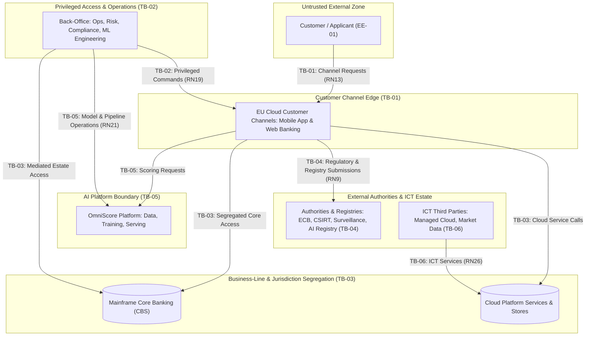

# AEGIS Phase 3 — Part 2: Step 1 — Assets, Boundaries & Data Flow Modeling (OmniBank Financial Systems)

> **Case Study:** Case 03 — OmniBank Financial Systems S.A. (Consumer Banking with In-House High-Risk Credit-Scoring AI)  
> **Lifecycle Phase:** AEGIS Phase 3 — Specification, **Part 2 of 2 (Threat & Risk Analysis)**  
> **Step Deliverable:** Step 1 of 5 (`01_SYSTEM_MODEL_ASSETS_AND_BOUNDARIES.md`)  
> **Upstream Inputs:** Phase 3 Part 1 Approved Baseline Version 2 — [`../part1_security_privacy/v2_security_privacy_synthesis/Doc01_Requirements_Elicitation_and_PUC.md`](../part1_security_privacy/v2_security_privacy_synthesis/Doc01_Requirements_Elicitation_and_PUC.md) (43 Cards `R1.1`–`R11.4`) & [`../part1_security_privacy/v2_security_privacy_synthesis/Doc02_System_Use_Cases.md`](../part1_security_privacy/v2_security_privacy_synthesis/Doc02_System_Use_Cases.md) (43 Use Cases `{U.C. 1.1}`–`{U.C. 11.4}`)  
> **Methodological Standard:** [`../../../templates/phase3_threat_risk_guidelines.md`](../../../templates/phase3_threat_risk_guidelines.md) §6.1 & [`00_METHODOLOGY_AND_EXECUTION_GUIDE.md`](00_METHODOLOGY_AND_EXECUTION_GUIDE.md) §6.1  

---

## 1. Executive Summary & Purpose

This document establishes the **structural context, asset inventory, trust boundary catalog, and Data Flow Diagram (DFD Level 1)** for OmniBank Financial Systems under Phase 3 Part 2. The estate is defined by three structural features that shape every threat downstream: a **mainframe core-banking system segregated from EU-region cloud customer channels** (per-business-line and per-jurisdiction isolation, `RN10`), an **in-house AI platform** (OmniScore — provider and deployer duties under the AI Act, Annex III §5(b)), and a **five-regime statutory notification surface** (GDPR, NIS 2, DORA — with the 4-hour initial clock, CRA, AI Act).

### 1.1 Artefact Lifecycle & Pipeline Transitions

| Transition Dimension | Content & Operational Flow |
|---|---|
| **Upstream Inputs (from Part 1)** | Consumes the certified Version 2 functional baseline: 43 Requirement Cards (`R1.1`–`R11.4`), 26 EARS non-functional constraints (`RN1`–`RN26`), and 43 Cockburn Sea-Level Use Cases (`{U.C. 1.1}`–`{U.C. 11.4}`). |
| **Analytical Transformation** | Decomposes the functional system into: (1) 17 critical assets (`AST-01`–`AST-17`) under CIA-A, GDPR, DORA, and AI Act obligations; (2) 6 formal trust boundaries (`TB-01`–`TB-06`); (3) 15 inter-entity data flows (`DF-01`–`DF-15`) formalized in a DFD Level 1. |
| **Downstream Handoff $\rightarrow$ Step 2** | Transfers all boundary-crossing interactions to [`02_TECHNICAL_THREATS_STRIDE.md`](02_TECHNICAL_THREATS_STRIDE.md) for technical threat elicitation per functional package, including the ATLAS AI lane. |
| **Downstream Handoff $\rightarrow$ Step 3** | Transfers all personal data flows to [`03_PRIVACY_THREATS_LINDDUN.md`](03_PRIVACY_THREATS_LINDDUN.md) for data subject privacy threat modeling. |
| **Downstream Handoff $\rightarrow$ Step 4** | Anchors the root targets (`AST-04` OmniScore Model, `AST-05` Decision Records, `AST-07` Key Custody, `AST-13` ICT Register, `TB-02` Privileged Access, `TB-03` Segregation Boundary) for Attack Tree decomposition in [`04_ATTACK_VECTORS_AND_DEFENSE_TREES.md`](04_ATTACK_VECTORS_AND_DEFENSE_TREES.md). |

All entities, boundaries, and data flows are derived strictly from the approved Version 2 functional baseline without fabricating unstated infrastructure or tools (Rule R6).

---

## 2. Asset Identification & Sensitivity Classification

| Asset ID | Asset Title & Functional Description | Persistent Store | Conf. (C) | Integ. (I) | Avail. (A) | Acc. (A) | Statutory & Regulatory Classification |
|---|---|---|---|---|---|---|---|
| **AST-01** | **Customer Account & Transaction Data:** account master records, balances, transaction histories on the mainframe core-banking system (CBS). | Mainframe Core (per business line) | **Critical** | **Critical** | **Critical** | **Critical** | Personal & Financial Data (GDPR Art. 4(1)); DORA Critical/Important Function (Art. 6) |
| **AST-02** | **Payment Instruction State:** payment orders, clearing state, processing records for the PSP service. | Mainframe Core | **Critical** | **Critical** | **Critical** | **Critical** | Financial Data; DORA Critical Function |
| **AST-03** | **Credit Application Data:** applicant identity, financials, behavioural features feeding the models. | Application DB (AI Data Platform) | **Critical** | **Critical** | High | **Critical** | Personal Data (GDPR Art. 4(1)); AI Act Annex III Input Data |
| **AST-04** | **OmniScore Model Artifacts & Version Registry:** model binaries, version lineage, rollback records. | AI Model Registry | **Critical** | **Critical** | High | **Critical** | AI Act Annex III High-Risk System Component (Art. 11/17 records) |
| **AST-05** | **OmniScore Decision Records:** token-only automated credit decisions with statutory retention floors (`RN17`). | Decision Record Store | **Critical** | **Critical** | High | **Critical** | Personal Data (GDPR Arts. 15, 22); Token-Only Statutory Retention |
| **AST-06** | **AI Training Datasets & Pipeline Records:** training corpora, pipeline run records, validation results. | AI Data Platform | **Critical** | **Critical** | Medium | High | Personal Data (GDPR Art. 5(1)(b)/(e)); AI Act Art. 10 Data Governance |
| **AST-07** | **Cryptographic Key Material:** field-level encryption keys, channel credentials under in-house HSM custody (`RN15`). | Key Custody Service | **Critical** | **Critical** | **Critical** | **Critical** | Cryptographic Material (CRA Annex I (2)(e); CSF PR.DS-01) |
| **AST-08** | **Security Event Store:** correlated security events from mainframe, cloud channels, and AI platform. | Tamper-Evident Event Store | Medium | **Critical** | High | **Critical** | Security Telemetry (NIS 2 Art. 21; DORA Art. 12) |
| **AST-09** | **Incident & Notification Records:** incident lifecycle, unified regulatory notification content and clocks (`RN18`). | Incident Store | High | **Critical** | High | **Critical** | NIS 2 Art. 23 / DORA Art. 19 / GDPR Art. 33 / CRA Art. 14 Notification Evidence |
| **AST-10** | **Immutable Audit Trail:** decision-relevant and security-relevant audit entries (`RN17`, `RN23`). | Audit Store | Medium | **Critical** | High | **Critical** | Statutory Audit Records (CRA Annex I (2)(l); DORA Art. 12) |
| **AST-11** | **Identity & Entitlement Store:** workforce identities, privileged-access state, entitlement records. | Identity Store | High | **Critical** | High | **Critical** | Personal Data (GDPR Art. 4(1)); Access-Control State |
| **AST-12** | **Rights Ledger & Retention Rules:** data-subject request cases, tiered retention schedule definitions. | Rights & Retention Store | High | **Critical** | High | **Critical** | Accountability Records (GDPR Arts. 5(2), 12–22) |
| **AST-13** | **ICT Third-Party Register & Vendor Records:** DORA register entries, criticality ratings, vendor assessments (`RN26`). | Vendor Register | Medium | **Critical** | Medium | High | DORA Art. 28/29 Register Duties |
| **AST-14** | **Release Artifacts & SBOM Records:** signed release packages, SBOM records for the mobile app and web platform. | Release Store | **Critical** | **Critical** | High | High | CRA Annex I (2)(j); Class I Product Records |
| **AST-15** | **Backup Estate:** mainframe and cloud backups with RTO 2 h / RPO 15 min objectives (`RN4`). | Backup Estate | **Critical** | **Critical** | High | **Critical** | DORA Art. 12 Recovery; NIS 2 Art. 21(2)(c) |
| **AST-16** | **Configuration Baselines:** hardened secure configurations for mainframe, cloud, and AI platform estates (`RN20`). | Configuration Store | High | **Critical** | High | **Critical** | CRA Annex I (2)(b)-(d) Secure Configuration |
| **AST-17** | **AI Conformity & Documentation:** AI risk management file, technical documentation, conformity records, post-market monitoring plan. | Document Store | Medium | **Critical** | Medium | High | AI Act Arts. 9, 11, 17, 72; DORA ICT Risk Framework |

---

## 3. Formal Trust Boundaries Catalog

Across the 43 Cockburn Sea-Level Use Cases (`{U.C. 1.1}` to `{U.C. 11.4}`), six distinct Trust Boundaries are established:

### 3.1 Trust Boundary Specifications

#### TB-01: Customer Channel Edge
- **Boundary Type:** Network / Untrusted-Public Crossing.
- **Source Entity:** Untrusted Customer / Applicant (`EE-01`).
- **Destination Entity:** EU Cloud Customer Channels — Mobile App & Web Banking (`P1`, `P4`, `P6`).
- **Data Flows Crossing:** `DF-01` (channel requests), `DF-02` (credit applications), `DF-12` (rights requests).
- **Threat Exposure:** Spoofing (customer credential abuse); Information Disclosure (unencrypted channel traffic); Denial of Service (channel flooding on peak days).
- **Target Use Cases:** `{U.C. 1.1}` (Customer Channels), `{U.C. 1.2}` (Credit Applications), `{U.C. 6.3}` (Data-Subject Requests), `{U.C. 6.4}` (Exports & Portability).
- **Mitigating Constraints in Baseline:** `RN13` (Data-in-Transit Protection — customer channel class), `RN16` (Rights-Requester Identity Verification), `RN6` (Tamper-Evident Event Recording).

#### TB-02: Privileged Access & Operations Boundary
- **Boundary Type:** Privilege Level / Authorization Context Crossing.
- **Source Entity:** Authenticated Workforce Session (operations, risk, compliance, ML engineering).
- **Destination Entity:** Elevated operations across channels, AI platform, and core (`P1`–`P11`).
- **Data Flows Crossing:** Model promotion commands, review decisions, change approvals, entitlement changes, key ceremonies.
- **Threat Exposure:** Elevation of Privilege; Tampering with privileged commands; Repudiation of administrative actions; Insider abuse of ML-pipeline authority.
- **Target Use Cases:** `{U.C. 1.3}` (Human Review), `{U.C. 2.3}` (Key Custody), `{U.C. 4.1}`–`{U.C. 4.4}` (Identity & Access), `{U.C. 5.2}` (Triage), `{U.C. 8.2}`–`{U.C. 8.4}` (Pipelines).
- **Mitigating Constraints in Baseline:** `RN19` (Strong Privileged-Access Authentication), `RN20` (Secure-by-Default Configuration & Reset), `RN21` (AI Platform Access Mediation & Least Privilege).

#### TB-03: Business-Line & Jurisdiction Segregation Boundary
- **Boundary Type:** Tenancy / Jurisdiction / Mainframe–Cloud Crossing.
- **Source Entity:** Cloud channels, platform services, and back-office (`P1`, `P2`, `P5`).
- **Destination Entity:** Mainframe Core Banking and per-estate stores.
- **Data Flows Crossing:** `DF-15` (payment processing), `DF-04` (decision writes), `DF-10` (event ingestion), `DF-13` (backup replication).
- **Threat Exposure:** Information Disclosure (cross-business-line or cross-jurisdiction data flows); Tampering (core records in transit); Denial of Service (estate exhaustion).
- **Target Use Cases:** `{U.C. 1.1}`–`{U.C. 1.2}` (Channels & Scoring), `{U.C. 5.1}` (Monitoring), `{U.C. 5.3}` (Backups).
- **Mitigating Constraints in Baseline:** `RN10` (Per-Business-Line & Jurisdiction Segregation, no unauthorized cross-estate flows), `RN13` (Data-in-Transit Protection — inter-service class), `RN6` (Tamper-Evident Event Recording).

#### TB-04: Authority & Registry Channels Boundary
- **Boundary Type:** External Third-Party / State System Crossing.
- **Source Entity:** Back-Office Notification & Compliance Services (`P5`, `P10`).
- **Destination Entity:** Authorities & Registries — ECB, BSI/CSIRT, market surveillance, AI registry (`EE-02`).
- **Data Flows Crossing:** `DF-09` (unified regulatory notifications, registry submissions, supervisory reports).
- **Threat Exposure:** Spoofing (forged submissions or spoofed authority instructions); Tampering (manipulated report content); Denial of Service (clock-bypass delay across five regimes).
- **Target Use Cases:** `{U.C. 5.2}` (Unified Regulatory Notification), `{U.C. 10.4}` (Compliance Reports).
- **Mitigating Constraints in Baseline:** `RN9` (Authenticated, Integrity-Protected Authority Channels), `RN18` (Unified Notification Clock Enforcement), `RN13` (Data-in-Transit Protection — authority class).

#### TB-05: AI Platform Boundary
- **Boundary Type:** Process / Data-Plane & Model-Plane Crossing (ATLAS lane).
- **Source Entity:** Customer channels, privileged engineers, data feeds.
- **Destination Entity:** OmniScore Platform — AI Data Platform, Training Pipeline, Model Serving.
- **Data Flows Crossing:** `DF-03` (scoring requests), `DF-06` (model promotion/rollback), `DF-07` (training-data pipeline).
- **Threat Exposure:** AI-specific classes (data poisoning, adversarial evasion, model inversion, model exfiltration) plus conventional tampering of the serving path.
- **Target Use Cases:** `{U.C. 1.2}` (Automated Scoring), `{U.C. 1.4}` (Model Releases), `{U.C. 6.5}` (Training-Data Lifecycle), `{U.C. 8.4}` (AI Pipeline Security).
- **Mitigating Constraints in Baseline:** `RN11` (OmniScore Decision & Model Integrity at Serving), `RN12` (Scoring Data Minimization & Purpose Binding), `RN21` (AI Platform Access Mediation & Least Privilege), `RN23` (AI Event Logging over Lifetime), `RN24` (Post-Market Monitoring Integration), `RN25` (AI Adversarial Robustness Measures).

#### TB-06: ICT Third-Party & Cloud Services Boundary
- **Boundary Type:** External Third-Party / DORA-Regulated ICT Crossing.
- **Source Entity:** Cloud Platform Services (`P1`, `P8`).
- **Destination Entity:** ICT Third Parties — managed cloud provider, market data provider (`EE-03`).
- **Data Flows Crossing:** `DF-11` (ICT service data exchange).
- **Threat Exposure:** Information Disclosure (data exchange beyond contract scope); Tampering (third-party service compromise propagating inward); Denial of Service (provider outage — DORA register criticality class).
- **Target Use Cases:** `{U.C. 7.1}` (ICT Third-Party Assessment & Register), `{U.C. 7.3}` (Contractual Security Terms).
- **Mitigating Constraints in Baseline:** `RN26` (ICT Third-Party Register Completeness & Criticality), `RN19` (Strong Privileged-Access Authentication for register administration), `RN13` (Data-in-Transit Protection — third-party class).

---

## 4. Data Flow Diagram (DFD Level 1)

```mermaid
flowchart TD
    subgraph EE["External Interactors"]
        EE1["EE-01: Customer / Applicant"]
        EE2["EE-02: Authorities & Registries (ECB, CSIRT, Surveillance, AI Registry)"]
        EE3["EE-03: ICT Third Parties (Managed Cloud, Market Data)"]
    end

    subgraph Processes["OmniBank Functional Subsystems (Processes)"]
        P1["P1: Banking Services & Credit Decisions<br>(R1.1, R1.2, R1.3, R1.4)"]
        P2["P2: Cryptographic Protection<br>(R2.1, R2.2, R2.3)"]
        P3["P3: Vulnerabilities & Patches<br>(R3.1, R3.2, R3.3, R3.4)"]
        P4["P4: Identities & Access<br>(R4.1, R4.2, R4.3, R4.4)"]
        P5["P5: Detect & Respond<br>(R5.1, R5.2, R5.3, R5.4)"]
        P6["P6: Data Lifecycle & Rights<br>(R6.1, R6.2, R6.3, R6.4, R6.5)"]
        P7["P7: Vendors & Supply Chain<br>(R7.1, R7.2, R7.3, R7.4)"]
        P8["P8: Develop & Release Securely<br>(R8.1, R8.2, R8.3, R8.4)"]
        P10["P10: Govern Security & AI Compliance<br>(R10.1, R10.2, R10.3, R10.4)"]
        P11["P11: Test & Assure Continuously<br>(R11.1, R11.2, R11.3, R11.4)"]
    end

    subgraph DataStores["Segregated Estate Data Stores"]
        DS1[("DS-01: Mainframe Core Banking<br>(Accounts, Payments)")]
        DS2[("DS-02: AI Data & Model Platform<br>(Training Data, Registry, Serving)")]
        DS3[("DS-03: Decision Record Store<br>(Token-Only, RN17)")]
        DS4[("DS-04: Event, Audit & Incident Stores<br>(RN6, RN17, RN18)")]
        DS5[("DS-05: Rights, Vendor & Release Stores")]
        DS6[("DS-06: Key Custody Service & Backup Estate<br>(RN15, RN4)")]
    end

    EE1 -->|"DF-01: Channel Requests (TB-01)"| P1
    EE1 -->|"DF-02: Credit Application (TB-01)"| P1
    P1 -->|"DF-15: Payment Processing (TB-03)"| DS1
    P1 -->|"DF-03: OmniScore Serving (TB-05)"| DS2
    P1 -->|"DF-04: Decision Write (TB-03)"| DS3
    P1 -->|"DF-05: Human Review & Explanation (TB-02)"| DS3
    P8 -->|"DF-06: Model Promotion & Rollback (TB-05)"| DS2
    P6 -->|"DF-07: Training-Data Pipeline (TB-05)"| DS2
    P2 -->|"DF-08: Key Lifecycle Operations (TB-02)"| DS6
    P5 -->|"DF-10: Security Event Ingestion (TB-03)"| DS4
    P5 -->|"DF-09: Unified Notification (TB-04)"| EE2
    P10 -->|"DF-09: Registry & Reports (TB-04)"| EE2
    P7 <-->|"DF-11: ICT Service Exchange (TB-06)"| EE3
    P6 -->|"DF-12: Rights Response (TB-01)"| EE1
    P5 -->|"DF-13: Backup Replication (TB-03)"| DS6
    P11 -->|"DF-14: Audit & Event Writes (TB-03)"| DS4
```

---

## 5. Comprehensive Data Flow Inventory

| Flow ID | Flow Name & Description | Source Entity | Destination Entity | Data Items / Assets Transferred | Boundaries Crossed | Governing Part 1 Constraints |
|---|---|---|---|---|---|---|
| **DF-01** | Customer Channel Requests | `EE-01` (Customer) | `P1` (Channels) | Session tokens, account queries, transaction instructions | `TB-01` | `RN13`, `RN6` |
| **DF-02** | Credit Application Submission | `EE-01` (Applicant) | `P1` (Credit Decisions) | Applicant identity, financials, consent state | `TB-01` | `RN13`, `RN12` |
| **DF-03** | OmniScore Serving Request & Decision | `P1` (Channels) | `DS-02` (AI Platform) | Scoring features, model decision, integrity state | `TB-05` | `RN11`, `RN23` |
| **DF-04** | Token-Only Decision Write | `P1` (Credit Decisions) | `DS-03` (Decision Store) | Token-only decision entry, statutory retention metadata | `TB-03` | `RN17`, `RN6` |
| **DF-05** | Human Review & Explanation | `P1` (Review) | `DS-03` (Decision Store) | Review outcome, explanation content, reviewer attribution | `TB-02` | `RN19`, `RN22`, `RN23` |
| **DF-06** | Model Promotion & Rollback | `P8` (Releases) | `DS-02` (Model Registry) | Model artifact, version lineage, rollback record | `TB-05` | `RN11`, `RN21` |
| **DF-07** | Training-Data Pipeline Flow | `P6` (Data Lifecycle) | `DS-02` (Data Platform) | Training corpora, purpose-binding metadata, pipeline records | `TB-05` | `RN12`, `RN21`, `RN24` |
| **DF-08** | Key Lifecycle Operations | `P2` (Crypto) | `DS-06` (Key Custody) | Key ceremonies, destruction evidence, custody attestations | `TB-02` | `RN15`, `RN17`, `RN19` |
| **DF-09** | Authority & Registry Submissions | `P5`/`P10` (Back-Office) | `EE-02` (Authorities) | Unified notifications, supervisory reports, registry entries | `TB-04` | `RN9`, `RN18`, `RN13` |
| **DF-10** | Security Event Ingestion | `P1`/`P5` (Estates) | `DS-04` (Event Store) | Mainframe, cloud, and AI-platform security events | `TB-03` | `RN13`, `RN6` |
| **DF-11** | ICT Third-Party Service Exchange | `EE-03` (Third Parties) | `P1` (Platform) | Cloud service payloads, market data feeds | `TB-06` | `RN13`, `RN26` |
| **DF-12** | Rights Request & Response | `EE-01` (Data Subject) | `P6` (Rights) | Verified rights request, erasure/portability delivery | `TB-01` | `RN16`, `RN15`, `RN17` |
| **DF-13** | Backup Replication | `P5` (Recovery) | `DS-06` (Backup Estate) | Estate backup sets, recovery metadata | `TB-03` | `RN4` |
| **DF-14** | Audit & Event Writes | `P11` (Assurance) | `DS-04` (Audit Store) | Immutable audit entries, decision-relevant events | `TB-03` | `RN17`, `RN23` |
| **DF-15** | Payment Processing | `P1` (Channels) | `DS-01` (Mainframe CBS) | Payment instructions, clearing state | `TB-03` | `RN13`, `RN6` |

---

## 6. Bidirectional Traceability: Use Cases $\longleftrightarrow$ Boundaries $\longleftrightarrow$ Assets

This matrix guarantees that 100% of the 43 functional requirement cards and 43 Cockburn Sea-Level Use Cases are mapped to their operational assets and trust boundaries:

| Req Card | Cockburn Sea-Level Use Case | Primary Assets Manipulated | Trust Boundaries Traversed | Critical Threat Surfaces | Governing Constraints |
|---|---|---|---|---|---|
| `R1.1` | `{U.C. 1.1}` Operate customer banking channels | `AST-01`, `AST-02`, `AST-08` | `TB-01`, `TB-03` | Channel interception, cross-estate flows, transaction tampering | `RN13` |
| `R1.2` | `{U.C. 1.2}` Process credit applications through automated scoring | `AST-03`, `AST-04`, `AST-05` | `TB-01`, `TB-03`, `TB-05` | Decision forgery, AI evasion, model inversion, scoring-data probing | `RN11`, `RN12`, `RN13`, `RN23`, `RN6` |
| `R1.3` | `{U.C. 1.3}` Provide human review and explanation of credit decisions | `AST-05`, `AST-11` | `TB-02` | Review bypass, explanation falsification, reviewer attribution | `RN13`, `RN19`, `RN22`, `RN23` |
| `R1.4` | `{U.C. 1.4}` Maintain AI model releases and versions | `AST-04` | `TB-02`, `TB-05` | Version tampering, rollback abuse, model exfiltration | `RN11`, `RN21` |
| `R2.1` | `{U.C. 2.1}` Configure data-at-rest encryption | `AST-01`, `AST-07` | `TB-02`, `TB-03` | At-rest decryption via key compromise | `RN14`, `RN15`, `RN19` |
| `R2.2` | `{U.C. 2.2}` Protect data in transit | `AST-01`, `AST-08` | `TB-03` | Inter-service channel interception | `RN13`, `RN19` |
| `R2.3` | `{U.C. 2.3}` Manage cryptographic key lifecycle and custody | `AST-07`, `AST-10` | `TB-02` | Key custody violation, destruction-evidence falsification | `RN15`, `RN17`, `RN19` |
| `R3.1` | `{U.C. 3.1}` Identify and assess vulnerabilities | `AST-08`, `AST-14` | `TB-02`, `TB-03` | Remediation circumvention | `RN18` |
| `R3.2` | `{U.C. 3.2}` Remediate vulnerabilities through security updates | `AST-14` | `TB-02`, `TB-03` | Patch withholding (carried by `TM-D-02.1-001`) | chains |
| `R3.3` | `{U.C. 3.3}` Operate coordinated vulnerability disclosure | `AST-08` | `TB-04` | Process lane: inbound advisory channel, no product-verifiable surface beyond channel class | chains |
| `R3.4` | `{U.C. 3.4}` Execute security and threat-led testing | `AST-08` | `TB-02` | Process lane: testing crosses no untrusted boundary | chains |
| `R4.1` | `{U.C. 4.1}` Manage identity lifecycle | `AST-11` | `TB-02` | Entitlement drift, orphaned privilege | `RN19`, `RN21` |
| `R4.2` | `{U.C. 4.2}` Enforce multi-factor authentication for privileged access | `AST-11`, `AST-07` | `TB-02` | Privileged MFA bypass | `RN19` |
| `R4.3` | `{U.C. 4.3}` Review and reconcile access rights | `AST-11` | `TB-02` | Entitlement drift (carried by `TM-D-03.3-002`) | chains |
| `R4.4` | `{U.C. 4.4}` Maintain hardened secure configurations | `AST-16` | `TB-02` | Hardening bypass | `RN19`, `RN20` |
| `R5.1` | `{U.C. 5.1}` Monitor and correlate security events | `AST-08` | `TB-03` | Event suppression, cross-estate flow abuse | `RN13` |
| `R5.2` | `{U.C. 5.2}` Triage incidents and execute unified regulatory notification | `AST-09` | `TB-02`, `TB-04` | Notification-clock circumvention (DORA 4 h), PII over-disclosure | `RN13`, `RN18`, `RN19` |
| `R5.3` | `{U.C. 5.3}` Maintain backups and execute disaster recovery | `AST-15` | `TB-03` | Backup and DR sabotage | `RN4` |
| `R5.4` | `{U.C. 5.4}` Investigate and recover AI system after failure | `AST-04`, `AST-08` | `TB-02`, `TB-05` | AI failure evidence tampering | `RN11`, `RN21`, `RN24` |
| `R6.1` | `{U.C. 6.1}` Minimize data collection | `AST-12` | `TB-03` | Process lane: minimization policy surface carried by `RN12` purpose binding (LINDDUN lane) | chains |
| `R6.2` | `{U.C. 6.2}` Enforce tiered retention schedules | `AST-12` | `TB-03` | Retention schedule circumvention | `RN17` |
| `R6.3` | `{U.C. 6.3}` Process data-subject requests | `AST-12` | `TB-01`, `TB-03` | Spoofed rights request, rights obstruction | `RN15`, `RN16`, `RN17` |
| `R6.4` | `{U.C. 6.4}` Deliver data exports and portability | `AST-12` | `TB-01`, `TB-03` | Portability obstruction | `RN16` |
| `R6.5` | `{U.C. 6.5}` Manage AI training-data lifecycle | `AST-06` | `TB-05` | Training-data poisoning, purpose drift | `RN12`, `RN21`, `RN24` |
| `R7.1` | `{U.C. 7.1}` Assess ICT third-party providers and maintain the register | `AST-13` | `TB-02`, `TB-06` | Register falsification, criticality mis-rating | `RN19`, `RN26` |
| `R7.2` | `{U.C. 7.2}` Maintain software bills of materials | `AST-14` | `TB-03` | SBOM falsification (carried by `TM-D-06.1-001`) | chains |
| `R7.3` | `{U.C. 7.3}` Enforce contractual security terms | `AST-13` | `TB-06` | Process lane: contractual surface, no product-verifiable crossing | chains |
| `R7.4` | `{U.C. 7.4}` Manage provider and vendor exit | `AST-13` | `TB-06` | Process lane: exit planning, no untrusted crossing | chains |
| `R8.1` | `{U.C. 8.1}` Apply secure development standards | `AST-14`, `AST-16` | `TB-02` | Process lane: standards surface carried by `RN20` pipelines | `RN19` |
| `R8.2` | `{U.C. 8.2}` Secure the release pipeline | `AST-14` | `TB-02`, `TB-03` | Pipeline gate bypass | `RN20` |
| `R8.3` | `{U.C. 8.3}` Approve production changes | `AST-14`, `AST-16` | `TB-02` | Change abuse (carried by `TM-D-07.2-001`) | chains |
| `R8.4` | `{U.C. 8.4}` Secure the AI training and serving pipeline | `AST-04`, `AST-06` | `TB-05` | Training-data poisoning, serving tampering | `RN11`, `RN21` |
| `R9.1` | `{U.C. 9.1}` Deliver security and privacy awareness training | — | — | Human-factors lane: no product threat surface | chains |
| `R9.2` | `{U.C. 9.2}` Maintain role-specific competence programs | — | — | Human-factors lane: oversight competence context (`RN22`) carried by `TM-D-03.3-001` | `RN22` |
| `R9.3` | `{U.C. 9.3}` Deliver board and oversight-body security training | — | — | Human-factors lane: no product threat surface | chains |
| `R10.1` | `{U.C. 10.1}` Maintain the unified management system | `AST-17` | `TB-03` | Governance lane: documentation integrity crosses no untrusted boundary | chains |
| `R10.2` | `{U.C. 10.2}` Execute unified risk and impact assessments | `AST-17` | `TB-03` | Governance lane: assessment records (post-market monitoring context `RN24`) | `RN24` |
| `R10.3` | `{U.C. 10.3}` Maintain asset and AI documentation inventories | `AST-17` | `TB-03` | Governance lane: inventory integrity crosses no untrusted boundary | chains |
| `R10.4` | `{U.C. 10.4}` Generate regulatory compliance reports | `AST-09`, `AST-17` | `TB-04` | Regulatory report falsification | `RN13` |
| `R11.1` | `{U.C. 11.1}` Operate threat detection capabilities | `AST-08` | `TB-03` | Detection surface carried by `TM-D-10.1-001` class | chains |
| `R11.2` | `{U.C. 11.2}` Maintain immutable audit logging | `AST-10` | `TB-03` | Immutable audit tampering | `RN17`, `RN23` |
| `R11.3` | `{U.C. 11.3}` Execute penetration and resilience testing | `AST-08` | `TB-02` | Process lane: testing crosses no untrusted boundary | chains |
| `R11.4` | `{U.C. 11.4}` Test AI adversarial robustness and explainability | `AST-04`, `AST-17` | `TB-02`, `TB-05` | Robustness assurance bypass | `RN22`, `RN24`, `RN25` |

---

## 7. Step 1 Sign-Off & Verification

This document satisfies all requirements of **Step 1 of Phase 3 Part 2**:
- [x] **100% Asset Coverage:** All 17 persistent, platform, and compliance asset types classified under CIA-A and statutory categories (GDPR, DORA critical functions, AI Act Annex III).
- [x] **100% Trust Boundary Definition:** All 6 trust boundaries ($TB_{01}$ to $TB_{06}$) formalized with traversed entities, data flows, and target use cases — including the business-line/jurisdiction segregation boundary (mainframe↔cloud) and the AI platform boundary (ATLAS lane).
- [x] **Valid DFD Level 1:** Data Flow Diagram fully rendered in valid Mermaid syntax with complete data flow matrix.
- [x] **Bidirectional Traceability Matrix:** Full mapping across all 43 requirement cards and 43 Cockburn Sea-Level Use Cases.

**Step 1 is COMPLETE and APPROVED.** Cleared to proceed to **Step 2 ([`02_TECHNICAL_THREATS_STRIDE.md`](02_TECHNICAL_THREATS_STRIDE.md))**.
