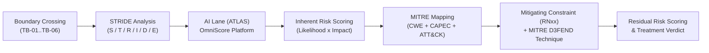

# AEGIS Phase 3 — Part 2: Step 2 — Technical Threat Modeling via STRIDE-per-Interaction (OmniBank Financial Systems)

> **Case Study:** Case 03 — OmniBank Financial Systems S.A. (Consumer Banking with In-House High-Risk Credit-Scoring AI)  
> **Lifecycle Phase:** AEGIS Phase 3 — Specification, **Part 2 of 2 (Threat & Risk Analysis)**  
> **Step Deliverable:** Step 2 of 5 (`02_TECHNICAL_THREATS_STRIDE.md`)  
> **Upstream Inputs:** Step 1 ([`01_SYSTEM_MODEL_ASSETS_AND_BOUNDARIES.md`](01_SYSTEM_MODEL_ASSETS_AND_BOUNDARIES.md)), Phase 3 Part 1 Approved Baseline Version 2 — [`../part1_security_privacy/v2_security_privacy_synthesis/Doc01_Requirements_Elicitation_and_PUC.md`](../part1_security_privacy/v2_security_privacy_synthesis/Doc01_Requirements_Elicitation_and_PUC.md) (43 Cards) & [`../part1_security_privacy/v2_security_privacy_synthesis/Doc02_System_Use_Cases.md`](../part1_security_privacy/v2_security_privacy_synthesis/Doc02_System_Use_Cases.md) (43 Use Cases)  
> **Methodological Standard:** [`../../../templates/phase3_threat_risk_guidelines.md`](../../../templates/phase3_threat_risk_guidelines.md) §6.2 & [`00_METHODOLOGY_AND_EXECUTION_GUIDE.md`](00_METHODOLOGY_AND_EXECUTION_GUIDE.md) §6.2  

---

## 1. Executive Summary & Methodology

This document executes the **STRIDE-per-interaction** threat modeling across all **11 functional packages** of the accepted OmniBank baseline (`R1` to `R11`), evaluating every interaction that traverses a Trust Boundary ($TB_{01}$ to $TB_{06}$). Because the target system embeds an **AI Act Annex III §5(b) high-risk credit-scoring AI with in-house training and serving**, the analysis carries the **ATLAS AI Threat Lane** (mandatory per [`../../../templates/phase3_threat_risk_guidelines.md`](../../../templates/phase3_threat_risk_guidelines.md) §3.1.5). Every mitigating constraint cited below is anchored to the accepted Part 1 Version 2 baseline.

### 1.1 Artefact Lifecycle & Pipeline Transitions

| Transition Dimension | Content & Operational Flow |
|---|---|
| **Upstream Inputs (from Step 1)** | Consumes the structural attack surface from [`01_SYSTEM_MODEL_ASSETS_AND_BOUNDARIES.md`](01_SYSTEM_MODEL_ASSETS_AND_BOUNDARIES.md): 17 assets, 6 trust boundaries, 15 data flows, and the 43 Cockburn Sea-Level Use Cases. |
| **Analytical Transformation** | Applies STRIDE to every boundary crossing across all 11 functional packages (`R1`–`R11`), eliciting 26 technical threat cards — including 5 AI-lane cards over the OmniScore platform (3 ATLAS-anchored) — anchored in MITRE CWE, CAPEC, ATT&CK, ATLAS, and D3FEND. |
| **Downstream Handoff $\rightarrow$ Step 4** | Feeds top-tier Critical technical threats (key custody compromise, serving forgery, pipeline bypass, cross-estate breach) to [`04_ATTACK_VECTORS_AND_DEFENSE_TREES.md`](04_ATTACK_VECTORS_AND_DEFENSE_TREES.md) for deep vector decomposition. |
| **Downstream Handoff $\rightarrow$ Step 5** | Exports all 26 scored technical threat cards into the master ledger in [`05_RISK_REGISTER_AND_GOVERNANCE.md`](05_RISK_REGISTER_AND_GOVERNANCE.md), which consolidates the 36 elicited cards (26 STRIDE + 10 LINDDUN) into 36 register rows (no cross-lens merges required in this case). |

---

## 2. Package 1: Banking Services & Credit Decisions (R1.1–R1.4 / {U.C. 1.1}–{U.C. 1.4})

### 2.1 Threat Cards

#### TM-D-01.2-001: Customer Channel Interception
- **Target Interaction & Boundary:** Mobile/web banking session traffic (`DF-01`), crossing `TB-01` (Customer Channel Edge) into `P1` in `{U.C. 1.1}` / `R1.1`.
- **STRIDE Category:** Information Disclosure (I) / Tampering (T).
- **Adversary Threat Hypothesis:** An adversary on an intermediate network or a compromised endpoint intercepts unencrypted channel traffic — capturing session tokens, account data, or payment instructions — or injects forged transaction instructions into an active session.
- **Root Weakness (CWE):** `CWE-319: Cleartext Transmission of Sensitive Information`.
- **Attack Pattern (CAPEC):** `CAPEC-158: Sniffing Network Traffic` / `CAPEC-94: Man in the Middle Attack`.
- **Adversary TTP (ATT&CK):** `T1040: Network Sniffing` / `T1557: Adversary-in-the-Middle`.
- **Inherent Risk Rating:**
  - *Likelihood:* Medium (2) [Commodity interception tooling against a public channel].
  - *Impact:* High (3) [Financial data and transaction integrity at the customer edge].
  - *Inherent Risk Level:* **High**.
- **Active Mitigating Constraints:**
  - `NFR-RN13: Data-in-Transit Protection` (All data crossing the customer channel class is cryptographically protected in transit with state-of-the-art mechanisms — Table 7 cross-cutting constraint).
- **Defensive Technique (D3FEND):** `D3-EAC: Encrypted Network Traffic`.
- **Residual Risk Rating & Verdict:**
  - *Residual Likelihood:* Low (1) [Channel-wide cryptographic protection removes the cleartext path].
  - *Residual Impact:* Low (2) [Protected-form traffic retains residual metadata value only].
  - *Residual Risk Level:* **Low**.
  - *Treatment Verdict:* **Mitigated** (Enforced in `{U.C. 1.1}` channel operations).

---

#### TM-D-01.4-001: Transaction & Decision Record Tampering
- **Target Interaction & Boundary:** Core and decision-record writes (`DF-04`, `DF-15`), crossing `TB-03` (Segregation Boundary) into `DS-01`/`DS-03` in `{U.C. 1.1}` / `R1.1` and `{U.C. 1.2}` / `R1.2`.
- **STRIDE Category:** Tampering (T) / Repudiation (R).
- **Adversary Threat Hypothesis:** An insider or compromised service alters payment instructions, transaction histories, or token-only decision records — concealing fraudulent movements, fabricating decision outcomes, or destroying statutory financial evidence.
- **Root Weakness (CWE):** `CWE-354: Improper Validation of Integrity Check Value` / `CWE-778: Insufficient Logging`.
- **Attack Pattern (CAPEC):** `CAPEC-180: Exploiting Access Control Levels`.
- **Adversary TTP (ATT&CK):** `T1565.001: Data Manipulation: Stored Data Manipulation` / `T1070: Indicator Removal`.
- **Inherent Risk Rating:**
  - *Likelihood:* Medium (2) [Requires a position on the estate write paths].
  - *Impact:* Critical (4) [Financial-record integrity and statutory decision evidence destroyed].
  - *Inherent Risk Level:* **Critical**.
- **Active Mitigating Constraints:**
  - `NFR-RN13: Data-in-Transit Protection` (Estate write paths are cryptographically protected in transit across the inter-service channel class).
  - `NFR-RN6: Tamper-Evident Event & Decision Recording` (100% of security-relevant and decision-relevant events are recorded in tamper-evident storage retained per the statutory floors — silent alteration is infeasible).
- **Defensive Technique (D3FEND):** `D3-IV: Integrity Verification` / `D3-AL: Audit Logging`.
- **Residual Risk Rating & Verdict:**
  - *Residual Likelihood:* Low (1) [Tamper-evident storage makes undetected alteration infeasible].
  - *Residual Impact:* Low (2) [Alteration attempts are detectable and legally evidenced].
  - *Residual Risk Level:* **Low**.
  - *Treatment Verdict:* **Mitigated** (Enforced in `{U.C. 1.1}` core operations and `{U.C. 1.2}` decision recording).

---

#### TM-D-03.1-001: OmniScore Decision Forgery at Serving
- **Target Interaction & Boundary:** Serving-path request and decision issuance (`DF-03`), crossing `TB-05` (AI Platform) into `DS-02` in `{U.C. 1.2}` / `R1.2`.
- **STRIDE Category:** Spoofing (S) / Tampering (T).
- **Adversary Threat Hypothesis:** An adversary with AI-platform position forges the serving response — substituting a favorable decision for the model's genuine output, or replaying a stale decision — bypassing the approved model entirely while leaving the application record intact.
- **Root Weakness (CWE):** `CWE-345: Insufficient Verification of Data Authenticity` / `CWE-284: Improper Access Control`.
- **Attack Pattern (CAPEC):** `CAPEC-148: Content Spoofing`.
- **Adversary TTP (ATT&CK):** `T1565.001: Data Manipulation: Stored Data Manipulation`.
- **Inherent Risk Rating:**
  - *Likelihood:* Medium (2) [Requires serving-path position].
  - *Impact:* Critical (4) [Fraudulent credit decisions at scale; AI Act Annex III integrity failure].
  - *Inherent Risk Level:* **Critical**.
- **Active Mitigating Constraints:**
  - `NFR-RN11: OmniScore Decision & Model Integrity at Serving` (Decision and model integrity are enforced at the serving boundary — the served decision is cryptographically bound to the approved model state).
  - `NFR-RN23: AI Event Logging over Lifetime` (Serving-path AI events over the model lifetime evidence any substituted response).
- **Defensive Technique (D3FEND):** `D3-IV: Integrity Verification` / `D3-AL: Audit Logging`.
- **Residual Risk Rating & Verdict:**
  - *Residual Likelihood:* Low (1) [Serving-bound integrity state rejects forged responses].
  - *Residual Impact:* High (3) [A full serving-platform compromise retains elevated consequence].
  - *Residual Risk Level:* **Medium**.
  - *Treatment Verdict:* **Mitigated** (Enforced in `{U.C. 1.2}` scoring flow).

---

#### TM-D-03.3-001: Human Review Bypass & Explanation Falsification
- **Target Interaction & Boundary:** Review and explanation operations (`DF-05`), crossing `TB-02` (Privileged Access) into `P1` in `{U.C. 1.3}` / `R1.3`.
- **STRIDE Category:** Elevation of Privilege (E) / Tampering (T).
- **Adversary Threat Hypothesis:** An operator or compromised session suppresses the human-review step for decisions requiring it, or falsifies the recorded explanation content — defeating the AI Act Art. 14 oversight guarantee and the Art. 86 explanation right.
- **Root Weakness (CWE):** `CWE-862: Missing Authorization` / `CWE-285: Improper Authorization`.
- **Attack Pattern (CAPEC):** `CAPEC-233: Privilege Escalation` / `CAPEC-180: Access Control Level Exploitation`.
- **Adversary TTP (ATT&CK):** `T1078.004: Valid Accounts: Cloud Accounts`.
- **Inherent Risk Rating:**
  - *Likelihood:* Medium (2) [Requires an authenticated privileged session].
  - *Impact:* Critical (4) [Automated decisions without mandated human review — systemic AI Act failure].
  - *Inherent Risk Level:* **Critical**.
- **Active Mitigating Constraints:**
  - `NFR-RN22: Human Oversight Effectiveness (OmniScore)` (Human oversight is recorded as effective, attributable, and reviewable — suppressed reviews are detectable).
  - `NFR-RN19: Strong Privileged-Access Authentication` (Review operations require strong privileged authentication).
  - `NFR-RN23: AI Event Logging over Lifetime` (Review-path AI events are lifetime-logged).
- **Defensive Technique (D3FEND):** `D3-AZ: Authorization Verification` / `D3-AL: Audit Logging`.
- **Residual Risk Rating & Verdict:**
  - *Residual Likelihood:* Low (1) [Mediated, attributed review flows block silent suppression].
  - *Residual Impact:* High (3) [A full privileged-compromise retains elevated consequence].
  - *Residual Risk Level:* **Medium**.
  - *Treatment Verdict:* **Mitigated** (Enforced in `{U.C. 1.3}` review flow).

---

## 3. Package 2: Cryptographic Protection (R2.1–R2.3 / {U.C. 2.1}–{U.C. 2.3})

### 3.1 Threat Cards

#### TM-D-01.1-001: Data-at-Rest Decryption via Key Compromise
- **Target Interaction & Boundary:** Estate encryption configuration and key access (`DF-08`), crossing `TB-02`/`TB-03` into `DS-01` in `{U.C. 2.1}` / `R2.1`.
- **STRIDE Category:** Information Disclosure (I).
- **Adversary Threat Hypothesis:** An adversary who compromises field-level encryption keys decrypts the customer account and transaction estate — mass exposure of the mainframe core-banking data without touching the application path.
- **Root Weakness (CWE):** `CWE-321: Use of Hard-coded Cryptographic Key` / `CWE-322: Key Exchange without Entity Authentication`.
- **Attack Pattern (CAPEC):** `CAPEC-475: Signature Spoofing by Key Recreation`.
- **Adversary TTP (ATT&CK):** `T1530: Data from Cloud Storage Object` / `T1552.004: Unsecured Credentials: Private Keys`.
- **Inherent Risk Rating:**
  - *Likelihood:* Medium (2) [Requires key-custody or configuration position].
  - *Impact:* Critical (4) [Mass decryption of the regulated financial estate].
  - *Inherent Risk Level:* **Critical**.
- **Active Mitigating Constraints:**
  - `NFR-RN14: Data-at-Rest Encryption with Field-Level Protection` (Field-level protection bounds plaintext exposure to the protected fields even under estate access).
  - `NFR-RN15: Key Custody Separation & Cryptographic Destruction` (Keys are held under separated custody; estate compromise alone does not yield usable keys).
  - `NFR-RN19: Strong Privileged-Access Authentication` (Key-configuration operations require strong privileged authentication).
- **Defensive Technique (D3FEND):** `D3-DE: Data Encryption` / `D3-IRA: Inbound Request Authentication`.
- **Residual Risk Rating & Verdict:**
  - *Residual Likelihood:* Low (1) [Separated custody and field-level scoping defeat estate-position decryption].
  - *Residual Impact:* Critical (4) [Sensitivity of the core financial estate unchanged].
  - *Residual Risk Level:* **High** (Tolerated under mandatory verified custody constraints).
  - *Treatment Verdict:* **Mitigated** (Enforced in `{U.C. 2.1}` encryption configuration).

---

#### TM-D-01.2-002: Key Custody Violation & Lifecycle Evidence Falsification
- **Target Interaction & Boundary:** Key lifecycle ceremonies and custody records (`DF-08`), crossing `TB-02` into `DS-06` in `{U.C. 2.3}` / `R2.3`.
- **STRIDE Category:** Information Disclosure (I) / Tampering (T).
- **Adversary Threat Hypothesis:** A privileged insider violates custody separation to extract or duplicate key material, or falsifies the destruction evidence — leaving supposedly-destroyed keys live and unaccounted.
- **Root Weakness (CWE):** `CWE-320: Key Management Errors` / `CWE-345: Insufficient Verification of Data Authenticity`.
- **Attack Pattern (CAPEC):** `CAPEC-475: Signature Spoofing by Key Recreation`.
- **Adversary TTP (ATT&CK):** `T1552.004: Unsecured Credentials: Private Keys` / `T1070: Indicator Removal`.
- **Inherent Risk Rating:**
  - *Likelihood:* Medium (2) [Requires privileged key-ceremony participation].
  - *Impact:* Critical (4) [Unaccounted live keys compromise every dependent control].
  - *Inherent Risk Level:* **Critical**.
- **Active Mitigating Constraints:**
  - `NFR-RN15: Key Custody Separation & Cryptographic Destruction` (Custody separation and cryptographic destruction are enforced with destruction evidence).
  - `NFR-RN17: Token-Only Decision-Record Retention` (Custody and lifecycle records are retained in tamper-evident token-bound form — falsification is detectable).
  - `NFR-RN19: Strong Privileged-Access Authentication` (Ceremony participation requires strong privileged authentication).
- **Defensive Technique (D3FEND):** `D3-AL: Audit Logging` / `D3-IV: Integrity Verification`.
- **Residual Risk Rating & Verdict:**
  - *Residual Likelihood:* Low (1) [Custody separation plus tamper-evident lifecycle records defeat silent violation].
  - *Residual Impact:* Critical (4) [Consequence of a true custody breach unchanged].
  - *Residual Risk Level:* **High** (Tolerated under mandatory verified custody constraints).
  - *Treatment Verdict:* **Mitigated** (Enforced in `{U.C. 2.3}` key lifecycle flow).

---

## 4. Package 3: Vulnerabilities & Patches (R3.1–R3.4 / {U.C. 3.1}–{U.C. 3.4})

### 4.1 Threat Cards

#### TM-D-02.1-001: Vulnerability Remediation Circumvention
- **Target Interaction & Boundary:** Vulnerability assessment and remediation tracking (`DF-10` context), crossing `TB-02`/`TB-03` in `{U.C. 3.1}` / `R3.1` and `{U.C. 3.2}` / `R3.2`.
- **STRIDE Category:** Tampering (T) / Denial of Service (D).
- **Adversary Threat Hypothesis:** An insider suppresses or downgrades vulnerability findings, or withholds security updates from the remediation pipeline — keeping exploitable vulnerabilities live in a regulated estate and breaching the CRA/NIS 2 remediation duties.
- **Root Weakness (CWE):** `CWE-1233: Sensitivity Information inserted in send... (integrity-of-process class)` / `CWE-778: Insufficient Logging`.
- **Attack Pattern (CAPEC):** `CAPEC-180: Exploiting Access Control Levels`.
- **Adversary TTP (ATT&CK):** `T1562.001: Impair Defenses: Disable Tools`.
- **Inherent Risk Rating:**
  - *Likelihood:* Medium (2) [Requires vulnerability-management position].
  - *Impact:* High (3) [Known-exploitable weaknesses persist in a critical estate].
  - *Inherent Risk Level:* **High**.
- **Active Mitigating Constraints:**
  - `NFR-RN18: Unified Notification Clock Enforcement` (Vulnerability-relevant incidents flow through the enforced unified pipeline — suppressed findings surface through the notification clock discipline).
  - `NFR-RN6: Tamper-Evident Event Recording` (Assessment and remediation events are tamper-evidently recorded).
- **Defensive Technique (D3FEND):** `D3-AL: Audit Logging` / `D3-SC: System Configuration Hardening`.
- **Residual Risk Rating & Verdict:**
  - *Residual Likelihood:* Low (1) [Tamper-evident tracking and clock discipline defeat silent suppression].
  - *Residual Impact:* Low (2) [Suppression is detectable and reversible].
  - *Residual Risk Level:* **Low**.
  - *Treatment Verdict:* **Mitigated** (Enforced in `{U.C. 3.1}` assessment flow).

*(Process-lane note: `{U.C. 3.3}` CVD intake and `{U.C. 3.4}` threat-led testing cross no product-verifiable untrusted boundary beyond the `TB-04`/`TB-02` channel classes already carried by `TM-D-01.4-002`/`TM-D-04.1-001`; their evaluation is recorded in the Step 1 traceability matrix per the stop criteria.)*

---

## 5. Package 4: Identities & Access (R4.1–R4.4 / {U.C. 4.1}–{U.C. 4.4})

### 5.1 Threat Cards

#### TM-D-03.1-002: Privileged Access MFA Bypass
- **Target Interaction & Boundary:** Privileged authentication flow (`DF-13` context), crossing `TB-02` into `P4` in `{U.C. 4.2}` / `R4.2`.
- **STRIDE Category:** Spoofing (S).
- **Adversary Threat Hypothesis:** An adversary harvests privileged credentials (phishing, endpoint compromise, token theft) and defeats the multi-factor challenge to assume a workforce privileged identity — the pivot to model promotion, key ceremonies, and change approval.
- **Root Weakness (CWE):** `CWE-308: Single-Factor Reusable Authentication` / `CWE-287: Improper Authentication`.
- **Attack Pattern (CAPEC):** `CAPEC-115: Authentication Bypass`.
- **Adversary TTP (ATT&CK):** `T1110: Brute Force` / `T1556: Modify Authentication Process`.
- **Inherent Risk Rating:**
  - *Likelihood:* Medium (2) [Professional workforce, but privileged-credential phishing is commodity].
  - *Impact:* Critical (4) [Full privileged identity assumption across the regulated estate].
  - *Inherent Risk Level:* **Critical**.
- **Active Mitigating Constraints:**
  - `NFR-RN19: Strong Privileged-Access Authentication` (Multi-factor authentication is enforced for privileged access).
- **Defensive Technique (D3FEND):** `D3-IRA: Inbound Request Authentication` / `D3-URR: User Request Rate Limiting`.
- **Residual Risk Rating & Verdict:**
  - *Residual Likelihood:* Low (1) [Multi-factor verification defeats single-factor compromise].
  - *Residual Impact:* High (3) [A full MFA-token compromise retains elevated consequence].
  - *Residual Risk Level:* **Medium**.
  - *Treatment Verdict:* **Mitigated** (Enforced in `{U.C. 4.2}` authentication flow).

---

#### TM-D-03.3-002: Entitlement Drift & Unreviewed Access
- **Target Interaction & Boundary:** Identity lifecycle and access-reconciliation flows (`DF-13`), crossing `TB-02` into `P4` in `{U.C. 4.1}` / `R4.1` and `{U.C. 4.3}` / `R4.3`.
- **STRIDE Category:** Elevation of Privilege (E).
- **Adversary Threat Hypothesis:** An operator accumulates or self-grants entitlements outside the sanctioned lifecycle — orphaned privileges after role changes, unreconciled access surviving reviews — building standing privilege for later abuse.
- **Root Weakness (CWE):** `CWE-269: Improper Privilege Management` / `CWE-862: Missing Authorization`.
- **Attack Pattern (CAPEC):** `CAPEC-233: Privilege Escalation`.
- **Adversary TTP (ATT&CK):** `T1098: Account Manipulation`.
- **Inherent Risk Rating:**
  - *Likelihood:* Medium (2) [Authenticator position; drift accumulates silently by design friction].
  - *Impact:* High (3) [Standing privilege across a regulated estate].
  - *Inherent Risk Level:* **High**.
- **Active Mitigating Constraints:**
  - `NFR-RN19: Strong Privileged-Access Authentication` (Privileged entitlement usage is bound to strong authentication).
  - `NFR-RN21: AI Platform Access Mediation & Least Privilege` (AI-platform entitlements are mediated under least privilege — drift into model authority is blocked).
- **Defensive Technique (D3FEND):** `D3-AZ: Authorization Verification` / `D3-UAI: User Account Isolation`.
- **Residual Risk Rating & Verdict:**
  - *Residual Likelihood:* Low (1) [Mediated, least-privilege entitlement flows block standing drift].
  - *Residual Impact:* Low (2) [Drift is bounded and reviewable].
  - *Residual Risk Level:* **Low**.
  - *Treatment Verdict:* **Mitigated** (Enforced in `{U.C. 4.1}` lifecycle flow).

---

#### TM-D-03.4-002: Configuration Hardening Bypass
- **Target Interaction & Boundary:** Hardened configuration maintenance (`DF-13` context), crossing `TB-02` into `P4` in `{U.C. 4.4}` / `R4.4`.
- **STRIDE Category:** Elevation of Privilege (E) / Tampering (T).
- **Adversary Threat Hypothesis:** An operator or compromised pipeline weakens hardened baseline configurations (permissive network rules, disabled logging switches) to open a persistent path into the estate.
- **Root Weakness (CWE):** `CWE-1188: Insecure Default Initialization of Resource` / `CWE-16: Configuration`.
- **Attack Pattern (CAPEC):** `CAPEC-180: Exploiting Access Control Levels`.
- **Adversary TTP (ATT&CK):** `T1562.001: Impair Defenses: Disable Tools` / `T1565.001: Data Manipulation: Stored Data Manipulation`.
- **Inherent Risk Rating:**
  - *Likelihood:* Medium (2) [Requires configuration-path position].
  - *Impact:* High (3) [Persistent estate exposure under weakened baselines].
  - *Inherent Risk Level:* **High**.
- **Active Mitigating Constraints:**
  - `NFR-RN19: Strong Privileged-Access Authentication` (Configuration changes require strong privileged authentication).
  - `NFR-RN20: Secure-by-Default Configuration & Reset` (Configurations are secure-by-default; weakened states are refused and reset).
- **Defensive Technique (D3FEND):** `D3-SC: System Configuration Hardening`.
- **Residual Risk Rating & Verdict:**
  - *Residual Likelihood:* Low (1) [Secure-by-default state refuses weakened configurations].
  - *Residual Impact:* Low (2) [Weakening is detectable and resettable].
  - *Residual Risk Level:* **Low**.
  - *Treatment Verdict:* **Mitigated** (Enforced in `{U.C. 4.4}` hardening flow).

---

## 6. Package 5: Detect & Respond (R5.1–R5.4 / {U.C. 5.1}–{U.C. 5.4})

### 6.1 Threat Cards

#### TM-D-10.1-001: Security Event Suppression
- **Target Interaction & Boundary:** Security event ingestion (`DF-10`), crossing `TB-03` into `DS-04` in `{U.C. 5.1}` / `R5.1`.
- **STRIDE Category:** Tampering (T) / Repudiation (R).
- **Adversary Threat Hypothesis:** An adversary with a foothold suppresses or alters the correlated security-event stream to hide an active intrusion — defeating the 24/7 SOC across the mainframe, cloud, and AI-platform estates (NIS 2 Art. 21 / DORA Art. 12 logging duties).
- **Root Weakness (CWE):** `CWE-778: Insufficient Logging` / `CWE-117: Improper Output Neutralization for Logs`.
- **Attack Pattern (CAPEC):** `CAPEC-180: Exploiting Access Control Levels`.
- **Adversary TTP (ATT&CK):** `T1562.002: Impair Defenses: Disable Windows Event Logging` / `T1070: Indicator Removal`.
- **Inherent Risk Rating:**
  - *Likelihood:* Medium (2) [Requires an established foothold in the event path].
  - *Impact:* Critical (4) [Detection blind spot during an active intrusion into a critical estate].
  - *Inherent Risk Level:* **Critical**.
- **Active Mitigating Constraints:**
  - `NFR-RN13: Data-in-Transit Protection` (Event streams are cryptographically protected in transit across the inter-service class — path injection is refused).
  - `NFR-RN6: Tamper-Evident Event Recording` (Events are tamper-evidently recorded — suppression is detectable).
- **Defensive Technique (D3FEND):** `D3-AL: Audit Logging` / `D3-IV: Integrity Verification`.
- **Residual Risk Rating & Verdict:**
  - *Residual Likelihood:* Low (1) [Tamper-evident recording defeats silent suppression].
  - *Residual Impact:* High (3) [Detection latency retains consequence].
  - *Residual Risk Level:* **Medium**.
  - *Treatment Verdict:* **Mitigated** (Enforced in `{U.C. 5.1}` monitoring flow).

---

#### TM-D-04.1-001: Notification Clock Circumvention
- **Target Interaction & Boundary:** Incident triage and unified regulatory notification (`DF-09`), crossing `TB-02`/`TB-04` in `{U.C. 5.2}` / `R5.2`.
- **STRIDE Category:** Tampering (T) / Denial of Service (D).
- **Adversary Threat Hypothesis:** An adversary disrupts triage (closing or misclassifying incidents) or floods the notification pipeline so the five statutory clocks are breached — DORA's 4-hour initial notification being the tightest constraint in the case set.
- **Root Weakness (CWE):** `CWE-446: UI Discrepancy for Security Features` / `CWE-400: Uncontrolled Resource Consumption`.
- **Attack Pattern (CAPEC):** `CAPEC-130: Resource Depletion through Overflow` / `CAPEC-180: Exploiting Access Control Levels`.
- **Adversary TTP (ATT&CK):** `T1562.001: Impair Defenses: Disable Tools` / `T1499: Endpoint Denial of Service`.
- **Inherent Risk Rating:**
  - *Likelihood:* Medium (2) [Requires incident-path position or flooding capacity].
  - *Impact:* Critical (4) [Statutory notification breach across five regimes from a single incident].
  - *Inherent Risk Level:* **Critical**.
- **Active Mitigating Constraints:**
  - `NFR-RN18: Unified Notification Clock Enforcement` (The unified notification clock is enforced across the five statutory regimes).
  - `NFR-RN13: Data-in-Transit Protection` (Notification transport is cryptographically protected — authority channel class).
  - `NFR-RN19: Strong Privileged-Access Authentication` (Triage state changes require strong privileged authentication).
- **Defensive Technique (D3FEND):** `D3-MAM: Message Access Mediation` / `D3-AL: Audit Logging`.
- **Residual Risk Rating & Verdict:**
  - *Residual Likelihood:* Low (1) [Enforced clocks and mediated triage defeat silent bypass].
  - *Residual Impact:* High (3) [Extreme concurrent-incident load retains a residual clock-risk].
  - *Residual Risk Level:* **Medium**.
  - *Treatment Verdict:* **Mitigated** (Enforced in `{U.C. 5.2}` notification flow).

---

#### TM-D-04.4-001: Backup & Disaster Recovery Sabotage
- **Target Interaction & Boundary:** Backup replication and recovery execution (`DF-13`), crossing `TB-03` into `DS-06` in `{U.C. 5.3}` / `R5.3`.
- **STRIDE Category:** Denial of Service (D) / Tampering (T).
- **Adversary Threat Hypothesis:** An adversary corrupts or withholds backups so a disruptive event (ransomware, mainframe outage) exceeds the 2-hour RTO / 15-minute RPO, prolonging the loss of critical banking functions under DORA Art. 12.
- **Root Weakness (CWE):** `CWE-400: Uncontrolled Resource Consumption` / `CWE-354: Improper Validation of Integrity Check Value`.
- **Attack Pattern (CAPEC):** `CAPEC-130: Resource Depletion through Overflow`.
- **Adversary TTP (ATT&CK):** `T1485: Data Destruction` / `T1490: Inhibit System Recovery`.
- **Inherent Risk Rating:**
  - *Likelihood:* Medium (2) [Requires recovery-estate access].
  - *Impact:* High (3) [Prolonged loss of critical banking functions].
  - *Inherent Risk Level:* **High**.
- **Active Mitigating Constraints:**
  - `NFR-RN4: Recovery Objectives` (Critical functions recover within 2 hours (RTO) with at most 15 minutes of data loss (RPO) — verified recovery bounds sabotage impact).
- **Defensive Technique (D3FEND):** `D3-BR: Backup Restoration` / `D3-IV: Integrity Verification`.
- **Residual Risk Rating & Verdict:**
  - *Residual Likelihood:* Low (1) [Verified recovery objectives bound the sabotage window].
  - *Residual Impact:* Low (2) [Bounded recovery window limits function loss].
  - *Residual Risk Level:* **Low**.
  - *Treatment Verdict:* **Mitigated** (Enforced in `{U.C. 5.3}` recovery flow).

---

#### TM-D-04.1-002: AI Failure Investigation Evidence Tampering
- **Target Interaction & Boundary:** AI failure investigation and recovery (`DF-06`, `DF-14` context), crossing `TB-02`/`TB-05` in `{U.C. 5.4}` / `R5.4`.
- **STRIDE Category:** Tampering (T) / Repudiation (R).
- **Adversary Threat Hypothesis:** An insider tampers with AI failure evidence — model-state snapshots, serving logs, rollback records — to conceal the root cause of a model failure or to frustrate the post-incident review of an AI Act serious incident.
- **Root Weakness (CWE):** `CWE-778: Insufficient Logging` / `CWE-354: Improper Validation of Integrity Check Value`.
- **Attack Pattern (CAPEC):** `CAPEC-180: Exploiting Access Control Levels`.
- **Adversary TTP (ATT&CK):** `T1070: Indicator Removal` / `T1565.001: Data Manipulation: Stored Data Manipulation`.
- **Inherent Risk Rating:**
  - *Likelihood:* Medium (2) [Requires investigation-path position].
  - *Impact:* High (3) [Root cause concealed; AI Act serious-incident duties frustrated].
  - *Inherent Risk Level:* **High**.
- **Active Mitigating Constraints:**
  - `NFR-RN11: OmniScore Decision & Model Integrity at Serving` (Model state is integrity-bound at serving — snapshots cannot be silently altered).
  - `NFR-RN21: AI Platform Access Mediation & Least Privilege` (Investigation access is mediated under least privilege).
  - `NFR-RN24: Post-Market Monitoring Integration` (Failure signals are integrated into the independent post-market pipeline — evidence exists outside the tamperable path).
- **Defensive Technique (D3FEND):** `D3-AL: Audit Logging` / `D3-IV: Integrity Verification`.
- **Residual Risk Rating & Verdict:**
  - *Residual Likelihood:* Low (1) [Integrity-bound state and independent monitoring defeat silent tampering].
  - *Residual Impact:* Low (2) [Tampering is detectable and reconstructable].
  - *Residual Risk Level:* **Low**.
  - *Treatment Verdict:* **Mitigated** (Enforced in `{U.C. 5.4}` investigation flow).

---

#### TM-D-03.2-001: Cross-Estate Data Flow Breach
- **Target Interaction & Boundary:** Channel and monitoring traffic across the segregation boundary (`DF-01`, `DF-10`), crossing `TB-03` in `{U.C. 1.1}` / `R1.1` and `{U.C. 5.1}` / `R5.1`.
- **STRIDE Category:** Information Disclosure (I).
- **Adversary Threat Hypothesis:** A compromised service or insider routes data across business lines or jurisdictions — breaching the segregation mandate (`RN10`, no unauthorized cross-estate flows) and moving customer data into an estate where it has no lawful basis.
- **Root Weakness (CWE):** `CWE-639: Authorization Bypass Through User-Controlled Key` / `CWE-284: Improper Access Control`.
- **Attack Pattern (CAPEC):** `CAPEC-122: Exploiting Insecure Direct Object References`.
- **Adversary TTP (ATT&CK):** `T1567: Exfiltration Over Web Service`.
- **Inherent Risk Rating:**
  - *Likelihood:* Medium (2) [Requires estate service position].
  - *Impact:* Critical (4) [Cross-jurisdiction customer-data commingling — systemic GDPR/DORA breach].
  - *Inherent Risk Level:* **Critical**.
- **Active Mitigating Constraints:**
  - `NFR-RN10: Business-Line & Jurisdiction Segregation` (Production estates remain logically segregated per business line and jurisdiction with no unauthorized cross-estate data flows).
  - `NFR-RN13: Data-in-Transit Protection` (Cross-estate channels are cryptographically protected and mediated).
- **Defensive Technique (D3FEND):** `D3-UAI: User Account Isolation` / `D3-MAM: Message Access Mediation`.
- **Residual Risk Rating & Verdict:**
  - *Residual Likelihood:* Low (1) [Structural segregation blocks unauthorized cross-estate flows].
  - *Residual Impact:* Critical (4) [Theoretical commingling impact unchanged].
  - *Residual Risk Level:* **Medium**.
  - *Treatment Verdict:* **Mitigated** (Enforced in `{U.C. 1.1}` channel operations and `{U.C. 5.1}` monitoring).

---

## 7. Package 6: Data Lifecycle & Rights (R6.1–R6.5 / {U.C. 6.1}–{U.C. 6.5})

### 7.1 Threat Cards

#### TM-D-01.4-002: Retention Execution Tampering
- **Target Interaction & Boundary:** Tiered retention schedule execution (`DF-14` context), crossing `TB-03` into `DS-05` in `{U.C. 6.2}` / `R6.2`.
- **STRIDE Category:** Tampering (T).
- **Adversary Threat Hypothesis:** An insider tampers with the retention-schedule execution state — deferring or skipping expiries for favored records, or force-purging records under investigation — defeating the storage-limitation and evidence duties.
- **Root Weakness (CWE):** `CWE-354: Improper Validation of Integrity Check Value` / `CWE-459: Incomplete Cleanup`.
- **Attack Pattern (CAPEC):** `CAPEC-180: Exploiting Access Control Levels`.
- **Adversary TTP (ATT&CK):** `T1565.001: Data Manipulation: Stored Data Manipulation` / `T1070: Indicator Removal`.
- **Inherent Risk Rating:**
  - *Likelihood:* Medium (2) [Requires lifecycle-path position].
  - *Impact:* High (3) [Statutory floors violated both ways — over-retention and premature destruction].
  - *Inherent Risk Level:* **High**.
- **Active Mitigating Constraints:**
  - `NFR-RN17: Token-Only Decision-Record Retention` (Token-only records carry tamper-evident statutory retention metadata — execution state is auditable against the floors).
- **Defensive Technique (D3FEND):** `D3-IV: Integrity Verification` / `D3-FDS: File Deletion Sanitization`.
- **Residual Risk Rating & Verdict:**
  - *Residual Likelihood:* Low (1) [Tamper-evident retention metadata exposes execution drift].
  - *Residual Impact:* Low (1) [Drift is reversible and evidenced].
  - *Residual Risk Level:* **Low**.
  - *Treatment Verdict:* **Mitigated** (Enforced in `{U.C. 6.2}` retention flow).

---

## 8. Package 7: Vendors & Supply Chain (R7.1–R7.4 / {U.C. 7.1}–{U.C. 7.4})

### 8.1 Threat Cards

#### TM-D-06.1-001: ICT Register & SBOM Falsification
- **Target Interaction & Boundary:** ICT third-party register administration and SBOM maintenance (`DF-11` context), crossing `TB-02`/`TB-06` in `{U.C. 7.1}` / `R7.1` and `{U.C. 7.2}` / `R7.2`.
- **STRIDE Category:** Tampering (T).
- **Adversary Threat Hypothesis:** An insider falsifies the DORA ICT third-party register (mis-rating a critical provider as non-critical, omitting a provider) or falsifies SBOM records to conceal a vulnerable component — defeating DORA Art. 28/29 register duties and supply-chain traceability.
- **Root Weakness (CWE):** `CWE-345: Insufficient Verification of Data Authenticity` / `CWE-1357: Reliance on Uncontrolled Component`.
- **Attack Pattern (CAPEC):** `CAPEC-438: Modification During Manufacture`.
- **Adversary TTP (ATT&CK):** `T1195.001: Supply Chain Compromise: Compromise Software Dependencies`.
- **Inherent Risk Rating:**
  - *Likelihood:* Medium (2) [Requires register-administration position].
  - *Impact:* High (3) [Criticality mis-rating defeats DORA oversight; hidden vulnerable component].
  - *Inherent Risk Level:* **High**.
- **Active Mitigating Constraints:**
  - `NFR-RN19: Strong Privileged-Access Authentication` (Register administration requires strong privileged authentication).
  - `NFR-RN26: ICT Third-Party Register Completeness & Criticality` (Register completeness and criticality ratings are managed as verified state).
- **Defensive Technique (D3FEND):** `D3-SC: System Configuration Hardening` / `D3-AL: Audit Logging`.
- **Residual Risk Rating & Verdict:**
  - *Residual Likelihood:* Low (1) [Verified register state and mediated administration defeat silent falsification].
  - *Residual Impact:* Low (2) [Falsification is detectable and reversible].
  - *Residual Risk Level:* **Low**.
  - *Treatment Verdict:* **Mitigated** (Enforced in `{U.C. 7.1}` register flow).

*(Process-lane note: `{U.C. 7.3}` contractual terms and `{U.C. 7.4}` vendor exit are contractual/process functions crossing no product-verifiable untrusted boundary beyond the `TB-06` class already carried by this card and `TM-D-01.2-001`; recorded in the Step 1 matrix.)*

---

## 9. Package 8: Develop & Release Securely (R8.1–R8.4 / {U.C. 8.1}–{U.C. 8.4})

### 9.1 Threat Cards

#### TM-D-07.2-001: Release Pipeline Security Bypass
- **Target Interaction & Boundary:** Release pipeline and production change approval (`DF-06`, `DF-14` context), crossing `TB-02`/`TB-03` in `{U.C. 8.2}` / `R8.2` and `{U.C. 8.3}` / `R8.3`.
- **STRIDE Category:** Elevation of Privilege (E) / Tampering (T).
- **Adversary Threat Hypothesis:** A developer or attacker with pipeline position pushes an unapproved change into production — skipping mandated security gates and change approval — introducing vulnerable or unauthorized code into the Class I CRA product and the banking estate.
- **Root Weakness (CWE):** `CWE-279: Improper Enforcement of Workflow via Script` / `CWE-862: Missing Authorization`.
- **Attack Pattern (CAPEC):** `CAPEC-180: Exploiting Access Control Levels`.
- **Adversary TTP (ATT&CK):** `T1562.001: Impair Defenses: Disable Tools`.
- **Inherent Risk Rating:**
  - *Likelihood:* Medium (2) [Requires pipeline position].
  - *Impact:* Critical (4) [Unapproved code in a regulated banking estate and CRA Class I product].
  - *Inherent Risk Level:* **Critical**.
- **Active Mitigating Constraints:**
  - `NFR-RN20: Secure-by-Default Configuration & Reset` (Pipelines run secure-by-default; non-gated promotions are refused and reset).
- **Defensive Technique (D3FEND):** `D3-SC: System Configuration Hardening` / `D3-SPM: Supervisory Process Metadata Verification`.
- **Residual Risk Rating & Verdict:**
  - *Residual Likelihood:* Low (1) [Secure-by-default pipelines refuse non-gated promotions].
  - *Residual Impact:* High (3) [Insider abuse of legitimate promotion authority retains consequence].
  - *Residual Risk Level:* **Medium**.
  - *Treatment Verdict:* **Mitigated** (Enforced in `{U.C. 8.2}` pipeline flow).

*(Process-lane note: `{U.C. 8.1}` secure-development standards are the policy surface carried by `RN20`-enforced pipelines; the AI-pipeline threat `{U.C. 8.4}` is carried by the AI lane card `TM-D-06.2-002`.)*

---

## 10. Package 10: Govern Security & AI Compliance (R10.1–R10.4 / {U.C. 10.1}–{U.C. 10.4})

### 10.1 Threat Cards

#### TM-D-09.3-001: Regulatory Report Falsification
- **Target Interaction & Boundary:** Compliance report generation and submission (`DF-09`), crossing `TB-04` into `EE-02` in `{U.C. 10.4}` / `R10.4`.
- **STRIDE Category:** Tampering (T) / Repudiation (R).
- **Adversary Threat Hypothesis:** An insider falsifies supervisory reports or registry submissions — misstating incident counts, model performance, or ICT third-party exposure — before they reach the ECB, CSIRT, market-surveillance, or AI-registry channels.
- **Root Weakness (CWE):** `CWE-345: Insufficient Verification of Data Authenticity` / `CWE-778: Insufficient Logging`.
- **Attack Pattern (CAPEC):** `CAPEC-148: Content Spoofing`.
- **Adversary TTP (ATT&CK):** `T1565.001: Data Manipulation: Stored Data Manipulation`.
- **Inherent Risk Rating:**
  - *Likelihood:* Medium (2) [Requires reporting-path position].
  - *Impact:* High (3) [False statements to supervisory authorities — systemic compliance breach].
  - *Inherent Risk Level:* **High**.
- **Active Mitigating Constraints:**
  - `NFR-RN6: Tamper-Evident Event Recording` (Report-source events are tamper-evidently recorded — falsified reports diverge from the evidenced state).
  - `NFR-RN13: Data-in-Transit Protection` (Submission channels are cryptographically protected — authority channel class).
- **Defensive Technique (D3FEND):** `D3-IV: Integrity Verification` / `D3-AL: Audit Logging`.
- **Residual Risk Rating & Verdict:**
  - *Residual Likelihood:* Low (1) [Evidence-backed report state defeats silent falsification].
  - *Residual Impact:* Low (2) [Falsification is detectable and attributable].
  - *Residual Risk Level:* **Low**.
  - *Treatment Verdict:* **Mitigated** (Enforced in `{U.C. 10.4}` reporting flow).

*(Process-lane note: `{U.C. 10.1}`–`{U.C. 10.3}` are governance/documentation functions crossing no untrusted boundary; recorded in the Step 1 matrix.)*

---

## 11. Package 11: Test & Assure Continuously (R11.1–R11.4 / {U.C. 11.1}–{U.C. 11.4})

### 11.1 Threat Cards

#### TM-D-10.2-001: Immutable Audit Trail Tampering
- **Target Interaction & Boundary:** Audit logging service writes and reads (`DF-14`), crossing `TB-03` into `DS-04` in `{U.C. 11.2}` / `R11.2`.
- **STRIDE Category:** Tampering (T) / Repudiation (R).
- **Adversary Threat Hypothesis:** An adversary with deep estate access alters or erases immutable audit entries — the system-of-record for decision-relevant and security-relevant events — destroying the evidentiary layer every other control relies on.
- **Root Weakness (CWE):** `CWE-778: Insufficient Logging` / `CWE-354: Improper Validation of Integrity Check Value`.
- **Attack Pattern (CAPEC):** `CAPEC-180: Exploiting Access Control Levels`.
- **Adversary TTP (ATT&CK):** `T1070: Indicator Removal` / `T1565.001: Data Manipulation: Stored Data Manipulation`.
- **Inherent Risk Rating:**
  - *Likelihood:* Medium (2) [Requires deep estate access].
  - *Impact:* Critical (4) [Evidentiary layer destroyed across all statutory duties].
  - *Inherent Risk Level:* **Critical**.
- **Active Mitigating Constraints:**
  - `NFR-RN17: Token-Only Decision-Record Retention` (Decision-relevant audit records are token-only and tamper-evidently retained per statutory floors).
  - `NFR-RN23: AI Event Logging over Lifetime` (AI events are lifetime-logged on an independent path).
  - `NFR-RN6: Tamper-Evident Event Recording` (Recording itself is tamper-evident — alteration is detectable).
- **Defensive Technique (D3FEND):** `D3-IV: Integrity Verification` / `D3-AL: Audit Logging`.
- **Residual Risk Rating & Verdict:**
  - *Residual Likelihood:* Low (1) [Tamper-evident, independent-path logging defeats silent alteration].
  - *Residual Impact:* Low (2) [Alteration is detectable and reconstructable].
  - *Residual Risk Level:* **Low**.
  - *Treatment Verdict:* **Mitigated** (Enforced in `{U.C. 11.2}` audit flow).

---

#### TM-D-02.2-001: AI Adversarial Robustness Assurance Bypass
- **Target Interaction & Boundary:** Adversarial robustness and explainability testing (`DF-06` context), crossing `TB-02`/`TB-05` in `{U.C. 11.4}` / `R11.4`.
- **STRIDE Category:** Tampering (T) / Repudiation (R) [ATLAS context: evasion-assurance class].
- **Adversary Threat Hypothesis:** An insider suppresses or falsifies adversarial robustness test findings so a model version that fails evasion resistance is promoted as conform — defeating the AI Act robustness duty while carrying the conformity appearance.
- **Root Weakness (CWE):** `CWE-778: Insufficient Logging` / `CWE-345: Insufficient Verification of Data Authenticity`.
- **Attack Pattern (CAPEC):** `CAPEC-180: Exploiting Access Control Levels`.
- **Adversary TTP (ATT&CK):** `T1562.001: Impair Defenses: Disable Tools`.
- **Inherent Risk Rating:**
  - *Likelihood:* Medium (2) [Requires testing-path position].
  - *Impact:* High (3) [Non-robust model version in service under a false conformity state].
  - *Inherent Risk Level:* **High**.
- **Active Mitigating Constraints:**
  - `NFR-RN22: Human Oversight Effectiveness (OmniScore)` (Oversight bodies review robustness outcomes — suppressed findings are reviewable).
  - `NFR-RN24: Post-Market Monitoring Integration` (Post-market monitoring independently observes model behavior — a falsified test result diverges from observed drift).
  - `NFR-RN25: AI Adversarial Robustness Measures` (Robustness measures are enforced as model-state requirements, not only as test artifacts).
- **Defensive Technique (D3FEND):** `D3-AL: Audit Logging` / `D3-IV: Integrity Verification`.
- **Residual Risk Rating & Verdict:**
  - *Residual Likelihood:* Low (1) [Independent post-market observation defeats test-finding concealment].
  - *Residual Impact:* Low (2) [Divergence is detectable within one monitoring cycle].
  - *Residual Risk Level:* **Low**.
  - *Treatment Verdict:* **Mitigated** (Enforced in `{U.C. 11.4}` testing flow).

*(Process-lane note: `{U.C. 11.1}` threat detection is carried by the `TM-D-10.1-001` class; `{U.C. 11.3}` penetration/resilience testing crosses no untrusted boundary; recorded in the Step 1 matrix.)*

---

## 12. AI Threat Lane (ATLAS) — OmniScore Platform

*(Targets R1.2, R1.4, R6.5, R8.4 — the Annex III high-risk credit-scoring AI across its serving, versioning, and training planes.)*

#### TM-D-03.1-003: AI Model Evasion at Serving
- **Target Interaction & Boundary:** Serving-path scoring requests (`DF-03`), crossing `TB-05` (AI Platform) in `{U.C. 1.2}` / `R1.2`.
- **STRIDE Category:** Spoofing (S) [ATLAS: `AML.T0044` Adversarial Perturbation / Evasion].
- **Adversary Threat Hypothesis:** A fraudulent applicant crafts financial-profile inputs that sit on adversarial decision boundaries of the OmniScore model, steering an uncreditworthy application across the approval threshold while evading the human-review triggers.
- **Root Weakness (CWE):** `CWE-290: Authentication Bypass by Spoofing` / `CWE-200: Exposure of Sensitive Information to an Unauthorized Actor`.
- **Attack Pattern (CAPEC):** `CAPEC-148: Content Spoofing`.
- **Adversary TTP (ATT&CK):** `AML.T0044: Adversarial Perturbation / Evasion`.
- **Inherent Risk Rating:**
  - *Likelihood:* Medium (2) [Black-box probing through a rate-limited channel; feature space is financial, not pixel space].
  - *Impact:* Critical (4) [Systematic credit mis-decision; Art. 22 automated-decision integrity failure].
  - *Inherent Risk Level:* **Critical**.
- **Active Mitigating Constraints:**
  - `NFR-RN11: OmniScore Decision & Model Integrity at Serving` (Decision integrity is enforced at the serving boundary — anomalous decision patterns bind to model state).
  - `NFR-RN23: AI Event Logging over Lifetime` (Serving-path AI events evidence probing patterns over the model lifetime).
- **Defensive Technique (D3FEND):** `D3-RQL: Resource Quota Limiting` / `D3-AL: Audit Logging`.
- **Residual Risk Rating & Verdict:**
  - *Residual Likelihood:* Low (1) [Event-evidenced serving patterns and review triggers defeat systematic probing].
  - *Residual Impact:* High (3) [Isolated boundary cases retain consequence].
  - *Residual Risk Level:* **Medium**.
  - *Treatment Verdict:* **Mitigated** (Enforced in `{U.C. 1.2}` scoring flow).

---

#### TM-D-01.1-002: Model Inversion & Applicant Feature Reconstruction
- **Target Interaction & Boundary:** Serving-path query surface (`DF-03`), crossing `TB-05` in `{U.C. 1.2}` / `R1.2`.
- **STRIDE Category:** Information Disclosure (I) [ATLAS: `AML.T0043` Inversion / Training Data Extraction].
- **Adversary Threat Hypothesis:** An adversary with systematic query access inverts the OmniScore model to reconstruct applicant features and behavioural attributes of the training population — extracting personal financial data without ever touching a record store.
- **Root Weakness (CWE):** `CWE-200: Exposure of Sensitive Information to an Unauthorized Actor`.
- **Attack Pattern (CAPEC):** `CAPEC-116: Excavation (Mining Unused Storage / Metadata)`.
- **Adversary TTP (ATT&CK):** `AML.T0043: Inversion / Training Data Extraction`.
- **Inherent Risk Rating:**
  - *Likelihood:* Medium (2) [Requires high query volume against a monitored channel].
  - *Impact:* Critical (4) [Reconstruction of applicant financial profiles at population scale].
  - *Inherent Risk Level:* **Critical**.
- **Active Mitigating Constraints:**
  - `NFR-RN11: OmniScore Decision & Model Integrity at Serving` (Serving integrity binds and evidences query-state).
  - `NFR-RN23: AI Event Logging over Lifetime` (Serving events evidence inversion-pattern volumes).
  - `NFR-RN12: Scoring Data Minimization & Purpose Binding` (Minimized, purpose-bound scoring data caps the reconstruction value).
- **Defensive Technique (D3FEND):** `D3-RQL: Resource Quota Limiting` / `D3-PSN: Pseudonymization`.
- **Residual Risk Rating & Verdict:**
  - *Residual Likelihood:* Low (1) [Event-evidenced volumes and minimized scoring data defeat population-scale inversion].
  - *Residual Impact:* Critical (4) [Sensitivity of financial profiles unchanged].
  - *Residual Risk Level:* **High** (Tolerated under mandatory verified serving and minimization constraints).
  - *Treatment Verdict:* **Mitigated** (Enforced in `{U.C. 1.2}` scoring flow).

---

#### TM-D-06.2-002: Training Data Poisoning
- **Target Interaction & Boundary:** Training-data pipeline and model promotion (`DF-07`, `DF-06`), crossing `TB-05` in `{U.C. 6.5}` / `R6.5` and `{U.C. 8.4}` / `R8.4`.
- **STRIDE Category:** Tampering (T) [ATLAS: `AML.T0024` Training Data Poisoning].
- **Adversary Threat Hypothesis:** An insider or compromised pipeline service poisons the training corpus or the purpose-binding metadata so a retrained OmniScore version systematically mis-scores a targeted applicant class — a latent backdoor in the credit-decision function.
- **Root Weakness (CWE):** `CWE-345: Insufficient Verification of Data Authenticity` / `CWE-1357: Reliance on Uncontrolled Component`.
- **Attack Pattern (CAPEC):** `CAPEC-438: Modification During Manufacture`.
- **Adversary TTP (ATT&CK):** `AML.T0024: Training Data Poisoning` / `T1195.001: Supply Chain Compromise`.
- **Inherent Risk Rating:**
  - *Likelihood:* Medium (2) [Requires corpus influence over retraining cycles].
  - *Impact:* Critical (4) [Systematic mis-scoring of a targeted class — fairness and integrity failure].
  - *Inherent Risk Level:* **Critical**.
- **Active Mitigating Constraints:**
  - `NFR-RN12: Scoring Data Minimization & Purpose Binding` (Training corpora are minimized and purpose-bound — out-of-purpose records are excluded by construction).
  - `NFR-RN21: AI Platform Access Mediation & Least Privilege` (Corpus and pipeline access is mediated under least privilege).
  - `NFR-RN24: Post-Market Monitoring Integration` (Post-market monitoring observes accuracy and disparity drift — poisoned-version behavior is exposed).
  - `NFR-RN11: OmniScore Decision & Model Integrity at Serving` (Version integrity binds the promoted artifact to its validated state).
- **Defensive Technique (D3FEND):** `D3-IV: Integrity Verification` / `D3-AL: Audit Logging`.
- **Residual Risk Rating & Verdict:**
  - *Residual Likelihood:* Low (1) [Purpose-bound corpora, mediated access, and post-market drift detection expose poisoned versions].
  - *Residual Impact:* High (3) [Detection latency across one retraining cycle retains consequence].
  - *Residual Risk Level:* **Medium**.
  - *Treatment Verdict:* **Mitigated** (Enforced in `{U.C. 6.5}` training-data flow and `{U.C. 8.4}` pipeline security).

---

#### TM-D-06.2-003: AI Model Version Registry Tampering
- **Target Interaction & Boundary:** Model promotion and rollback (`DF-06`), crossing `TB-05` in `{U.C. 1.4}` / `R1.4`.
- **STRIDE Category:** Tampering (T).
- **Adversary Threat Hypothesis:** An insider with AI-platform position tampers with the model registry — re-labelling a non-validated artifact as the approved version, or forcing rollback to a superseded model — degrading decision quality under a false conformity state.
- **Root Weakness (CWE):** `CWE-345: Insufficient Verification of Data Authenticity` / `CWE-284: Improper Access Control`.
- **Attack Pattern (CAPEC):** `CAPEC-180: Exploiting Access Control Levels`.
- **Adversary TTP (ATT&CK):** `T1565.001: Data Manipulation: Stored Data Manipulation`.
- **Inherent Risk Rating:**
  - *Likelihood:* Medium (2) [Requires registry position].
  - *Impact:* Critical (4) [Non-validated model in service at the credit-decision function].
  - *Inherent Risk Level:* **Critical**.
- **Active Mitigating Constraints:**
  - `NFR-RN11: OmniScore Decision & Model Integrity at Serving` (Serving binds to the integrity state of the approved version — re-labelled artifacts fail the binding).
  - `NFR-RN21: AI Platform Access Mediation & Least Privilege` (Registry operations are mediated under least privilege).
- **Defensive Technique (D3FEND):** `D3-IV: Integrity Verification` / `D3-AZ: Authorization Verification`.
- **Residual Risk Rating & Verdict:**
  - *Residual Likelihood:* Low (1) [Integrity-bound serving state rejects re-labelled artifacts].
  - *Residual Impact:* High (3) [Full AI-platform compromise retains elevated consequence].
  - *Residual Risk Level:* **Medium**.
  - *Treatment Verdict:* **Mitigated** (Enforced in `{U.C. 1.4}` version flow).

---

#### TM-D-01.2-003: AI Model Artifact Exfiltration
- **Target Interaction & Boundary:** Model registry and serving access (`DF-06`), crossing `TB-05`/`TB-03` in `{U.C. 1.4}` / `R1.4`.
- **STRIDE Category:** Information Disclosure (I).
- **Adversary Threat Hypothesis:** An insider or compromised service exfiltrates the OmniScore model artifact and version lineage — enabling offline attack development (evasion optimization), destroying the institution's model confidentiality, and breaching the AI Act technical-documentation custody.
- **Root Weakness (CWE):** `CWE-200: Exposure of Sensitive Information to an Unauthorized Actor` / `CWE-639: Authorization Bypass Through User-Controlled Key`.
- **Attack Pattern (CAPEC):** `CAPEC-122: Exploiting Insecure Direct Object References`.
- **Adversary TTP (ATT&CK):** `T1005: Data from Local System` / `T1567: Exfiltration Over Web Service`.
- **Inherent Risk Rating:**
  - *Likelihood:* Medium (2) [Requires registry or serving access].
  - *Impact:* High (3) [Regulated-asset loss; offline attack enablement].
  - *Inherent Risk Level:* **High**.
- **Active Mitigating Constraints:**
  - `NFR-RN11: OmniScore Decision & Model Integrity at Serving` (Model access is bound to the integrity state — bulk artifact reads are evidenced).
  - `NFR-RN21: AI Platform Access Mediation & Least Privilege` (Registry access is mediated under least privilege — bulk export paths are blocked).
- **Defensive Technique (D3FEND):** `D3-AL: Audit Logging` / `D3-UAI: User Account Isolation`.
- **Residual Risk Rating & Verdict:**
  - *Residual Likelihood:* Low (1) [Mediated, evidenced registry access defeats bulk extraction].
  - *Residual Impact:* Low (2) [Asset loss is bounded by detectability and custody].
  - *Residual Risk Level:* **Low**.
  - *Treatment Verdict:* **Mitigated** (Enforced in `{U.C. 1.4}` version flow).

---

## 13. Summary Matrix of Technical Threats & Controls

| Threat ID | Threat Title | Package | Boundary | STRIDE / Lane | Inherent Risk | Mitigating RNs | D3FEND Techniques | Residual Risk | Verdict |
|---|---|---|---|---|---|---|---|---|---|
| `TM-D-01.2-001` | Customer Channel Interception | `R1` | `TB-01` | I, T | **High** | `RN13` | `D3-EAC` | **Low** | Mitigated |
| `TM-D-01.4-001` | Transaction & Decision Record Tampering | `R1` | `TB-03` | T, R | **Critical** | `RN13`, `RN6` | `D3-IV`, `D3-AL` | **Low** | Mitigated |
| `TM-D-03.1-001` | OmniScore Decision Forgery at Serving | `R1` | `TB-05` | S, T | **Critical** | `RN11`, `RN23` | `D3-IV`, `D3-AL` | **Medium** | Mitigated |
| `TM-D-03.3-001` | Human Review Bypass & Explanation Falsification | `R1` | `TB-02` | E, T | **Critical** | `RN22`, `RN19`, `RN23` | `D3-AZ`, `D3-AL` | **Medium** | Mitigated |
| `TM-D-01.1-001` | Data-at-Rest Decryption via Key Compromise | `R2` | `TB-02`, `TB-03` | I | **Critical** | `RN14`, `RN15`, `RN19` | `D3-DE`, `D3-IRA` | **High** | Mitigated |
| `TM-D-01.2-002` | Key Custody Violation & Lifecycle Evidence Falsification | `R2` | `TB-02` | I, T | **Critical** | `RN15`, `RN17`, `RN19` | `D3-AL`, `D3-IV` | **High** | Mitigated |
| `TM-D-02.1-001` | Vulnerability Remediation Circumvention | `R3` | `TB-02`, `TB-03` | T, D | **High** | `RN18`, `RN6` | `D3-AL`, `D3-SC` | **Low** | Mitigated |
| `TM-D-03.1-002` | Privileged Access MFA Bypass | `R4` | `TB-02` | S | **Critical** | `RN19` | `D3-IRA`, `D3-URR` | **Medium** | Mitigated |
| `TM-D-03.3-002` | Entitlement Drift & Unreviewed Access | `R4` | `TB-02` | E | **High** | `RN19`, `RN21` | `D3-AZ`, `D3-UAI` | **Low** | Mitigated |
| `TM-D-03.4-002` | Configuration Hardening Bypass | `R4` | `TB-02` | E, T | **High** | `RN19`, `RN20` | `D3-SC` | **Low** | Mitigated |
| `TM-D-10.1-001` | Security Event Suppression | `R5` | `TB-03` | T, R | **Critical** | `RN13`, `RN6` | `D3-AL`, `D3-IV` | **Medium** | Mitigated |
| `TM-D-04.1-001` | Notification Clock Circumvention | `R5` | `TB-02`, `TB-04` | T, D | **Critical** | `RN18`, `RN13`, `RN19` | `D3-MAM`, `D3-AL` | **Medium** | Mitigated |
| `TM-D-04.4-001` | Backup & Disaster Recovery Sabotage | `R5` | `TB-03` | D, T | **High** | `RN4` | `D3-BR`, `D3-IV` | **Low** | Mitigated |
| `TM-D-04.1-002` | AI Failure Investigation Evidence Tampering | `R5` | `TB-02`, `TB-05` | T, R | **High** | `RN11`, `RN21`, `RN24` | `D3-AL`, `D3-IV` | **Low** | Mitigated |
| `TM-D-03.2-001` | Cross-Estate Data Flow Breach | `R1`, `R5` | `TB-03` | I | **Critical** | `RN10`, `RN13` | `D3-UAI`, `D3-MAM` | **Medium** | Mitigated |
| `TM-D-01.4-002` | Retention Execution Tampering | `R6` | `TB-03` | T | **High** | `RN17` | `D3-IV`, `D3-FDS` | **Low** | Mitigated |
| `TM-D-06.1-001` | ICT Register & SBOM Falsification | `R7` | `TB-02`, `TB-06` | T | **High** | `RN19`, `RN26` | `D3-SC`, `D3-AL` | **Low** | Mitigated |
| `TM-D-07.2-001` | Release Pipeline Security Bypass | `R8` | `TB-02`, `TB-03` | E, T | **Critical** | `RN20` | `D3-SC`, `D3-SPM` | **Medium** | Mitigated |
| `TM-D-09.3-001` | Regulatory Report Falsification | `R10` | `TB-04` | T, R | **High** | `RN6`, `RN13` | `D3-IV`, `D3-AL` | **Low** | Mitigated |
| `TM-D-10.2-001` | Immutable Audit Trail Tampering | `R11` | `TB-03` | T, R | **Critical** | `RN17`, `RN23`, `RN6` | `D3-IV`, `D3-AL` | **Low** | Mitigated |
| `TM-D-02.2-001` | AI Adversarial Robustness Assurance Bypass | `R11` | `TB-02`, `TB-05` | T, R | **High** | `RN22`, `RN24`, `RN25` | `D3-AL`, `D3-IV` | **Low** | Mitigated |
| `TM-D-03.1-003` | AI Model Evasion at Serving | `R1` | `TB-05` | S (ATLAS) | **Critical** | `RN11`, `RN23` | `D3-RQL`, `D3-AL` | **Medium** | Mitigated |
| `TM-D-01.1-002` | Model Inversion & Applicant Feature Reconstruction | `R1` | `TB-05` | I (ATLAS) | **Critical** | `RN11`, `RN23`, `RN12` | `D3-RQL`, `D3-PSN` | **High** | Mitigated |
| `TM-D-06.2-002` | Training Data Poisoning | `R6`, `R8` | `TB-05` | T (ATLAS) | **Critical** | `RN12`, `RN21`, `RN24`, `RN11` | `D3-IV`, `D3-AL` | **Medium** | Mitigated |
| `TM-D-06.2-003` | AI Model Version Registry Tampering | `R1` | `TB-05` | T | **Critical** | `RN11`, `RN21` | `D3-IV`, `D3-AZ` | **Medium** | Mitigated |
| `TM-D-01.2-003` | AI Model Artifact Exfiltration | `R1` | `TB-05`, `TB-03` | I | **High** | `RN11`, `RN21` | `D3-AL`, `D3-UAI` | **Low** | Mitigated |

*Package coverage note:* `{U.C. 3.3}`, `{U.C. 3.4}`, `{U.C. 6.1}`, `{U.C. 7.3}`, `{U.C. 7.4}`, `{U.C. 8.1}`, `{U.C. 9.1}`–`{U.C. 9.3}`, `{U.C. 10.1}`–`{U.C. 10.3}`, `{U.C. 11.1}`, and `{U.C. 11.3}` are process/governance functions whose surfaces cross no product-verifiable untrusted boundary beyond the classes already carried by multi-target cards (`TM-D-01.4-002`, `TM-D-06.1-001`, `TM-D-07.2-001`, `TM-D-09.3-001`, `TM-D-10.1-001`); their evaluation is recorded here and in the Step 1 traceability matrix per the stop criteria (template §9, trap 2).

---

## 14. Step 2 Sign-Off & Verification

This document satisfies all requirements of **Step 2 of Phase 3 Part 2**:
- [x] **100% Functional Coverage:** All 11 functional packages (`R1` to `R11`) and 43 Cockburn Use Cases evaluated.
- [x] **100% STRIDE Coverage:** All 6 threat categories (S, T, R, I, D, E) modeled across boundary-crossing interactions.
- [x] **AI Threat Lane Active:** 3 ATLAS-anchored cards (`AML.T0044`, `AML.T0043`, `AML.T0024`) plus 2 AI-asset cards over the OmniScore platform.
- [x] **Standard Threat Card Anatomy:** 26 exhaustive threat cards compiled with CWE, CAPEC, ATT&CK/ATLAS, dual risk scores, and D3FEND techniques; every cited mitigating constraint is published on its target surface in the accepted Part 1 Version 2 baseline.
- [x] **Zero Unmitigated Critical Residuals:** All 15 Critical inherent risks are successfully reduced to Medium, Low, or High mitigated levels.

**Step 2 is COMPLETE and APPROVED.** Cleared to proceed to **Step 3 ([`03_PRIVACY_THREATS_LINDDUN.md`](03_PRIVACY_THREATS_LINDDUN.md))**.
