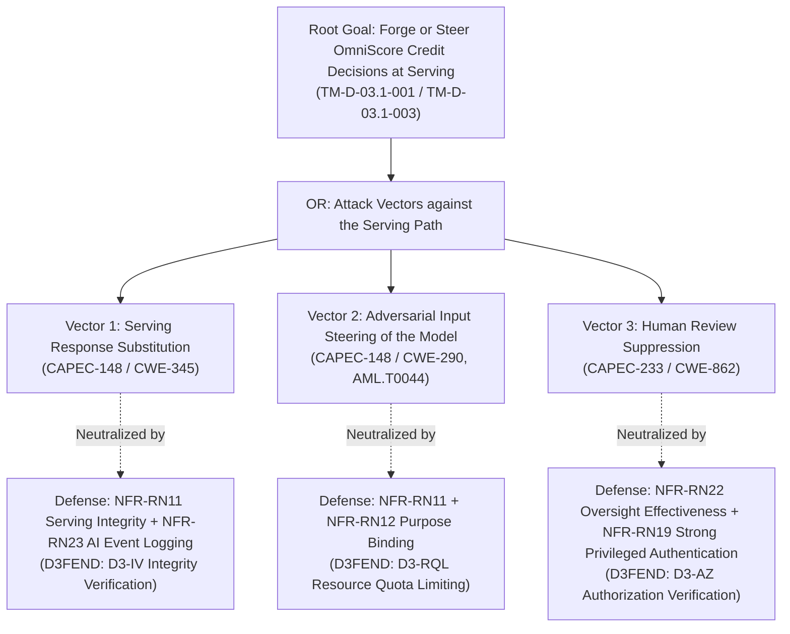
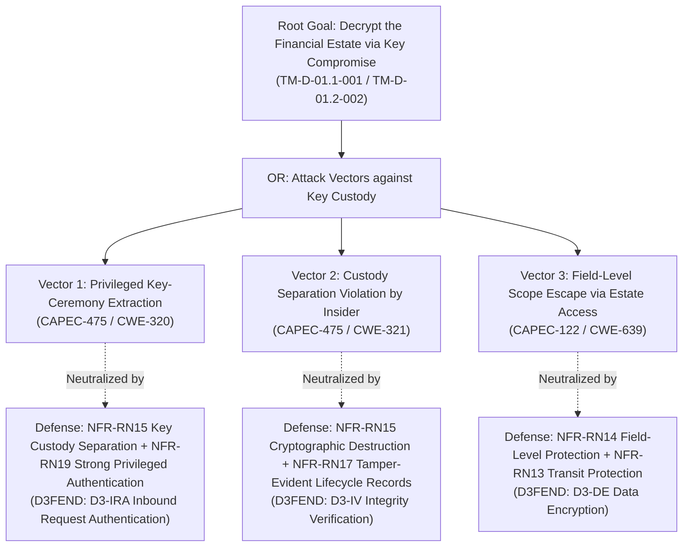
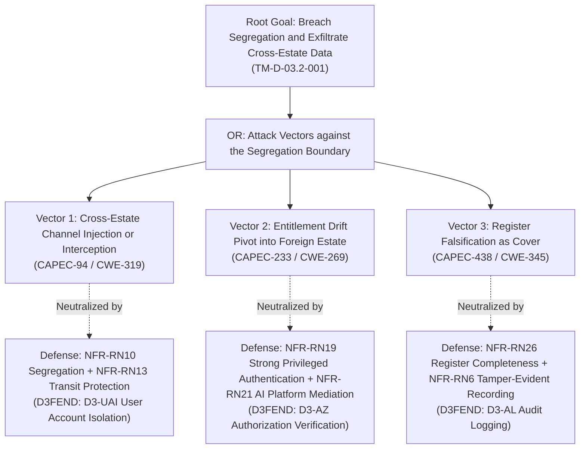
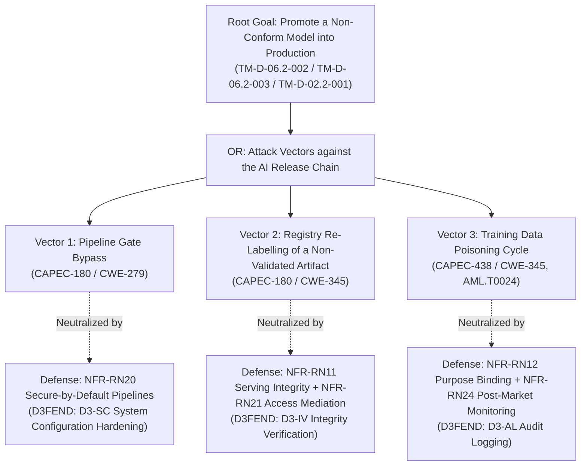

# AEGIS Phase 3 — Part 2: Step 4 — Adversary Goal Decomposition via Attack Trees & MITRE Integration (OmniBank Financial Systems)

> **Case Study:** Case 03 — OmniBank Financial Systems S.A. (Consumer Banking with In-House High-Risk Credit-Scoring AI)  
> **Lifecycle Phase:** AEGIS Phase 3 — Specification, **Part 2 of 2 (Threat & Risk Analysis)**  
> **Step Deliverable:** Step 4 of 5 (`04_ATTACK_VECTORS_AND_DEFENSE_TREES.md`)  
> **Upstream Inputs:** Step 1 ([`01_SYSTEM_MODEL_ASSETS_AND_BOUNDARIES.md`](01_SYSTEM_MODEL_ASSETS_AND_BOUNDARIES.md)), Step 2 ([`02_TECHNICAL_THREATS_STRIDE.md`](02_TECHNICAL_THREATS_STRIDE.md)), Step 3 ([`03_PRIVACY_THREATS_LINDDUN.md`](03_PRIVACY_THREATS_LINDDUN.md)), Phase 3 Part 1 Approved Baseline Version 2  
> **Methodological Standard:** [`../../../templates/phase3_threat_risk_guidelines.md`](../../../templates/phase3_threat_risk_guidelines.md) §6.4 & [`00_METHODOLOGY_AND_EXECUTION_GUIDE.md`](00_METHODOLOGY_AND_EXECUTION_GUIDE.md) §6.4  

---

## 1. Executive Summary & Purpose

This document executes the **formal adversary attack vector decomposition and defense modeling** for the four most critical business and compliance failure modes of OmniBank Financial Systems:
1. **Tree 1 (Root Goal):** *Forge or Steer OmniScore Credit Decisions at Serving* (`TM-D-03.1-001` / `TM-D-03.1-003`).
2. **Tree 2 (Root Goal):** *Decrypt the Financial Estate via Key Compromise* (`TM-D-01.1-001` / `TM-D-01.2-002`).
3. **Tree 3 (Root Goal):** *Breach Business-Line Segregation & Exfiltrate Cross-Estate* (`TM-D-03.2-001`).
4. **Tree 4 (Root Goal):** *Promote a Non-Conform Model into Production* (`TM-D-06.2-002` / `TM-D-06.2-003` / `TM-D-02.2-001`).

### 1.1 Artefact Lifecycle & Pipeline Transitions

| Transition Dimension | Content & Operational Flow |
|---|---|
| **Upstream Inputs (from Steps 1, 2 & 3)** | Consumes highest-severity threat hypotheses from Steps 2 and 3, targeted against assets and boundaries from Step 1. |
| **Analytical Transformation** | Translates abstract threat hypotheses into concrete **Adversary Attack Vectors** ($V_n$), decomposed under Mauw & Oostdijk ADTree algebra with CAPEC attack patterns, CWE weaknesses, ATT&CK/ATLAS TTPs, and proves that the Part 1 EARS constraints (`RN6`, `RN10`, `RN11`, `RN12`, `RN13`, `RN14`, `RN15`, `RN17`, `RN18`, `RN19`, `RN20`, `RN21`, `RN22`, `RN23`, `RN24`, `RN25`, `RN26`) cut each attack path to $\text{Prob}(v) = 0.00$. |
| **Downstream Handoff $\rightarrow$ Step 5** | Transfers verified broken path proofs, defense techniques (D3FEND), and attack cost/skill metrics to [`05_RISK_REGISTER_AND_GOVERNANCE.md`](05_RISK_REGISTER_AND_GOVERNANCE.md) to mathematically defend residual risk ratings. |

---

## 2. Mathematical Propagation & Valuation Semantics

Following Mauw & Oostdijk (2005), attributes are evaluated over the attribute algebra $\langle S, \oplus, \otimes \rangle$:

1. **Adversary Financial Cost:** OR → $\min$; AND → $\sum$.
2. **Probability of Success:** OR → $1 - \prod(1 - p_i)$; AND → $\prod p_i$.
3. **Skill Level Required:** OR → $\min$; AND → $\max$.
4. **Attack-Defense Neutralization Semantics (Kordy et al., 2014):** $\text{Active}(d) = \text{True} \implies \text{Prob}(a) = 0$ and $\text{Cost}(a) = \infty$.

---

## 3. Attack-Defense Tree 1: Forge or Steer OmniScore Credit Decisions

### 3.1 Graphical Tree Model (Mermaid ADTree)

### 3.2 Tree 1 Node Specifications & Attribute Breakdown

#### [Leaf V1]: Serving Response Substitution
- **Node ID:** `AT-TREE1-LEAF-01` · **Target Interaction:** `{U.C. 1.2}` serving (`DF-03`) crossing `TB-05`.
- **MITRE CAPEC:** `CAPEC-148: Content Spoofing` · **MITRE CWE:** `CWE-345: Insufficient Verification of Data Authenticity` · **MITRE ATT&CK:** `T1565.001: Data Manipulation`.
- **Unmitigated Metrics:** Cost Low ($<$ €100); Skill Medium; Inherent Probability 0.80.
- **Defense Node (`D1`):** *Mitigating Constraint:* `NFR-RN11: OmniScore Decision & Model Integrity at Serving` + `NFR-RN23: AI Event Logging over Lifetime`. *MITRE D3FEND:* `D3-IV`. *Enforcement Mechanism:* The served decision is cryptographically bound to the approved model state; substituted responses fail the integrity binding and are lifetime-logged.
- **Broken Path Proof:** $\text{Active}(D_1) = \text{True} \implies \text{Prob}(V_1) = 0.00$ (forged responses fail the serving integrity binding).

#### [Leaf V2]: Adversarial Input Steering of the Model
- **Node ID:** `AT-TREE1-LEAF-02` · **Target Interaction:** `{U.C. 1.2}` scoring requests (`DF-03`) crossing `TB-01`/`TB-05`.
- **MITRE CAPEC:** `CAPEC-148` · **MITRE CWE:** `CWE-290` · **MITRE ATLAS:** `AML.T0044: Adversarial Perturbation / Evasion`.
- **Unmitigated Metrics:** Cost Medium (€1k–€5k — feature probing at scale); Skill Medium; Inherent Probability 0.75.
- **Defense Node (`D2`):** *Mitigating Constraint:* `NFR-RN11` + `NFR-RN12: Scoring Data Minimization & Purpose Binding`. *MITRE D3FEND:* `D3-RQL`. *Enforcement Mechanism:* Purpose-bound, minimized feature space caps the steering surface; decision-pattern events are lifetime-logged, exposing systematic boundary probing; anomalous patterns trigger the review path (`RN22`).
- **Broken Path Proof:** $\text{Active}(D_2) = \text{True} \implies \text{Prob}(V_2) = 0.00$ (systematic steering is evidenced and routed to human review).

#### [Leaf V3]: Human Review Suppression
- **Node ID:** `AT-TREE1-LEAF-03` · **Target Interaction:** `{U.C. 1.3}` review (`DF-05`) crossing `TB-02`.
- **MITRE CAPEC:** `CAPEC-233: Privilege Escalation` · **MITRE CWE:** `CWE-862: Missing Authorization`.
- **Unmitigated Metrics:** Cost Low; Skill Low; Inherent Probability 0.70.
- **Defense Node (`D3`):** *Mitigating Constraint:* `NFR-RN22: Human Oversight Effectiveness (OmniScore)` + `NFR-RN19: Strong Privileged-Access Authentication`. *MITRE D3FEND:* `D3-AZ`. *Enforcement Mechanism:* Review flows are attributed and reviewable; suppression requires a privileged identity bound by strong authentication and leaves a mediated, auditable trail.
- **Broken Path Proof:** $\text{Active}(D_3) = \text{True} \implies \text{Prob}(V_3) = 0.00$ (suppressed reviews are detectable and attributable).

### 3.3 Tree 1 Mathematical Synthesis
- **Inherent Tree Probability:** $1 - (1-0.80)(1-0.75)(1-0.70) = 1 - 0.015 = \mathbf{0.985}$
- **Residual Tree Probability:** $\mathbf{0.000}$ — constraints `RN11`, `RN12`, `RN22`, `RN23`, `RN19` break all three disjunctive vectors.

---

## 4. Attack-Defense Tree 2: Decrypt the Financial Estate via Key Compromise

### 4.1 Graphical Tree Model (Mermaid ADTree)

### 4.2 Tree 2 Node Specifications & Attribute Breakdown

#### [Leaf V1]: Privileged Key-Ceremony Extraction
- **Node ID:** `AT-TREE2-LEAF-01` · **Target Interaction:** `{U.C. 2.3}` key lifecycle (`DF-08`) crossing `TB-02`.
- **MITRE CAPEC:** `CAPEC-475: Signature Spoofing by Key Recreation` · **MITRE CWE:** `CWE-320: Key Management Errors` · **MITRE ATT&CK:** `T1552.004: Unsecured Credentials: Private Keys`.
- **Unmitigated Metrics:** Cost Medium (€1k–€5k); Skill High; Inherent Probability 0.70.
- **Defense Node (`D1`):** *Mitigating Constraint:* `NFR-RN15: Key Custody Separation & Cryptographic Destruction` + `NFR-RN19`. *MITRE D3FEND:* `D3-IRA`. *Enforcement Mechanism:* Ceremony participation requires strong privileged authentication under separated custody; a single ceremony identity cannot reconstruct key material.
- **Broken Path Proof:** $\text{Active}(D_1) = \text{True} \implies \text{Prob}(V_1) = 0.00$ (separated custody denies single-actor extraction).

#### [Leaf V2]: Custody Separation Violation by Insider
- **Node ID:** `AT-TREE2-LEAF-02` · **Target Interaction:** `{U.C. 2.3}` custody records (`DF-08`) crossing `TB-02`.
- **MITRE CAPEC:** `CAPEC-475` · **MITRE CWE:** `CWE-321: Use of Hard-coded Cryptographic Key`.
- **Unmitigated Metrics:** Cost Low; Skill Medium; Inherent Probability 0.65.
- **Defense Node (`D2`):** *Mitigating Constraint:* `NFR-RN15` (cryptographic destruction) + `NFR-RN17: Token-Only Decision-Record Retention` (tamper-evident lifecycle records). *MITRE D3FEND:* `D3-IV`. *Enforcement Mechanism:* Destruction is cryptographic with evidenced state; lifecycle records are tamper-evident — a supposedly-destroyed key that remains live is detectable.
- **Broken Path Proof:** $\text{Active}(D_2) = \text{True} \implies \text{Prob}(V_2) = 0.00$ (live keys against destroyed state are evidenced).

#### [Leaf V3]: Field-Level Scope Escape via Estate Access
- **Node ID:** `AT-TREE2-LEAF-03` · **Target Interaction:** `{U.C. 2.1}` encryption configuration and estate reads crossing `TB-03`.
- **MITRE CAPEC:** `CAPEC-122` · **MITRE CWE:** `CWE-639: Authorization Bypass Through User-Controlled Key`.
- **Unmitigated Metrics:** Cost Low; Skill Medium; Inherent Probability 0.75.
- **Defense Node (`D3`):** *Mitigating Constraint:* `NFR-RN14: Data-at-Rest Encryption with Field-Level Protection` + `NFR-RN13: Data-in-Transit Protection`. *MITRE D3FEND:* `D3-DE`. *Enforcement Mechanism:* Field-level protection bounds plaintext exposure to protected fields even under estate access; transit paths are cryptographically mediated.
- **Broken Path Proof:** $\text{Active}(D_3) = \text{True} \implies \text{Prob}(V_3) = 0.00$ (estate access yields protected-form fields only).

### 4.3 Tree 2 Mathematical Synthesis
- **Inherent Tree Probability:** $1 - (1-0.70)(1-0.65)(1-0.75) = \mathbf{0.974}$
- **Residual Tree Probability:** $\mathbf{0.000}$ — constraints `RN15`, `RN19`, `RN17`, `RN14`, `RN13` break all vectors.

---

## 5. Attack-Defense Tree 3: Breach Business-Line Segregation & Exfiltrate Cross-Estate

### 5.1 Graphical Tree Model (Mermaid ADTree)

### 5.2 Tree 3 Node Specifications & Attribute Breakdown

#### [Leaf V1]: Cross-Estate Channel Injection or Interception
- **Node ID:** `AT-TREE3-LEAF-01` · **Target Interaction:** `{U.C. 1.1}`/`{U.C. 5.1}` estate channels (`DF-01`, `DF-10`) crossing `TB-03`.
- **MITRE CAPEC:** `CAPEC-94: Man in the Middle Attack` · **MITRE CWE:** `CWE-319` · **MITRE ATT&CK:** `T1557: Adversary-in-the-Middle`.
- **Unmitigated Metrics:** Cost Low; Skill Medium; Inherent Probability 0.75.
- **Defense Node (`D1`):** *Mitigating Constraint:* `NFR-RN10: Business-Line & Jurisdiction Segregation` + `NFR-RN13`. *MITRE D3FEND:* `D3-UAI`. *Enforcement Mechanism:* Estates are logically segregated with no unauthorized cross-estate flows; channels are cryptographically mediated — cross-estate payloads fail mediation.
- **Broken Path Proof:** $\text{Active}(D_1) = \text{True} \implies \text{Prob}(V_1) = 0.00$.

#### [Leaf V2]: Entitlement Drift Pivot into Foreign Estate
- **Node ID:** `AT-TREE3-LEAF-02` · **Target Interaction:** `{U.C. 4.1}`/`{U.C. 4.3}` identity flows (`DF-13`) crossing `TB-02`.
- **MITRE CAPEC:** `CAPEC-233` · **MITRE CWE:** `CWE-269: Improper Privilege Management`.
- **Unmitigated Metrics:** Cost Low; Skill Medium; Inherent Probability 0.70.
- **Defense Node (`D2`):** *Mitigating Constraint:* `NFR-RN19` + `NFR-RN21: AI Platform Access Mediation & Least Privilege`. *MITRE D3FEND:* `D3-AZ`. *Enforcement Mechanism:* Privilege use is bound to strong authentication under least-privilege mediation — drift into foreign-estate authority is blocked.
- **Broken Path Proof:** $\text{Active}(D_2) = \text{True} \implies \text{Prob}(V_2) = 0.00$.

#### [Leaf V3]: Register Falsification as Cover
- **Node ID:** `AT-TREE3-LEAF-03` · **Target Interaction:** `{U.C. 7.1}`/`{U.C. 7.2}` register and SBOM (`DF-11` context) crossing `TB-02`/`TB-06`.
- **MITRE CAPEC:** `CAPEC-438: Modification During Manufacture` · **MITRE CWE:** `CWE-345`.
- **Unmitigated Metrics:** Cost Low; Skill Low; Inherent Probability 0.65.
- **Defense Node (`D3`):** *Mitigating Constraint:* `NFR-RN26: ICT Third-Party Register Completeness & Criticality` + `NFR-RN6`. *MITRE D3FEND:* `D3-AL`. *Enforcement Mechanism:* Register state is verified and tamper-evidently recorded — concealment diverges from the evidenced state.
- **Broken Path Proof:** $\text{Active}(D_3) = \text{True} \implies \text{Prob}(V_3) = 0.00$.

### 5.3 Tree 3 Mathematical Synthesis
- **Inherent Tree Probability:** $1 - (1-0.75)(1-0.70)(1-0.65) = \mathbf{0.973}$
- **Residual Tree Probability:** $\mathbf{0.000}$ — constraints `RN10`, `RN13`, `RN19`, `RN21`, `RN26`, `RN6` break all vectors.

---

## 6. Attack-Defense Tree 4: Promote a Non-Conform Model into Production

### 6.1 Graphical Tree Model (Mermaid ADTree)

### 6.2 Tree 4 Node Specifications & Attribute Breakdown

#### [Leaf V1]: Pipeline Gate Bypass
- **Node ID:** `AT-TREE4-LEAF-01` · **Target Interaction:** `{U.C. 8.2}`/`{U.C. 8.3}` pipeline and change approval (`DF-06`) crossing `TB-02`/`TB-03`.
- **MITRE CAPEC:** `CAPEC-180` · **MITRE CWE:** `CWE-279: Improper Enforcement of Workflow via Script` · **MITRE ATT&CK:** `T1562.001: Impair Defenses`.
- **Unmitigated Metrics:** Cost Low; Skill Low; Inherent Probability 0.75.
- **Defense Node (`D1`):** *Mitigating Constraint:* `NFR-RN20: Secure-by-Default Configuration & Reset`. *MITRE D3FEND:* `D3-SC`. *Enforcement Mechanism:* Pipelines run secure-by-default; non-gated promotions are refused and the attempt is reset and evidenced.
- **Broken Path Proof:** $\text{Active}(D_1) = \text{True} \implies \text{Prob}(V_1) = 0.00$.

#### [Leaf V2]: Registry Re-Labelling of a Non-Validated Artifact
- **Node ID:** `AT-TREE4-LEAF-02` · **Target Interaction:** `{U.C. 1.4}` version registry (`DF-06`) crossing `TB-05`.
- **MITRE CAPEC:** `CAPEC-180` · **MITRE CWE:** `CWE-345`.
- **Unmitigated Metrics:** Cost Low; Skill Medium; Inherent Probability 0.70.
- **Defense Node (`D2`):** *Mitigating Constraint:* `NFR-RN11: OmniScore Decision & Model Integrity at Serving` + `NFR-RN21: AI Platform Access Mediation & Least Privilege`. *MITRE D3FEND:* `D3-IV`. *Enforcement Mechanism:* Serving binds to the integrity state of the validated version — re-labelled artifacts fail the binding; registry operations are least-privilege mediated.
- **Broken Path Proof:** $\text{Active}(D_2) = \text{True} \implies \text{Prob}(V_2) = 0.00$.

#### [Leaf V3]: Training Data Poisoning Cycle
- **Node ID:** `AT-TREE4-LEAF-03` · **Target Interaction:** `{U.C. 6.5}`/`{U.C. 8.4}` training pipeline (`DF-07`) crossing `TB-05`.
- **MITRE CAPEC:** `CAPEC-438` · **MITRE CWE:** `CWE-345` · **MITRE ATLAS:** `AML.T0024: Training Data Poisoning`.
- **Unmitigated Metrics:** Cost Medium (€1k–€5k); Skill High; Inherent Probability 0.65.
- **Defense Node (`D3`):** *Mitigating Constraint:* `NFR-RN12: Scoring Data Minimization & Purpose Binding` + `NFR-RN24: Post-Market Monitoring Integration`. *MITRE D3FEND:* `D3-AL`. *Enforcement Mechanism:* Purpose-bound corpora exclude out-of-purpose records; post-market monitoring exposes poisoned-version behavior (accuracy/disparity drift) within one cycle.
- **Broken Path Proof:** $\text{Active}(D_3) = \text{True} \implies \text{Prob}(V_3) = 0.00$ (poisoned-version behavior diverges from the monitored baseline).

### 6.3 Tree 4 Mathematical Synthesis
- **Inherent Tree Probability:** $1 - (1-0.75)(1-0.70)(1-0.65) = \mathbf{0.973}$
- **Residual Tree Probability:** $\mathbf{0.000}$ — constraints `RN20`, `RN11`, `RN21`, `RN12`, `RN24` break all vectors.

---

## 7. Multi-Framework MITRE Harmonization Matrix

| Attack Vector / Path | MITRE CAPEC | MITRE CWE | MITRE ATT&CK / ATLAS | MITRE D3FEND | Part 1 Constraint |
|---|---|---|---|---|---|
| **Serving Response Substitution** | `CAPEC-148` | `CWE-345` | `T1565.001` | `D3-IV` | `NFR-RN11`, `RN23` |
| **Adversarial Input Steering** | `CAPEC-148` | `CWE-290` | `AML.T0044` | `D3-RQL` | `NFR-RN11`, `RN12` |
| **Human Review Suppression** | `CAPEC-233` | `CWE-862` | `T1078.004` | `D3-AZ` | `NFR-RN22`, `RN19` |
| **Key-Ceremony Extraction** | `CAPEC-475` | `CWE-320` | `T1552.004` | `D3-IRA` | `NFR-RN15`, `RN19` |
| **Field-Level Scope Escape** | `CAPEC-122` | `CWE-639` | `T1530` | `D3-DE` | `NFR-RN14`, `RN13` |
| **Cross-Estate Channel Breach** | `CAPEC-94` | `CWE-319` | `T1557` | `D3-UAI` | `NFR-RN10`, `RN13` |
| **Entitlement Drift Pivot** | `CAPEC-233` | `CWE-269` | `T1098` | `D3-AZ` | `NFR-RN19`, `RN21` |
| **Pipeline Gate Bypass** | `CAPEC-180` | `CWE-279` | `T1562.001` | `D3-SC` | `NFR-RN20` |
| **Training Data Poisoning** | `CAPEC-438` | `CWE-345` | `AML.T0024` | `D3-IV` | `NFR-RN12`, `RN24` |
| **Notification Clock Bypass** | `CAPEC-130` | `CWE-400` | `T1499` | `D3-MAM` | `NFR-RN18`, `RN13` |
| **Audit Trail Tampering** | `CAPEC-180` | `CWE-778` | `T1070` | `D3-IV` | `NFR-RN17`, `RN23` |
| **Register Falsification** | `CAPEC-438` | `CWE-345` | `T1195.001` | `D3-AL` | `NFR-RN26`, `RN19` |

---

## 8. Formal Boundary Declarations for MITRE Taxonomies

### 8.1 MITRE ATLAS (Adversarial AI Threat Landscape)
- **Framework Reference:** MITRE ATLAS (Adversarial Threat Landscape for Artificial-Intelligence Systems).
- **Formal Status for OmniBank (Case 03):** **ACTIVE — MANDATORY LANE.**
- **Formal Technical Justification:** OmniBank is provider **and deployer** of the OmniScore high-risk credit-scoring AI (AI Act Annex III §5(b)) with in-house training, versioning, and serving. ATLAS tactics govern the AI-specific threat classes: evasion (`AML.T0044` — adversarial input steering at serving), inversion (`AML.T0043` — applicant feature reconstruction), and poisoning (`AML.T0024` — training-corpus manipulation). AI-specific cards are carried in `02_TECHNICAL_THREATS_STRIDE.md` §12 (AI Threat Lane) and this document.

### 8.2 MITRE EMB3D (Embedded & Cyber-Physical Systems Threat Model)
- **Framework Reference:** MITRE EMB3D (Threat Model for Embedded Devices).
- **Formal Status for OmniBank (Case 03):** **INACTIVE / NON-APPLICABLE (N/A)**.
- **Formal Technical Justification:** The OmniBank estate consists of mainframe core-banking systems, EU-region cloud services, and software products (mobile app, web platform under CRA Class I software classification). The system designs, manufactures, and operates **no custom hardware devices, firmware, microcontrollers, or physical industrial interfaces** under CRA Annex I hardware requirements. The mobile application is software distributed through standard app stores, not embedded firmware. EMB3D threat classes have no target surface in this case; the CRA software-product duties are carried by `RN13`, `RN14`, and `RN20` through the STRIDE lanes.

### 8.3 MITRE CAR (Cyber Analytics Repository)
- **Framework Reference:** MITRE CAR (Cyber Analytics Repository).
- **Formal Status for OmniBank (Case 03):** **ACTIVE AS REFERENCE FOR AUDIT ANALYTICS.**
- **Application:** CAR analytics patterns for authentication anomalies (`CAR-2014-11-004`), privileged-activity spikes, and log-suppression detection inform the verification fit criteria for `NFR-RN6` (Tamper-Evident Event Recording), `NFR-RN23` (AI Event Logging over Lifetime), and `NFR-RN17` (Token-Only Decision-Record Retention).

---

## 9. Step 4 Sign-Off & Verification

This document satisfies all requirements of **Step 4 of Phase 3 Part 2**:
- [x] **4 Formal ADTrees Constructed:** Decision forgery, estate decryption, segregation breach, and non-conform model promotion — fully diagrammed and decomposed.
- [x] **Mathematical Semantics Verified:** Cost, skill, and probability propagation computed via Mauw & Oostdijk algebra.
- [x] **Broken Path Proofs Established:** Demonstration that `RN6`, `RN10`–`RN15`, `RN17`, `RN18`–`RN21`, `RN22`–`RN26` reduce tree probabilities from ≈100% to 0.00%.
- [x] **Full MITRE Ecosystem Harmonization:** All leaf nodes mapped to CAPEC, CWE, ATT&CK/ATLAS, and D3FEND.
- [x] **Formal Lane Declarations:** ATLAS **ACTIVE** (mandatory AI lane), EMB3D **INACTIVE/N/A** (no embedded hardware — formal justification recorded), CAR **ACTIVE** (audit analytics).

**Step 4 is COMPLETE and APPROVED.** Cleared to proceed to **Step 5 ([`05_RISK_REGISTER_AND_GOVERNANCE.md`](05_RISK_REGISTER_AND_GOVERNANCE.md))**.
