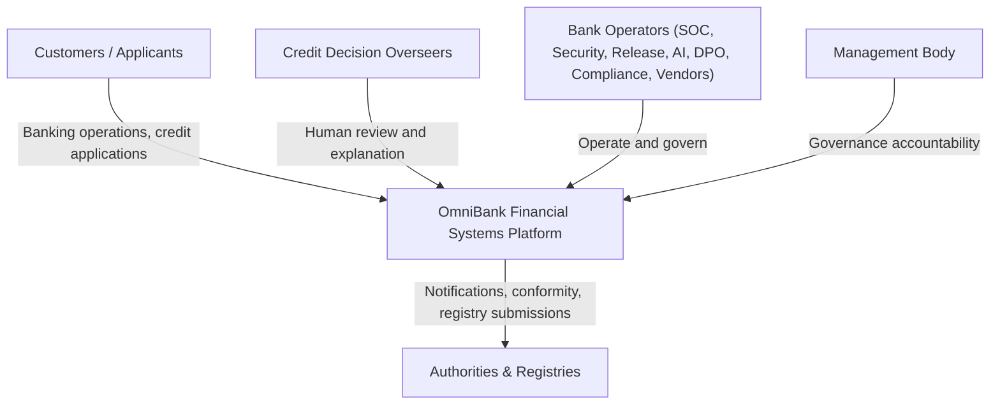

# E1.2 – OmniBank Financial Systems: System Use Cases

## Executive Summary

This document specifies the **System Use Case model** for the OmniBank Financial Systems platform: 43 Level-1 (Sea-Level) use cases across 11 functional areas, elaborated to the fully-dressed Cockburn anatomy with the security & privacy behavior accepted in the Round-1 risk-acceptance synthesis (`RN11`–`RN26` + 92 chain bindings). It is the E1.2 companion of `Doc01_Requirements_Elicitation_and_PUC.md` (2.0.0), maintaining strict 1:1 traceability between requirements, Product Use Cases, and System Use Cases, technology-neutral throughout.

---

## 1. Introduction

The OmniBank platform serves retail customers through mobile and web channels, produces automated credit decisions with the OmniScore AI platform under effective human oversight, and operates the banking-grade security, resilience, and governance functions required of a five-regulation essential financial entity (GDPR, CRA, NIS 2, DORA, AI Act).

## 2. System Requirements Approach & Literature Foundations

### 2.1 The Volere Triangular Decomposition

Business events drive Product Use Cases (Doc01 §3), realized here as System Use Cases; the triangular decomposition connects business events → product use cases → system use cases with the requirement cards as the central vertex.

### 2.2 Use Case Architecture & Anatomy (Cockburn, Larman, Wiegers)

Each use case is specified at Cockburn’s Sea Level (User Goal, Level 1) in the fully-dressed format: traceability, primary & supporting actors, stakeholders, preconditions, trigger, main success scenario (black-box actor–system exchanges), extensions, and success/minimal guarantees.

### 2.3 Refinement Boundary

Refinement stops strictly at Level 1 (`{U.C. n.m}`); zero leaf nodes, zero micro-UI procedural scripts. Security behavior appears as preconditions, extensions, and guarantees — never as threat models (formal threat analysis is Phase 3 Part 2, ADR-006).

## 3. Requirements Analysis

### 3.1 Work Context Model

### 3.2 Traceability Matrix: Requirements to System Use Cases

*Table 1. Traceability Matrix — 43 requirements ↔ 43 PUCs ↔ 43 System Use Cases*

| Req (Doc01) | PUC | System Use Case | Title | Priority | Bound NFR-Security & Privacy |
|---|---|---|---|---|---|
| **R1.1** | **PUC 1.1** | **{U.C. 1.1}** | operate customer banking channels | MUST | NFR-RN10, NFR-RN13, NFR-RN19, NFR-RN22 |
| **R1.2** | **PUC 1.2** | **{U.C. 1.2}** | process credit applications through automated scoring | MUST | NFR-RN11, NFR-RN12, NFR-RN13, NFR-RN23, NFR-RN6 |
| **R1.3** | **PUC 1.3** | **{U.C. 1.3}** | provide human review and explanation of credit decisions | MUST | NFR-RN13, NFR-RN21, NFR-RN22, NFR-RN23, NFR-RN24 |
| **R1.4** | **PUC 1.4** | **{U.C. 1.4}** | maintain AI model releases and versions | MUST | NFR-RN11, NFR-RN21 |
| **R2.1** | **PUC 2.1** | **{U.C. 2.1}** | configure data-at-rest encryption | MUST | NFR-RN14, NFR-RN15, NFR-RN19 |
| **R2.2** | **PUC 2.2** | **{U.C. 2.2}** | protect data in transit | MUST | NFR-RN13, NFR-RN19 |
| **R2.3** | **PUC 2.3** | **{U.C. 2.3}** | manage cryptographic key lifecycle and custody | MUST | NFR-RN15, NFR-RN17, NFR-RN19 |
| **R3.1** | **PUC 3.1** | **{U.C. 3.1}** | identify and assess vulnerabilities | MUST | NFR-RN18 |
| **R3.2** | **PUC 3.2** | **{U.C. 3.2}** | remediate vulnerabilities through security updates | MUST | — |
| **R3.3** | **PUC 3.3** | **{U.C. 3.3}** | operate coordinated vulnerability disclosure | SHOULD | — |
| **R3.4** | **PUC 3.4** | **{U.C. 3.4}** | execute security and threat-led testing | MUST | — |
| **R4.1** | **PUC 4.1** | **{U.C. 4.1}** | manage identity lifecycle | MUST | NFR-RN19, NFR-RN21 |
| **R4.2** | **PUC 4.2** | **{U.C. 4.2}** | enforce multi-factor authentication for privileged access | MUST | NFR-RN19 |
| **R4.3** | **PUC 4.3** | **{U.C. 4.3}** | review and reconcile access rights | MUST | — |
| **R4.4** | **PUC 4.4** | **{U.C. 4.4}** | maintain hardened secure configurations | MUST | NFR-RN19, NFR-RN20 |
| **R5.1** | **PUC 5.1** | **{U.C. 5.1}** | monitor and correlate security events | MUST | NFR-RN13 |
| **R5.2** | **PUC 5.2** | **{U.C. 5.2}** | triage incidents and execute unified regulatory notification | MUST | NFR-RN13, NFR-RN18, NFR-RN19 |
| **R5.3** | **PUC 5.3** | **{U.C. 5.3}** | maintain backups and execute disaster recovery | MUST | NFR-RN4 |
| **R5.4** | **PUC 5.4** | **{U.C. 5.4}** | investigate and recover AI system after failure | MUST | NFR-RN11, NFR-RN21, NFR-RN24 |
| **R6.1** | **PUC 6.1** | **{U.C. 6.1}** | minimize data collection | MUST | — |
| **R6.2** | **PUC 6.2** | **{U.C. 6.2}** | enforce tiered retention schedules | MUST | NFR-RN17 |
| **R6.3** | **PUC 6.3** | **{U.C. 6.3}** | process data-subject requests | MUST | NFR-RN15, NFR-RN16, NFR-RN17 |
| **R6.4** | **PUC 6.4** | **{U.C. 6.4}** | deliver data exports and portability | MUST | NFR-RN16 |
| **R6.5** | **PUC 6.5** | **{U.C. 6.5}** | manage AI training-data lifecycle | MUST | NFR-RN12, NFR-RN21, NFR-RN24 |
| **R7.1** | **PUC 7.1** | **{U.C. 7.1}** | assess ICT third-party providers and maintain the register | MUST | NFR-RN19, NFR-RN26 |
| **R7.2** | **PUC 7.2** | **{U.C. 7.2}** | maintain software bills of materials | MUST | — |
| **R7.3** | **PUC 7.3** | **{U.C. 7.3}** | enforce contractual security terms | MUST | — |
| **R7.4** | **PUC 7.4** | **{U.C. 7.4}** | manage provider and vendor exit | SHOULD | — |
| **R8.1** | **PUC 8.1** | **{U.C. 8.1}** | apply secure development standards | MUST | NFR-RN19 |
| **R8.2** | **PUC 8.2** | **{U.C. 8.2}** | secure the release pipeline | MUST | NFR-RN20 |
| **R8.3** | **PUC 8.3** | **{U.C. 8.3}** | approve production changes | MUST | — |
| **R8.4** | **PUC 8.4** | **{U.C. 8.4}** | secure the AI training and serving pipeline | MUST | NFR-RN11, NFR-RN21 |
| **R9.1** | **PUC 9.1** | **{U.C. 9.1}** | deliver security and privacy awareness training | MUST | — |
| **R9.2** | **PUC 9.2** | **{U.C. 9.2}** | maintain role-specific competence programs | MUST | NFR-RN22 |
| **R9.3** | **PUC 9.3** | **{U.C. 9.3}** | deliver board and oversight-body security training | MUST | — |
| **R10.1** | **PUC 10.1** | **{U.C. 10.1}** | maintain the unified management system | MUST | — |
| **R10.2** | **PUC 10.2** | **{U.C. 10.2}** | execute unified risk and impact assessments | MUST | NFR-RN24 |
| **R10.3** | **PUC 10.3** | **{U.C. 10.3}** | maintain asset and AI documentation inventories | MUST | — |
| **R10.4** | **PUC 10.4** | **{U.C. 10.4}** | generate regulatory compliance reports | MUST | NFR-RN13 |
| **R11.1** | **PUC 11.1** | **{U.C. 11.1}** | operate threat detection capabilities | MUST | — |
| **R11.2** | **PUC 11.2** | **{U.C. 11.2}** | maintain immutable audit logging | MUST | NFR-RN17, NFR-RN23 |
| **R11.3** | **PUC 11.3** | **{U.C. 11.3}** | execute penetration and resilience testing | MUST | — |
| **R11.4** | **PUC 11.4** | **{U.C. 11.4}** | test AI adversarial robustness and explainability | MUST | NFR-RN22, NFR-RN24, NFR-RN25 |

---

## 4. Domain Application Use Cases

### 4.1 System Actors

- **Customer / Applicant:** retail customer; credit applicant; data subject.
- **Credit Decision Overseer:** empowered, trained human reviewer of automated credit decisions (AI Act Art. 14).
- **Bank Operators:** SOC analysts, security engineers, cryptographic officers, release engineers, ML/AI data engineers, AI operations, DPO team, compliance officers, vendor risk managers, identity administrators, internal audit.
- **Management Body:** board with governance accountability (NIS 2 Art. 20; DORA).
- **Authorities & Registries:** supervisory authorities, CSIRT, financial authorities, market-surveillance authorities, AI registry.

### 4.2 System Use Cases Specification

### {U.C. 1} Manage Banking Services and Credit Decisions

#### {U.C. 1.1} Operate customer banking channels
- **Traceability:** Requirement `R1.1` | Product Use Case `PUC 1.1`
- **Primary Actor:** Customer
- **Supporting Actors:** None
- **Scope & Level:** OmniBank Financial Systems Platform | Sea Level (User Goal / Level 1)
- **Stakeholders & Interests:** *Customers:* seamless self-service banking. *Bank:* attributed, auditable channel operations.
- **Preconditions:** Customer authenticated per channel policy (RN19); session protected in transit (RN13).
- **Trigger:** Customer initiates a banking operation (account, payment, card).
- **Main Success Scenario:**
  1. Customer submits the operation through the mobile or web channel.
  2. System validates the operation against account state and limits.
  3. System executes the operation and records it with attribution (RN22-chain audit fabric, R11.2).
  4. System confirms the outcome to the customer.
- **Extensions:**
  - 2a. Validation fails (limit, state): 2a1. System refuses with the reason and records the attempt.
  - 3a. Estate segregation breach attempt detected: 3a1. System blocks the flow, alerts the SOC, and records the event (RN10-chain, R11.1).
- **Success Guarantees:** Operation executed and recorded with attribution; customer informed.
- **Minimal Guarantees:** Failed operations leave no partial state; attempts are recorded (R11.2).

---

#### {U.C. 1.2} Process credit applications through automated scoring
- **Traceability:** Requirement `R1.2` | Product Use Case `PUC 1.2`
- **Primary Actor:** Customer
- **Supporting Actors:** None
- **Scope & Level:** OmniBank Financial Systems Platform | Sea Level (User Goal / Level 1)
- **Stakeholders & Interests:** *Customers:* lawful, explainable credit access. *Provider/deployer:* AI Act conformity for OmniScore.
- **Preconditions:** Application channels protected (RN13); OmniScore model version verified (RN11); scoring field set bound to the declared purposes (RN12).
- **Trigger:** Customer submits a credit application.
- **Main Success Scenario:**
  1. Customer submits the application and the required applicant data.
  2. System collects only the purpose-bound data set for the assessment (RN12).
  3. System produces the OmniScore score and access decision, logging the decision event over the lifetime (RN23) with integrity protection (RN11).
  4. System communicates the outcome with the reasons underlying it (chain: SO-D-09.1-004 transparency).
  5. System records the decision as a token-only entry in tamper-evident storage (chain: R11.2, V0 RN6).
- **Extensions:**
  - 2a. Required data outside the purpose-bound set: 2a1. System proceeds without it and records the gap (RN12).
  - 3a. Model fault or inconsistent state: 3a1. System withholds the automated decision, routes to human review ({U.C. 1.3}), and triggers recovery ({U.C. 5.4}) (RN11).
  - 4a. Applicant contests the decision: 4a1. System routes the case to human review ({U.C. 1.3}).
- **Success Guarantees:** Decision produced, logged, and communicated with reasons; decision record tamper-evident.
- **Minimal Guarantees:** On any model fault the automated decision is withheld, never silently produced (RN11); logs complete (RN23).

---

#### {U.C. 1.3} Provide human review and explanation of credit decisions
- **Traceability:** Requirement `R1.3` | Product Use Case `PUC 1.3`
- **Primary Actor:** Credit Decision Overseer
- **Supporting Actors:** None
- **Scope & Level:** OmniBank Financial Systems Platform | Sea Level (User Goal / Level 1)
- **Stakeholders & Interests:** *Applicants:* human recourse on automated decisions. *Provider/deployer:* AI Act Art. 14 oversight.
- **Preconditions:** Overseer trained and authorized for the decision class (RN22); decision drivers and logs available (RN23, chain: SO-D-09.1-004).
- **Trigger:** A decision is flagged, declined, or contested.
- **Main Success Scenario:**
  1. Overseer opens the case with the decision drivers, applicant data, and logs (RN23, chain: SO-D-09.1-004).
  2. Overseer confirms, corrects, or reverses the automated decision.
  3. System records the review outcome as an attributed, tamper-evident decision (chain: R11.2).
  4. System supports delivery of the explanation to the applicant and propagates the corrected state (RN13).
- **Extensions:**
  - 1a. Overseer not authorized for the class: 1a1. System refuses and records the attempt (RN22, RN21-chain).
  - 2a. Drivers insufficient for a reasoned review: 2a1. System returns the case to the AI governance queue with the gap recorded (RN24).
- **Success Guarantees:** Review recorded non-repudiably; applicant explanation delivered; state consistent.
- **Minimal Guarantees:** No review executes without trained, authorized oversight (RN22); every review leaves an attributed record.

---

#### {U.C. 1.4} Maintain AI model releases and versions
- **Traceability:** Requirement `R1.4` | Product Use Case `PUC 1.4`
- **Primary Actor:** AI Governance Lead
- **Supporting Actors:** None
- **Scope & Level:** OmniBank Financial Systems Platform | Sea Level (User Goal / Level 1)
- **Stakeholders & Interests:** *Bank:* only verified models serve decisions. *Supervisors:* traceable model lifecycle.
- **Preconditions:** Model artefacts integrity-verified in the pipeline (chain: R8.4); access mediated (RN21).
- **Trigger:** A model version is released, promoted, or withdrawn from service.
- **Main Success Scenario:**
  1. Governance Lead registers the model version with its verification metadata.
  2. System governs promotion to the serving estate with the recorded approval (chain: R8.3).
  3. System records the release event and supports retirement of superseded versions.
- **Extensions:**
  - 2a. Verification metadata incomplete: 2a1. System blocks the promotion until completed (RN11).
- **Success Guarantees:** Only verified, approved model versions serve; lifecycle events recorded.
- **Minimal Guarantees:** No unverified model reaches the serving estate (RN11); retirement leaves the audit trail intact.

---

### {U.C. 2} Manage Cryptographic Protection

#### {U.C. 2.1} Configure data-at-rest encryption
- **Traceability:** Requirement `R2.1` | Product Use Case `PUC 2.1`
- **Primary Actor:** Security Engineer
- **Supporting Actors:** None
- **Scope & Level:** OmniBank Financial Systems Platform | Sea Level (User Goal / Level 1)
- **Stakeholders & Interests:** *Customers:* stored data protected. *Bank:* four-regulation at-rest duties.
- **Preconditions:** Key custody operational (RN15); change authorized (RN19).
- **Trigger:** A storage estate is provisioned or reconfigured.
- **Main Success Scenario:**
  1. Engineer applies the at-rest encryption configuration, including field-level protection for the sensitive categories (RN14).
  2. System verifies the estate state against the standard and records the change (chain: R11.2).
- **Extensions:**
  - 1a. Key custody unavailable: 1a1. System aborts the change and prevents unencrypted operation (RN15).
- **Success Guarantees:** Estate encrypted per standard; change recorded.
- **Minimal Guarantees:** No estate operates without the mandated at-rest protection (RN14).

---

#### {U.C. 2.2} Protect data in transit
- **Traceability:** Requirement `R2.2` | Product Use Case `PUC 2.2`
- **Primary Actor:** Security Engineer
- **Supporting Actors:** None
- **Scope & Level:** OmniBank Financial Systems Platform | Sea Level (User Goal / Level 1)
- **Stakeholders & Interests:** *Customers and authorities:* confidential, unaltered flows. *Bank:* transit duties across four regimes.
- **Preconditions:** Channel inventory current; change authorized (RN19).
- **Trigger:** A channel is established or reconfigured.
- **Main Success Scenario:**
  1. Engineer applies the transit protection configuration to the channel (RN13).
  2. System verifies the channel refuses unauthenticated connections and records the state (chain: R11.2).
- **Extensions:**
  - 2a. Channel fails the verification: 2a1. System blocks the channel until compliant (RN13).
- **Success Guarantees:** All boundary flows authenticated, encrypted, integrity-verified.
- **Minimal Guarantees:** No unauthenticated channel serves traffic (RN13).

---

#### {U.C. 2.3} Manage cryptographic key lifecycle and custody
- **Traceability:** Requirement `R2.3` | Product Use Case `PUC 2.3`
- **Primary Actor:** Cryptographic Officer
- **Supporting Actors:** None
- **Scope & Level:** OmniBank Financial Systems Platform | Sea Level (User Goal / Level 1)
- **Stakeholders & Interests:** *Customers:* re-identification impossible without the separated keys. *Bank:* custody duties (four regimes).
- **Preconditions:** Custody roles separated from operational environments (RN15); actions authorized (RN19).
- **Trigger:** A key lifecycle event occurs (generation, rotation, destruction).
- **Main Success Scenario:**
  1. Officer executes the lifecycle event in the custody service.
  2. System enforces role separation between key custody and data operations (RN15).
  3. System records the event with destruction evidence where applicable (RN17-chain erasure path).
- **Extensions:**
  - 2a. Separation check fails: 2a1. System refuses the operation and alerts the CISO (RN15).
- **Success Guarantees:** Keys managed per the cryptographic periods with separation enforced.
- **Minimal Guarantees:** Custody separation is never bypassed (RN15); destruction events evidenced (RN17).

---

### {U.C. 3} Manage Vulnerabilities and Patches

#### {U.C. 3.1} Identify and assess vulnerabilities
- **Traceability:** Requirement `R3.1` | Product Use Case `PUC 3.1`
- **Primary Actor:** Security Engineer
- **Supporting Actors:** None
- **Scope & Level:** OmniBank Financial Systems Platform | Sea Level (User Goal / Level 1)
- **Stakeholders & Interests:** *Market:* no known exploitable vulnerabilities (CRA). *Bank:* NIS 2/DORA handling duties.
- **Preconditions:** SBOM current (chain: R7.2); scanning cadence active.
- **Trigger:** A scan cycle, advisory, or test report arrives.
- **Main Success Scenario:**
  1. System identifies and documents vulnerabilities across the ICT estate, product components, and AI models (chain: SO-D-02.1-002/003/005).
  2. Engineer assesses severity and records the register entry.
  3. Remediation flows to {U.C. 3.2}; disclosures to {U.C. 3.3}.
- **Extensions:**
  - 1a. Actively-exploited vulnerability found: 1a1. System escalates to the notification clock ({U.C. 5.2}, RN18).
- **Success Guarantees:** Register complete with severity assessments.
- **Minimal Guarantees:** Identification artefacts feed remediation, disclosure, and notification cascades.

---

#### {U.C. 3.2} Remediate vulnerabilities through security updates
- **Traceability:** Requirement `R3.2` | Product Use Case `PUC 3.2`
- **Primary Actor:** Security Engineer
- **Supporting Actors:** None
- **Scope & Level:** OmniBank Financial Systems Platform | Sea Level (User Goal / Level 1)
- **Stakeholders & Interests:** *Customers:* patched estate. *Market:* CRA remediation duties.
- **Preconditions:** Vulnerability registered ({U.C. 3.1}); update verified in the pipeline (chain: R8.2).
- **Trigger:** A remediation is due per severity.
- **Main Success Scenario:**
  1. Engineer deploys the security update per severity without delay (chain: SO-D-02.2-002/005).
  2. System records the deployment state across the estate and the AI models.
- **Extensions:**
  - 1a. Deployment fails on a segment: 1a1. System isolates the segment per policy and escalates (chain: R5.1).
- **Success Guarantees:** Estate remediated per severity timelines.
- **Minimal Guarantees:** No vulnerable segment silently remains out of the remediation scope.

---

#### {U.C. 3.3} Operate coordinated vulnerability disclosure
- **Traceability:** Requirement `R3.3` | Product Use Case `PUC 3.3`
- **Primary Actor:** Security Engineer
- **Supporting Actors:** None
- **Scope & Level:** OmniBank Financial Systems Platform | Sea Level (User Goal / Level 1)
- **Stakeholders & Interests:** *Researchers:* reporting channel. *Market:* CRA/NIS 2 disclosure duties.
- **Preconditions:** CVD policy published; contact address identifiable.
- **Trigger:** A vulnerability report arrives.
- **Main Success Scenario:**
  1. System registers the report through the contact address (chain: SO-D-02.3-002/003).
  2. Engineer triages, remediates via {U.C. 3.1}/{U.C. 3.2}, and publishes under the policy with the justified-delay check.
- **Extensions:**
  - 2a. Publication risk outweighs benefit: 2a1. System records the justified delay and re-evaluates on schedule.
- **Success Guarantees:** Reports handled per policy; disclosures complete.
- **Minimal Guarantees:** Disclosure records traceable to the handled vulnerability.

---

#### {U.C. 3.4} Execute security and threat-led testing
- **Traceability:** Requirement `R3.4` | Product Use Case `PUC 3.4`
- **Primary Actor:** Security Engineer
- **Supporting Actors:** None
- **Scope & Level:** OmniBank Financial Systems Platform | Sea Level (User Goal / Level 1)
- **Stakeholders & Interests:** *Market:* CRA testing duties. *Supervisors:* DORA TLPT and NIS 2 evidence.
- **Preconditions:** Testing programme scheduled; environments isolated.
- **Trigger:** A testing cycle is due.
- **Main Success Scenario:**
  1. System executes the security and threat-led testing programmes (chain: SO-D-02.4-002/005).
  2. Findings register with remediation tracking feeding {U.C. 3.1} and the conformity evidence set (chain: R10.3).
- **Extensions:**
  - 1a. Critical finding: 1a1. System escalates per severity to {U.C. 3.2} and, if exploited, {U.C. 5.2}.
- **Success Guarantees:** Testing evidence current and conformity-ready.
- **Minimal Guarantees:** Findings never silently discarded — each is registered and tracked.

---

### {U.C. 4} Manage Identities and Access

#### {U.C. 4.1} Manage identity lifecycle
- **Traceability:** Requirement `R4.1` | Product Use Case `PUC 4.1`
- **Primary Actor:** Identity Administrator
- **Supporting Actors:** None
- **Scope & Level:** OmniBank Financial Systems Platform | Sea Level (User Goal / Level 1)
- **Stakeholders & Interests:** *Bank:* workforce identity discipline (NIS 2/DORA). *AI platform:* least-privilege access (RN21).
- **Preconditions:** Administrator authorized (RN19); employment event recorded.
- **Trigger:** An operator is inducted, changes role, or separates.
- **Main Success Scenario:**
  1. Administrator provisions the identity with role-appropriate entitlements (chain: PO-D-03.1-001, SO-D-03.1-003/005).
  2. On role change, system reviews and adjusts entitlements (RN21 for AI-platform roles).
  3. On separation, system revokes entitlements and sessions and records the revocation (RN21, chain: R11.2).
- **Extensions:**
  - 1a. Provisioning request exceeds the documented role: 1a1. System requires re-authorization or refuses (RN19, RN21).
- **Success Guarantees:** Identity state matches the employment lifecycle; AI-platform access least-privileged.
- **Minimal Guarantees:** No orphaned active entitlements after separation (RN21).

---

#### {U.C. 4.2} Enforce multi-factor authentication for privileged access
- **Traceability:** Requirement `R4.2` | Product Use Case `PUC 4.2`
- **Primary Actor:** Privileged Operator
- **Supporting Actors:** None
- **Scope & Level:** OmniBank Financial Systems Platform | Sea Level (User Goal / Level 1)
- **Stakeholders & Interests:** *Bank:* strong access boundary (NIS 2/DORA/CRA).
- **Preconditions:** Operator identity active ({U.C. 4.1}).
- **Trigger:** A privileged session is established.
- **Main Success Scenario:**
  1. Operator presents credentials per the policy strength (multi-factor).
  2. System verifies the factors and establishes the session with the role context (RN19).
  3. System records the authentication event (chain: R11.2).
- **Extensions:**
  - 1a. Factor failure beyond the policy threshold: 1a1. System refuses and locks per policy, recording the lockout (RN19).
- **Success Guarantees:** Only policy-strength authentication reaches privileged functions.
- **Minimal Guarantees:** Weak modalities are refused; failures recorded (RN19).

---

#### {U.C. 4.3} Review and reconcile access rights
- **Traceability:** Requirement `R4.3` | Product Use Case `PUC 4.3`
- **Primary Actor:** Compliance Officer
- **Supporting Actors:** None
- **Scope & Level:** OmniBank Financial Systems Platform | Sea Level (User Goal / Level 1)
- **Stakeholders & Interests:** *Bank:* least privilege and documented-instruction discipline (GDPR Art. 29/32(4)).
- **Preconditions:** Entitlement catalog current ({U.C. 4.1}).
- **Trigger:** A review cycle is due.
- **Main Success Scenario:**
  1. System presents entitlements against documented authorizations.
  2. Reviewers reconcile and record outcomes; adjustments flow to {U.C. 4.1}.
- **Extensions:**
  - 1a. Entitlement without documented authorization: 1a1. System flags for revocation and records the finding.
- **Success Guarantees:** Entitlements reconciled to authorizations.
- **Minimal Guarantees:** Review outcomes recorded (chain: R11.2).

---

#### {U.C. 4.4} Maintain hardened secure configurations
- **Traceability:** Requirement `R4.4` | Product Use Case `PUC 4.4`
- **Primary Actor:** Security Engineer
- **Supporting Actors:** None
- **Scope & Level:** OmniBank Financial Systems Platform | Sea Level (User Goal / Level 1)
- **Stakeholders & Interests:** *Bank:* secure-by-default duties (CRA/NIS 2/DORA/GDPR Art. 25(2)).
- **Preconditions:** Baseline definitions current; change authorized (RN19).
- **Trigger:** A platform or service is deployed or reconfigured.
- **Main Success Scenario:**
  1. Engineer deploys from the hardened baseline (RN20).
  2. System supports restoring the known secure state and records the configuration (chain: R11.2).
- **Extensions:**
  - 1a. Drift from baseline detected: 1a1. System flags and supports reset to the default state (RN20).
- **Success Guarantees:** Estates deployed from hardened baselines; drift detected and correctable.
- **Minimal Guarantees:** Reset restores exactly the restrictive default (RN20).

---

### {U.C. 5} Detect and Respond to Incidents

#### {U.C. 5.1} Monitor and correlate security events
- **Traceability:** Requirement `R5.1` | Product Use Case `PUC 5.1`
- **Primary Actor:** SOC Analyst
- **Supporting Actors:** None
- **Scope & Level:** OmniBank Financial Systems Platform | Sea Level (User Goal / Level 1)
- **Stakeholders & Interests:** *Bank:* detection duties (CRA/NIS 2/DORA).
- **Preconditions:** Monitoring fabric active; channels protected (RN13).
- **Trigger:** Estate, fleet, or AI-platform events are emitted.
- **Main Success Scenario:**
  1. System collects and correlates events (chain: SO-D-04.1-002/003/005).
  2. Analysts triage signals; incidents flow to {U.C. 5.2}.
- **Extensions:**
  - 1a. Tamper attempt on the event stream: 1a1. System raises a priority alert and preserves evidence (chain: R11.2).
- **Success Guarantees:** Complete, correlated event coverage.
- **Minimal Guarantees:** Event streams tamper-evident (chain: R11.2).

---

#### {U.C. 5.2} Triage incidents and execute unified regulatory notification
- **Traceability:** Requirement `R5.2` | Product Use Case `PUC 5.2`
- **Primary Actor:** SOC Manager
- **Supporting Actors:** DPO; AI Governance Lead; Regulatory Dispatch Service
- **Scope & Level:** OmniBank Financial Systems Platform | Sea Level (User Goal / Level 1)
- **Stakeholders & Interests:** *Authorities:* five notification regimes. *Bank:* one clock-start discipline (T-001).
- **Preconditions:** Incident detected ({U.C. 5.1}); handlers authorized (RN19); dispatch channel protected (RN13).
- **Trigger:** An incident meets a statutory notification criterion.
- **Main Success Scenario:**
  1. System records the awareness/trigger moment — the single clock-start (RN18).
  2. Analysts triage and record containment/mitigation (chain: PO-D-04.1-001).
  3. System routes the dossier to each competent authority per the applicable deadline — GDPR 72 h; NIS 2 24 h/72 h/1 month; DORA initial/intermediate/final; CRA three-tier; AI Act matrix (RN18).
  4. System records the dispatches and receipts (chain: R11.2).
- **Extensions:**
  - 1a. Concurrent regimes apply: 1a1. System generates concurrent notifications from one incident record without re-starting the clock (RN18).
  - 3a. Dispatch channel unavailable: 3a1. System retries per policy and records the delay cause against the clock (RN18).
- **Success Guarantees:** All statutory deadlines met and evidenced from one clock-start.
- **Minimal Guarantees:** The clock-start is never absent for a notifiable incident (RN18).

---

#### {U.C. 5.3} Maintain backups and execute disaster recovery
- **Traceability:** Requirement `R5.3` | Product Use Case `PUC 5.3`
- **Primary Actor:** IT Operations
- **Supporting Actors:** None
- **Scope & Level:** OmniBank Financial Systems Platform | Sea Level (User Goal / Level 1)
- **Stakeholders & Interests:** *Bank:* continuity and restoration duties (GDPR Art. 32(1)(c); NIS 2; DORA).
- **Preconditions:** Continuity plan in force; backups verified.
- **Trigger:** A disruption or recovery exercise occurs.
- **Main Success Scenario:**
  1. Operations executes recovery within the RTO/RPO envelope (V0 RN4; chain: PO-D-04.2-001/PO-D-04.4-001).
  2. System restores availability of essential functions and records the recovery (chains: SO-D-04.2-002/003, SO-D-04.4-002/003/005).
- **Extensions:**
  - 1a. Recovery exceeds the envelope: 1a1. System escalates per crisis procedure and records the breach (chains).
- **Success Guarantees:** Essential functions restored within objectives.
- **Minimal Guarantees:** Recovery actions recorded; availability protections active post-incident (chains).

---

#### {U.C. 5.4} Investigate and recover AI system after failure
- **Traceability:** Requirement `R5.4` | Product Use Case `PUC 5.4`
- **Primary Actor:** AI Operations
- **Supporting Actors:** None
- **Scope & Level:** OmniBank Financial Systems Platform | Sea Level (User Goal / Level 1)
- **Stakeholders & Interests:** *Applicants:* no degraded decisions. *Provider:* AI Act Art. 15 resilience.
- **Preconditions:** Model versions verified ({U.C. 1.4}); access mediated (RN21).
- **Trigger:** An AI anomaly or failure is detected.
- **Main Success Scenario:**
  1. System isolates the affected serving path and keeps decisions withheld or routed to human review ({U.C. 1.3}) (RN11).
  2. Operations investigates the anomaly and restores the last verified model version.
  3. System feeds the findings to the model owners and the risk file (RN24).
- **Extensions:**
  - 2a. Rollback fails: 2a1. System keeps the serving path withheld and escalates (RN11).
- **Success Guarantees:** AI service restored to a verified state; findings recorded.
- **Minimal Guarantees:** No degraded model serves decisions (RN11); findings reach the risk file (RN24).

---

### {U.C. 6} Manage Data Lifecycle and Rights

#### {U.C. 6.1} Minimize data collection
- **Traceability:** Requirement `R6.1` | Product Use Case `PUC 6.1`
- **Primary Actor:** DPO
- **Supporting Actors:** None
- **Scope & Level:** OmniBank Financial Systems Platform | Sea Level (User Goal / Level 1)
- **Stakeholders & Interests:** *Customers:* only necessary data collected (GDPR Art. 5(1)(c); CRA).
- **Preconditions:** Processing register current (chain: R10.3).
- **Trigger:** A collection point is created or changed.
- **Main Success Scenario:**
  1. DPO binds the collected fields to the declared purposes (chain: PO-D-05.1-001/SO-D-05.1-002).
  2. System enforces the bound field set at the collection points.
- **Extensions:**
  - 1a. Field without a declared purpose: 1a1. System blocks the collection and records the finding (chain).
- **Success Guarantees:** Collection limited to purpose-bound fields.
- **Minimal Guarantees:** Unbound collection is blocked, not silently permitted.

---

#### {U.C. 6.2} Enforce tiered retention schedules
- **Traceability:** Requirement `R6.2` | Product Use Case `PUC 6.2`
- **Primary Actor:** Compliance Officer
- **Supporting Actors:** None
- **Scope & Level:** OmniBank Financial Systems Platform | Sea Level (User Goal / Level 1)
- **Stakeholders & Interests:** *Customers:* data not kept longer than necessary. *Bank:* statutory floors.
- **Preconditions:** Retention schedules approved; expiry events scheduled.
- **Trigger:** A retention schedule expires for a record class.
- **Main Success Scenario:**
  1. System executes the purge or de-identification per the schedule (chain: PO-D-05.2-001/SO-D-05.2-005).
  2. System records the execution with evidence (chain: R11.2).
- **Extensions:**
  - 1a. Statutory floor prevents deletion: 1a1. System applies the token-only separation per T-002 and records the legal basis (RN17).
- **Success Guarantees:** Retention enforced on schedule with evidence.
- **Minimal Guarantees:** Floors respected; expired data not silently retained.

---

#### {U.C. 6.3} Process data-subject requests
- **Traceability:** Requirement `R6.3` | Product Use Case `PUC 6.3`
- **Primary Actor:** DPO Team
- **Supporting Actors:** None
- **Scope & Level:** OmniBank Financial Systems Platform | Sea Level (User Goal / Level 1)
- **Stakeholders & Interests:** *Data subjects:* GDPR rights over financial data. *Bank:* Art. 15-22 duties.
- **Preconditions:** Requester identity verified (RN16); case recorded.
- **Trigger:** A data subject submits an access, rectification, or erasure request.
- **Main Success Scenario:**
  1. System verifies the requester identity proportionately and records the verification (RN16).
  2. For erasure: system destroys direct identifiers including the key material, keeping token-only decision records under the statutory floor (RN17, T-002).
  3. For rectification: system executes the correction and the downstream cascade (chain: PO-D-01.4-001).
  4. System records the response against the 30-day clock.
- **Extensions:**
  - 1a. Verification fails: 1a1. System halts execution and records the failed attempt (RN16).
  - 2a. Statutory floor conflicts: 2a1. System applies the token-only separation and records the legal basis (RN17).
- **Success Guarantees:** Rights fulfilled within the statutory window; identifiers destroyed incl. key material.
- **Minimal Guarantees:** No request executes without verification (RN16); erasure never leaves re-identification paths (RN15/RN17).

---

#### {U.C. 6.4} Deliver data exports and portability
- **Traceability:** Requirement `R6.4` | Product Use Case `PUC 6.4`
- **Primary Actor:** DPO Team
- **Supporting Actors:** None
- **Scope & Level:** OmniBank Financial Systems Platform | Sea Level (User Goal / Level 1)
- **Stakeholders & Interests:** *Data subjects:* Art. 20 portability.
- **Preconditions:** Requester verified (RN16).
- **Trigger:** A portability/access export is requested.
- **Main Success Scenario:**
  1. System assembles the structured, machine-readable export of the requester’s data excluding third-party content (chain: PO-D-05.4-001).
  2. System delivers via an authenticated channel and records the delivery.
- **Extensions:**
  - 1a. Export includes third-party content: 1a1. System excludes it and notes the exclusion.
- **Success Guarantees:** Export delivered structured and machine-readable.
- **Minimal Guarantees:** Third-party data never leaks through exports.

---

#### {U.C. 6.5} Manage AI training-data lifecycle
- **Traceability:** Requirement `R6.5` | Product Use Case `PUC 6.5`
- **Primary Actor:** AI Data Engineer
- **Supporting Actors:** None
- **Scope & Level:** OmniBank Financial Systems Platform | Sea Level (User Goal / Level 1)
- **Stakeholders & Interests:** *Applicants:* representative, governed datasets (AI Act Art. 10). *Bank:* model quality.
- **Preconditions:** Dataset lineage recorded; access mediated (RN21).
- **Trigger:** A training, validation, or test dataset is created, changed, or withdrawn from use.
- **Main Success Scenario:**
  1. Engineer governs the dataset across its lifecycle with relevance and representativeness checks (chain: SO-D-05.1-004, RN12).
  2. System versions the dataset and records the governance checks (chain: R10.3).
- **Extensions:**
  - 1a. Representativeness check fails: 1a1. System blocks the training use and files the finding to the risk file (RN24).
- **Success Guarantees:** Datasets governed with recorded checks.
- **Minimal Guarantees:**  Ungoverned datasets never train production models.

---

### {U.C. 7} Manage Vendors and Supply Chain

#### {U.C. 7.1} Assess ICT third-party providers and maintain the register
- **Traceability:** Requirement `R7.1` | Product Use Case `PUC 7.1`
- **Primary Actor:** Vendor Risk Manager
- **Supporting Actors:** None
- **Scope & Level:** OmniBank Financial Systems Platform | Sea Level (User Goal / Level 1)
- **Stakeholders & Interests:** *Supervisors:* DORA register duties. *Bank:* processor/supplier duties (GDPR/NIS 2/CRA).
- **Preconditions:** Assessment methodology current; register roles authorized (RN19).
- **Trigger:** A provider is onboarded, changes, or is reassessed.
- **Main Success Scenario:**
  1. Vendor Risk Manager executes the due-diligence pass producing processor documentation, component records, the NIS 2 three-prong assessment, and the DORA register entry (chain: PO-D-06.1-001/PO-D-06.3-001/SO-D-06.1-002/003/005).
  2. System maintains the register with criticality classification and locations (RN26).
- **Extensions:**
  - 1a. Provider fails the assessment: 1a1. System records the finding and gates the engagement per policy (RN26).
- **Success Guarantees:** Register complete and current; assessments evidenced.
- **Minimal Guarantees:** No critical ICT third-party arrangement without a register entry (RN26).

---

#### {U.C. 7.2} Maintain software bills of materials
- **Traceability:** Requirement `R7.2` | Product Use Case `PUC 7.2`
- **Primary Actor:** Release Engineer
- **Supporting Actors:** None
- **Scope & Level:** OmniBank Financial Systems Platform | Sea Level (User Goal / Level 1)
- **Stakeholders & Interests:** *Market:* CRA SBOM duty. *Bank:* supply-chain visibility.
- **Preconditions:** Component inventory current ({U.C. 8.2}).
- **Trigger:** A release is produced or a component changes.
- **Main Success Scenario:**
  1. System generates/updates the machine-readable SBOM (chain: SO-D-06.2-002).
  2. SBOM feeds {U.C. 3.1} and {U.C. 7.1}.
- **Extensions:**
  - 1a. Provenance incomplete: 1a1. System flags the entry as provisional.
- **Success Guarantees:** SBOM current per release.
- **Minimal Guarantees:** SBOM machine-readable and versioned.

---

#### {U.C. 7.3} Enforce contractual security terms
- **Traceability:** Requirement `R7.3` | Product Use Case `PUC 7.3`
- **Primary Actor:** Procurement
- **Supporting Actors:** None
- **Scope & Level:** OmniBank Financial Systems Platform | Sea Level (User Goal / Level 1)
- **Stakeholders & Interests:** *Bank:* processor/supplier contractual duties (GDPR/NIS 2/CRA/DORA).
- **Preconditions:** Contract inventory current.
- **Trigger:** A contract is signed, changed, or reviewed.
- **Main Success Scenario:**
  1. System records and tracks the security terms including sub-processor chains (chain: PO-D-06.3-001/SO-D-06.3-002/003/005).
- **Extensions:**
  - 1a. Term gap against the regime floor: 1a1. System flags the contract for remediation before renewal.
- **Success Guarantees:** Contract terms tracked against the regime floors.
- **Minimal Guarantees:** Gaps flagged, never silent.

---

#### {U.C. 7.4} Manage provider and vendor exit
- **Traceability:** Requirement `R7.4` | Product Use Case `PUC 7.4`
- **Primary Actor:** Vendor Risk Manager
- **Supporting Actors:** None
- **Scope & Level:** OmniBank Financial Systems Platform | Sea Level (User Goal / Level 1)
- **Stakeholders & Interests:** *Bank:* DORA exit strategies; data protection on exit.
- **Preconditions:** Exit plan defined; access inventory current ({U.C. 4.1}).
- **Trigger:** A provider engagement ends.
- **Main Success Scenario:**
  1. Vendor Risk Manager executes the exit plan — data return or deletion, transition, access revocation.
  2. System records the completion of each exit step (chain: R11.2).
- **Extensions:**
  - 1a. Data return or deletion unverified: 1a1. System blocks the closure until evidenced.
- **Success Guarantees:** Exit completed with evidenced data handling and revocation.
- **Minimal Guarantees:** No access survives an exited engagement.

---

### {U.C. 8} Develop and Release Securely

#### {U.C. 8.1} Apply secure development standards
- **Traceability:** Requirement `R8.1` | Product Use Case `PUC 8.1`
- **Primary Actor:** Development Manager
- **Supporting Actors:** None
- **Scope & Level:** OmniBank Financial Systems Platform | Sea Level (User Goal / Level 1)
- **Stakeholders & Interests:** *Market:* Annex I design duties (CRA). *Bank:* NIS 2 development security; AI Act Art. 15 design leg.
- **Preconditions:** Standards current; reviewers authorized (RN19).
- **Trigger:** A component or model code is designed or changed.
- **Main Success Scenario:**
  1. Teams apply the design review, coding outcomes, and code review standards (chain: PO-D-07.1-001/SO-D-07.1-002/003/004).
  2. System records the review outcomes.
- **Extensions:**
  - 1a. Review finding unresolved: 1a1. Pipeline blocks the promotion (chain: R8.2).
- **Success Guarantees:** Standards enforced with recorded reviews.
- **Minimal Guarantees:** Unreviewed changes never reach the pipeline.

---

#### {U.C. 8.2} Secure the release pipeline
- **Traceability:** Requirement `R8.2` | Product Use Case `PUC 8.2`
- **Primary Actor:** Release Engineer
- **Supporting Actors:** None
- **Scope & Level:** OmniBank Financial Systems Platform | Sea Level (User Goal / Level 1)
- **Stakeholders & Interests:** *Market:* only verified artefacts distributed (CRA). *Bank:* attack-surface limitation.
- **Preconditions:** Gate definitions current; artifacts born restrictive (RN20).
- **Trigger:** A release candidate enters the pipeline.
- **Main Success Scenario:**
  1. Pipeline executes the gates — build verification, dependency and artefact checks, signing (chain: SO-D-07.2-002).
  2. System records the gate outcomes (chain: R11.2).
- **Extensions:**
  - 1a. Gate failure: 1a1. Pipeline blocks the release and records the failing gate.
- **Success Guarantees:** Only gate-passing artefacts are distributed.
- **Minimal Guarantees:** Gate outcomes tamper-evident (chain: R11.2).

---

#### {U.C. 8.3} Approve production changes
- **Traceability:** Requirement `R8.3` | Product Use Case `PUC 8.3`
- **Primary Actor:** Change Advisory Board
- **Supporting Actors:** None
- **Scope & Level:** OmniBank Financial Systems Platform | Sea Level (User Goal / Level 1)
- **Stakeholders & Interests:** *Bank:* DORA ICT change management (Art. 9(4)(e)).
- **Preconditions:** Change request documented with risk.
- **Trigger:** A production change is proposed.
- **Main Success Scenario:**
  1. CAB reviews the change scope, risk, and implementation plan.
  2. System records the approval decision and the controlled implementation and verification steps (chain: SO-D-07.4-002).
- **Extensions:**
  - 1a. Approval denied: 1a1. System blocks the deployment and records the decision.
- **Success Guarantees:** Changes approved, implemented, and verified in a controlled manner.
- **Minimal Guarantees:** Unapproved changes never deploy.

---

#### {U.C. 8.4} Secure the AI training and serving pipeline
- **Traceability:** Requirement `R8.4` | Product Use Case `PUC 8.4`
- **Primary Actor:** ML Engineer
- **Supporting Actors:** None
- **Scope & Level:** OmniBank Financial Systems Platform | Sea Level (User Goal / Level 1)
- **Stakeholders & Interests:** *Bank:* model integrity at serving (RN11). *Supervisors:* AI Act cybersecurity leg.
- **Preconditions:** Pipeline access mediated (RN21); model artefacts verified.
- **Trigger:** A training job runs or a model is served.
- **Main Success Scenario:**
  1. System protects ingestion, training, and serving against unauthorized modification (RN21, chain: SO-D-01.4-002/004).
  2. System verifies model integrity at serving and refuses unverified artefacts (RN11).
- **Extensions:**
  - 2a. Integrity verification fails at serving: 2a1. System withholds the model, keeps the safe state, and alerts ({U.C. 5.4}) (RN11).
- **Success Guarantees:** Training and serving protected; only verified models serve.
- **Minimal Guarantees:** Integrity verification is never bypassed (RN11).

---

### {U.C. 9} Train and Sustain Competence

#### {U.C. 9.1} Deliver security and privacy awareness training
- **Traceability:** Requirement `R9.1` | Product Use Case `PUC 9.1`
- **Primary Actor:** Awareness Officer
- **Supporting Actors:** None
- **Scope & Level:** OmniBank Financial Systems Platform | Sea Level (User Goal / Level 1)
- **Stakeholders & Interests:** *Bank:* NIS 2 hygiene and training duties.
- **Preconditions:** Programme defined.
- **Trigger:** Onboarding or a periodic cycle.
- **Main Success Scenario:**
  1. Entity delivers the awareness and cyber-hygiene training (chain: SO-D-08.1-003/005).
  2. System records completion per employee.
- **Extensions:**
  - 2a. Completion overdue: 2a1. System flags the record to the access review ({U.C. 4.3}).
- **Success Guarantees:** Workforce awareness current.
- **Minimal Guarantees:** Completion records maintained.

---

#### {U.C. 9.2} Maintain role-specific competence programs
- **Traceability:** Requirement `R9.2` | Product Use Case `PUC 9.2`
- **Primary Actor:** HR Manager
- **Supporting Actors:** AI Governance Lead
- **Scope & Level:** OmniBank Financial Systems Platform | Sea Level (User Goal / Level 1)
- **Stakeholders & Interests:** *Applicants:* effective oversight (AI Act Art. 14). *Bank:* role competence (NIS 2).
- **Preconditions:** Role curricula defined; oversight roles assigned ({U.C. 4.1}).
- **Trigger:** A competence cycle or role change occurs.
- **Main Success Scenario:**
  1. Entity delivers role curricula — development, operations, and AI oversight competence (chain: SO-D-08.2-003/SO-D-08.3-002).
  2. System maintains competence states gating oversight shifts ({U.C. 1.3}) (RN22).
- **Extensions:**
  - 2a. Competence lapsed: 2a1. System disqualifies the role holder from oversight shifts until retrained (RN22).
- **Success Guarantees:** Role holders current per their curricula.
- **Minimal Guarantees:** No oversight shift without current competence (RN22).

---

#### {U.C. 9.3} Deliver board and oversight-body security training
- **Traceability:** Requirement `R9.3` | Product Use Case `PUC 9.3`
- **Primary Actor:** Board Secretariat
- **Supporting Actors:** None
- **Scope & Level:** OmniBank Financial Systems Platform | Sea Level (User Goal / Level 1)
- **Stakeholders & Interests:** *Supervisors:* management-body accountability (NIS 2 Art. 20; DORA).
- **Preconditions:** Training calendar defined.
- **Trigger:** The annual cycle or a material change.
- **Main Success Scenario:**
  1. Entity delivers security and digital-operational-resilience training to the management body (chain: SO-D-09.1-003/005).
  2. System records the completion.
- **Extensions:**
  - 1a. Completion outstanding: 1a1. System reports it to the governance evidence set ({U.C. 10.4}).
- **Success Guarantees:** Management body trained per the duties.
- **Minimal Guarantees:** Completion evidenced in the governance records.

---

### {U.C. 10} Govern Security and AI Compliance

#### {U.C. 10.1} Maintain the unified management system
- **Traceability:** Requirement `R10.1` | Product Use Case `PUC 10.1`
- **Primary Actor:** CISO
- **Supporting Actors:** None
- **Scope & Level:** OmniBank Financial Systems Platform | Sea Level (User Goal / Level 1)
- **Stakeholders & Interests:** *Supervisors:* five-regulation governance duties (GDPR Art. 24; NIS 2 Art. 20; DORA Art. 6).
- **Preconditions:** Governance roles assigned.
- **Trigger:** A policy or procedure changes.
- **Main Success Scenario:**
  1. CISO maintains the policy and procedure set implementing the five regimes (chain: PO-D-09.1-001/SO-D-09.1-002/003/005).
  2. System versions the documents and records the management-body approval (chain: R11.2).
- **Extensions:**
  - 1a. Document without approval: 1a1. System marks it draft until approved.
- **Success Guarantees:** Management system current and approved.
- **Minimal Guarantees:** Unapproved documents never serve as the governing set.

---

#### {U.C. 10.2} Execute unified risk and impact assessments
- **Traceability:** Requirement `R10.2` | Product Use Case `PUC 10.2`
- **Primary Actor:** CISO
- **Supporting Actors:** DPO; AI Governance Lead
- **Scope & Level:** OmniBank Financial Systems Platform | Sea Level (User Goal / Level 1)
- **Stakeholders & Interests:** *Supervisors:* five-regime assessment duties (T-003). *Applicants:* AI risk management (Art. 9).
- **Preconditions:** Assessment methodology current; post-market data flowing (RN24).
- **Trigger:** A material change or the annual cycle.
- **Main Success Scenario:**
  1. One evidence-gathering pass produces the DPIA (chain: PO-D-09.2-001), the CRA assessment (chain: SO-D-09.2-002), the NIS 2 analysis (chain: SO-D-09.2-003), the DORA ICT-risk framework output (chain: SO-D-09.2-005), and the AI risk-management leg (chain: SO-D-09.2-004).
  2. System updates the assessments on material change and at least annually, ingesting the post-market monitoring data (RN24).
- **Extensions:**
  - 1a. Regime-specific gap found: 1a1. System records the gap against the specific requirement and tracks remediation.
  - 2a. Post-market data indicates new risk: 2a1. Risk file updated with the traced trigger (RN24).
- **Success Guarantees:** Five-regime documentation consistent and current.
- **Minimal Guarantees:** Every update traceable to its trigger (RN24, chains).

---

#### {U.C. 10.3} Maintain asset and AI documentation inventories
- **Traceability:** Requirement `R10.3` | Product Use Case `PUC 10.3`
- **Primary Actor:** IT Asset Manager
- **Supporting Actors:** AI Governance Lead
- **Scope & Level:** OmniBank Financial Systems Platform | Sea Level (User Goal / Level 1)
- **Stakeholders & Interests:** *Supervisors:* records and documentation duties (GDPR Art. 30; CRA Annex VII; AI Act Annex IV).
- **Preconditions:** Inventory sources current.
- **Trigger:** An asset or document set changes.
- **Main Success Scenario:**
  1. System maintains the asset inventory and the product/AI technical documentation (chain: PO-D-09.4-001/SO-D-09.4-002/004/005).
  2. System keeps records with integrity and traceability for authority access.
- **Extensions:**
  - 1a. Documentation stale against a lifecycle event: 1a1. System flags the gap with an owner and deadline.
- **Success Guarantees:** Inventories and documentation current and authority-accessible.
- **Minimal Guarantees:** Gaps flagged, never silent.

---

#### {U.C. 10.4} Generate regulatory compliance reports
- **Traceability:** Requirement `R10.4` | Product Use Case `PUC 10.4`
- **Primary Actor:** Compliance Officer
- **Supporting Actors:** None
- **Scope & Level:** OmniBank Financial Systems Platform | Sea Level (User Goal / Level 1)
- **Stakeholders & Interests:** *Authorities:* reporting and register duties across the regimes.
- **Preconditions:** Evidence sets current ({U.C. 10.2}/{U.C. 10.3}).
- **Trigger:** A reporting deadline or registry update is due.
- **Main Success Scenario:**
  1. System assembles the report or register update from the recorded evidence (chain: R10.4 reporting calendar).
  2. System dispatches via the protected channels (RN13) and records the submission.
- **Extensions:**
  - 1a. Evidence gap: 1a1. System records the gap with an owner and deadline before submission.
- **Success Guarantees:** Reports and registry updates submitted on time from recorded evidence.
- **Minimal Guarantees:** Submissions integrity-protected and traceable (RN13, chain: R11.2).

---

### {U.C. 11} Test and Assure Continuously

#### {U.C. 11.1} Operate threat detection capabilities
- **Traceability:** Requirement `R11.1` | Product Use Case `PUC 11.1`
- **Primary Actor:** SOC Analyst
- **Supporting Actors:** None
- **Scope & Level:** OmniBank Financial Systems Platform | Sea Level (User Goal / Level 1)
- **Stakeholders & Interests:** *Bank:* detection duties (CRA/NIS 2/DORA).
- **Preconditions:** Detection rules current; estates enrolled.
- **Trigger:** Suspicious or anomalous activity occurs.
- **Main Success Scenario:**
  1. System raises alerts on the detected activity (chain: SO-D-10.1-002/003/005).
  2. Analysts triage into {U.C. 5.1}/{U.C. 5.2}.
- **Extensions:**
  - 1a. Detection coverage gap identified: 1a1. System records the gap into the testing programme ({U.C. 11.3}).
- **Success Guarantees:** Detection operating across the monitored estates.
- **Minimal Guarantees:** Alerts recorded and traceable (chain: R11.2).

---

#### {U.C. 11.2} Maintain immutable audit logging
- **Traceability:** Requirement `R11.2` | Product Use Case `PUC 11.2`
- **Primary Actor:** Internal Audit
- **Supporting Actors:** None
- **Scope & Level:** OmniBank Financial Systems Platform | Sea Level (User Goal / Level 1)
- **Stakeholders & Interests:** *Authorities:* evidence duties across the regimes. *Data subjects:* token-only records (T-002).
- **Preconditions:** Tamper-evident storage operational; retention floors configured (RN17).
- **Trigger:** A security-relevant or decision-relevant event occurs.
- **Main Success Scenario:**
  1. System records the event in tamper-evident storage with integrity verification (chain: PO-D-10.2-001/SO-D-10.2-002/003/005).
  2. System retains per the statutory floors, applying the token-only separation for decision records (RN17, RN23).
- **Extensions:**
  - 1a. Integrity verification fails: 1a1. System alerts and preserves the evidence for forensics.
- **Success Guarantees:** Complete, tamper-evident, floor-compliant logging.
- **Minimal Guarantees:** Integrity failures surfaced, never suppressed.

---

#### {U.C. 11.3} Execute penetration and resilience testing
- **Traceability:** Requirement `R11.3` | Product Use Case `PUC 11.3`
- **Primary Actor:** Penetration Tester
- **Supporting Actors:** None
- **Scope & Level:** OmniBank Financial Systems Platform | Sea Level (User Goal / Level 1)
- **Stakeholders & Interests:** *Supervisors:* DORA TLPT; NIS 2 effectiveness; CRA testing; GDPR Art. 32(1)(d).
- **Preconditions:** Testing programme scheduled; scope authorized.
- **Trigger:** A testing cycle is due.
- **Main Success Scenario:**
  1. Programme executes the penetration and resilience scenarios (chain: PO-D-10.3-001/SO-D-10.3-002/003/005).
  2. Findings register with remediation tracking into {U.C. 3.1}.
- **Extensions:**
  - 1a. Critical finding: 1a1. Escalation per severity to {U.C. 3.2} and, if exploited, {U.C. 5.2}.
- **Success Guarantees:** Testing evidence current; findings tracked.
- **Minimal Guarantees:** Findings never silently discarded.

---

#### {U.C. 11.4} Test AI adversarial robustness and explainability
- **Traceability:** Requirement `R11.4` | Product Use Case `PUC 11.4`
- **Primary Actor:** AI Governance Lead
- **Supporting Actors:** None
- **Scope & Level:** OmniBank Financial Systems Platform | Sea Level (User Goal / Level 1)
- **Stakeholders & Interests:** *Applicants:* robust, explainable scoring (AI Act Art. 15). *Bank:* provider duties.
- **Preconditions:** Test environments isolated; models versioned ({U.C. 1.4}).
- **Trigger:** A validation cycle is due.
- **Main Success Scenario:**
  1. Governance Lead executes the adversarial testing — poisoning, evasion, confidentiality classes (RN25, chain: SO-D-02.1-004/SO-D-02.4-004/SO-D-07.1-004/SO-D-07.2-004/SO-D-10.3-004).
  2. System produces the explainability artefacts for overseers and applicants (chain: SO-D-09.1-004, RN22).
  3. Findings drive targeted measures in the risk file (RN24).
- **Extensions:**
  - 1a. Adversarial success found: 1a1. System files the finding with a targeted measure and, if exploitable in production, triggers {U.C. 5.4} (RN25).
- **Success Guarantees:** Testing evidence current; explainability available per decision class.
- **Minimal Guarantees:** Findings enter the risk file — never silently discarded (RN24).

---

## 5. Non-Functional Requirements

Mirrors `Doc01` Table 7 — `RN1`–`RN10` quality attributes plus the cross-cutting `RN13` (Security — Transport) with its four-regulation chain.

## 6. Conclusions

The system use case model establishes the round-converged behavioral contract for the OmniBank platform: 43 Level-1 fully-dressed use cases; accepted security behavior traced to `RN11`–`RN26` and the 92 chain bindings (Round 1: 16/16 + 92/92 accepts by client directive); the five-regulation chains and T-001..T-005 harmonizations visible in the flows; Part 2 (Threat & Risk Analysis, ADR-006) gated by the Part 1 Exit Gate.

## 7. Bibliography

- Cockburn, A. (2000). *Writing Effective Use Cases*. Addison-Wesley.
- Larman, C. (2004). *Applying UML and Patterns* (3rd ed.). Prentice Hall.
- Robertson, S., & Robertson, J. (2012). *Mastering the Requirements Process* (3rd ed.). Addison-Wesley.
- Wiegers, K., & Beatty, J. (2013). *Software Requirements* (3rd ed.). Microsoft Press.
- Centro de Computação Gráfica (CCG) & PIEP. (2023). *E1.2 – GPTools_AnáliseRequisitos_CasosDeUso_V4.0*. Guimarães, Portugal.

---

## Version History

| Version | Date | Author | Description of Changes |
|---|---|---|---|
| **1.0.0** | 2026-09-28 | Requirements Engineering Agent | Initial baseline System Use Cases (GPTools E1.2 model): 11 Level-0 groups, 43 Sea-Level use cases, zero leaf nodes; light identification format. |
| **2.0.0** | 2026-09-29 | Requirements Engineering Agent | Round 1 synthesis (ADR-005, `synthesis_rounds/ROUND1_REGISTER.md`, 16/16 + 92/92 accepts by client directive): 43 use cases elaborated to the fully-dressed Cockburn anatomy with the accepted security behavior (`RN11`–`RN26` + chain bindings); traceability matrix with bound NFRs; T-001..T-005 harmonizations realized in {U.C. 5.2}, {U.C. 6.3}, {U.C. 10.2}, {U.C. 7.1}. |
