# ADR-004 — Pipeline I/O contract (Phases 0–3)

> Registered decision (2026-09-22), stated by the researcher: *"Na fase 0 também tem de ser goals e não objectives, senão não faz sentido. Fase 0 entra regulamento, sai Goals; fase 1 entra Goals e saem goals ajustados; fase 2 entra goals ajustados e saem objetivos de segurança e privacidade; fase 3 entram estes objetivos de segurança e saem requisitos de segurança e privacidade."*

---

## 1. The contract (normative)

```mermaid
flowchart LR
    REG["Regulation corpus<br>verbatim articles"] --> P0["FASE 0<br>Baseline (frozen)"]
    P0 --> G0["Baseline Goals<br>SO-D-XX.Y.HL + SO-D-XX.Y.REG"]
    G0 --> P1["FASE 1<br>Contextual Definition<br>+ company context"]
    P1 --> AG["Adjusted Goals<br>AG-D-XX.Y-NNN"]
    AG --> P2["FASE 2<br>Operationalization<br>+ obligations, tensions"]
    P2 --> OBJ["Security & Privacy<br>Operational Objectives<br>PO/SO-D-XX.Y-NNN"]
    OBJ --> P3["FASE 3<br>Specification"]
    P3 --> REQ["Security & Privacy<br>Requirements<br>REQ-D-XX.Y-NNN"]
```

| Phase | Input | Output (unit of exchange) | IDs |
|---|---|---|---|
| **Fase 0 — Baseline** (frozen, company-neutral) | Regulation corpus: verbatim articles + ambiguity analysis, cut across the 38 sub-domains | **Baseline Goals** — generic security/privacy goals per sub-domain: one high-level goal (`SO-D-XX.Y.HL`) + per-regulation goals (`SO-D-XX.Y.<REG>`, the "Sub-SO" layer) | `SO-D-XX.Y.*` |
| **Fase 1 — Contextual Definition** | Baseline Goals **+ company context** (`company_input.md`) | **Adjusted Goals** (company-proportional, regulation-anchored) | `AG-D-XX.Y-NNN` |
| **Fase 2 — Operationalization** | Adjusted Goals **+ obligations & tensions** (derived from the same confirmed regulations) | **Security & Privacy Operational Objectives**; the catalog's tail refines them into testable Rules (`RULE-*`) — the bridge artifact, still Phase 2 per corr-008 | `PO-/SO-D-XX.Y-NNN` |
| **Fase 3 — Specification** | Security & Privacy Objectives (+ Rules) | **Security & Privacy Requirements** (quantified, testable) | `REQ-D-XX.Y-NNN` |

**The one-line reading:** each phase's output is the *only* unit of work the next phase consumes; company context enters once (Fase 1); control anchors and regulations ride along the chain as citations, never as work units.

## 2. Decisions

- **D1 — Phase 0 output is Goals.** The word "objective" starts at Phase 2. The frozen baseline's generic objectives (`objective.md`, "HSO", "Generic Objectives") are, **conceptually, Baseline Goals**: the high-level baseline goal (legacy expansion "High-Level Security Objective") and per-regulation baseline goals (legacy "Sub-SO"). Every new document writes *goal* for the Fase 0 layer.
- **D2 — Frozen artifact names stay.** File names (`objective.md`, `02_Regulatory_Mapping_and_Generic_Objectives.md`) and ID namespaces (`SO-D-XX.Y.*`, and the `SO-D-XX.X-NNN` Phase-2 corpus-SO note in corr-008) are **functional data** keyed into the M0–M9 audit chain, `traceability.csv`, the dashboards and the mapping stores — they do not change. The concept/alias mapping is:

  | Legacy name (frozen artifacts) | Concept (all prose, ADR-004) |
  |---|---|
  | HSO — "High-Level Security Objective" (`SO-D-XX.Y.HL`) | high-level **Baseline Goal** |
  | Sub-SO (`SO-D-XX.Y.<REG>`) | regulation-specific **Baseline Goal** |
  | `objective.md` | the Baseline Goal card file (name unchanged) |

  This is the same pattern as the AG/AO resolution (corr-008): *concept renamed, IDs stable*.
- **D3 — Chain semantics.** regulation → Baseline Goal → Adjusted Goal → Objective → Requirement is one refinement tree (KAOS/GORE, ADR-003 §3.1): Fase 0 generalizes the law into company-neutral goals; Fase 1 adapts them to one company; Fase 2 operationalizes them into verifiable objectives (SMART layer, ISO 27001 6.2); Fase 3 quantifies them into requirements. The I/O contract makes ADR-003's card schemas the **format of each exchange unit**: D1 columns for the Fase 0→1 exchange, D2 schema for the Fase 1→2 exchange.
- **D4 — Optional physical rename is out of scope.** Renaming the frozen files/IDs (e.g. `objective.md` → `goal.md`, `SO-` → `G-`) would be a corpus-wide mechanical campaign touching the entire M0–M9 chain for zero semantic gain. It requires an explicit human decision (P7) and is not recommended.

## 3. Supersessions & amendments

- **Amends ADR-003 D4.2**: the Phase-0 "objective overload" is no longer merely *documented* — it is *resolved at the concept level* (F0 = Goals); only frozen artifact names remain as-is (D2).
- **Partially supersedes the M9-session caveat** ("do NOT rename the frozen Phase 0 vocabulary"): preserved for **artifact names** (that rationale — baseline integrity — is exactly D2); overridden for **prose/concept** (the researcher's explicit decision).
- Consistent with ADR-002 (MVP TECHNOLOGY-only): unaffected — the contract is about units of exchange, not realization classes.

## 4. Consequences

- **C1 (MVP) — EXECUTED 2026-09-22:** `AGENTS.md` §6 carries the I/O contract; `SPEC.md` R4 states the full 4-phase designation chain.
- **C2 (MC, needs ratification sweep):** `00_METHODOLOGY` prose introducing the layers (PRODUCTION_FLOW.md, flow-diagram overviews, README-level docs) adopts "Baseline Goal" terminology with the D2 alias on first use. Physical artifacts untouched. P5/KG impact check before ID-namespace-adjacent edits.
- **C3 (optional, P7):** physical rename of frozen artifacts — blocked by D4 unless the researcher explicitly orders it.

## 5. Ratification checklist (P7)

1. D1 (Fase 0 output = Baseline Goals, concept level) — **decided by researcher**.
2. D2 (frozen artifact names/IDs stay; alias table authoritative) — confirm: ______
3. C2 terminology sweep in MC prose — order: ______
4. D4 (no physical rename) — confirm: ______
