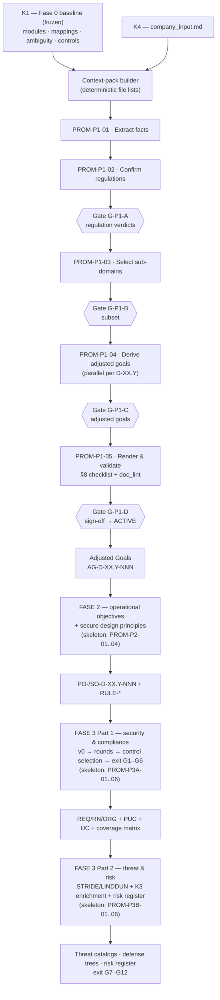

# AI Pipeline Master Design (Phases 0–3)

## 1. Purpose & scope

This document organizes, end to end, the pipeline that executes the AEGIS methodology on a company: which steps run, in which order, with which prompts, consuming which knowledge, guarded by which deterministic checks, and where humans decide.

Three boundaries are normative here:

1. **Two layers, strict separation.** The *methodology layer* (`SPEC.md`, `AGENTS.md`, `templates/`, `baseline/`, case deliverables) stays exactly as it is — frozen corpus, technology-neutral deliverables (R5, R13). The *pipeline layer* (this folder) is engineering scaffolding that specifies how an LLM agent executes the methodology. Pipeline documents may name tooling; methodology deliverables still may not.
2. **The pipeline ends at Phase 3.** Phase 3 Part 2 (Threat & Risk) is the last stage; there is no Phase 4 (researcher ruling, 2026-09-30).
3. **ADR-004 I/O contract is binding.** Each phase consumes only the previous phase's unit of exchange plus the corpus by reference. Company context enters once (Phase 1). Regulations and control anchors ride the chain as citations, never as work units. No step may smuggle Phase-N context into Phase-N+1 beyond the declared unit.

## 2. Reference pipeline from the literature

The consensus stage model of a production LLM pipeline (sources and evidence in [04_LITERATURE_REVIEW.md](04_LITERATURE_REVIEW.md)):

| # | Stage | What happens | AEGIS realization |
|---|---|---|---|
| 1 | **Ingest & curate** | Parse, normalize, freeze the source corpus | Already done and frozen: Fase 0 baseline — modular `baseline/domains/`, mappings, ambiguity registry, controls (M0–M9 audit chain) |
| 2 | **Represent / index** | Build the retrieval substrate | Machine-readable surfaces today (YAML blocks, `sr_control_mappings/*.json`, `traceability.csv`, `registry.csv`, `CONTROLS/**/*.json`, `aegis:` tags); KG schema designed in [02](02_KNOWLEDGE_ARCHITECTURE.md), materialization as a later increment (ADR-011) |
| 3 | **Retrieve / assemble context** | Route the step, fetch exactly what it needs | **Deterministic context packs** — explicit file lists per prompt (heir of `filtered_corpus/` composition); no free-form vector retrieval in the loop |
| 4 | **Generate** | Staged, schema-constrained generation | Prompt fichas ([03](03_PROMPT_CATALOG.md)): one step = one ficha = one output contract |
| 5 | **Validate / guardrail** | Programmatic gates between steps | Layered guards (§7 of this doc): schema → deterministic scripts → self-checks → judge → human |
| 6 | **Human-in-the-loop** | Expert checkpoints on high-stakes artifacts | Explicit gates G-*: regulation verdicts, sub-domain subset, goals, round verdicts (Accept/Reject/Adjust), exit gates, sign-offs |
| 7 | **Iterate / state** | Trace-logging, error analysis, eval sets | `RUN_NOTES.md` evidence logs per run (golden-example convention); golden run as the initial eval set; ficha versions evolve from findings |

## 3. Workflow patterns: adopted / rejected

Assessment against the canonical patterns (Anthropic *Building Effective Agents*; OpenAI agent guide):

| Pattern | Verdict | Where |
|---|---|---|
| **Prompt chaining** (fixed sequence of LLM calls, programmatic gates between) | **ADOPTED — dominant pattern** | The whole pipeline: P1→P2→P3→P4→P5 within Phase 1; phase-to-phase chaining per ADR-004 |
| **Routing** (classify, dispatch to a specialized path) | **ADOPTED** | Regulation-specific branches (e.g., PF 1.1 anchors only on GDPR rows, AI RMF only on AI_Act rows, R8); case-profile routing for K3 (ATLAS/EMB3D only when AI/embedded is in profile) |
| **Parallelization — sectioning** | **ADOPTED** | Per-sub-domain goal derivation (PROM-P1-04); per-objective RN derivation (Phase 3 Part 1) |
| **Evaluator–optimizer** (generator + critic loop) | **ADOPTED, bounded** | The iterative risk-acceptance rounds (ADR-005): proposals → per-item client verdicts → convergence; LLM-as-judge only as an L3 aid, never as the verdict authority |
| **Orchestrator-workers** (LLM dynamically decomposes) | **REJECTED** | Dynamic decomposition breaks auditability; our decomposition is fixed by the methodology (SPEC §5, ADR-004) |
| **Autonomous agent** (LLM directs its own process/tools across phases) | **REJECTED** | Unpredictable control flow is incompatible with evidence-grade traceability (R12b, exit gates). Workflows, not agents (ADR-010) |

## 4. End-to-end organization

### Per-phase contract

| Phase | LLM steps (prompts) | Deterministic guards | Human gates | Knowledge | Output unit (ADR-004) |
|---|---|---|---|---|---|
| **Fase 0 — Baseline** | none (frozen) | `verify_no_loss.py`, audit chain M0–M9 | already frozen | — | `SO-D-XX.Y.*` Baseline Goals |
| **Fase 1 — Contextual Definition** | PROM-P1-01 … PROM-P1-05 (detailed) | SPEC §8 checklist; `doc_lint.py --strict`; anchor resolution spot-checks | G-P1-A verdicts · G-P1-B subset · G-P1-C goals · G-P1-D sign-off | K1 (+ K4 input) | `AG-D-XX.Y-NNN` Adjusted Goals |
| **Fase 2 — Operationalization** | PROM-P2-01…04 (skeleton) | structure lint; anchor copy-check; cross-reg consistency | objective-by-objective review | K1 + K4 (AG set) | `PO-/SO-D-XX.Y-NNN` (+ `RULE-*` tail) |
| **Fase 3 Part 1 — Security & Compliance** | PROM-P3A-01…06 (skeleton) | `check_traceability.py` T1–T7; `doc_lint.py --strict`; coverage matrix sums | per-item Accept/Reject/Adjust rounds (plain language); exit gate G1–G6 | K1 + K4 (objectives) + K2 when ADR-001 ratified | v0 → v1 → v2 Part 1 deliverables + `Doc03` |
| **Fase 3 Part 2 — Threat & Risk** | PROM-P3B-01…06 (skeleton) | T1–T7; T8 (threat-ID resolution, after K3 ingestion); ledger columns | entry gate (Part 1 G1–G6); risk-acceptance verdicts; exit gates G7–G12 | K1 + K3 (CWE/CAPEC/ATT&CK; ATLAS/EMB3D per case) + system model | `TM-D-XX.Y-NNN` + risk register |

## 5. Knowledge architecture (summary)

Four layers, detailed in [02_KNOWLEDGE_ARCHITECTURE.md](02_KNOWLEDGE_ARCHITECTURE.md):

- **K1 — Regulatory & control knowledge** (Phases 1–3): the frozen modular corpus plus its machine-readable surfaces; KG schema designed, materialization deferred (ADR-011).
- **K2 — Best-practice knowledge** (Phase 2 onward, gated): enters only after ADR-001 ratification; three source tiers, admission gate A1–A4.
- **K3 — Threat knowledge** (Phase 3 Part 2): CWE + CAPEC core, ATT&CK consultive, ATLAS/EMB3D per case; CVE/KEV/EPSS excluded (ADR-012).
- **K4 — Company & case state**: intake, fact sheets, and the case's own versioned artifacts as retrievable state.

## 6. Prompt architecture (summary)

One step = one ficha. Fichas are versioned markdown under [prompts/](prompts/) with a fixed anatomy (mission, input contract, context pack, output schema, self-checks, guard hooks, gate, failure handling). The catalog and the ficha anatomy are in [03_PROMPT_CATALOG.md](03_PROMPT_CATALOG.md). Fichas are the only place where execution instructions live; case deliverables never absorb them (R11).

## 7. Validation & evaluation in layers

| Layer | Mechanism | Catches | Source |
|---|---|---|---|
| **L0 — Schema** | fixed output contract per ficha (tables, columns, enums) | malformed/missing fields | OpenAI Structured Outputs caveat: conformance ≠ correctness — necessary, not sufficient |
| **L1 — Deterministic guards** | `doc_lint.py --strict` (R11/R12), `check_traceability.py` T1–T7, SPEC §8 items, anchor resolution | broken references, non-summing totals, unresolved placeholders/anchors, placeholder integrity | existing repo tooling |
| **L2 — Prompt self-checks** | per-ficha checklists bound to R1–R13 rules | rule violations at generation time | SPEC §7, AGENTS.md §5 |
| **L3 — LLM-as-judge** | critic pass with explicit rubric, order-debiasing | subjective quality (clarity, proportionality wording) — advisory only | judge-reliability literature: validate against human agreement before trusting |
| **L4 — Human gates** | G-* gates, risk-acceptance rounds, exit gates | everything stakes-relevant; testability of requirements (LLM-elicited requirements scored worst on testability — 44.4% in the security-RE study) | ADR-005/006; literature |

**Eval loop:** the golden example (`example/`, VetCare Connect) is the initial test set; every run appends its `RUN_NOTES.md` evidence; recurring failures become ficha amendments (versioned) or new L1 guard items.

## 8. Execution model & state

- **Executor:** any LLM agent (or human) following the runbook and the fichas, in order, one gate at a time. No cross-phase autonomous loops.
- **State on disk:** all intermediates are written files (fact sheets, verdict tables, registers, run notes) — nothing lives only in conversation context; any step can be re-entered from its recorded predecessor.
- **Flag-not-drop:** every negative finding (non-applied regulation, excluded sub-domain, unresolvable anchor, rejected proposal) is recorded with its rationale in the step's designated artifact.
- **Run record:** `RUN_NOTES.md` per run — per-item evidence against the applicable checklist (convention inherited from `example/RUN_NOTES.md`).

## 9. Roadmap

| # | Item | Status | Depends on |
|---|---|---|---|
| 1 | Master design + knowledge architecture + catalog + literature | **done (2026-10-01)** | — |
| 2 | Phase 1 fichas PROM-P1-01…05 | **done (2026-10-01)** | 1 |
| 3 | Phase 2 fichas (PROM-P2-01…04) | next pass | 2 |
| 4 | Phase 3 Part 1 fichas (PROM-P3A-01…06) | pass after | 3 |
| 5 | K3 ingestion into `baseline/THREATS/` (CWE, CAPEC, ATT&CK; ATLAS/EMB3D manifests) | increment | ADR-012; independent of 3–4 |
| 6 | KG materialization script (node-link JSON + GraphML, regenerable) | increment | ADR-011; independent |
| 7 | T8 guard (threat-ID resolution) in `check_traceability.py` | with 5 | 5 |
| 8 | Orchestration runtime (optional) | deferred | ADR-010 D4 |
