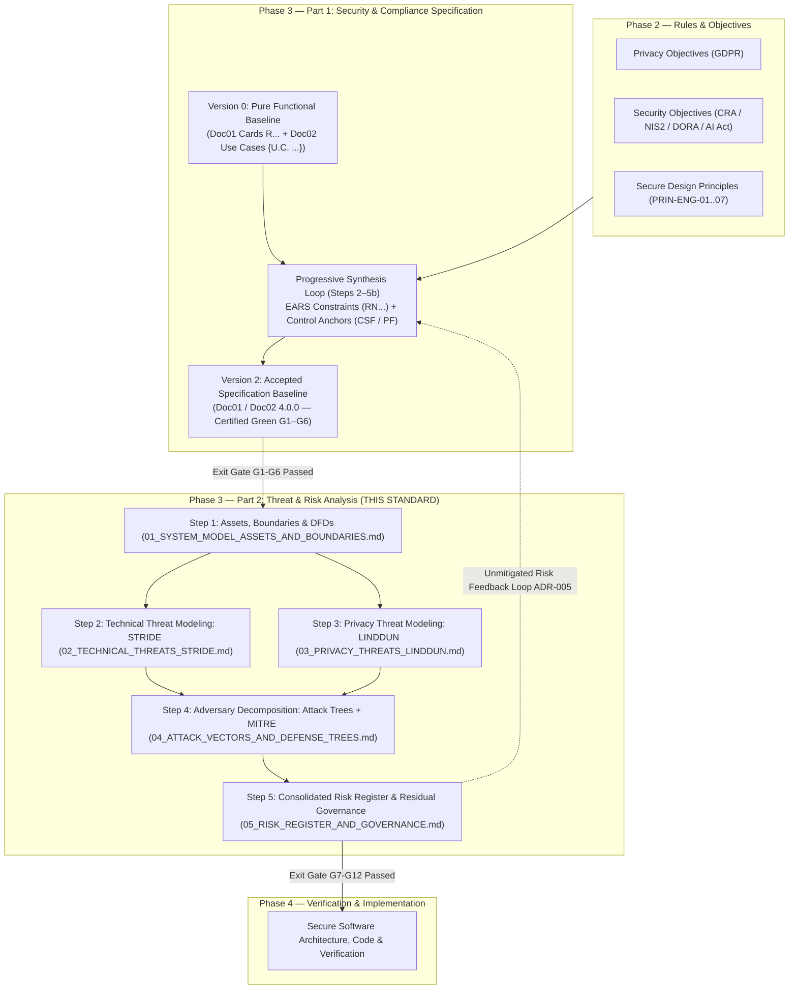
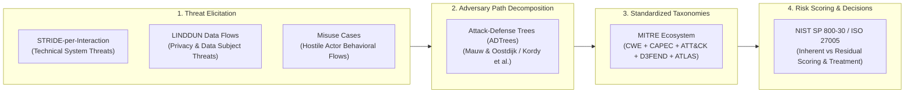
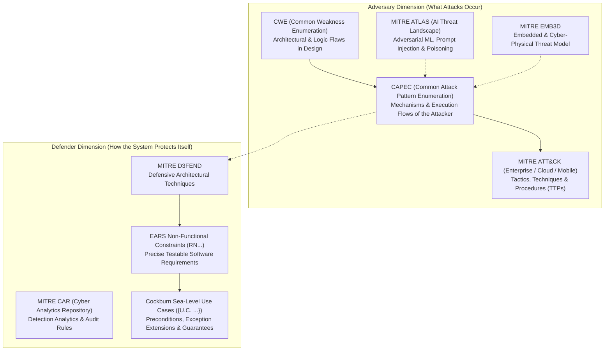
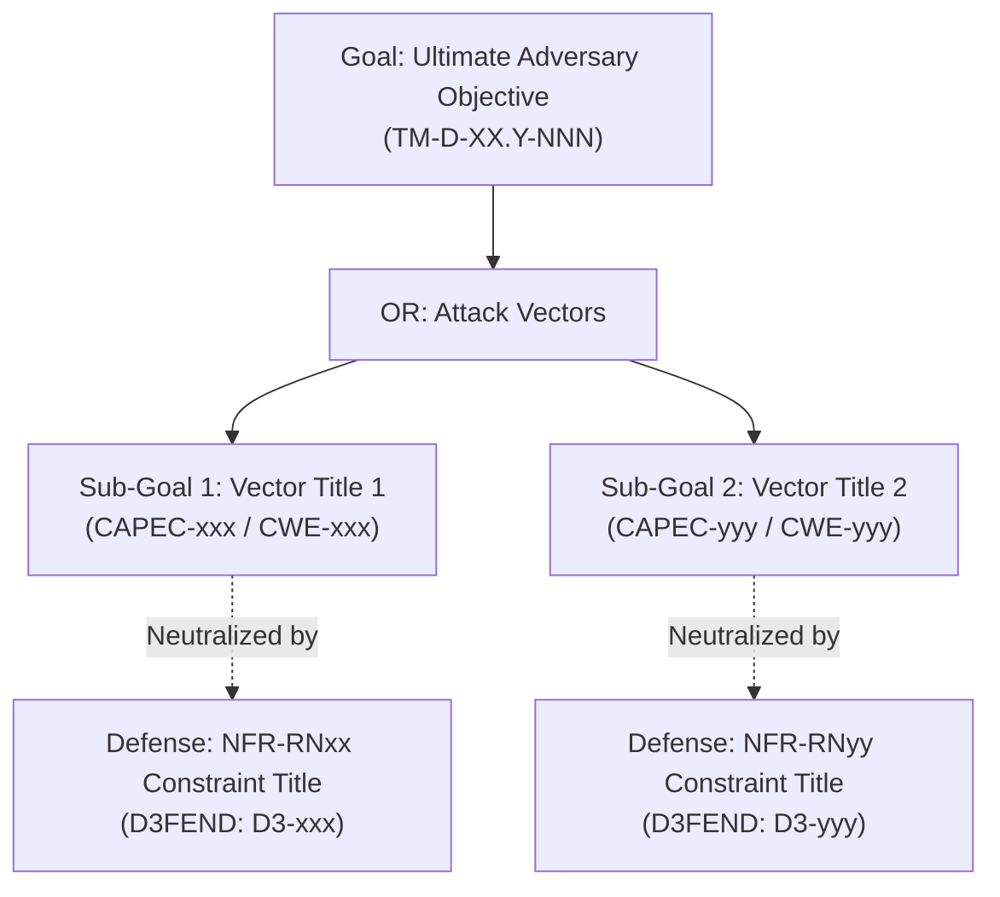
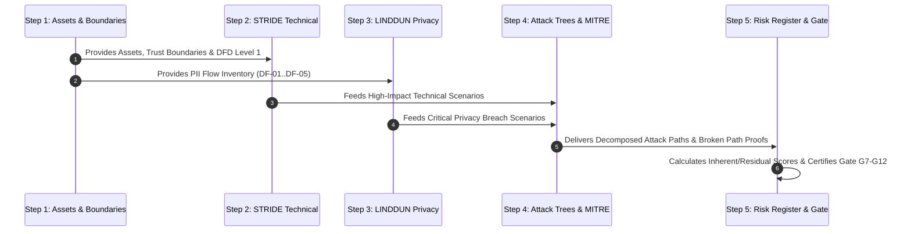

# AEGIS Phase 3 — Part 2: Threat Modeling, Attack Analysis & Cybersecurity Risk Assessment Guidelines

> **Scope:** Theoretical foundations, mandatory rules, taxonomy standards, scoring algorithms, and step-by-step operational procedures for executing **AEGIS Phase 3 Part 2 (Threat & Risk Analysis)** across any target system (SaaS, On-Premises, Cyber-Physical / Embedded, or AI-Enabled).
> **Authority:** Derived from `AGENTS.md` (Rules R1–R13), ADR-006 (Two-Part Phase 3 Architecture), ADR-005 (Risk-Acceptance Feedback Loop), foundational cybersecurity standards (NIST SP 800-30 Rev 1, ISO/IEC 27005:2022, The Threat Modeling Manifesto 2020), and the MITRE Cyber Defense Ecosystem (CAPEC, CWE, ATT&CK, D3FEND, ATLAS, EMB3D).
> **Companion Document:** [`phase3_functional_spec_guidelines.md`](phase3_functional_spec_guidelines.md) (Standard for Phase 3 Part 1 Functional Baseline and Synthesis).

---

## 1. Mission, Architectural Positioning & Scope

### 1.1 The Two-Part Architecture of Phase 3 (ADR-006)
Phase 3 (*System Specification*) operates in two strictly partitioned, sequential parts to prevent analytical confusion between regulatory compliance and adversarial validation:



### 1.2 Core Mission of Part 2
Part 1 establishes **what the system must do compliant with regulations**.
Part 2 evaluates **how the system can be attacked, exploited, or abused by hostile adversaries**, testing whether the non-functional constraints (`RN1`..`RNn`) established in Part 1 are sufficient to reduce operational and compliance risk to an acceptable residual level (**Shift-Left Security & Privacy Engineering**).

Part 2 is **strictly case-agnostic**: the analytical engine applies universally whether the system under study is:
- A multi-tenant Cloud/SaaS software platform.
- An enterprise on-premises client-server or distributed system.
- A cyber-physical, IoT, or embedded hardware product under CRA Annex I.
- An AI-assisted or machine learning product under the EU AI Act.

---

## 2. Foundational Threat Modeling Paradigms (Literature State of the Art)

The AEGIS methodology rejects ad-hoc, unstructured "brainstorming." All threat elicitation in Part 2 is governed by four established academic paradigms:



### 2.1 The Four Questions (The Threat Modeling Manifesto, 2020)
Every Part 2 execution must answer four core questions:
1. **What are we working on?** $\rightarrow$ Step 1: Assets, Data Flow Diagrams (DFD Level 1), and Trust Boundaries derived from the Part 1 Use Cases (`Doc02`) and Requirement Cards (`Doc01`).
2. **What can go wrong?** $\rightarrow$ Steps 2, 3, and 4: STRIDE-per-interaction, LINDDUN data flows, and formal Attack Trees.
3. **What are we going to do about it?** $\rightarrow$ Step 4 and 5: Mitigations through EARS constraints (`RN`), Cockburn Use Case exception flows, and MITRE D3FEND architectural techniques.
4. **Did we do a good enough job?** $\rightarrow$ Step 5: Dual qualitative risk scoring (Inherent vs. Residual), risk reduction quantification ($\Delta R$), and Exit Gate validation (G7–G12).

---

### 2.2 STRIDE-per-Interaction (Shostack, 2014)
*Adam Shostack, "Threat Modeling: Designing for Security" (Wiley, 2014); Loren Kohnfelder & Praerit Garg (1999).*

Instead of analyzing static components in isolation, AEGIS applies **STRIDE-per-interaction**: examining interactions that **cross Trust Boundaries** between actors, processes, networks, and data stores:

| STRIDE Category | Security Property Violated | Definition & System Manifestation | Typical Mitigation Archetypes |
|---|---|---|---|
| **Spoofing (S)** | **Authenticity** | An entity illegitimately assumes the identity of a legitimate actor, process, or external system. | Strong mutual authentication, cryptographic signature verification, ephemeral session tokens, anti-replay nonces. |
| **Tampering (T)** | **Integrity** | Unauthorized modification of state, payload, parameters, memory, or storage in transit or at rest. | Message authentication codes (HMAC), digital signatures, input validation, immutable ledger storage, parameterized queries. |
| **Repudiation (R)** | **Non-Repudiation** | An actor executes a critical or destructive action while denying it, due to lack of tamper-proof audit trails. | Cryptographically bound audit trails, append-only logging, non-repudiation tokens, synchronized trusted timestamps. |
| **Information Disclosure (I)** | **Confidentiality** | Exposure of private, proprietary, or classified data to unauthorized observers or untrusted environments. | End-to-end transport encryption (TLS), at-rest envelope encryption, contextual tenancy isolation, data masking. |
| **Denial of Service (D)** | **Availability** | Degradation or exhaustion of compute, memory, bandwidth, or storage resources, denying legitimate service. | Rate limiting, request throttling, quota allocation, asynchronous task queuing, circuit breakers, payload size bounds. |
| **Elevation of Privilege (E)** | **Authorization** | An authenticated actor executes capabilities, endpoints, or data access assigned to a higher privilege level. | Least-privilege role-based / attribute-based access control (RBAC/ABAC), centralized authorization mediation, capability tokens. |

---

### 2.3 LINDDUN: Privacy Threat Modeling (KU Leuven)
*Mina Deng, Kim Wuyts, Riccardo Scandariato, Bart Preneel, Wouter Joosen (2011); Kim Wuyts, Laurens Sion, Wouter Joosen (2020).*

While STRIDE models technical threats against system resources, **LINDDUN models privacy threats against the Data Subject** (natural person) under European data protection law (GDPR Arts. 5, 6, 12–22):

| LINDDUN Category | Privacy Violation Property | Definition & System Manifestation | GDPR Statutory Driver |
|---|---|---|---|
| **Linkability (L)** | **Unlinkability** | An adversary can correlate two or more records, queries, or actions to the same subject across different contexts. | Art. 5(1)(b) (Purpose Limitation), Art. 6(4) (Compatibility). |
| **Identifiability (I)** | **Anonymity / Pseudonymity** | An adversary can deduce the real-world identity of the data subject from observed data, pseudonyms, or metadata. | Art. 4(1) (Personal Data Definition), Art. 25 (Privacy by Design). |
| **Non-Repudiation (N)** | **Plausible Deniability** | The system stores excessive, irreversible technical proof of a user's action where privacy or deniability is justified. | Art. 5(1)(c) (Data Minimization), Art. 9 (Special Categories). |
| **Detectability (D)** | **Undetectability** | An observer can deduce whether a data item, account, or record exists (e.g., user enumeration in login or password reset). | Art. 5(1)(a) (Fairness), Art. 32 (Security of Processing). |
| **Disclosure of Information (D)** | **Confidentiality of PII** | Unauthorized or accidental release of personal data to external parties, third-party sub-processors, or unauthorized users. | Art. 5(1)(f) (Integrity and Confidentiality), Art. 33/34 (Data Breach). |
| **Unawareness (U)** | **Transparency & Intervenability** | The data subject is unaware of collection practices or lacks functional mechanisms to exercise rights (access, erasure, export). | Art. 12 (Transparent Info), Arts. 15–22 (Subject Rights: Access, Rectification, Erasure, Portability, Objection). |
| **Non-Compliance (N)** | **Regulatory Compliance** | System data processing operations violate legal bases, retention limits, international transfer rules, or processor duties. | Art. 5 (Core Principles), Art. 6 (Lawfulness), Art. 28 (Processor Contracts). |

---

### 2.4 Misuse & Abuse Cases (Sindre & Opdahl, 2000; McDermott & Fox, 1999)
Misuse cases provide the direct behavioral bridge between functional Cockburn Use Cases (`Doc02`) and adversarial scenarios:
- **Use Case (`{U.C. X.Y}`):** Specifies the Main Success Scenario executed by a legitimate Primary Actor to achieve a business goal.
- **Misuse Case:** Specifies an inverted scenario executed by a hostile **Misuser** seeking to compromise the system.
- **Relational Semantics:**
  - A Misuse Case **«threatens»** a legitimate Use Case (targeting a specific step, precondition, or data exchange).
  - An EARS Non-Functional Constraint (`RNxx`) and its use-case extension point **«mitigates»** the Misuse Case.
  - An Audit/Logging constraint **«detects»** the Misuse Case.

---

### 2.5 Attack Trees & Attack-Defense Trees (ADTrees)
*Sjouke Mauw & Martijn Oostdijk (2005); Barbara Kordy, Sjouke Mauw, Saša Radomirović, Patrick Schweitzer (2014).*

An **Attack Tree** is a directed rooted tree $T = (V, E)$ modeling how an adversary achieves a primary malicious goal:
- **Root Node ($r \in V$):** The adversary's ultimate goal (e.g., *Exfiltrate Tenant Database*, *Compromise Firmware Integrity*, *Force Industrial Actuator Shutdown*).
- **Internal Nodes ($v \in V$):** Sub-goals decomposed using propositional logic:
  - **Disjunctive (OR) Node:** The sub-goal is achieved if **at least one** child node succeeds.
  - **Conjunctive (AND) Node:** The sub-goal is achieved only if **all** child nodes succeed in combination or sequence.
- **Leaf Nodes ($l \in V$):** Atomic attack actions executed via specific attack patterns (**MITRE CAPEC**).

#### Mathematical Semantics & Attribute Propagation
Let $\mathcal{A}$ be the set of atomic attack actions. Attributes are propagated from leaves to root using an **attribute valuation algebra** $\langle S, \oplus, \otimes \rangle$:

1. **Adversary Financial / Resource Cost ($S = \mathbb{R}^+, \oplus = \min, \otimes = +$):**
   $$\text{Cost}(v) = \begin{cases} 
   \min_{c \in \text{children}(v)} \text{Cost}(c) & \text{if } v \text{ is an OR-node} \\ 
   \sum_{c \in \text{children}(v)} \text{Cost}(c) & \text{if } v \text{ is an AND-node} 
   \end{cases}$$
2. **Probability of Adversary Success ($S = [0, 1], \oplus = 1 - \prod(1 - p_i), \otimes = \times$):**
   $$\text{Prob}(v) = \begin{cases} 
   1 - \prod_{c \in \text{children}(v)} (1 - \text{Prob}(c)) & \text{if } v \text{ is an OR-node} \\ 
   \prod_{c \in \text{children}(v)} \text{Prob}(c) & \text{if } v \text{ is an AND-node} 
   \end{cases}$$
3. **Skill Level Required ($S = \{1:\text{Low}, 2:\text{Med}, 3:\text{High}\}, \oplus = \min, \otimes = \max$):**
   $$\text{Skill}(v) = \begin{cases} 
   \min_{c \in \text{children}(v)} \text{Skill}(c) & \text{if } v \text{ is an OR-node} \\ 
   \max_{c \in \text{children}(v)} \text{Skill}(c) & \text{if } v \text{ is an AND-node} 
   \end{cases}$$

#### Attack-Defense Trees (ADTrees)
In an **Attack-Defense Tree**, defense nodes $d \in V_{\text{def}}$ are attached to attack nodes $a \in V_{\text{att}}$. 
- A defense node represents a specification constraint (`NFR-RNxx`) realizing a **MITRE D3FEND** countermeasure.
- If the defense is verified in the specification, the probability of the attacked sub-branch is forced to $\text{Prob}(a) = 0$ (or cost $\text{Cost}(a) = \infty$), formally proving that the adversary's attack path is broken.

---

## 3. The MITRE Cyber Defense Ecosystem Integration

AEGIS mandates formal, standardized terminology across the threat modeling lifecycle. Part 2 systematically bridges the five primary MITRE frameworks into a unified traceability chain:

$$\text{Threat (STRIDE / LINDDUN)} \longrightarrow \mathbf{CWE} \text{ (Weakness)} \longrightarrow \mathbf{CAPEC} \text{ (Attack Pattern)} \longrightarrow \mathbf{ATT\&CK} \text{ (TTP)} \longrightarrow \mathbf{D3FEND} \text{ (Countermeasure)} \longrightarrow \mathbf{RN} \text{ (EARS)}$$



---

### 3.1 Detailed Specification of MITRE Frameworks

#### 1. CAPEC (Common Attack Pattern Enumeration and Classification)
- **Role:** Populates the atomic leaves of Attack Trees. Provides descriptions of the attacker's perspective, preconditions, attack execution flow (Explore $\rightarrow$ Experiment $\rightarrow$ Exploit), and required skills.
- **Structure:** Hierarchical classification into *Domains of Attack* (Software, Hardware, Communications, Social, Physical) and *Mechanisms of Attack* (Subvert Access Control, Inject Unexpected Items, Manipulate Resources, Deceive, Employ Probabilistic Techniques).
- **Core SaaS & Web CAPECs:** `CAPEC-122` (IDOR), `CAPEC-180` (Exploiting Access Control Levels), `CAPEC-115` (Auth Bypass), `CAPEC-63` (Script Injection), `CAPEC-130` (Resource Depletion), `CAPEC-221` (Storage Exhaustion).
- **Core Cyber-Physical / Embedded CAPECs:** `CAPEC-459` (Command Injection via Physical Interface), `CAPEC-68` (Firmware Modification), `CAPEC-196` (Session Replay on Industrial Bus).

#### 2. CWE (Common Weakness Enumeration)
- **Role:** Identifies the architectural, design, or specification flaw that would exist in the system if the security constraints (`RN`) were missing.
- **Taxonomic Views:**
  - *CWE-1000 (Research Concepts):* Architectural abstraction hierarchy (Class $\rightarrow$ Base $\rightarrow$ Variant).
  - *CWE-699 (Software Development):* Functional categorizations (Data Neutralization, Authentication, Authorization, State Management).
  - *CWE Top 25 Most Dangerous Software Weaknesses:* Priority benchmarks (e.g., `CWE-79` XSS, `CWE-89` SQLi, `CWE-287` Improper Authentication, `CWE-862` Missing Authorization).
- **Key Design Weaknesses for Specifications:**
  - `CWE-639: Authorization Bypass Through User-Controlled Key`
  - `CWE-284: Improper Access Control`
  - `CWE-862: Missing Authorization`
  - `CWE-306: Missing Authentication for Critical Function`
  - `CWE-311: Missing Encryption of Sensitive Data`
  - `CWE-400: Uncontrolled Resource Consumption`
  - `CWE-799: Improper Control of Interaction Frequency`

#### 3. MITRE ATT&CK (Adversarial Tactics, Techniques, and Common Knowledge)
- **Role:** Provides behavioral context on adversary tactics, techniques, and procedures (TTPs) across the operational lifecycle.
- **Matrices Applied:**
  - *ATT&CK Enterprise:* Standard host, network, and identity techniques.
  - *ATT&CK Cloud:* SaaS, IaaS, and Identity Provider (IdP) tactics (e.g., `T1078.004` Valid Cloud Accounts, `T1567` Exfiltration Over Web Service, `T1530` Data from Cloud Storage Object).
  - *ATT&CK for ICS / Embedded:* Cyber-physical tactics (e.g., `T0813` Denial of Control, `T0855` Unauthorized Command Message).

#### 4. MITRE D3FEND (Detection, Denial, and Disruption Framework)
- **Role:** A formal ontology and knowledge graph of cybersecurity defensive techniques. Defines the engineering counterpart to ATT&CK and CAPEC.
- **Core Defensive Tactics:**
  - *Model:* System Mapping, Threat Modeling, Asset Identification.
  - *Harden:* Credential Hardening, Software Isolation, Execution Prevention.
  - *Detect:* Process Analysis, File Analysis, Network Traffic Analysis, User Behavior Analysis.
  - *Isolate:* User Account Isolation (`D3-UAI`), Execution Isolation, Network Isolation.
  - *Deceive:* Decoy Environment, Honeypot Token.
  - *Evict:* Process Termination, Session Termination, Credential Invalidation.
- **Direct Mapping to EARS Constraint Archetypes:** the constraint identifiers (`RNxx`) are case-specific — always cite the identifiers of the case's own accepted baseline, never the exemplars below:
  - `D3-UAI: User Account Isolation` $\longleftrightarrow$ Tenancy- and user-boundary mediation constraints.
  - `D3-MAM: Message Access Mediation` $\longleftrightarrow$ Role- and payload-authorization mediation constraints.
  - `D3-IRA: Inbound Request Authentication` $\longleftrightarrow$ Token/credential verification constraints.
  - `D3-EAA: Ephemeral Access Authorization` $\longleftrightarrow$ Session expiration and revocation constraints.
  - `D3-AL: Audit Logging` $\longleftrightarrow$ Immutable audit trail constraints.

#### 5. MITRE ATLAS (Adversarial Threat Landscape for Artificial-Intelligence Systems)
- **Role:** Dedicated threat matrix modeling vulnerabilities unique to machine learning, Large Language Models (LLMs), and autonomous AI systems.
- **Core Tactic Matrix:** Reconnaissance (`AML.TA0000`), Resource Development, Initial Access, ML Model Access, Execution, Persistence, Defense Evasion, Credential Access, Discovery, Collection, ML Attack Staging, Exfiltration, Impact.
- **Key AI Attack Techniques:**
  - `AML.T0054: LLM Prompt Injection (Direct & Indirect)`
  - `AML.T0051: LLM Jailbreaking`
  - `AML.T0024: Training Data Poisoning`
  - `AML.T0043: Inversion / Training Data Extraction`
  - `AML.T0044: Adversarial Perturbation / Evasion`
- **Application & Activation Rules:**
  - **Deterministic Systems (No AI/ML):** ATLAS must be explicitly evaluated and recorded as **INACTIVE / NON-APPLICABLE (N/A)** with formal justification in `04_ATTACK_VECTORS_AND_DEFENSE_TREES.md` (e.g., *"System logic consists exclusively of deterministic business rules; zero generative or predictive models are integrated"*).
  - **AI-Enabled Systems (AI Act In-Scope):** When the system incorporates LLMs, NLP, predictive algorithms, or autonomous agents, ATLAS tactics are **MANDATORY** in `04_ATTACK_VECTORS_AND_DEFENSE_TREES.md` and `02_TECHNICAL_THREATS_STRIDE.md`.

#### 6. MITRE EMB3D (Embedded & Cyber-Physical Systems Threat Model)
- **Role:** Standardized threat model cataloging threats to embedded devices, firmware, sensors, and cyber-physical interfaces.
- **Application Rule:** Activated whenever the target system includes hardware products, edge IoT nodes, firmware updates, or physical interfaces under Cyber Resilience Act (CRA) Annex I hardware requirements. Like ATLAS, the status must be explicitly declared in `04_ATTACK_VECTORS_AND_DEFENSE_TREES.md` §6 — **ACTIVE** with a hardware threat lane, or **INACTIVE / NON-APPLICABLE (N/A)** with a formal technical justification.

---

## 4. Quantitative & Qualitative Risk Scoring Engine

Risk scoring in Phase 3 must evaluate **specification-level architectural risk** rather than code-level runtime vulnerabilities. AEGIS integrates the **NIST SP 800-30 Rev 1** and **ISO/IEC 27005:2022** assessment workflow with the structured scoring factors of the **OWASP Risk Rating Methodology**.

### 4.1 The Dual-Score Risk Lifecycle
For every identified threat entry (`TM-D-XX.Y-NNN`), risk is computed at two distinct lifecycle milestones:

1. **Inherent Risk ($R_{\text{inh}}$):** The risk level of the threat against the pure functional model (`v0_functional_baseline`), assuming **zero security or privacy constraints**.
2. **Residual Risk ($R_{\text{res}}$):** The risk level remaining after verifying that the non-functional constraints (`RN1`..`RNn`) established in Part 1 are applied as active mitigations.
3. **Risk Reduction Quotient ($\Delta R$):**
   $$\Delta R = \text{Score}(R_{\text{inh}}) - \text{Score}(R_{\text{res}})$$
   $\Delta R$ measures the empirical security and privacy value provided by the specification constraints.

---

### 4.2 Likelihood Scoring Engine (Verosimilhança: 1.0 to 3.0)

Likelihood evaluates the probability that an adversary will successfully discover, access, and exploit the threat scenario:

$$\text{Likelihood Score} = \left\lceil \frac{\text{TAF} + \text{VEF}}{2} \right\rceil \in \{1: \text{Low}, 2: \text{Medium}, 3: \text{High}\}$$

#### A. Threat Agent Factors (TAF):
$$\text{TAF} = \frac{\text{Skill} + \text{Motive} + \text{Opportunity} + \text{Size}}{4}$$

| Factor | Low (1) | Medium (2) | High (3) |
|---|---|---|---|
| **Skill Level** | Advanced / Nation-state / Custom exploit capability required. | Proficient web/system penetration tester; automated exploit tools. | Minimal skill; regular user, browser dev tools, script kiddie. |
| **Motive** | Negligible reward; immense risk of legal prosecution. | Commercial competitor advantage, disgruntled customer/tenant. | Immediate financial gain, direct data exfiltration, extortion. |
| **Opportunity** | Requires rare physical/internal access; highly restricted path. | Standard authenticated user account required. | Completely public Internet interface; anonymous access. |
| **Size / Exposure** | Isolated individual target; negligible attack surface. | Targeted customer segment or specific tenant organization. | System-wide; affects 100% of tenants, users, or endpoints. |

#### B. Vulnerability & Exploitability Factors (VEF):
$$\text{VEF} = \frac{\text{Discovery} + \text{Exploit} + \text{Awareness} + \text{Intrusion Detection}}{4}$$

| Factor | Low (1) | Medium (2) | High (3) |
|---|---|---|---|
| **Ease of Discovery** | Obscure logic flaw; requires deep internal state reverse-engineering. | Observable in standard HTTP/JSON traffic or public schema. | Obvious parameter in URL, form, or documented public API. |
| **Ease of Exploit** | Complex timing/race condition or cryptographic compromise. | Modifying standard parameters, crafting standard API requests. | Trivial script, single parameter alteration, automated tool. |
| **Awareness** | Zero public knowledge; strictly novel attack vector. | Known vulnerability pattern documented in CWE/CAPEC. | Common widely exploited pattern (e.g. OWASP Top 10 A01). |
| **Intrusion Detection** | Real-time immediate automated alerting and blocking. | Logged in standard application logs; reviewed asynchronously. | Zero logging or detection capability present in baseline. |

---

### 4.3 Impact Scoring Engine (Impacto: 1.0 to 4.0)

Impact evaluates the total damage resulting from successful exploitation. It is governed by the **worst-case (maximum) rule** across four objective impact dimensions:

$$\text{Impact Score} = \max(\text{Impact}_{\text{Technical}}, \text{Impact}_{\text{GDPR}}, \text{Impact}_{\text{CRA / Regulatory}}, \text{Impact}_{\text{Business}}) \in \{1: \text{Low}, 2: \text{Med}, 3: \text{High}, 4: \text{Crit}\}$$

| Impact Dimension | Low (1) | Medium (2) | High (3) | Critical (4) |
|---|---|---|---|---|
| **Technical Impact (CIA-A)** | Minor cosmetic or metadata leak; zero loss of CIA on core data. | Localized temporary degradation; single record corrupted. | Project-wide integrity loss; unprivileged $\rightarrow$ privileged-role escalation. | Complete multi-tenant breach; full database drop; root account takeover. |
| **GDPR Statutory Impact** | Minor transparency/documentation gap. | Isolated delay in handling Subject Rights request (Art. 15–22). | Reportable personal data breach affecting a subset of users (Art. 33). | Systemic exfiltration of special category PII; GDPR Art. 83 Tier 2 fine (up to 4% global turnover). |
| **CRA / NIS2 / Regulatory Impact** | Minor gap in advisory user guidance documentation. | Non-critical default configuration ambiguity. | Exploitable unpatched vulnerability violating CRA Annex I §1. | Systemic failure to provide secure lifecycle management; EU market withdrawal / ban. |
| **Business / Financial Impact** | Negligible financial consequence; zero customer churn. | Minor customer dissatisfaction resolved via standard support. | Client contract breach; public disclosure advisory; moderate churn. | Catastrophic loss of market trust; investor default; corporate insolvency. |

---

### 4.4 The 3×4 Qualitative Risk Matrix & Threshold Rules

$$\begin{array}{|c|c|c|c|c|}
\hline
\textbf{Likelihood} \setminus \textbf{Impact} & \textbf{Low (1)} & \textbf{Medium (2)} & \textbf{High (3)} & \textbf{Critical (4)} \\
\hline
\textbf{High (3)} & \text{Medium} & \text{High} & \text{Critical} & \textbf{Critical} \\
\hline
\textbf{Medium (2)} & \text{Low} & \text{Medium} & \text{High} & \text{Critical} \\
\hline
\textbf{Low (1)} & \text{Low} & \text{Low} & \text{Medium} & \text{High} \\
\hline
\end{array}$$

#### Non-Negotiable Risk Threshold Rules:
1. **The Zero-Critical-Residual Rule:** No specification may pass the Exit Gate if any threat exhibits a **Critical** residual risk. Critical inherent risks must be mitigated to High, Medium, or Low.
2. **The High-Residual Explicit Acceptance Rule:** Any threat remaining at **High** residual risk requires an explicit, formal **Risk Acceptance Record** signed off by the researcher or designated client owner, containing technical justification for why further mitigation is economically or operationally disproportionate.
3. **Statutory Non-Compliance Cannot Be Accepted:** Risks deriving directly from mandatory statutory obligations (e.g., GDPR Art. 5, CRA Annex I mandatory requirements) **cannot be treated with "Accept"**; they must be mitigated or transferred.

---

### 4.5 Formal Risk Treatment Decisions (ISO/IEC 27005:2022)

Every threat entry in the register must culminate in exactly one of four formal treatment verdicts:

1. **Mitigate (Mitigado):** One or more EARS non-functional constraints (`RNxx`) and use case extension points are verified to break the attack path or reduce likelihood/impact to an acceptable level.
2. **Accept (Risco Aceite):** The residual risk is formally accepted by the organization. The acceptance is **explicitly recorded in `05_RISK_REGISTER_AND_GOVERNANCE.md` with operational justification** (zero silent dropping).
3. **Transfer (Transferido):** The risk is delegated to a vetted, certified external third party (e.g., cardholder data handling transferred to a PCI-DSS Level 1 payment gateway; physical infrastructure security transferred to an ISO 27001 cloud provider).
4. **Avoid (Evitado):** The high-risk functional feature is eliminated from the system specification because the business value does not justify the security or compliance liability.

---

## 5. Traceability, Allocation & Codification Architecture

### 5.1 Canonical Identification Scheme (`TM-D-XX.Y-NNN`)
To maintain strict structural alignment with the AEGIS domain taxonomy (`D-01.1` to `D-10.3`), all threat model entries follow the canonical syntax:
$$\mathbf{TM\text{-}D\text{-}XX.Y\text{-}NNN}$$
- `TM`: Threat Model identifier.
- `D-XX.Y`: The canonical sub-domain to which the threat's target asset or regulatory driver belongs (e.g., `D-03.2` for multi-tenant isolation, `D-03.3` for role-based authorization, `D-05.1` for privacy purpose limitation, `D-06.1` for security event logging).
- `NNN`: Three-digit sequential index within that sub-domain (e.g., `001`, `002`).

### 5.2 The 5-Dossier Allocation Strategy
Part 2 organizes documentation across five modular, reviewable dossiers to eliminate redundancy while guaranteeing bidirectional traceability:

```text
cases/<Case_Name>/03_PHASE3_SPEC/part2_threat_risk/
├── README.md                                    # Dossier Map, Scope, Gate Status & Traceability Index
├── 00_METHODOLOGY_AND_EXECUTION_GUIDE.md        # Step 0: Methodological Guide & Scoring Engine
├── 01_SYSTEM_MODEL_ASSETS_AND_BOUNDARIES.md     # Step 1: Assets, Trust Boundaries, DFD Level 1
├── 02_TECHNICAL_THREATS_STRIDE.md               # Step 2: STRIDE Technical Threat Cards across Packages R1..Rn
├── 03_PRIVACY_THREATS_LINDDUN.md                # Step 3: LINDDUN Privacy Threat Cards across PII Lifecycles
├── 04_ATTACK_VECTORS_AND_DEFENSE_TREES.md       # Step 4: ADTrees for Critical Risks + CAPEC/CWE/D3FEND/ATLAS
└── 05_RISK_REGISTER_AND_GOVERNANCE.md           # Step 5: Consolidated 18-Column Enriched Ledger & Exit Gate G7–G12
```

### 5.3 The Proportionality Law (Derivation & Scaling of Expected Counts)

Part 2 is bounded by the functional surface of the accepted Part 1 baseline (§9, trap 2) — threat volume is a **derived** quantity, never a creative one. Every count below is a projection to be confirmed at execution; the actual-vs-projected delta is recorded in the case's `05_` dossier.

| Artefact | Derivation rule (case-agnostic) | Case 01 check |
|---|---|---|
| Packages `P1..Pn` | = requirement-card packages in `Doc01` | 8 packages → `P1`–`P8` |
| Assets `AST-nn` | 1 per package + 1 per data class not owned by a package (e.g., security ledger, privacy ledger) + 1 for key material; final set fixed by the distinct-persistent-data-class test | 10 |
| Trust boundaries `TB-nn` | 1 untrusted→edge + 1 authenticated→privilege mediation + 1 if multi-tenant / multi-jurisdiction / per-line segregation + 1 per external system that sends or receives data | 2 + 1 + 2 = 5 |
| DFD flows `DF-nn` | ≈1 per package; a package that both stores and transmits carries 2 | 10 |
| STRIDE cards | ≈0.9 per use case (1–3 per package), only where a boundary is genuinely crossed — never 6 × N | 20 UCs → 21 cards |
| LINDDUN cards | ≈1 per PII lifecycle flow; all 7 categories covered ≥1 across the flow set | 7 flows → 8 cards |
| ADTrees | top 2–4 root goals by inherent risk (§7 Step 4.1) | 2 |
| Register rows | STRIDE + LINDDUN cards − declared cross-lens merges (§6.5 tier 3) | 29 − 1 = 28 |

The total threat volume scales with the **product of four independent drivers**, not with any single ratio:

| Driver | Case 01 (SaaS, 2 regs) | Case 02 (border control, 4 regs) | Case 03 (banking, 5 regs) |
|---|---|---|---|
| Functional surface (cards / UCs) | 20 | 28 (1.4×) | 43 (2.15×) |
| External systems (boundaries + flows + channel threats) | 2 | 5–6 (2.5×) | 8–9 (3.5×) |
| Regulatory regimes (impact severity ceiling) | 2 | 4 (2×) | 5 (2.5×) |
| New threat lanes (additive: ATLAS AI lane, EMB3D hardware lane) | 0 | +2 lanes | +1 lane |

A naive "multiply by the card ratio" undercounts: each external system adds a trust boundary, 2+ data flows, and a distinct channel-threat class; AI and hardware lanes are additive regardless of card count.

---

## 6. Concrete Schemas, Data Dictionaries & Specification Standards

### 6.1 Step 1: `01_SYSTEM_MODEL_ASSETS_AND_BOUNDARIES.md` Specification

#### A. Asset Inventory Schema
Every critical asset manipulated across the functional requirements must be cataloged:

| Column | Description | Data Type | Validation Standard |
|---|---|---|---|
| **Asset ID** | Canonical identifier (`AST-01`, `AST-02`...) | String | Unique sequential ID |
| **Asset Name** | Clear functional title of the asset | String | E.g., User Authentication Credentials, Proprietary Document Deliverables |
| **Description & Role** | Functional purpose and storage location | String | E.g., Stored in application relational database; cached in session store |
| **Confidentiality (C)** | Sensitivity rating for confidentiality | Enum | Critical / High / Medium / Low |
| **Integrity (I)** | Sensitivity rating for unauthorized alteration | Enum | Critical / High / Medium / Low |
| **Availability (A)** | Operational criticality for uptime | Enum | Critical / High / Medium / Low |
| **Regulatory Category** | Legal classification | Enum | Personal Data (GDPR Art. 4(1)) / Special Category (Art. 9) / Commercial Asset / Cryptographic Key |

#### B. Trust Boundary Schema
A Trust Boundary ($TB_{xx}$) is defined wherever data moves between entities operating at different privilege levels, network zones, or operational jurisdictions:

```markdown
### TB-01: <Boundary Title>
- **Boundary Type:** Network / Privilege / Tenancy / Physical / Process.
- **Entities Traversed:** From <Source Entity (Untrusted/Less Trusted)> to <Destination Entity (Trusted/More Trusted)>.
- **Data Flows Crossing:** List of data flow identifiers (`DF-xx`) crossing this interface.
- **Threat Exposure:** Summary of primary STRIDE/LINDDUN threats exposed at this crossing.
- **Relevant Cockburn Use Cases:** List of `{U.C. X.Y}` executing across this boundary.
```

---

### 6.2 Step 2: `02_TECHNICAL_THREATS_STRIDE.md` Specification

#### A. Standard Threat Card Anatomy (10 Mandatory Elements):
Every technical threat identified must be specified using the exact 10-row structured card format:

```markdown
#### TM-D-XX.Y-NNN: <Imperative Threat Title>

- **Target Interaction & Boundary:** <Interaction description>, crossing <Trust Boundary TB-xx> in `{U.C. X.Y}` / `RX.Y`.
- **STRIDE Category:** Spoofing (S) / Tampering (T) / Repudiation (R) / Information Disclosure (I) / Denial of Service (D) / Elevation of Privilege (E).
- **Adversary Threat Hypothesis:** <Concrete description of the adversary, their motivation, and the technical mechanism executed to violate the interaction>.
- **Root Weakness (CWE):** `CWE-xxx: <Official CWE Name>`.
- **Attack Pattern (CAPEC):** `CAPEC-xxx: <Official CAPEC Name>`.
- **Adversary TTP (ATT&CK):** `Txxxx.xxx: <Official ATT&CK Technique Name>`.
- **Inherent Risk Rating:**
  - *Likelihood:* Low (1) / Medium (2) / High (3) [Justification: TAF / VEF factors].
  - *Impact:* Low (1) / Medium (2) / High (3) / Critical (4) [Justification: Worst-case technical/business/legal vector].
  - *Inherent Risk Level:* **Low / Medium / High / Critical**.
- **Active Mitigating Constraints:** `NFR-RNxx` (<Constraint Title>), enforcing <Behavioral guarantee in Doc01/Doc02>.
- **Defensive Technique (D3FEND):** `D3-xxx: <Official D3FEND Technique Name>`.
- **Residual Risk Rating & Verdict:**
  - *Residual Likelihood:* Low (1) / Medium (2) / High (3).
  - *Residual Impact:* Low (1) / Medium (2) / High (3) / Critical (4).
  - *Residual Risk Level:* **Low / Medium / High**.
  - *Treatment Verdict:* **Mitigated / Accepted / Transferred / Avoided**.
  - *Enforcement Location:* `{U.C. X.Y}` Extension Flow <step> / Guarantee.
```

**AI Threat Lane (ATLAS active — §3.1.5):** AI-specific threat cards use the same 10-field anatomy with the ATLAS technique ID (`AML.Txxxx`) in the TTP field and the ATLAS tactic recorded in the classification; they are grouped in an explicit **AI Threat Lane** section of `02_TECHNICAL_THREATS_STRIDE.md`.

---

### 6.3 Step 3: `03_PRIVACY_THREATS_LINDDUN.md` Specification

#### A. PII Data Flow Lifecycle Inventory:
All data flows carrying personal data must be mapped across their complete lifecycle:
1. **Collection / Ingestion (`DF-COL`):** Data subject input, registration, device telemetry.
2. **Storage / Processing (`DF-PROC`):** Internal database write, aggregation, search indexing.
3. **Transmission / Sharing (`DF-TRN`):** External APIs, third-party sub-processors, email dispatch.
4. **Subject Rights Access & Export (`DF-SRA`):** Portability exports, access reports (GDPR Arts. 15, 20).
5. **Erasure & Lifecycle Disposal (`DF-ERS`):** Retention purge, permanent deletion (GDPR Art. 17).

#### B. Standard Privacy Threat Card Anatomy:
```markdown
#### TM-D-XX.Y-NNN: <Privacy Threat Title>

- **Target Data Flow:** <Data Flow ID & Title>, in `{U.C. X.Y}` / `RX.Y`.
- **LINDDUN Category:** Linkability (L) / Identifiability (I) / Non-Repudiation (N) / Detectability (D) / Disclosure (D) / Unawareness (U) / Non-Compliance (N).
- **Privacy Threat Hypothesis:** <Description of how personal data or data subject rights are infringed>.
- **GDPR Legal Driver:** `GDPR Art. <x>` (<Statutory Article Title>).
- **Inherent Risk Rating:** Likelihood <x> × Impact <y> = **Inherent Level**.
- **Active Mitigating Constraint:** `NFR-RNxx` (<Constraint Title>).
- **Residual Risk Rating & Verdict:** Likelihood <x> × Impact <y> = **Residual Level** $\rightarrow$ **Mitigated / Accepted**.
```

---

### 6.4 Step 4: `04_ATTACK_VECTORS_AND_DEFENSE_TREES.md` Specification

#### A. Attack-Defense Tree Structure & Notation Standard:
Every critical business risk must be modeled as an **Attack-Defense Tree (ADTree)** using standard Mermaid syntax or structured ASCII hierarchy:



#### B. Leaf Node Attribute Dictionary:
Every atomic leaf node in the attack tree must specify:
- **`[ID]:`** `AT-LEAF-xxx`
- **`[Attack Pattern]:`** `CAPEC-xxx`
- **`[Weakness]:`** `CWE-xxx`
- **`[TTP]:`** `ATT&CK Txxxx.xxx`
- **`[Estimated Cost]:`** Low ($<$ €1k) / Med (€1k–€10k) / High ($>$ €10k)
- **`[Skill Required]:`** Low / Med / High
- **`[Detection Probability]:`** Low / Med / High
- **`[Broken Path Proof]:`** Explicit reference to the mitigating EARS constraint (`RNxx`) and D3FEND technique that breaks the attack path.

---

### 6.5 Step 5: `05_RISK_REGISTER_AND_GOVERNANCE.md` Specification

The central ledger is the master governing artifact of Part 2. It integrates four essential tiers of information:
1. **Executive KPI Cockpit & Visual Risk Heatmaps:** Dual Likelihood × Impact matrices with color grading demonstrating the complete migration of risk and the emptying of the Critical quadrant.
2. **Subsystem Risk Posture Table:** Aggregation of exposure across functional components (`P1`..`Pn`), identifying architectural roles, maximum risk levels, active Phase 2 Secure Design Principles (`PRIN-ENG-01`..`07`), and mitigating requirements.
3. **Cross-Lens Merge Record:** Declared consolidation of threat cards carried by both lenses — every merged ID names both source cards (STRIDE + LINDDUN) and the justification, and the ledger reconciles as *STRIDE + LINDDUN cards − declared merges*. **No threat may vanish from the register silently.**
4. **Master 18-Column Enriched Ledger:** Complete ontological traceability bridging weaknesses, attack mechanisms, adversary tactics, defensive techniques, and architectural principles:

| Col # | Field Name | Description & Values |
|---|---|---|
| 1 | **#** | Sequential threat index (1 to N) |
| 2 | **Threat ID** | Canonical syntax: `TM-D-XX.Y-NNN` |
| 3 | **Threat Title** | Imperative, concise threat title |
| 4 | **Cards / UCs** | Requirement card references (`R1.1`...) & Cockburn Use Cases (`{U.C. 1.1}`...) |
| 5 | **Classification** | STRIDE category (S/T/R/I/D/E) or LINDDUN category (L/I/N/D/D/U/N) |
| 6 | **MITRE CWE** | Primary Common Weakness ID (e.g., `CWE-639`) |
| 7 | **MITRE CAPEC** | Primary Attack Pattern ID (e.g., `CAPEC-122`) |
| 8 | **MITRE ATT&CK** | Operational adversary technique ID (e.g., `T1567`, `T1110.003`); ATLAS (`AML.Txxxx`) on the AI lane |
| 9 | **MITRE D3FEND** | Defensive countermeasure technique ID (e.g., `D3-UAI`, `D3-IRA`) |
| 10 | **NIST CSF Anchors** | Control-anchor subcategory IDs (e.g., `PR.AA-05`) published by the row's mitigating constraints in the accepted Part 1 baseline; `—` when none are published |
| 11 | **Secure Design Principle** | Phase 2 architectural principle (`PRIN-ENG-01` to `PRIN-ENG-07`) |
| 12 | **Inherent Likelihood** | 1 (Low), 2 (Medium), 3 (High) |
| 13 | **Inherent Impact** | 1 (Low), 2 (Medium), 3 (High), 4 (Critical) |
| 14 | **Inherent Risk** | Qualitative level: 🟢 Baixo (1–2), 🟡 Médio (3–4), 🟠 Alto (6), 🔴 Crítico (8–12) |
| 15 | **Mitigating Constraints** | EARS constraint references (`RN1`, `RN14`...) |
| 16 | **Residual Likelihood** | Post-mitigation likelihood (1, 2, or 3) |
| 17 | **Residual Impact** | Post-mitigation impact (1, 2, 3, or 4) |
| 18 | **Residual Risk & Verdict** | Final rating + Verdict: **Mitigated / Accepted / Transferred / Avoided** |

---

## 7. Step-by-Step Operational Roadmap for Part 2

The execution of Part 2 progresses through five discrete, verifiable steps:



### Step 1: Assets, Boundaries & Data Flow Modeling (`01_SYSTEM_MODEL_ASSETS_AND_BOUNDARIES.md`)
1. Review `Doc01` and `Doc02` to extract all critical assets manipulated by the system. Classify each asset under CIA-A and statutory categories (PII, commercial state, credentials).
2. Trace all interactions across the 20 Sea-Level Use Cases to identify every point where data or execution moves between different security contexts.
3. Formalize the complete catalog of Trust Boundaries ($TB_{01}$..$TB_{xx}$).
4. Construct a formal DFD Level 1 diagram representing all processes, data stores, external entities, and boundary crossings.

### Step 2: Technical Threat Modeling via STRIDE-per-Interaction (`02_TECHNICAL_THREATS_STRIDE.md`)
1. Partition the analysis across the system's core functional packages (`R1` to `Rn`).
2. For each package, evaluate every boundary-crossing interaction against the 6 STRIDE categories.
3. Hypothesize concrete adversary attack scenarios. Assign canonical IDs (`TM-D-XX.Y-NNN`).
4. Map each threat to its underlying architectural weakness (**CWE**) and attack pattern (**CAPEC**).
5. Compute Inherent Risk. Cross-check against the accepted Part 1 constraints (`RN1`..`RNn`).
6. Identify the mitigating constraint, map the corresponding **MITRE D3FEND** technique, compute Residual Risk, and assign the treatment verdict.

### Step 3: Privacy Threat Modeling via LINDDUN Data Flows (`03_PRIVACY_THREATS_LINDDUN.md`)
1. Map all personal data flows across their full lifecycle (Ingestion, Processing, Transmission, Subject Rights, Disposal).
2. Apply the 7 LINDDUN categories to each PII flow, specifically evaluating:
   - Linkability and Identifiability in activity feeds, logs, and telemetry.
   - Unawareness and Intervenability in GDPR Subject Rights execution (Arts. 15–22).
3. Compute Inherent and Residual Risk. Ensure every statutory privacy requirement is verified as mitigated by an EARS constraint.

### Step 4: Adversary Goal Modeling via Attack Trees & MITRE Integration (`04_ATTACK_VECTORS_AND_DEFENSE_TREES.md`)
1. Select the top 2 to 4 highest-risk business scenarios identified in Steps 2 and 3 (e.g., cross-tenant data breach, account takeover, firmware compromise).
2. Construct formal Attack-Defense Trees decomposing the root goal into disjunctive (OR) and conjunctive (AND) branches.
3. Populate each atomic leaf with CAPEC, CWE, ATT&CK, and D3FEND identifiers.
4. Calculate cost, skill level, and probability propagation across the tree.
5. Formulate the explicit **Broken Path Proof** for each branch, demonstrating which EARS constraint neutralizes the attack.
6. Record the formal status of **MITRE ATLAS** (Active for AI systems; Inactive with formal justification for deterministic systems).

### Step 5: Consolidated Risk Register, Scoring & Residual Governance (`05_RISK_REGISTER_AND_GOVERNANCE.md`)
1. Compile the comprehensive 18-column enriched ledger, reconciled 1:1 against the elicited card count less declared cross-lens merges (§6.5 tier 3).
2. Validate that every threat entry carries complete Inherent and Residual risk scores, and that every elicited card is carried by exactly one register row (cross-lens merges recorded in the merge record).
3. Audit for unmitigated Critical risks (prohibited under Rule 4.4).
4. Verify that any High residual risk carries an explicit Risk Acceptance Record with operational justification.
5. If an unmitigated High or Critical risk is identified that lacks an existing constraint, trigger the **ADR-005 Feedback Loop**: formulate a candidate EARS constraint, submit for client risk verdict in the Part 1 Round Cycle, and evolve `Doc01`/`Doc02` accordingly.
6. Formally audit and certify the **Part 2 Exit Gate (G7–G12)**.

---

## 8. Part 2 Exit Gate & Definition of Done (Gates G7–G12)

Phase 3 Part 2 is formally declared complete and cleared for transition to **Phase 4 (Architecture, Verification & Implementation)** only when all six Exit Gates evaluate to **GREEN**:

| Gate | Gate Title | Objective Verification Standard | Mandatory Evidence Location |
|---|---|---|---|
| **G7** | **Trust Boundary Coverage** | 100% of boundary-crossing interactions in `Doc02` ({U.C. 1.1}..{U.C. n.m}) are evaluated under STRIDE. | Matrix in `02_TECHNICAL_THREATS_STRIDE.md` §10 |
| **G8** | **GDPR PII Flow Coverage** | 100% of personal data flows are evaluated under LINDDUN across the full data lifecycle. | Inventory in `03_PRIVACY_THREATS_LINDDUN.md` §4 |
| **G9** | **MITRE Harmonization** | 100% of attack tree leaves carry verified CAPEC, CWE, ATT&CK, and D3FEND cross-references; the formal status of ATLAS, EMB3D, and CAR is recorded with activation-boundary criteria. | Annotated trees in `04_ATTACK_VECTORS_AND_DEFENSE_TREES.md` §5–§6 |
| **G10** | **Risk Register Completeness** | 100% of identified `TM-D-XX.Y-NNN` entries carry Inherent Risk, Residual Risk, and formal Treatment Verdicts. | Consolidated table in `05_RISK_REGISTER_AND_GOVERNANCE.md` |
| **G11** | **Residual Risk Policy Compliance** | Zero threat entries remain at "Critical" residual risk; any "High" residual carries explicit client risk acceptance. | Audit query on `05_RISK_REGISTER_AND_GOVERNANCE.md` |
| **G12** | **Mechanical & Document Hygiene** | `scripts/check_traceability.py` (T1–T7, including Part 2 threat-ledger reconciliation) and `scripts/doc_lint.py --strict` return 0 findings across all Part 2 dossiers. | Automated CLI execution logs |

---

## 9. Anti-Patterns & Common Traps in Threat Modeling

1. **The Code-Level Scanner Trap:** Writing threats about specific buffer overflows, SQL syntax errors, or Linux kernel exploits in Phase 3. Phase 3 evaluates *specification and architectural logic*, not source code implementation bugs (which belong to Phase 4).
2. **The Infinite Threat Trap (Analysis Paralysis):** Attempting to list thousands of theoretical attack variations. Threat modeling must be bounded by the functional surface of the Use Cases and Requirement Cards.
3. **The Unanchored Attack Tree Trap:** Drawing attack trees that end in vague colloquial labels (e.g., "Hack the database") without anchoring leaf nodes in formal MITRE CAPEC attack patterns and CWE root weaknesses.
4. **The Silent Risk Acceptance Trap:** Dropping or ignoring a threat because "we don't have time to fix it." Every identified threat must carry a formal verdict; unmitigated risks must be explicitly recorded as accepted with client sign-off.
5. **The Disconnected Defense Trap:** Specifying security constraints that do not map to standard architectural techniques (D3FEND) or that fail to trace back to use case preconditions, exception flows, or postconditions.
